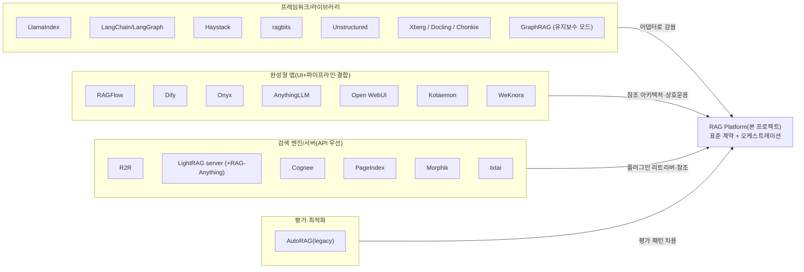
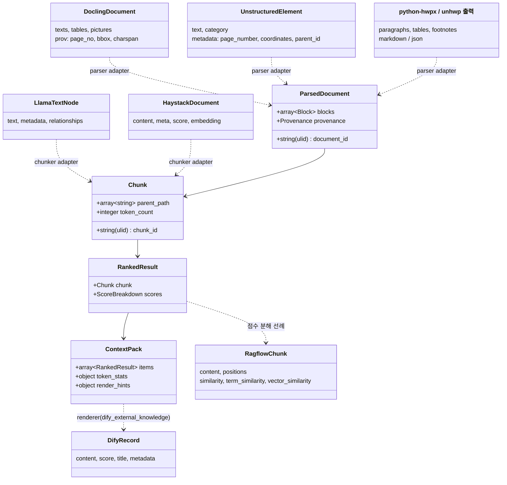

# 기존 오픈소스 RAG 플랫폼 비교·갭 분석

## 목적

이 문서는 2026-09 기준으로 활동 중인(또는 최근까지 활동했던) 오픈소스 RAG 플랫폼·프레임워크를 **동일한 기준**으로 비교하고, 설계 브리프의 요구사항 R1~R6 대비 각 플랫폼의 충족도를 갭 매트릭스로 정리한다. 목표는 세 가지다.

1. **채택할 패턴**을 식별한다. 이미 검증된 계약·구조·운영 관행은 그대로 배운다(원칙 2 "Adapters over Forks").
2. **우리의 차별점**을 근거와 함께 확정한다: 표준 계약(D-05), HWPX/HWP 1급 지원(R1), 설명 가능한 점수 분해(원칙 8), Context Pack(R6), 평가 하네스 내장(D-12).
3. **상호운용 지점**을 찾는다. 우리 플랫폼이 기존 생태계(Dify, Open WebUI, MCP 클라이언트 등)의 검색 백엔드로 즉시 끼워질 수 있는 지점을 설계 함의로 남긴다.

모든 버전·라이선스·커뮤니티 수치는 2026-09-18에 PyPI JSON/릴리스 이력, GitHub 저장소 페이지, 원문 LICENSE/README/소스 파일을 직접 조회해 확인했다. 확인하지 못한 항목은 "확인 필요(as of 2026-09)"로 표기한다. v0.2.0(2026-09-22)은 검증 리뷰에서 지적된 사실 오류 — MinerU 라이선스(AGPL이 아닌 Apache-2.0 + 추가 조건), AutoRAG legacy·python-hwpx·langchain-teddynote 릴리스 날짜, RAGFlow 청크 템플릿 수(14), Unstructured 포맷 수(27), GraphRAG 유지보수 모드 선언, LlamaIndex OSS 우선순위 하향, `EnsembleRetriever`의 `langchain_classic` 이동과 2026-12 EOL, Upstage Document Parse의 HWP/HWPX 지원, Open WebUI 로더 클래스명, LightRAG OpenSearch 스토리지 — 와 "확인 필요"로 남겨 두었던 항목의 확정(hwp.js·ko-pii 라이선스, Quivr 마지막 커밋, Haystack/LlamaIndex 융합 모드, `HWPReader` 내부 구현), 그리고 누락 후보(Xberg, hwpkit, WeKnora, Cognee, PageIndex, RAG-Anything, Elysia, ragbits, Chonkie, MaxKB, FastGPT)를 반영한 개정판이다. 2차 추가 후보의 릴리스 날짜는 2026-09-22 PyPI JSON으로 재확인했다.

## 범위

**포함**: RAGFlow, Dify, Onyx(구 Danswer), R2R, Kotaemon, Cognita, Verba, AnythingLLM, Morphik, LlamaIndex, LangChain/LangGraph, Haystack, txtai, Quivr, Open WebUI(RAG 기능), LightRAG·GraphRAG(플랫폼 관점만), AutoRAG(Marker-Inc), 한국 HWP/HWPX 생태계 프로젝트, Unstructured(오픈소스 부분). v0.2.0에서 추가: WeKnora(Tencent), Cognee, PageIndex, RAG-Anything, ragbits, Xberg(구 Kreuzberg), Chonkie, hwpkit, Weaviate Elysia(Verba 후속), MaxKB·FastGPT(라이선스 비교 사례). 비오픈소스(Vectara, Glean, Upstage Document Parse)는 기능 비교 참고로만 다룬다.

**제외**: 개별 파서·청커·임베딩·인덱스 백엔드의 심층 비교(각각 `01`~`07` 문서에서 다룸), 최종 챗봇 UI 품질, 상용 SaaS 가격 비교.

**관점**: 우리는 이 중 하나를 "채택"하려는 것이 아니다. 브리프 §1의 정의대로 **파싱→청킹→임베딩→하이브리드 인덱싱→Context Pack**을 표준 계약으로 제공하는 플랫폼을 새로 만들되, 아래 플랫폼들은 (a) 참조 아키텍처, (b) 어댑터로 감쌀 컴포넌트 공급원, (c) 상호운용 대상, (d) 벤치마크 베이스라인의 네 가지 역할로 본다.

## 평가 기준

가중치는 브리프의 우선순위(한국어·Korean-First, 라이선스 D-02, 검색 품질 제1 지표)를 반영해 정했다. 점수는 1~5(높을수록 우리 목적에 유리). "통합 난이도"와 "운영 비용"은 **높을수록 쉽고/저렴함**으로 정규화했다.

| 기준 | 가중치 | 5점의 의미 | 1점의 의미 |
|------|-------|-----------|-----------|
| 한국어 지원 | 20% | HWP/HWPX 파싱, 한국어 형태소 토크나이저, 한국어 임베딩 기본 제공 | CJK 고려 없음, HWP 미지원 |
| 라이선스 적합성(D-02) | 15% | Apache-2.0/MIT/BSD, 추가 조건 없음 | BSL/AGPL 또는 멀티테넌트 운영 금지 등 조건부 |
| 성숙도/유지보수 | 15% | 2026-09 기준 월 1회 이상 릴리스, 활발한 커밋 | 아카이브 또는 12개월 이상 무릴리스 |
| 품질/성능(검색) | 20% | 3-way 하이브리드 + 리랭킹 + 부모 확장 + 점수 분해 | dense 단독, 점수 불투명 |
| 통합 난이도 | 10% | pip 설치 가능한 라이브러리, 명확한 계약 | 모놀리스 컨테이너, 내부 API만 |
| 커뮤니티/생태계 | 10% | 50k+ stars, 다수 기업 기여 | 5k 미만, 단일 벤더 |
| 운영 비용 | 10% | 단일 프로세스/경량 | 16GB+ RAM, 다중 인프라 필수 |

## 후보 목록

확인일은 모두 2026-09-18. "최신 버전"의 날짜는 PyPI 릴리스 이력(ISO 타임스탬프) 또는 GitHub Releases 기준. 성숙도는 위 기준표의 정의를 따른다.

| 이름 | 최신 버전(날짜) | 라이선스 | 성숙도 | 한국어 지원 | 핵심 강점 | 약점 |
|------|----------------|---------|-------|-----------|----------|------|
| RAGFlow (infiniflow) | v0.27.2 (2026-09-10) | Apache-2.0 | 활발 (90.9k stars) | HWP 없음, 한국어 토크나이저 확인 필요(as of 2026-09) | DeepDoc(OCR·레이아웃·TSR), 14종 청크 템플릿, 점수 분해 API, Knowledge Compilation, MCP 서버 | Python 3.13 고정, 16GB RAM, 모놀리스, ES/MySQL 종속 |
| Dify (langgenius) | v1.17.1 (2026-09-10) | Dify Open Source License(Apache-2.0 + 조건) | 활발 (156.2k) | HWP 없음 | Knowledge Pipeline, parent-child 청킹, External Knowledge API, 12+ 벡터DB | 멀티테넌트 운영 금지 조항, 로고 유지 의무, 검색 품질은 범용 |
| Onyx (구 Danswer) | v4.7.7 (2026-09-16) | MIT + Onyx Enterprise License(`ee/`) | 활발 (32.2k) | HWP 없음 | `DocumentIndex` 능력 기반 계약, Vespa+OpenSearch 이중 백엔드, 비-LLM 문맥 보강, 50+ 커넥터 | 커넥터 중심(pull), EE 기능 분리, 리소스 큼 |
| R2R (SciPhi) | 3.6.6 (2025-08-17), 마지막 커밋 2025-11-07 | MIT | 정체 (8.0k) | 없음 | pgvector 단일 스토어 + RRF + KG + Hatchet 오케스트레이션 | 10개월 무활동, Unstructured 컨테이너 종속 |
| Kotaemon (Cinnamon) | v0.12.0 (2026-05-30) | Apache-2.0 | 저빈도 (25.8k) | HWP 없음 | 경량, GraphRAG/LightRAG/NanoGraphRAG 인덱스 선택, Docling/PaddleOCR 로더, MCP 도구 | 2026년 커밋 4건, 기본 리랭커 Cohere(상용) |
| Cognita (TrueFoundry) | 아카이브 2026-03-13 | Apache-2.0 | 종료 (4.4k) | 없음 | 모듈형 계약(파서·임베더·쿼리컨트롤러), Infinity 서버 | 유지보수 종료 |
| Verba (Weaviate) | 아카이브 2026-06-08 | BSD-3-Clause | 종료 (7.7k) | Upstage Document Parse 로더(상용 API 경유 HWP/HWPX 간접 처리 가능) | 리더/청커/임베더 플러그인 UI | 유지보수 종료. 후속으로 소개된 Elysia(아래) 역시 10개월 무릴리스 |
| AnythingLLM (Mintplex) | v1.16.1 (2026-08-27) | MIT | 활발 (66.2k) | HWP 없음, .doc도 없음 | 데스크톱/도커, 다중 벡터DB, MCP 에이전트 | Node.js, 검색 파이프라인 단순(dense) |
| Morphik | morphik-core(BSL), 클라이언트 1.2.6 (2026-06-19) | BSL 1.1 → Apache-2.0 (2029-06-18) | 보통 (3.7k) | 없음 | ColPali 멀티모달 검색, 규칙 엔진, MCP | **오픈소스 아님**(월 $2,000 매출 초과 시 상용 라이선스) |
| LlamaIndex | 0.14.24 (2026-08-19); 0.14.25 (2026-09-21, 확인일 이후) | MIT | 활발하나 우선순위 하향 (52.2k) — README "our primary focus has shifted towards LlamaParse, along with liteparse and our benchmarking efforts" | `HWPReader` 존재(텍스트만, 레코드 67) | 노드 모델, 분할기·퓨전 리트리버, 300+ 통합 | 프레임워크(플랫폼 아님), 잦은 API 변경, 벤더 초점이 상용 LlamaParse로 이동 |
| LangChain / LangGraph | 1.4.1 (2026-09-16) / 1.2.11 (2026-08-11) | MIT | 활발 (146.6k) | 없음(커뮤니티 `langchain-teddynote` HWPLoader) | 생태계 최대, LangGraph 내구 실행 | 검색 계약이 느슨함(`Document` 2필드); `EnsembleRetriever` 등 구 컴포넌트는 `langchain_classic`(2026-12까지 보안 패치만)으로 이동 |
| Haystack (deepset) | 3.1.1 (2026-09-03) | Apache-2.0 | 활발 (26.5k) | 없음 | 타입드 컴포넌트 계약, 파이프라인 직렬화(allowlist), hayhooks(REST/MCP) | 3.0 대개편으로 통합 패키지 분산 |
| txtai (neuml) | 9.13.0 (2026-08-27) | Apache-2.0 | 활발 (13.0k) | 없음 | 단일 프로세스 임베딩 DB(sparse+dense+graph+SQL), MCP API | 단일 벤더 유지, 엔터프라이즈 기능 부족 |
| Quivr | quivr-core 0.0.26 (2024-12-10), 마지막 커밋 2025-06-19 | Apache-2.0 | 정체 (39.5k) | 없음 | MegaParse 연동 | 사실상 휴면 |
| Open WebUI | 0.11.3 (2026-08-31) | Open WebUI License(BSD-3 + 브랜딩 조항) | 활발 (152.4k) | HWP 없음 | 8종 추출 엔진 스위치, BM25+벡터 앙상블, 외부 리랭커 | 라이선스 조항(50인 초과 시 브랜딩 유지), RAG는 부가 기능 |
| LightRAG (HKUDS) | 1.5.7 (2026-09-02) | MIT | 활발 (39.7k) | 없음 | 서버+WebUI, 4종 스토리지 추상화, workspace 격리, RAGAS 평가 내장, 인용 | 그래프 구축 LLM 비용, 청크 provenance 약함 |
| GraphRAG (Microsoft) | 3.1.2 (2026-08-21); 1.x 백포트 1.2.3 (2026-09-21) | MIT | **유지보수 모드**(신기능 중단 선언, 36.1k) — README "largely in maintenance mode, and won't be accepting new PRs or implementing new features" | 없음 | 커뮤니티 요약 기반 global 검색 | 인덱싱 비용 매우 높음, 플랫폼 아님, 신기능 없음(CVE·의존성 수정만) |
| AutoRAG (Marker-Inc, 한국) | 2.0(TypeScript, MIT) / legacy 0.3.25 (2026-08-24, Apache-2.0; 0.3.26은 2026-09-19, 확인일 이후) | MIT / Apache-2.0 | 피벗, legacy는 유지보수 모드이나 패치 릴리스 지속(0.3.23 07-20 → 0.3.24 07-22 → 0.3.25 08-24 → 0.3.26 09-19) (5.1k) | legacy: `ko_kiwi`/`ko_okt`/`ko_kkma` BM25, Upstage·Clova 파서 | 파이프라인 조합 자동 평가(YAML) | legacy 유지보수 모드, 2.0은 RAG 최적화 도구가 아님 |
| Unstructured (OSS) | 0.27.6 (2026-09-14) | Apache-2.0 | 활발 (15.4k) | HWP 없음 | 27종 포맷 `partition`, Element 좌표 메타 | 고급 전략 일부는 API/플랫폼 전용 |
| Docling (IBM) | 2.128.0 (2026-09-16) | MIT | 활발 | HWP/HWPX 없음(공식 포맷 목록) | DoclingDocument provenance(page/bbox/charspan), HybridChunker | HWPX는 자체 어댑터 필요 |
| WeKnora (Tencent) † | v0.8.0 (2026-04 공개) | MIT | 신규·활발 (28.5k) | HWP 없음(PDF/Word/Txt/MD/HTML/EPUB/이미지/CSV/Excel/PPT/JSON/XMind) | Go 백엔드, RAG+ReAct 에이전트+자동 위키, 청크 편집 버전 관리, 다중 소스 수집 | 완성형 앱(Dify/RAGFlow와 같은 열), 공개 6개월 미만 |
| Cognee † | 1.6.0 (2026-09-18) | Apache-2.0 | 활발 (30.9k) | 없음 | 지식 그래프 기반 메모리/GraphRAG 엔진, Python/TS/REST/MCP, remember·recall·improve·forget 연산 | LLM 비용, 에이전트 메모리 지향(문서 RAG는 부차) — O-03에서 LightRAG 대안으로 비교 |
| PageIndex (VectifyAI) † | SDK 0.2.19 (2026-09-21; 9월에만 7회 릴리스) | MIT | 활발 (35.8k), PyPI Alpha | 없음 | 벡터리스 트리 인덱스 + LLM 추론 검색, 로컬/클라우드 | 청킹·벡터 없음(우리 3-way 하이브리드와 직교), LLM 호출 비용, RAGFlow v0.27 Knowledge Compilation의 "Page Index"와 직결 — 04-pipelines/18 참조 후보 |
| RAG-Anything (HKUDS) † | raganything 1.4.1 (2026-09-02) | MIT | 활발 (23.4k), PyPI Beta | 없음 | LightRAG 위 멀티모달(MinerU/Docling/PaddleOCR 파서, 이미지·표·수식) | LightRAG 종속, MinerU 추가 조건 승계 — LightRAG 플러그인 권고 시 함께 평가 |
| ragbits (deepsense-ai) † | 1.6.2 (2026-03-31; 이후 dev 빌드만) | MIT | 저빈도 (1.7k) | 없음 | 타입드 빌딩블록(Docling/Unstructured 파서 선택, Ray 분산 수집, OTel) | 6개월 정식 릴리스 없음, 소규모 |
| Xberg (구 Kreuzberg) † | xberg 1.2.6 (2026-09-20); 구 `kreuzberg` 4.10.4 (2026-09-21, LTS) | MIT | 활발 (9.3k), 1.x 초기 | **`.hwp/.hwpx` 텍스트 추출 명시**(107 포맷 중) | Rust 코어 + 14개 언어 바인딩(`pip install xberg`), MCP 서버 내장 | 텍스트 추출 수준(표 구조 확인 필요, as of 2026-09), 재구축 직후 — `02`/`03` 문서 참조 |
| Chonkie † | 1.7.0 (2026-07-07) | MIT | 활발 | 다국어(56개 언어 주장) | 경량 청커 모음(recursive/semantic/token/code 등), REST 서버, 브리프 R2 명시 후보 | 청커 전용(플랫폼 아님) — `04` 문서에서 심층 비교 |
| Weaviate Elysia † | elysia-ai 0.2.8 (2025-11-04) | BSD-3-Clause | 정체 (1.9k, 10개월 무릴리스) | 없음 | Verba 후속 에이전틱 RAG(결정 트리 에이전트, Weaviate 기본) | Python <3.13 고정, 벤더 종속 |
| MaxKB (1Panel-dev) † | - | **GPL-3.0** | 활발 (22.9k) | 없음 | 완성형 지식베이스 앱 | D-02상 코드 포함·링크 불가(라이선스 비교 사례) |
| FastGPT (labring) † | - | **FastGPT Open Source License**(Apache-2.0 + 멀티테넌트 SaaS 금지 + 콘솔 로고/저작권 유지) | 활발 (29.7k) | 없음 | 완성형 지식베이스 앱 | Dify와 동일 유형의 조건부 라이선스 |

† v0.2.0(2026-09-22)에 추가된 후보. 릴리스 날짜는 2026-09-22 PyPI JSON 기준, stars는 검증자 제공 수치.

### 한국 HWP/HWPX 생태계(플랫폼이 아닌 파서·도구, R1 관점)

| 프로젝트 | 언어 | 라이선스 | 규모(확인일) | 지원 포맷 | 비고 |
|----------|------|---------|-------------|----------|------|
| python-hwpx (airmang) | Python | Apache-2.0 | 6.4.0 (2026-09-09); 6.5.0 (2026-09-21, 확인일 이후), 109 stars | HWPX(OWPML) 읽기·쓰기·검증 | 텍스트/HTML/Markdown 내보내기, 중첩 표·각주 보존, MCP 서버 제공. 8~9월 릴리스 5회(6.1.0 08-15, 6.2.1 08-19, 6.3.0 08-22, 6.4.0 09-09, 6.5.0 09-21)로 매우 활발하나 PyPI Development Status **3 - Alpha**(API 변경 가능). D-18 기본 채택과 일치 |
| hwpkit (psychofict) | Python | MIT | 1.0.0 (2026-06-09), 1 star | HWP 5.0 + HWPX 텍스트 추출·편집 | 순수 Python(`olefile`, 선택 `lxml`), "Korean RAG & LLM pipelines" 목적 명시, 표는 평탄화. O-07의 **사이드카 없는 인프로세스 HWP5 옵션**이나 규모가 매우 작음 |
| pyhwp (mete0r) | Python | **AGPLv3+** | 0.1b15 (2020-05-30) | HWP 5.0 | 6년 무릴리스. D-02상 별도 컨테이너로만 허용 |
| hwplib (neolord0) | Java | Apache-2.0 | 590 stars | HWP 5.0 읽기·쓰기 | 표·필드·이미지 처리, 암호화 파일 미지원 |
| hwpxlib (neolord0) | Java | Apache-2.0 | 1.0.8 (2025-11-14), 183 stars | HWPX 읽기·쓰기 | Maven 배포 |
| unhwp (iyulab) | Rust | MIT | PyPI 0.12.0 (2026-09-22; 7~9월 7회 릴리스), 12 stars | HWP 5.0+, HWPX, HWP 3.x(옵션) | Markdown/텍스트/JSON 출력, 스트리밍, **PyPI `unhwp` 바인딩**(Beta) |
| kordoc (chrisryugj) | TypeScript | MIT | v4.14.0, 1.8k stars | HWP 3.x/5.x, HWPX, HWPML, PDF, DOCX, XLSX | 자체 CFB 파서(배포용 암호 복호화 포함), Markdown/IRBlock 출력, MCP 17도구 |
| rhwp (edwardkim) | Rust/WASM | MIT | 3.8k stars | HWP 5.0, HWPX, HML | 렌더링·편집기, npm `@rhwp/core`, CLI SVG/PNG/PDF |
| hwp.js (hahnlee) | TypeScript | Apache-2.0 | 1.3k stars | HWP 5.0 뷰어/파서 | 브라우저용 |
| Xberg (구 Kreuzberg) | Rust(+Python 등 바인딩) | MIT | xberg 1.2.6 (2026-09-20), 9.3k stars | `.hwp`, `.hwpx` 텍스트 추출(107 포맷 중 하나) | 범용 파서에 HWP가 포함된 유일한 대형 프로젝트. 표 구조 보존 여부 확인 필요(as of 2026-09) |
| H2Orestart (ebandal) | Java(LibreOffice 확장) | **GPLv3** | 193 stars | HWP 5.0, HWPX → ODT/PDF | headless 변환. 프로세스 경계로만 사용 |
| Apache Tika `HwpV5Parser` | Java | Apache-2.0 | Tika 표준 모듈 | HWP 5.0 텍스트 | MIME `application/x-hwp-v5`, `HwpTextExtractorV5` 위임. RAGFlow/Open WebUI가 Tika를 이미 사용 |
| LlamaIndex `HWPReader` | Python | MIT | llama-index-readers-file 0.7.0 | HWP 5.0 텍스트만 | 리더 목록에 공식 포함. `readers/file/docs/base.py`: `olefile` + `HWP_TEXT_TAGS = [67]`만 읽는 텍스트 전용(docstring은 "extract table"이라 하나 표 처리 코드 없음) — teddynote `HWPLoader`와 동일 접근 |
| langchain-teddynote `HWPLoader` | Python | Apache-2.0 | 0.5.4 (2025-11-06) | HWP 5.0 텍스트 | `olefile` 기반, 레코드 타입 67(텍스트)만 추출, 표 미지원 |
| ko-pii (Marker-Inc-Korea) | Python | MIT | PyPI 1.16.0 (2026-09-09), 91 stars | HWP/HWPX/DOCX/XLSX/CSV/PDF 직접 입력, 한국어 PII 33종 탐지·가역 익명화 | 규칙·체크섬 기반(ML 무의존), 표준 라이브러리만. 원칙 9 PII 훅 후보 |

**관찰**: 조사한 RAG 플랫폼 중 **오픈소스 파서로 HWP/HWPX를 네이티브 지원하는 곳은 0개**다(RAGFlow `rag/app/naive.py`, Dify `extract_processor.py`, Onyx `extract_file_text.py`, AnythingLLM `collector/utils/constants.js`, Open WebUI `retrieval/loaders/main.py`, WeKnora README, Docling·Unstructured 공식 포맷 목록에서 각각 확인). 단, **상용 API 경유 간접 지원**은 존재한다: Upstage Document Parse가 2025-04-15부터 `.hwp/.hwpx` 업로드를 자동 변환하므로, Upstage 로더를 통합한 Verba(`UpstageDocumentParse`)와 AutoRAG legacy(Upstage layout analysis)는 HWP/HWPX를 API 경유로 처리할 수 있었고, Open WebUI·RAGFlow의 Tika 경로는 HWP 5.0 텍스트만 얻는다. 범용 오픈소스 파서 중에는 Xberg(MIT)만 `.hwp/.hwpx` 텍스트 추출을 명시한다. 반면 HWP 전용 파서 생태계는 2025~2026년에 Rust/TypeScript 진영(rhwp, kordoc, unhwp)에서 급성장했고 모두 MIT다. 이는 R1의 "HWPX/HWP 1급 지원(구조 보존·오픈소스·인프로세스 또는 자체 사이드카)"이 실제 차별점이면서도 **자체 구현 없이 어댑터로 달성 가능**함을 뜻한다.

## 심층 비교

각 소절은 동작 방식 → 진입점 → 출력 형식 → 성능 근거 → 함정 순으로 기술한다. 벤치마크 수치는 1차 출처가 확인된 것만 적고, 벤더 자체 주장은 그렇게 표기한다.

### RAGFlow

- **동작 방식**: 모놀리스 Python 서버 + 태스크 실행기. 문서 엔진은 Docker Compose 프로파일로 Elasticsearch(기본)/OpenSearch 2.19.1/Infinity v0.7.3을 선택. 메타는 MySQL 8.0(SereneDB/OceanBase/SeekDB 프로파일), 원본은 MinIO, 캐시는 Valkey 8. `ragflow-go` 프로파일에 NATS 2.14 + Kvrocks가 추가되어 이벤트 버스를 실험 중이다. Jaeger 프로파일(트레이싱), TEI CPU/GPU 프로파일(임베딩 서빙)이 존재한다.
- **파서**: DeepDoc = vision(OCR, 10클래스 레이아웃 인식, TSR 5라벨 + 0/90/180/270도 회전 감지) + parser(PDF/DOCX/Excel/PPT). PDF 파서는 `_dispatch_pdf_parser()`로 DeepDoc(기본)/MinerU/Docling/PaddleOCR-VL/MonkeyOCRv2/Mistral OCR 등을 선택. `.doc`은 Apache Tika. HWP 없음.
- **청킹**: `rag/app/` 하위 14개 템플릿 모듈(`__init__.py` 제외: `naive`, `book`, `laws`, `manual`, `paper`, `presentation`, `picture`, `qa`, `resume`, `table`, `one`, `email`, `tag`, `audio`). 2025-10 "orchestrable ingestion pipeline"으로 노드형 수집 파이프라인 추가. v0.27.0(2026-08-19) "Knowledge Compilation"(Wiki/Graph/Tree/Page Index/Mind Map/Timeline).
- **진입점**: PyPI `ragflow-sdk` 0.27.2(**Python >=3.13,<3.14**), REST `POST /api/v1/retrieval`, MCP 서버(doc_id 파일 미리보기 포함).
- **출력 형식(리트리벌)**: 요청 `question`, `dataset_ids`, `document_ids`, `similarity_threshold`(기본 0.2), `vector_similarity_weight`(기본 0.3), `knn_top_k`(1024), `knn_num_candidates`, `rerank_candidates_count`(64), `rerank_id`, `keyword`, `highlight`, `cross_languages`, `metadata_condition`, `use_kg`, `toc_enhance`, `include_knowledge_compilation`. 응답 청크: `content`, `content_ltks`, `document_id`, `document_keyword`, `highlight`, `id`, `image_id`, `important_keywords`, `tag_kwd`, `dataset_id`, `positions`, `similarity`, `term_similarity`, `vector_similarity`; 상위 `chunks`, `doc_aggs`, `total`.
- **성능 근거**: 공개 리트리벌 벤치마크 수치 없음. 시스템 요구 CPU 4코어·RAM 16GB·디스크 50GB(README).
- **함정**: (1) Python 3.13 고정으로 D-01(3.12+) 환경에서 SDK를 인프로세스 임포트하기 어렵다 → HTTP만 사용. (2) 하이브리드 융합이 `vector_similarity_weight` 가중 합산이며 sparse(learned) 채널이 없다. (3) 한국어 형태소 분석은 자체 토크나이저(`content_ltks`) 기반으로 CJK 중 중국어 중심 설계(확인 필요, as of 2026-09). (4) MinerU 옵션은 **AGPL이 아니다** — LICENSE.md 원문 "MinerU Open Source License — MinerU is licensed under Apache License 2.0 and is subject to the additional terms below": (a) MAU 1억 초과 또는 월 매출 USD 2,000만 초과 시 별도 상용 라이선스, (b) MinerU 기반 **온라인 서비스 제공 시 사용 사실을 제품 UI 또는 공개 문서에 명시**, (c) 위반 시 자동 종료. 따라서 D-02 검토 포인트는 AGPL 격리가 아니라 **귀속 표기 의무 수용 여부**다(Dify/Open WebUI와 같은 "조건부 라이선스" 열). 별도로 MinerU 2.x pipeline 백엔드가 의존하던 DocLayout-YOLO는 AGPL-3.0이므로 4.x 레이아웃 가중치 출처는 `02` 문서의 확인 항목을 따른다.
- **배울 점**: 청크 응답에 `term_similarity`/`vector_similarity`를 분해 노출하는 관행, `positions` 보존, 파서 디스패치 패턴, 템플릿형 청킹.

### Dify

- **동작 방식**: `api`(Flask) + `worker`/`worker_beat`(Celery) + `web`(Next.js) + PostgreSQL/MySQL + Redis + `sandbox` + `plugin_daemon` + `ssrf_proxy` + nginx. 벡터 스토어 기본 Weaviate 1.39.2, 프로파일로 Qdrant/Milvus 2.6.3/pgvector/Elasticsearch 8.14.3/OpenSearch/Chroma/Couchbase/OceanBase/SeekDB 등.
- **수집/파서**: 파일 업로드·Notion·웹 스크래퍼. `ExtractProcessor`가 확장자별로 `PdfExtractor`, `WordExtractor`, `HtmlExtractor`, `ExcelExtractor`, `CSVExtractor`, `TextExtractor`를 쓰고 `ETL_TYPE=Unstructured` 시 `.doc/.ppt/.pptx/.msg/.eml/.xml/.epub`을 Unstructured API로 위임. HWP 없음. v1.17.1(2026-09-10)은 "오류 없이 내용을 바꾸는 추출 버그"(CSV pandas 타입 추론, Notion 표 열 손실 등)를 수정 — 파서 출력의 **묵시적 변형**이 실제 사고임을 보여주는 사례.
- **청킹/인덱싱**: General(단일 계층) vs Parent-child(Paragraph 또는 Full Doc 부모) 모드. 인덱싱 High Quality(임베딩) vs Economical(청크당 키워드 10개, 역색인). Knowledge Pipeline: "Data Sources → Data Extraction → Data Processing → Knowledge Storage" 노드형 시각 파이프라인, 템플릿 제공.
- **검색**: Vector / Full-text / Hybrid. Hybrid는 가중치 설정 또는 리랭크 모델 중 택일. TopK 기본 3, score threshold 기본 0.5.
- **External Knowledge API**: Dify가 외부 검색 백엔드를 호출하는 계약. 요청 `knowledge_id`, `query`, `retrieval_setting{top_k, score_threshold}`, `metadata_condition`; 응답 `records[{content, score, title, metadata}]`(metadata는 `null` 불가, 반드시 객체). Bearer 토큰 인증.
- **성능 근거**: 공개 리트리벌 벤치마크 없음.
- **함정**: 라이선스 원문에 "you may not use the Dify source code to operate a multi-tenant environment"(서면 허가 없이) 및 콘솔 로고/저작권 수정 금지 조항. D-09(멀티테넌시 1급)를 가진 우리가 Dify 코드를 포함·포크하는 것은 불가. 상호운용은 API 경계로만.
- **배울 점**: External Knowledge API라는 **최소 검색 계약**이 생태계 표준처럼 쓰이므로 우리 Context Pack의 렌더러 중 하나로 제공할 가치가 있다. Parent-child UX, 파이프라인 템플릿.

### Onyx (구 Danswer)

- **동작 방식**: Lite(<1GB, 채팅 UI만) / Standard(벡터·키워드 인덱스, 백그라운드 워커, 추론 서버, Redis, MinIO). 50+ 커넥터(pull 모델) + MCP Actions. Docker/K8s/Helm/Terraform.
- **인덱스 계약**: `backend/onyx/document_index/interfaces_new.py`의 `DocumentIndex`는 `SchemaVerifiable`, `Indexable`, `Updatable`, `Deletable`, `HybridCapable`, `IdRetrievalCapable`, `RandomCapable` 믹스인의 합성이며 "A valid document index that can plug into all Onyx flows must implement all of these functionalities". `index()`는 `DocMetadataAwareIndexChunk` 반복자를 받아 `DocumentInsertionRecord`를 반환, `update()`는 `MetadataUpdateRequest`로 ACL·document set·boost·hidden을 **재임베딩 없이** 갱신. 백엔드 디렉터리는 `vespa/`와 `opensearch/` 두 개(2026-09 확인) — Vespa 단일 종속에서 OpenSearch로 확장 중.
- **문맥 보강**: `chunk_content_enrichment.py`의 `generate_enriched_content_for_chunk_text()`/`..._for_chunk_embedding()`이 문서 요약(contextual RAG)·제목 접두(`title_prefix`)·메타데이터 접미를 부착하고, `cleanup_content_for_chunks()`가 이를 정확히 역연산해 원문을 복원. 즉 **임베딩용 텍스트와 사용자 반환 텍스트를 분리**한다.
- **파서**: `extract_file_text.py` — pypdf/pypdfium2, openpyxl, markitdown(차트는 `[chart omitted]`), chardet, 이메일 파서; Unstructured API 키가 있으면 우선 시도 후 로컬 폴백. 파일 커넥터 지원: `.txt .pdf .docx .pptx .xlsx .csv .md .mdx .conf .log .json .tsv .xml .yml .yaml .eml .epub`. HWP 없음.
- **임베딩**: `DOC_EMBEDDING_DIM` 기본 768, 비대칭 접두 `ASYM_QUERY_PREFIX="search_query: "`, `ASYM_PASSAGE_PREFIX="search_document: "`(nomic 계열 규약), 구 기본 `thenlper/gte-small`(384d). 리랭커 상수는 조회한 파일에 없음(확인 필요, as of 2026-09).
- **최근 릴리스**: v4.7.7(2026-09-16), v4.8.0-beta.0에 재색인 상태 머신("old-index reclaim beat task"), 섹션 선택 토큰 예산 2배.
- **성능 근거**: README의 "leaderboard-leading deep research"는 벤더 주장(수치 미확인).
- **함정**: 커넥터 중심 pull 모델이라 R1(URI+메타 push)과 정반대. `ee/` 디렉터리는 별도 라이선스.
- **배울 점**: 능력(capability) 믹스인으로 쪼갠 인덱스 계약, 메타데이터 전용 갱신 경로, 보강/복원 대칭 함수, 재색인 상태 머신. 이는 우리 `IndexBackend`(D-15)와 `IndexCommit`(D-05) 설계의 직접 참조다.

### R2R (SciPhi)

- **동작 방식**: `compose.full.yaml` 기준 서비스 14개 — `pgvector/pgvector:pg16`, MinIO, Hatchet v0.53.15(엔진·대시보드·전용 Postgres·RabbitMQ 3), `unstructured`(자체 이미지 `ragtoriches/unst-prod`), `graph_clustering`, `r2r`(7272), `r2r-dashboard`. Light 모드는 pip만.
- **검색**: 시맨틱+키워드 RRF, 자동 엔티티·관계 추출 KG, 에이전틱 RAG(Deep Research). Python `r2r`/JS `r2r-js` SDK.
- **상태**: PyPI 3.6.6(2025-08-17), 마지막 커밋 2025-11-07(2026년 커밋 없음). 8.0k stars.
- **함정**: 정체. Hatchet 종속(내구 워크플로우를 자체 오케스트레이터에 결합)은 우리 D-17(Temporal)과 개념적으로 같은 선택이지만, Hatchet 자체가 R2R 배포의 무게 대부분을 차지한다.
- **배울 점**: 단일 Postgres(pgvector + 메타 + KG)로 경량 프로파일을 구성한 사례. 정체 상태이므로 코드 재사용은 권하지 않음.

### Kotaemon (Cinnamon)

- **동작 방식**: `kotaemon` 라이브러리 + `ktem` 앱(Gradio). `flowsettings.py` 기본값: DocStore `LanceDBDocumentStore`, VectorStore `ChromaVectorStore`(주석으로 LanceDB/Milvus/Qdrant), 리랭커 기본 Cohere `rerank-v4.0-fast`, 임베딩 기본 OpenAI `text-embedding-3-large`. 인덱스 유형: File Collection, `GraphRAGIndex`, `NanoGraphRAGIndex`, `LightRAGIndex`.
- **파서**: 기본 `.pdf .html .mhtml .xlsx`; `.doc/.docx`는 Unstructured 설치 필요; 멀티모달 로더로 Azure Document Intelligence, Adobe PDF Extract, Docling, PaddleOCR(v0.12.0, 2026-05-30 추가). HWP 없음.
- **검색**: full-text + vector 하이브리드 + 리랭킹, 질의 분해·에이전트 추론, 인브라우저 PDF 뷰어 인용.
- **상태**: 2026년 커밋 4건(2/27, 3/4, 3/28, 5/30). 유지보수 저빈도.
- **함정**: 기본값이 상용 API(OpenAI, Cohere)로 향함. 로컬 기본 조합의 벤치마크 없음.
- **배울 점**: 인덱스 유형을 플러그인처럼 병렬 노출(파일 인덱스 옆에 그래프 인덱스)하는 UX — 우리 O-03의 "프로파일/플러그인" 노선과 일치.

### Cognita (TrueFoundry), Verba (Weaviate) — 종료 사례

| 항목 | Cognita | Verba |
|------|---------|-------|
| 아카이브일 | 2026-03-13 | 2026-06-08 |
| 계약 구조 | `BaseParser` 상속 파서, 임베더(OpenAI 호환·Infinity), Prisma/PostgreSQL 메타 스토어, Qdrant/SingleStore, FastAPI 쿼리 컨트롤러 | Reader/Chunker/Embedder/Retriever/Generator 5단 플러그인, 하이브리드 검색, Upstage Document Parse 로더 |
| 교훈 | 증분 인덱싱(변경 없는 문서 재색인 방지)과 컴포넌트 계약은 좋았으나 단일 벤더 후원 종료로 소멸 | 데모 지향 UI 플랫폼은 벤더의 전략 변경(Weaviate)에 취약. Verba 아카이브 시 후속으로 소개된 **Elysia**(weaviate/elysia, BSD-3-Clause, 1.9k stars, PyPI `elysia-ai` 0.2.8 2025-11-04)도 10개월 무릴리스·Python <3.13 고정 상태 |

두 사례는 **컴포넌트 계약은 살아남고 앱은 죽는다**는 점을 보여준다. 우리의 가치는 계약(D-05)과 스키마 게시에 있어야 한다. Verba의 Upstage Document Parse 로더는 상용 API 경유로 HWP/HWPX를 간접 처리할 수 있던 유일한 완성형 앱 사례였으나, 앱 종료와 함께 사라졌다는 점도 "파서를 어댑터 뒤에 두고 대체 구현을 유지하라"는 원칙 2를 뒷받침한다.

### AnythingLLM

- Node.js 데스크톱/도커 앱. 컬렉터 허용 포맷: `.txt .md .org .adoc .rst .csv .json .html .docx .pptx .xlsx .odt .odp .pdf .mbox .epub` + 오디오/비디오/이미지. `.doc`은 TODO, HWP 없음. 벡터DB 기본 LanceDB(PGVector/Astra/Pinecone/Chroma/Weaviate/Qdrant/Milvus/Zilliz). 다중 사용자 워크스페이스, MCP 호환 에이전트, 35+ LLM 공급자. v1.16.1(2026-08-27).
- **함정**: 검색 파이프라인이 dense 중심이며 점수 분해·리랭킹 옵션이 제한적(확인 필요, as of 2026-09).
- **배울 점**: 소비자 측 UX(워크스페이스 단위 권한). 우리에게는 상호운용 타깃(외부 벡터DB/임베더 설정) 정도.

### Morphik

- ColPali 기반 시각 문서 검색, 메타데이터 추출(바운딩박스·분류), Postgres/pgvector, MCP, Python SDK/REST/콘솔.
- **라이선스**: LICENSE 원문 "Business Source License 1.1", Licensor Morphik, Inc., Licensed Work "Morphik 0.1.0", Change Date **2029-06-18**, Change License Apache-2.0, 프로덕션 사용 제한 "total gross revenue attributable to that use ... less than US $2000 per month". **D-02 부적합**. 코드 재사용 금지, 개념(ColPali 인덱스 단계 배치)만 참고 → O-04.

### LlamaIndex

- 프레임워크. `llama_index.core`의 `Document`/`TextNode`(`text`, `metadata`, `relationships`), `SentenceSplitter`, `VectorStoreIndex`, `QueryFusionRetriever`(`FUSION_MODES` = `reciprocal_rerank` / `relative_score` / `dist_based_score` / `simple`), `NodeWithScore`. `llama-index-readers-file` 0.7.0의 리더 목록에 `HWPReader` 공식 포함 — 내부는 `olefile` + `HWP_TEXT_TAGS = [67]` 텍스트 레코드만 읽는 **텍스트 전용**(docstring "extract table"과 달리 표 처리 코드 없음). 0.14.24(2026-08-19), 0.14.25(2026-09-21), MIT, 52.2k stars.
- **출력 형식**: `NodeWithScore(node, score)` — 단일 스칼라 점수, 분해 없음.
- **함정**: (1) 0.x 버전 정책으로 마이너 릴리스 간 API 변경 잦음. 어댑터 경계에서 버전 핀 필수. (2) **벤더 우선순위 하향**: README가 "our primary focus has shifted towards LlamaParse, along with liteparse and our benchmarking efforts"라고 공식 명시. OSS 프레임워크 릴리스는 월 1회 수준으로 계속되지만(0.14.19 03-25 → 0.14.25 09-21) 신기능 투자는 상용 LlamaParse로 이동했다. 어댑터 1차 공급원으로 쓰되 Haystack/자체 구현 대체를 항상 유지한다(리스크 표 참조).
- **배울 점**: 노드 간 `relationships`(PARENT/CHILD/PREV/NEXT)로 small-to-big을 표현하는 방식 — 우리 `Chunk.parent_path`의 선례.

### LangChain / LangGraph

- LangChain 1.4.1(2026-09-16), LangGraph 1.2.11(2026-08-11), MIT, 146.6k stars. `Document(page_content, metadata)` 2필드 계약. `EnsembleRetriever`(가중 RRF)는 1.x에서 `langchain_classic.retrievers.ensemble.EnsembleRetriever`로 이동했고, 공식 레퍼런스는 `langchain_classic` 패키지가 "maintained for security vulnerabilities until **December 2026**"이며 `langchain` 패키지로 이전을 권한다고 경고한다 — 즉 문서 작성 시점 기준 3개월 뒤 보안 패치까지 종료되는 패키지다. Open WebUI가 이 `EnsembleRetriever`로 하이브리드를 구현하므로 Open WebUI에도 같은 이전 부담이 있다.
- **함정**: 검색 계약이 느슨해 provenance·점수 분해가 `metadata` dict에 비공식으로 들어간다. 우리 표준 모델로 변환할 때 필드 매핑 규약이 필요.
- **배울 점**: LangGraph의 체크포인트 기반 내구 실행은 에이전틱 리트리벌(04-pipelines/18)에서 Temporal과 역할 분담을 검토할 대상.

### Haystack 3

- 3.1.1(2026-09-03), Apache-2.0, 26.5k stars. 3.0에서 `AsyncPipeline`을 `Pipeline`에 통합, 30개 컴포넌트를 `haystack-core-integrations`로 이동(Sentence Transformers, Tika 등), 역직렬화에 신뢰 모듈 allowlist 도입(`eval`/`exec` 차단), 에이전트 훅(`before_run`, `before_llm`, `before_tool`, `after_tool`, `on_exit`, `after_run`). `Document(content, meta, score, embedding)`. hayhooks(152 stars, Apache-2.0)로 파이프라인을 REST·OpenAI 호환 `/chat/completions`·**MCP 도구**로 노출.
- **배울 점**: 컴포넌트 입출력 타입 선언 + 파이프라인 YAML 직렬화 + allowlist 역직렬화는 우리 프로파일(Profile) 직렬화·플러그인 로딩 보안의 직접 참조. `DocumentJoiner`의 융합 모드 `join_mode` = `concatenate` / `merge` / `reciprocal_rank_fusion` / `distribution_based_rank_fusion`은 O-01 실험 도구로 유용.

### txtai

- 9.13.0(2026-08-27), Apache-2.0, 13.0k stars. 단일 프로세스 임베딩 DB(sparse+dense+graph+SQL), 파이프라인·워크플로우 YAML, REST/MCP API, JS/Java/Rust/Go 바인딩.
- **배울 점**: 경량 프로파일(D-15 "Qdrant 단독")의 대안적 참조 — 한 프로세스에서 하이브리드+그래프를 제공하는 최소 구성. 엔터프라이즈 기능(테넌시·ACL)은 없음.

### Quivr

- 39.5k stars이지만 `quivr-core` 0.0.26(2024-12-10) 이후 PyPI 릴리스 없음, 마지막 커밋 2025-06-19T13:02Z. 참고 가치 낮음.

### Open WebUI (RAG 기능)

- 0.11.3(2026-08-31), 152.4k stars. `retrieval/loaders/main.py`의 `CONTENT_EXTRACTION_ENGINE` 분기: `external`, `tika`, `docling`, `document_intelligence`, `datalab_marker`, `mineru`, `mistral_ocr`, `paddleocr_vl`; 기본 로더는 자체 구현 `PDFLoader`(`loaders/pdf.py`, pypdf + 선택적 RapidOCR) / `DocxLoader`(docx2txt 래핑) / `HTMLLoader`(BeautifulSoup) / `TextLoader`(`loaders/local.py`, CJK 인코딩 감지) + `UnstructuredLoader` 폴백(LangChain의 PyPDFLoader 등 클래스명은 쓰지 않음). `retrieval/utils.py`: `query_doc_with_hybrid_search()`가 BM25+벡터를 `EnsembleRetriever`(`langchain_classic`, 2026-12 EOL)로 결합(`hybrid_bm25_weight`; 0 이하 벡터만, 1 이상 BM25만), `CHUNK_HASH_KEY`로 중복 제거("enriched BM25 texts don't defeat RRF"), `RerankCompressor`가 외부 리랭커 또는 sentence-transformers로 리랭크, `query_doc_with_native_hybrid_search()`는 네이티브 하이브리드 지원 벡터DB에 위임.
- **라이선스**: BSD-3 변형 + 4조 브랜딩 조항("strictly prohibited from altering, removing, obscuring, or replacing any 'Open WebUI' branding"), 예외는 30일 롤링 50명 이하·서면 허가·엔터프라이즈 라이선스. 코드 포함 금지, 상호운용만.
- **배울 점**: `external` 추출 엔진과 외부 리랭커 훅은 우리 파서 API·리랭크 API를 Open WebUI에 꽂을 수 있는 지점. Tika 엔진 경로로 HWP 5.0 텍스트가 간접 지원됨을 시사(Tika `HwpV5Parser`).

### LightRAG / GraphRAG (플랫폼 관점)

| 항목 | LightRAG | GraphRAG |
|------|----------|----------|
| 최신 | 1.5.7 (2026-09-02), MIT, 39.7k | 3.1.2 (2026-08-21), MIT, 36.1k; 1.x 백포트 라인 1.2.3 (2026-09-21) 병행 |
| 상태 | 활발(6~9월 6회 릴리스) | **유지보수 모드** — README "This project is largely in maintenance mode, and won't be accepting new PRs or implementing new features. We'll perform bug fixes and dependency updates as appropriate, particularly to address CVEs" |
| 서버 | `lightrag-server` REST + `/webui`(관리) + `/workspace`(질의 전용) | CLI(`graphrag index`, `graphrag query`), 라이브러리 |
| 스토리지 | KV(Json/PostgreSQL/MongoDB/Redis), Vector(NanoVectorDB/Milvus/Qdrant/PostgreSQL/Weaviate/**OpenSearch**/Faiss/MongoDB), Graph(NetworkX/Neo4j/PostgreSQL/Memgraph), DocStatus(Json/PostgreSQL/MongoDB); "PostgreSQL is the recommended backend", OpenSearch·MongoDB는 통합 백엔드로도 제공 | Parquet/테이블 공급자(CosmosTableProvider 3.1) |
| 질의 모드 | local/global/hybrid/naive/mix(기본 mix) | local/global/drift/basic(확인 필요, as of 2026-09) |
| 부가 | 리랭킹 지원, **RAG-Anything**(HKUDS, MIT, 23.4k, PyPI `raganything` 1.4.1 2026-09-02) 멀티모달(MinerU/Docling/PaddleOCR 파서 — MinerU 추가 조건 승계), 인용, RAGAS 평가 + Langfuse, workspace 격리, 역할별 LLM(EXTRACT/QUERY/KEYWORDS/VLM), 1.5.7에서 "graph-first ingestion with deferred vector indexing" | 커뮤니티 요약, 고비용 인덱싱 |
| 우리 관점 | 플러그인 `retriever`로 감쌀 1순위 그래프 후보(MIT, 스토리지 추상화 4종, workspace). D-15 기본 렉시컬 인덱스인 **OpenSearch와 PostgreSQL을 그대로 재사용** 가능. Cognee(Apache-2.0, 30.9k)를 O-03에서 대안으로 병행 비교 | **알고리즘 참조만**(커뮤니티 요약·global 검색). 신기능 중단이 선언되었으므로 코드 의존은 피한다 |

### AutoRAG (Marker-Inc, 한국)

- **2.0**: TypeScript/Node ≥24 또는 Bun, `@autorag/librarian`, MIT. "self-evolving librarian agent" — BM25/벡터(EmbeddingGemma)/하이브리드 + 데이터소스 스킬(KakaoTalk `katok`, Discord, Slack, Notion, GitHub, rclone, Obsidian, RSS). RAG 파이프라인 최적화 도구가 **아니다**. HWP/한국어 문서 언급 없음.
- **legacy(Python)**: `pip install AutoRAG` 0.3.25(2026-08-24; 0.3.26은 2026-09-19로 확인일 이후), Apache-2.0. legacy README 원문: "it continues to receive bug fixes, dependency updates, and PyPI releases (`pip install AutoRAG`), but new feature development happens in AutoRAG 2.0" — 즉 **신기능 없는 유지보수 모드이나 패치 릴리스는 월 1회 이상 지속**(0.3.22 04-03, 0.3.23 07-20, 0.3.24 07-22, 0.3.25 08-24, 0.3.26 09-19). 모듈: 파서(LangChain 파서, LlamaParse, Clova OCR, Upstage layout analysis, table hybrid), 청커(token/sentence/semantic, llama_index), 리트리벌(BM25 토크나이저 `ko_kiwi`/`ko_okt`/`ko_kkma`, vectordb, `hybrid_rrf`, `hybrid_cc`), 패시지 리랭커, 질의 확장, 메트릭(F1/Recall/nDCG/MRR, 토큰 메트릭, METEOR/ROUGE/의미 유사도). YAML로 모듈 조합을 격자 평가.
- **배울 점**: 한국어 BM25 토크나이저를 **평가 변수**로 두고 데이터셋별 최적 조합을 고르는 접근은 D-12·O-09에 직접 적용. 단, 코드 재사용보다 패턴 차용.

### Unstructured (오픈소스 부분)

- 0.27.6(2026-09-14), Apache-2.0, 15.4k stars, Python >=3.11,<3.14. 27종 확장자(`.bmp .csv .doc .docx .eml .epub .heic .html .jpeg .png .md .msg .odt .org .p7s .pdf .ppt .pptx .rst .rtf .tif .tiff .txt .tsv .xls .xlsx .xml`; 공식 supported-file-types 페이지 기준). `partition()` → `Element(text, metadata{page_number, coordinates, parent_id, category})`. `unstructured-ingest` 1.11.x는 별도 ETL CLI. HWP 없음.
- **함정**: R2R처럼 Unstructured를 컨테이너 종속으로 두면 파이프라인 전체가 한 벤더 이미지에 묶인다. 우리는 `parser` 플러그인 중 하나로만.

### v0.2.0 추가 후보(약식)

검증 리뷰에서 누락으로 지적된 후보다. 심층 조사는 하지 않았고 README·LICENSE·PyPI 메타데이터만 확인했으므로 아래 서술은 후보 표 수준의 요약이다.

| 후보 | 유형 | 확인한 사실 | 우리 관점 |
|------|------|-----------|----------|
| WeKnora (Tencent) | 완성형 앱 | Go 백엔드 + Vue 프론트, MIT, 28.5k stars, v0.8.0(스킬 샌드박스, 테넌트 스킬 카탈로그, 장기 메모리, 인프로세스 오피스 파싱). RAG Q&A + ReAct 에이전트 + Wiki 모드(자동 생성 마크다운 지식베이스·개정 이력), 청크 편집 버전 관리, Feishu/GitLab/Notion/Yuque/RSS 수집. 포맷 PDF/Word/Txt/MD/HTML/EPUB/MHTML/이미지/CSV/Excel/PPT/JSON/XMind — HWP 없음 | Dify/RAGFlow 열의 대형 신규 후보. **청크 편집 버전 관리·롤백**은 우리 `IndexCommit` 이력 설계에 참고. 상호운용 API는 확인 필요(as of 2026-09) |
| Cognee | 그래프 메모리 엔진 | Apache-2.0, 30.9k stars, PyPI 1.6.0(2026-09-18, 8~9월 6회 릴리스), Python >=3.10,<3.15. 지식 그래프 + 벡터 기반 "AI memory"(remember/recall/improve/forget), Python/TS/REST/MCP | O-03에서 LightRAG의 **대안으로 병행 비교**. 에이전트 메모리 지향이라 문서 RAG 플러그인으로는 LightRAG가 더 직접적이나, MCP 인터페이스와 Apache-2.0은 장점 |
| PageIndex (VectifyAI) | 벡터리스 추론 검색 | MIT, 35.8k stars, PyPI `pageindex` 0.2.19(2026-09-21, Alpha). 문서별 트리 인덱스 생성 후 LLM 추론으로 탐색; 청킹·벡터DB 없음; 벤더 주장 FinanceBench 98.7%, 인덱싱 비용 약 $0.001/페이지 | RAGFlow v0.27 Knowledge Compilation의 "Page Index"와 직결. 우리 3-way 하이브리드와 직교하는 접근이므로 04-pipelines/18(고급 검색)에서 `advanced` 프로파일 옵션 후보로 검토. 청크 provenance가 없어 Context Pack 인용 모델과 맞추려면 어댑터 필요 |
| RAG-Anything (HKUDS) | LightRAG 확장 | MIT, 23.4k stars, PyPI `raganything` 1.4.1(2026-09-02, Beta). LightRAG 위에 멀티모달(이미지·표·수식) 파싱을 MinerU/Docling/PaddleOCR로 수행 | LightRAG 플러그인 권고 시 함께 평가. MinerU 경로를 쓰면 MinerU 추가 조건(귀속 표기)이 따라온다 |
| ragbits (deepsense-ai) | 라이브러리 | MIT, 1.7k stars, PyPI 1.6.2(2026-03-31; 이후 1.7.0.dev 야간 빌드만). 타입드 빌딩블록(100+ LLM, 벡터 스토어, 20+ 포맷 파서로 Docling/Unstructured 선택, Ray 분산 수집, OTel) | Haystack과 같은 라이브러리형이지만 규모·릴리스 빈도가 낮아 어댑터 공급원 후보에서는 제외, 타입드 계약 설계 참고만 |
| Xberg (구 Kreuzberg) | 범용 파서 | MIT, 9.3k stars, PyPI `xberg` 1.2.6(2026-09-20; 9월에만 7회 릴리스), 구 `kreuzberg` 4.10.4(2026-09-21, v4 LTS: 2026년 말까지 보안 수정만). README: "Xberg is the next iteration of Kreuzberg", 107 포맷·141 확장자, Rust 코어 + Python/Node/Go/Java 등 바인딩, `xberg mcp` 서버. 포맷 표에 **"Hangul — .hwp, .hwpx — Korean document format, text extraction"** 행 명시 | Docling·Unstructured 대체 파서 공급원이면서 HWP 생태계 표에도 포함. 표 구조 보존 여부는 확인 필요(as of 2026-09) — `02`/`03` 문서에서 "관찰 대상, 기본 비채택" |
| Chonkie | 청커 | MIT, PyPI 1.7.0(2026-07-07). recursive/semantic/token/code 등 청커, 56개 언어 주장, REST 서버, 10+ 벡터DB·16+ 임베딩 통합 | 브리프 R2가 청커 후보로 직접 명시. 컴포넌트 어댑터 공급원 목록에 추가(심층은 `04` 문서) |
| Weaviate Elysia | 에이전틱 RAG 프레임워크 | BSD-3-Clause, 1.9k stars, PyPI `elysia-ai` 0.2.8(2025-11-04, Beta, Python >=3.11,<3.13). Verba 후속으로 소개. 결정 트리 에이전트, Weaviate 기본 | 10개월 무릴리스. Verba 종료 사례의 후속작으로만 기록 |
| MaxKB (1Panel-dev) | 완성형 앱 | **GPL-3.0**(LICENSE 원문 "GNU GENERAL PUBLIC LICENSE Version 3"), 22.9k stars | D-02 "GPL 라이브러리 링크 금지"에 해당. 코드 포함·포크 불가, 상호운용 API 경계만 |
| FastGPT (labring) | 완성형 앱 | **FastGPT Open Source License**(Apache-2.0 기반 + "you may not use the FastGPT.AI source code to operate a multi-tenant SaaS service that is similar to the FastGPT" + 콘솔 로고/저작권 수정 금지), 29.7k stars | Dify와 동일 유형의 조건부 라이선스. D-09 멀티테넌시를 가진 우리가 코드를 포함할 수 없다 |

### 비오픈소스 참고

| 제품 | 확인한 기능 | 시사점 |
|------|-----------|-------|
| Vectara | 하이브리드 `lexical_interpolation`(0.0 순수 시맨틱, 1.0 순수 키워드, 권장 시작값 0.025), 인용구·와일드카드·제외 문법. 리랭커(다국어 리랭커·MMR·UDF·체인)는 문서 페이지 조회 실패로 확인 필요(as of 2026-09) | 융합 파라미터를 **질의 시점에 노출**하는 API 설계. 우리 `QueryPlan.fusion` 파라미터의 선례 |
| Upstage Document Parse | 벤더 페이지: 입력 "PDFs, scanned images, spreadsheets, and slides", DP-Bench 기준 TEDS 93.48 / TEDS-S 94.16(벤더 주장). **HWP/HWPX 업로드 지원**(2025-04-15 공식 블로그: "You can now upload .hwp and .hwpx files — commonly used in Korea — and Document Parse will convert them automatically for processing") | 표 인식 벤치마크(TEDS)를 파서 평가 지표로 채택. 상용 API지만 HWP/HWPX 파서 **정확도 베이스라인**으로 골든셋 비교에 활용 가능 |
| Glean | 웹 조회 미수행(확인 필요, as of 2026-09) | 권한 인식 검색·커넥터 중심; 우리 범위 밖(Non-goal) |

## 갭 매트릭스 (R1~R6)

범례: **상** = 요구를 그대로 충족, **중** = 부분 충족 또는 설정으로 가능, **하** = 흔적만 있음, **무** = 없음. 기준은 브리프 §2 해석 열.

| 플랫폼 | R1 URI+메타 push 수집, HWPX 1급 | R2 오픈소스 어댑터 재사용 | R3 하이브리드→융합→리랭크→평가 | R4 플러그인 확장 지점 | R5 스테이지 계약 표준화(스키마) | R6 LLM 네이티브 Context Pack |
|--------|------|------|------|------|------|------|
| RAGFlow | 하 (업로드/커넥터, HWP 무) | 중 (MinerU/Docling/PaddleOCR 스위치) | 중 (term+vector 가중, 리랭크 옵션, 검색 테스트 UI) | 중 (파서·모델 공급자·MCP) | 하 (내부 dict, `positions`·점수 분해 노출은 장점) | 하 (청크 배열 + 하이라이트) |
| Dify | 하 (업로드/Notion/웹, HWP 무) | 중 (Unstructured ETL 스위치) | 중 (vector/full-text/hybrid, 가중 또는 리랭크) | 중 (plugin_daemon, Knowledge Pipeline 노드) | 중 (External Knowledge API는 최소 계약) | 하 (records 배열) |
| Onyx | 하 (커넥터 pull, HWP 무) | 중 (Unstructured API 옵션) | 중 (Vespa/OpenSearch 하이브리드 + 리랭크, 문맥 보강) | 중 (커넥터·인덱스 백엔드 팩토리·MCP) | 중 (`DocumentIndex` 능력 계약, 코드 수준) | 하 |
| R2R | 하 | 하 (Unstructured 컨테이너 고정) | 중 (RRF+KG, 리랭크 확인 필요, as of 2026-09) | 하 | 하 | 하 |
| Kotaemon | 하 | 중 (Docling/PaddleOCR/Unstructured) | 중 | 중 (인덱스 유형 플러그인) | 하 | 하 |
| AnythingLLM | 하 | 하 | 하 (dense 중심) | 중 (벡터DB·임베더·MCP) | 무 | 하 |
| Open WebUI | 하 (`external` 로더 훅은 있음) | 중 (8종 추출 엔진) | 중 (BM25+벡터 앙상블, 외부 리랭커) | 중 (pipelines/tools/functions) | 하 | 하 |
| LightRAG | 하 (파일/텍스트 insert, HWP 무) | 중 (MinerU/Docling) | 중 (그래프+벡터 mix, 리랭크, RAGAS 평가 내장) | 중 (스토리지 4종 추상화) | 하 | 중 (인용 포함 컨텍스트) |
| LlamaIndex | 하 (`HWPReader` 텍스트만, 레코드 67) | 상 (라이브러리 자체가 어댑터 모음; 벤더 초점은 LlamaParse로 이동) | 중 (융합 리트리버·리랭커 컴포넌트, 평가 모듈) | 상 | 하 (`TextNode`는 코드 계약, JSON Schema 게시 없음) | 하 |
| Haystack | 하 | 상 | 중 (`DocumentJoiner`, 리랭커, 평가기 컴포넌트) | 상 (타입드 컴포넌트) | 중 (컴포넌트 I/O 타입 선언 + YAML 직렬화) | 하 |
| LangChain/LangGraph | 하 (커뮤니티 HWPLoader) | 상 | 하 (`EnsembleRetriever` 수준, `langchain_classic` 2026-12 EOL) | 상 | 하 (`Document` 2필드) | 하 |
| txtai | 하 | 중 | 중 (sparse+dense+graph, 리랭크 확인 필요, as of 2026-09) | 중 (YAML 파이프라인) | 하 | 하 |
| AutoRAG legacy | 하 (Upstage/Clova 파서, HWP 무) | 중 | 상 (한국어 토크나이저 포함 조합 평가가 핵심) | 중 (YAML 모듈) | 하 | 무 |
| Morphik | 하 | 하 (BSL로 재사용 불가) | 중 (ColPali) | 하 | 하 | 하 |
| **본 플랫폼(목표)** | **상** (IngestRequest push, HWPX/HWP 어댑터) | **상** (D-18/D-19/D-16 어댑터) | **상** (3-way + RRF/가중 + 크로스인코더 + 평가 코어) | **상** (14개 entry-point 확장 지점, D-10) | **상** (JSON Schema 2020-12 게시, D-05) | **상** (Context Pack + 렌더러, D-20) |

**핵심 갭 요약**

| 갭 | 현황 | 우리의 차별점 |
|----|------|-------------|
| HWPX/HWP | 오픈소스 파서로 네이티브 지원하는 플랫폼 **0개**(상용 API 경유 간접 지원: Verba·AutoRAG legacy의 Upstage 통합; Tika 경로는 HWP5 텍스트만; 범용 파서 중 Xberg만 `.hwp/.hwpx` 텍스트 추출) | `parser` 플러그인 3중화(python-hwpx / unhwp·hwplib·Tika / LibreOffice 폴백)와 HWP 골든셋, 표·각주 구조 보존 |
| 스테이지 계약 | Onyx(`DocumentIndex`)와 Haystack(컴포넌트 타입)만 코드 수준 계약; **JSON Schema로 게시하는 플랫폼 없음** | D-05 13개 스테이지 경계 타입(수집 8 + 질의 5) JSON Schema 2020-12 게시 + `schema_version` |
| 점수 분해 | RAGFlow만 `term_similarity`/`vector_similarity` 노출 | dense/sparse/lexical/fusion/rerank 각 채널 점수·순위·기여도와 선택 사유 |
| Context Pack | 전부 청크 배열(+하이라이트/인용) | 토큰 예산 패킹, 중복 제거, 부모 확장, 인용 ID, 공급자별 렌더러(D-20) |
| 평가 내장 | LightRAG(RAGAS), AutoRAG legacy만 | qrels 골든셋·오프라인 메트릭·LLM-judge·A/B 프로파일(D-12) |
| 수집 모델 | 업로드/커넥터(pull) 일색 | `IngestRequest`(URI+메타) push + 비동기 잡(D-08) |
| 라이선스 위생 | Dify/Open WebUI/FastGPT/MinerU 조건부(멀티테넌트 금지·브랜딩·귀속 표기), Morphik BSL, MaxKB GPL-3.0, pyhwp AGPL, `langchain_classic` 2026-12 EOL | Apache-2.0 + CI 라이선스 게이트 + 의존성 EOL 추적 |

## 권고안

### 역할별 선정

| 역할 | 1차 | 2차 | 폴백/참고 | 근거 |
|------|-----|-----|----------|------|
| 참조 아키텍처(인덱스 계약·재색인) | Onyx `DocumentIndex` 믹스인, 재색인 상태 머신 | RAGFlow 파서 디스패치·문서 엔진 프로파일 | LightRAG 스토리지 4종 추상화 | 능력 단위 계약과 메타데이터 전용 갱신은 D-15/D-05에 직접 매핑 |
| 참조 API(검색 응답) | RAGFlow `/api/v1/retrieval` 점수 분해·`positions` | Vectara `lexical_interpolation` 질의 시점 융합 파라미터 | Dify External Knowledge `records` | 설명 가능성(원칙 8)과 상호운용 |
| 문맥 보강 패턴 | Onyx `chunk_content_enrichment`(보강/복원 대칭) | Dify parent-child | RAGFlow auto-keyword/auto-question(확인 필요, as of 2026-09) | 임베딩 텍스트와 반환 텍스트 분리는 D-19 문맥 보강의 안전한 구현 |
| 컴포넌트 어댑터(청킹·융합·평가 유틸) | Docling `HybridChunker`, Haystack `DocumentJoiner`(4 모드)/evaluators, Chonkie 청커 | LlamaIndex splitters·`QueryFusionRetriever`(4 모드; 벤더 초점 이동 리스크로 Haystack 대체 유지) | LangChain `langchain_classic` `EnsembleRetriever`는 **2026-12 EOL이므로 참고 구현만**(폴백에서 제외); Xberg는 관찰 대상 | Apache/MIT, 활발, pip 설치 |
| HWPX 파서 | python-hwpx (Apache-2.0, 6.4.0 2026-09-09 / 6.5.0 2026-09-21, Alpha 선언) | unhwp (MIT, PyPI 바인딩 0.12.0) | hwpxlib(Java 사이드카) | D-18 일치, MCP 서버까지 제공. Alpha API 변경에 대비해 버전 핀 + 어댑터 계약 테스트 |
| HWP 5.0 파서 | unhwp 또는 hwplib 사이드카(MIT/Apache) | Apache Tika `HwpV5Parser`(텍스트만) | hwpkit(MIT, 순수 Python 인프로세스, 텍스트만) → LibreOffice + H2Orestart(GPL, 별도 컨테이너) → pyhwp(AGPL, 별도 컨테이너) | AGPL/GPL은 프로세스 경계 밖으로. O-07 참조 |
| 그래프 RAG 플러그인 | LightRAG(MIT, 서버형; 스토리지로 우리 PostgreSQL/OpenSearch 재사용) + RAG-Anything(멀티모달 옵션) | Cognee(Apache-2.0, 그래프 메모리) 병행 비교 | Microsoft GraphRAG(**알고리즘 참조만**, 유지보수 모드), Kotaemon의 인덱스 유형 병렬 노출 UX, PageIndex(벡터리스 트리) | O-03 |
| 평가 패턴 | AutoRAG legacy의 YAML 격자 + 한국어 토크나이저 변수 | LightRAG RAGAS 통합 | Haystack evaluators | D-12 |
| 상호운용 렌더러 | Dify External Knowledge API | Open WebUI `external` 추출 엔진·외부 리랭커 | MCP(D-13) | 기존 사용자 기반이 큰 두 앱에 백엔드로 즉시 진입 |

### 프로파일별 참조 조합

| 프로파일 | 구성(브리프 D-15/D-16/D-17 준수) | 가장 가까운 기존 플랫폼 | 차이 |
|----------|-----------------------------------|----------------------|------|
| `lite` | Qdrant 단독(dense+sparse+BM25) + 인프로세스 러너 + BGE-M3 + bge-reranker-v2-m3 CPU | txtai, LightRAG(NanoVectorDB) | 계약·Context Pack·HWPX 유지 |
| `standard` | Qdrant + OpenSearch(Nori) + TEI + Temporal + PostgreSQL + MinIO + Redis | Onyx Standard, RAGFlow(ES/OpenSearch 프로파일) | 3-way 하이브리드(learned sparse 포함), push 수집, 스키마 게시 |
| `advanced` | standard + LightRAG 플러그인 + LLM 보강 + ColBERT 리랭크 | RAGFlow Knowledge Compilation, Kotaemon 그래프 인덱스 | 프로파일 단위 A/B 평가로 정당화 |

### 선정 근거 점수표(연구자 판단, 1~5)

| 플랫폼 | 한국어 20% | 라이선스 15% | 성숙도 15% | 품질 20% | 통합 10% | 커뮤니티 10% | 운영비 10% | 가중 합 |
|--------|-----|-----|-----|-----|-----|-----|-----|-----|
| LlamaIndex | 3 | 5 | 4 | 4 | 5 | 5 | 5 | 4.25 |
| Haystack 3 | 2 | 5 | 5 | 4 | 5 | 4 | 5 | 4.10 |
| LangChain/LangGraph | 2 | 5 | 5 | 3 | 4 | 5 | 5 | 3.90 |
| Unstructured OSS | 2 | 5 | 5 | 3 | 5 | 4 | 4 | 3.80 |
| Cognee † | 2 | 5 | 5 | 4 | 4 | 4 | 3 | 3.80 |
| AutoRAG legacy | 5 | 5 | 3 | 3 | 3 | 2 | 4 | 3.70 |
| Xberg † | 3 | 5 | 3 | 3 | 5 | 3 | 5 | 3.70 |
| RAGFlow | 2 | 5 | 5 | 4 | 2 | 5 | 2 | 3.60 |
| PageIndex † | 2 | 5 | 5 | 3 | 4 | 4 | 3 | 3.60 |
| txtai | 2 | 5 | 4 | 3 | 4 | 3 | 5 | 3.55 |
| LightRAG | 2 | 5 | 4 | 4 | 3 | 4 | 3 | 3.55 |
| Onyx | 2 | 4 | 5 | 4 | 3 | 4 | 2 | 3.45 |
| ragbits † | 2 | 5 | 3 | 3 | 5 | 2 | 5 | 3.40 |
| Dify | 2 | 3 | 5 | 3 | 3 | 5 | 3 | 3.30 |
| Open WebUI | 2 | 2 | 5 | 3 | 3 | 5 | 4 | 3.25 |
| WeKnora † | 2 | 5 | 4 | 3 | 2 | 4 | 3 | 3.25 |
| Kotaemon | 2 | 5 | 3 | 3 | 3 | 3 | 4 | 3.20 |
| AnythingLLM | 2 | 5 | 4 | 2 | 2 | 4 | 4 | 3.15 |
| GraphRAG | 2 | 5 | 2 | 3 | 3 | 4 | 2 | 2.95 |
| R2R | 1 | 5 | 2 | 3 | 3 | 2 | 2 | 2.55 |
| Quivr | 1 | 5 | 1 | 2 | 2 | 3 | 3 | 2.30 |
| Morphik | 1 | 1 | 3 | 4 | 2 | 2 | 2 | 2.20 |
| Cognita / Verba / Elysia | 아카이브·정체로 제외 | | | | | | | - |
| MaxKB / FastGPT | 라이선스(GPL-3.0 / 조건부)로 제외 | | | | | | | - |

† v0.2.0 약식 평가(README·PyPI만 확인). 점수 변경 이력(0.2.0): **LlamaIndex 성숙도 5→4**(README의 LlamaParse 중심 전환 선언; 릴리스는 지속) → 4.40→4.25, 여전히 1위. **AutoRAG legacy 성숙도 2→3**(잘못된 날짜 2025-11-13에서 파생된 과소평가 수정; 실제 0.3.25는 2026-08-24, 이후 0.3.26 09-19로 월 1회 이상 패치 릴리스가 지속되나 신기능은 없음) → 3.55→3.70. **GraphRAG 성숙도 4→2**(README "largely in maintenance mode … won't be … implementing new features") → 3.25→2.95. 가중 합은 2026-09-22 기계 재검산(전 행 일치).

해석: 상위는 전부 **라이브러리형**이다. 완성형 앱은 라이선스·운영비·통합 난이도에서 감점되며, 이는 "앱을 채택하지 않고 계약과 어댑터를 소유한다"는 브리프 노선을 데이터로 뒷받침한다. 1위 LlamaIndex도 벤더 초점 이동이 확인되었으므로 "1차 공급원 + Haystack/자체 구현 대체"라는 이중화가 전제다.

## 통합 설계 함의

### 표준 모델 매핑

| 외부 모델 | 우리 계약 | 매핑 규칙(초안) | 손실·주의 |
|----------|----------|---------------|----------|
| DoclingDocument `prov{page_no,bbox,charspan}` | `ParsedDocument.blocks[].provenance` | page/bbox/char offset 1:1 | 표 셀 병합 정보는 `table` 블록 속성으로 |
| Unstructured `Element.metadata.coordinates` | 동일 | 좌표계 단위(포인트/픽셀) 정규화 필요 | `parent_id`로 계층 복원 |
| python-hwpx 문단·표·각주 | `heading/paragraph/table/footnote` 블록 | OWPML 요소 경로를 `element_path`로 | 페이지 번호는 HWPX에 없음(렌더링 의존) → `page`는 null 허용 |
| unhwp/kordoc JSON | 동일 | Markdown이 아닌 JSON 출력을 사용해 구조 보존 | 사이드카 프로세스(Rust/Node) 버전 핀 |
| LlamaIndex `TextNode.relationships` | `Chunk.parent_path`, 이웃 링크 | PARENT/CHILD → 부모 확장, PREV/NEXT → 문맥 창 | `metadata` 자유 필드는 `extra`로 격리 |
| Haystack `Document.score` | `ScoreBreakdown.channel[...]` | 채널 이름을 어댑터가 명시 | 단일 스칼라만 있으면 `fused` 채널로만 기록 |
| RAGFlow `positions`, `*_similarity` | `provenance`, `ScoreBreakdown` | 참조용(코드 미사용) | - |
| Dify `records[]` | `ContextPack` 렌더러 출력 | `content`=렌더된 청크 텍스트, `score`=`fused_score` 0~1 정규화, `title`=문서 제목, `metadata`=인용 ID·URI·page(빈 객체라도 `{}`) | Dify는 `metadata: null`을 거부 |

### 어댑터 계약 요구

| 확장 지점(D-10) | 이번 조사에서 확인된 어댑터 요구 |
|----------------|------------------------------|
| `parser` | 확장자·MIME 라우팅 표를 데이터로 관리(RAGFlow 정규식 분기·Dify 확장자 표·Open WebUI 엔진 스위치의 공통점). 사이드카형 파서(Java/Rust/LibreOffice)를 위한 **프로세스 경계 어댑터**(stdin/stdout JSON, 타임아웃, 메모리 제한) 필요 |
| `enricher` | Onyx처럼 `enrich(chunk) -> (embed_text, index_text)`와 `strip(index_text) -> original` 대칭을 계약으로 강제 |
| `index_backend` | Onyx 믹스인처럼 `Indexable`, `Updatable(metadata_only)`, `Deletable`, `HybridCapable`, `IdRetrievalCapable`, `SchemaVerifiable`로 분해. 메타데이터 전용 갱신(ACL·boost)은 재임베딩 없이 |
| `fuser` | 질의 시점 파라미터(`rrf.k`, 가중치, Vectara식 보간값)를 `QueryPlan`에 노출 |
| `reranker` | Open WebUI/Dify가 기대하는 "외부 리랭커" HTTP 형태와 호환되는 서빙 엔드포인트 제공 |
| `packer` | 렌더러 `anthropic_documents`, `openai_messages`, `markdown_xml`(D-20) 외에 `dify_external_knowledge`, `plain_records` 추가 제안(미해결 이슈 참조) |
| `evaluator` | AutoRAG legacy 방식의 모듈 격자(YAML) 실행과 qrels 기반 메트릭 |

### 실패 모드(조사에서 드러난 실제 사례 기반)

| 실패 모드 | 근거 사례 | 대응 |
|----------|----------|------|
| 파서가 오류 없이 내용을 변형 | Dify v1.17.1 수정 목록(CSV 선행 0 손실, Notion 표 열 손실, 스크레이퍼 dict 문자열) | `ParsedDocument`에 원문 해시·문자 수 대비 검증, 파서 회귀 골든셋 |
| 잘못된 이미지 링크로 인덱싱 큐 정지 | Dify v1.17.1 | 스테이지 타임아웃·격리 실패(Temporal 액티비티 단위) |
| 보강 텍스트가 RRF 중복 제거를 깨뜨림 | Open WebUI `CHUNK_HASH_KEY` 주석 | 중복 제거 키는 원문 해시(BLAKE3)로, 보강 텍스트는 별도 필드 |
| 재색인 중 임베딩 설정 유실 | Onyx v4.8.0-beta.0 수정 | `IndexCommit`에 프로파일 해시 고정 |
| 벤더 종료·정체·초점 이동 | Cognita/Verba(+후속 Elysia) 아카이브·정체, R2R/Quivr 정체, AutoRAG 피벗, GraphRAG 유지보수 모드 선언, LlamaIndex OSS 우선순위 하향, `langchain_classic` 2026-12 EOL | 어댑터 경계 + 대체 구현 2개 이상, 의존성 EOL 달력 관리 |
| 런타임 버전 충돌 | RAGFlow SDK Python 3.13 고정, Unstructured <3.14 | 외부 앱은 HTTP로만, 파서는 사이드카 컨테이너 |

### 리소스 요구(공개 문서 기준)

| 플랫폼 | 문서화된 최소 요구 | 시사점 |
|--------|------------------|-------|
| RAGFlow | CPU 4코어, RAM 16GB, 디스크 50GB, Docker 24+ | ES/Infinity + DeepDoc 모델이 주요 비용 |
| Onyx | Lite <1GB; Standard는 인덱스·워커·추론 서버·Redis·MinIO | 우리 `lite`/`standard` 프로파일 분리의 선례 |
| R2R full | Postgres 2개, RabbitMQ, Hatchet 4 서비스, Unstructured, 클러스터링, MinIO | 오케스트레이터가 무게의 절반 → Temporal도 `lite`에서는 인프로세스 러너(D-17) |
| LightRAG | 기본 파일 스토리지, 프로덕션은 PostgreSQL 권장; Vector 스토리지에 OpenSearch·Faiss·MongoDB 구현 포함 | 그래프 플러그인의 스토리지는 우리 **PostgreSQL(KV/Graph/DocStatus)과 OpenSearch(Vector, D-15 기본 렉시컬 인덱스)** 재사용 가능 → `standard` 프로파일에 추가 인프라 없이 탑재 |

## 개방 결정에 대한 의견

| ID | 조사 근거 | 권고 |
|----|----------|------|
| O-01 융합 기본값 | RAGFlow 가중 합(`vector_similarity_weight` 0.3), Dify 가중 또는 리랭크, Open WebUI 가중 앙상블(RRF 기반), R2R RRF, AutoRAG legacy `hybrid_rrf`/`hybrid_cc` 병행 평가, Vectara 보간 0.025 권장 | **RRF 기본**(파라미터 적고 스케일 무관), 가중 정규화는 `QueryPlan`에서 질의 시점 선택 가능하게. 한국어 골든셋에서 AutoRAG legacy 방식으로 두 방식을 격자 평가 후 ADR |
| O-02 sparse 표현 | 조사 플랫폼 중 learned sparse를 기본으로 쓰는 곳 없음(전부 BM25/역색인) | BGE-M3 sparse를 기본으로 유지하면 **실질적 차별점**. OpenSearch neural sparse는 `standard` 프로파일 옵션, SPLADE-v3은 영어 중심이므로 후순위 |
| O-03 GraphRAG/RAPTOR 위치 | Kotaemon·RAGFlow는 선택형 인덱스로, LightRAG는 독립 서버로 제공. Microsoft GraphRAG는 유지보수 모드 선언. Cognee(Apache-2.0, 30.9k)·PageIndex(MIT, 벡터리스 트리)가 2026년 대안으로 부상 | **외부 플러그인**(`retriever` + `enricher`)으로 LightRAG(MIT) 래핑, 스토리지는 우리 PostgreSQL/OpenSearch 재사용. Cognee는 동일 플러그인 계약으로 병행 비교 후 ADR. GraphRAG는 알고리즘 참조만(코드 의존 금지). 코어에는 훅과 `graph` 채널 점수 슬롯만 |
| O-04 late interaction 위치 | Morphik은 ColPali를 인덱스 단계에(BSL, 참고만). 나머지는 크로스인코더 리랭크 | **리랭커 단계 우선**(BGE-M3 colbert 벡터를 선택 저장해 재점수), 인덱스 단계 multi-vector는 `advanced` 프로파일 |
| O-05 LLM 보강 기본값 | Onyx는 문서 요약 contextual RAG를 옵션으로, 비-LLM 보강(제목·메타 접미)은 기본. RAGFlow auto-keyword/auto-question 옵션(확인 필요, as of 2026-09) | 비-LLM 보강(제목·섹션 경로·메타) **기본 켬**, LLM 요약·가상 질문은 **기본 끔** + 컬렉션별 예산 정책 |
| O-06 이벤트 버스 | Dify/Onyx Celery+Redis, R2R Hatchet+RabbitMQ, RAGFlow `ragflow-go`에 NATS 실험 | v1은 **Temporal 시그널 + 웹훅**으로 충분. NATS는 `events` 플러그인으로 후속 |
| O-07 HWP 5.0 범위 | pyhwp AGPL·2020 정체; MIT/Apache 대안(unhwp, hwplib, kordoc, rhwp, Tika, hwpkit, Xberg) 확인 | 텍스트·표 추출은 **MIT/Apache 사이드카**(unhwp 1순위, hwplib 2순위, Tika 3순위)로 기본 지원. 사이드카 없는 인프로세스 텍스트 전용 옵션으로 hwpkit(MIT, 순수 Python) 검토. LibreOffice+H2Orestart(GPL)는 레이아웃 보존 변환이 필요할 때만 별도 컨테이너. pyhwp는 폴백에서 제외 검토 |
| O-08 OCR 기본값 | RAGFlow(PaddleOCR-VL, MinerU, MonkeyOCR, Mistral OCR), Kotaemon(PaddleOCR), Open WebUI(paddleocr_vl, mineru, docling) — 생태계가 PaddleOCR 계열로 수렴 | PaddleOCR(Apache-2.0) 기본, 한국어 정확도는 `02` 문서 벤치마크로 확정. MinerU는 **AGPL이 아니라 Apache-2.0 + 추가 조건**(온라인 서비스 시 사용 사실 표기 의무, MAU 1억/월매출 USD 2천만 초과 시 상용 라이선스)이므로 별도 컨테이너 격리는 불필요하고, 검토 포인트는 귀속 표기 의무 수용 여부(법무·제품 결정). 단, MinerU 2.x pipeline의 DocLayout-YOLO(AGPL-3.0) 의존과 4.x 레이아웃 가중치 출처는 `02` 문서 확인 항목을 따른다 |
| O-09 청크 크기·토크나이저 | Dify TopK 3/threshold 0.5, parent-child; AutoRAG legacy는 한국어 토크나이저를 평가 변수로 | 모델 토크나이저(BGE-M3의 XLM-R) 기준으로 계산. 초안 목표 child 256·parent 1024 토큰, 골든셋으로 확정 |
| O-10 gRPC | 조사한 모든 플랫폼이 REST(+MCP)만 공개 | REST + MCP 우선, gRPC는 내부 워커 간 통신 필요 시 후속 |

## 브리프와의 충돌

| 대상 | 문제 | 권고 |
|------|------|------|
| D-18 "HWP 5.0 → pyhwp/hwp5 + LibreOffice(H2Orestart) 폴백" | pyhwp는 **AGPLv3+**이며 마지막 릴리스 0.1b15(2020-05-30). D-02는 AGPL을 별도 컨테이너로만 허용하므로 "기본 파서"로 두면 항상 사이드카가 필요하고, 6년 무유지보수 위험. H2Orestart는 **GPLv3**(별도 프로세스라 허용되나 명시 필요) | HWP 5.0 기본을 MIT/Apache 계열(unhwp·hwplib·Tika)로 교체하고 pyhwp를 폴백에서 제외하거나 최후순위로. ADR로 D-18 개정 |
| 원칙 6 "Nori/Kiwi" 및 D-02 | kiwipiepy는 **LGPL-3.0**. D-02는 GPL 링크 금지·AGPL 분리만 규정하고 LGPL 정책이 없다 | D-02에 LGPL 조항 추가(동적 링크·미수정 사용 허용 또는 Nori(Apache-2.0, OpenSearch 플러그인) 우선). 법무 검토 후 ADR |
| D-01 Python 3.12+ | RAGFlow SDK는 >=3.13,<3.14, Unstructured는 <3.14 | 충돌 아님. 단, 외부 앱 SDK는 인프로세스 의존에서 제외하고 HTTP 어댑터로 한정하는 규칙을 `10-development/03-coding-standards`에 명시 권고 |
| D-15 OpenSearch 채택 | 충돌 없음. Onyx가 2026년 OpenSearch 백엔드를 추가하고 RAGFlow가 OpenSearch 2.19 프로파일을 제공해 선택을 뒷받침 | 유지 |
| D-16 TEI 서빙 | 충돌 없음. RAGFlow compose에 TEI CPU/GPU 프로파일 존재 | 유지 |

그 외 D-xx 결정에서 연구 결과상 틀린 것은 발견되지 않았다.

## 리스크 및 완화

| 리스크 | 가능성 | 영향 | 완화 |
|--------|-------|------|------|
| 참조 플랫폼의 정체·종료(2026년만 Cognita·Verba 아카이브, R2R·Quivr 정체, AutoRAG 피벗, Microsoft GraphRAG 유지보수 모드 선언) | 높음 | 중 | 코드 재사용 최소화, 패턴만 차용, 어댑터 뒤에 대체 구현 2개 |
| **LlamaIndex OSS 우선순위 하향**(README: "primary focus has shifted towards LlamaParse, along with liteparse and our benchmarking efforts") — 1위 어댑터 공급원의 벤더 전략 변화 | 중 | 중 | 어댑터 뒤에 Haystack/자체 구현 대체 유지, LlamaIndex 의존은 splitter·fusion 유틸로 한정, 버전 핀 |
| **`langchain_classic` EOL**(2026-12 이후 보안 패치 종료) — `EnsembleRetriever` 등 구 컴포넌트, Open WebUI도 의존 | 높음 | 낮음 | 폴백에서 제거(참고 구현만), 융합은 자체 `fuser` 구현 + Haystack `DocumentJoiner` |
| 라이선스 변경·조건부 라이선스(Open WebUI 브랜딩 조항, Dify·FastGPT 멀티테넌트 금지, MinerU 귀속 표기 의무, Morphik BSL, MaxKB GPL) | 중 | 높음 | CI 라이선스 스캐너(허용 목록 Apache/MIT/BSD, LGPL 조건부, GPL/AGPL/BSL 차단, 커스텀 라이선스는 수동 검토), SBOM |
| HWP 파서 생태계의 소규모·Alpha(python-hwpx 109 stars·PyPI Alpha 선언, unhwp 12 stars, hwpkit 1 star) | 중 | 높음 | 파서 3중화 + 자체 HWP/HWPX 골든 코퍼스(공공문서) 회귀 테스트 + 업스트림 기여 + Upstage Document Parse를 정확도 베이스라인으로 비교 |
| 한국어 형태소 분석기 라이선스(Kiwi LGPL) | 중 | 중 | OpenSearch Nori 기본, Kiwi는 옵션 플러그인 |
| 공개 벤치마크 부재(조사 플랫폼 대부분 수치 미공개) | 높음 | 중 | 자체 골든셋(D-12)으로 RAGFlow·Dify·LightRAG를 베이스라인으로 측정해 §7 목표 검증 |
| 파서의 묵시적 데이터 변형 | 중 | 높음 | 파서 계약에 무손실 검증(문자 수·해시·표 셀 수) 불변식 |
| 사이드카(Java/Rust/LibreOffice) 운영 복잡도 | 중 | 중 | 파서 사이드카를 단일 "parser-workers" 이미지로 묶고 Temporal 액티비티 타임아웃·재시도 |
| MCP 표준 변화 | 중 | 낮음 | D-13 도구 3종만 최소 노출, 스키마는 계약 문서에서 관리 |

## 결정 사항 요약

- **결정:** 기존 플랫폼을 채택·포크하지 않는다. 참조 아키텍처는 Onyx(인덱스 계약·보강/복원 대칭·재색인 상태 머신)와 RAGFlow(파서 디스패치·점수 분해 API·`positions` 보존)로 한다. 관련 ADR: `06-adr/`에 "플랫폼 채택 대신 계약 소유" ADR 신설 제안.
- **결정:** 컴포넌트 어댑터 공급원은 라이브러리형 상위(LlamaIndex, Haystack, Unstructured) + Docling + Chonkie로 한정하고 버전 핀을 강제한다. LangChain은 `langchain` 1.x 코어(`Document`, 스플리터)만 허용하고 `langchain_classic`(2026-12 EOL) 컴포넌트는 참고 구현으로만 둔다. LlamaIndex는 벤더 초점 이동을 감안해 Haystack/자체 구현 대체를 항상 유지한다.
- **결정:** MinerU는 AGPL 격리 대상이 아니다(Apache-2.0 + 추가 조건). 채택 시 "온라인 서비스 사용 사실 표기 의무" 수용 여부를 법무·제품이 결정하고, 결정 전까지는 D-02 "조건부" 열로 분류한다.
- **결정:** 상호운용 렌더러로 Dify External Knowledge API 형태를 Context Pack 렌더러에 추가 제안하고, Open WebUI `external` 추출 엔진·외부 리랭커 규격 호환 엔드포인트를 검토한다.
- **미정(O-07):** HWP 5.0 기본 파서를 MIT/Apache 사이드카로 교체(D-18 개정 ADR 필요). 인프로세스 텍스트 전용 옵션(hwpkit)과 범용 파서(Xberg)의 표 구조 보존 여부는 `01` 문서에서 실측 후 반영.
- **미정(O-03):** LightRAG 대 Cognee 비교, PageIndex의 `advanced` 프로파일 옵션 여부 → 04-pipelines/18.
- **미정(O-01, O-09):** 한국어 골든셋 격자 평가 후 확정.

## 미해결 이슈

1. `ContextPack` 렌더러 열거값에 `dify_external_knowledge`, `plain_records` 추가 제안 → `03-contracts/11-context-pack.md` 소유자 검토.
2. `ScoreBreakdown`에 채널별 `rank`와 `contribution`(융합 기여도) 필드 제안 → `03-contracts/10-candidate-set-and-ranked-set.md`.
3. `IndexBackend` 인터페이스를 Onyx식 능력 믹스인으로 분해할지 → `02-architecture/05-plugin-architecture.md`.
4. HWPX는 페이지 개념이 없어 `provenance.page`를 null 허용해야 하는지, 렌더링 기반 페이지 추정을 넣을지 → `03-contracts/03-parsed-document.md`.
5. LGPL 정책 부재(D-02) → 아키텍처 소유자·법무.
6. 확인 필요 항목(as of 2026-09): RAGFlow 한국어 토크나이저 동작, RAGFlow auto-keyword/auto-question 옵션, Onyx 기본 리랭커 모델명, Vectara 리랭커 종류, GraphRAG 질의 모드 목록, AnythingLLM 리랭킹 옵션, R2R·txtai 리랭크 지원, Xberg `.hwp/.hwpx` 표 구조 보존 여부, WeKnora 외부 검색 API 유무. (v0.2.0에서 확정 완료: Haystack `DocumentJoiner` 4 모드, LlamaIndex `QueryFusionRetriever` 4 모드, Upstage HWP/HWPX 지원, MinerU 라이선스, Quivr 마지막 커밋 2025-06-19, hwp.js Apache-2.0, ko-pii MIT, `HWPReader` 텍스트 전용, `EnsembleRetriever` 패키지 위치.)

## 참조

확인일 2026-09-18. 모두 직접 조회.

- RAGFlow 저장소·릴리스: https://github.com/infiniflow/ragflow , https://github.com/infiniflow/ragflow/releases ; PyPI ragflow-sdk: https://pypi.org/pypi/ragflow-sdk/json ; DeepDoc: https://raw.githubusercontent.com/infiniflow/ragflow/main/deepdoc/README.md ; 청크 템플릿: https://github.com/infiniflow/ragflow/tree/main/rag/app ; naive 파서 분기: https://raw.githubusercontent.com/infiniflow/ragflow/main/rag/app/naive.py ; compose: https://raw.githubusercontent.com/infiniflow/ragflow/main/docker/docker-compose-base.yml ; HTTP API(Retrieve chunks): https://raw.githubusercontent.com/infiniflow/ragflow/main/docs/references/http_api_reference.md
- Dify 저장소·릴리스·라이선스: https://github.com/langgenius/dify , https://github.com/langgenius/dify/releases , https://raw.githubusercontent.com/langgenius/dify/main/LICENSE ; compose: https://raw.githubusercontent.com/langgenius/dify/main/docker/docker-compose.yaml ; 추출기: https://raw.githubusercontent.com/langgenius/dify/main/api/core/rag/extractor/extract_processor.py ; 문서: https://docs.dify.ai/en/guides/knowledge-base/connect-external-knowledge-base , https://docs.dify.ai/en/guides/knowledge-base/create-knowledge-and-upload-documents/chunking-and-cleaning-text , https://docs.dify.ai/en/guides/knowledge-base/create-knowledge-and-upload-documents/setting-indexing-methods , https://docs.dify.ai/en/guides/knowledge-base/knowledge-pipeline/readme
- Onyx 저장소·릴리스·라이선스: https://github.com/onyx-dot-app/onyx , https://github.com/onyx-dot-app/onyx/releases , https://raw.githubusercontent.com/onyx-dot-app/onyx/main/LICENSE ; 인덱스 계약: https://raw.githubusercontent.com/onyx-dot-app/onyx/main/backend/onyx/document_index/interfaces_new.py , https://github.com/onyx-dot-app/onyx/tree/main/backend/onyx/document_index ; 보강: https://raw.githubusercontent.com/onyx-dot-app/onyx/main/backend/onyx/document_index/chunk_content_enrichment.py ; 파서: https://raw.githubusercontent.com/onyx-dot-app/onyx/main/backend/onyx/file_processing/extract_file_text.py ; 모델 설정: https://raw.githubusercontent.com/onyx-dot-app/onyx/main/backend/onyx/configs/model_configs.py ; 파일 커넥터: https://docs.onyx.app/admins/connectors/official/file
- R2R: https://github.com/SciPhi-AI/R2R , https://github.com/SciPhi-AI/R2R/commits/main , https://pypi.org/project/r2r/#history , https://raw.githubusercontent.com/SciPhi-AI/R2R/main/py/README.md , https://raw.githubusercontent.com/SciPhi-AI/R2R/main/docker/compose.full.yaml
- Kotaemon: https://github.com/Cinnamon/kotaemon , https://github.com/Cinnamon/kotaemon/releases , https://github.com/Cinnamon/kotaemon/commits/main , https://raw.githubusercontent.com/Cinnamon/kotaemon/main/flowsettings.py , https://raw.githubusercontent.com/Cinnamon/kotaemon/main/README.md
- Cognita: https://github.com/truefoundry/cognita , https://raw.githubusercontent.com/truefoundry/cognita/main/README.md , https://raw.githubusercontent.com/truefoundry/cognita/main/LICENSE
- Verba: https://github.com/weaviate/Verba , https://raw.githubusercontent.com/weaviate/Verba/main/README.md , https://raw.githubusercontent.com/weaviate/Verba/main/LICENSE
- AnythingLLM: https://github.com/Mintplex-Labs/anything-llm , https://github.com/Mintplex-Labs/anything-llm/releases , https://raw.githubusercontent.com/Mintplex-Labs/anything-llm/master/collector/utils/constants.js
- Morphik: https://github.com/morphik-org/morphik-core , https://raw.githubusercontent.com/morphik-org/morphik-core/main/LICENSE , https://raw.githubusercontent.com/morphik-org/morphik-core/main/README.md , https://pypi.org/pypi/morphik/json
- LlamaIndex: https://github.com/run-llama/llama_index , https://pypi.org/project/llama-index/#history , https://pypi.org/pypi/llama-index-readers-file/json , https://raw.githubusercontent.com/run-llama/llama_index/main/llama-index-integrations/readers/llama-index-readers-file/README.md
- LangChain/LangGraph: https://github.com/langchain-ai/langchain , https://pypi.org/project/langchain/#history , https://pypi.org/project/langgraph/#history
- Haystack: https://github.com/deepset-ai/haystack , https://github.com/deepset-ai/haystack/releases , https://pypi.org/pypi/haystack-ai/json , https://haystack.deepset.ai/release-notes/3.0.0 , https://github.com/deepset-ai/hayhooks
- txtai: https://github.com/neuml/txtai , https://pypi.org/project/txtai/#history , https://raw.githubusercontent.com/neuml/txtai/master/README.md
- Quivr: https://github.com/QuivrHQ/quivr , https://github.com/QuivrHQ/quivr/commits/main , https://pypi.org/pypi/quivr-core/json , https://raw.githubusercontent.com/QuivrHQ/quivr/main/LICENSE
- Open WebUI: https://github.com/open-webui/open-webui , https://pypi.org/pypi/open-webui/json , https://raw.githubusercontent.com/open-webui/open-webui/main/LICENSE , https://raw.githubusercontent.com/open-webui/open-webui/main/backend/open_webui/retrieval/loaders/main.py , https://raw.githubusercontent.com/open-webui/open-webui/main/backend/open_webui/retrieval/utils.py
- LightRAG: https://github.com/HKUDS/LightRAG , https://github.com/HKUDS/LightRAG/releases , https://pypi.org/project/lightrag-hku/#history , https://raw.githubusercontent.com/HKUDS/LightRAG/main/README.md
- GraphRAG: https://github.com/microsoft/graphrag , https://pypi.org/pypi/graphrag/json
- AutoRAG: https://github.com/Marker-Inc-Korea/AutoRAG , https://raw.githubusercontent.com/Marker-Inc-Korea/AutoRAG/main/README.md , https://raw.githubusercontent.com/Marker-Inc-Korea/AutoRAG/main/legacy/README.md , https://pypi.org/pypi/AutoRAG/json
- Unstructured: https://github.com/Unstructured-IO/unstructured , https://pypi.org/project/unstructured/#history , https://docs.unstructured.io/open-source/introduction/supported-file-types , https://pypi.org/pypi/unstructured-ingest/json
- Docling: https://pypi.org/project/docling/#history , https://docling-project.github.io/docling/usage/supported_formats/
- HWP/HWPX 생태계: https://pypi.org/pypi/python-hwpx/json , https://github.com/airmang/python-hwpx , https://pypi.org/pypi/pyhwp/json , https://github.com/neolord0/hwplib , https://github.com/neolord0/hwpxlib , https://github.com/iyulab/unhwp , https://github.com/chrisryugj/kordoc , https://github.com/edwardkim/rhwp , https://github.com/ebandal/H2Orestart , https://raw.githubusercontent.com/apache/tika/main/tika-parsers/tika-parsers-standard/tika-parsers-standard-modules/tika-parser-miscoffice-module/src/main/java/org/apache/tika/parser/hwp/HwpV5Parser.java , https://raw.githubusercontent.com/teddylee777/langchain-teddynote/main/langchain_teddynote/document_loaders/hwp.py , https://pypi.org/pypi/langchain-teddynote/json , https://github.com/topics/hwp , https://github.com/topics/hwpx
- 한국어 토크나이저: https://pypi.org/pypi/kiwipiepy/json
- 비오픈소스 참고: https://docs.vectara.com/docs/search-and-retrieval/hybrid-search , https://www.upstage.ai/products/document-parse ; Upstage HWP/HWPX 지원 공지(2025-04-15): https://www.upstage.ai/blog/en/upstage-document-parse-now-supports-rotated-docs-multi-page-tables-and-long-image-processing

v0.2.0(2026-09-22) 추가 확인 출처:

- MinerU 라이선스 원문: https://raw.githubusercontent.com/opendatalab/MinerU/master/LICENSE.md
- GraphRAG README(유지보수 모드 선언): https://raw.githubusercontent.com/microsoft/graphrag/main/README.md ; PyPI 1.2.3/3.1.2 날짜: https://pypi.org/pypi/graphrag/json
- LlamaIndex README(초점 이동 선언): https://raw.githubusercontent.com/run-llama/llama_index/main/README.md ; `HWPReader` 소스: https://raw.githubusercontent.com/run-llama/llama_index/main/llama-index-integrations/readers/llama-index-readers-file/llama_index/readers/file/docs/base.py ; PyPI 0.14.25: https://pypi.org/pypi/llama-index/json
- LangChain `langchain_classic` 레퍼런스(2026-12 유지보수 종료 경고): https://reference.langchain.com/python/langchain_classic/retrievers/ , https://reference.langchain.com/python/langchain_classic/retrievers/ensemble/EnsembleRetriever/
- Open WebUI 로더 소스: https://raw.githubusercontent.com/open-webui/open-webui/main/backend/open_webui/retrieval/loaders/pdf.py , https://raw.githubusercontent.com/open-webui/open-webui/main/backend/open_webui/retrieval/loaders/local.py
- LightRAG 스토리지 목록(OpenSearch 포함): https://raw.githubusercontent.com/HKUDS/LightRAG/main/README.md
- AutoRAG legacy README(유지보수 모드 원문)·PyPI 날짜: https://raw.githubusercontent.com/Marker-Inc-Korea/AutoRAG/main/legacy/README.md , https://pypi.org/pypi/AutoRAG/json (0.3.23 2026-07-20, 0.3.24 2026-07-22, 0.3.25 2026-08-24, 0.3.26 2026-09-19)
- python-hwpx PyPI(6.4.0 2026-09-09, 6.5.0 2026-09-21, Development Status 3 - Alpha): https://pypi.org/pypi/python-hwpx/json ; unhwp PyPI(0.12.0 2026-09-22): https://pypi.org/pypi/unhwp/json ; langchain-teddynote PyPI(0.5.4 2025-11-06): https://pypi.org/pypi/langchain-teddynote/json
- hwp.js 라이선스: https://raw.githubusercontent.com/hahnlee/hwp.js/master/LICENSE ; ko-pii: https://github.com/Marker-Inc-Korea/ko-pii , https://pypi.org/pypi/ko-pii/json (1.16.0, 2026-09-09, MIT) ; hwpkit: https://github.com/psychofict/hwpkit , https://pypi.org/pypi/hwpkit/json (1.0.0, 2026-06-09, MIT)
- Xberg/Kreuzberg: https://github.com/xberg-io/xberg , https://raw.githubusercontent.com/xberg-io/xberg/main/README.md , https://pypi.org/pypi/xberg/json (1.2.6, 2026-09-20) , https://pypi.org/pypi/kreuzberg/json (4.10.4, 2026-09-21)
- WeKnora: https://github.com/Tencent/WeKnora , https://raw.githubusercontent.com/Tencent/WeKnora/main/README.md
- Cognee: https://github.com/topoteretes/cognee , https://pypi.org/pypi/cognee/json (1.6.0, 2026-09-18, Apache-2.0)
- PageIndex: https://github.com/VectifyAI/PageIndex , https://pypi.org/pypi/pageindex/json (0.2.19, 2026-09-21, MIT)
- RAG-Anything: https://github.com/HKUDS/RAG-Anything , https://pypi.org/pypi/raganything/json (1.4.1, 2026-09-02, MIT)
- ragbits: https://github.com/deepsense-ai/ragbits , https://pypi.org/pypi/ragbits/json (1.6.2, 2026-03-31, MIT)
- Chonkie: https://github.com/chonkie-inc/chonkie , https://pypi.org/pypi/chonkie/json (1.7.0, 2026-07-07, MIT)
- Weaviate Elysia: https://github.com/weaviate/elysia , https://pypi.org/pypi/elysia-ai/json (0.2.8, 2025-11-04)
- MaxKB 라이선스: https://raw.githubusercontent.com/1Panel-dev/MaxKB/main/LICENSE (GPL-3.0) ; FastGPT 라이선스: https://raw.githubusercontent.com/labring/FastGPT/main/LICENSE
- Quivr 마지막 커밋(2025-06-19T13:02Z): https://github.com/QuivrHQ/quivr/commits/main
- Haystack `DocumentJoiner` join_mode: https://docs.haystack.deepset.ai/docs/documentjoiner ; LlamaIndex `QueryFusionRetriever` FUSION_MODES: https://github.com/run-llama/llama_index/blob/main/llama-index-core/llama_index/core/retrievers/fusion_retriever.py
