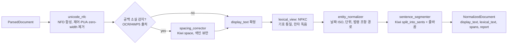
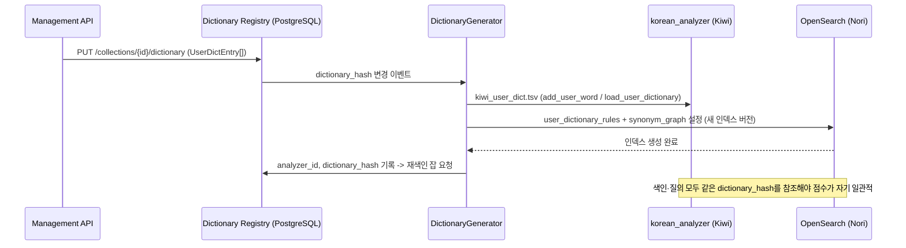

# 한국어 NLP: 형태소 분석·문장 분리·정규화·벤치마크

## 목적

브리프 원칙 6(Korean-First, Multilingual-Ready)과 D-07(lexical BM25는 한국어 형태소 기반), D-15(OpenSearch Nori 기본), D-19(문장·구조 인식 청킹), O-08(한국어 OCR), O-09(청크 크기·토크나이저)가 전제하는 **한국어 언어 처리 계층**을 2026-09-18 시점의 공개 정보로 검증한다. 구체적으로 (1) 플랫폼 측 형태소 분석기(morphological analyzer)와 서버 측 분석기(Nori)의 선택, (2) BM25 토크나이징 전략(형태소·어절·서브워드·문자 bigram), (3) 문장 분리(sentence splitting)·띄어쓰기 교정·유니코드 정규화·표기 정규화 도구, (4) 한국어 임베딩·리랭커 벤치마크 세트와 토큰 팽창률, (5) 한국 공공·기업 문서 특성이 파싱·청킹·질의 이해에 주는 함의, (6) 한국어 OCR 엔진을 다룬다. 모든 버전·라이선스·수치는 출처를 병기했고, 확인하지 못한 것은 "확인 필요"로 표시했다. 0.2.0(2026-09-22)은 독립 검증 결과를 반영한 개정판이다: Kiwi 문장 분리 벤치마크의 집계 기준 혼용과 kss 자체 벤치마크(kss 우세) 병기, MIRACL-ko 연구의 Kiwi 품질 주장 철회, python-mecab-ko의 라이선스(BSD-3 + Apache-2.0 사전)·Windows wheel 사실 정정과 이에 따른 공백기 기본 후보 재평가, Kiwi 0.22.0/0.23.0 기능 귀속, kss 6.0.6 날짜(2025-11-13), spaCy 모델 라이선스(CC BY-SA 4.0), Bareun 무료 범위, KORIE 벤치마크 도메인(영수증) 한정, pecab 성숙도, hanja 라이선스(WTFPL), 모델 크기(약 84 MiB)를 고쳤고, 누락 후보(lindera-python, wtpsplit/SaT, PaddleOCR-VL, EasyOCR, Surya, charabia/Qdrant multilingual, RapidOCR 버전 지정 조건)를 추가했다.

## 범위

- 포함: Kiwi/kiwipiepy, MeCab-ko + mecab-ko-dic(python-mecab-ko, pecab, lindera-python), Khaiii, KoNLPy(Okt/Komoran/Hannanum/Kkma/Mecab), Lucene Nori(OpenSearch `analysis-nori`), Bareun(상업), 신경망 계열(Stanza ko, spaCy ko, Kiwi CoNg), soynlp; kss, Kiwi `split_into_sents`, wtpsplit/SaT, 정규식 분리; PyKoSpacing, Kiwi `space`, kss `correct_spacing`; NFC/NFKC·전각/반각·한자·자모·특수 기호·숫자·단위·날짜 정규화; 불용어·동의어·사용자 사전; KURE 벤치마크(MTEB(kor, v2) Retrieval), AutoRAG 한국어 임베딩 벤치마크, MIRACL-ko, Mr.TyDi-ko, Ko-StrategyQA, KLUE; 토크나이저별 한국어 토큰 팽창률(본 문서에서 직접 측정); PaddleOCR korean(PP-OCRv5, PaddleOCR-VL), RapidOCR, Tesseract kor/kor_vert, EasyOCR, Surya(한국어 관점만).
- 제외: 임베딩·리랭커 모델 자체의 선정(`05-embedding-models-and-serving.md`), 렉시컬 인덱스 백엔드 비교(`06-vector-and-lexical-index-backends.md`), 청킹 라이브러리 비교(`04-chunking-strategies-and-libraries.md`), PDF 레이아웃·OCR 파이프라인 전체(`02-document-parsing-pdf-layout-ocr.md`), HWPX 파서(`01-document-parsing-hwpx-hwp.md`). 이 문서는 위 문서들이 공유하는 **한국어 언어 계층**만 다루고, 겹치는 수치는 해당 문서의 값을 그대로 인용한다.

## 평가 기준

| 기준 | 가중치 | 판단 근거 |
|------|--------|-----------|
| 한국어 지원 | 25 | 형태소 단위 분리 품질, 복합명사 처리, 사전 갱신 가능성, 공문서 표기(날짜·조항·개조식) 처리 |
| 라이선스 적합성(D-02) | 20 | Apache/MIT/BSD = 5, LGPL 동적 링크 = 3, LGPL 정적 링크 wheel = 2, GPL 또는 상업 전용 = 1 |
| 성숙도/유지보수 | 10 | 최근 12개월 릴리스, 사전·모델 갱신, 이슈 응답 |
| 품질/성능 | 15 | 공개 정확도(F1, 문장 분리 F1), 처리량(chars/s), 중의성 해소 |
| 통합 난이도 | 10 | `pip install` wheel 여부, 네이티브 빌드·JVM·별도 서버 필요 여부, 오프셋(start/end) 제공 |
| 커뮤니티/생태계 | 5 | 바인딩 수, 다른 검색 엔진·프레임워크에서의 채택 |
| 운영 비용 | 15 | CPU 단독 가능성, 메모리, 모델 로딩 시간, 라이선스 비용 |

점수는 1~5 척도 x 가중치, 만점 500, 백분율로 표기한다(`05-embedding-models-and-serving.md`와 동일 척도).

## 후보 목록

### A. 형태소 분석기(morphological analyzer)

| 이름 | 최신 버전(확인일 2026-09-18) | 라이선스 | 성숙도 | 한국어 지원 | 핵심 강점 | 약점 |
|------|------|------|------|------|------|------|
| Kiwi (C++ 코어) | v0.24.0 (2026-09-13, GitHub Releases) | **Apache-2.0(0.24.0부터)**; 0.23.2 이하는 LGPLv3 유지 | 높음(활발, 연 4회 이상 릴리스) | 자가 보고 정확도 문어 약 94%, 웹 약 87%, 중의성 해소 86.7% | 통계 LM + Skip-Bigram/CoNg 중의성 해소, 오타 교정, 문장 분리, 사용자 사전, 형태소 결합(`join`), 12개 언어 바인딩 | 0.24.0의 Python wheel 미공개(아래) |
| kiwipiepy (Python) | 0.23.2 (2026-06-11, PyPI) | **LGPLv3**(Kiwi 정적 링크). 0.24.0부터 Apache-2.0 전환 절차 진행 중(이슈 #233, 2026-09-17 개설, 기여자 동의 약 2주) | 높음 | 동일 | `pip install kiwipiepy` 단일 wheel(CPython 3.9+), Stable ABI, `split_into_sents` 오프셋 반환 | 현 PyPI 버전은 LGPL 정적 링크 → D-02 검토 필요 |
| MeCab-ko + mecab-ko-dic (python-mecab-ko) | python-mecab-ko **1.3.7** (2024-07-14, PyPI) + python-mecab-ko-dic **2.1.1.post2** (2022-12-14, PyPI, 약 34.5 MB wheel); 사전 원천 mecab-ko-dic **2.1.1-20180720**(Lucene Nori 빌드 기준, 이후 갱신 없음) | **python-mecab-ko BSD-3-Clause + python-mecab-ko-dic Apache-2.0**(PyPI 메타데이터); mecab-ko 엔진 원 저장소의 GPL-2.0/LGPL-2.1/BSD-3 삼중 라이선스 원문은 확인 필요(python-mecab-ko wheel은 BSD-3로 배포) | 중간(엔진 wheel 2024-07; 사전 2018년 정체) | KoNLPy 비교에서 최고속(100K자 0.28s) | 가장 빠름; `pip install python-mecab-ko` 한 줄로 **Windows(win32/win_amd64/win_arm64)·macOS(x86_64/arm64)·manylinux wheel(cp37~cp312, 45개)** 설치, 사전 자동 의존; Nori·lindera·kagome_kr·infinity `korean`의 공통 사전 원천 | 신조어·고유명사 약함(사전 2018 정체), **문자 오프셋 미제공**, Python 3.13+ wheel 확인 필요(as of 2026-09) |
| pecab | **1.0.8** (2022-12-23, PyPI; 이후 릴리스 없음, 약 3년 9개월) | Apache-2.0 | **낮음**(개인, 3년 이상 릴리스 없음) | mecab-ko-dic 기반 순수 Python | 설치 무의존(sdist 약 26 MB), `user_dict=List[str]`, mmap·DAT로 pynori 대비 50~100배 빠른 로딩 | kss 4.x README(PyPI kss 4.5.4 설명) 기준 kss 파이프라인 내 pecab 백엔드 7,050 ms vs mecab 46.81 ms("약 160배 느림") — kss 파이프라인 내부 수치이므로 형태소 분석 단독 속도로 일반화는 보류 |
| lindera-python | **5.3.0** (2026-08-16, PyPI) | MIT(바인딩·엔진); ko-dic 사전 Apache-2.0(`06` 문서, 확인 필요) | 중간~높음(lindera 모노레포 v6.0.0 2026-08-25; lindera-python 별도 저장소는 2026-03-28 아카이브 후 모노레포로 통합) | mecab-ko-dic 계열 `ko-dic` 사전(Milvus·LanceDB·Meilisearch(charabia)·ParadeDB `korean_lindera`와 동일 계열) | Rust 엔진, manylinux/macOS/win_amd64/win_arm64 wheel(6개, 약 2.3 MB), 라이선스 깨끗; 서버 측 lindera 백엔드(`06` 문서 Milvus/LanceDB 경로)와 **토큰 일관성** 확보 가능 | **wheel에 사전 미포함**("no embedded dictionaries") → GitHub Releases에서 사전 아카이브 별도 배포·경로 지정 필요; 사용자 사전·품사 필터가 Nori보다 제한적(`06` 문서); 오프셋 제공 여부 확인 필요 |
| Khaiii (Kakao) | v0.4(마지막 릴리스; 마지막 실질 커밋 2024-03, 관리 커밋 2025-05) | Apache-2.0 | **낮음(사실상 휴면, 아카이브는 아님)** | CNN, v0.4 large F1 96.71 / base 94.96(자가 보고) | 정확도, Apache | 10,000문장에 base 14.4s·large 165s(자가 보고), CMake 소스 빌드, Python 3.12 wheel 없음(확인 필요) |
| KoNLPy | 0.6.0 (2022-01-02, PyPI) | **GPL-3.0-or-later** | 낮음(3년 이상 릴리스 없음) | Okt/Komoran/Hannanum/Kkma/Mecab 통합 | 교육·연구 표준, 태거 비교 문서 | GPL → D-02 링크 금지, JDK 1.8+·JPype1 필요, 느림(Kkma 100K자 35.7s) |
| KOMORAN | 3.x (shineware) | Apache-2.0 | 중간 | 사용자 사전(평문 파일) | 100% Java, PyKOMORAN 공식 래퍼 | JVM 필요, KoNLPy 비교 100K자 25.6s |
| Open Korean Text(Okt) | 2.1.0 | Apache-2.0 | 중간(릴리스 정체) | 구어·신조어 정규화(`입니닼ㅋㅋ` → `입니다 ㅋㅋ`), 어간 추출 | 트위터 출신, 색인 목적 설계 | Scala/JVM, 형태소 분석 정밀도는 낮음 |
| Lucene Nori (`analysis-nori`) | Lucene 10.5.0(OpenSearch 3.8 동봉, `06` 문서 기준); OpenSearch 저장소 `plugins/analysis-nori` 존재 확인 | Apache-2.0 | 매우 높음 | mecab-ko-dic 2.1.1-20180720 내장, `decompound_mode`, 사용자 사전, 품사 필터, 한자 독음, 숫자 정규화 | 서버 내장, 운영 검증, Elasticsearch·OpenSearch·Vespa(lucene-linguistics) 공통 | 사전 갱신은 사용자 사전으로만, 플랫폼(Python) 측에서는 `_analyze` API 호출 필요 |
| Bareun (바이칼에이아이) | 서버 버전 확인 필요; 클라이언트 bareunpy 2.1.0 (2026-08-06, BSD-3-Clause, Connect RPC) | **상업. 연구 목적 사용(개인·기업·학교·언론기관)만 무료**; 상업적 목적의 연구, 상용 서비스, 비상업이라도 사용자 대상 상시 운영 서비스는 유료 라이선스; 맞춤법 검사는 항상 유료(bareun.ai/docs/intro 원문) | 높음(기업) | 트랜스포머 기반, 벤더 주장 태깅 정확도 99.6% | 5종 사용자 사전, 띄어쓰기·맞춤법, Docker·온프레미스, Elasticsearch 플러그인 | 별도 서버·API 키, GPU 권장(확인 필요), 문장 분리는 Kiwi 저장소 벤치마크 차트(8 데이터셋 매크로 평균)에서 약 0.54로 최하위(Bareun 3.0.rc2) |
| Stanza ko (GSD/Kaist) | Stanza 1.5.1 수치(UD 2.12) | 코드 Apache-2.0, 모델 ODC-By 1.0(UD 데이터 라이선스는 "불명확"이라고 명시) | 높음 | 토큰 99.90/100.00, 문장 96.29/99.93, UPOS 95.98/95.74 | UD 표준, 의존 구문 분석 | UD 토큰은 어절 단위(형태소 미분리) → BM25용 부적합, 신경망 비용 |
| spaCy `ko_core_news_*` | sm/md/lg 3.8.0 | **CC BY-SA 4.0(모델; spacy-models 릴리스 메타데이터. 학습 데이터 UD Korean Kaist v2.8·KLUE v1.1.0 파생)** — Share-Alike 조건으로 D-02의 Apache/MIT/BSD 등급과 다른 범주; 코드(spaCy)는 MIT | 높음 | 기본 규칙 토크나이저(mecab-ko 선택) | 파이프라인 생태계 | 형태소 분석은 mecab-ko 설치 시에만; 모델 재배포 시 SA 조건 검토 필요 |
| soynlp | 0.0.47+ | LGPL-3.0 | 낮음 | 비지도 단어 추출(cohesion, branching entropy), 명사 추출, 반복 문자 정규화 | 사전 없이 도메인 신조어 후보 추출 | LGPL, 유지보수 정체 |

### B. 문장 분리·띄어쓰기·정규화 도구

| 이름 | 최신 버전(확인일) | 라이선스 | 성숙도 | 기능 | 강점 | 약점 |
|------|------|------|------|------|------|------|
| Kiwi `split_into_sents` | kiwipiepy 0.23.2 / Kiwi 0.24.0 | 위와 동일 | 높음 | 문장 분리 + 오프셋 + 서브문장(`subs`) | 자체 벤치마크(Kiwi 저장소) Overall normalized F1 0.866(baseline 0.622); 오프셋 제공 | 형태소 모델 로딩(측정 1.4 s); kss 자체 벤치마크(kss 4.2.0 vs Kiwi 0.14.1)에서는 kss가 우세 → 두 자사 벤치마크가 상반(아래 "문장 분리" 절) |
| kss | 6.0.6 (2025-11-13, PyPI 업로드 기준; `04` 문서와 동일) | BSD-3-Clause | 중간(단일 메인테이너, 최근 릴리스 약 10개월 전) | `split_sentences(backend=mecab/pecab/punct/fast)`, `correct_spacing`, `normalize`, `hanja2hangul`, `h2j/j2h`, `romanize`, `g2p`, `anonymize` 등 | 문장 분리 외 유틸 다수, BSD; 자체 벤치마크(kss 4.x README) normalized F1 평균 kss(mecab) 0.851, kss(pecab) 0.850 | mecab 자동 설치 제거(수동), `fast` 백엔드 오분할(본 문서 측정), pecab 자동 선택 시 느림(kss 4.x README: pecab 백엔드 약 160배); 6.0.6 sdist가 `pecab`을 필수 의존으로 끌어옴(PyPI requires_dist) |
| wtpsplit (SaT, Segment any Text) | 2.2.1 (2026-04-11, PyPI) | MIT | 중간~높음(EMNLP 2024 논문, `04` 문서) | 85개 언어 신경망 문장·단락 분리(`sat-1l`~`sat-12l`, `-sm` 변형), **한국어 포함** | 구두점 없는 텍스트에 강건, 언어 코드 불필요, ONNX 지원 → 다국어 컬렉션 공용 `SentenceSegmenter` 후보이자 LGPL 공백기의 MIT 대안 | torch/transformers + HF 모델 의존, 반환은 문자열 리스트(오프셋 재계산 필요), 한국어 단독 정확도 미검증(골든셋 비교 필요) |
| 정규식(종결 부호) | - | - | - | `[.!?]\s+` 분리 | 무의존, 마이크로초 | 한국어 종결어미·인용문·"2026. 9. 18." 날짜·"1." 번호에서 오분할(Kiwi 벤치마크 baseline Overall F1 0.622) |
| PyKoSpacing | 마지막 커밋 2024-07-04 | **GPL-3.0** | 낮음 | 딥러닝 띄어쓰기(세종 구어 97.1%, 문어 94.3% 자가 보고) | 정확도 | GPL → D-02 링크 금지, TensorFlow/Keras 의존 |
| Kiwi `space()` | 동일 | 동일 | 높음 | 형태소 LM 기반 띄어쓰기 복원 | 추가 의존 없음 | 복합명사 과분리 가능(측정: "공공기관" → "공공 기관") |
| kss `correct_spacing` | 6.0.6 | BSD-3-Clause | 중간 | 띄어쓰기 교정 | BSD | 측정에서 "이법은" 미분리 |
| soyspacing | - | 확인 필요 | 낮음 | 휴리스틱 띄어쓰기 | 경량 | 라이선스·유지보수 확인 필요 |
| python-jamo | - | Apache-2.0 | 중간 | `h2j`, `j2h`, `j2hcj`(음절↔자모) | Unicode 7.0 자모 전 범위 | 정규화 자체는 표준 라이브러리 `unicodedata`로 충분 |
| hanja | 0.15.1 (2024-08-06) | **WTFPL v2**(저장소 LICENSE.txt; OSI 미승인이나 허용적. PyPI 메타데이터에는 라이선스 필드 비어 있음) | 중간 | `translate(mode=substitution/combination-text/combination-html)`, `is_hanja`, `split_hanja` | 한자 → 한글 독음 | D-02 우선 목록(Apache/MIT/BSD)에 없는 라이선스 → kss `hanja2hangul`(BSD-3) 또는 Nori `nori_readingform` 우선, hanja는 법무 검토 후 선택 extra |
| stopwords-iso/stopwords-ko | - | MIT | 낮음(커밋 5회) | 한국어 불용어 목록(JSON/텍스트) | MIT | 어절 단위 목록이라 형태소 파이프라인과 불일치, 규모 확인 필요 |

### C. 한국어 리트리벌 벤치마크 자원

| 이름 | 구성(확인일 2026-09-18) | 라이선스 | 성격 | RAG 평가 용도 |
|------|------|------|------|------|
| MTEB(kor, v2) Retrieval(KURE 리더보드 기준 9태스크) | Ko-StrategyQA, AutoRAGRetrieval, MIRACLRetrieval, PublicHealthQA, BelebeleRetrieval, MrTidyRetrieval, MultiLongDocRetrieval, LawIRKo, SQuADKorV1Retrieval | 태스크별 상이(MTEB 메타데이터 명시) | 위키·법령·의료·PDF 혼합 | 임베딩·리랭커 선택(D-16 근거) |
| KURE 벤치마크 결과 | avg nDCG@10 / Recall@10: KURE-v2(late-interaction, 154M) 0.8160/0.8921, KURE-v1(dense 568M) 0.7616/0.8629, bge-m3 0.7509/0.8588, KoE5 0.7337/0.8300 | 모델 MIT | 고려대 NLP&AI Lab | 한국어 dense 기준선 |
| AutoRAG Korean embedding benchmark(Marker-Inc) | 지표 F1/Recall/Precision/mAP/mRR/nDCG @k=1,3,5,10,50; top_k=1 상위: KU-HIAI-ONTHEIT-large-v1.1 0.7193, v1 0.7105, KoE5 0.6930, bge-m3 0.6754, Upstage 0.6579(지표명 확인 필요) | 저장소 라이선스 확인 필요 | 파싱된 한국어 PDF(금융·공공·의료·법률·커머스), `09` 문서 기준 질의 114/문서 720 | 소규모 스모크 테스트 |
| MIRACL-ko | 코퍼스 1,486,752 문단 / 437,373 위키 문서; train 868 질의(12,767 판정), dev 213 질의(3,057 판정) | Apache-2.0 | 원어민 주석 | 대규모 dense/sparse 회귀 |
| Mr.TyDi-ko | 코퍼스 약 1.5M 문단; 질의 수 확인 필요 | Apache-2.0 | TyDi QA 파생 | 대규모 BM25 기준선(BM25 공식 수치 존재) |
| Ko-StrategyQA(`taeminlee/Ko-StrategyQA`) | corpus 27.8k 행, queries 8.5k 행(train 4.38k / dev 1.15k), BeIR 포맷 | 확인 필요 | 다중 홉 | 다중 홉 회귀 |
| KLUE | 8과제(TC/YNAT, STS, NLI, NER, RE, DP, MRC, DST/WoS) | CC BY-SA 4.0 | NLU 벤치마크, **리트리벌 과제 없음** | 질의 이해(NER·STS) 보조, 형태소 분석기 간접 평가(DP의 형태소 태그) |

## 심층 비교

### Kiwi / kiwipiepy

| 항목 | 내용 |
|------|------|
| 동작 방식 | 사전 기반 격자(lattice) 탐색 + 통계 언어모델(KNLM) + Skip-Bigram, 기본 모델 CoNg(Contextual N-gram embedding, 0.21.0에서 도입, 0.22.0부터 기본). 오타 교정(0.13.0+)은 후보 확장 방식. **0.22.0(2025-11-16)에서 방언 분석 추가**(형태소에 방언·의미 번호 정보) 및 KnLM/SBG 기본 모델 목록 제거(CoNg 단독 기본); **0.23.0(2026-03-16)에서 경량 문자 모델·빈도 기반 OOV 탐지, 오타 교정의 분석 시점 적용(메모리 최적화)·복합명사 오타 교정** 추가(Kiwi Releases). 0.24.0에서 **형태소 경계를 존중하는 byte-level BPE 토크나이저 트레이너** 추가 |
| 진입점 | `pip install kiwipiepy`; `from kiwipiepy import Kiwi`; `Kiwi(num_workers=-1, model_path=None, load_default_dict=True, integrate_allomorph=True, model_type='cong'|'cong-global', enabled_dialects='standard')`; `kiwi.tokenize(text, normalize_coda=False, compatible_jamo=False, typos='basic', saisiot=None) -> list[Token]`; `kiwi.analyze(text, top_n=1) -> list[(list[Token], score)]`; `kiwi.split_into_sents(text, return_tokens=False, return_sub_sents=True) -> list[Sentence]`; `kiwi.add_user_word(word, tag='NNP', score=0.0, orig_word=None)`; `kiwi.add_pre_analyzed_word(form, analyzed, score)`; `kiwi.add_re_rule(tag, pattern, repl, score)`; `kiwi.load_user_dictionary(path)`; `kiwi.extract_words(texts, min_cnt=10, max_word_len=10, min_score=0.25)`; `kiwi.extract_add_words(...)`; `kiwi.join(morphs, lm_search=True)`; `kiwi.space(text, reset_whitespace=False)`; `kiwi.glue(text_chunks)` |
| 출력 형식 | `Token(form, tag, start, len, end, word_position, sent_position, line_number, base_form, score, typo_cost ...)`; `Sentence(text, start, end, tokens, subs)`. 태그는 세종 품사 집합(NNG/NNP/NNB/NR/NP, VV/VA/VX/VCP/VCN, JKS/JKC/JKG/JKO/JKB/JX, EP/EF/EC/ETN/ETM, XSN/XSV/XSA, SF/SP/SN/SL/SH/SW) + 확장 태그 `W_URL`, `W_EMAIL`, `W_HASHTAG`, `W_EMOJI`, `W_SERIAL`, `Z_SIOT` |
| 본 문서 측정(kiwipiepy 0.23.2, Windows 11 노트북, `num_workers=1`) | 모델 로딩 1.4 s. `split_into_sents`가 "제1조(목적) … 목적으로 한다. 각 부서는 2026. 10. 31.까지 결과를 제출하여야 함(별첨 1 참조). 그는 \"내일 보자.\"라고 말했다. 세종시 가곡역 …"를 **4문장으로 정확히 분리**(날짜 온점·인용문 내부 종결 부호에서 오분할 없음, 오프셋 정확). `tokenize`: `세종시/NNP 가곡역/NNP 인근/NNG 정보/NNG 공개/NNG 청구서/NNG 를/JKO 접수/NNG 하/XSV 었/EP 다/EF`, **`2026. 9. 18./W_SERIAL`**(날짜 전체가 1토큰), `87.5/SN %/SW`. `add_user_word("정보공개청구서","NNG")` 후 단일 토큰화 확인. 처리량 약 **61,000자/s**(단일 스레드, 4,900자 반복 텍스트, 참고치). `space()`는 "공공기관"을 "공공 기관"으로 과분리. `typos='basic'`은 "접수햇다" → `엇/EP`로 교정 불완전 |
| 공개 벤치마크 | README: 문어 약 94%, 웹 약 87%, 1.9 ms/line(예시 출력). Kiwi 논문 초록: 중의성 해소 평균 86.7%(기존 오픈소스, 특히 딥러닝 계열 50~70%). 문장 분리 벤치마크(kiwipiepy/benchmark/sentence_split, 8개 데이터셋; 비교 대상 Kiwi 0.22.0, kss 3.4.2(pecab 백엔드), KoalaNLP 2.1.x 7종, Bareun 3.0.rc2): README 본문의 "Overall" 집계는 **Kiwi normalized F1 0.866, baseline 정규식 0.622** 두 값만 있다. 나머지 시스템은 데이터셋별 표와 차트 이미지(`SentSplit_F1.PNG`, 8개 데이터셋 매크로 평균)만 있으며 차트 기준 대략 Kiwi 약 0.83, KSS(pecab) 약 0.815, Okt 약 0.59, Hannanum 약 0.57, Bareun 약 0.54, baseline 약 0.56(이미지 판독치, 근사). 즉 Kiwi와 kss의 차이는 작고, kss는 가장 느린 pecab 백엔드·구 버전(3.4.2, 현재 6.0.6)으로 측정되었으므로 **현재 kss와의 우열 근거로 쓰지 않는다**. 반대로 kss 4.x README(PyPI kss 4.5.4 설명)의 자체 벤치마크는 normalized F1 평균 **kss 4.2.0(mecab) 0.851, kss(pecab) 0.850, Kiwi 0.14.1 0.782**, 속도 kss(mecab) 46.81 ms vs Kiwi 36.26 ms로 kss 우세다. 두 벤치마크는 서로 다른 시점의 상대 구버전(Kiwi 0.14.1 ↔ 0.22.0, kss 4.2.0 ↔ 3.4.2)을 썼고 모두 자사 벤치마크이므로 **최종 선택은 자체 공문서 골든셋 측정으로 결정**한다(미해결 이슈 11). MIRACL-ko 연구(jaesolshin 2026, `06` 문서 인용): 공개 본문은 "Phase 1에서 MeCab·Kiwi·Okt를 비교해 MeCab이 처리량·품질 절충에서 이겨 기본이 되었다"고만 하며 Kiwi의 nDCG 수치는 공개하지 않았다(요약표의 "Kiwi-CoNg 품질 우위" 문구는 수치 근거 없음, 확인 필요). 따라서 본 문서는 이 연구를 Kiwi 품질 근거로 쓰지 않는다 |
| 함정 | (1) **라이선스 전환기**: PyPI 0.23.2는 LGPLv3 wheel(정적 링크). Apache-2.0 kiwipiepy 0.24.0 릴리스 전까지 기본 의존성으로 넣을 수 없다(D-02). (2) 모델 파일은 별도 패키지(`kiwipiepy_model` 0.23.0, 2026-03-17)로 sdist 87,976,912바이트(약 84 MiB 압축, PyPI 파일 메타데이터; `04` 문서와 동일), 전개 후 디스크·상주 메모리 크기는 측정 필요. (3) 멀티프로세스 워커마다 모델 로딩 → 프로세스당 1회 로딩 후 재사용. (4) `space()`·`typos`는 검색 색인용이 아니라 OCR·HWP 추출 텍스트 복구용으로만 opt-in. (5) `W_SERIAL` 등 확장 태그는 Nori(세종 태그만)에 없으므로 태그 매핑 시 `SN`/`SW`로 축약해야 한다 |

### MeCab-ko + mecab-ko-dic (python-mecab-ko, pecab)

| 항목 | 내용 |
|------|------|
| 동작 방식 | CRF 기반 MeCab의 한국어 포크(mecab-ko) + 세종 말뭉치 기반 사전(mecab-ko-dic). 사전은 Lucene Nori가 `mecab-ko-dic-2.1.1-20180720`을 빌드 소스로 사용하는 것에서 알 수 있듯 **2018-07 이후 갱신 없음** |
| 진입점 | `pip install python-mecab-ko`(1.3.7, **BSD-3-Clause**; mecab-ko 엔진을 wheel에 포함, cp37~cp312 × Windows win32/win_amd64/win_arm64·macOS x86_64/arm64·manylinux 45개 wheel; `python-mecab-ko-dic` 2.1.1.post2 **Apache-2.0** 사전을 requires_dist로 자동 설치 → 네이티브 빌드 없이 3개 OS 설치) → `from mecab import MeCab; MeCab().pos(text) / morphs / nouns / parse`; 또는 `pip install mecab-python3 mecab-ko-dic`(사전 패키지 Apache-2.0, `import mecab_ko_dic; MeCab.Tagger(mecab_ko_dic.MECAB_ARGS)`); 순수 Python `pip install pecab`(1.0.8) → `Pecab(user_dict=[...]).pos(text)`; Rust `pip install lindera-python`(5.3.0, MIT) + ko-dic 아카이브 별도 다운로드 → `TokenizerBuilder().set_dictionary(<ko-dic 경로>).build().tokenize(text)`(API는 버전별로 다름, 확인 필요) |
| 출력 형식 | `(형태소, 세종 태그)` 튜플; `parse()`는 피처(품사, 의미부류, 종성 유무, 읽기, 타입, 첫/끝 품사, 표현) 포함. **문자 오프셋 미제공**(mecab-python3의 `node.rlength`로 재구성 필요) |
| 성능 근거 | KoNLPy 공식 비교: 로딩 0.0007 s, 100K자 0.2838 s(약 350K자/s), Okt 2.47 s, Hannanum 8.83 s, Komoran 25.6 s, Kkma 35.7 s. MIRACL-ko 연구(`06` 인용): MeCab 형태소 BM25 nDCG@10 0.61~0.64 |
| 함정 | KoNLPy 문서의 "Windows 미지원"은 **KoNLPy의 `Mecab()` 래퍼에 한정**된 문장이며 python-mecab-ko wheel은 Windows를 포함한다(0.1.0 판의 일반화는 오류). 사전 정체로 신조어·기관명 약함, 문자 오프셋 미제공(`node.rlength`로 재구성), 사용자 사전은 mecab-dict-index 컴파일이 필요해 Kiwi `add_user_word`보다 운영이 번거롭다. 라이선스는 python-mecab-ko(BSD-3) + 사전(Apache-2.0)으로 정리되지만 mecab-ko 엔진 원 저장소(Bitbucket) 원문은 미확인(미해결 이슈 2). pecab은 라이선스가 깔끔(Apache-2.0)하지만 2022-12 이후 릴리스가 없고 속도가 느려 대량 색인용으로는 부적합. lindera-python은 라이선스·wheel이 깨끗하지만 사전을 별도 배포해야 하고 한국어 품질을 독립 검증한 자료가 없다 |

### Khaiii

CNN 기반(RNN 회피, "속도가 매우 중요"), 세종 수정 말뭉치 약 85만 문장·1,000만 어절로 학습. v0.4 large F1 96.71, base 94.96(v0.3 large 97.11). 속도는 10,000문장 base 14.4 s·large 165 s로 Kiwi·MeCab 대비 한 자릿수 이상 느리다. 마지막 기능 릴리스 v0.4 이후 README 수정(2024-03)과 CLA 봇 정리(2025-05)만 있으며 wheel 배포가 없어 CMake 소스 빌드가 필요하다. Apache-2.0이라는 장점만으로 채택할 근거는 없다. **후보 제외(참고용)**.

### KoNLPy 계열 (Okt / Komoran / Hannanum / Kkma / Mecab)

KoNLPy 자체가 GPL-3.0-or-later이므로 **D-02상 플랫폼 코드에서 import 금지**. 업스트림 중 Apache-2.0인 KOMORAN(PyKOMORAN)과 Open Korean Text는 JVM이 필요하다. Hannanum(KAIST), Kkma(SNU)는 각각 GPL 계열로 알려져 있으나 KoNLPy API 문서에 라이선스가 명시되어 있지 않다(확인 필요). 실무 함의: AutoRAG legacy의 `ko_okt`/`ko_kkma` 토크나이저 옵션(`09` 문서)은 **평가 하네스의 오프라인 실험 컨테이너에서만** 사용하고 런타임에서는 제외한다.

### Lucene Nori (OpenSearch `analysis-nori`)

| 항목 | 내용 |
|------|------|
| 동작 방식 | mecab-ko-dic 2.1.1-20180720을 Lucene FST로 컴파일한 Viterbi 격자 분석. `KoreanAnalyzer = KoreanTokenizer + KoreanPartOfSpeechStopFilter + KoreanReadingFormFilter + LowerCaseFilter` |
| 진입점 | OpenSearch: `opensearch-plugin install analysis-nori`(저장소 `plugins/analysis-nori` 확인, `06` 문서: Maven `org.opensearch.plugin:analysis-nori:3.x`). 인덱스 설정 `analysis.tokenizer.<name>.type: nori_tokenizer` + `decompound_mode`, `discard_punctuation`(기본 true), `user_dictionary`(파일, 한 줄 `<token> [<token 1> ... <token n>]`), `user_dictionary_rules`(인라인 배열), `lenient`. 필터 `nori_part_of_speech(stoptags)`, `nori_readingform`(한자 → 한글 독음), `nori_number`(한글 숫자 → 아라비아). 분석기 `nori`는 `decompound_mode`, `user_dictionary`, `stoptags` 3개 파라미터만 노출 |
| `decompound_mode` | `none` / **`discard`(기본: 분해 후 원형 폐기)** / `mixed`(원형 유지 + 분해). 예: 세종시 → `mixed`: 세종시, 세종, 시; `discard`: 세종, 시 |
| 기본 stoptags(Lucene `KoreanPartOfSpeechStopFilter.DEFAULT_STOP_TAGS`, 30개) | `EP EF EC ETN ETM IC JKS JKC JKG JKO JKB JKV JKQ JX JC MAG MAJ MM SP SSC SSO SC SE XPN XSA XSN XSV UNA NA VSV`. 즉 **어미(E*)·조사(J*)는 기본 제거**된다(Elastic 문서의 축약 표기 `E`, `J`와 동일 의미). 주의: `XSN`(명사 파생 접미사: -성, -화, -적, -들)이 기본 제거되어 "투명성"이 `mixed`에서 "투명성/투명/성" 중 "성"만 사라지는 정도지만, `discard`에서는 "투명"만 남아 "투명성" 정확 매칭이 약해진다 |
| 성능 근거 | MIRACL-ko 연구(`06` 인용): ES+Nori BM25 단독 nDCG@10 0.61~0.64, 하이브리드 0.7501. 형태소 미적용(ICU/유니코드 경계) 0.36~0.41 |
| 함정 | (1) 기본 `discard`가 복합명사 원형을 버림 → 색인 `mixed`, 질의 `discard` 또는 `mixed`(`06` 문서 권고와 동일). (2) 사전이 2018년 고정 → 기관명·신조어·제품명은 `user_dictionary` 필수. (3) 플랫폼(Python)에서 Nori와 동일 토큰을 얻으려면 `POST /<index>/_analyze` 왕복이 필요 → 질의 이해 단계에서 Kiwi와 Nori 토큰이 다를 수 있다(각 레그는 색인·질의를 같은 분석기로 처리하므로 점수는 자기 일관적). (4) 사용자 사전 갱신은 `_close`/`_open` 또는 `_reload_search_analyzers`(search_analyzer에만) 필요 |

### Bareun

트랜스포머 기반 상용 분석기(바이칼에이아이 + 한국언론진흥재단). 벤더 주장 형태소 태깅 정확도 99.6%(독립 검증 없음). 라이선스(bareun.ai/docs/intro 원문): "개인, 기업, 학교, 언론기관 등에서 **연구 목적으로 사용하는 경우에는 무료**"이며, "상업적인 목적을 가진 연구"는 유료 라이선스를 먼저 확보해야 하고, 상용 서비스뿐 아니라 **비상업적 목적이라도 사용자 대상 상시 운영 서비스는 유료**, 맞춤법 검사는 직접 설치 시에도 항상 유료. 즉 "기업 무료"는 연구 목적에 한정된다. Docker·온프레미스(Linux/macOS/Windows), 클라우드 API(api.bareun.ai, API 키). 클라이언트: bareunpy 2.1.0(BSD-3-Clause, Connect RPC로 grpcio 의존 제거), Java, JS, R, Elasticsearch 플러그인, REST. 5종 사용자 사전(고유명사·복합명사·동사·형용사·분리 규칙). Kiwi 저장소 문장 분리 벤치마크 차트(매크로 평균)에서 Bareun 3.0.rc2가 약 0.54로 최하위이므로 문장 분리 용도로는 부적합(형태소 분석 품질과는 별개). **오픈소스 플랫폼의 기본 의존성으로는 불가, `korean_analyzer` 플러그인(외부 서버)으로 수용**.

### 신경망 계열 (Stanza, spaCy, Kiwi CoNg)

Stanza ko(GSD/Kaist)는 토큰 99.9~100, 문장 96.29/99.93, UPOS 약 96이지만 UD 토큰이 **어절 단위**여서 조사·어미가 분리되지 않아 BM25 색인 단위로 쓸 수 없다. 모델 라이선스는 ODC-By 1.0이나 UD 데이터 라이선스가 "불명확"하다고 명시. spaCy 한국어 학습 파이프라인(`ko_core_news_*` 3.8.0)은 규칙 토크나이저를 기본으로 하며 형태소 분석은 mecab-ko 설치 시에만 가능하고, 모델 라이선스가 CC BY-SA 4.0(UD Korean Kaist·KLUE 파생)이라 Share-Alike 검토가 필요하다. 따라서 "최신 신경망 분석기"로 실용적인 오픈소스 선택지는 **Kiwi의 CoNg 모델**(경량 문맥 n-gram 임베딩, CPU)이며, 대형 트랜스포머 분석기는 Bareun(상업) 외에 유지보수되는 오픈소스가 확인되지 않았다(확인 필요, as of 2026-09).

### 문장 분리: Kiwi vs kss vs 정규식

| 항목 | Kiwi `split_into_sents` | kss `split_sentences` | 정규식 |
|------|------|------|------|
| 근거 | 형태소 분석 결과의 종결어미(EF)·부호(SF) + LM | 백엔드별: `mecab`/`pecab` 형태소 휴리스틱, `punct` 부호 규칙, `fast` 경량 규칙 | 종결 부호 뒤 공백 |
| 벤치마크 A(Kiwi 저장소, 8 데이터셋; Kiwi 0.22.0 vs kss 3.4.2 pecab 백엔드) | Overall normalized F1 **0.866**(README 본문); 차트 매크로 평균 약 0.83 | README 본문에 집계치 없음; 차트 매크로 평균 약 0.815(KSS(pecab), 이미지 판독 근사) | Overall **0.622** |
| 벤치마크 B(kss 4.x README; kss 4.2.0 vs Kiwi 0.14.1) | normalized F1 평균 **0.782**, 36.26 ms | mecab **0.851**, 46.81 ms / pecab 0.850, 7,050 ms | - |
| 벤치마크 해석 | 두 자사 벤치마크가 상반되고 각각 상대의 구버전을 썼다. 어느 쪽도 현재 버전(Kiwi 0.23.2~0.24.0, kss 6.0.6) 간 우열 근거가 못 된다 → **자체 공문서 골든셋 재측정 필요**(미해결 이슈 11) | 동일 | baseline은 두 벤치마크 모두에서 크게 열세 |
| 본 문서 측정(공문서·법령 4문장 샘플) | 4/4 정확, 오프셋 제공 | `punct` 4/4 정확(7 ms); **`fast`는 "…참조). 그는 …"를 1문장으로 병합(3/4)**; mecab 미설치 시 pecab 자동 선택 경고 | 미측정(Kiwi 벤치마크 baseline과 동일 방식) |
| 한국어 특유 난점 | "~다."로 끝나지 않는 개조식("~함", "~할 것", "~요망")은 부호가 없으면 분리 불가 → **줄바꿈을 1차 경계로** 처리해야 함 | 동일 | 날짜 "2026. 9. 18.", 번호 "1." "가.", 인용문 내부 "보자."에서 오분할 |
| 판단 | 1차(Apache-2.0 kiwipiepy 공개 후). 근거는 벤치마크 우위가 아니라 **형태소 분석과 모델·오프셋을 공유**해 비용 증가 없이 `Sentence.start/end`를 얻는다는 점 | 공백기 기본·폴백(`punct` 백엔드; `fast` 사용 금지; `mecab` 백엔드는 python-mecab-ko 설치 시 선택 가능) | 최후 폴백(Kiwi·kss 모두 불가 시) |

wtpsplit/SaT(2.2.1, MIT)는 위 표의 세 후보와 성격이 다른 **신경망 다국어 분리기**다. 한국어를 포함한 85개 언어를 언어 코드 없이 처리하고 구두점 없는 텍스트에 강하지만, torch/transformers 의존과 모델 다운로드가 필요하고 반환이 문자열 리스트라 오프셋을 재계산해야 하며 한국어 단독 정확도 자료가 없다. `04` 문서와 같이 (a) 다국어 컬렉션의 공용 `SentenceSegmenter` 후보, (b) kiwipiepy Apache 전환 지연 시 MIT 대안으로 두고, 한국어 골든셋에서 Kiwi·kss와 같은 조건으로 측정한다(미해결 이슈 11).

### 띄어쓰기 교정과 정규화 도구

- **띄어쓰기 교정은 기본 끔(opt-out)**. HWP 5.0 바이너리 추출·OCR 출력처럼 공백이 소실된 경우에만 `normalizer` 옵션으로 켠다. PyKoSpacing은 GPL-3.0이므로 제외. Kiwi `space()`는 복합명사를 과분리할 수 있으므로 **교정 결과를 `text.lexical`(색인용 뷰)에만 적용**하고 표시용 텍스트는 보존한다.
- **유니코드 정규화**: 표시용 텍스트는 NFC(macOS 파일명·일부 HWP 변환에서 나오는 NFD 조합형 한글을 완성형으로 합성). 색인용 뷰는 NFKC를 추가 적용해 전각 영숫자(`ＡＢＣ１２３`), 원문자(`①` → `1`), 단위 기호(`㎡` → `m2`), 괄호 약호(`㈜` → `(주)`)를 호환 문자로 펼친다. NFKC는 정보 손실이 있으므로 표시용에는 적용하지 않는다. 호환 자모(U+3130~318F, "ㅋㅋ")는 NFC로 합성되지 않으며 Kiwi `tokenize(compatible_jamo=True)`가 호환 자모로 통일한다.
- **한자 병기**: 법령·오래된 공문서의 "憲法(헌법)" 또는 "헌법(憲法)". 색인용 뷰에는 한자를 독음으로 치환(Nori `nori_readingform`, kss `hanja2hangul(combination=True)` 측정 결과 `大韓民國(대한민국) 憲法(헌법) 第(제)1條(조)`), 표시용은 원문 유지. `hanja` 패키지는 WTFPL v2(허용적이나 OSI 미승인, D-02 우선 목록 외)이므로 kss(BSD-3) 또는 Nori 경로를 우선한다.
- **특수 기호 통일(색인용 뷰)**: 가운뎃점 `·`(U+00B7)·`ㆍ`(U+318D)·`•`(U+2022) → `·`; 물결 `~`/`∼`/`～` → `~`; 대시류 → `-`; 법령명 괄호 `「」`·『』는 유지(법령명 경계 신호); NBSP·zero-width(U+200B~200D, U+FEFF)·HWP 사용자 정의 영역(PUA U+E000~F8FF) 문자 제거 후 `NormalizedDocument` 정규화 리포트에 건수 기록.
- **숫자·단위·날짜(공문서 규정 표기)**: 「행정업무의 운영 및 혁신에 관한 규정」은 날짜를 "연·월·일 글자를 생략하고 온점으로 표시"(예: `2026. 9. 18.`), 시각을 24시각제 쌍점(`14:30`)으로 쓰도록 규정한다(조항 번호 확인 필요). 파생 메타데이터로 ISO 8601(`2026-09-18`)을 추출하되 원문은 바꾸지 않는다. 처리해야 할 변형: `2026. 9. 18.`, `2026.9.18.`, `'26. 9. 18.`, `2026년 9월 18일`, `2026-09-18`, 기간 `2026. 9. 1. ~ 9. 30.`(월 생략), 회계 단위 `1,250백만원`(= 12.5억 원), `천원`, `억 원`, 비율 `12.3%p`. Kiwi가 `2026. 9. 18.`을 `W_SERIAL` 1토큰으로 묶는 점은 문장 분리와 청킹에 유리하지만, BM25 색인에는 연·월·일을 분리 토큰(`2026`, `9`, `18`)으로도 넣어야 "2026년 9월" 질의에 매칭된다.
- **불용어**: 형태소 파이프라인에서는 어절 기반 불용어 목록(stopwords-ko) 대신 **품사 기반 제거**(Nori stoptags / Kiwi 태그 필터)를 쓴다. 도메인 불용어(예: "붙임", "별첨", "참조", "이하 같다")는 `collection` 단위 설정.
- **동의어·사용자 사전**: 기관 약칭("행안부" ↔ "행정안전부"), 법령 약칭("정보공개법" ↔ "공공기관의 정보공개에 관한 법률"), 영문 약어("RAG" ↔ "검색 증강 생성")는 OpenSearch `synonym_graph`(질의 시점)와 Kiwi `add_user_word(orig_word=...)`에 **하나의 소스 파일**에서 생성한다. 우리말샘·표준국어대사전은 국립국어원 이용 약관(CC BY-SA 계열로 알려짐, 확인 필요)에 따라 재배포 조건을 검토해야 하며, 기본 배포물에는 포함하지 않는다.

### BM25 토크나이징 전략 비교

| 전략 | 구현 예 | 재현율(recall) | 정밀도(precision) | 색인 크기 | 사전 유지 | 근거 |
|------|------|------|------|------|------|------|
| 어절(공백/유니코드 경계) | OpenSearch `standard`, Qdrant `multilingual`(charabia) 토크나이저 — 공식 빌드는 charabia의 `korean`(lindera ko-dic) 피처를 켜지 않아 한국어는 유니코드 경계 분절만 적용(`06` 문서, master 2026-09) | **매우 낮음**: 조사·어미가 붙은 "정보를"·"정보의"·"정보가"가 모두 다른 토큰 | 높음(정확 어절 일치) | 작음 | 없음 | MIRACL-ko 10K 문서: Qdrant multilingual(charabia) 0.36, Vespa ICU 0.41(jaesolshin 2026, `06` 인용). charabia `korean` 피처를 켠 소스 빌드(Meilisearch 경로)는 lindera ko-dic 형태소 분절이 되지만 Qdrant 공식 이미지에는 없음 |
| 형태소(morpheme) | Nori, Kiwi, MeCab | **높음**: 조사·어미 제거, 어간 정규화 | 높음(`mixed`로 원형 보존 시) | 중간(`mixed`는 토큰 수 증가) | 필요(신조어·기관명) | 동일 연구 0.61~0.64(PG+MeCab, ES+Nori) |
| 서브워드 BPE/SentencePiece | bge-m3(XLM-R SPM), Qwen3 BPE | 중간: 형태 경계와 무관한 분절("청구서를" → "청구", "서를" 등 가능) | 중간~낮음(무의미 조각 매칭) | 중간 | 없음(모델 고정) | Park et al.(AACL 2020): 대부분의 한국어 과제에서 **형태소 분리 후 BPE**가 최고, 순수 BPE는 KorQuAD에서만 최고. BGE-M3 sparse가 이 단위를 쓴다(O-02) |
| 문자 bigram | Lucene/OpenSearch `cjk_bigram`(han·hiragana·katakana·**hangul** 지원, `output_unigrams`, `ignored_scripts`) | 높음(OOV·오타·띄어쓰기 오류에 강함) | 낮음~중간(우연 일치 "대한"/"한민" 등) | 큼(문자 수에 비례) | 없음 | 1990년대 한국어 IR 연구에서 bigram이 형태소 색인과 경쟁력 있다는 보고가 있으나 원문 확인 필요(확인 필요, as of 2026-09) |
| 하이브리드(권고) | 색인: `text.lexical`(Nori `mixed` + 사용자 사전) 주 필드 + `text.bigram`(`cjk_bigram`) 보조 필드(낮은 boost); 질의: 두 필드 `multi_match` 또는 `bool.should` | 형태소의 정밀도 + bigram의 OOV 내성 | - | 약 1.5~2배(측정 필요) | 형태소 필드만 | Park et al.의 "형태소 + 서브워드" 하이브리드 결론과 동일 논리. 골든셋 A/B로 boost 결정(초안 목표: bigram boost 0.3) |

## 권고안

### 1차 / 2차 / 폴백

| 역할(D-10 확장 지점) | 1차 | 2차 | 폴백 | 비고 |
|------|------|------|------|------|
| `korean_analyzer`(플랫폼 측: 질의 이해, Qdrant sparse BM25 토큰화, 키워드 추출, 문장 분리 공유) | **Kiwi via kiwipiepy ≥ 0.24.0(Apache-2.0)** | **python-mecab-ko 1.3.7(BSD-3) + python-mecab-ko-dic(Apache-2.0)** — 공백기 기본 설치 | pecab(Apache-2.0, 순수 Python, wheel 설치 불가 환경) → OpenSearch `_analyze`(Nori) 호출 | kiwipiepy 0.24.0 공개 전까지 `rag-platform[kiwi]` 선택 extra(LGPL 0.23.2, 기본 미설치). 공백기 기본을 0.1.0 판의 pecab에서 python-mecab-ko로 바꾼 이유: 3개 OS wheel·네이티브 빌드 불필요·허용적 라이선스가 확인되었고 pecab은 2022-12 이후 릴리스가 없다. 대안 lindera-python(MIT)은 서버 측 lindera 백엔드(Milvus/LanceDB)를 쓰는 프로파일에서 토큰 일관성용으로 재평가 |
| 렉시컬 인덱스 서버 분석기 | **Nori `mixed`(색인) / `discard`(질의)** + `user_dictionary` + 커스텀 stoptags | Nori 기본 | `cjk_bigram` 단독(형태소 불가 환경) | D-15와 일치 |
| `sentence_segmenter` | Kiwi `split_into_sents` | kss `split_sentences(backend="punct")`(공백기 기본) | 정규식 + 줄바꿈 | `04` 문서 `SentenceSegmenter` 인터페이스와 동일. wtpsplit/SaT(MIT)는 다국어 컬렉션 공용 후보로 골든셋 비교 후 결정. Kiwi 1차의 근거는 오프셋·모델 공유이며 kss 대비 정확도 우위는 미확정 |
| `spacing_corrector`(opt-in) | Kiwi `space()` | kss `correct_spacing` | 없음(원문 유지) | PyKoSpacing 제외(GPL) |
| `text_normalizer`(한국어 규칙) | 표준 라이브러리 `unicodedata`(NFC/NFKC) + 자체 규칙(기호·날짜·단위·법령 구조) | kss `normalize`·`hanja2hangul` | - | 외부 의존 최소화 |
| `hanja_reading` | Nori `nori_readingform`(서버) / kss `hanja2hangul`(플랫폼) | `hanja` 패키지(WTFPL v2, 법무 검토 후 선택 extra) | 미처리 | |
| 한국어 벤치마크 세트(D-12) | MTEB(kor, v2) Retrieval 9태스크(`mteb` 패키지) | MIRACL-ko dev 213 질의(BM25·하이브리드 회귀) | AutoRAG 한국어 벤치마크(스모크) | 내부 골든셋은 `09` 문서 절차 |
| 한국어 OCR(O-08 관련) | PaddleOCR `lang="korean"`(`korean_PP-OCRv5_mobile_rec`, GPU) / RapidOCR 동일 가중치(CPU; **`Rec.ocr_version=OCRVersion.PPOCRV5` + `Rec.model_type=ModelType.MOBILE` 명시 필수** — v3.9.0+ 기본 PP-OCRv6 small은 한국어 미포함, `02` 문서) | Tesseract `kor`(+`kor_vert` 세로쓰기); GPU 정확도 상향이 필요하면 PaddleOCR-VL(Apache-2.0, 0.9B, 한국어 명시) 프로파일 | EasyOCR `ko`(Apache-2.0, 2년 무릴리스, 비교군으로만) | `02` 문서 권고와 일치. Surya(코드·PyPI Apache-2.0, **가중치 modified OpenRAIL-M** 5M USD 임계, `02` 문서)는 D-02상 기본 채택 불가 |

### 프로파일별 조합

| 프로파일 | 플랫폼 분석기 | 서버 분석기 | 문장 분리 | 정규화 | 비고 |
|------|------|------|------|------|------|
| standard | Kiwi(CoNg) | OpenSearch Nori `mixed` + 사용자 사전 + `cjk_bigram` 보조 필드 | Kiwi | NFC(표시) / NFKC+기호+한자 독음(색인 뷰) | 프로덕션 |
| lite(Qdrant 단독) | **플랫폼 측 형태소 분석기 필수**(Kiwi, 공백기에는 python-mecab-ko; sparse BM25 토큰 생성) | 없음(Qdrant `multilingual` 토크나이저는 공식 빌드에서 한국어 형태소 미지원 — charabia `korean` 피처 비활성, `06` 문서) | Kiwi / kss `punct` | 동일 | 형태소 분석기 없으면 유니코드 경계 BM25로 강등(MIRACL-ko nDCG 0.36 수준) → 경고 로그. 서버 측 대안은 없음(Qdrant 소스 빌드로 charabia `korean`을 켜는 방법은 공식 이미지 밖이라 지원 범위 제외) |
| unified-opensearch | Kiwi(질의 이해만) | Nori | Kiwi | 동일 | |
| airgapped/CPU-only | Kiwi | Nori | Kiwi | 동일 | Kiwi·Nori 모두 CPU, 모델 사전 배포 |
| dev/eval | Kiwi 또는 python-mecab-ko(pecab은 wheel 불가 환경) | bm25s + Kiwi 토큰(`06` 문서); LanceDB `lindera/ko-dic` 사용 시 플랫폼 측도 lindera-python으로 맞춤 | kss `punct`·wtpsplit SaT도 비교 | 동일 | AutoRAG legacy 실험은 별도 컨테이너(GPL KoNLPy 격리) |

### 선정 근거 점수표 — `korean_analyzer`

| 후보 | 한국어(25) | 라이선스(20) | 성숙도(10) | 품질(15) | 통합(10) | 커뮤니티(5) | 운영비용(15) | 합계(%) |
|------|------|------|------|------|------|------|------|------|
| Kiwi / kiwipiepy ≥ 0.24.0 | 5 | 5(현재 PyPI 0.23.2는 2) | 4 | 4 | 5 | 3 | 5 | **93** (현재 81) |
| Nori(서버, OpenSearch) | 4 | 5 | 5 | 4 | 4 | 5 | 3 | 84 |
| MeCab-ko + mecab-ko-dic(python-mecab-ko) | 4 | 4(BSD-3 + Apache-2.0 사전; 엔진 원 저장소 원문 미확인) | 3 | 4 | 5(3개 OS wheel, 사전 자동 의존) | 4 | 5 | **83** |
| lindera-python + ko-dic | 3 | 5 | 4 | 3 | 3(사전 별도 배포) | 3 | 5 | 76 |
| pecab | 4 | 5 | 2(2022-12 이후 릴리스 없음) | 4 | 5 | 2 | 3 | 77 |
| Bareun | 5 | 2 | 4 | 4 | 3 | 2 | 2 | 67 |
| Khaiii | 4 | 5 | 1 | 4 | 1 | 2 | 2 | 64 |
| Stanza ko | 3 | 4 | 4 | 3 | 3 | 4 | 2 | 64 |
| KoNLPy(Okt/Komoran) | 4 | 1 | 2 | 3 | 2 | 5 | 2 | 52 |

0.2.0 재산정 메모: Kiwi 품질을 5에서 4로 내렸다. 0.1.0 판이 근거로 든 MIRACL-ko 연구의 "Kiwi 품질 우위"는 공개 수치가 없고, 남은 근거(자가 보고 정확도 문어 약 94%, 중의성 해소 86.7%, 본 문서 4문장 측정)는 독립 검증이 아니어서 MeCab과 같은 등급으로 둔다. python-mecab-ko는 Windows wheel·라이선스 확인으로 통합 3 → 5가 되어 pecab을 넘었고, **kiwipiepy Apache-2.0 공개 전 공백기의 기본 설치 후보를 pecab에서 python-mecab-ko로 바꾼다**. 현 시점 점수(Kiwi 81, MeCab-ko 83)로는 python-mecab-ko가 근소 우위지만 Apache-2.0 kiwipiepy가 나오면 Kiwi(93)가 1차다. 점수는 어댑터 계약 뒤에서 교체 가능하다는 전제에서의 우선순위이며 절대 평가가 아니다.

### 선정 근거 점수표 — `sentence_segmenter`

| 후보 | 한국어(25) | 라이선스(20) | 성숙도(10) | 품질(15) | 통합(10) | 커뮤니티(5) | 운영비용(15) | 합계(%) |
|------|------|------|------|------|------|------|------|------|
| Kiwi `split_into_sents` | 5 | 5(→ 현재 2) | 4 | 4 | 5 | 3 | 5 | **93** (현재 81) |
| kss(`punct`) | 5 | 5 | 3 | 4 | 4 | 3 | 5 | 89 |
| kss(`mecab`, python-mecab-ko 설치 시) | 5 | 5 | 3 | 4 | 4 | 3 | 4 | 86 |
| wtpsplit SaT | 4 | 5 | 4 | 3(한국어 미검증) | 3(torch·모델, 오프셋 재계산) | 4 | 2 | 70 |
| 정규식 + 줄바꿈 | 2 | 5 | 5 | 2 | 5 | 1 | 5 | 72 |
| Bareun | 4 | 2 | 4 | 2 | 3 | 2 | 2 | 56 |

0.2.0 재산정 메모: Kiwi·kss 품질을 모두 4로 두었다(두 자사 벤치마크가 상반, 본 문서 4문장 측정에서 Kiwi·kss `punct` 모두 4/4). kss(`mecab`)의 통합 점수는 python-mecab-ko wheel 확인으로 2 → 4. 0.1.0 판 표의 합계 산술 오류(kss `punct` 86 → 89, 정규식 70 → 72, Bareun 55 → 56)도 고쳤다. 현 시점 점수는 kss(`punct`) 89 > Kiwi 81이므로 공백기 기본은 kss `punct`이고, Apache-2.0 kiwipiepy 공개 후 Kiwi(93)로 전환한다.

**결정:** 플랫폼 측 한국어 분석기·문장 분리기는 Kiwi(kiwipiepy Apache-2.0 버전)로 통일하고, 서버 측 렉시컬 분석기는 Nori `mixed`로 유지한다. kiwipiepy 0.24.0 PyPI 공개 전에는 **python-mecab-ko(BSD-3 + Apache-2.0 사전) + kss(`punct`)** 조합을 기본 설치로 두고(pecab은 wheel 설치 불가 환경의 순수 Python 폴백), Kiwi는 선택 extra로 제공한다. 관련 ADR은 아직 작성되지 않았다(`docs/06-adr/`는 비어 있음; ADR 인덱스 생성 후 링크). **미정(O-09):** 청크 토큰 예산 토크나이저는 아래 "개방 결정에 대한 의견" 참조.

## 통합 설계 함의

### 한국어 정규화 파이프라인(`normalizer` 스테이지 내부)



### 어댑터 계약(제안, 계약 문서 확정 전)

```python
from typing import Protocol, Literal
from pydantic import BaseModel

class MorphToken(BaseModel):
    form: str
    tag: str                       # 세종 태그(예: "NNG"); 확장 태그는 ext_tag에 보존
    ext_tag: str | None = None     # Kiwi "W_SERIAL" 등 분석기 고유 태그
    start: int                     # lexical_text 기준 문자 오프셋(포함)
    end: int                       # 문자 오프셋(미포함)
    base_form: str | None = None
    score: float | None = None

class SentenceSpan(BaseModel):
    start: int
    end: int
    sub_spans: list[tuple[int, int]] = []

class KoreanAnalyzer(Protocol):
    analyzer_id: str               # 예: "kiwi:0.24.0:cong", "nori:lucene-10.5.0:mecab-ko-dic-2.1.1-20180720"
    tagset: Literal["sejong"]
    def tokenize(self, text: str) -> list[MorphToken]: ...
    def split_sentences(self, text: str) -> list[SentenceSpan]: ...
    def index_terms(self, text: str, *, keep_tags: frozenset[str]) -> list[str]: ...
    def add_user_words(self, entries: list["UserDictEntry"]) -> int: ...

class UserDictEntry(BaseModel):
    surface: str                   # "정보공개청구서"
    tag: str = "NNG"
    decompound: list[str] = []     # Nori 형식 "정보공개청구서 정보 공개 청구서" 생성용
    synonyms: list[str] = []       # synonym_graph 및 Kiwi orig_word 생성용
    score: float = 0.0
```

- `analyzer_id`는 `IndexCommit`·`QueryPlan`에 기록되어 색인·질의 토큰화 불일치를 감지한다(재현성 목표, 브리프 §7).
- `UserDictEntry` 하나에서 Kiwi 사용자 사전(`surface\ttag\tscore`), Nori `user_dictionary_rules`(`surface decompound...`), OpenSearch `synonym_graph` 규칙을 **생성**한다. 사전 파일의 BLAKE3 해시가 바뀌면 렉시컬 인덱스는 재색인 대상이다(D-06, 원칙 4).



### 표준 모델 매핑

| 소스 | 표준 모델 위치(제안) | 비고 |
|------|------|------|
| Kiwi `Sentence(start,end,subs)` | `NormalizedDocument` 블록 내 `sentence_spans`(제안 필드) | `04` 문서의 제안과 동일 |
| Kiwi `Token(form,tag,start,len)` | 청크 `lexical_terms`(제안 필드; Qdrant sparse BM25 입력) | 색인 시에만 계산, 저장은 선택 |
| Nori `_analyze` 토큰 | 저장하지 않음(서버 내부) | 디버그 API에서만 노출 |
| 날짜 `2026. 9. 18.` | 청크 `enrichment.dates: array<string(date)>`(제안), 원문 불변 | 필터·부스팅용 |
| 법령 조항 `제1조(목적) ②` | 블록 `path`(예: `law/제1조/제2항`)와 heading 계층 | HWPX 파서(`01` 문서)와 조율 |
| 정규화 리포트 | `NormalizedDocument.normalization_report`(제안: 제거 문자 수, NFD 합성 수, 한자 치환 수, 띄어쓰기 교정 여부) | 감사·재현성 |

### 토큰 팽창률과 청크 크기 함의(본 문서 직접 측정)

측정 조건: 2026-09-18, `tiktoken` 0.x(`cl100k_base`, `o200k_base`)와 HF `tokenizers`(`BAAI/bge-m3`, `intfloat/multilingual-e5-large`, `nlpai-lab/KURE-v1`, `Snowflake/snowflake-arctic-embed-l-v2.0`, `Qwen/Qwen3-Embedding-0.6B`)로 4개 표본을 인코딩(특수 토큰 제외). 표본이 작으므로 **경향 확인용 참고치**이며 골든셋 표본으로 재측정해야 한다.

| 표본(문자 수, 공백 포함) | cl100k | o200k | bge-m3 / m-e5 / KURE-v1 / arctic-l-v2(동일 XLM-R 어휘) | Qwen3-Embedding |
|------|------|------|------|------|
| 공문서 개조식(208자) | 193 (0.93 토큰/자) | 138 (0.66) | 103 (0.50) | 160 (0.77) |
| 법령 조문(276자) | 264 (0.96) | 161 (0.58) | 145 (0.53) | 179 (0.65) |
| 한국어 산문(160자) | 164 (1.03) | 96 (0.60) | 92 (0.58) | 111 (0.69) |
| 같은 내용 영문 산문(339자) | 62 (0.18) | 62 (0.18) | 88 (0.26) | 62 (0.18) |
| 한국어/영어 토큰 비(같은 내용) | **2.6배** | 1.55배 | **1.05배** | 1.8배 |

해석과 함의:

| 함의 | 내용 |
|------|------|
| 토크나이저 선택이 예산을 결정 | 같은 한국어 텍스트가 cl100k에서는 bge-m3의 약 1.8배 토큰. cl100k 기준 512토큰 예산은 bge-m3 기준 약 280토큰만 채워 **임베딩 용량 과소 활용**, 반대로 bge-m3 기준 예산을 cl100k로 LLM 컨텍스트에 넣으면 1.8배 초과 |
| bge-m3 계열은 한국어 페널티가 거의 없음 | XLM-R 어휘(약 25만)는 한국어 음절·형태소 단위 어휘가 풍부해 영어와 거의 같은 토큰 수(1.05배). Qwen3는 1.8배 → Qwen3-Embedding으로 교체하면 동일 문자 수 청크가 8192 한도 내에서도 토큰 수 1.5배 증가 |
| 문자 수 환산 계수(bge-m3 기준) | 512토큰 ≈ 한국어 900~1,000자(공백 포함) ≈ 700~750자(공백 제외). 개조식·표는 기호가 많아 계수가 커진다 |
| 외부 참고치(`04` 문서 인용) | jangwook.net 285문서 쌍: 한/영 토큰 비 cl100k 1.82배, o200k 1.38배, Claude 1.88배; tonybaloney(Tatoeba 200만 문장) cl100k 2.36배. 본 측정(cl100k 2.6배, o200k 1.55배)과 방향 일치 |

### 실패 모드

| 실패 | 감지 | 처리 |
|------|------|------|
| kiwipiepy 미설치·모델 미다운로드 | import/`Kiwi()` 예외 | kss `punct` → 정규식으로 강등, `rag_normalize_segmenter_fallback_total` 메트릭, lite 프로파일은 경고(BM25 품질 저하) |
| Kiwi 사용자 사전과 Nori 사용자 사전 불일치 | 사전 파일 해시 불일치(`analyzer_id`·`dictionary_hash` 비교) | 렉시컬 재색인 잡 생성, 질의 시 경고 헤더 |
| Nori `user_dictionary` 갱신 미반영 | `_analyze` 결과가 기대 토큰과 다름(CI 스모크) | `_reload_search_analyzers` 또는 인덱스 blue/green 교체(`06` 문서) |
| NFD 한글 잔존 | 정규화 리포트 `nfd_composed_count > 0` 인데 색인 텍스트에 U+1100~11FF 존재 | 정규화 스테이지 버그로 취급, 잡 실패 |
| 띄어쓰기 교정 과분리로 복합명사 소실 | 골든셋 recall 하락, 교정 전후 토큰 차이 비율 > 임계 | 교정 opt-in 유지, 사용자 사전에 복합명사 추가 |
| 날짜 오인식(`1. 2.` 목차 번호를 날짜로) | 연도 없는 패턴 | 연도 필수 패턴만 ISO 변환, 나머지는 원문 유지 |
| 개조식 문장 미분리(부호 없음) | 문장 길이 이상치 | 줄바꿈·글머리 기호를 경계로 강제 분리 |
| Kiwi 멀티스레드와 워커 프로세스 중복 로딩 | 메모리 급증 | `num_workers=1`로 고정하고 프로세스 풀로 병렬화, 프로세스당 1개 인스턴스 |

### 리소스 요구(초안, 측정 필요)

| 구성 | CPU/GPU | 메모리 | 지연 | 비고 |
|------|------|------|------|------|
| Kiwi(CoNg base) | CPU | `kiwipiepy_model` 0.23.0 sdist 약 84 MiB(압축, PyPI 87,976,912바이트); 전개·상주 메모리는 측정 필요 | 로딩 약 1.4 s(측정), 약 61K자/s 단일 스레드(측정, 참고치) | 100페이지 텍스트 PDF(약 15만 자) 분석 약 2.5 s → 브리프 §7 목표(30 s) 대비 무시 가능 |
| kss `punct` | CPU | 수십 MB | 4문장 7 ms(측정) | pecab 자동 선택 시 로딩·지연 증가 |
| python-mecab-ko | CPU | 사전 wheel 약 34.5 MB(압축) | KoNLPy 비교 로딩 0.0007 s, 100K자 0.28 s | 오프셋 재구성 비용 별도 |
| Nori | OpenSearch JVM 내 | 사전 FST 수십 MB | 색인 시 `mixed`는 토큰 수 증가로 색인 크기 0.3~1.0배(`06` 문서) | |
| PaddleOCR korean mobile | GPU 권장 | `02` 문서 참조 | `02` 문서 참조 | |

## 개방 결정에 대한 의견

**O-09 (청크 크기·오버랩·토크나이저)** — 권고: 예산 토크나이저는 **임베딩 모델의 HF 토크나이저**(`hf:BAAI/bge-m3`)로 하고 `tiktoken:o200k_base` 카운트를 병기한다(`04` 문서 권고와 동일). 본 측정으로 근거를 보강한다: bge-m3와 cl100k의 한국어 토큰 수 차이가 약 1.8배이므로 cl100k 기준 예산은 임베딩 잘림(truncation)은 막지만 용량을 절반만 쓴다. 자식 청크 512토큰(bge-m3 기준 ≈ 한국어 900~1,000자)은 법령 1개 조(평균 수백 자)나 개조식 소절 하나를 한 청크에 담기에 적절하다. 오버랩은 문장 경계 정렬(Kiwi 문장 1~2개)로 하고 비율 고정은 피한다. 문장 분리기는 Kiwi로 고정(`SentenceSegmenter` 인터페이스).

**O-08 (스캔 PDF OCR 엔진)** — 한국어 관점 권고: PaddleOCR `korean_PP-OCRv5_mobile_rec`(벤더 정확도 88.0%)를 GPU 기본, RapidOCR(동일 가중치, CPU; **v3.9.0+는 기본 `ocr_version`이 한국어 미포함 PP-OCRv6이므로 `OCRVersion.PPOCRV5` + `ModelType.MOBILE` 명시 필수**, `02` 문서)를 경량 기본으로 하고 Tesseract `kor`는 폴백으로만 둔다. 공개 비교 근거는 KORIE(MDPI Mathematics 14(1):187, 2026-01) **한국어 열 프린터 영수증 748장** 벤치마크의 CER — Tesseract 25.43%, EasyOCR 17.36%, PaddleOCR 15.84% — 이며, 잉크 퇴색·밴딩·접힘이 있는 영수증 도메인이라 스캔 공문서·법령 PDF의 인쇄체 한글로 일반화하기는 어렵다(자체 표본으로 확인 필요). 브리프 O-08이 열거한 네 엔진 중 Surya는 코드·PyPI(`surya-ocr` 0.22.1)는 Apache-2.0이지만 **가중치가 modified OpenRAIL-M(매출 5M USD 임계)** 이라 D-02상 기본 채택 불가(`02` 문서), EasyOCR(1.7.2, Apache-2.0)은 2년 무릴리스로 비교군에만 둔다. 한국어 GPU 인식 정확도 자체를 올려야 하면 `02` 문서가 지목한 PaddleOCR-VL(Apache-2.0, 0.9B VLM, 109개 언어에 한국어 명시) 프로파일이 대안이다. **세로쓰기**는 Tesseract `kor_vert`만 명시적으로 지원하므로 세로쓰기 감지 시 Tesseract 경로로 라우팅한다(PaddleOCR의 세로 한국어 지원은 확인 필요). **한자 혼용** 문서는 인식 후 색인 뷰에서 독음 치환으로 보정하며, Tesseract는 `kor+chi_tra` 동시 지정을 실험 옵션으로 둔다(정확도 영향 측정 필요). PP-OCRv6 통합 50개 언어 모델은 한국어를 포함하지 않으므로(`02` 문서) 한국어는 v5 모델 고정.

**O-02 (sparse 표현)** — 한국어 관점 의견: BGE-M3 sparse는 XLM-R 서브워드 가중치이므로 형태소 BM25와 **단위가 다르다**. 두 레그는 상호 보완적(서브워드는 OOV·오타에, 형태소는 정밀 매칭에 강함)이므로 O-02는 "BM25 대체"가 아니라 "제3 레그"로 판단해야 하며, 평가 시 lexical 레그를 끄지 말고 3-way로 비교한다(D-07 유지).

**O-01 (융합 기본값)** — 한국어 BM25 점수 분포는 `mixed` 모드에서 토큰 수가 늘어 절대값 스케일이 커지므로 가중 정규화 융합은 프로파일 간 이식성이 낮다. RRF 기본 유지에 동의하며, 가중 융합은 골든셋별 캘리브레이션 결과가 있을 때만 켠다.

**O-05 (LLM 기반 보강)** — 한국어 키워드·엔티티 보강은 LLM 호출 전에 Kiwi 명사(NNG/NNP) 추출 + 사용자 사전 매칭으로 **무비용 1차 보강**을 만들 수 있다. LLM 요약은 문서 단위로만 기본 켬(`04`·`10` 문서 논의와 정합).

**O-07 (HWP 5.0 지원 범위)** — HWP 5.0 바이너리 추출 텍스트는 공백·줄바꿈 소실이 잦으므로 `spacing_corrector` opt-in과 정규화 리포트가 HWP 경로에서는 사실상 필수다. 지원 범위 결정 시 이 비용을 포함해야 한다.

## 브리프와의 충돌

| ID | 내용 | 연구 결과 | 권고 |
|------|------|------|------|
| D-02 | "GPL 라이브러리 링크 금지, AGPL은 분리 서비스" — **LGPL에 대한 규칙이 없다** | 현행 kiwipiepy 0.23.2는 LGPLv3를 **정적 링크한 wheel**이며, soynlp도 LGPL-3.0. LGPL 정적 링크는 Apache-2.0 배포물에 재링크 가능성 제공 의무를 발생시킨다 | D-02에 "LGPL: 동적 링크·선택 extra는 허용, 정적 링크 wheel은 기본 설치 금지" 규칙을 ADR로 추가. kiwipiepy는 0.24.0(Apache-2.0) 공개 후 기본 의존성으로 승격 |
| 원칙 6 / D-15 | "한국어 토크나이징(Nori/Kiwi)"을 동급으로 명명 | Nori의 사전은 2018-07 고정(mecab-ko-dic 2.1.1-20180720)이라 사용자 사전 운영 없이는 기관명·신조어 재현율이 떨어진다. Kiwi는 사전·모델이 갱신되지만 서버 내장이 아니다 | 충돌은 아니나 D-15에 "Nori 사용자 사전 파이프라인 필수" 조건을 명시. `UserDictEntry` 단일 소스 → Kiwi/Nori/synonym 생성 |
| D-15 경량 프로파일 | "Qdrant 단독(sparse BM25 포함)"이 한국어에서 충분하다고 읽힐 수 있음 | Qdrant는 BM25 토큰화를 하지 않으므로 클라이언트 측 형태소 분석기가 없으면 유니코드 경계 BM25(MIRACL-ko nDCG 0.36)로 강등된다 | 경량 프로파일의 전제 조건에 "플랫폼 측 `korean_analyzer` 필수"를 명시 |
| D-18 | "OCR(스캔 시 PaddleOCR/Tesseract-kor/RapidOCR)"을 병렬 나열 | 한국어 Tesseract는 공개 비교(KORIE, 영수증 748장)에서 CER 25.43%로 PaddleOCR 15.84%·EasyOCR 17.36% 대비 열세(인쇄 문서 스캔으로의 일반화는 자체 표본 확인 필요), 반면 세로쓰기(`kor_vert`)는 Tesseract만 지원. RapidOCR는 v3.9.0+에서 버전·모델 명시 없이는 한국어 모델이 선택되지 않음 | Tesseract는 "세로쓰기·에어갭 폴백"으로 역할을 한정하고, RapidOCR 경로에는 `PPOCRV5`+`MOBILE` 고정을 조건으로 명시(`02` 문서 O-08 권고와 정합) |

## 리스크 및 완화

| 리스크 | 영향 | 완화 |
|------|------|------|
| kiwipiepy Apache-2.0 릴리스 지연(기여자 동의 절차; 이슈 #233은 2026-09-22 기준 open, 0.24.0 wheel 미공개) | 플랫폼 측 한국어 분석기가 선택 extra에 머물러 lite 프로파일 품질 저하 | python-mecab-ko + kss `punct`를 기본으로 유지, Kiwi는 extra; 이슈 #233 추적; 필요 시 Kiwi C++(Apache) 직접 바인딩(cffi) 검토; wtpsplit SaT(MIT)를 문장 분리 대안으로 골든셋 비교 |
| 공백기 기본(python-mecab-ko)과 1차(Kiwi)의 토큰·태그 차이 | 색인 후 분석기 전환 시 sparse BM25 토큰 불일치, 사용자 사전 형식 차이(mecab-dict-index 컴파일 vs `add_user_word`) | `analyzer_id`를 `IndexCommit`에 기록해 전환 시 재색인 강제, `UserDictEntry`에서 두 형식 모두 생성 |
| 단일 메인테이너 의존(Kiwi, kss, pecab, python-mecab-ko 모두 개인 프로젝트) | 버그 수정·보안 패치 지연(pecab은 2022-12, python-mecab-ko는 2024-07이 마지막 릴리스) | 어댑터 계약으로 교체 가능성 확보, Nori(ASF) 폴백 유지, 버전 고정과 wheel 미러링, Python 신버전 wheel 부재 시 lindera-python(MIT, 활발) 대안 |
| 문장 분리 벤치마크 근거 부재(Kiwi·kss 자사 벤치마크 상반) | 잘못된 1차 선택으로 청크 경계 품질 저하 | 자체 공문서 골든셋(개조식·날짜·인용문 포함)에서 Kiwi·kss(punct/mecab)·wtpsplit을 같은 조건으로 측정 후 확정(미해결 이슈 11) |
| Nori 사전 정체 + 사용자 사전 미운영 | 기관명·법령 약칭 재현율 저하 | 컬렉션별 사용자 사전을 온보딩 체크리스트에 포함, Kiwi `extract_words`로 후보 자동 추출 → 사람 검수 |
| Kiwi와 Nori 토큰 불일치(예: `W_SERIAL` vs 분리 토큰) | 질의 이해에서 뽑은 키워드가 Nori 색인 토큰과 어긋나 필터·하이라이트 누락 | 각 레그는 자기 분석기로 색인·질의 일관 처리; 키워드는 `_analyze`로 재토큰화 후 사용; 날짜는 연·월·일 분리 토큰도 색인 |
| NFKC 과정규화(`㈜` → `(주)`, `①` → `1`) | 표시 텍스트 훼손, 인용 불일치 | NFKC는 색인 뷰에만 적용, 표시 텍스트는 NFC 유지, 오프셋은 표시 텍스트 기준 |
| 띄어쓰기 교정 오류 확산 | 복합명사 소실로 recall 하락 | opt-in, 교정 전후 diff 기록, 골든셋 회귀 |
| 벤치마크 편향(MIRACL/Mr.TyDi는 위키, AutoRAG는 소규모) | 공문서·표 중심 도메인 성능 과대평가 | 내부 골든셋(공공누리 문서, `09` 문서) 필수, 표·개조식 질의 유형 포함 |
| 토큰 팽창률 표본 부족 | 예산 계수 오차 | 골든셋 코퍼스 전체로 문자당 토큰 재측정, 프로파일 설정에 측정값 기록 |
| Bareun 등 상업 분석기 라이선스 조건 변동 | 플러그인 사용자 법적 리스크 | 코어 미포함, 플러그인 문서에 라이선스 고지 |
| 한자·세로쓰기 OCR 품질 미검증 | 고문서·법령 원문 스캔 품질 저하 | Tesseract `kor_vert`·`kor+chi_tra` 실험 스위트, 표본 라벨링 |

## 결정 사항 요약

- **결정:** 플랫폼 측 `korean_analyzer`·`sentence_segmenter`는 Kiwi(kiwipiepy ≥ 0.24.0, Apache-2.0)로 통일한다. 공개 전까지는 python-mecab-ko(BSD-3) + python-mecab-ko-dic(Apache-2.0) + kss `punct`(BSD-3)를 기본, pecab(Apache-2.0)은 wheel 설치 불가 환경의 순수 Python 폴백, Kiwi는 `rag-platform[kiwi]` extra. ADR 미작성(`06-adr` 인덱스 생성 후 링크).
- **결정:** 문장 분리기의 Kiwi 1차 선택 근거는 오프셋·모델 공유이며 kss 대비 정확도 우위는 근거로 삼지 않는다(두 자사 벤치마크 상반). 최종 확정은 자체 골든셋 측정 후.
- **결정:** 서버 측 렉시컬 분석기는 Nori `mixed`(색인)/`discard`(질의) + 사용자 사전 + 커스텀 stoptags, 보조 필드 `cjk_bigram`(낮은 boost, 골든셋으로 조정).
- **결정:** GPL 계열(KoNLPy, PyKoSpacing)은 런타임에서 제외하고 평가용 격리 컨테이너에서만 허용한다.
- **결정:** 유니코드 정규화는 표시용 NFC / 색인용 NFKC 이중 뷰. 띄어쓰기 교정은 opt-in, 색인 뷰에만 적용.
- **결정:** 날짜·단위·법령 조항은 원문을 바꾸지 않고 파생 메타데이터로 추출한다.
- **결정:** 한국어 벤치마크 기본 세트는 MTEB(kor, v2) Retrieval 9태스크 + MIRACL-ko dev + 내부 골든셋.
- **미정(O-09):** 청크 예산 토크나이저는 임베딩 모델 토크나이저(bge-m3)로 권고, 최종 확정은 청킹 ADR.
- **미정(O-08):** 한국어 OCR은 PaddleOCR korean(PP-OCRv5 mobile) 1차, RapidOCR는 `PPOCRV5`+`MOBILE` 명시 조건부, Tesseract `kor_vert`는 세로쓰기 전용, Surya는 가중치 라이선스로 제외 권고. KORIE 수치는 영수증 도메인이라 인쇄 문서 표본 재측정이 전제.

## 미해결 이슈

1. kiwipiepy 0.24.0(Apache-2.0)의 PyPI 공개 시점과 wheel 플랫폼 범위(이슈 #233 추적).
2. mecab-ko 엔진 및 mecab-ko-dic 원 저장소(Bitbucket)의 라이선스 원문 확인(python-mecab-ko wheel은 BSD-3-Clause, 사전 패키지는 Apache-2.0으로 PyPI 메타데이터 확인 완료; 원 저장소 원문만 미확인).
3. `soyspacing` 라이선스 확인(`hanja`는 WTFPL v2, `python-mecab-ko`는 BSD-3-Clause로 0.2.0에서 해소). python-mecab-ko의 Python 3.13/3.14 wheel 제공 여부, lindera-python의 문자 오프셋 제공 여부 확인.
4. 「행정업무의 운영 및 혁신에 관한 규정」 날짜·시각 표기 조항 번호 확인.
5. 문자 bigram 대 형태소 색인의 한국어 IR 고전 연구 원문 확인 및 우리 골든셋에서의 `cjk_bigram` boost 실험.
6. 계약 필드 제안: `NormalizedDocument.sentence_spans`, `NormalizedDocument.normalization_report`, `Chunk.lexical_terms`, `enrichment.dates`, `IndexCommit.analyzer_id`/`dictionary_hash`, `QueryPlan.analyzer_id` — `03-contracts` 소유자 검토 필요.
7. Kiwi 확장 태그(`W_SERIAL`, `W_URL`, `Z_SIOT`)의 세종 태그 매핑 표 확정.
8. 토큰 팽창률을 골든셋 코퍼스 전체로 재측정하고 프로파일 설정 파일에 계수 기록.
9. PaddleOCR 세로쓰기 한국어 지원 여부, Tesseract `kor+chi_tra` 조합의 정확도 측정.
10. 우리말샘·표준국어대사전 등 국립국어원 자원의 재배포 조건 검토(동의어 사전 시드).
11. 한국어 문장 분리 골든셋 측정: Kiwi(0.23.2/0.24.x)·kss 6.0.6(punct/mecab)·wtpsplit SaT를 공문서·법령 표본(개조식·날짜·인용문·번호 포함)에서 같은 조건으로 측정해 `sentence_segmenter` 1차를 확정한다(`04` 문서 미해결 이슈 4와 공유). 두 자사 벤치마크(Kiwi 저장소 vs kss 4.x README)는 상반되어 근거로 쓰지 않는다.
12. `kiwipiepy_model` 전개 후 디스크·상주 메모리 크기 측정(sdist 약 84 MiB 압축만 확인).
13. 형제 문서 정합: `06` 문서의 "Kiwi-CoNg 품질 우위"(MIRACL-ko 연구) 문구는 공개 수치가 없으므로 본 문서 0.2.0 결론과 맞춰 수정이 필요하다(해당 문서 소유자에게 전달). kss 6.0.6 날짜는 `04` 문서와 일치시켰다.

## 참조

확인일: 2026-09-18(0.2.0 정정분은 2026-09-22 재확인).

- Kiwi 저장소·README(라이선스 절, 정확도, 기능): https://github.com/bab2min/Kiwi
- Kiwi Releases(v0.24.0 2026-09-13 Apache-2.0 전환, v0.23.x 변경): https://github.com/bab2min/Kiwi/releases
- kiwipiepy PyPI(0.23.2, 2026-06-11, LGPLv3): https://pypi.org/project/kiwipiepy/
- kiwipiepy README(API·태그표): https://github.com/bab2min/kiwipiepy
- kiwipiepy Releases: https://github.com/bab2min/kiwipiepy/releases
- kiwipiepy 이슈 #233(LGPL → Apache-2.0 기여자 동의 요청, 2026-09-17): https://github.com/bab2min/kiwipiepy/issues/233
- Kiwi 문장 분리 벤치마크(README "Overall": Kiwi 0.86601, baseline 0.62247; 나머지는 `SentSplit_F1.PNG` 차트): https://github.com/bab2min/kiwipiepy/tree/main/benchmark/sentence_split
- kss 4.x README 벤치마크(kss 4.2.0 mecab 0.85129 / pecab 0.84957 / Kiwi 0.14.1 0.78202; 속도 46.81 / 7050.50 / 36.26 ms, "about 160 times slower"): https://github.com/hyunwoongko/kss/blob/v4.5.4/README.md
- jaesolshin, "PostgreSQL replaces Elasticsearch"(MIRACL-ko; Phase 1 MeCab 채택, Kiwi 수치 미공개; 차트 MeCab 0.64 / nori 0.61 / ICU 0.41 / charabia 0.36): https://jaesolshin.com/posts/postgresql-replaces-elasticsearch/
- Lucene Nori 빌드 설정(mecab-ko-dic-2.1.1-20180720): https://github.com/apache/lucene/blob/main/lucene/analysis/nori/build.gradle
- Lucene `KoreanPartOfSpeechStopFilter.DEFAULT_STOP_TAGS`: https://github.com/apache/lucene/blob/main/lucene/analysis/nori/src/java/org/apache/lucene/analysis/ko/KoreanPartOfSpeechStopFilter.java
- Lucene Nori 모듈 개요: https://lucene.apache.org/core/10_1_0/analysis/nori/index.html
- OpenSearch `plugins/analysis-nori`: https://github.com/opensearch-project/OpenSearch/tree/main/plugins/analysis-nori
- Elasticsearch `nori_tokenizer`(decompound_mode, user_dictionary): https://www.elastic.co/docs/reference/elasticsearch/plugins/analysis-nori-tokenizer
- Elasticsearch `nori_part_of_speech`: https://www.elastic.co/docs/reference/elasticsearch/plugins/analysis-nori-speech
- Elasticsearch `nori` 분석기 구성: https://www.elastic.co/docs/reference/elasticsearch/plugins/analysis-nori-analyzer
- Elasticsearch `cjk_bigram` 필터: https://www.elastic.co/docs/reference/text-analysis/analysis-cjk-bigram-tokenfilter
- mecab-ko-dic PyPI 패키지(Apache-2.0, 1.0.0 2021-02-19): https://pypi.org/project/mecab-ko-dic/
- mecab-ko-dic 원 저장소(접근 실패, 확인 필요): https://bitbucket.org/eunjeon/mecab-ko-dic/
- python-mecab-ko: https://github.com/jonghwanhyeon/python-mecab-ko
- python-mecab-ko PyPI(1.3.7, 2024-07-14, BSD-3-Clause, win32/win_amd64/win_arm64·macOS·manylinux wheel 45개, requires python-mecab-ko-dic): https://pypi.org/project/python-mecab-ko/
- python-mecab-ko-dic PyPI(2.1.1.post2, 2022-12-14, Apache-2.0, 약 34.5 MB): https://pypi.org/project/python-mecab-ko-dic/
- pecab(Apache-2.0): https://github.com/hyunwoongko/pecab
- pecab PyPI(1.0.8, 2022-12-23): https://pypi.org/project/pecab/
- lindera-python PyPI(5.3.0, 2026-08-16, MIT, "no embedded dictionaries"): https://pypi.org/project/lindera-python/
- lindera 모노레포(lindera-python 통합, ko-dic): https://github.com/lindera/lindera
- Khaiii README(F1, 속도, Apache-2.0): https://github.com/kakao/khaiii
- Khaiii 커밋 이력(2025-05 관리 커밋, 2024-03 README): https://github.com/kakao/khaiii/commits/master
- KoNLPy PyPI(0.6.0, 2022-01-02, GPLv3+): https://pypi.org/project/konlpy/
- KoNLPy 태거 비교(로딩·실행 시간): https://konlpy.org/en/latest/morph/
- KoNLPy 태거 API·설치(JDK, Windows Mecab 미지원): https://konlpy.org/en/latest/api/konlpy.tag/ , https://konlpy.org/en/latest/install/
- KOMORAN(Apache-2.0): https://github.com/shineware/KOMORAN
- Open Korean Text(Apache-2.0, 2.1.0): https://github.com/open-korean-text/open-korean-text
- soynlp LICENSE(LGPL-3.0): https://github.com/lovit/soynlp/blob/master/LICENSE
- kss 저장소(BSD-3-Clause): https://github.com/hyunwoongko/kss
- kss Releases: https://github.com/hyunwoongko/kss/releases
- kss PyPI(6.0.6 업로드 2025-11-13, requires pecab): https://pypi.org/project/kss/
- wtpsplit PyPI(2.2.1, 2026-04-11, MIT): https://pypi.org/project/wtpsplit/ ; 저장소: https://github.com/segment-any-text/wtpsplit
- PyKoSpacing(GPL-3.0, 정확도): https://github.com/haven-jeon/PyKoSpacing
- PyKoSpacing 커밋 이력(2024-07-04): https://github.com/haven-jeon/PyKoSpacing/commits/master
- python-jamo(Apache-2.0): https://github.com/JDongian/python-jamo
- hanja PyPI(0.15.1): https://pypi.org/project/hanja/ ; LICENSE.txt(WTFPL v2): https://github.com/suminb/hanja/blob/develop/LICENSE.txt
- stopwords-ko(MIT): https://github.com/stopwords-iso/stopwords-ko
- Bareun 소개·라이선스·배포: https://bareun.ai/docs/intro/
- bareunpy PyPI(2.1.0, BSD-3-Clause): https://pypi.org/project/bareunpy/
- Stanza 성능표(ko_gsd, ko_kaist)와 모델 라이선스: https://stanfordnlp.github.io/stanza/performance.html
- spaCy 한국어 모델·토크나이저: https://spacy.io/models/ko , https://spacy.io/usage/models
- spacy-models `ko_core_news_sm-3.8.0` 릴리스(라이선스 CC BY-SA 4.0, 학습 데이터 UD Korean Kaist v2.8·KLUE v1.1.0): https://github.com/explosion/spacy-models/releases/tag/ko_core_news_sm-3.8.0
- KURE 저장소(MTEB(kor, v2) Retrieval 결과표): https://github.com/nlpai-lab/KURE
- AutoRAG 한국어 임베딩 벤치마크: https://github.com/Marker-Inc-Korea/AutoRAG-example-korean-embedding-benchmark
- MIRACL 프로젝트 통계(ko 1,486,752 문단): https://project-miracl.github.io/
- MIRACL HF 데이터셋(Apache-2.0, ko train 868/dev 213): https://huggingface.co/datasets/miracl/miracl
- Mr.TyDi 코퍼스(ko 약 1.5M, Apache-2.0): https://huggingface.co/datasets/castorini/mr-tydi-corpus
- Ko-StrategyQA(BeIR 포맷): https://huggingface.co/datasets/taeminlee/Ko-StrategyQA
- KLUE(8과제, CC BY-SA 4.0): https://github.com/KLUE-benchmark/KLUE
- Park et al., "An Empirical Study of Tokenization Strategies for Various Korean NLP Tasks", AACL-IJCNLP 2020: https://arxiv.org/abs/2010.02534
- PaddleOCR 저장소(3.7.0, Apache-2.0): https://github.com/PaddlePaddle/PaddleOCR
- PaddleOCR PP-OCRv5 다국어 문서(`korean_PP-OCRv5_mobile_rec` 88.0): https://github.com/PaddlePaddle/PaddleOCR/blob/main/docs/version3.x/algorithm/PP-OCRv5/PP-OCRv5_multi_languages.en.md
- Tesseract tessdata_best(Apache-2.0, kor/kor_vert): https://github.com/tesseract-ocr/tessdata_best
- KORIE(MDPI Mathematics 14(1):187, 2026-01; 한국어 영수증 748장, CER Tesseract 25.43 / EasyOCR 17.36 / PaddleOCR 15.84; `02` 문서 인용): https://www.mdpi.com/2227-7390/14/1/187
- RapidOCR PyPI(3.9.2; v3.9.0+ 기본 PP-OCRv6 → 한국어는 `OCRVersion.PPOCRV5` 명시): https://pypi.org/project/rapidocr/
- PaddleOCR-VL(Apache-2.0, 0.9B, 109개 언어): https://huggingface.co/PaddlePaddle/PaddleOCR-VL
- EasyOCR PyPI(1.7.2, 2024-09-24, Apache-2.0): https://pypi.org/project/easyocr/
- Surya 저장소 LICENSE(코드 Apache-2.0; 가중치 modified OpenRAIL-M은 `02` 문서 참조): https://github.com/datalab-to/surya ; PyPI surya-ocr 0.22.1: https://pypi.org/project/surya-ocr/
- 「행정업무의 운영 및 혁신에 관한 규정」(국가법령정보센터, 조항 확인 필요): https://www.law.go.kr/법령/행정업무의운영및혁신에관한규정
- 관련 내부 문서: `01-document-parsing-hwpx-hwp.md`, `02-document-parsing-pdf-layout-ocr.md`, `04-chunking-strategies-and-libraries.md`, `05-embedding-models-and-serving.md`, `06-vector-and-lexical-index-backends.md`, `09-evaluation-and-observability.md`
- 본 문서 측정 스크립트(스크래치, 재현용): `tok_inflate2.py`(tiktoken + HF tokenizers), `kiwi_probe.py`(kiwipiepy 0.23.2), `kss_probe.py`(kss 6.0.6) — 세션 스크래치 디렉터리에 위치, 저장소 미포함
