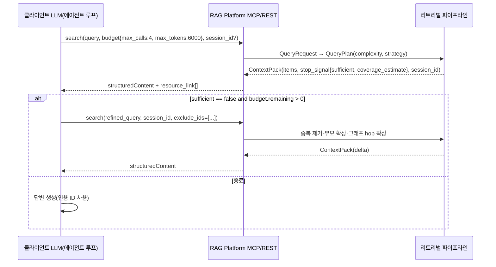
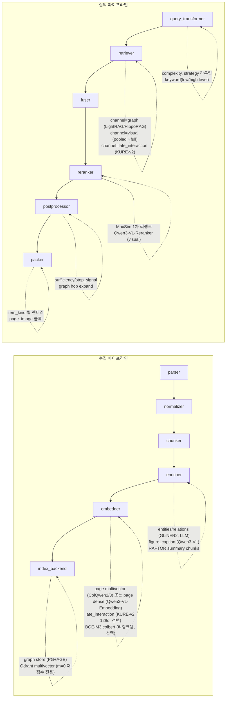
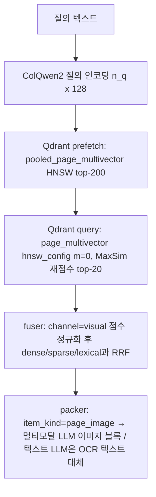

# 고급 RAG: GraphRAG·RAPTOR·에이전틱·멀티모달·late interaction

## 목적

브리프 R4("모든 기술을 사용하도록 설계" = 모두 기본 켬이 아니라 모두 플러그인으로 수용 가능한 확장 지점)와 D-10(플러그인 확장 지점)에 따라, 기본 하이브리드 파이프라인(D-07) 위에 선택적으로 얹는 네 계열의 고급 기법을 조사한다.

1. 그래프 기반 RAG(GraphRAG, LightRAG, HippoRAG 2, Graphiti, KAG, nano-graphrag, Fast-GraphRAG, RAG-Anything, PIKE-RAG, Cognee)와 재귀 요약 트리(RAPTOR), 장기 메모리형(MemoRAG), 그리고 이들이 필요로 하는 지식그래프 저장소·엔티티/관계 추출기.
2. 에이전틱 RAG(ReAct 루프, Self-RAG, CRAG, Adaptive-RAG, IRCoT, Search-R1/DeepResearch류 반복 검색)와 "검색 도구를 제공하는 플랫폼 vs 루프를 수행하는 클라이언트" 경계.
3. Late interaction(ColBERTv2/PLAID, KURE-v2, BGE-M3 colbert, PyLate)과 페이지 이미지 검색(ColPali·ColQwen2·ColQwen3·ColSmol·ColModernVBERT·colnomic), 단일 벡터 시각 문서 임베딩(Qwen3-VL-Embedding), 벡터 백엔드의 multivector 지원.
4. 멀티모달 보강(그림·차트 캡셔닝 VLM, 표 이해, 멀티모달 임베딩·리랭커)과 스캔 문서를 "이미지로 검색"할지 "OCR 텍스트로 검색"할지의 비교 근거.

결과물은 개방 결정 **O-03**(GraphRAG/RAPTOR를 코어 옵션 모듈로 둘지 외부 플러그인으로 둘지), **O-04**(late interaction의 위치), **O-05**(LLM 보강 기본 켬/끔)에 대한 명시적 권고와, `ChunkSet`/`EnrichedChunkSet`/`IndexRecord`/`QueryPlan`/`CandidateSet`/`ContextPack` 계약이 이 기법들을 손실 없이 수용하기 위해 예약해야 할 필드 제안이다.

모든 버전·라이선스·수치는 확인일(2026-09-18, 검증 반영 2026-09-22)에 1차 소스(GitHub README·릴리스, PyPI, Hugging Face 모델 카드, arXiv 본문, 공식 문서)를 직접 확인했다. 소스에 명시되지 않았거나 확인에 실패한 항목은 "확인 필요(as of 2026-09)"로 표기한다.

## 범위

| 포함 | 제외(다른 문서) |
|------|----------------|
| 그래프 RAG 프레임워크의 동작·비용·벤치마크, 지식그래프 저장소 라이선스, 엔티티/관계 추출기 | 기본 하이브리드 검색·융합·크로스인코더 리랭킹([07-retrieval-techniques-fusion-reranking.md](07-retrieval-techniques-fusion-reranking.md)) |
| RAPTOR·MemoRAG 등 요약 계층 인덱스 | 청킹 라이브러리 자체([04-chunking-strategies-and-libraries.md](04-chunking-strategies-and-libraries.md)) |
| 에이전틱 검색 루프의 패턴과 플랫폼/클라이언트 경계, MCP 도구 설계 함의 | Context Pack 직렬화·MCP 서버 구현([10-llm-context-optimization-and-mcp.md](10-llm-context-optimization-and-mcp.md)) |
| 텍스트·이미지 late interaction 모델, multivector 저장 비용, 백엔드 지원 | dense/sparse 임베딩 모델 선정·한국어 ColBERT 모델 상세([05-embedding-models-and-serving.md](05-embedding-models-and-serving.md)), 인덱스 백엔드 비교([06-vector-and-lexical-index-backends.md](06-vector-and-lexical-index-backends.md)) |
| 그림/차트 캡셔닝 VLM, 표 이해, 멀티모달 임베딩, 스캔 문서 이미지 검색 vs OCR 비교 | OCR 엔진 선정 O-08([02-document-parsing-pdf-layout-ocr.md](02-document-parsing-pdf-layout-ocr.md)) |
| 각 기법을 D-10 확장 지점에 매핑하고 계약 필드를 제안 | 계약 자체의 확정(03-contracts 문서 소유, 작성 예정) |

## 평가 기준

D-02(Apache/MIT/BSD 우선, AGPL은 네트워크 분리 서비스로만, GPL 라이브러리 링크 금지)와 원칙 6(Korean-First)을 반영해 라이선스와 한국어 지원에 높은 가중치를 둔다. 고급 기법은 기본 프로파일이 아니므로 운영 비용(LLM 토큰·GPU·저장량)을 별도 축으로 둔다.

| 기준 | 가중치 | 5점 기준 | 1점 기준 |
|------|--------|----------|----------|
| 라이선스 적합성(D-02) | 20 | Apache-2.0/MIT/BSD, 모델 가중치 포함 | SSPL/BSL/NC, 또는 GPL 링크 필요 |
| 품질/성능(공개 벤치마크) | 20 | 동료 평가 벤치마크에서 baseline 대비 유의한 개선 | 벤더 주장만 존재 |
| 한국어 지원 | 15 | 한국어 명시 지원 또는 언어 무관 구조, 한국어 공개 벤치마크 존재 | 영어 전용 |
| 성숙도/유지보수 | 15 | 12개월 내 정기 릴리스, 안정 API | 아카이브/무갱신 12개월 초과 |
| 통합 난이도 | 15 | 저장소·LLM·임베더를 주입 가능, 우리 계약으로 변환 용이 | 자체 서버·자체 스토리지 강제 |
| 운영 비용(토큰·GPU·저장) | 10 | 코퍼스 대비 추가 비용 < 10%, 질의당 토큰이 기본 RAG의 수 배 이내 | 코퍼스 토큰의 수 배 LLM 호출, 질의당 토큰이 기본 RAG의 100배 이상 |
| 커뮤니티/생태계 | 5 | 1만 스타 이상, 활발한 이슈 응답 | 개인 프로젝트 |

## 후보 목록

### A. 그래프 기반 RAG·요약 계층 프레임워크

| 이름 | 최신 버전(확인일 2026-09-18) | 라이선스 | 성숙도 | 한국어 지원 | 핵심 강점 | 약점 |
|------|------------------------------|----------|--------|-------------|-----------|------|
| Microsoft GraphRAG | PyPI `graphrag` 3.1.2 (2026-08-21), Python 3.11~<3.14 | MIT | 높음(월 단위 릴리스) | 프롬프트 언어 무관(프롬프트 튠 필요) | 커뮤니티 요약 + map-reduce 글로벌 질의, DRIFT 검색, `graphrag update` 증분 인덱싱, 레퍼런스 구현 | 인덱싱·글로벌 질의 토큰 비용 최고(GraphRAG-Bench Fig. 9: global 질의당 약 33만 토큰, local 약 3.9만 토큰) |
| LightRAG (HKU) | PyPI `lightrag-hku` 1.5.7 (2026-09-02), Python ≥3.10, 39.7k 스타 | MIT | 높음 | 언어 무관, 서버 WebUI | 이중 레벨(entity/relation 키워드) 검색, 증분 갱신, 저장소 플러그인(NetworkX/Neo4j/PostgreSQL+AGE/Memgraph, Qdrant/Milvus/FAISS/PG), 서버+MCP 유사 REST | 자체 추상화가 두꺼움, 리랭커 추가 시 1~2초 지연(README), GraphRAG-Bench Fig. 9 질의당 약 10만 토큰(기본 RAG의 100배 규모) |
| RAG-Anything (HKUDS) | GitHub 23.4k 스타, LightRAG 위의 멀티모달 계층(버전 확인 필요) | MIT | 중간(신생, 활발) | 언어 무관(VLM 의존) | MinerU/Docling/PaddleOCR 파서 + VLM 캡셔닝으로 그림·표·수식을 그래프 노드화, LightRAG와 동일 저장소 | LightRAG 종속, 파서를 자체 보유(우리 파서 계약과 중복) |
| nano-graphrag | GitHub 155 커밋, 약 1,100 LoC, 4k+ 스타 | MIT | 낮음~중간(최근 릴리스 확인 필요) | 언어 무관 | GraphRAG 알고리즘의 최소 구현(학습·포크 참조용) | 소규모 유지보수, 프로덕션 검증 부족 |
| HippoRAG 2 (OSU) | PyPI `hipporag` 2.0.0a4 (2025-06-24, pre-release) | MIT | 중간(학술) | 언어 무관(OpenIE는 LLM) | PPR 기반 passage 통합, 질의당 약 1,000 토큰으로 GraphRAG 계열 중 최저 비용(GraphRAG-Bench Fig. 9) | 알파 버전, torch 2.5.1·transformers 4.45.2·litellm 1.73.1·networkx 3.4.2·python_igraph 0.11.8 고정 의존, vLLM/NV-Embed 등 무거운 기본 의존 |
| Graphiti (Zep) | PyPI `graphiti-core` 0.30.2 (2026-09-08), Python ≥3.10 | Apache-2.0 | 높음 | 언어 무관 | 이중 시간(bi-temporal) 엣지, 하이브리드(임베딩+BM25+그래프) 검색, Pydantic 커스텀 엔티티 타입, MCP 서버 동봉 | 대화형 메모리 지향, Neo4j 5.26+/FalkorDB/Neptune 필요(Kuzu 지원은 0.29.2에서 deprecated, "업스트림 미유지"를 사유로 제거 예정) |
| KAG (OpenSPG) | GitHub 0.8.0 (2025-06-28, 최신 릴리스) | Apache-2.0 | 중간(15개월 무릴리스) | 문서 EN/zh/ja | 논리형식(logical form) 유도 추론, 전문 도메인 스키마 | OpenSPG 서버(Docker) 필수, 무거운 스택 |
| PIKE-RAG (Microsoft) | GitHub, EMNLP 2025 Findings(버전·스타 확인 필요) | MIT(확인 필요, as of 2026-09) | 중간(연구) | 언어 무관 | 도메인 지식 추출 + 질의 분해·추론 단계 구성(sPecIalized KnowledgE and Rationale), 그래프 없이 다중 홉 대응 | 연구 코드, 어댑터 계약 부재 |
| Cognee | GitHub v1.6.0 (2026-09-18), 30.9k 스타 | Apache-2.0 | 높음 | 언어 무관 | 에이전트 메모리용 그래프+벡터 파이프라인, "Postgres 단일 인스턴스로 전체 메모리 계층" 운영 가능(README) | 메모리 플랫폼 지향, 그래프 백엔드 목록은 문서 확인 필요 |
| Fast-GraphRAG (circlemind) | PyPI `fast-graphrag`, 249 커밋 | MIT | 중간 | 언어 무관 | PPR 탐색(HippoRAG 계보), 증분 갱신, GraphRAG-Bench Fig. 9 질의당 약 4,200 토큰 | 소규모 커뮤니티, 벤더 비용 주장(6배)은 별도 검증 필요 |
| RAPTOR (Stanford) | GitHub 20 커밋(2024 이후 무갱신 추정, 확인 필요); `llama-index-packs-raptor` 0.4.2 (2026-04-02)는 **deprecated 명시** | MIT | 낮음(참조 구현) | 언어 무관(요약 LLM 의존) | 재귀 클러스터링·요약 트리, QuALITY +20%p 절대 정확도(GPT-4, 논문), GraphRAG-Bench Fig. 9 질의당 약 3,500 토큰 | 유지보수 중단, OpenAI 하드 의존, 자체 구현 필요 |
| MemoRAG (BAAI) | GitHub, 2025-04 학습 스크립트 공개 | Apache-2.0 | 중간(학술) | 메모리 모델 의존(Qwen2 기반) | 장문 메모리 모델이 "clue"를 생성해 검색 유도(qwen2-7b 약 400K 토큰) | 7B 메모리 모델 GPU 상주, 코퍼스 규모 제한 |
| LlamaIndex PropertyGraphIndex | `llama-index-core` 계열, 문서 확인 | MIT | 높음 | 언어 무관 | 추출기(Simple/Schema/Dynamic LLM, Implicit)와 리트리버(Synonym/VectorContext/Text2Cypher/CypherTemplate) 조합형 | LlamaIndex 객체 모델 종속 |
| neo4j-graphrag-python | PyPI 1.19.0 (2026-08-26), Python 3.10~3.14 | Apache-2.0 | 높음 | 언어 무관 | SimpleKGPipeline, Vector/Hybrid/VectorCypher/Text2Cypher 리트리버, Qdrant/Weaviate 외부 벡터 연동 | Neo4j 서버 전제 |

### B. 지식그래프 저장소

| 이름 | 최신 버전(확인일) | 라이선스 | D-02 판정 | 비고 |
|------|------------------|----------|-----------|------|
| PostgreSQL + Apache AGE | AGE v1.8.0, PostgreSQL 11~18 지원 | Apache-2.0 | 적합 | D-14 PostgreSQL과 동일 인스턴스, openCypher; LightRAG가 `PostgreSQL+AGE` 그래프 저장소를 공식 지원 |
| NetworkX | 3.x(HippoRAG는 3.4.2 고정) | BSD-3 | 적합 | 인메모리; 컬렉션 단위 GraphML/JSON 산출물로 오브젝트 스토리지에 저장 가능. LightRAG·nano-graphrag 기본 |
| LadybugDB (구 Kuzu) | Kuzu 저장소 **2025-10-10 아카이브**(read-only, 최종 0.11.3, Apple 인수 후 종료); LadybugDB는 revival fork("formerly known as Kuzu"), GitHub 1.8k 스타, 6,400+ 커밋, PyPI `ladybug`(README 기준; `real-ladybug` 병행 배포 보고, 확인 필요), 공식 문서 docs.ladybugdb.com | MIT | 적합(성숙도 주의) | 임베디드, Cypher, 벡터·FTS 인덱스. Graphiti는 Kuzu 경로를 deprecated·제거 예정이라 **Graphiti 백엔드로는 사용 불가** |
| Neo4j Community | 2026.09.0 (2026-09-16), LTS 5.26.x(5.26.30, 2026-08-21) | 서버 **GPLv3**, Python 드라이버 `neo4j` 6.x **Apache-2.0** | 조건부(네트워크 분리 서비스로만, 법무 확인) | 생태계 최대. 서버는 별도 컨테이너, 코드 링크 없음 |
| FalkorDB | 2,421 커밋 | **SSPLv1** | 부적합(기본 제외) | GraphBLAS 희소행렬, Redis 모듈. SSPL은 OSI 미승인 |
| Memgraph | 확인 필요 | **BSL**(Community) / MEL | 부적합(기본 제외) | 사용자 자체 제공 백엔드로만 허용 |
| Amazon Neptune | 관리형 | 상용 | 클라우드 옵션 | Graphiti 지원 |

### C. 엔티티/관계 추출

| 이름 | 최신 버전(확인일) | 라이선스 | 한국어 | 핵심 강점 | 약점 |
|------|------------------|----------|--------|-----------|------|
| GLiNER (`gliner`) | 저장소 활성, `gliner_multi-v2.1` 등 | 코드·모델 Apache-2.0 | `gliner_multi-v2.1` 다국어(한국어 명시 없음, 확인 필요) | 제로샷 라벨 지정 NER, CPU 가능, `GLiNER.from_pretrained().predict_entities()` | 관계 추출 없음(v1) |
| GLiNER2 / GLiNER2.5 (`gliner2`) | GLiNER2 205M~340M, GLiNER2.5 74M~287M | Apache-2.0 | mDeBERTa 다국어 버전 존재(한국어 품질 확인 필요) | NER + 분류 + 구조화 추출 + **관계 추출**, CPU 우선, `AutoExtractor` | 신생, 한국어 벤치마크 없음 |
| GLiREL (`glirel`) | `jackboyla/glirel-large-v0` | **CC BY-NC-SA 4.0** | 영어 예시만 | GLiNER 위의 제로샷 관계 분류(엔티티 주어진 상태) | 비상업 라이선스 → D-02 제외 |
| spaCy `ko_core_news_lg` 3.8.0 | 3.8.0 | 코드 MIT, **모델 CC BY-SA 4.0** | 한국어 전용(KLUE·UD Kaist), NER F 85.27, 타입 DT/LC/OG/PS/QT/TI | 빠르고 안정 | 6개 타입 고정, 가중치 copyleft(재배포 시 주의) |
| LLM 구조화 추출(GraphRAG/LightRAG 프롬프트, Pydantic 스키마) | LLM 의존 | - | 프롬프트로 한국어 지정 | 개방형 타입·관계·설명 생성, 그래프 RAG의 사실상 표준 | 코퍼스 토큰의 1배 이상 LLM 비용, 비결정성 |

### D. Late interaction(텍스트·페이지 이미지)과 도구

| 이름 | 최신 버전(확인일) | 라이선스 | 한국어 | 핵심 강점 | 약점 |
|------|------------------|----------|--------|-----------|------|
| ColBERT (stanford-futuredata) + PLAID | main = ColBERTv2 + PLAID | MIT | `colbertv2.0` 영어 | 참조 구현, PLAID 엔진 | 영어 체크포인트, 활동 둔화 |
| PyLate (LightOn) | GitHub 894 스타 | MIT | 모델 의존 | sentence-transformers 기반 학습·PLAID/WARP/TACHIOM 인덱스·`rank.rerank()`, 1-bit 양자화 + 토큰 풀링 | 자체 모델 없음(모델은 별도) |
| sentence-transformers `MultiVectorEncoder` | v6.0.0+ (최신 v6.1.0, 05 문서) | Apache-2.0 | 모델 의존 | `encode_query`/`encode_document`/`similarity`(MaxSim), 텍스트·이미지 동일 API, colpali-engine이 이 클래스로 이관 권고 | 신규 API |
| FastEmbed | 0.x | Apache-2.0 | 모델 의존 | `LateInteractionTextEmbedding`(colbertv2.0), `LateInteractionMultimodalEmbedding`(`Qdrant/colpali-v1.3-fp16`), ONNX CPU | 모델 목록 제한 |
| **`nlpai-lab/KURE-v2`** | `skt/A.X-Encoder-base`(ModernBERT) 기반 154M, 토큰당 **128d**, 문서 8,192 토큰, 2026-08(모델 카드) | **Apache-2.0** | **한국어-영어 학습**, MTEB(kor,v2) 검색 9과제 평균 nDCG@10 **0.8160**(카드 자체 보고; KURE-v1 dense 0.7616, bge-m3 dense 0.7509) | 인덱스 단계 한국어 ColBERT 1차 후보, PyLate·`MultiVectorEncoder` 로드, 1-bit + 토큰 풀링으로 9코퍼스 1.7GB(카드 주장) | 신규(1개월), 카드 수치 자체 보고, 학계 유지 |
| `lightonai/mLateOn` / `LateOn` | mmBERT-base 기반 307M 다국어 / ModernBERT 영어, 128d, 8,192 토큰, 2026-06~07(arXiv 2607.27178) | Apache-2.0 | 명시 대상 언어에 한국어 없음; MIRACL 전언어 67.04, KURE-v2 카드 표 MTEB(kor,v2) 0.7906 | 기업(LightOn) 유지, PyLate 네이티브 | 한국어 비대상 학습(KURE-v2 대비 -2.5p) |
| `LiquidAI/LFM2-ColBERT-350M` | 350M, 다국어(한국어 명시 지원) | **LFM Open License v1.0**(D-02 검토 필요) | 한국어 명시 | 소형 다국어 ColBERT, vLLM LFM2 백본 | 커스텀 라이선스 → 기본 배포 제외, 법무 확인 후 옵션 |
| BGE-M3 colbert 벡터 | `BAAI/bge-m3` | MIT | 한국어 포함 다국어(MIRACL-ko multi-vec 71.2) | 추가 모델 없이 dense/sparse와 동일 패스, 권고 가중치 dense 0.4/sparse 0.2/colbert 0.4 | 토큰당 **1024d**(128d 모델의 8배 저장) → 인덱스 단계 제외, 리랭크 단계 전용 |
| `jinaai/jina-colbert-v2` | 0.6B, 128/96/64d, 8192 토큰 | **CC-BY-NC-4.0** | 94개 언어 | BEIR 0.531(ColBERTv2 0.496), MIRACL 0.627 | 비상업 → 제외 |
| `answerdotai/answerai-colbert-small-v1` | 33.4M | Apache-2.0 | 영어 | BEIR 53.79(ColBERTv2 50.02) | 영어 전용 |
| ColPali v1.x | `vidore/colpali-v1.3` | **Gemma 라이선스** | KoViDoRe 평가 대상(저성능) | 원조 페이지 이미지 검색 | 라이선스 제약, 1,030 벡터/페이지 |
| ColQwen2 v1.0 | `vidore/colqwen2-v1.0`, 128d | 백본 Qwen2-VL-2B Apache-2.0 + 어댑터 MIT | KoViDoRe(arXiv 2608.20840) 평가 대상(수치는 논문 표 참조, jina-v4 55.0 대비 열세) | **D-02 적합한 Qwen 계열 소형(2B) 모델** | ColQwen2.5·ColQwen3보다 구세대 |
| ColQwen2.5 v0.2 | `vidore/colqwen2.5-v0.2`, 최대 768 패치, 128d | 백본 **Qwen Research License** + 어댑터 MIT | 확인 필요 | 동적 해상도 | 비상업 백본 → 제외 |
| ColSmol-256M/500M | `vidore/colSmol-500M`, 128d, 예시 1,135 벡터/이미지 | 백본 SmolVLM Apache-2.0 + 어댑터 MIT | KoViDoRe 평가 대상(하위권) | 소형, CPU 가능 | 벡터 수 많음, 다국어 미학습 |
| ColModernVBERT (LightOn) | 250M, 2025-10-01(arXiv 2510.01149) | MIT | 확인 필요 | "10배 큰 모델과 동급"(모델 카드), 소형 | 신생, 다국어 미검증 |
| **`TomoroAI/tomoro-colqwen3-embed-4b` / `-8b`** | Qwen3-VL-4B-Instruct + Qwen3-Embedding-4B 병합 4B / 8B, 토큰당 **320d** | Apache-2.0 | KoViDoRe 평가 대상; Qwen3-VL 백본(OCR 32개 언어에 한국어) | ViDoRe V1 0.9057, V2 0.6598, V3 0.5934, 다국어 V2 0.6080 / V3 0.5708(카드) | ColQwen2 대비 파라미터 2~4배, 벡터당 저장 2.5배(320d), GPU 요구 상승 |
| ColQwen3 소형 변형(05 문서 후보) | `SauerkrautLM-ColQwen3-2b`(128d), `Ops-Colqwen3-4B`(128~2560 선택) | 확인 필요 | 확인 필요 | Qwen3-VL 백본으로 128d 유지 | 개인/소규모 유지, 라이선스·수치 확인 필요(as of 2026-09) |
| **`nomic-ai/colnomic-embed-multimodal-7b` / `-3b`** | ColPali형 다국어 멀티벡터, 7B / 3B | 7b **Apache-2.0**; 3b는 Qwen2.5-VL-3B 백본(**Qwen Research** 주의) | KoViDoRe 평가 대상 | 다국어 학습, ViDoRe 상위 | 7B GPU 비용, 3b 라이선스 제외 |
| `jinaai/jina-embeddings-v4` | 4B, dense 2048d + multi-vector 128d | **Qwen Research License**(Qwen2.5-VL-3B 파생) | KoViDoRe **최고 55.0 nDCG@10** | 텍스트·이미지·시각 문서 통합 | 비상업 → 제외(품질 상한 참조용) |

### E. VLM 캡셔닝·멀티모달 임베딩·리랭커

| 이름 | 최신 버전(확인일) | 라이선스 | 한국어 | 핵심 강점 | 약점 |
|------|------------------|----------|--------|-----------|------|
| Qwen3-VL | 2B/4B/8B/32B dense, 30B-A3B/235B-A22B MoE, Instruct/Thinking(2025-09-23~10-21) | Apache-2.0 | **OCR 32개 언어에 한국어 포함** | 문서·차트·표 이해, vLLM 서빙 | 4B 이상 GPU 필요 |
| **`Qwen/Qwen3-VL-Embedding-2B` / `-8B`** | 2026-01-08, arXiv 2601.04720, MRL **64~2048d** 단일 벡터 | **Apache-2.0** | **30+ 언어에 한국어 명시** | 텍스트·이미지·스크린샷·비디오·시각 문서 통합 임베딩, ViDoRe v1 84.4, MMEB-V2 73.2(2B)/80.1(8B); 페이지당 1개 벡터로 기존 dense 인덱스 경로 재사용 | late interaction 아님(정밀도 열세 가능), 한국어 VDR 수치 미공개 |
| **`Qwen/Qwen3-VL-Reranker-2B` / `-8B`** | 2026-01-08, 동일 논문 | Apache-2.0 | 30+ 언어 | 텍스트-이미지·시각 문서 멀티모달 리랭커(Embedding과 세트) | GPU 리랭크 비용 |
| Qwen2.5-VL | 3B/7B/72B | 7B Apache-2.0; 3B **Qwen Research**; **72B Qwen License(비Apache) → 제외** | 확인 필요 | DocVQA 95.7, ChartQA 87.3, OCRBench 864(7B 카드) | 3B·72B 비허용 라이선스 |
| SmolVLM2 | 256M/500M/2.2B | Apache-2.0 | **영어** | 2.2B: OCRBench 72.9, ChartQA 68.84, DocVQA 79.98; 5.2GB VRAM | 영어 전용 |
| Florence-2 | 0.23B/0.77B | MIT | **영어** | 캡션·OCR·검출·영역 캡션 단일 모델 | 영어 전용 |
| Docling `do_picture_description` | granite-vision-3.1-2b-preview, SmolVLM-256M, 임의 HF 모델, `PictureDescriptionApiOptions`(vLLM/Ollama) | Docling MIT | 원격 VLM에 위임 가능 | `PictureItem` 주석으로 결과 부착 → ParsedDocument 어댑터에 자연 통합 | 기본 모델은 영어 중심 |
| Docling `VlmPipeline` | SmolDocling-256M, granite-docling-258M, granite-vision-3.2-2b, Qwen2.5-VL-3B(MLX), Pixtral-12b, Gemma-3-12b, Nanonets-OCR2-3B, Phi-4-multimodal; OpenAI 호환 원격 | 모델별 상이 | 모델 의존 | 스캔 페이지 end-to-end DocTags | 한국어 미검증(02 문서 참조) |
| `jinaai/jina-clip-v2` | 0.9B, 1024d(MRL→64), 512px | **CC BY-NC 4.0** | 89개 언어(한국어 포함) | 텍스트-이미지 통합 공간 | 비상업 → 제외 |
| SigLIP 2 (`google/siglip2-so400m-patch16-naflex`) | so400m 1B 등 | Apache-2.0 | 다국어(WebLI) | 제로샷 분류·이미지-텍스트 검색, VLM 비전 인코더 | 문서 페이지 특화 아님 |
| `nomic-ai/nomic-embed-vision-v1.5` | v1.5 | Apache-2.0 | 영어 | nomic-embed-text-v1.5와 동일 공간 | 영어, 우리 기본 텍스트 임베더(BGE-M3)와 공간 불일치 |

### F. 한국어 시각 문서 검색 벤치마크(D-12 골든셋 후보)

| 이름 | 출처 | 규모 | 라이선스 | 비고 |
|------|------|------|----------|------|
| SDS KoPub VDR | arXiv 2511.04910 (Samsung SDS), HF 데이터셋·MTEB 태스크 `SDSKoPubVDRT2IRetrieval`/`T2ITRetrieval` | 공문서 361건(KOGL 제1유형 256 + 법령 105), 40,781페이지, 질의 600 | 문서 KOGL Type 1, 데이터셋 CC BY-SA 4.0(09 문서) | 한국 공공문서 표·그래프·레이아웃, 09 문서 골든셋 목록과 일치 |
| KoViDoRe | arXiv 2608.20840 (2026-08-21), HF `whybe-choi/kovidore-v2-*-mteb` | 4도메인(cybersecurity/economic/energy/hr) 다중 페이지 | CC BY 4.0 | ColSmol·ColQwen2·ColPali·jina-embeddings-v4·Qwen3-VL-Embedding-2B/8B·tomoro-colqwen3·colnomic-3B/7B 평가; 최고 jina-embeddings-v4 55.0 nDCG@10, "현재 모델들이 한국어 구조화 문서에서 어려움"(논문) |
| KoVRE / Ko-VDR Train Public | arXiv 2608.01389 / HF | 학습 쌍 310,226 | 확인 필요 | 한국어 시각 문서 검색 파인튠 데이터 |
| ViDoRe V3 | arXiv 2601.08620 | 26k 페이지, 질의 6개 언어 번역(한국어 미포함), 시각 grounding | 확인 필요 | `visual-pages` 다국어 회귀 기준(V1/V2는 영어·프랑스어 중심) |

## 심층 비교

### GraphRAG 계열 공통: 언제 이기고 언제 지는가

두 편의 독립 평가(동료 평가 arXiv)가 일관된 결론을 낸다.

| 질의 유형 | 승자 | 근거(출처) |
|-----------|------|-----------|
| 단일 홉 사실 질의(NQ 등) | **기본 RAG** | RAG vs GraphRAG(arXiv 2502.11371): 세부 사실 질의는 RAG 우세. GraphRAG-Bench(arXiv 2506.05690) Level 1: 기본 RAG가 GraphRAG와 같거나 우세, 그래프는 "중복·잡음 도입" |
| 다중 홉 추론(HotpotQA, MultiHop-RAG) | **Community-GraphRAG(local), HippoRAG 2** | 2502.11371: 두 방식이 RAG와 "상보적". GraphRAG-Bench Level 2: HippoRAG 증거 재현율 87.9~90.9%, HippoRAG 2 컨텍스트 관련성 85.8~87.8% |
| 코퍼스 수준 요약·주제 질의 | **Global search(커뮤니티 요약)** | 2404.16130: 포괄성·다양성 개선; 2502.11371: Global은 "코퍼스 커버리지", RAG는 "질의 특화 세부"에 강함 |
| 창작·개방형 생성 | 혼합 | GraphRAG-Bench Level 4: RAPTOR 충실도 70.9%지만 증거 커버리지 40% |
| 그래프 구축 LLM 품질 | 강한 LLM 필수 | 2502.11371: GPT-4o vs GPT-4o-mini 구축 시 비교·시간 추론에서 큰 격차 |
| 혼합 전략 | Integration > Selection | 2502.11371: MultiHop-RAG, Llama 3.1-70B에서 Integration(양쪽 증거 연결) +6.4%, Selection(LLM 라우팅) +1.1% |

비용은 결정적 변수다. GraphRAG-Bench(arXiv 2506.05690)는 본문 서술("LightRAG 약 10^4", "GraphRAG global 7,800→40,000")과 Figure 9 실측치가 약 10배 어긋나는 내부 불일치가 있다. 본 문서는 **Figure 9 실측치**를 기준으로 삼고, 우리 코퍼스에서의 자체 측정을 채택 게이트로 둔다.

| 시스템 | 질의당 프롬프트 토큰(GraphRAG-Bench Fig. 9, Novel / Medical) | 기본 RAG 대비 | 인덱싱 비용 근거 |
|--------|-----------------------------------------------------------------|---------------|------------------|
| 기본 RAG | 879 / 954 | 1배 | 임베딩만 |
| HippoRAG 2 | 1,008 / 1,020 | 약 1.1배 | OpenIE 1회 통과, 커뮤니티 요약 없음 |
| RAPTOR | 3,441 / 3,510 | 약 4배 | 클러스터 요약 LLM(트리 레벨 수 × 클러스터 수) |
| Fast-GraphRAG | 4,204 / 4,298 | 약 4.5배 | 엔티티/관계 추출 1회 통과 |
| MS GraphRAG(local) | 38,707 / 39,821 | 약 42배 | 엔티티/관계/클레임 추출 + 커뮤니티 보고서 |
| LightRAG(기본 mix/hybrid) | **100,832 / 100,310** | **약 105배** | 엔티티/관계 추출 1회 통과, 증분 갱신 시 커뮤니티 재구축 없음(커뮤니티 자체가 없음) |
| MS GraphRAG(global) | 331,375 / 332,881 | 약 350배 | LightRAG 논문 측정(구버전 GraphRAG): Legal(94문서, 5.08M 토큰)에서 1,399 커뮤니티, 레벨-2 610개 × 약 1,000 토큰 = 질의당 610K 토큰·수백 API 호출; **초기 구축(또는 최악 케이스 전체 재인덱싱)** 약 1,399 × 2 × 5,000 = 약 14M 토큰(코퍼스의 약 2.8배, 본 문서 계산) |

해석: LightRAG는 GraphRAG global의 약 1/3 비용이지만 GraphRAG local의 2.5배, HippoRAG 2·기본 RAG의 약 100배다. LightRAG 기본 `mix` 모드는 엔티티·관계 설명과 청크를 모두 컨텍스트에 넣기 때문이며, `top_k`·`max_token_for_*` 파라미터로 줄일 수 있으나 벤치마크 기본값 기준 수치가 이렇다. 따라서 "LightRAG = 저비용"이라는 통념은 성립하지 않고, 그래프 엔진의 1차 선정은 **우리 코퍼스에서의 mix 모드 프롬프트 토큰 자체 측정 전까지 보류**한다(권고안 참조).

결론: 그래프 RAG는 **(a) 다중 홉·비교·시간 추론 질의 비율이 높거나 (b) 코퍼스 전체 요약 질의가 있는 컬렉션**에서만 투자 대비 효과가 있고, FAQ·규정 조회형 컬렉션에서는 기본 프로파일보다 못하거나 비용만 는다. 따라서 컬렉션 프로파일 단위로 켜고, 질의 시점에는 `QueryPlan` 라우팅(Selection) 또는 채널 융합(Integration)으로 결합해야 한다.

### Microsoft GraphRAG

- 동작 방식: 텍스트 유닛 → LLM 엔티티/관계/클레임 추출 → 그래프 → 계층 커뮤니티 탐지 → 커뮤니티 보고서(LLM 요약) 사전 생성. 질의 모드 네 가지: **local**(엔티티 이웃 + 원문 청크), **global**(모든 커뮤니티 보고서에 map-reduce, 문서에 "resource-intensive" 명시), **DRIFT**(local에 커뮤니티 정보를 더해 후속 질문으로 확장), **basic**(비교용 벡터 RAG).
- 진입점: `pip install graphrag`; CLI `graphrag init`, `graphrag index`, `graphrag update`(증분 인덱싱: 기존 엔티티 ID 유지·병합, `update_output` 저장소 분리, 커뮤니티 재계산 최소화), `graphrag query --method {local,global,drift,basic}`; Python API `graphrag.api.build_index`, `graphrag.api.local_search`/`global_search`/`drift_search`(함수 시그니처 상세 확인 필요). 산출물은 parquet 테이블(entities, relationships, communities, community_reports, text_units).
- 출력 형식: 답변 문자열 + 컨텍스트 데이터프레임(참조 엔티티·보고서·텍스트 유닛 ID). 우리 계약으로는 `CandidateSet` 항목에 `item_kind=community_report|entity|chunk`로 변환 가능.
- 성능 근거: 2404.16130(1M 토큰급 코퍼스에서 포괄성·다양성 개선), 반면 GraphRAG-Bench Fig. 9에서 global 모드는 질의당 약 33만 토큰, local 약 3.9만 토큰.
- 함정: (1) 인덱싱 LLM 비용이 코퍼스 토큰의 수 배. (2) 문서 추가는 `graphrag update`로 증분 가능하나(0.5.0/1.0 이후), 변경량이 임계를 넘으면 커뮤니티 재계산·보고서 재요약이 발생하고 최악은 전체 재인덱싱과 같다(LightRAG 논문의 "전체 재구축" 측정은 증분 갱신 도입 이전 버전 기준). (3) 프롬프트 튠(`graphrag prompt-tune`) 없이는 한국어 엔티티 타입이 영어 기본값에 끌려간다. (4) 자체 벡터 스토어 추상화(LanceDB 기본)라 Qdrant와 이중 저장.

### LightRAG

- 동작 방식: 청크 → LLM 엔티티·관계 추출(설명 포함) → 그래프 + 엔티티/관계 키-값 저장 + 벡터 인덱스. 질의 시 LLM이 **저수준(엔티티)·고수준(주제) 키워드**를 생성하고 각각 엔티티/관계 벡터 검색 → 그래프 1-hop 확장 → 청크 병합. 모드 `local`/`global`/`hybrid`/`naive`/`mix`(기본 `mix`), `bypass`.
- 진입점: `from lightrag import LightRAG, QueryParam`; `LightRAG(working_dir=..., llm_model_func=..., embedding_func=..., graph_storage="PGGraphStorage"|"Neo4JStorage"|"NetworkXStorage"|"MemgraphStorage", vector_storage="QdrantVectorDBStorage"|"PGVectorStorage"|..., kv_storage="PGKVStorage"|...)`(저장소 클래스명은 README 기준, 최신 정확 명칭 확인 필요); `await rag.ainsert(text)`, `await rag.aquery(q, param=QueryParam(mode="mix", top_k=..., enable_rerank=...))`. 서버 `lightrag-server`(REST, `/webui`, `/workspace`). 멀티모달 확장은 RAG-Anything(MIT)이 같은 저장소 위에서 그림·표·수식 노드를 추가한다.
- 출력 형식: 답변 문자열 또는 `only_need_context=True`로 컨텍스트(엔티티·관계·청크 섹션) 반환 → 우리 `CandidateSet`으로 변환하는 자연스러운 훅.
- 성능 근거: LightRAG 논문 UltraDomain **Overall 승률** vs NaiveRAG 60.0~84.8%, vs GraphRAG 49.6~54.8%(전 지표 Comprehensiveness/Diversity/Empowerment/Overall 범위는 vs NaiveRAG 57.2~86.4%, vs GraphRAG 49.2~77.2%, Diversity에서 최대 77.2%; LLM-judge, 저자 평가). GraphRAG-Bench Fig. 9: 질의당 약 10만 토큰(GraphRAG global의 약 1/3, local의 2.5배, 기본 RAG의 약 105배).
- 함정: (1) `mix` 모드 기본은 LLM 키워드 생성 1회가 항상 선행 → 지연 +1 LLM 호출. (2) 기본 파라미터의 컨텍스트가 매우 커서(위 표) `top_k`·토큰 상한을 우리 `ContextPack` 예산에 맞춰 강제해야 한다. (3) 리랭커 추가 시 1~2초(README). (4) 저장소 4종(KV/vector/graph/doc-status)이 각각 플러그인이라 운영 복잡도. (5) 엔티티 이름 정규화가 대소문자·표기 변형에 약해 한국어 조사·띄어쓰기 변형에서 중복 엔티티가 생기기 쉬움(자체 평가 필요).

### HippoRAG 2

- 동작 방식: OpenIE(LLM)로 (주어, 관계, 목적어) 삼중항 추출 → 구절(passage) 노드와 엔티티 노드가 공존하는 그래프 → 질의 시 임베딩으로 시드(엔티티·사실·구절) 선택, LLM "recognition memory"로 필터 → **Personalized PageRank**로 구절 순위화. 커뮤니티 요약이 없어 인덱싱·질의 비용이 낮다.
- 진입점: `pip install hipporag`; `from hipporag import HippoRAG`; `HippoRAG(save_dir=..., llm_model_name=..., embedding_model_name=...)`, `.index(docs)`, `.retrieve(queries, num_to_retrieve=k)`, `.rag_qa(...)`.
- 출력 형식: 순위화된 구절 목록 + 점수 → `CandidateSet` 직결.
- 성능 근거: 논문(arXiv 2502.14802) 연상 기억 과제 SOTA 임베딩 대비 +7%; GraphRAG-Bench 다중 홉 최상위, 질의당 약 1,000 토큰(Fig. 9).
- 함정: PyPI 2.0.0a4 알파. requirements가 `torch==2.5.1`, `transformers==4.45.2`, `litellm==1.73.1`, `networkx==3.4.2`, `python_igraph==0.11.8`, `pydantic==2.10.4` 등을 **정확 버전으로 고정**해 우리 스택(Pydantic v2 최신, vLLM/transformers 최신)과 같은 프로세스에 두기 어렵다 → 별도 워커 컨테이너로 격리. 기본 임베더가 NV-Embed-v2/GritLM 등 대형 모델 지향 → BGE-M3로 교체 가능한지 어댑터 검증 필요. 그래프는 igraph/NetworkX 인메모리(대규모 컬렉션 메모리 상주).

### Graphiti (Zep)

- 동작 방식: 에피소드(텍스트/JSON) 단위로 엔티티·관계 추출, **이중 시간 모델**(`valid_at`/`invalid_at`)로 사실 무효화 대신 이력 보존, 검색은 임베딩 + BM25 + 그래프 탐색 하이브리드(LLM 요약 없음).
- 진입점: `from graphiti_core import Graphiti`; `Graphiti(uri, user, password)`(Neo4j 5.26+; FalkorDB 1.1.2+; Neptune), `await g.build_indices_and_constraints()`, `await g.add_episode(name, episode_body, source=EpisodeType.text|json|message, reference_time=...)`, `await g.search(query)`; 커스텀 엔티티는 Pydantic 모델. MCP 서버 동봉.
- 성능 근거: Zep 논문(arXiv 2501.13956) DMR 94.8% vs MemGPT 93.4%, LongMemEval 정확도 최대 +18.5%·지연 90% 감소(벤더 논문).
- 함정: 대화 메모리 최적화라 정적 문서 코퍼스 인덱싱에는 과잉. 기본 백엔드 Neo4j(GPLv3 서버) 또는 FalkorDB(SSPL); Kuzu/LadybugDB 경로는 deprecated. 우리 플랫폼에서는 "테넌트별 시간 변화 사실 그래프"가 필요한 특수 컬렉션에서만 외부 플러그인으로.

### KAG (OpenSPG)·PIKE-RAG·Cognee

- KAG: SPG 스키마 기반 지식 구축 + 논리형식(logical form) 계획 → 기호 추론과 검색 혼합. OpenSPG 서버 필수. 0.8.0(2025-06-28) 이후 15개월 무릴리스, Docker 다중 서비스 스택, 문서 EN/zh/ja. 우리 아키텍처(Temporal + FastAPI + Qdrant/OpenSearch)와 중복 컴포넌트가 많아 어댑터 비용이 크다. 후보 유지, 채택 보류.
- PIKE-RAG(Microsoft, EMNLP 2025 Findings): 도메인 지식 원자화 + 질의 분해·추론 단계 구성으로 그래프 없이 다중 홉을 다루는 접근. "그래프 대체" 관점의 참고 구현으로 두되, 연구 코드라 어댑터 대상은 아니다(라이선스·버전 확인 필요, as of 2026-09).
- Cognee(Apache-2.0, v1.6.0, 30.9k 스타): 에이전트 메모리 플랫폼으로 그래프+벡터 파이프라인을 Postgres 단일 인스턴스에서 운영 가능(README). 정적 문서 RAG보다 에이전트 세션 메모리 지향이라 Graphiti와 같은 범주(특수 컬렉션 플러그인)로 분류한다.

### RAPTOR와 요약 계층

- 동작 방식: 리프 청크 임베딩 → (UMAP 차원 축소 + GMM 소프트 클러스터링) → 클러스터별 LLM 요약 → 요약을 다시 임베딩·클러스터링해 루트까지 반복. 검색은 **tree traversal** 또는 **collapsed tree**(모든 레벨 노드를 평평하게 두고 상위 k). 논문은 collapsed tree가 동등 이상이라고 보고한다(원문 재확인 필요).
- 진입점(참조 구현): `from raptor import RetrievalAugmentation`; `BaseSummarizationModel`/`BaseQAModel`/`BaseEmbeddingModel` 상속으로 모델 교체. OpenAI 키 요구, Python 3.8+, 커밋 20개로 유지보수 사실상 중단. LlamaIndex 팩은 deprecated 명시.
- 성능 근거: QuALITY 절대 정확도 +20%p(GPT-4, 논문 초록). GraphRAG-Bench: 창작 과제 충실도 70.9%, 증거 커버리지 40%; 질의당 약 3,500 토큰(Fig. 9, 기본 RAG의 4배).
- 설계 함의(핵심): collapsed tree는 **"요약 노드를 일반 청크와 같은 인덱스에 넣는 것"** 과 동일하다. 즉 RAPTOR는 새 리트리버가 아니라 **`enricher`가 생성하는 파생 청크(item_kind=summary, tree_level=n)** 로 수용할 수 있고, 검색·융합·리랭킹·패킹은 기본 파이프라인을 그대로 쓴다. 이것이 O-03에서 RAPTOR를 GraphRAG와 다르게 취급하는 이유다.

### MemoRAG

- 동작 방식: 장문 메모리 모델(`TommyChien/memorag-qwen2-7b-inst`, 약 400K 토큰; `memorag-mistral-7b-inst`, 약 128K)이 코퍼스 전체를 "기억"한 뒤 질의에 대해 clue(초안 답·키워드)를 생성, clue로 실제 청크를 검색.
- 함정: 컬렉션 규모가 메모리 모델 컨텍스트에 갇힘, 7B 모델 GPU 상주. 우리 구조에서는 `query_transformer` 플러그인(clue 생성 = 질의 확장)으로만 의미가 있다. 후보 유지, 기본 미채택.

### 지식그래프 저장소 선택

| 관점 | PostgreSQL+AGE | NetworkX(+산출물) | LadybugDB(구 Kuzu) | Neo4j CE |
|------|----------------|-------------------|---------------------|----------|
| D-02 | Apache-2.0 | BSD-3 | MIT | 서버 GPLv3(분리 서비스), 드라이버 Apache-2.0 |
| D-14 정합 | **동일 PostgreSQL 인스턴스, 추가 DB 없음** | 무상태 워커에 적합, 컬렉션 규모 제한 | 임베디드 파일 | 별도 클러스터 운영 |
| 멀티테넌시(D-09) | 그래프 이름 = `{tenant}_{collection}` 또는 노드 속성 필터 | 컬렉션당 그래프 파일 | DB 파일 분리 | 데이터베이스 분리(Enterprise 기능) 또는 라벨 필터 |
| 성숙도 | v1.8.0, PG 11~18 | 최고 | Kuzu 아카이브(2025-10-10) 후 커뮤니티 fork(1.8k 스타, PyPI `ladybug`); Graphiti 등 상위 프레임워크가 지원 철회 | 최고(2026.09.0, LTS 5.26.x) |
| 생태계 | LightRAG 지원 | LightRAG·nano-graphrag·HippoRAG 기본 | LlamaIndex 지원(Kuzu 시절), Graphiti 제외 | 모든 프레임워크 |

**결정(권고):** 그래프 플러그인의 기본 저장소는 **PostgreSQL + Apache AGE**, 개발/`lite`는 **NetworkX**(GraphML 산출물을 오브젝트 스토리지에 content-addressed 저장). Neo4j CE는 사용자가 운영하는 외부 서비스로 연결만 허용(법무 확인 후). FalkorDB·Memgraph는 기본 배포에서 제외. LadybugDB는 임베디드 대안으로 감시 목록에만 둔다.

### 엔티티/관계 추출 전략

| 전략 | 비용 | 품질 | 한국어 | 용도 |
|------|------|------|--------|------|
| GLiNER2 제로샷(CPU) | 매우 낮음 | 중(라벨 설계 의존) | mDeBERTa 다국어, **골든셋 검증 필요** | 기본 프로파일의 `enricher.entities`(필터·부스트·파셋용) |
| spaCy `ko_core_news_lg` | 매우 낮음 | KLUE 기준 F 85.27, 6타입 | 한국어 전용 | 한국어 뉴스형 문서의 PS/OG/LC/DT 추출 폴백. 모델 CC BY-SA 4.0 → 컨테이너 재배포 시 표기 의무 검토 |
| LLM 구조화 추출(Pydantic 스키마, 관계·설명 포함) | 코퍼스 토큰 1배 이상 | 최고 | 프롬프트로 제어 | 그래프 프로파일 전용(O-05 비용 정책 적용) |
| GLiREL 제로샷 관계 | 낮음 | 미검증 | 영어 예시만 | **CC BY-NC-SA 4.0으로 D-02 제외**(기록만) |

엔티티 정규화(canonicalization)는 한국어에서 조사·띄어쓰기·약칭(예: "삼성전자", "삼성전자(주)", "삼성")이 별개 노드가 되는 문제가 크다. 정규화 단계(형태소 기반 표제어 + 임베딩 유사도 병합)를 `enricher` 내부 서브스텝으로 두고 `canonical_id`를 부여한다.

### 에이전틱 RAG 패턴

| 패턴 | 핵심 메커니즘 | 근거(출처) | 우리 플랫폼에서의 위치 |
|------|---------------|-----------|------------------------|
| ReAct 검색 루프 | 생각 → 도구 호출(검색) → 관찰 반복 | 사실상 표준 | **클라이언트(LLM) 측 루프**, 플랫폼은 MCP `search` 도구 |
| IRCoT | CoT 문장마다 검색을 끼워 넣음 | arXiv 2212.10509: GPT-3에서 검색 +21%p, QA +15%p(HotpotQA/2Wiki/MuSiQue/IIRC) | 클라이언트 루프; 서버는 `session_id`로 중복 제거 지원 |
| Self-RAG | 반영 토큰으로 검색 필요·관련성·지지도 자체 판단(7B/13B 학습 모델) | arXiv 2310.11511 | 특수 학습 모델 필요 → 범위 외; 서버는 `relevance`·`support` 힌트 필드 제공 |
| CRAG | 경량 검색 평가기 → correct/incorrect/ambiguous 행동, 웹 폴백, 분해-재구성 | arXiv 2401.15884 | 평가기는 서버 `postprocessor`(충분성 판정)로, 행동 선택은 클라이언트 |
| Adaptive-RAG | 소형 분류기로 질의 복잡도 → 무검색/단일/다단계 | arXiv 2403.14403 | 서버 `query_transformer`가 `QueryPlan.complexity` 산출(07 문서와 일치) |
| Search-R1 / DeepResearch류 | RL로 다중 턴 검색 호출을 학습, 검색 토큰 마스킹 | arXiv 2503.09516: Qwen2.5-7B +41%, 3B +20% 상대 개선(7개 QA) | 클라이언트 모델 역량; 서버는 예산·종료 신호 제공 |
| 계획-실행(plan-and-execute) | 하위 질문 계획 → 병렬 검색 → 종합 | Agentic RAG 서베이(arXiv 2501.09136): reflection/planning/tool use/multi-agent | 서버 `search_batch`(다중 질의 1회 호출)로 왕복 절감 |

경계 원칙: **플랫폼은 "검색 도구 + 예산·상태·종료 신호"를 제공하고, 추론 루프·답변 생성은 클라이언트가 수행한다**(브리프 §6 비목표: 최종 답변 생성은 레퍼런스 구현만). 서버 측에 허용하는 "에이전틱" 요소는 생성 없이 결정론적으로 끝나는 것으로 한정한다: 질의 복잡도 분류, 하위 질의 분해(1단계), 그래프 1~2 hop 확장, 충분성 점수. 다단계 LLM 루프를 서버에 넣으면 지연 SLO(§7 p95 < 800ms)와 관측성(원칙 8)이 무너진다.

MCP 2026-07-28 스펙에서 활용할 요소: 도구 `outputSchema` + `structuredContent`(ContextPack을 구조화 결과로), `resource_link`(문서 원문·페이지 이미지 링크), 도구 실행 오류 `isError: true`(모델 자기수정), "Stateful Tools" 지침(명시적 핸들 = `session_id`를 결과에 담고 후속 호출 인자로 받기), 선택적 **Tasks 확장**(장시간 그래프 global 질의의 비동기 실행).



### Late interaction: 텍스트

- ColBERTv2/PLAID: 토큰당 128d 벡터, MaxSim. PLAID는 중심점(centroid) 기반 후보 생성으로 대규모 인덱스 검색. 참조 구현 MIT, 영어 체크포인트.
- **한국어 허용 라이선스 128d 모델이 존재한다**(05 문서와 일치): `nlpai-lab/KURE-v2`(Apache-2.0, 154M, ModernBERT 계열 A.X-Encoder-base, 토큰당 128d, 8,192 토큰, MTEB(kor,v2) 검색 nDCG@10 0.8160 카드 보고). 비한국어 학습 다국어 대안 `lightonai/mLateOn`(Apache-2.0, 307M, 128d; 한국어 비대상이나 0.7906), 한국어 명시 지원 `LiquidAI/LFM2-ColBERT-350M`(LFM Open License → D-02 법무 검토 전 제외). 따라서 "허용 라이선스 다국어 텍스트 late interaction 모델 부재"라는 0.1.0의 전제는 철회한다.
- 저장량(계산, fp16 2바이트 기준, 평균 300토큰 청크 100만 개): **128d(KURE-v2) 약 77GB**, turbo4(4비트) 약 19GB, PyLate 1-bit + 토큰 풀링(계수 2~3)은 수 GB대(05 문서 계산). **1024d(BGE-M3 colbert) 약 614GB**로 인덱스 단계 저장은 비현실적. 즉 인덱스 단계 late interaction은 128d 한국어 모델 + 압축 조건에서 "비교 대상"이고, BGE-M3 colbert는 리랭크 단계 전용이다.
- BGE-M3 colbert 리랭크 경로: `BGEM3FlagModel.encode(..., return_colbert_vecs=True)` → `float[n_tokens, 1024]`, `colbert_score()`. (a) 상위 N 후보의 원문을 질의 시점에 재인코딩해 MaxSim을 계산(GPU 필요, 지연 증가)하거나, (b) 청크당 토큰 벡터를 압축해 Qdrant multivector에 저장하고 서버 측 재점수(`prefetch` → `query`)로 쓴다. 07 문서의 "리랭커 1차 경량 단계, 기본 끔"과 동일하다.
- Qdrant multivector: 1.10.0부터 `MultiVectorConfig(comparator=MAX_SIM)`, 포인트당 `sub_vectors × dim < 1,048,576` 하드 제한(128d → 최대 8,192 서브벡터, 1024d → 최대 1,024 서브벡터 = BGE-M3 colbert 청크 상한 1,024토큰). MaxSim은 포인트당 단일 점수(서브벡터별 점수 없음). **재점수 전용 저장은 multivector 필드에 `hnsw_config=HnswConfigDiff(m=0)`으로 HNSW를 비활성하는 것이 Qdrant 공식 문서·튜토리얼(Multivectors and Late Interaction, ColPali/ColQwen PDF retrieval at scale)이 명시하는 표준 구성**이며 06 문서의 재스코어링 패턴과 일치한다(확인 완료). 압축은 `turbo4` datatype + 1-bit TurboQuant(1.18+)가 튜토리얼로 확인됨(05 문서); scalar/binary 양자화의 멀티벡터 적용 여부는 미기재.
- 서빙: sentence-transformers `MultiVectorEncoder`(v6.0.0+), PyLate(`rank.rerank()` 인덱스 없이 리랭킹, PLAID/WARP/TACHIOM 인덱스), FastEmbed `LateInteractionTextEmbedding`(ONNX CPU, colbertv2.0·answerai만). vLLM `--runner pooling` + `token_embed`(ModernBERT ColBERT, KURE-v2 실측 확인 필요)는 05 문서 참조.

### Late interaction: 페이지 이미지(ColPali 계열)와 단일 벡터 대안

- 동작 방식: 페이지 렌더 이미지를 VLM 비전 인코더 패치(ColPali 32×32 = 1,024 + 특수 토큰 = 약 1,030 벡터; ColQwen2.5 최대 768 패치; ColSmol 예시 1,135)로 인코딩해 토큰당 128d(ColQwen2/ColSmol/ColModernVBERT) 또는 320d(tomoro-colqwen3) 멀티벡터로 저장, 텍스트 질의 토큰과 MaxSim. OCR·레이아웃 파서 없이 end-to-end. ColPali 논문(arXiv 2407.01449)은 OCR+캡셔닝+텍스트 임베딩 파이프라인을 "largely outperforms"라고 보고(ViDoRe, 초록에 수치 없음 → 본문 확인 필요).
- 저장 비용(계산, fp16, 100만 페이지):

| 구성 | 페이지당 | 100만 페이지 | 비고 |
|------|----------|-------------|------|
| 128d × 800벡터(ColQwen2) | 약 205KB | 약 205GB(int8 약 102GB) | 기준 케이스 |
| 320d × 800벡터(tomoro-colqwen3-4b/8b) | 약 512KB | 약 512GB(int8 약 256GB) | 128d의 2.5배, Qdrant 상한(1,048,576 원소) 내 최대 3,276 벡터 |
| 128d 풀링 38벡터(Qdrant 행 평균) | 약 9.7KB | 약 9.7GB | 1단계 HNSW용, nDCG@20 0.952·Recall@20 0.917 유지(원본 대비, Qdrant 블로그) |
| 단일 벡터 2048d(Qwen3-VL-Embedding, MRL 1024로 절단 시 1024d) | 약 4KB(2KB) | 약 4GB(2GB) | late interaction 아님, 기존 dense 인덱스 경로 재사용 |

  Qdrant 2단계(풀링 벡터 HNSW로 top-200 → 전체 벡터 `m=0` 필드에서 MaxSim 재점수 top-20)는 13배 가속(Qdrant 블로그).
- 라이선스 필터(D-02): 채택 가능 = **ColQwen2 v1.0**(Apache-2.0 백본 + MIT 어댑터, 2B, 128d), **tomoro-colqwen3-embed-4b/8b**(Apache-2.0, 320d, ViDoRe V1 0.9057/V2 0.6598/V3 0.5934), **colnomic-embed-multimodal-7b**(Apache-2.0), **ColSmol-256M/500M**(Apache-2.0 + MIT), **ColModernVBERT**(MIT, 250M), 단일 벡터 **Qwen3-VL-Embedding-2B/8B**(Apache-2.0). 제외 = ColPali v1.x(Gemma), ColQwen2.5(Qwen Research), jina-embeddings-v4(Qwen Research), colnomic-3b(Qwen2.5-VL-3B 백본), ColNetraEmbed(Gemma).
- 한국어: **공개 벤치마크가 존재한다**(표 F). KoViDoRe(arXiv 2608.20840)는 ColSmol·ColQwen2·ColPali·jina-embeddings-v4·Qwen3-VL-Embedding-2B/8B·tomoro-colqwen3·colnomic-3B/7B를 평가했고 최고가 jina-embeddings-v4 55.0 nDCG@10로 "현재 모델들이 한국어 구조화 문서에서 어려움"이라고 결론짓는다. SDS KoPub VDR(40,781페이지·600질의, 한국 공문서)은 09 문서의 MTEB 태스크 목록에 이미 포함되어 있다. 따라서 근거는 "없음"이 아니라 **"있음, 단 절대 성능이 낮음"**이며, 채택 게이트는 HWPX 렌더·스캔 공고문 자체 골든셋 + KoPub VDR/KoViDoRe 회귀다. 0.1.0이 제외한 jina-embeddings-v4가 최고 성능이라는 점은 허용 라이선스 후보의 품질 상한 참조값으로 명시한다.
- 진입점: sentence-transformers `MultiVectorEncoder("vidore/colqwen2-v1.0-hf")`(카드 목록 기준), `colpali_engine.models.ColQwen2/ColQwen2Processor`(deprecated 예정, README), FastEmbed `LateInteractionMultimodalEmbedding("Qdrant/colpali-v1.3-fp16")`(Gemma 라이선스 주의), Qdrant `models.VectorParams(size=128|320, distance=COSINE, multivector_config=MultiVectorConfig(comparator=MAX_SIM), hnsw_config=HnswConfigDiff(m=0))`. 단일 벡터 대안은 `Qwen/Qwen3-VL-Embedding-2B`(vLLM/transformers)로 페이지당 1개 벡터를 `dense` named vector에 적재하고 `Qwen3-VL-Reranker-2B`로 리랭크.

### 스캔 문서: 이미지 검색 vs OCR 텍스트 파이프라인

| 관점 | OCR 텍스트 파이프라인(기본, 02 문서 O-08) | 페이지 이미지 검색(`visual-pages`: 멀티벡터 또는 단일 벡터) |
|------|------------------------------------------|-----------------------------------------------|
| 렉시컬·sparse 채널(D-07 3-way) | 사용 가능(Nori/Kiwi BM25, BGE-M3 sparse) | **불가**(텍스트 없음) → 하이브리드 융합에서 dense 대체 채널로만 참여 |
| 레이아웃 의존 정보(차트·도장·표 구조·서식) | 파서·OCR 품질에 종속, 차트는 캡셔닝 필요 | 원본 시각 정보 보존, ViDoRe에서 강점 |
| 저장량 | 텍스트 + 1024d dense(약 2KB/청크) | 멀티벡터 약 205KB(128d)~512KB(320d)/페이지 또는 풀링 9.7KB + 재점수용 전체 벡터; 단일 벡터 약 4KB/페이지 |
| 인덱싱 GPU | OCR GPU(스캔 시) | VLM 인코딩 GPU 필수(ColSmol은 CPU 가능하나 느림) |
| 한국어 근거 | 라인 OCR 벤치 존재(02 문서) | KoViDoRe·SDS KoPub VDR 존재, 최고 nDCG@10 55.0(jina-v4) 수준으로 절대 성능 낮음 |
| 인용·하이라이트(R6) | 문자 오프셋·bbox 가능 | 페이지 단위 인용만(패치 → bbox 매핑은 근사) |
| LLM 소비(Context Pack) | 텍스트 그대로 | 페이지 이미지를 멀티모달 LLM에 전달하거나 질의 시점 OCR/VLM 전사 필요 |

**결정(권고):** 스캔 문서 기본은 OCR 텍스트 파이프라인(3-way 하이브리드와 인용 단위를 유지). `visual-pages`는 (a) 차트·도면·서식이 많은 컬렉션, (b) OCR 신뢰도가 낮은 페이지(`ocr_confidence < 임계`)에 대한 **보완 채널**로 프로파일 옵션. Context Pack에는 `item_kind=page_image`와 `page_image_ref`를 실어 멀티모달 LLM 렌더러가 이미지 블록으로 직렬화하고, 텍스트 전용 LLM에는 해당 페이지의 OCR 텍스트(있으면)로 대체한다.

### 그림·차트 캡셔닝, 표 이해, 멀티모달 임베딩

- Docling `do_picture_description`: `PictureItem`에 VLM 캡션을 주석으로 부착. 로컬 기본(granite-vision-3.1-2b-preview, SmolVLM-256M)은 영어 중심이므로 **`PictureDescriptionApiOptions`로 vLLM에 올린 Qwen3-VL-4B/8B(Apache-2.0, 한국어 OCR)** 를 호출하는 구성이 D-02·한국어 요건을 동시에 만족한다. 결과는 ParsedDocument 어댑터가 `figure` 블록의 `caption_generated` 텍스트로 옮기고, 청커가 그림 청크 본문으로 사용(D-19 "표/그림 텍스트화").
- 차트: Qwen2.5-VL-7B 카드 ChartQA 87.3, SmolVLM2-2.2B 68.84(영어). 차트 데이터 표 추출(chart-to-table) 프롬프트를 캡션과 별도 필드(`figure_table_markdown`)로 저장하면 수치 질의 재현율이 올라간다(효과는 골든셋으로 검증, 초안 가설).
- 표: 기본은 파서의 셀 구조 → Markdown/HTML 직렬화 + 표 전용 청킹(D-19). VLM 요약(`table_summary`)은 O-05 비용 정책에 따라 선택. 표 이미지 검색은 `visual-pages`에 포함되므로 별도 채널 불필요.
- 멀티모달 임베딩: 문서 RAG에서는 "이미지를 캡션 텍스트로 바꿔 텍스트 임베딩"이 인용·융합·한국어 렉시컬 채널 면에서 기본으로 우월하다. 다만 0.1.0의 제외 근거("허용 라이선스 다국어 멀티모달 임베딩 부재")는 **Qwen3-VL-Embedding-2B/8B + Qwen3-VL-Reranker(Apache-2.0, 한국어 포함 30+ 언어, MRL 64~2048d)** 로 무효화되었다. 재평가 결과: (1) `visual-pages`의 **저비용 단일 벡터 대안**(페이지당 1개 벡터, 저장 1/50 이하, 기존 dense 경로 재사용, 멀티모달 리랭커로 정밀도 보완)으로 ColQwen 계열과 KoPub VDR/KoViDoRe에서 비교 평가; (2) 그림 청크의 캡션 텍스트 임베딩(BGE-M3)과 그림 이미지 임베딩(Qwen3-VL-Embedding)을 병렬 named vector로 두는 옵션. D-16이 Qwen3-Embedding/Reranker를 교체 후보로 이미 명시하므로 브리프와 정합한다. jina-clip-v2는 CC BY-NC로 제외, nomic-embed-vision은 영어·BGE-M3와 공간 불일치로 제외, SigLIP 2(Apache-2.0)는 이미지-이미지 유사 검색(로고·도면 재사용) 전용 `embedder` 플러그인.

## 권고안

### 선정 근거 점수표(5점 척도 × 가중치, 만점 500)

| 후보 | 라이선스(20) | 품질(20) | 한국어(15) | 성숙도(15) | 통합(15) | 운영비용(10) | 커뮤니티(5) | 합계 |
|------|-------------|----------|-----------|-----------|----------|-------------|------------|------|
| LightRAG (MIT, PG+AGE/Qdrant 주입) | 5 | 4 | 4 | 4 | 4 | 2(Fig. 9 질의당 약 10만 토큰) | 5 | **405** |
| HippoRAG 2 (MIT) | 5 | 5 | 4 | 2 | 3 | 5 | 3 | **400** |
| Microsoft GraphRAG (MIT) | 5 | 4 | 3 | 5 | 2 | 1 | 5 | 365 |
| RAPTOR as `enricher`(자체 구현, 알고리즘 MIT) | 5 | 4 | 4 | 3(자체) | 5 | 3 | 2 | 400 |
| Graphiti (Apache-2.0) | 5 | 3 | 4 | 4 | 2 | 3 | 4 | 360 |
| Fast-GraphRAG (MIT) | 5 | 3 | 4 | 3 | 3 | 4 | 2 | 360 |
| KAG (Apache-2.0, OpenSPG 필수) | 5 | 3 | 2 | 2 | 1 | 2 | 3 | 270 |
| MemoRAG (Apache-2.0) | 5 | 3 | 2 | 2 | 2 | 1 | 2 | 270 |
| ColQwen2 v1.0 (`visual-pages` 멀티벡터) | 5 | 4 | 3(KoViDoRe 평가, 저성능) | 4 | 4 | 2 | 4 | 385 |
| tomoro-colqwen3-embed-4b (Apache-2.0, 320d) | 5 | 5 | 3 | 2 | 3 | 1 | 2 | 340 |
| Qwen3-VL-Embedding-2B (`visual-pages` 단일 벡터) | 5 | 4 | 4(한국어 명시, VDR 수치 없음) | 2 | 5 | 4 | 4 | 405 |
| ColModernVBERT (MIT, 250M) | 5 | 3 | 2(미검증) | 2 | 4 | 4 | 2 | 330 |
| ColSmol-500M | 5 | 3 | 2(KoViDoRe 하위) | 3 | 4 | 3 | 3 | 340 |
| KURE-v2 (인덱스 단계 텍스트 late interaction) | 5 | 4(카드 자체 보고) | 5 | 2 | 4 | 3(128d+압축) | 2 | 385 |
| Qwen3-VL-8B (그림 캡셔닝) | 5 | 5 | 5 | 4 | 4 | 2 | 5 | 440 |
| GLiNER2 (엔티티 기본) | 5 | 3 | 3(미검증) | 3 | 5 | 5 | 3 | 390 |

LightRAG(405)와 HippoRAG 2(400)의 차이는 운영비용 재산정(3→2) 후 오차 범위 안이며, 0.1.0의 합계에 있던 산술 오류(HippoRAG 2 405→400, GraphRAG 355→365 등)도 정정했다. 그래프 엔진 1차/2차 순위는 **우리 코퍼스에서의 자체 측정(질의당 프롬프트 토큰, 다중 홉 골든셋 nDCG)까지 보류**한다.

### 역할별 1차/2차/폴백

| 역할 | 1차 | 2차 | 폴백 | 비고 |
|------|-----|-----|------|------|
| 그래프 RAG 엔진(외부 플러그인) | **보류: LightRAG vs HippoRAG 2**(우리 코퍼스에서 LightRAG `mix` 모드 프롬프트 토큰·HippoRAG 2 PPR 품질 자체 측정 후 확정; 두 어댑터 모두 작성) | (측정 후 차순위) | Microsoft GraphRAG(글로벌 요약 질의 전용, `graphrag update` 증분) | 모두 `retriever` 채널 `graph` + `enricher`(엔티티/관계)로 래핑. LightRAG는 PG+AGE/Qdrant/PG KV 주입, HippoRAG 2는 고정 의존 때문에 별도 워커 컨테이너 |
| 요약 계층(코어 옵션 모듈) | **RAPTOR 알고리즘 자체 구현 `enricher`**(collapsed tree, `item_kind=summary`) | 섹션 요약만(D-19 contextual retrieval 확장) | 없음 | 참조 구현 유지보수 중단 → 알고리즘만 채택 |
| 그래프 저장소 | PostgreSQL + Apache AGE | NetworkX(+GraphML 산출물) | 사용자 제공 Neo4j CE(분리 서비스) | FalkorDB/Memgraph 기본 제외, LadybugDB 감시 |
| 엔티티 추출(기본 프로파일) | GLiNER2 `AutoExtractor`(CPU) | spaCy `ko_core_news_lg`(한국어 6타입) | 없음(끔) | 그래프 프로파일에서는 LLM 구조화 추출로 교체 |
| 관계 추출(그래프 프로파일) | LLM 구조화 추출(Pydantic 스키마) | GLiNER2 관계 추출 | 없음 | O-05 비용 정책 적용; GLiREL은 NC 라이선스로 제외 |
| 텍스트 late interaction, 리랭크 단계(O-04) | BGE-M3 colbert 재점수(리랭크 1차 경량, 기본 끔) 또는 KURE-v2 재점수 | PyLate `rank.rerank()` | 크로스인코더만 | 07 문서와 일치 |
| 텍스트 late interaction, 인덱스 단계(O-04, 채널 `late_interaction`) | **KURE-v2**(128d, Apache-2.0) + Qdrant `MultiVectorConfig(MAX_SIM)`, turbo4/1-bit 압축 또는 PyLate PLAID | `lightonai/mLateOn`(다국어) | 끔 | 05 문서 `ko-late-interaction` 프로파일과 일치; M2 골든셋에서 리랭크 단계 구성과 비교 후 승격 |
| 페이지 이미지 검색(`visual-pages`) | ColQwen2 v1.0 + Qdrant 2단계(풀링 HNSW → `m=0` 전체 MaxSim), **잠정** | tomoro-colqwen3-embed-4b(320d, 고품질·고비용) 또는 **Qwen3-VL-Embedding-2B 단일 벡터 + Qwen3-VL-Reranker-2B**(저비용) | ColSmol-500M(CPU) / ColModernVBERT | KoPub VDR·KoViDoRe·자체 골든셋으로 3자 비교 후 확정. KoViDoRe 최고(jina-v4 55.0)는 라이선스 제외, 상한 참조값 |
| 그림/차트 캡셔닝 | Qwen3-VL-8B(vLLM, Docling API 옵션) | Qwen3-VL-4B | SmolVLM2-2.2B(영어 문서) | `enricher.figure_caption` |
| 멀티모달 임베딩(그림 청크·이미지-이미지) | 기본 미채택(캡션 텍스트 → BGE-M3) | Qwen3-VL-Embedding-2B 병렬 named vector(옵션) | SigLIP 2(이미지-이미지 전용) | D-16 교체 후보 목록과 정합 |
| 에이전틱 검색 도구 | MCP `search`(예산·세션·stop_signal), `search_batch`, `get_document`, `expand`(그래프/부모) | REST 동등 엔드포인트 | - | 루프는 클라이언트 |

### 프로파일별 조합

| 프로파일 | 그래프 | 요약 계층 | late interaction | 멀티모달 | 대상 |
|----------|--------|-----------|------------------|----------|------|
| `lite` | 끔 | 끔 | 끔 | 끔 | 단일 Qdrant, 소규모 |
| `default` | 끔(엔티티 추출은 GLiNER2로 켬, 필터·부스트용) | 섹션 요약 prefix(D-19) | 끔 | 그림 캡션(VLM API 있으면) | 대다수 기업 문서 |
| `graph` | 그래프 플러그인(LightRAG 또는 HippoRAG 2, 측정 후 기본 확정; PG+AGE), 채널 `graph` 융합 + `QueryPlan` 라우팅 | RAPTOR `enricher` 켬 | 끔 | 그림 캡션 | 다중 홉·요약 질의 비율 높은 컬렉션 |
| `ko-late-interaction`(05 문서와 동일) | 끔 | 끔 | KURE-v2 인덱스 단계 채널 `late_interaction` vs 리랭크 단계 비교 | 그림 캡션 | O-04 결정용 M2 평가 |
| `visual-pages` | 끔 | 끔 | 페이지 멀티벡터(ColQwen2 v1.0 잠정) 2단계 또는 단일 벡터(Qwen3-VL-Embedding-2B) | 페이지 이미지 인용 | 차트·서식·저품질 스캔 |
| `advanced` | `graph` + | RAPTOR | BGE-M3 colbert 또는 KURE-v2 리랭크 1차 | 캡션 + 표 요약 | 평가 하네스로 개별 스위치 정당화 |

## 통합 설계 함의

### 확장 지점 매핑(D-10)



| 기법 | 확장 지점 | 어댑터 계약(입력 → 출력) | 실패 모드 | 리소스 |
|------|-----------|--------------------------|-----------|--------|
| 엔티티/관계 추출 | `enricher` | `ChunkSet → EnrichedChunkSet(enrichment.entities[], enrichment.relations[])` | 추출기 타임아웃 → 빈 배열 + `enrichment.status=partial`; 그래프 프로파일에서는 잡 실패 | GLiNER2 CPU 1코어/워커; LLM 추출은 코퍼스 토큰 1배 이상 |
| 그래프 구축 | `index_backend`(그래프 저장소 구현) | `EnrichedChunkSet → IndexCommit(graph_stats)` | AGE 트랜잭션 실패 → 커밋 롤백(IndexCommit 원자성) | PostgreSQL 동일 인스턴스 |
| 그래프 검색 | `retriever` | `QueryPlan → CandidateSet(channel=graph, graph_path)` | 플러그인 장애 → 채널 제외, `QueryPlan.degraded=[graph]` | LightRAG 키워드 LLM 1회; 컨텍스트 토큰 상한을 `ContextPack` 예산으로 강제 |
| RAPTOR | `enricher`(배치 단계, 컬렉션 커밋 후) | `ChunkSet → ChunkSet(+summary chunks, tree_level, child_ids)` | 요약 LLM 예산 초과 → 상위 레벨 생략 | 클러스터 수 × 요약 토큰 |
| 텍스트 late interaction(인덱스 단계) | `embedder` + `index_backend` | `Chunk → vectors.late_interaction[n_tokens, 128]`(KURE-v2) | 백엔드 multivector 미지원 → 채널 비활성, 리랭크 단계로 폴백 | 100만 청크 약 77GB fp16, 압축 시 수~19GB |
| 페이지 멀티벡터 | `embedder` + `index_backend` | `page_image_ref → vectors{page_multivector[n, 128|320], pooled_page_multivector[m, 128|320]}` 또는 `vectors.page_dense[2048]` | GPU 부재 → 프로파일 활성 거부(수집 시점) | 페이지당 약 205KB(128d)~512KB(320d) fp16, 단일 벡터 약 4KB |
| 시각 채널 검색 | `retriever` | `QueryPlan → CandidateSet(channel=visual, item_kind=page_image)` | 백엔드 multivector 미지원 → 단일 벡터 구성으로 폴백 또는 채널 비활성 | 질의 인코딩 VLM GPU |
| colbert 리랭크 | `reranker` | `CandidateSet → RankedSet(score_breakdown.late_interaction)` | 토큰 벡터 미저장 청크 → 통과(점수 없음) | Qdrant 서버 측 MaxSim |
| 그림 캡션 | `enricher` | `ParsedDocument.figure → figure.caption_generated, figure_table_markdown` | VLM API 실패 → 원본 캡션만 | vLLM Qwen3-VL-8B 약 16~20GB VRAM(fp16 추정, 확인 필요) |
| 에이전틱 지원 | `postprocessor` + API | `RankedSet → ContextPack(stop_signal, session_id)` | 세션 만료 → 오류 `isError`로 새 세션 유도 | Redis 세션(D-14) |

### `IndexBackend.capabilities.multivector` (D-15 교체 가능성)

| 백엔드 | multivector(MaxSim) | 도입 버전 | 비고 |
|--------|---------------------|-----------|------|
| Qdrant | 지원 | 1.10.0+ | `MultiVectorConfig(comparator=MAX_SIM)`, `hnsw_config.m=0` 재점수 전용, turbo4/TurboQuant 압축, 포인트당 1,048,576 원소 상한 |
| Milvus | 지원 | 2.6.4+ | Array of Structs(`ARRAY_OF_VECTOR`/EmbeddingList) + `MAX_SIM` 메트릭(공식 블로그); 3.0에서 EmbList + DISKANN·Muvera 가속 |
| Weaviate | 지원 | 1.29(프리뷰) → 1.30 GA → 1.31 MUVERA 인코딩 | ColBERT/ColPali형 멀티벡터, 공식 블로그·튜토리얼 기준(설정 상세는 확인 필요, as of 2026-09) |
| Vespa | 지원 | - | `tensor<float>(token{}, x[128])` + `max_sim` 랭킹 표현식(06 문서) |
| pgvector | **미지원** | 0.8.6 기준 | 단일 벡터 타입만(`vector`/`halfvec`/`bit`/`sparsevec`); 애플리케이션 측 MaxSim 우회만 가능 → `visual`·`late_interaction` 채널 자동 비활성 |
| OpenSearch/Elasticsearch | 부분(Elasticsearch `rank_vectors` 8.18+, 확인 필요) | - | 렉시컬 전용 역할이므로 범위 외 |

### 표준 모델 매핑(외부 객체 → 우리 계약)

| 외부 객체 | 우리 계약 필드 | 변환 규칙 |
|-----------|---------------|-----------|
| LightRAG 엔티티(name, type, description, source_id) | `EnrichedChunkSet.enrichment.entities[]{name, type, canonical_id, description, chunk_ids}` | `source_id`(청크 키) → 우리 `chunk_id`(ULID) 매핑 테이블 필수 |
| LightRAG 관계(src, tgt, description, keywords, weight) | `enrichment.relations[]{subject_id, predicate, object_id, weight, evidence_chunk_ids}` | `keywords` → `predicate`(첫 키워드) + `tags` |
| GraphRAG community_report | `CandidateSet` 항목 `item_kind=community_report`, `provenance.community_id`, `provenance.level` | 텍스트 유닛 ID 목록을 `supporting_chunk_ids`로 |
| HippoRAG 구절 점수 | `CandidateSet` 항목 `score_breakdown.graph=ppr_score` | 구절 = 우리 청크(인덱싱 시 우리 `chunk_id`를 doc id로 전달) |
| RAPTOR 요약 노드 | `Chunk{item_kind=summary, tree_level, child_ids, parent_id=null}` | 리프는 `tree_level=0` 유지 |
| ColQwen 페이지 벡터 | `IndexRecord.vectors.page_multivector`, `IndexRecord.vectors.pooled_page_multivector`, `payload.page_no`, `payload.page_image_ref` | 이미지 산출물은 BLAKE3 주소; `MultiVector.dim`(128/320)을 `embedding_space_id`에 포함(05 문서) |
| Qwen3-VL-Embedding 페이지 벡터 | `IndexRecord.vectors.page_dense`(2048 또는 MRL 절단) | dense named vector, 텍스트 dense와 공간 분리 |
| KURE-v2 토큰 벡터 | `IndexRecord.vectors.late_interaction[n_tokens, 128]` | BGE-M3 colbert(1024d)와 같은 named vector에 혼합 금지(05 문서) |
| Docling PictureItem annotation | `ParsedDocument` figure 블록 `caption_generated`, `caption_model` | 원본 캡션(`caption`)과 분리 보존 |

### 계약 필드 제안(03-contracts 문서에 제안; 본 문서는 계약을 변경하지 않음)

| 계약 | 필드 | 타입 | 필수 | 설명 | 예시 |
|------|------|------|------|------|------|
| `Chunk` | `item_kind` | `enum[chunk, summary, community_report, entity, page_image, table, figure]` | 예(기본 `chunk`) | 10 문서의 예약 슬롯과 동일 열거에 `page_image`·`table`·`figure` 추가 | `"summary"` |
| `Chunk` | `tree_level` | `integer` | 아니오 | RAPTOR 레벨(리프 0) | `2` |
| `Chunk` | `child_ids` | `array<string(ulid)>` | 아니오 | 요약이 덮는 하위 청크 | `["01J..."]` |
| `Chunk` | `page_image_ref` | `string` | 아니오 | 렌더 페이지 이미지 산출물 해시 | `"blake3:..."` |
| `EnrichedChunkSet` | `enrichment.entities` | `array<Entity>` | 아니오 | `Entity{name, type, canonical_id, span{start,end}, confidence, extractor}` | - |
| `EnrichedChunkSet` | `enrichment.relations` | `array<Relation>` | 아니오 | `Relation{subject_id, predicate, object_id, weight, evidence_chunk_ids}` | - |
| `EnrichedChunkSet` | `enrichment.figure_caption`, `enrichment.figure_table_markdown` | `string` | 아니오 | VLM 생성 캡션·차트 표 | - |
| `IndexRecord` | `payload.entity_ids` | `array<string>` | 아니오 | 필터·부스트용 정규화 엔티티 ID | - |
| `IndexRecord` | `vectors.page_multivector`, `vectors.pooled_page_multivector`, `vectors.late_interaction` | `array<array<number>>` | 아니오 | named multivector; 차원은 `embedding_space_id`에 기록 | - |
| `IndexRecord` | `vectors.page_dense` | `array<number>` | 아니오 | 단일 벡터 페이지 임베딩(Qwen3-VL-Embedding) | - |
| `QueryPlan` | `strategy` | `enum[hybrid, graph_local, graph_global, tree_collapsed, visual_pages, iterative]` | 예 | 라우팅 결과(복수 허용 시 `array`) | `"graph_local"` |
| `QueryPlan` | `complexity` | `enum[no_retrieval, single_step, multi_step]` | 아니오 | Adaptive-RAG 분류 | - |
| `QueryRequest` | `budget` | `object{max_tool_calls, max_context_tokens, max_latency_ms}` | 아니오 | 에이전트 예산 | - |
| `QueryRequest` | `session_id`, `exclude_ids` | `string(ulid)`, `array<string(ulid)>` | 아니오 | 반복 검색 중복 제거 | - |
| `CandidateSet` | `channel` | `enum[dense, sparse, lexical, graph, tree, visual, late_interaction]` | 예 | 07 문서의 채널 열거 확장 | - |
| `CandidateSet` | `graph_path` | `array<string>` | 아니오 | 설명 가능성(원칙 8): 시드 엔티티 → hop 경로 | - |
| `RankedSet` | `score_breakdown.graph`, `score_breakdown.late_interaction` | `number` | 아니오 | 채널 점수 분해 | - |
| `ContextPack` | `stop_signal` | `object{sufficient: boolean, coverage_estimate: number, reason: string}` | 아니오 | 에이전트 종료 조건 | - |
| `ContextPack` | `session_id` | `string(ulid)` | 아니오 | MCP stateful handle | - |

Pydantic v2 스케치(제안):

```python
from typing import Literal
from pydantic import BaseModel, Field

class Entity(BaseModel):
    name: str
    type: str
    canonical_id: str | None = None
    span: tuple[int, int] | None = None
    confidence: float = Field(ge=0, le=1)
    extractor: Literal["gliner2", "spacy_ko", "llm"]

class Relation(BaseModel):
    subject_id: str
    predicate: str
    object_id: str
    weight: float = 1.0
    evidence_chunk_ids: list[str] = []

class StopSignal(BaseModel):
    sufficient: bool
    coverage_estimate: float = Field(ge=0, le=1)
    reason: str | None = None
```

```json
{
  "item_kind": "summary",
  "tree_level": 1,
  "child_ids": ["01J8Z0A2B3C4D5E6F7G8H9J0K1", "01J8Z0A2B3C4D5E6F7G8H9J0K2"],
  "enrichment": {
    "entities": [{"name": "국민연금공단", "type": "organization", "canonical_id": "ent_01J8...", "confidence": 0.91, "extractor": "gliner2"}],
    "relations": []
  }
}
```

### 페이지 이미지 2단계 검색 흐름



단일 벡터 대안 흐름: `Qwen3-VL-Embedding-2B` 질의 인코딩 → `page_dense` HNSW top-50 → `Qwen3-VL-Reranker-2B`(질의 텍스트 + 페이지 이미지) top-10 → 동일 fuser/packer.

### 실패 모드 요약

| 실패 | 탐지 | 대응 |
|------|------|------|
| 그래프 플러그인 장애·지연 초과 | 채널 타임아웃(예: 300ms) | 채널 제외, `QueryPlan.degraded` 기록, 기본 하이브리드 결과 반환 |
| 그래프 채널 컨텍스트 폭증(LightRAG mix 기본값) | 채널별 프롬프트 토큰 지표(`rag_retriever_context_tokens_total`) | `top_k`·토큰 상한을 `ContextPack` 예산에서 파생해 플러그인에 강제 |
| 엔티티 중복(한국어 표기 변형) | 정규화 후 동일 `canonical_id` 비율 지표 | 임베딩 병합 임계 조정, 골든 엔티티 사전 |
| RAPTOR 요약이 리프를 밀어냄(정밀 질의) | 평가: 단일 홉 nDCG 하락 | `QueryPlan.complexity=single_step`에서 `item_kind=summary` 가중치 하향 또는 제외 |
| 멀티벡터 저장 폭증 | 컬렉션 크기 알람(`rag_index_bytes_total`) | 풀링 벡터만 저장 + 재점수 생략 모드, turbo4/1-bit 양자화, 단일 벡터(Qwen3-VL-Embedding) 구성으로 전환 |
| 에이전트 무한 루프 | `budget.max_tool_calls` 초과 | 서버가 `isError`가 아닌 정상 결과에 `stop_signal.reason="budget_exhausted"` |
| VLM 캡션 환각 | 캡션-원본 OCR 텍스트 불일치 점수 | `caption_generated`를 별도 필드로 보존, 원본 캡션 우선 렌더 |

## 개방 결정에 대한 의견

**O-03 (GraphRAG/LightRAG·RAPTOR: 코어 옵션 모듈 vs 외부 플러그인)** — **권고: 이분(二分)한다.**
- **GraphRAG 계열은 외부 플러그인**(`rag-plugin-lightrag`, `rag-plugin-hipporag`, `rag-plugin-msgraphrag`). 근거: (1) 인덱싱 비용이 코퍼스 토큰의 수 배(LightRAG 논문·GraphRAG-Bench)이고 질의 비용도 기본 RAG의 수십~수백 배(Fig. 9)로 기본 배포에 넣으면 §7 처리량·지연 목표를 위협, (2) 단일 홉에서 기본 RAG보다 못함(두 벤치마크 일치), (3) 각 프레임워크가 자체 저장소·LLM 추상화(HippoRAG는 고정 의존 버전까지)를 강제해 코어 결합 시 D-04 벤더 독립성 훼손, (4) 11 문서·10 문서의 권고(외부 플러그인 + 계약 슬롯)와 일치. 1차 엔진(LightRAG vs HippoRAG 2)은 자체 측정까지 보류.
- **코어에는 계약 슬롯과 훅만**: `item_kind`, `enrichment.entities/relations`, `payload.entity_ids`, `channel=graph`, `QueryPlan.strategy`, `graph_path`. 이것으로 어떤 그래프 엔진도 같은 계약으로 결과를 실을 수 있다.
- **RAPTOR는 코어 옵션 모듈(`enricher`)**. 근거: collapsed tree는 파생 요약 청크를 같은 인덱스에 넣는 것과 동일해 새 리트리버·저장소가 필요 없고, D-19 "문맥 보강(요약 부착)"의 자연스러운 확장이며, 질의 비용이 기본 RAG의 4배 수준(Fig. 9)으로 그래프 계열보다 훨씬 낮고, 참조 구현이 유지보수 중단이라 어차피 알고리즘을 자체 구현해야 한다. 기본은 끔, `graph`/`advanced` 프로파일에서 켬.
- 채택 게이트(09 문서와 동일): MultiHop-RAG·KoStrategyQA 다중 홉 회귀에서 `default` 대비 유의한 개선이 있을 때만 프로파일 공개.

**O-04 (late interaction 위치)** — **권고: 모델·차원별로 위치를 나눈다.**
- **BGE-M3 colbert(1024d)는 리랭크 단계 전용**(기본 끔): 100만 청크 약 614GB(계산)로 인덱스 단계 저장 불가. 07 문서와 일치.
- **128d 한국어 ColBERT(KURE-v2, Apache-2.0)는 인덱스 단계 옵션**: 채널 `late_interaction`, Qdrant `MultiVectorConfig(MAX_SIM)`(1차 검색용이면 HNSW 유지, 재점수 전용이면 `m=0`), turbo4/1-bit 압축 또는 PyLate PLAID. 100만 청크 약 77GB fp16, 압축 시 수~19GB로 "비교 대상". 05 문서의 `ko-late-interaction` M2 평가(인덱스 단계 vs 리랭크 단계 골든셋 비교)로 최종 위치 확정.
- **페이지 이미지는 인덱스 단계 필수**(텍스트가 없어 리랭크만으로는 후보를 만들 수 없음), 별도 `visual-pages` 컬렉션. 멀티벡터(ColQwen2 v1.0 128d 잠정, tomoro-colqwen3 320d 대안)는 Qdrant 풀링 2단계(1,030 → 38 벡터, nDCG@20 0.952 유지, 13배 가속, 전체 벡터는 `m=0`)로 비용을 제어하고, 단일 벡터(Qwen3-VL-Embedding-2B + Qwen3-VL-Reranker-2B)를 저비용 대안으로 같은 골든셋(KoPub VDR·KoViDoRe·자체)에서 비교한다.
- 0.1.0의 "128d 허용 라이선스 다국어 텍스트 모델 부재" 전제는 철회(05·07 문서와 일치).

**O-05 (LLM 보강 기본 켬/끔, 비용 정책)** — **권고: `default`는 비LLM 보강(GLiNER2 엔티티, 섹션 제목 기반 prefix)만 켬; LLM 보강(관계 추출, RAPTOR 요약, 그림 캡션, 표 요약)은 프로파일별 명시 켬 + 컬렉션 단위 토큰 예산(`enrichment_budget_tokens`)과 코퍼스 대비 배수 상한(예: 1.5배) 초과 시 잡을 `partial`로 종료.** 근거: 그래프 인덱싱 초기 구축(또는 최악 케이스 전체 재인덱싱) 약 14M 토큰/5M 토큰 코퍼스(LightRAG 논문 측정, 본 문서 계산); 증분 갱신(`graphrag update`, LightRAG `ainsert`)은 이보다 훨씬 적지만 상한이 없으므로 예산 정책이 필요하다.

**O-08 (OCR 엔진)에 대한 부가 의견** — 스캔 문서 이미지 검색(`visual-pages`)은 OCR 대체가 아니라 보완 채널. O-08 결정은 02 문서 권고를 따르고, 본 문서는 `ocr_confidence` 저조 페이지의 폴백 채널로만 연결한다.

**O-10 (gRPC)에 대한 부가 의견** — 에이전트 생태계 인터페이스는 MCP(JSON-RPC over Streamable HTTP)이므로 gRPC 없이 REST + MCP로 충분(10 문서와 일치).

## 브리프와의 충돌

| 대상 | 내용 | 권고 |
|------|------|------|
| D-16 "선택적 colbert" | BGE-M3 colbert는 토큰당 1024d로 인덱스 단계 저장 시 100만 청크 약 614GB(계산). 한국어 학습 128d 모델(KURE-v2, Apache-2.0)이 공개된 시점에서 late interaction을 "BGE-M3의 선택적 출력"으로 묶어 둘 이유가 없음 | 05 문서와 동일: late interaction을 별도 모델 슬롯(`late_interaction` 역할, 기본 KURE-v2 후보)으로 분리, 프로파일 게이팅 + 저장량 경고 명시. 브리프 문구는 ADR로 보완(충돌 아님, 보완) |
| D-16 교체 후보 목록 | Qwen3-Embedding/Reranker가 교체 후보로 명시되어 있으나 시각 문서·멀티모달용 `Qwen3-VL-Embedding`/`Qwen3-VL-Reranker`(Apache-2.0, 2026-01)는 없음 | 충돌 아님. `visual-pages` 단일 벡터 대안과 멀티모달 리랭커로 후보 목록에 추가 권고 |
| D-02 GPL 링크 금지와 Neo4j | 그래프 생태계 최대 백엔드가 GPLv3 서버. 드라이버는 Apache-2.0이고 네트워크 분리이므로 "링크"는 아니나 브리프는 AGPL만 분리 서비스 허용을 명시 | GPL 서버도 "네트워크 분리 서비스" 조항에 포함되는지 ADR로 명문화(권고: 사용자 제공 외부 서비스로만 허용) |
| D-02와 커스텀 모델 라이선스 | LFM Open License(LFM2-ColBERT-350M), Qwen License(Qwen2.5-VL-72B), Qwen Research(ColQwen2.5·jina-v4·colnomic-3b)는 Apache/MIT/BSD가 아님 | 기본 배포 제외. 플러그인 레지스트리 `license` 필드로 사용자 자체 판단 하에 로드만 허용 |
| D-18 그림 처리 | 브리프는 파서만 정하고 그림 캡셔닝 모델을 정하지 않음 | 충돌 아님. `enricher.figure_caption`으로 Qwen3-VL(Apache-2.0)을 권고 |

## 리스크 및 완화

| 리스크 | 영향 | 완화 |
|--------|------|------|
| 한국어 그래프 추출 품질 근거 부재(그래프 벤치마크가 영어) | `graph` 프로파일이 한국어에서 기대 이하 | D-12 하네스에 한국어 다중 홉 골든셋(KoStrategyQA 등) 포함, 엔티티 정규화 지표 추가, 채택 게이트 |
| 그래프 엔진 질의 비용의 벤치마크 내부 불일치(GraphRAG-Bench 본문 vs Fig. 9, 10배) | 1차 엔진 선정 근거 불안정 | Fig. 9 기준 채택 + 우리 코퍼스 자체 측정(`mix` 모드 프롬프트 토큰) 전까지 1차/2차 보류 |
| ColPali 계열 한국어 절대 성능 낮음(KoViDoRe 최고 55.0, 허용 라이선스 모델은 그 이하) | `visual-pages`가 한국어 공문서에서 저성능 | KoPub VDR·KoViDoRe·HWPX 렌더 자체 골든셋으로 ColQwen2 / tomoro-colqwen3 / Qwen3-VL-Embedding 3자 비교 후 공개; Ko-VDR Train Public으로 파인튠 옵션 |
| 라이선스 함정(ColPali Gemma, ColQwen2.5·jina-v4·colnomic-3b Qwen Research, Qwen2.5-VL-72B Qwen License, LFM2-ColBERT LFM License, jina-colbert-v2·jina-clip-v2 NC, GLiREL NC-SA, FalkorDB SSPL, Memgraph BSL, spaCy 모델 CC BY-SA) | D-02 위반 | 플러그인 레지스트리에 `license` 필드와 CI 라이선스 검사; 기본 배포는 Apache/MIT/BSD만 |
| 기술 부채: HippoRAG 알파·고정 의존, RAPTOR·nano-graphrag 저활동, Kuzu 아카이브(LadybugDB fork), colpali-engine deprecated, KAG 15개월 무릴리스 | API 변동·중단, 의존 충돌 | 어댑터로 격리(원칙 2), HippoRAG는 별도 컨테이너, 알고리즘 자체 구현(RAPTOR), 대체 후보 명시(sentence-transformers MultiVectorEncoder) |
| GraphRAG 인덱싱 비용 폭주 | 클라우드 LLM 비용, 잡 지연 | `enrichment_budget_tokens`, 로컬 vLLM 추출 모델 옵션, 증분 갱신 엔진 우선(`graphrag update`, LightRAG `ainsert`, HippoRAG) |
| 서버 측 에이전틱 기능 확대 유혹 | 지연 SLO·관측성 붕괴, 답변 생성 비목표 침범 | 경계 원칙 문서화: 서버는 결정론적 1단계 확장까지, 루프는 클라이언트 |
| 멀티벡터 백엔드 이식성(Qdrant 1.10+, Milvus 2.6.4+, Weaviate 1.30+ 지원; pgvector 미지원) | pgvector 교체 시 `visual`·`late_interaction` 채널 상실 | `IndexBackend.capabilities.multivector` 플래그, 미지원 시 단일 벡터(Qwen3-VL-Embedding) 구성 또는 채널 자동 비활성 |
| LLM-judge 위치 편향(2502.11371 보고) | 그래프 프로파일 A/B 결론 왜곡 | 09 문서 하네스에서 순서 교차 평가 필수 |
| 신규 모델 조기 채택(KURE-v2 1개월, Qwen3-VL-Embedding, tomoro-colqwen3; 카드 수치 자체 보고) | 수치 재현 실패 | 12개월 관찰 + 골든셋 재현 게이트, 가중치·라이선스 미러링 |

## 결정 사항 요약

- **결정(권고):** O-03 = GraphRAG 계열은 외부 플러그인, RAPTOR는 코어 옵션 `enricher`(collapsed tree). 코어에는 `item_kind`, `enrichment.entities/relations`, `channel=graph`, `QueryPlan.strategy` 슬롯만. 그래프 엔진 1차/2차(LightRAG vs HippoRAG 2)는 자체 측정까지 **보류**, 폴백 Microsoft GraphRAG(글로벌 요약 질의).
- **결정(권고):** 그래프 저장소 기본 PostgreSQL + Apache AGE, `lite`/개발은 NetworkX. FalkorDB(SSPL)·Memgraph(BSL) 기본 제외, Neo4j CE는 사용자 제공 외부 서비스, LadybugDB는 감시 목록.
- **결정(권고):** O-04 = BGE-M3 colbert(1024d)는 리랭커 1차 경량 단계(기본 끔); 128d 한국어 ColBERT(KURE-v2)는 인덱스 단계 옵션(채널 `late_interaction`, Qdrant multivector, M2 평가로 위치 확정); 페이지 이미지는 `visual-pages` 컬렉션 인덱스 단계(ColQwen2 v1.0 잠정, Qdrant 풀링 2단계 + `hnsw_config.m=0` 재점수 전용; 단일 벡터 Qwen3-VL-Embedding-2B 대안과 비교).
- **결정(권고):** 스캔 문서 기본은 OCR 텍스트 파이프라인, 이미지 검색은 보완 채널. 한국어 시각 문서 골든셋은 SDS KoPub VDR·KoViDoRe + 자체 HWPX 렌더 셋.
- **결정(권고):** 그림·차트 캡셔닝은 Docling `PictureDescriptionApiOptions` → vLLM Qwen3-VL-8B(Apache-2.0, 한국어 OCR). 멀티모달 임베딩은 기본 미채택(캡션 텍스트 → BGE-M3)이되 Qwen3-VL-Embedding/Reranker(Apache-2.0)를 `visual-pages` 단일 벡터·멀티모달 리랭커 옵션으로 채택, SigLIP 2는 이미지-이미지 용도 플러그인.
- **결정(권고):** 에이전틱 경계 = 플랫폼은 `search`(예산·세션·`stop_signal`)·`search_batch`·`get_document`·`expand` 도구 제공, 루프·생성은 클라이언트. 서버 측은 Adaptive-RAG식 복잡도 분류와 1단계 분해까지.
- **미정(O-03 게이트):** 한국어 다중 홉 골든셋에서 `default` 대비 개선 폭과 우리 코퍼스에서의 질의당 토큰 측정 후 `graph` 프로파일 공개·1차 엔진 확정.
- **미정(O-04 세부):** 인덱스 측 KURE-v2 활성 기준(청크 수·저장 예산), Qdrant multivector scalar/binary 양자화 지원 범위.

## 미해결 이슈

1. 03-contracts 문서(작성 예정: 문서 맵 기준 `05-chunk-set`, `06-enriched-chunk-set`, `07-embedded-chunk-set-and-index-record`, `09-query-request-and-query-plan`, `10-candidate-set-and-ranked-set`, `11-context-pack`) 작성 시 위 "계약 필드 제안" 채택 여부 결정 필요(`item_kind` 열거는 10 문서 제안과 통합; 파일명은 작성 시 확정).
2. Qdrant multivector에 대한 scalar(int8)/binary 양자화 적용 가능 여부 확인 필요(as of 2026-09; turbo4 + 1-bit TurboQuant 경로는 확인 완료).
3. sentence-transformers `MultiVectorEncoder`의 `vidore/colqwen2-v1.0-hf`·`tomoro-colqwen3-embed-4b` 로딩 호환성과 vLLM `token_embed` KURE-v2 서빙 실측 확인 필요.
4. KoViDoRe 논문 표의 모델별 nDCG@10(ColQwen2 v1.0, tomoro-colqwen3, Qwen3-VL-Embedding-2B/8B, colnomic-7b)을 표 D에 수치로 전기하고, 허용 라이선스 최고 모델을 `visual-pages` 1차로 확정.
5. LadybugDB PyPI 패키지명(`ladybug` vs `real-ladybug`)·최신 버전 확인 필요(as of 2026-09; MIT·fork 경위는 확인 완료).
6. LightRAG 최신 저장소 클래스명(`PGGraphStorage`, `QdrantVectorDBStorage` 등)과 `only_need_context` 반환 구조의 정확한 스키마, `mix` 모드 컨텍스트 토큰 상한 파라미터 확인 필요.
7. HippoRAG 2에서 임베더를 BGE-M3로 교체할 때의 어댑터 인터페이스, 고정 의존(torch 2.5.1·transformers 4.45.2) 격리 컨테이너 구성, igraph 메모리 상한 측정 필요.
8. GLiNER2 다국어 모델의 한국어 NER F1을 KLUE-NER 기준으로 측정(08-evaluation 문서 작성 시 계획에 포함).
9. Qwen3-VL-8B fp16 VRAM 실측 확인 필요(라이선스 항목은 해소: 72B는 Qwen License로 제외).
10. GPLv3 서버(Neo4j CE)를 "네트워크 분리 서비스"로 허용할지, LFM Open License를 플러그인 로드 허용 범위에 넣을지 ADR 필요.
11. Weaviate 멀티벡터 설정 상세(컬렉션 스키마·MUVERA 파라미터)와 Elasticsearch `rank_vectors` 지원 버전 공식 문서 확인 필요(as of 2026-09; Milvus 2.6.4 MAX_SIM·pgvector 미지원은 확인 완료).
12. GraphRAG-Bench 저자에게 본문/Fig. 9 토큰 수치 불일치 확인 요청 또는 공개 코드로 재측정.
13. PIKE-RAG·Cognee의 라이선스·버전·그래프 백엔드 목록 확인 후 표 A 갱신.

## 참조

확인일: 2026-09-18(0.1.0), 검증 반영 2026-09-22(0.2.0).

- Microsoft GraphRAG PyPI 3.1.2: https://pypi.org/project/graphrag/
- Microsoft GraphRAG 릴리스: https://github.com/microsoft/graphrag/releases
- GraphRAG 질의 모드 문서: https://microsoft.github.io/graphrag/query/overview/
- GraphRAG 증분 인덱싱(`graphrag update`): https://microsoft.github.io/graphrag/index/overview/
- GraphRAG 논문(From Local to Global): https://arxiv.org/abs/2404.16130
- LightRAG PyPI 1.5.7: https://pypi.org/project/lightrag-hku/
- LightRAG GitHub: https://github.com/HKUDS/LightRAG
- LightRAG 논문(비용·승률 Table 1): https://arxiv.org/html/2410.05779
- RAG-Anything(MIT): https://github.com/HKUDS/RAG-Anything
- nano-graphrag: https://github.com/gusye1234/nano-graphrag
- HippoRAG GitHub·requirements: https://github.com/OSU-NLP-Group/HippoRAG
- HippoRAG PyPI 2.0.0a4: https://pypi.org/project/hipporag/
- HippoRAG 2 논문: https://arxiv.org/abs/2502.14802
- Graphiti PyPI 0.30.2: https://pypi.org/project/graphiti-core/
- Graphiti GitHub: https://github.com/getzep/graphiti
- Zep 논문: https://arxiv.org/abs/2501.13956
- KAG GitHub 0.8.0(2025-06-28): https://github.com/OpenSPG/KAG/releases
- PIKE-RAG: https://github.com/microsoft/PIKE-RAG
- Cognee(Apache-2.0, v1.6.0): https://github.com/topoteretes/cognee
- Fast-GraphRAG: https://github.com/circlemind-ai/fast-graphrag
- RAPTOR GitHub: https://github.com/parthsarthi03/raptor
- RAPTOR 논문: https://arxiv.org/abs/2401.18059
- llama-index-packs-raptor(deprecated): https://pypi.org/project/llama-index-packs-raptor/
- LlamaIndex PropertyGraphIndex: https://developers.llamaindex.ai/python/framework/module_guides/indexing/lpg_index_guide/
- MemoRAG: https://github.com/qhjqhj00/MemoRAG
- RAG vs GraphRAG 체계적 평가: https://arxiv.org/html/2502.11371
- GraphRAG-Bench(When to use Graphs in RAG, Fig. 9 토큰 비용): https://arxiv.org/html/2506.05690
- Apache AGE v1.8.0: https://github.com/apache/age
- NetworkX(BSD-3): https://github.com/networkx/networkx
- Kuzu(아카이브 2025-10-10): https://github.com/kuzudb/kuzu
- LadybugDB(구 Kuzu, MIT): https://github.com/LadybugDB/ladybug
- LadybugDB 문서: https://docs.ladybugdb.com/
- Neo4j(GPLv3, 2026.09.0): https://github.com/neo4j/neo4j/releases
- Neo4j Python 드라이버(Apache-2.0): https://github.com/neo4j/neo4j-python-driver
- neo4j-graphrag 1.19.0: https://pypi.org/project/neo4j-graphrag/
- FalkorDB(SSPLv1): https://github.com/FalkorDB/FalkorDB
- Memgraph(BSL/MEL): https://github.com/memgraph/memgraph
- GLiNER: https://github.com/urchade/GLiNER
- gliner_multi-v2.1: https://huggingface.co/urchade/gliner_multi-v2.1
- GLiNER2: https://github.com/fastino-ai/GLiNER2
- GLiREL(CC BY-NC-SA 4.0): https://github.com/jackboyla/GLiREL
- spaCy ko_core_news_lg 3.8.0: https://github.com/explosion/spacy-models/releases/tag/ko_core_news_lg-3.8.0
- Self-RAG: https://arxiv.org/abs/2310.11511
- CRAG: https://arxiv.org/abs/2401.15884
- Adaptive-RAG: https://arxiv.org/abs/2403.14403
- IRCoT: https://arxiv.org/abs/2212.10509
- Search-R1: https://arxiv.org/abs/2503.09516
- Agentic RAG 서베이: https://arxiv.org/abs/2501.09136
- MCP 스펙 2026-07-28: https://modelcontextprotocol.io/specification/latest
- MCP Tools(outputSchema, structuredContent, stateful tools): https://modelcontextprotocol.io/specification/2026-07-28/server/tools
- ColBERT/PLAID: https://github.com/stanford-futuredata/ColBERT
- PyLate: https://github.com/lightonai/pylate
- sentence-transformers MultiVectorEncoder: https://sbert.net/docs/multi_vector_encoder/usage/usage.html
- FastEmbed: https://github.com/qdrant/fastembed
- BGE-M3: https://huggingface.co/BAAI/bge-m3
- KURE-v2(Apache-2.0, 128d): https://huggingface.co/nlpai-lab/KURE-v2
- mLateOn(Apache-2.0): https://huggingface.co/lightonai/mLateOn
- LFM2-ColBERT-350M(LFM Open License): https://huggingface.co/LiquidAI/LFM2-ColBERT-350M
- jina-colbert-v2(CC-BY-NC): https://huggingface.co/jinaai/jina-colbert-v2
- answerai-colbert-small-v1: https://huggingface.co/answerdotai/answerai-colbert-small-v1
- colpali-engine(모델·라이선스 표): https://github.com/illuin-tech/colpali
- ColPali 논문·ViDoRe: https://arxiv.org/abs/2407.01449
- ViDoRe 벤치마크: https://github.com/illuin-tech/vidore-benchmark
- ViDoRe V3: https://arxiv.org/abs/2601.08620
- colqwen2-v1.0: https://huggingface.co/vidore/colqwen2-v1.0
- colqwen2.5-v0.2: https://huggingface.co/vidore/colqwen2.5-v0.2
- colSmol-500M: https://huggingface.co/vidore/colSmol-500M
- ColModernVBERT: https://huggingface.co/ModernVBERT/colmodernvbert
- tomoro-colqwen3-embed-4b(Apache-2.0, 320d): https://huggingface.co/TomoroAI/tomoro-colqwen3-embed-4b
- colnomic-embed-multimodal-7b(Apache-2.0): https://huggingface.co/nomic-ai/colnomic-embed-multimodal-7b
- jina-embeddings-v4(Qwen Research): https://huggingface.co/jinaai/jina-embeddings-v4
- SDS KoPub VDR: https://arxiv.org/abs/2511.04910
- KoViDoRe: https://arxiv.org/abs/2608.20840
- KoVRE: https://arxiv.org/abs/2608.01389
- Qdrant multivector 개념: https://qdrant.tech/documentation/concepts/vectors/
- Qdrant ColPali 최적화(풀링 2단계): https://qdrant.tech/blog/colpali-qdrant-optimization/
- Qdrant PDF retrieval at scale(ColPali/ColQwen, `m=0`): https://qdrant.tech/documentation/advanced-tutorials/pdf-retrieval-at-scale/
- Milvus Array of Structs + MAX_SIM(2.6.4): https://milvus.io/blog/unlocking-true-entity-level-retrieval-new-array-of-structs-and-max-sim-capabilities-in-milvus.md
- Milvus 2.6.x 릴리스 노트: https://milvus.io/docs/v2.6.x/release_notes.md
- Weaviate 멀티벡터 튜토리얼: https://docs.weaviate.io/weaviate/tutorials/multi-vector-embeddings
- Weaviate 1.31 MUVERA: https://weaviate.io/blog/weaviate-1-31-release
- pgvector(0.8.6, 단일 벡터만): https://github.com/pgvector/pgvector
- Qwen3-VL GitHub: https://github.com/QwenLM/Qwen3-VL
- Qwen3-VL-8B-Instruct: https://huggingface.co/Qwen/Qwen3-VL-8B-Instruct
- Qwen3-VL-Embedding-2B(Apache-2.0): https://huggingface.co/Qwen/Qwen3-VL-Embedding-2B
- Qwen3-VL-Reranker-2B(Apache-2.0): https://huggingface.co/Qwen/Qwen3-VL-Reranker-2B
- Qwen3-VL-Embedding 논문: https://arxiv.org/abs/2601.04720
- Qwen2.5-VL-7B-Instruct: https://huggingface.co/Qwen/Qwen2.5-VL-7B-Instruct
- Qwen2.5-VL-72B-Instruct(Qwen License): https://huggingface.co/Qwen/Qwen2.5-VL-72B-Instruct
- Florence-2-large(MIT): https://huggingface.co/microsoft/Florence-2-large
- SmolVLM-Instruct: https://huggingface.co/HuggingFaceTB/SmolVLM-Instruct
- SmolVLM2-2.2B-Instruct: https://huggingface.co/HuggingFaceTB/SmolVLM2-2.2B-Instruct
- Docling 보강(picture description): https://docling-project.github.io/docling/usage/enrichments/
- Docling VLM 파이프라인: https://docling-project.github.io/docling/usage/vision_models/
- jina-clip-v2(CC BY-NC): https://huggingface.co/jinaai/jina-clip-v2
- SigLIP 2: https://huggingface.co/google/siglip2-so400m-patch16-naflex
- nomic-embed-vision-v1.5: https://huggingface.co/nomic-ai/nomic-embed-vision-v1.5
