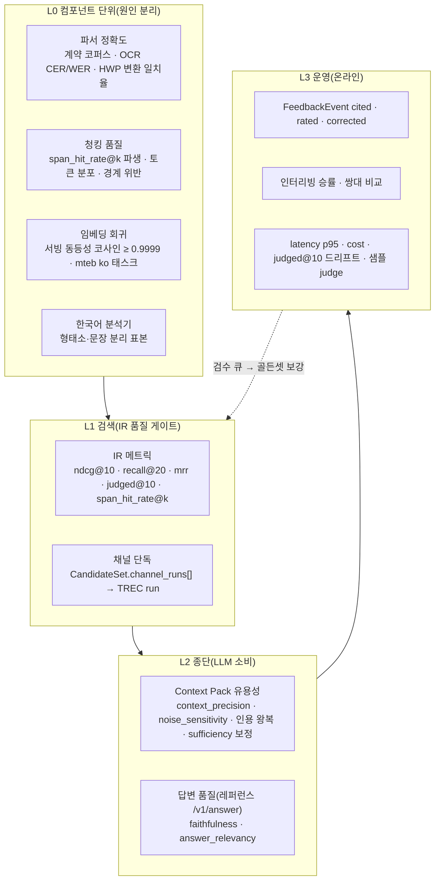
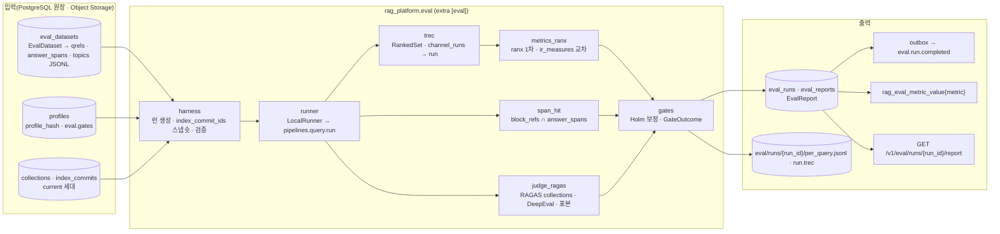
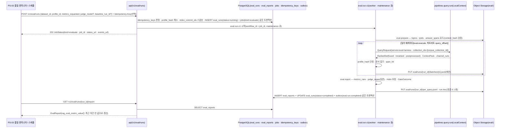

# 평가 전략

## 목적

이 문서는 브리프 원칙 7(Evaluation-Driven)과 확정 결정 D-12(평가 하네스 코어 포함)를 **운영 가능한 전략**으로 풀어 쓴다. 무엇을(평가 계층), 무엇으로(메트릭·골든셋), 어떻게(러너·게이트), 누가(책임), 얼마에(비용 통제) 측정하는지를 한 곳에 고정하고, 브리프 §7 품질 목표 각 행이 어느 계층의 어느 메트릭으로 측정되는지를 매핑한다. 08-evaluation의 나머지 문서(메트릭·하네스, 골든셋 구축, LLM-judge, 벤치마크 계획, 온라인 피드백)는 이 문서의 계층·메트릭 키·게이트 규칙을 전제로 세부를 확정한다.

정본 관계는 브리프 > 바이블 > ADR > 이 문서다(바이블 §1.1). 계약 필드·열거 철자는 바이블 §5.6·§5.7과 [평가·피드백·사이드카 계약](../03-contracts/16-eval-feedback-and-sidecar-contracts.md)을 그대로 쓰고, 이 문서가 새로 정하는 것은 **전략과 절차**뿐이다. 바이블에 없는 이름은 "제안" 또는 "초안 목표"로 표기한다.

## 범위

- 포함: 평가 계층 4단(컴포넌트·검색·종단·운영)의 정의와 책임 경계, 브리프 §7 목표의 측정 매핑, 메트릭 선택 원칙과 정본 메트릭 키, 골든셋 종류(합성·자동 라벨·사람 라벨·프로덕션 샘플)와 진실값 규약, 프로파일 비교 방식(A/B·파라미터 스윕·인터리빙·쌍대 비교), CI·야간·릴리스 게이트 계층과 판정 규칙, 평가 러너 아키텍처(워크플로우 `eval.run.v1`, 데이터셋 저장 형식, PostgreSQL 결과 저장, 리포트·이벤트·API), 한국어 우선 벤치마크 계획, LLM-judge 비용 통제, 책임(RACI), 대시보드.
- 제외: 메트릭 계산식·검정 이름·Holm 보정 구현([리트리벌 메트릭과 하네스](02-retrieval-metrics-and-harness.md)), 골든셋 라벨링 절차·검수 도구 운영([골든 데이터셋 구축](03-golden-dataset-construction.md)), 판정 프롬프트 표·한국어 교정 프로토콜([LLM-judge와 생성 품질](04-llm-judge-and-generation-quality.md)), 외부 셋 실행 절차·베이스라인 수치([벤치마크 계획과 베이스라인](05-benchmark-plan-and-baselines.md)), 인터리빙 구현·피드백 API 상세([온라인 피드백 루프](06-online-feedback-loop.md)), 계약 스키마 전문(03-contracts/16), 관측 스택 배포([관측성](../09-operations/03-observability.md)).

## 1. 평가 원칙

브리프 원칙 7은 "모든 기본값은 골든셋 평가로 정당화된다"이다. 바이블은 이를 세 장치로 강제한다: (1) 프로파일의 품질 기본값은 `{value, gate: {metric, grid | min_delta | min_qrels | candidate, dataset, max_cost_per_doc_usd}}` 형식이며 `EvalReport.gate_result.passed`와 ADR 없이 바뀌지 않는다(바이블 §7.4), (2) 하네스는 별도 검색 경로를 갖지 않고 프로덕션 `pipelines.query.run`을 비내구 `LocalRunner`로 실행한다(바이블 §2.3, §11.1; D-17), (3) 골든셋 진실값은 문서 ID + `answer_spans`로 저장해 재청킹에 불변이다(D-12).

**결정:** 이 문서의 평가 전략은 다음 여섯 원칙을 따른다([ADR-0023](../06-adr/0023-evaluation-qrels-answer-spans-and-linear-ndcg.md), [ADR-0031](../06-adr/0031-profile-schema-extends-and-quality-gates.md)).

| # | 원칙 | 근거 | 위반 예(금지) |
|---|------|------|---------------|
| P1 | **같은 코드 경로** — 평가는 프로덕션과 동일한 인프로세스 스테이지(`plan → retrieve → fuse/hydrate → rerank → postprocess → pack`)를 실행한 결과만 유효하다 | D-17, 바이블 §2.3 `eval harness` 행, ADR-0023 대안 C 기각 | 백엔드 클라이언트 직접 질의, 프레임워크 내장 evaluator로 "리트리버만" 평가 |
| P2 | **재청킹 불변 진실값** — qrels는 문서 단위, 정답 구간은 `element_path` + 원문 코드포인트. 청크 판정은 `block_refs[]`로 파생 계산하고 저장하지 않는다 | D-12, 바이블 §2.1 K1, ADR-0023 F1 | `chunk_id`를 진실값으로 저장 |
| P3 | **외부 비교 가능한 정의** — nDCG는 선형 이득·`1/log2(i+1)` 할인(trec_eval 호환). 다른 정의는 다른 키(`ndcg_exp@k`) | ADR-0023 대안 D 기각 | 같은 키로 두 정의 혼용 |
| P4 | **사람 라벨이 게이트, LLM은 확장·모니터링** — 게이트 데이터셋은 `label_provenance=human`만. 판정 모델은 평가 대상의 리랭커·보강 모델과 다른 계열 | ADR-0023 F6, 03-contracts/16 §2.3 | `umbrela`·`synthetic` 셋으로 프로파일 승격 |
| P5 | **유의성 없는 수치는 승격 근거가 아니다** — 베이스라인 비교는 질의 단위 쌍대 검정 + Holm 보정 `p_values` | D-12, 바이블 §5.6 `EvalReport.comparison` | 보정 없는 p값, 표본 부족 셋의 단독 판정 |
| P6 | **재현성 고정** — `EvalRun`은 `profile_hash`·`index_commit_ids`·`dataset_id`로 "무엇을 평가했는지"를 고정한다 | 브리프 §7 재현성, 바이블 §5.6 `EvalRun` | 프로파일 값을 우회한 스테이지 직접 설정 |

## 2. 평가 계층

평가는 네 계층으로 나눈다. 아래 계층은 위 계층의 원인 분석 도구이고, 위 계층은 아래 계층의 종합 판정이다. 게이트는 네 종류로 분류하며 서로 다른 장치가 판정한다: (1) **IR 품질 게이트**(`eval.gates.{metric}`의 `min`·`max_regression`, 파라미터 `gate{grid | min_delta | candidate | min_qrels}`)는 L1 메트릭에만 붙는다; (2) 비용·지연 상한(`gate.max_cost_per_doc_usd`, 15 `EvalGate.max`)은 런 단위 보조 게이트다; (3) 서빙 동등성(`embed.equivalence_gate`)은 프로파일 로딩·모델 교체 검증이다(바이블 §7.4); (4) 인용 왕복·멱등성 같은 계약 불변식은 적합성 키트가 CI에서 판정한다. L0은 L1 회귀의 원인을 분리하며, L2·L3는 L1이 보지 못하는 "LLM이 실제로 쓸 수 있었는가"를 본다.



### 2.1 L0 컴포넌트 단위

L0은 IR 품질 게이트를 갖지 않는 회귀 분리 계층이다(임베더 행의 서빙 동등성 게이트는 프로파일 검증 장치이며 하네스 메트릭이 아니다). L1 회귀가 감지되면 어느 스테이지가 원인인지 L0 지표로 좁힌다. L0 지표는 산출물 계약(`ParsedDocument`·`ChunkSet`·`EmbeddedChunkSet`) 위에서 계산하며 검색을 실행하지 않는다.

| 컴포넌트 | 무엇을 재는가 | 진실값·입력 | 지표(초안; 정본은 04-pipelines 각 문서) | 정본 장치 |
|----------|--------------|-------------|------------------------------------------|-----------|
| 파서(`parser`) | 포맷별 구조·텍스트 보존 | 계약 코퍼스(pin-and-bump; 바이블 §15 리스크 4), HWP→HWPX 변환본, OCR 골든 페이지 | 블록 텍스트 문자 오류율(CER), 블록 유형 정확도, 표 셀 일치율, 각주·캡션 회수율, `parser_chain[]` 폴백 발생률, OCR CER/WER(O-08 ADR 재측정 조건) | `ParsedDocument.quality`·`warnings[]`, `parser_fingerprint_hash`(바이블 §6.2) |
| 청커(`chunker`) | 정답 구간이 한 청크에 담기는가, 예산 준수 | `answer_spans` ∩ `Chunk.block_refs[]`(검색 없이 직접 교차), `token_counts` | 구간 포함률(청크가 정답 구간을 온전히 담는 비율), 토큰 분포(`leaf_max_tokens` 초과 0건), heading 경계 위반율, 표 행 그룹 헤더 반복 준수 | O-09 그리드 `{256, 384, 512, 768} × {0, 10%, 15%}`는 L1 `span_hit_rate@k`·`ndcg@10`로 판정(바이블 §3.2) |
| 임베더(`embedder`) | 서빙 교체 동등성, 모델 교체 후보 선별 | 표본 1,000 청크(프로파일 `embed.equivalence_gate: {cosine_min: 0.9999, sample: 1000}`, 바이블 §7.3) | 같은 공간 내 서빙 교체는 코사인 ≥ 0.9999(D-16); 모델 교체 후보는 `mteb` 한국어 리트리벌 태스크 10종으로 선별 후 L1 게이트(`ko-quality` nDCG@10 +2p) | `embedding_space_id`·`embedding_profile_hash`(바이블 §6.2), 공간 불일치 `embed.space_mismatch` |
| 한국어 분석기(`normalizer` role `korean_analyzer`·`sentence_splitter`) | 형태소 분절·문장 분리 정확도 | 골든셋 4종 중 (4) 문장 분리·형태소 표본(개조식·날짜·인용문; 매트릭스 §운영·평가 공통 요구) | 토큰 일치율, 문장 경계 F1, 사용자 사전 적용률 | `analyzer_id`·`dictionary_hash` → `lexical_profile_hash`(ADR-0021) |

파서 정확도는 골든셋 라벨이 아니라 **계약 코퍼스의 기대 산출물**(승인된 `ParsedDocument` 스냅샷)과 비교한다. 업스트림 파서 버전을 올릴 때 스냅샷 차이가 나면 사람이 승인해야 하며(pin-and-bump), 승인된 차이는 새 기대 산출물이 된다.

### 2.2 L1 검색

L1은 IR 품질 게이트가 붙는 유일한 계층이다. 하네스가 `EvalDataset.corpus_collection_id`의 현재 세대에 대해 `topics`의 모든 질의를 프로덕션 경로로 실행하고, 단계별 `RankedSet`(`stage ∈ {fused, reranked, postprocessed}`, 바이블 §5.5·§5.7 `RankedStage`)·`CandidateSet.channel_runs[]`·`ContextPack`을 수집해 IR 메트릭을 계산한다.

| 지표(정본 키, 바이블 §5.6) | 무엇을 보나 | 판정 단위 | 브리프 §7 대응 |
|------|------|------|------|
| `ndcg@10` | 최종 순위 품질(제1 지표) | 문서, graded 선형 이득 | 검색 품질 nDCG@10 ≥ 0.80 |
| `recall@20` | 1차 검색·융합의 회수 | 문서 | 검색 품질 Recall@20 ≥ 0.92 |
| `mrr` | 단일 정답형 질의의 첫 정답 위치 | 문서 | 보조 |
| `judged@10` | qrels 풀링 편향(낮으면 골든셋 보강 필요) | 문서 | 골든셋 건강도(`warn_below: 0.7`) |
| `span_hit_rate@k` | 상위 k 항목 중 정답 구간을 담은 청크 존재 여부 | 청크 + provenance | 청킹·부모 확장·문장 윈도우 비교(O-09) |

**결정:** L1 정본 메트릭의 판정 단위는 문서(qrels `doc_id` = `document_id`)이지만 `RankedSet.results[]`는 청크(레코드) 단위이므로, 어느 단계의 순위를 어떤 규칙으로 문서 순위로 접는지를 이 문서가 고정한다(바이블 §5.5 `RankedSet` "소비: `pack`, 평가"; 계산식은 08/02, `run_tag`·파일 키 세부는 16 minor — 미해결 이슈 13; [ADR-0023](../06-adr/0023-evaluation-qrels-answer-spans-and-linear-ndcg.md)).

| 메트릭 | 입력 | 깊이 | 이유 |
|--------|------|------|------|
| `ndcg@10`, `judged@10` | `postprocessed` `RankedSet`(팩 직전 최종 순위) → 문서 접기 → 1차 TREC run(`run.trec`) | `pack.k_max` 이하(`standard` 20, `lite` 10; 바이블 §7.2) | 브리프 §7 "하이브리드+리랭크 Top-10"; LLM이 받을 순위 그 자체를 판정한다 |
| `recall@k`(k ≤ `hydrate.top_n`), `mrr` | 같은 실행의 `fused`(`hydrated=true`) `RankedSet` → 문서 접기 | `hydrate.top_n`(`standard` 100, `lite` 30; 16 §4.2 `mrr` 깊이 초안) | `rerank.top_n_out`(20)·`pack.k_max`(20)·`relevance_gate` 절단 뒤에는 서로 다른 문서가 20개 미만이라 최종 단계에서 재면 `recall@20 ≥ 0.92`(브리프 §7)가 구조적으로 절단된다 |
| `span_hit_rate@k` | `ContextPack.items[]`를 관련도 순(`cite_id` 순, ADR-0024)으로 본 상위 k | k ≤ `pack.k_max` | 16 §10 "LLM이 실제로 받는 항목"이 정답 구간을 담았는가 |
| 채널 단독(`recall@100` 등) | `CandidateSet.channel_runs[]` → 채널별 run | `channels[*].top_k` | 별도 경로 없이 같은 실행에서 계산(ADR-0023 대안 C 판정) |

청크→문서 접기(collapse) 규칙: 문서별 **첫 등장 순위**를 문서 순위로 하고, 점수는 그 문서 청크들의 `final_score` 최대값이다. 부모 확장 항목(`item_kind=parent`, `expanded_from[]`)·문장 윈도우 항목도 같은 `document_id`로 접힌다. 채널 run에도 같은 규칙을 채널 후보 점수에 적용한다. `run_tag`는 `run_id`(16 §4.1)이며, 단계 표기(`{run_id}:{stage}`)와 `fused`·채널 run의 파일 키(`eval/runs/{run_id}/runs/{stage|channel}.trec`, 제안)는 08/02·16 minor로 위임한다. 융합·리랭크 단계별 기여는 `RankedSet.score_breakdown`(K3 점수 원장)으로 분석한다.

### 2.3 L2 종단

L2는 "반환된 Context Pack이 LLM에게 유용했는가"를 본다. 두 가지로 나눈다.

| 대상 | 지표(키는 03-contracts/16 §4.2 초안 어휘) | 방법 | 정본 장치 |
|------|------|------|------|
| Context Pack 유용성 | `context_precision`, `noise_sensitivity`(LLM-judge); 인용 좌표 왕복 성공률; `sufficiency.status` 보정(무응답 골든 질의에서 `insufficient` 판정률); `confidence_tier` 보정 | judge는 RAGAS 0.4 collections 정의 1차 + DeepEval 병기(D-12); 인용 왕복은 적합성 키트 `renderer_citation_roundtrip`; 순서는 `litm_order` | `ContextPack.sufficiency`·`confidence_tier`, `calibrations` 표(바이블 §13.1), `rag_pack_citation_unresolved_total`(§6.5) |
| 답변 품질(레퍼런스 `POST /v1/answer`) | `faithfulness`, `answer_relevancy`, 정답 문자열이 있는 셋은 `FactualCorrectness`(RAGAS 정의) | 레퍼런스 구현이 렌더한 인용 응답을 judge가 채점 | 브리프 §6: `answer`는 레퍼런스 구현만 — L2 답변 품질은 **렌더러·팩 정책의 회귀 감지용**이며 플랫폼 게이트가 아니다 |

L2 판정은 원칙 P4에 따라 게이트가 아니다. 다만 인용 왕복(좌표가 원문으로 되돌아가는가)은 계약 불변식이므로 적합성 키트가 CI에서 실패로 처리한다(바이블 §15 리스크 7).

### 2.4 L3 운영

L3는 골든셋 없이 운영 트래픽에서 신호를 얻는다. 소비자가 LLM이므로 "클릭"은 없고, 다운스트림 응답이 인용한 `cite_id`와 명시 평점·정정이 신호다(ADR-0023 F7).

| 신호 | 계약·이벤트(바이블 §5.6·§5.7) | 용도 |
|------|------|------|
| 인용 사용 | `FeedbackEvent.kind=cited`, `cite_ids[]` → `feedback.query.cited` | 인터리빙 팀 귀속(`QueryRequest.experiment_id`·`team_assignment`) → 승률 |
| 평점·정정 | `kind=rated`(`rating` 1..5) / `kind=corrected`(`comment`) → `feedback.query.rated` | 오답 사례 수집 → 검수 큐 → 골든셋 보강(UC-13) |
| 지연·비용 | `rag_query_latency_seconds`, `rag_rerank_latency_seconds`, `rag_enrich_llm_cost_usd_total`(§6.5) | 브리프 §7 p95, 비용 폭주 감시(바이블 §15 리스크 10) |
| 참조 없는 판정 | 운영 트래픽 1~5% 층화 표본(초안 목표; 매트릭스 §종합 리스크 10)에 `ContextRelevance`·`ResponseGroundedness`·UMBRELA형 라벨 | 골든셋이 없는 컬렉션의 품질 추세, `umbrela` 셋 후보 생성 |
| 풀링 드리프트 | 야간 런의 `judged@10` 추세 | 새 리트리버가 미판정 문서를 올리면 골든셋 보강 트리거 |

## 3. 브리프 §7 품질 목표 측정 매핑

브리프 §7의 여섯 행을 계층·메트릭·데이터·게이트 위치로 사상한다. 목표값은 브리프 그대로이며(초안 목표), 이 표는 **어떻게 재는지**만 정한다.

| 브리프 §7 항목 | 목표(브리프) | 계층 | 측정 메트릭·키 | 측정 조건·데이터 | 게이트 위치·도구 |
|---|---|---|---|---|---|
| 리트리벌 p95 지연 | 하이브리드+리랭크 Top-10, 100만 청크, **< 800ms**(GPU) / **< 1.5s**(CPU) | L1(런 단위)·L3 | `latency_p95_ms`(런 단위 집계값; 16 §4.2 키, 바이블 §5.6 `metrics` 예시에는 없음 — 미해결 이슈 3), 운영은 `rag_query_latency_seconds{profile_id}` | 벤치마크 컬렉션 100만 청크(05 문서가 구축), `QueryRequest.retrieval_variant=default`, 프로파일 `latency_budget_ms.total` 800 / 1,500(바이블 §7.2) | `eval.gates.latency_p95_ms: {max: 800}`(15 `EvalGate.max` 형식; 키 어휘 확정 전 초안), 운영 SLO 알림 |
| 수집 처리량 | 텍스트 PDF 100p **< 30s**, 스캔 PDF 100p **< 5min**(GPU OCR) | L0 | `JobStatus.started_at`·`finished_at` 차, `rag_ingest_stage_duration_seconds{stage}` | 05 문서가 정의하는 수집 벤치마크 문서 세트(디지털·스캔 각 100p), `standard`/`premium` 프로파일 | 야간 벤치마크 잡의 리포트(게이트 아님, 회귀 알림) |
| 검색 품질 | 내부 한국어 골든셋 **nDCG@10 ≥ 0.80, Recall@20 ≥ 0.92**, dense-only 대비 **+15%p** | L1 | `ndcg@10`, `recall@20`; 베이스라인 비교는 `comparison.deltas["ndcg@10"] ≥ 0.15` — 브리프 §7은 "+15%p"의 적용 메트릭을 명시하지 않으므로 `ndcg@10` 적용은 이 문서의 해석(초안 목표; `recall@20` 병기 여부는 08/05 확정). 베이스라인 런 = 같은 컬렉션·같은 데이터셋·`QueryRequest.mode=dense` | `eval.datasets: [ko-public-v1, allganize-ko]`(바이블 §7.3), `label_provenance=human` | `eval.gates.ndcg@10.min 0.80`, `recall@20.min 0.92`(standard·premium·korean-gov; lite 0.70/0.85, 바이블 §7.2), ranx 1차·ir_measures 교차 |
| 가용성 | 리트리벌 API 99.9%, 수집 at-least-once + 멱등 | L3 | `rag_query_latency_seconds{outcome}` 성공 비율(SLO), 적합성 키트 `idempotency` | 운영 메트릭(하네스 대상 아님); 멱등성은 계약 테스트 | 운영 SLO(09-operations), CI 적합성 키트 |
| 재현성 | 동일 `IngestRequest` + 동일 프로파일 → 동일 `IndexCommit` 해시 | L0·하네스 자체 | 두 번 수집한 `IndexCommit.commit_hash` 일치; `EvalRun.profile_hash == 모든 QueryPlan.profile_hash` 런타임 단정 | 소형 골든셋 코퍼스 재수집(`tests/eval`) | CI 적합성 키트 `contract_roundtrip`·`idempotency`, 하네스 시작 검증(`contract.violation` → `failed`) |
| 보안 | 테넌트 격리, ACL 필터 강제 | L1 보조·CI | 평가 주체 `service:eval-harness`가 볼 수 없어야 하는 문서의 회수 0건(누출 테스트 셋; 제안) | 카나리 테넌트 침투 테스트(바이블 §15 리스크 3), 적합성 키트 `security_invariants` | CI 실패(품질 게이트와 별개) |

## 4. 메트릭 선택 원칙과 정본 키

**결정:** 메트릭은 다음 규칙으로 선택·명명한다(D-12; [ADR-0023](../06-adr/0023-evaluation-qrels-answer-spans-and-linear-ndcg.md), [ADR-0036](../06-adr/0036-naming-and-identifier-conventions.md)).

1. 계층마다 **제1 지표 하나**(L1 `ndcg@10`, L2 `context_precision`, L3 인터리빙 승률)와 보조 지표 소수만 둔다. 지표가 늘수록 다중 비교 보정이 보수적이 되어 검정력이 떨어진다.
2. 정의가 **외부 수치와 직접 비교 가능**해야 한다(선형 nDCG, TREC qrels). 새 정의는 새 키다.
3. 진실값이 **구현 산물에 묶이지 않아야** 한다(문서 ID + 정답 구간; 청크 판정은 파생).
4. **사람 라벨 기반 지표만 게이트**가 될 수 있다. LLM-judge 지표는 `warn`·추세용이다.
5. 품질 지표는 **비용·지연과 병기**한다(`cost_per_doc_usd`, `latency_p95_ms`). 개선이 예산을 넘으면 승격하지 않는다(`gate.max_cost_per_doc_usd`).
6. 키는 `{metric}[@{k}]`(`^[a-z][a-z0-9_]*(@[1-9][0-9]*)?$`)이며 값은 유한한 number다. 추가는 바이블 §1.2 minor 절차(ADR 발의 + §5.6 갱신).
7. Prometheus 노출은 `rag_eval_metric_value{metric}`만이고 라벨은 저카디널리티(`metric`, `profile_id`; `tenant_id` 금지, 바이블 §6.5).

| 키 | 계층 | 정의 요지 | 게이트 가능 | 계산기(07/09 문서 근거) |
|----|------|-----------|-------------|-------------------------|
| `ndcg@k` | L1 | DCG@k / IDCG@k, 이득 선형 `rel`, 할인 `1/log2(i+1)` | 예 | ranx `ndcg` 1차, ir_measures `nDCG@k` 교차(±0.01) |
| `ndcg_exp@k` | L1 | 지수 이득 `2^rel − 1`; `ndcg@k`와 혼용 금지 | 아니오(보고용) | ranx `ndcg_burges` |
| `recall@k` | L1 | `rel ≥ 1` 문서 중 상위 k 회수 비율 | 예 | ranx |
| `mrr`, `mrr@k` | L1 | 첫 관련 문서 역순위 평균 | 예 | ranx |
| `judged@k` | L1 | 상위 k 중 qrels 판정 존재 비율 | `warn_below`만 | ir_measures `Judged@k` |
| `span_hit_rate@k` | L1(청킹) | 상위 k 항목 중 `block_refs[]`가 `answer_spans`와 겹치는 항목 존재 시 1 | 예(O-09 그리드) | 자체 `rag_platform.eval.span_hit` |
| `context_precision`, `noise_sensitivity`, `faithfulness`, `answer_relevancy` | L2 | RAGAS 0.4 collections 정의(DeepEval 병기) | 아니오(`warn`) | `judge_ragas` |
| `cost_per_doc_usd`, `latency_p95_ms` | 런 단위 | 게이트 `max_cost_per_doc_usd`·지연 상한 입력 | 예(상한) | `usage_ledger`, OTel |

## 5. 골든셋 종류와 진실값 규약

### 5.1 종류

**결정:** 골든셋은 `EvalDataset.label_provenance`(`human` / `umbrela` / `synthetic`, 바이블 §5.7)로 종류를 구분하고, 게이트 데이터셋은 `human`만 허용한다(03-contracts/16 §2.3 EF-6; [ADR-0023](../06-adr/0023-evaluation-qrels-answer-spans-and-linear-ndcg.md) 준수 10). 프로덕션 샘플은 별도 열거값이 아니라 **질의 출처**이며, 검수를 거쳐 `human`으로 등록된다.

| 종류 | `label_provenance` | 질의 출처 | 라벨 방법 | 용도 | 제약 |
|------|--------------------|-----------|-----------|------|------|
| 합성 | `synthetic` | 코퍼스에서 LLM 생성(RAGAS `TestsetGenerator` 1차, DeepEval `Synthesizer`·자체 프롬프트 2차; 단일 홉·다중 홉·표·비사실형·무응답) | 생성 시 정답 구간 자동 부착, 검수 없음 | 개발 스모크, 새 컬렉션 초기 베이스라인, 검수 큐 입력 | 게이트 불가; 생성 모델 계열 기록(`TopicRecord.metadata`, 제안) |
| 자동 라벨 | `umbrela` | 합성·프로덕션 질의 | UMBRELA형 0~3 등급 LLM 판정(판정 모델 버전 기록) | 골든셋 확장, `judged@k` 저하 시 미판정 상위 결과 보강 후보 | 게이트 불가; 사람 표본과 κ·τ 교정 통과 프롬프트만 사용 |
| 사람 라벨 | `human` | 합성·프로덕션 질의 + 도메인 전문가 작성 질의 | 등급 판정(Langfuse annotation queue) + 정답 구간(Label Studio Community 2차; 07/09 문서 §골든셋 구축) | **게이트**, 베이스라인, ADR 근거 | `license` 필수(SPDX; 공공누리는 `LicenseRef-KOGL-{유형}` — 확인 필요 as of 2026-09) |
| 프로덕션 샘플 | (출처) → 검수 후 `human` | 익명화 질의 로그(NFR-PRV-04), `FeedbackEvent.kind ∈ {rated, corrected}`의 저평점·정정 질의, `judged@10` 미달 질의 | 검수 큐 → 사람 라벨 | 실사용 분포 반영, 오답 사례 회귀 | 질의 본문은 PII 정책 적용 후만 저장; `comment`는 `pii_policy_applied` 기록 |

### 5.2 저장 형식

진실값과 질의는 JSON Lines 산출물이며 `EvalDataset`은 `ArtifactRef`로만 참조한다(바이블 §5.1 "qrels·`answer_spans`는 산출물", §13.3 `eval/datasets/{dataset_id}/{qrels|answer_spans}.jsonl`). 레코드 필드는 03-contracts/16 §2.2가 확정한 `QrelsRecord`·`AnswerSpanRecord`·`TopicRecord`를 그대로 쓴다.

| 파일 | 레코드 | 필드(16 §2.2) | 외부 교환 |
|------|--------|---------------|-----------|
| `qrels.jsonl` | `QrelsRecord` | `query_id`, `iteration`(`0`/`Q0`), `doc_id`(= `document_id`, ULID), `relevance`(binary 0/1, graded 0..`relevance_max` — `EvalDataset.relevance_max`는 바이블 §5.6 1.3.0 등재(AM-34), 기본 3) | TREC qrels 텍스트(`rag eval export --format trec`, 16 §2.2) |
| `answer_spans.jsonl` | `AnswerSpanRecord` | `query_id`, `doc_id`, `doc_version`, `element_path`, `char_start`, `char_end`(원문 `Block.text` 기준 코드포인트, 끝 미포함) | 없음(플랫폼 확장) |
| `topics.jsonl` | `TopicRecord` | `query_id`, `query`(≤ 4,000자), `language`, `metadata`(스칼라) | TREC topics 대체 |

`EvalDataset.content_hash = H("evalset", qrels_ref.blake3, answer_spans_ref.blake3, topics_ref.blake3 or "")`(16 §2.3)이므로 바이트가 하나라도 바뀌면 다른 데이터셋이다. 라벨 정정판은 같은 `name`의 새 행으로 등록하고 프로파일 `eval.datasets[]`·`gate.dataset`의 `name` 참조는 최신 행으로 해소된다; 의미가 달라지는 개정은 `name`을 바꾼다(`ko-public-v2`). `topics_ref` 필드 자체는 바이블 §5.6 1.3.0 등재(AM-34)이나, 이 결합식과 `name` 최신 행 해소 규칙은 03-contracts/16이 정한 것으로 바이블 §6.2 해시 표·§5.6 `EvalDataset` 행에는 아직 없다(16 미해결 이슈 3·17에 기댐; 이 문서 미해결 이슈 14). `EvalRun`은 `dataset_id`를 고정하므로 과거 런의 재현성은 유지된다.

정답 구간의 세대 불일치(stale span): `AnswerSpanRecord.doc_version`이 문서의 현재 `documents.current_doc_version`과 다르면 그 구간은 stale이다(16 §2.2). P2의 "재청킹 불변"은 재수집으로 `doc_version`이 바뀐 경우까지 보장하지 않으므로 하네스는 다음 규칙을 적용한다: stale 구간은 해당 `(query_id, doc_id)`의 구간 판정(`span_hit_rate@k`)에서 **제외**하고(분모의 질의는 유지, 문서 단위 qrels는 영향 없음), `per_query.jsonl`에 표시하며(`PerQueryRecord.stale_span_doc_ids[]`, N 제안), 데이터셋의 stale 구간 비율을 §12 골든셋 건강도 패널에 올려 재라벨 트리거로 쓴다. 비율 상한을 경고 게이트로 두는 형식(15 `EvalGate`에는 `warn_below`만 있어 `warn_above`가 없음)과 규칙 확정은 08/03에 위임한다(미해결 이슈 15).

### 5.3 라이선스와 공개

- 공개 골든셋(`ko-public-v1`)은 공공누리 제1유형(출처 표시) 문서로만 구성해 배포 가능하게 한다(07/09 문서 §골든셋 구축). AI Hub 데이터는 내국인 한정·재배포 불가이므로 조직 내부 시드로만 쓴다.
- NC·ND 라이선스 셋(CRAG, KorQuAD 등)은 등록은 가능하나 배포물·공개 골든셋·공개 비교표에 포함하지 않는다(ADR-0023 준수 11; CI 라이선스 게이트).
- `EvalDataset.license`는 SPDX 표현식이며 D-02 등급표로 판정한다(ADR-0001).

## 6. 평가 대상과 프로파일 비교

평가 대상은 항상 **(데이터셋, 프로파일 해시, 인덱스 커밋 집합)** 삼중항이다. 비교는 삼중항 중 하나만 바꾼 두 런의 `comparison`이다.

### 6.1 변경 분류

UC-14(01-requirements/03)에 따라 변경을 두 종류로 나눈다.

| 변경 종류 | 예 | 실행 방법 | 삼중항 변화 |
|-----------|----|-----------|-------------|
| 검색 전용 | 융합 방법·가중, 리랭커, 후처리 파라미터, 팩 예산·순서 | 같은 컬렉션에 프로파일 두 버전을 적용해 두 런 실행(인덱스 불변) | `profile_hash`만 |
| 인덱스 영향 | 파서·청커·임베더·인덱스 백엔드·분석기·사전 | 후보 프로파일로 섀도(blue/green) 컬렉션을 채운 뒤 두 컬렉션에 두 런(`reindex.collection.v1` → 하네스 게이트 → alias 교체, 바이블 §11.2) | `profile_hash` + `index_commit_ids` |

### 6.2 비교 방식

| 방식 | 언제 | 절차 | 계약 |
|------|------|------|------|
| A/B(오프라인 쌍대 런) | 모든 프로파일 변경의 기본 | 베이스라인 런 지정 → 후보 런 → 질의 단위 쌍대 검정 + Holm → `comparison{deltas, p_values, correction: holm}` | `EvalRun.baseline_run_id`(16 N 필드), `EvalReport.comparison` |
| 파라미터 스윕(그리드) | `gate.grid`가 붙은 값(`leaf_max_tokens`, `fallback.overlap_ratio`; 바이블 §7.3). 융합 `fusion.k`(바이블 §7.2 `query.fusion.k`)·CC 가중 그리드는 §7.3에 없는 예시(제안) — §7.3 융합 게이트는 `{promote_to: convex_minmax, min_qrels: 200, tool: ranx.optimize_fusion}`으로 그리드 게이트가 아니다 | 그리드 각 점을 별도 프로파일 버전 런으로 실행, 전체 비교는 Tukey HSD(초안; 08/02 확정), 최고 후보와 현재 `value` 일치 여부를 `GateOutcome.condition=grid`로 기록 | `Profile` 게이트 값 `{value, gate: {grid}}`(바이블 §7.3) |
| 인터리빙(온라인) | 오프라인 차이가 작거나 골든셋이 실사용 분포를 대표하지 못할 때 | `QueryRequest.experiment_id`·`team_assignment`로 팩 내부 순서를 팀 교차 배치 → `FeedbackEvent.cited`의 팀 귀속으로 승률 | `EvalRun.experiment_id`, `feedback.query.cited` |
| 쌍대 비교(LLM-judge) | 절대 점수가 불안정한 프로파일 비교(O-01·O-05), 골든셋 없는 컬렉션 | RAGElo형 pairwise 판정 + Elo(매트릭스 2차) | `EvalRun.judge_model` 기록, 게이트 불가(P4) |

베이스라인 dense-only(브리프 §7 "+15%p")는 같은 컬렉션·같은 데이터셋에 `QueryRequest.mode=dense`(`RetrievalMode`, 바이블 §5.7)로 실행한 런이며, 검색 전용 비교로 취급한다(+15%p의 적용 메트릭은 §3 표의 해석 `ndcg@10`을 따른다).

## 7. 게이트

### 7.1 게이트 계층

**결정:** 게이트는 세 층으로 실행하고, 층마다 데이터셋 규모와 판정 강도가 다르다([ADR-0023](../06-adr/0023-evaluation-qrels-answer-spans-and-linear-ndcg.md) 준수 7; 바이블 §11.6 CI 목록).

| 층 | 트리거 | 데이터셋 | 실행기 | 판정 | 실패 시 |
|----|--------|----------|--------|------|---------|
| PR CI | 모든 PR | `tests/eval` 소형 골든셋(`ko-public-v1` 소형 분할; `lite` 프로파일) | `LocalRunner`(인프로세스, 분 단위) | 절대 게이트 `lite` 값(`ndcg@10 ≥ 0.70`, `recall@20 ≥ 0.85`; 바이블 §7.2) + 베이스라인 대비 `max_regression`. 베이스라인 = `main`의 최신 `completed` 런(같은 `dataset_id`; `run_id`는 `tests/eval`에 고정 파일로 커밋). `lite` `eval.gates`에 `max_regression: 0.01, p: 0.05`를 두는 것은 제안(바이블 §7.2는 `lite`에 `min`만, §7.3 YAML은 `standard`만 제시)이며 확정 전 PR CI는 `standard`의 회귀 게이트 값을 상속한다(미해결 이슈 16) | PR 머지 차단 |
| 야간 | 스케줄(`maintenance` 큐, `ScheduleOverlapPolicy.SKIP`) | 프로파일 `eval.datasets[]` 전량(`standard`: `ko-public-v1`, `allganize-ko`) | `eval.run.v1`(`temporal` 모드, 액티비티 재시도) | 전체 게이트 + LLM-judge 표본(`warn`) | `eval.run.completed` + 대시보드 회귀 패널 + 알림 |
| 릴리스·프로파일 변경 | 프로파일 `version` 증가 PR, 모델 교체 ADR | 야간과 동일 + 외부 회귀 셋(MIRACL-ko·MLDR-ko) + 그리드 | `eval.run.v1` | `gate_result.passed=true`인 `run_id`를 PR·ADR에 첨부 | `rag profile validate` 거부 |

### 7.2 판정 규칙

**결정:** 회귀 게이트는 **베이스라인 대비 `ndcg@10` 하락이 0.01(1%p)을 넘고 Holm 보정 p값이 0.05 미만이면 실패**한다(`eval.gates.ndcg@10: {max_regression: 0.01, p: 0.05, correction: holm}`, 바이블 §7.3). 하락이 0.01 이내이거나 유의하지 않으면 통과한다(03-contracts/16 §4.4 규칙 (a); 검정 이름·규칙 확정은 08/02, 미해결 이슈 5). 절대 게이트(`min`)와 회귀 게이트는 독립이며 하나라도 실패하면 `passed=false`다.

| 게이트(바이블 §7.3 `standard`) | `condition` | 통과 조건 | 실패 영향 |
|------|------|------|------|
| `eval.gates.ndcg@10.min: 0.80` | `min` | `metrics["ndcg@10"] ≥ 0.80` | `fail` |
| `eval.gates.ndcg@10.max_regression: 0.01, p: 0.05` | `max_regression` | `−deltas["ndcg@10"] ≤ 0.01` 또는 `p_values["ndcg@10"] ≥ 0.05` | `fail` |
| `eval.gates.recall@20.min: 0.92` | `min` | `metrics["recall@20"] ≥ 0.92` | `fail` |
| `eval.gates.judged@10.warn_below: 0.7` | `warn_below` | `metrics["judged@10"] ≥ 0.7` | `warn`(`warned_gates`, 골든셋 보강 트리거) |
| 파라미터 `gate{metric, grid}` | `grid` | 현재 `value`가 그리드 최고 후보 | `fail` |
| 후보 교체 `gate{candidate, min_delta_pt}` / `gate{min_delta, max_cost_per_doc_usd}` | `min_delta_pt` / `min_delta`·`max_cost_per_doc_usd` | 개선 ≥ 임계(유의성은 `eval.gates.{metric}.p` 상속, 16 규칙 (b)) 그리고 비용 ≤ 상한 | `fail` |

`comparison`이 필요한 게이트(`max_regression`·`min_delta*`)에 베이스라인이 없으면 그 게이트는 `observed: null`·`fail`이다(16 §4.4). 첫 베이스라인은 검색 품질 엔지니어가 UC-13 6단계로 지정한다.

게이트 값 객체의 선택 키(`metric?` 기본 `ndcg@10`, `dataset?` 기본 `eval.datasets[0]`, `grid?`·`min_delta?`·`min_delta_pt?`·`min_qrels?`·`candidate?`·`promote_to?`·`tool?`·`max_cost_per_doc_usd?`)는 바이블 §5.6 1.3.0에서 확인됐다(AM-34, CR-37; `profile.schema.json` `$defs/GateSpec`).

이 문서가 쓰는 `warned_gates`(`GateResult`), `schema_version`(`EvalRun`·`EvalReport`), `baseline_run_id`(`EvalRun`), `run_ref`(`EvalReport`)는 바이블 §5.6 표에 없고 03-contracts/16이 추가한 선택(N) 필드다(바이블 §5.1이 계약 문서의 N 필드 추가를 허용; §5.6 minor 반영은 16 미해결 이슈 1). `relevance_max`(`EvalDataset`)는 해소됐다(바이블 §5.6 1.3.0 등재, AM-34). `warned_gates`는 §7.2 경고 판정과 §12 대시보드의 핵심 장치이므로 반영 전까지는 "16 선택 필드"로 읽는다(미해결 이슈 14).

### 7.3 게이트가 구속하는 것

`gate_result.passed=true`인 `run_id`가 있어야 (1) 프로파일 게이트 값 변경 PR, (2) 컬렉션 blue/green alias 교체(`reindex.collection.v1`의 "하네스 게이트" 단계), (3) 모델 교체 ADR 발의가 가능하다. 게이트 값 자체의 변경(예 `min` 상향)은 바이블 §1.2 minor 절차(ADR + §7.2 표 갱신)다.

## 8. 평가 러너 아키텍처

### 8.1 구성 요소



| 구성 요소(바이블 §12 `eval/`) | 책임 | 의존 제약 |
|------|------|-----------|
| `harness` | `POST /v1/eval/runs` 요청 해소: `profile_id` → `profile_hash`, `corpus_collection_id` current 커밋(= `documents.current_commit_id`가 가리키는 커밋, 03-contracts/08 §8·IC-5, CR-40) → `index_commit_ids` 스냅숏, 시작 검증(게이트 셋 `label_provenance=human`, `judge_model` 계열 분리, 평가 주체 가시 집합) | `ledger`·`profiles`·`orchestration.local` 임포트 가능 — 근거는 10-development/01 §4.1의 11계층 정밀화(`eval` L7 → `orchestration` L6 → `profiles` L5 → `ledger` L4; 바이블 §12 규칙은 `eval`을 이들과 같은 층의 `\|` 형제로 두어 상위 규칙만 제공 — 문구 정밀화는 미해결 이슈 18) |
| `runner` | 질의별 `pipelines.query.run(ctx, req, security, profile)`을 `LocalRunner`(`LocalContext`)로 실행, 단계별 `RankedSet`(`fused`·`reranked`·`postprocessed`)·`ContextPack`·`CandidateSet.channel_runs[]` 수집 | `adapters/retrieve`·`adapters/index`·백엔드 클라이언트 임포트 금지(import-linter 제안, ADR-0023 준수 5) |
| `trec` | 입력 `stage`별 TREC run 변환(`query_id Q0 doc_id rank score run_tag`, `run_tag = run_id`): 1차 `run.trec`은 `postprocessed` `RankedSet`을 §2.2 접기 규칙으로 문서 순위화한 것, `fused`(hydrated) run·채널별 run은 메모리 내 계산(파일 내보내기는 제안) | 순수 함수 |
| `metrics_ranx` | ranx `evaluate`·`compare`, ir_measures 교차 검증(±0.01) | `ndcg_burges` 호출 금지 테스트 |
| `span_hit` | `RankedResult.block_refs[]{element_path, original_char_start, original_char_end}` ∩ `AnswerSpanRecord` | K1 좌표만 사용 |
| `judge_ragas` | RAGAS 0.4 collections 인스턴스(한국어 프롬프트 인스턴스 속성 교체) + DeepEval 병기, 표본 추출, 예산 감시 | 판정 LLM 호출은 `ingest-llm` 큐 동시성 상한 아래(바이블 §11.2) |
| `gates` | statsmodels `multipletests(method="holm")`, 게이트 두 형식(`eval.gates.*`, 파라미터 `gate{}`) → `GateOutcome` | PyTerrier 대조는 dev 의존성만 |
| `datasets/` | 외부 셋 로더(`ir_datasets`: MIRACL·Mr.TyDi·MLDR; Allganize KO·MTEB 한국어 태스크 변환기) → `EvalDataset` 등록 | 라이선스 게이트 통과 셋만 |

### 8.2 실행 흐름(`eval.run.v1`)

**결정:** 평가 실행의 워크플로우 타입은 `eval.run.v1`(바이블 §11.2; 다른 문서·제안서의 `EvaluationRun`·`EvaluationRunWorkflow` 표기는 이 정본 이름으로 정규화한다), 잡 종류는 `JobKind=evaluate`, 태스크 큐는 `maintenance`다. CI·개발은 `LocalRunner`가 같은 하네스 코드를 인프로세스로 실행하고, `standard` 이상의 야간·릴리스 런은 Temporal이 `eval.prepare → eval.execute → eval.report → stage.publish`(02-architecture/06 §2.6 내부 액티비티; 이름은 제안) 순으로 실행하며 `eval.execute`는 질의 배치 단위 하트비트(`heartbeat_details.query_offset`)로 재개한다(D-17; [ADR-0003](../06-adr/0003-orchestrator-neutral-pipeline-and-non-durable-local-runner.md)).



실행 규칙:

- 평가 질의의 `SecurityContext`는 서버가 주입한 `service:eval-harness` 주체 + 테넌트 스코프다(E6). 골든셋 문서 전부가 이 주체의 가시 집합에 있어야 하며, 시작 검증이 이를 확인한다(16 미해결 이슈 14; 전용 역할 확정은 02-architecture/07).
- 접수 멱등성: `POST /v1/eval/runs`의 `Idempotency-Key`는 선택·권장이다(05-api/01 §6; D-08이 필수로 고정한 것은 `POST /v1/ingest*`뿐). 제시되면 판정 정본은 `idempotency_keys(tenant_id, key)`(재전송 200 / 처리 중 409 / 다른 본문 422, 바이블 §13.1)이고 `eval_runs`·`jobs` INSERT와 같은 트랜잭션이다; 부재 시 서버가 `internal:eval.run.v1:{ulid}` 형식의 키를 합성해 `JobStatus.idempotency_key`를 채운다(12 §2.1 초안). 야간 스케줄은 `ScheduleOverlapPolicy.SKIP`으로 중복 런을 막는다(바이블 §11.2). 202 본문은 `JobStatus`(`kind=evaluate`)이며 `run_id`를 어떻게 노출하는지(`JobStatus` 필드 또는 `GET /v1/eval/runs?job_id=`)는 05-api/04가 확정한다(미해결 이슈 17).
- 재시도 멱등성: 질의 실행은 읽기 전용이므로(검색 경로는 상태를 바꾸지 않음, 바이블 §11.1 `query` 모드) `eval.execute` 재시도는 안전하다. 배치 결과는 `eval/runs/{run_id}/batches/{n}.jsonl`(제안; 바이블 §13.3 미등재, 미해결 이슈 17)에 배치 번호로 기록해 재시도가 `query_offset`부터 재개하고 같은 배치 번호는 덮어쓴다. `per_query.jsonl`·`run.trec`은 `eval.report`가 종결 직전 1회 기록하며 런 종결 후 불변이다(16 §9). `LocalRunner` 모드에는 하트비트가 없어 크래시는 `status=failed`(`error` 없음 허용)이고 재시도는 클라이언트 책임이다.
- 런 도중 문서 세대가 플립되면 `per_query.jsonl`에 표시만 하고 런을 무효화하지 않는다(`ContextPack.diagnostics.index_generations_seen`). stale `answer_spans`는 §5.2 규칙으로 구간 판정에서 제외한다.
- 판정 LLM 실패·예산 초과는 IR 메트릭 판정에 영향을 주지 않는다. judge 지표는 생략되고 `warned_gates`에 기록된다(07/09 문서 §실패 모드).

### 8.3 저장과 리포트

| 대상 | 위치 | 정본 |
|------|------|------|
| 데이터셋 메타 | PostgreSQL `eval_datasets`(RLS `FORCE`) | 바이블 §13.1 |
| 진실값·질의 | `eval/datasets/{dataset_id}/{qrels\|answer_spans}.jsonl`(정본), `topics.jsonl`(16 제안). 키에 `tenants/{tenant_id}/` 접두가 없어 질의 본문 접근 통제는 `eval_datasets` 행의 RLS에만 의존한다(미해결 이슈 7) | 바이블 §13.3 / 16 미해결 이슈 2 |
| 런 | PostgreSQL `eval_runs`(`EvalRun` 컬럼; `status` 전이 `running → completed \| failed`) | 바이블 §13.1, 16 §3.2 |
| 리포트 | PostgreSQL `eval_reports`(`EvalReport` 컬럼; 런당 1행) | 바이블 §13.1 |
| 질의별 산출물 | `eval/runs/{run_id}/per_query.jsonl`(`PerQueryRecord{query_id, metrics, top_doc_ids?, span_hit_ranks?}`), `run.trec`(`postprocessed` 문서 run, §2.2); 배치 중간 결과 `batches/{n}.jsonl`은 제안(§8.2) | 16 §4.5·미해결 이슈 2(바이블 §13.3 추가 제안) |
| 이벤트 | `eval.run.completed`(아웃박스, `data`는 ID·해시·메트릭 값만) | 바이블 §5.7, ADR-0017 |
| 메트릭 | `rag_eval_metric_value{metric}`(최근 야간 런 값) | 바이블 §6.5 |
| API | `POST/GET /v1/eval/datasets`, `POST/GET /v1/eval/runs`, `GET /v1/eval/runs/{run_id}`, `GET /v1/eval/runs/{run_id}/report` | 바이블 §14 |
| CLI | `rag eval export --format trec`(16 §2.2 정본); 하위 명령 `run`·`compare`는 제안(바이블 §12 `cli/`는 `eval`만 명시; 10-development 확정) | 바이블 §12 `cli/`, 16 §2.2 |

`POST /v1/eval/runs` 요청 본문 예(readOnly 필드 없음; `baseline_run_id`는 16 문서의 선택 필드 — §7.2 끝 문단):

```json
{
  "dataset_id": "01J9ZR0D4T7V9W2X4Y6Z8A0B1C",
  "profile_id": "standard",
  "metrics_requested": ["ndcg@10", "recall@20", "mrr", "judged@10", "span_hit_rate@10"],
  "judge_model": null,
  "baseline_run_id": "01J9ZR1A2B3C4D5E6F7G8H9J0K"
}
```

회귀 게이트에 실패한 `EvalReport` 예(값은 형식 예시이며 측정치가 아니다; `GateOutcome` 필드는 16 §4.4; `schema_version`·`warned_gates`는 16 선택 필드):

```json
{
  "schema_version": "1.0.0",
  "run_id": "01J9ZR5E3H7K9M2N4P6Q8S0T1V",
  "metrics": {
    "ndcg@10": 0.791,
    "recall@20": 0.931,
    "mrr": 0.72,
    "judged@10": 0.81,
    "span_hit_rate@10": 0.84
  },
  "comparison": {
    "baseline_run_id": "01J9ZR1A2B3C4D5E6F7G8H9J0K",
    "deltas": {"ndcg@10": -0.018, "recall@20": 0.004},
    "p_values": {"ndcg@10": 0.012, "recall@20": 0.61},
    "correction": "holm"
  },
  "gate_result": {
    "passed": false,
    "failed_gates": [
      {
        "gate_path": "eval.gates.ndcg@10",
        "metric": "ndcg@10",
        "condition": "max_regression",
        "expected": 0.01,
        "observed": 0.018,
        "dataset": "ko-public-v1",
        "severity": "fail",
        "detail": "regression 0.018 exceeds 0.01 and holm-adjusted p 0.012 < 0.05"
      },
      {
        "gate_path": "eval.gates.ndcg@10",
        "metric": "ndcg@10",
        "condition": "min",
        "expected": 0.8,
        "observed": 0.791,
        "dataset": "ko-public-v1",
        "severity": "fail"
      }
    ],
    "warned_gates": []
  },
  "artifacts_ref": {
    "uri": "s3://rag-artifacts/eval/runs/01J9ZR5E3H7K9M2N4P6Q8S0T1V/per_query.jsonl",
    "blake3": "9f3a6c1e2b7d4f80a5c3e9d1b2f4a6c8e0d2b4f6a8c0e2d4b6f8a0c2e4d6b8f0",
    "media_type": "application/x-ndjson",
    "size_bytes": 184320
  },
  "created_at": "2026-09-22T02:41:17.512Z"
}
```

### 8.4 `evaluator` 확장 지점

하네스의 계산기는 D-10 `evaluator` 확장 지점의 플러그인이다(매트릭스 `eval_framework`·`ir_metrics` 행 "하네스 3종 구현체"). `plugin_id`는 `evaluator.{implementation}`(바이블 §6.1)이며 아래 이름은 **제안**이고 08/02가 확정한다(ADR-0023).

| 역할 | `plugin_id`(제안) | 입력 | 출력 | 라이선스 등급 |
|------|------|------|------|------|
| 리트리벌 메트릭 | `evaluator.ir_metrics_ranx` | TREC run + qrels | `metrics` 키 `ndcg@k`·`recall@k`·`mrr`·`judged@k` | A(ranx MIT, ir_measures Apache-2.0) |
| 구간 적중 | `evaluator.span_hit` | `RankedSet`/`ContextPack` + `answer_spans` | `span_hit_rate@k`, `span_hit_ranks[]` | 코어 |
| LLM-judge | `evaluator.judge_ragas`(DeepEval 병기 `evaluator.judge_deepeval`) | `ContextPack`(+ 응답) 표본 | `context_precision` 등 L2 키 | A(RAGAS·DeepEval Apache-2.0) |

`Capabilities.contracts_compat`로 계약 범위를 선언하고, `PluginMeta.license_grade`는 프로파일 `license_policy.max_grade` 이하여야 한다(바이블 §7.4 (1)). Phoenix evals(ELv2)·BERGEN(CC BY-NC-SA)은 플러그인으로도 채택하지 않는다(07/09 문서).

## 9. 한국어 우선 벤치마크 계획

바이블 §15 리스크 1은 "한국어 문서 수준 골든셋 부재"다. 이 절은 자체 골든셋 구축 순서와 외부 셋의 역할을 정하고, 세부(문서 수집 대상·라벨 지침·검수 도구)는 [골든 데이터셋 구축](03-golden-dataset-construction.md)과 [벤치마크 계획과 베이스라인](05-benchmark-plan-and-baselines.md)이 확정한다.

### 9.1 자체 골든셋 4종(`ko-public-v1` 계열)

**결정:** 자체 골든셋은 매트릭스 §운영·평가 공통 요구의 4종을 M1 산출물로 구축하고, 공개 가능성을 위해 공공누리 제1유형 문서로만 구성한다(D-12; [ADR-0023](../06-adr/0023-evaluation-qrels-answer-spans-and-linear-ndcg.md) 결정 동인 Korean-First).

| # | 코퍼스 | 목적 | 규모(초안 목표) | 라벨 |
|---|--------|------|-----------------|------|
| 1 | HWPX/HWP 공공문서(개요 없는 번호 문단·표·각주·배포용 포함) | R1 1급 포맷의 파서·청킹·검색 종단 회귀; HWPX 공개 벤치마크 부재 해소(ADR-0023 F8) | 문서 ≥ 300건, 질의 ≥ 300개(사람 라벨 qrels ≥ 200 — O-01 CC 전환 조건 충족) | `human`, graded 0~3, `answer_spans` 100% |
| 2 | PDF(디지털·스캔·2단·표·각주·공문서 5종 × 50p 이상) | OCR·레이아웃·표 파서 회귀(O-08 CER/WER 재측정 근거) | 5종 × ≥ 50p(합계 ≥ 250p; 초안 목표, 매트릭스 §운영·평가 공통 요구 원문). 매트릭스가 함께 명시한 SynthDoG-ko 합성 보강의 포함 여부는 미해결 이슈 8 | `human` + OCR 골든 텍스트 |
| 3 | HTML 200+ 페이지(포털 뉴스·보도자료·위키·기술 문서·포럼) | 본문 추출(Trafilatura → Docling) 회귀 | 페이지 ≥ 200 | `human`(문서 단위 qrels 위주) |
| 4 | 문장 분리·형태소 표본(개조식·날짜·인용문) | L0 분석기 회귀, 사용자 사전 효과 | 문장 ≥ 2,000(초안 목표) | 언어학 라벨(리트리벌 qrels 아님) |

질의 분포(초안 목표, 07/09 문서 §골든셋 구축): 단일 홉 사실형 40%, 다중 홉 20%, 표·수치 20%, 비사실형 장문 10%, 무응답 10%. 무응답 질의는 `ContextPack.sufficiency`·`confidence_tier` 보정에 필수다.

### 9.2 외부 셋의 역할

| 셋(07/09 문서 §벤치마크 데이터) | 라이선스 | 역할 | 프로파일 `eval.datasets` |
|------|------|------|------|
| Allganize RAG-Evaluation-Dataset-KO(PDF 63건·질의 300) | MIT | 자체 셋 완성 전 1차 외부 종단 회귀; 문서·페이지 정답이라 `answer_spans` 재라벨 필요, 검정력 낮음 | `allganize-ko`(standard 이상) |
| MIRACL-ko / Mr.TyDi-ko | Apache-2.0 | dense·sparse 1차 검색 회귀, Pyserini BM25 재현 런으로 **하네스 자체 검증**(공개 수치 ±0.01) | 릴리스 층 회귀 |
| MLDR-ko(장문, 평균 7,832 토큰) | MIT | 청킹·부모 확장(O-09) 평가 | 릴리스 층 회귀 |
| KoStrategyQA / LawIRKo | CC BY 4.0 / MIT | 다중 홉(O-03 그래프 승격 조건) / 법령 조문 장르 라우팅 | 선택 |
| SDS KoPub VDR T2I/T2IT(공공문서 이미지 361건·600쌍) | CC BY-SA 4.0 | 스캔 PDF·표 파서 간접 평가, `visual_pages` 전략 | `korean-gov` KoPub |
| AutoRAGRetrieval(질의 114) | MIT | 개발 스모크 | `lite` 소형 |
| MTEB 한국어 리트리벌 태스크 10종 + KURE 재현 스크립트 | Apache-2.0 / MIT | 임베딩·리랭커 **모델 선별**(D-16 근거; 파이프라인 평가 아님) | 하네스 밖(`mteb` 실행) |
| KorQuAD, CRAG, BERGEN | CC BY-ND / CC BY-NC / CC BY-NC-SA | 내부 참고만; 배포물·공개 비교 불가 | 등록 금지 |

### 9.3 단계

| 단계(11-roadmap/01 마일스톤과 정합) | 산출물 | 게이트 상태 |
|------|------|------|
| M1 | 하네스(`[eval]` extra, `eval.run.v1`, API·CLI), `ko-public-v1` 4종 1차(문서 수집·합성 질의·자동 라벨·사람 검수 착수), Allganize KO 등록, Pyserini 자체 검증 통과 | 절대 게이트는 "초안 목표"; 회귀 게이트만 PR CI 강제 |
| M2 | `ko-public-v1` 사람 라벨 qrels ≥ 200 확보 → 융합 CC 전환·청크 그리드·리랭커/임베딩 교체·late interaction 위치·LLM 접두어 게이트 판정(매트릭스 §M2 평가 게이트 목록) | 절대 게이트 강제(`standard` 0.80/0.92) |
| M3 이후 | 공개 골든셋 배포(공공누리 표기), 공개 비교표, `korean-gov` 셀프호스팅 judge 승격(κ·τ 교정 통과 시) | 외부 재현 가능 |

## 10. LLM-judge와 비용 통제

**결정:** LLM-judge는 게이트가 아닌 확장·모니터링 수단이며, 비용은 표본 추출·큐 동시성·예산 상한·소형 판정 모델의 네 겹으로 통제한다(D-12; [ADR-0016](../06-adr/0016-llm-enrichment-default-off-and-budget-policy.md)의 비용 정책 구조를 재사용; 바이블 §15 리스크 10).

| 통제 | 규칙 | 근거·장치 |
|------|------|-----------|
| 실행 분리 | IR 메트릭은 모든 런에서 전량 계산(수 초, 07/09 문서 §리소스 요구); judge는 야간·릴리스 층에서만 | IR 게이트가 judge 실패에 독립 |
| 표본 추출 | 오프라인: 골든셋 질의 중 층화 표본(질의 유형별 비례) — 초안 목표 상한 500 질의/런; 온라인: 운영 트래픽 1~5% | 매트릭스 §종합 리스크 10 "judge 샘플링 1~5%"; 표본 크기 확정은 08/04 |
| 큐 동시성 | 판정 LLM 호출은 `ingest-llm` 큐 `max_concurrent_activities` 아래 | 바이블 §11.2(`ingest-llm`: LLM 보강·그래프·판정) |
| 예산 상한 | `JobStatus.cost{llm_tokens_in, llm_tokens_out, cost_usd}`를 런 단위로 집계, `usage_ledger` `llm_tokens` 미터에 기록; 상한 초과 시 judge 단계만 중단하고 `warned_gates`에 기록 | 바이블 §5.6 `JobStatus.cost`, §13.1 `usage_ledger`; 런 단위 예산 필드는 미해결 이슈 4 |
| 판정 모델 | 교정 기준은 상용·대형 판정 모델; `korean-gov`는 셀프호스팅 judge(Atla Selene-1-Mini·M-Prometheus 후보)를 KoMT-Bench·LogicKor 사전 점검 + 골든셋 κ ≥ 0.6·τ ≥ 0.9(초안 목표) 통과 후 승격 | 07/09 문서 §LLM-judge 교정; 순환 편향 방지로 `EvalRun.judge_model`은 대상 프로파일의 리랭커·보강 모델과 다른 계열 |
| 캐시 | 같은 `(judge_model, prompt_hash, 입력 해시)`의 판정은 재사용 | `H("llm-enrich", model_id, prompt_hash, embed_text)`와 같은 결합 규칙(바이블 §6.2) 적용 제안 |
| 프라이버시 | judge 입력은 PII 정책 적용 텍스트만; 외부 LLM은 테넌트 `llm_enrichment_allowed` 옵트인과 같은 정책 | O-05 정책 재사용(바이블 §3.2) |

한국어 판정 프롬프트는 RAGAS collections가 언어 적응(`adapt_prompts`)을 지원하지 않으므로 하네스가 소유·버전 관리하며 인스턴스 속성 교체로 주입한다(07/09 문서 §RAGAS; 프롬프트 표는 08/04).

## 11. 책임

주 책임자는 PS-03 검색 품질 엔지니어(01-requirements/03 §PS-03; UC-12~UC-15)다. RACI: R = 실행, A = 승인, C = 협의, I = 통지.

| 활동 | PS-03 품질 엔지니어 | architecture(바이블 소유) | PS-01 운영자 | 도메인 라벨러(외부) | PS-06 보안 담당 | PS-04 앱 개발자 |
|------|------|------|------|------|------|------|
| 골든셋 기획·질의 분포·라벨 지침 | R/A | C | I | C | C(PII) | I |
| 라벨링·검수(등급·`answer_spans`) | R(검수 큐 운영) | I | I | R | I | I |
| 골든셋 등록(`POST /v1/eval/datasets`)·라이선스 판정 | R | A(라이선스 등급) | I | I | C | I |
| 베이스라인 지정·프로파일 A/B 런 | R/A | I | C(섀도 자원) | I | I | I |
| 게이트 값·메트릭 키 변경 | R(ADR 발의) | A(바이블 §7.2·§5.6 갱신) | I | I | I | I |
| 야간·릴리스 런 운영, 대시보드 알림 | C | I | R/A | I | I | I |
| 판정 모델 선정·교정 | R/A | C | C(GPU) | R(교정 표본) | C(외부 LLM 정책) | I |
| 누출 테스트·카나리 테넌트 | C | C | R | I | R/A | I |
| 오답 사례 제보·피드백 연동(`POST /v1/feedback`) | C(검수 큐 반영) | I | I | I | I | R |

품질 엔지니어의 성공 기준은 브리프 §7 검색 품질 행과 KPI-01~03·KPI-06(01-requirements/03)이며, 이 문서의 게이트가 그 기준을 기계 판정으로 옮긴 것이다.

## 12. 대시보드

대시보드는 관측 스택의 분리 컨테이너(Grafana; AGPL 불가 환경은 Perses)에서 Prometheus·PostgreSQL 데이터소스로 그린다(D-11; [ADR-0022](../06-adr/0022-observability-genai-semconv-pin-and-license-boundary.md)). 배포·데이터소스 구성은 [관측성](../09-operations/03-observability.md)이 정한다.

| 패널 | 데이터 | 질문 |
|------|--------|------|
| 게이트 추세 | `rag_eval_metric_value{metric, profile_id}`(야간 런), 게이트 임계 수평선 | 어느 프로파일이 목표 아래로 내려갔나 |
| 회귀 판정 | `eval_reports.gate_result`(PostgreSQL) — 최근 N런의 `passed`·`failed_gates[].condition` | 무엇이 실패했나(`min`/`max_regression`/`grid`) |
| 골든셋 건강도 | `judged@10` 추세, 데이터셋별 qrels 수, `warned_gates`, stale `answer_spans` 비율(§5.2) | 골든셋 보강·재라벨이 필요한가 |
| 채널 기여 | `per_query.jsonl` 집계 + `RankedSet.score_breakdown` 요약(트레이스 `explain` 드릴다운) | 회귀가 어느 채널·단계에서 왔나(UC-12) |
| 지연·비용 | `rag_query_latency_seconds{profile_id}` p95, `rag_rerank_latency_seconds`, `rag_enrich_llm_cost_usd_total`, `JobStatus.cost` 런 집계 | 품질 개선이 예산을 넘는가 |
| 온라인 신호 | `feedback_events` 집계(`kind`별), 인터리빙 승률(`experiment_id`별) | 오프라인 승자가 온라인에서도 이기나 |
| judge 모니터 | Langfuse(OTLP 분리 서비스) 관측 단위 판정 점수·주석 큐 적체 | 참조 없는 품질 추세, 검수 대기량 |

라벨 규칙: Prometheus 라벨은 `metric`·`profile_id` 등 저카디널리티만(바이블 §6.5). `dataset_id`·`tenant_id`는 라벨로 쓰지 않고 PostgreSQL 데이터소스 질의로 분해한다(07/09 문서의 `dataset_id` 라벨 제안은 채택하지 않음, 미해결 이슈 6). 피드백 카운터 `rag_feedback_events_total`은 바이블 §6.5 정본 목록에 없어 제안으로만 둔다(미해결 이슈 6).

## 결정 사항 요약

- **결정:** 평가는 L0 컴포넌트(원인 분리) → L1 검색(IR 품질 게이트 계층) → L2 종단(LLM 소비 유용성) → L3 운영(온라인 신호)의 4계층이며, 모든 계층은 프로덕션과 같은 인프로세스 코드 경로와 재청킹 불변 진실값(문서 ID + `answer_spans`) 위에서 측정한다. IR 품질 게이트는 L1에만 붙고, 비용·지연 상한은 런 단위 보조 게이트, 서빙 동등성은 프로파일 검증, 계약 불변식은 적합성 키트가 판정한다(D-12, D-17; [ADR-0023](../06-adr/0023-evaluation-qrels-answer-spans-and-linear-ndcg.md), [ADR-0003](../06-adr/0003-orchestrator-neutral-pipeline-and-non-durable-local-runner.md)).
- **결정:** L1 메트릭의 측정 단계는 `ndcg@10`·`judged@10` = `postprocessed` `RankedSet`(1차 TREC run `run.trec`), `recall@k`·`mrr` = 같은 실행의 `fused`(hydrated) `RankedSet`(깊이 `hydrate.top_n`), `span_hit_rate@k` = `ContextPack.items[]` 관련도 순 상위 k이며, 청크→문서 접기는 문서별 첫 등장 순위·`final_score` 최대값이다(바이블 §5.5 `RankedSet`; [ADR-0023](../06-adr/0023-evaluation-qrels-answer-spans-and-linear-ndcg.md)). stale `answer_spans`(`doc_version` 불일치)는 구간 판정에서 제외하고 건강도 지표로 올린다.
- **결정:** 정본 게이트 메트릭은 `ndcg@10`(선형 이득)·`recall@20`·`judged@10`이고, 회귀 게이트는 베이스라인 대비 `ndcg@10` 하락 > 0.01이면서 Holm 보정 p < 0.05일 때 실패한다(`eval.gates.ndcg@10: {min: 0.80, max_regression: 0.01, p: 0.05, correction: holm}`; 바이블 §7.3). PR CI(`lite` 소형 셋; 베이스라인 = `main` 최신 `completed` 런) → 야간(`eval.run.v1` 전량) → 릴리스(외부 셋·그리드) 3층으로 실행한다([ADR-0031](../06-adr/0031-profile-schema-extends-and-quality-gates.md)).
- **결정:** 게이트 데이터셋은 `label_provenance=human`만이며 `synthetic`·`umbrela`·프로덕션 샘플은 확장·모니터링·검수 큐 입력으로 쓴다. LLM-judge는 RAGAS 0.4 collections 정의 1차 + DeepEval 병기, 판정 모델은 평가 대상의 리랭커·보강 모델과 다른 계열이다([ADR-0023](../06-adr/0023-evaluation-qrels-answer-spans-and-linear-ndcg.md)).
- **결정:** 프로파일 비교는 (데이터셋, `profile_hash`, `index_commit_ids`) 삼중항 중 하나만 바꾼 두 런의 `comparison`이며, 검색 전용 변경은 같은 컬렉션에서, 인덱스 영향 변경은 섀도 컬렉션(blue/green)에서 실행한다. 온라인은 `experiment_id`·`team_assignment` 인터리빙과 `FeedbackEvent` 귀속, 절대 점수가 불안정한 비교는 RAGElo형 쌍대 비교로 보완한다([ADR-0023](../06-adr/0023-evaluation-qrels-answer-spans-and-linear-ndcg.md), [ADR-0024](../06-adr/0024-context-pack-ordering-and-anthropic-search-result-renderer.md)).
- **결정:** 러너는 `rag_platform.eval`(`harness`·`runner`·`trec`·`metrics_ranx`·`span_hit`·`judge_ragas`·`gates`·`datasets/`)이고 워크플로우 타입은 `eval.run.v1`(`JobKind=evaluate`, `maintenance` 큐), 정본 저장은 PostgreSQL `eval_datasets`·`eval_runs`·`eval_reports`, 산출물은 `eval/datasets/{dataset_id}/*.jsonl`·`eval/runs/{run_id}/*`, 이벤트는 `eval.run.completed`, 메트릭은 `rag_eval_metric_value{metric}`다. `POST /v1/eval/runs`의 `Idempotency-Key`는 선택·권장(05-api/01 §6)이며 판정은 `idempotency_keys`와 같은 트랜잭션, 질의 배치 재시도는 읽기 전용이라 안전하고 `per_query.jsonl`·`run.trec`은 종결 시 1회 기록한다(바이블 §11.2·§12·§13·§14; [ADR-0017](../06-adr/0017-event-delivery-outbox-cloudevents-no-broker.md)).
- **결정:** 한국어 골든셋 4종(`ko-public-v1` 계열)은 공공누리 제1유형 문서로 M1에 구축하고, M2에 사람 라벨 qrels ≥ 200을 확보해 융합 CC 전환·청크 그리드·모델 교체 게이트를 판정한다. 자체 셋 완성 전 1차 외부 종단 회귀 셋은 Allganize RAG-Evaluation-Dataset-KO(MIT)다(바이블 §15 리스크 1; [ADR-0023](../06-adr/0023-evaluation-qrels-answer-spans-and-linear-ndcg.md), [ADR-0013](../06-adr/0013-fusion-rrf-k60-then-convex-combination-and-postprocess-order.md), [ADR-0019](../06-adr/0019-chunk-size-tokenizer-defaults-and-recount-stage.md)).
- **결정:** LLM-judge 비용은 표본(오프라인 층화 표본·온라인 1~5%, 초안 목표)·`ingest-llm` 큐 동시성·`JobStatus.cost`/`usage_ledger` 예산 상한·교정 통과 소형 판정 모델의 네 겹으로 통제하며, judge 실패는 IR 게이트에 영향을 주지 않는다([ADR-0016](../06-adr/0016-llm-enrichment-default-off-and-budget-policy.md) 비용 정책 구조 재사용).
- **결정:** 주 책임자는 PS-03 검색 품질 엔지니어(골든셋·베이스라인·A/B·ADR 발의), 게이트 값·메트릭 키의 승인은 architecture, 야간·릴리스 런과 대시보드 운영은 PS-01 운영자다.

## 미해결 이슈

| # | 이슈 | 제안 |
|---|------|------|
| 1 | L0 컴포넌트 지표(파서 CER·블록 유형 정확도·표 셀 일치율, 청커 구간 포함률, 분석기 토큰 일치율)의 이름·계산식이 바이블에 없다. 이 문서는 초안으로만 열거했다 | 04-pipelines/03~10과 08/02가 정의를 확정하고 `EvalReport.metrics` 키 어휘에 넣을지(런 단위 값) 결정 → 바이블 §5.6 minor |
| 2 | `evaluator` 플러그인 3종의 `plugin_id`(`evaluator.ir_metrics_ranx`·`evaluator.span_hit`·`evaluator.judge_ragas`·`evaluator.judge_deepeval`)는 이 문서의 제안이다 | 08/02 확정 후 바이블 §6.1 예시·§12 `adapters/` 맵에 반영(patch) |
| 3 | `latency_p95_ms`·`cost_per_doc_usd`(런 단위 집계값)와 `eval.gates.latency_p95_ms: {max: 800}` 형식은 03-contracts/16 §4.2·15 `EvalGate.max`에 기대며 바이블 §5.6 `metrics` 키 예시·§7.3 `eval.gates`에는 없다 | 16 미해결 이슈 15와 공동으로 바이블 §5.6 `metrics` 의미 확장 + §7.3 `eval.gates`에 지연 상한 행 추가(minor) |
| 4 | 런 단위 judge 예산 필드가 `EvalRun`에 없다(`JobStatus.cost`·`usage_ledger`로 사후 집계만 가능) | `EvalRun.judge_budget_tokens`(N) 또는 `POST /v1/eval/runs` 요청 옵션 제안(바이블 §5.6 minor); 채택 전 예산은 프로파일 `eval` 절의 운영 설정으로 둔다 |
| 5 | 회귀 게이트 판정 규칙 (a)(`max_regression`+`p` 결합), 검정 이름(Fisher randomization·paired t·Tukey HSD), `grid`의 `expected`/`observed` 의미는 16 §4.4 초안이다 | 08/02가 확정하고 바이블 §7.4 문구 명확화(patch) — 16 미해결 이슈 20과 동일 트랙 |
| 6 | 대시보드용 `rag_feedback_events_total{kind}`와 `rag_eval_metric_value`의 `dataset_id` 라벨(07/09 문서 제안)은 바이블 §6.5 정본 목록·라벨 화이트리스트에 없다 | `rag_feedback_events_total{kind}` 추가는 §6.5 minor 제안(라벨 `kind`는 저카디널리티); `dataset_id` 라벨은 채택하지 않고 PostgreSQL 데이터소스로 분해 |
| 7 | 평가 주체 `service:eval-harness`의 전용 역할(가시 집합 = corpus 컬렉션 문서 전부)과 누출 테스트 셋(볼 수 없어야 하는 문서의 회수 0건)의 정의가 없다. 또한 `eval/` 오브젝트 키에 `tenants/{tenant_id}/` 접두가 없어(바이블 §13.3; 16 미해결 이슈 2) 질의 본문(`topics.jsonl`)·`per_query.jsonl` 접근 통제가 원장 RLS 단일 방어다 | 02-architecture/07·09-operations/05에서 역할 확정; 누출 테스트 셋 규약은 08/03; `eval/…` → `tenants/{tenant_id}/eval/…` 이관은 02-architecture/04와 협의(바이블 §13.3 minor) |
| 8 | 골든셋 규모(문서 ≥ 300·질의 ≥ 300·PDF 5종 × ≥ 50p·문장 ≥ 2,000)와 judge 표본 상한(500 질의/런)은 초안 목표다. 근거는 O-01 CC 조건(≥ 200 qrels)과 Allganize KO 규모(300)뿐이다. 매트릭스가 PDF 셋에 명시한 SynthDoG-ko 합성 보강을 `synthetic` 코퍼스로 포함할지도 미정이다 | 08/03·08/04·08/05가 검정력 계산(목표 효과 크기 0.01~0.02 nDCG@10)으로 확정; 합성 보강은 게이트 셋(`human`)과 분리된 별도 `EvalDataset`으로만 등록 |
| 9 | 자체 골든셋 `name`(`ko-public-v1`은 프로파일 정본; 4종 각각의 `name`은 미정)과 `korean-gov`의 KoPub 셋 `name`이 없다 | 08/03이 `ko-public-hwpx-v1`·`ko-public-pdf-v1`·`ko-public-html-v1`·`ko-sentence-v1`·`kopub-vdr-v1` 형식으로 확정 후 바이블 §7.3 `eval.datasets` 갱신(minor) |
| 10 | judge 판정 캐시 키 결합식(`H("judge", judge_model, prompt_hash, 입력 해시)`)이 바이블 §6.2에 없다 | 08/04 확정 후 §6.2 표 추가(patch) |
| 11 | 벤치마크 컬렉션(100만 청크; 브리프 §7 지연 조건)의 코퍼스·구축 절차가 없다 | 08/05가 합성·공개 코퍼스 조합으로 정의 |
| 12 | 인터리빙 감도 수치의 1차 출처가 미확인(as of 2026-09)이라 온라인 비교의 표본 규모 지침을 쓸 수 없다 | 08/06이 출처 확인 또는 자체 파일럿으로 표본 규칙 확정 |
| 13 | L1 측정 단계(§2.2: `ndcg@10`·`judged@10` = `postprocessed`, `recall@k`·`mrr` = `fused`, `span_hit_rate@k` = `ContextPack.items[]`)와 청크→문서 접기 규칙(첫 등장 순위·`final_score` 최대값)은 이 문서가 정했다. `run_tag`의 단계 표기, `fused`·채널 run 파일 키(`eval/runs/{run_id}/runs/{stage\|channel}.trec`), `PerQueryRecord`의 단계 표시는 16·바이블 §13.3에 없다 | 08/02가 계산식과 함께 확정; 16 §4.1 `run_ref`·§4.5 `PerQueryRecord`에 반영(minor), 바이블 §13.3 런 산출물 행 추가(patch; 16 미해결 이슈 2와 공동) |
| 14 | 이 문서가 쓰는 `warned_gates`·`schema_version`·`baseline_run_id`·`run_ref`·`job_id`는 16이 추가한 선택(N) 필드로 바이블 §5.6에 없다(16 미해결 이슈 1; `relevance_max`·`topics_ref`는 해소 — 바이블 1.3.0 §5.6 등재, AM-34). 골든셋 `content_hash = H("evalset", …)` 결합식과 `name` 최신 행 해소 규칙도 16 제안(16 미해결 이슈 3·17)에 의존한다 | 16 미해결 이슈 1·3·17의 바이블 §5.6·§6.2 minor 반영을 기다린다; 반영 전 이 문서의 해당 표기는 "16 선택 필드"·"16 제안"으로 읽는다 |
| 15 | stale `answer_spans`(`doc_version` ≠ `documents.current_doc_version`) 처리 규칙(§5.2: 구간 판정 제외·`per_query.jsonl` 표시·건강도 패널)은 이 문서의 초안이다. `PerQueryRecord.stale_span_doc_ids[]`(N)와 stale 비율 경고 게이트 형식(15 `EvalGate`에 `warn_above` 없음)은 계약에 없다 | 08/03이 재라벨 절차와 함께 확정; `PerQueryRecord` 필드 추가는 16 minor, 경고 형식은 15 `EvalGate` minor 제안 |
| 16 | PR CI(`lite`)의 회귀 게이트 `max_regression: 0.01, p: 0.05`는 바이블 §7.2(`lite`는 `min`만)·§7.3(`standard` YAML만)에 없다. PR CI 베이스라인 `run_id`의 고정 위치(`tests/eval` 파일)도 이 문서의 제안이다 | 바이블 §7.2 `lite` 열·§7.3에 `lite` `eval.gates` 추가(minor; 15 `EvalGate` 형식 그대로); 확정 전 PR CI는 `standard` 회귀 게이트 값 상속. 베이스라인 고정 파일은 10-development/04·05 확정 |
| 17 | `POST /v1/eval/runs`의 202 `JobStatus`에 `run_id`가 없어 클라이언트가 `run_id`를 얻는 경로가 미정이다(05-api/01 §9.3). 배치 중간 결과 키 `eval/runs/{run_id}/batches/{n}.jsonl`과 `eval.execute` 재개 규칙은 이 문서·02-architecture/06 §2.6의 제안이다 | 05-api/04가 `JobStatus` 필드 또는 `GET /v1/eval/runs?job_id=` 중 택1; 배치 키는 바이블 §13.3 patch(16 미해결 이슈 2와 공동), 재개 규칙은 02-architecture/06 확정 |
| 18 | 바이블 §12 의존 방향 문구는 `eval`을 `orchestration`·`ledger`·`profiles`와 같은 층의 `\|` 형제로 두어, import-linter layers 의미론으로는 `eval → ledger/profiles/orchestration.local` 임포트를 허가한다고 읽을 수 없다. 이 문서는 10-development/01 §4.1의 11계층 정밀화(`eval` L7)를 근거로 삼았다 | 바이블 §12 문구를 "`eval`은 `orchestration`·`ledger`·`profiles`를 임포트할 수 있다(단방향)"로 정밀화(patch); import-linter 계약 전문은 10-development/03 |

## 참조

- [설계 브리프](../00-vision/00-design-brief.md) — §2 R3·R6, §3 원칙 4·6·7·8, §4 D-02·D-10·D-11·D-12·D-16·D-17·D-20, §5 O-01·O-04·O-05·O-09, §6(answer 레퍼런스), §7 품질 목표, §8 문서 맵, §9 문서 규약
- [설계 바이블](../02-architecture/00-design-bible.md) — §1.1~1.2, §2.1 K1·K3·K5·K7, §2.3 `eval harness` 행, §3.1 D-12·D-16·D-17, §3.2 O-01·O-04·O-05·O-09, §3.3 ADR-0023, §5.1 인벤토리, §5.3 `Provenance`·`BlockRef`·`ScoreBreakdown`, §5.5 `QueryRequest`(`mode`·`experiment_id`·`team_assignment`)·`RankedSet`·`ContextPack`, §5.6 `JobStatus.cost`·`EvalDataset`/`EvalRun`/`EvalReport`·`FeedbackEvent`·`Profile.eval`, §5.7 `JudgmentLevel`·`LabelProvenance`·`EvalRunStatus`·`JobKind`·`FeedbackKind`·`RetrievalMode`·이벤트 카탈로그, §6.1·§6.2·§6.5·§6.7, §7.1 평가 행, §7.2 `eval.gates`, §7.3 `eval:`, §7.4, §11.1~11.2 `eval.run.v1`·큐, §11.6 CI, §12 `eval/`·`testing/`, §13.1 `eval_*`·`feedback_events`·`calibrations`·`usage_ledger`, §13.3 평가 셋 키, §14 `/v1/eval/*`·`/v1/feedback`·`/v1/answer`, §15 리스크 1·3·7·9·10
- [기술 지형 종합: 선정 매트릭스](../07-tech-landscape/00-summary-and-selection-matrix.md) — 매트릭스 `evaluator` 행, 프로파일별 기본 조합 "평가" 행, §운영·평가 공통 요구(골든셋 4종·M2 평가 게이트 목록), §종합 리스크 1·9·10
- [평가 프레임워크·벤치마크·관측성](../07-tech-landscape/09-evaluation-and-observability.md) — §메트릭 정의, §TREC 포맷, §RAGAS, §IR 메트릭 라이브러리 비교, §벤치마크 프로그램, §LLM-judge 교정, §골든셋 구축, §온라인 실험, §역할별 1차·2차·폴백, §평가 하네스 아키텍처, §실패 모드, §리소스 요구
- [오케스트레이션과 워크플로우](../02-architecture/06-orchestration-and-workflows.md) — §2.6 `eval.run.v1`(`eval.prepare`·`eval.execute`·`eval.report`, 하트비트 `query_offset`), 스케줄 `ScheduleOverlapPolicy.SKIP`
- [계약 개요](../03-contracts/00-contract-overview.md) — §1 계약 철학(K1·K3), §2 인벤토리·소유 문서, §4 공용 타입
- [컬렉션·프로파일·정책 계약](../03-contracts/15-collection-profile-and-policy-contracts.md) — `Profile.eval.gates` `EvalGate{min, max, max_regression, p, correction, warn_below}`, `GateSpec`
- [API 설계 지침](../05-api/01-api-design-guidelines.md) — §6 멱등성(`POST /v1/eval/runs` 선택·권장, 내부 키 합성), §9.3 엔드포인트 표(202 `JobStatus`)
- [저장소 구조](../10-development/01-repository-structure.md) — §4.1 의존 방향 11계층 정밀화(`eval` L7 → `orchestration` L6 → `profiles` L5 → `ledger` L4), `tests/eval/`
- [평가·피드백·사용자 사전·사이드카 계약](../03-contracts/16-eval-feedback-and-sidecar-contracts.md) — §2 `EvalDataset`·레코드 3종·`content_hash`, §3 `EvalRun` 상태 기계·재현성, §4 `EvalReport`·`metrics` 키·`comparison`·`GateOutcome`·`PerQueryRecord`, §5 `FeedbackEvent`, 미해결 이슈 2·14·15·20
- [페르소나와 유즈케이스](../01-requirements/03-personas-and-use-cases.md) — §PS-03 검색 품질 엔지니어, UC-12 검색 결과 설명, UC-13 골든셋 구축과 오프라인 평가, UC-14 프로파일 A/B, UC-15 임베딩 모델 교체
- ADR: [0003 오케스트레이터 중립 파이프라인·LocalRunner](../06-adr/0003-orchestrator-neutral-pipeline-and-non-durable-local-runner.md), [0013 융합 2단계 전략](../06-adr/0013-fusion-rrf-k60-then-convex-combination-and-postprocess-order.md), [0016 LLM 보강 비용 정책](../06-adr/0016-llm-enrichment-default-off-and-budget-policy.md), [0017 이벤트 전달](../06-adr/0017-event-delivery-outbox-cloudevents-no-broker.md), [0019 청크 크기·토크나이저](../06-adr/0019-chunk-size-tokenizer-defaults-and-recount-stage.md), [0022 관측성 규약](../06-adr/0022-observability-genai-semconv-pin-and-license-boundary.md), [0023 평가 하네스](../06-adr/0023-evaluation-qrels-answer-spans-and-linear-ndcg.md), [0024 Context Pack 순서·렌더러](../06-adr/0024-context-pack-ordering-and-anthropic-search-result-renderer.md), [0030 단일 좌표계·점수 원장](../06-adr/0030-single-coordinate-system-and-score-ledger.md), [0031 프로파일 게이트](../06-adr/0031-profile-schema-extends-and-quality-gates.md), [0036 명명 규약](../06-adr/0036-naming-and-identifier-conventions.md)
- 08-evaluation 후속 문서(브리프 §8 문서 맵 경로): [리트리벌 메트릭과 하네스](02-retrieval-metrics-and-harness.md), [골든 데이터셋 구축](03-golden-dataset-construction.md), [LLM-judge와 생성 품질](04-llm-judge-and-generation-quality.md), [벤치마크 계획과 베이스라인](05-benchmark-plan-and-baselines.md), [온라인 피드백 루프](06-online-feedback-loop.md)
- 운영·개발 문서(브리프 §8 문서 맵 경로): [관측성](../09-operations/03-observability.md), [CI/CD](../10-development/05-ci-cd.md), [테스트 전략](../10-development/04-testing-strategy.md), [마일스톤](../11-roadmap/01-milestones.md), [리스크와 완화](../11-roadmap/03-risks-and-mitigations.md)
