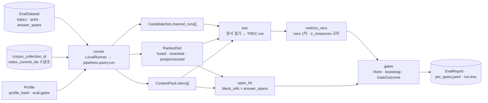
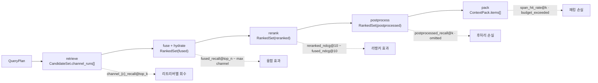

# 검색 메트릭과 평가 하네스

## 목적

이 문서는 [평가 전략](01-evaluation-strategy.md)이 위임한 세 가지를 확정한다. (1) 검색 메트릭의 **계산식과 판정 규칙** — 문서 단위 qrels 위의 IR 메트릭과, `answer_spans`에서 파생 계산하는 청크 단위 판정의 오프셋 알고리즘, (2) **평가 하네스(evaluation harness)의 입출력** — 골든셋 JSON Lines 스키마, TREC 교환, CLI·API, 병렬 실행·캐시, 런 산출물, (3) **통계 판정** — 부트스트랩 신뢰구간, 쌍대 유의성 검정과 Holm 보정, 게이트 통과 규칙. 또한 단계별 진단(리트리버별 회수·융합 효과·리랭커 효과·패킹 손실)을 어느 계약의 어느 필드에서 재는지, 회귀 비교 리포트의 형식, 라이브러리 선택, 재현성 고정, CI 통합을 정한다.

정본 관계는 브리프 > 바이블 > ADR > 이 문서다(바이블 §1.1). 계약 필드·열거 철자는 바이블 §5.6·§5.7과 [평가·피드백·사이드카 계약](../03-contracts/16-eval-feedback-and-sidecar-contracts.md)(이하 16)을 그대로 쓰고, TREC run 변환은 [후보 집합·순위 집합 계약](../03-contracts/10-candidate-set-and-ranked-set.md)(이하 10) §10을 따른다. 바이블에 없는 이름은 "제안"으로 표기하며, 이 문서가 새로 확정하는 것은 [ADR-0023](../06-adr/0023-evaluation-qrels-answer-spans-and-linear-ndcg.md)이 "08-evaluation/02가 확정한다"고 위임한 항목(검정 이름, 판정 규칙 세부, `evaluator` 플러그인 ID, 런 산출물 키, 메트릭 어휘 확장)에 한정한다.

## 범위

- 포함: 메트릭 표기와 공식(Recall@k, Precision@k, Hit@k, MRR, MAP, nDCG@k 선형·지수 이득, Judged@k, 스팬 파생 메트릭, 다양성, 지연·비용), 청크 vs 문서 판정 규칙과 오프셋 교차 알고리즘, 청크→문서 접기와 TREC run, 골든셋 포맷(`QrelsRecord`·`AnswerSpanRecord`·`TopicRecord`)과 `EvalDataset`, 코퍼스 = 컬렉션 스냅숏 규약, 하네스 구성 요소·`evaluator` 플러그인·실행 흐름·병렬·캐시, CLI·API, 결과 스키마(`EvalRun`·`PerQueryRecord`·`EvalReport`)와 런 산출물 키, 신뢰구간·유의성 검정·Holm 보정·게이트 판정, 단계별 진단 키, 회귀 비교 리포트, 라이브러리 선택, 재현성, CI 통합.
- 제외: 평가 계층·게이트 계층·책임(01 문서), 골든셋 라벨링 절차·검수 도구·stale 재라벨([골든 데이터셋 구축](03-golden-dataset-construction.md)), LLM-judge 프롬프트·교정·비용 통제([LLM-judge와 생성 품질](04-llm-judge-and-generation-quality.md)), 외부 셋 실행 절차·베이스라인 수치([벤치마크 계획과 베이스라인](05-benchmark-plan-and-baselines.md)), 인터리빙·피드백 귀속([온라인 피드백 루프](06-online-feedback-loop.md)), 계약 스키마 전문(16), 관측 스택 배포([관측성](../09-operations/03-observability.md)).

## 1. 전제와 전체 흐름

하네스는 세 전제 위에 서 있다(01 문서 §1 원칙 P1·P2·P6).

| 전제 | 정본 | 이 문서에서의 결과 |
|------|------|--------------------|
| 같은 코드 경로 | D-17, 바이블 §2.3 `eval harness` 행, §11.1 `local` 모드 | 모든 메트릭은 `pipelines.query.run`이 `LocalRunner`(`LocalContext`)로 낸 `CandidateSet`·`RankedSet`(세 단계)·`ContextPack`에서만 계산한다. 백엔드 직접 질의로 얻은 수치는 무효다 |
| 재청킹 불변 진실값 | D-12, 바이블 §2.1 K1, §6.3 | qrels는 문서(`document_id`) 단위, 정답 구간은 `element_path` + 원문 `Block.text` 코드포인트. 청크 판정은 `RankedResult.block_refs[]`·`ContextItem.provenance[]`와의 교차로 **파생 계산**하고 저장하지 않는다 |
| 재현성 고정 | 바이블 §5.6 `EvalRun`, §6.2 | (`dataset_id`, `profile_hash`, `index_commit_ids`) 삼중항이 "무엇을 평가했는지"를 고정하고, 이 문서는 그 위에 난수 시드·라이브러리 버전·동시성을 더한다(§11) |



## 2. 판정 단위와 진실값

### 2.1 문서 단위 판정(qrels)

`QrelsRecord{query_id, iteration, doc_id, relevance}`(16 §2.2)에서 `doc_id = document_id`(ULID), `relevance`는 `binary`면 `{0, 1}`, `graded`면 `0..relevance_max`(기본 3)다. 이 문서의 표기는 다음과 같다.

| 기호 | 의미 |
|------|------|
| `rel(q, d)` | qrels의 등급. qrels에 없는 (q, d)는 점수 계산에서 0, `judged@k`에서는 "미판정" |
| `R_q` | `{d : rel(q, d) ≥ 1}` — 관련 문서 집합 |
| `d_1 … d_n` | 접기(§2.4) 뒤 문서 순위 목록. `d_i`의 등급을 `rel_i`로 줄여 쓴다 |
| `k` | 컷오프. 기본 깊이는 §3.5 |

**결정(이 문서):** `R_q = ∅`인 질의(무응답 골든 질의)는 문서 단위 IR 메트릭(§3.2)의 평균에서 **제외**하고 `ContextPack.sufficiency` 보정(01 문서 §2.3)에만 쓴다. 이 제외 규칙은 ADR-0023에 없는 이 문서의 결정이며, "관련 문서가 없는 질의를 평균에서 뺀다"는 trec_eval의 기본 동작과 ranx·ir_measures가 같은 동작을 하는지는 확인 필요(as of 2026-09; `test_metrics_selfcheck`에 무응답 질의 케이스를 두어 라이브러리 동작이 다르면 하네스가 직접 제외한다). 질의 수는 세 가지를 구분한다.

| 수 | 정의 | 위치 |
|----|------|------|
| `query_count` | **실행한 질의 수** = `per_query.jsonl` 행 수(무응답 질의 포함; 16 §4.5·EF-16 "행 수 = `query_count`") | `EvalReport.query_count`(16 N), 매니페스트 |
| `ir_query_count`(제안) | IR 평균의 분모 = `query_count − unanswerable_query_count`(§3.3 스팬 키의 분모는 따로 `span_unlabeled_query_count`를 뺀다) | 매니페스트(§11) |
| `unanswerable_query_count` | `R_q = ∅` 질의 수 | 매니페스트(§11) |

베이스라인 비교에서 두 런의 질의 집합이 다를 때의 교집합 크기는 `comparison.json.query_count`(비교 전용, §7.6·§9)이며 `EvalReport.query_count`와 다른 값이다([ADR-0023](../06-adr/0023-evaluation-qrels-answer-spans-and-linear-ndcg.md)).

### 2.2 청크 단위 판정(`answer_spans` 오프셋 교차)

청크(항목)는 정답 문서의 **정답 스팬과 겹치면 관련**이다. 진실값 `AnswerSpanRecord{query_id, doc_id, doc_version, element_path, char_start, char_end}`(16 §2.2)와 항목의 좌표는 모두 원문 `Block.text` 기준 0-based 유니코드 코드포인트, 끝 미포함이다(바이블 §6.3, K1).

| 항목 종류 | 좌표 원천 | 비고 |
|-----------|-----------|------|
| `RankedResult`(`RankedSet.results[]`, `hydrated=true`) | `block_refs[]{element_path, original_char_start, original_char_end}` | `char_start/char_end`는 `Chunk.text` 기준이므로 쓰지 않는다 |
| `ContextItem`(`ContextPack.items[]`) | `provenance[]{element_path, char_start, char_end}` | `block_refs`에서 결정적으로 생성된 값이라 `original_*`과 같다(바이블 §5.5 `ContextItem.provenance`) |

**결정:** 항목 `x`가 질의 `q`의 스팬 `s`에 적중(hit)하는 조건은 아래 네 가지를 모두 만족하는 좌표 `r ∈ coords(x)`가 존재하는 것이다([ADR-0023](../06-adr/0023-evaluation-qrels-answer-spans-and-linear-ndcg.md), [ADR-0030](../06-adr/0030-single-coordinate-system-and-score-ledger.md)).

1. `x.document_id == s.doc_id`
2. `x.doc_version == s.doc_version` — 다르면 그 스팬은 **stale**이며 판정에서 제외(01 문서 §5.2; 분모에서도 빠진다)
3. `r.element_path == s.element_path`
4. 반개구간 교차: `r.start < s.char_end and s.char_start < r.end` (겹침 길이 ≥ 1 코드포인트)

```python
def span_hits(item, spans_q):
    """item: RankedResult(hydrated=true) 또는 ContextItem; spans_q: 질의 q의 AnswerSpanRecord 목록.
    반환: (적중한 스팬 키 집합, stale 스팬 키 집합). 저장하지 않고 메트릭 계산에만 쓴다."""
    hits, stale = set(), set()
    # Pydantic v2 RankedResult는 hydrated=false여도 block_refs 속성이 존재(None)하므로
    # hasattr가 아니라 값으로 분기한다. 둘 다 없으면 계약 위반(hydrated=false 입력).
    refs = getattr(item, "block_refs", None)
    if refs is not None:
        coords = [(b.element_path, b.original_char_start, b.original_char_end) for b in refs]
    else:
        prov = getattr(item, "provenance", None)
        if prov is None:
            raise ContractViolation("span_hits: RankedResult must be hydrated=true or item must be ContextItem")
        coords = [(p.element_path, p.char_start, p.char_end) for p in prov]
    for s in spans_q:
        key = (s.doc_id, s.element_path, s.char_start, s.char_end)
        if s.doc_id != item.document_id:
            continue
        if s.doc_version != item.doc_version:
            stale.add(key)
            continue
        for path, start, end in coords:
            if path == s.element_path and start < s.char_end and s.char_start < end:
                hits.add(key)
                break
    return hits, stale
```

규칙 보충:

- 스팬 하나가 여러 블록에 걸치면 라벨러가 블록마다 한 행을 만든다(`element_path`는 블록 단위이므로 한 행은 한 블록만 가리킨다). `span_recall@k`(§3.3)의 분모는 행 수다.
- 부모 확장 항목(`item_kind=parent`)·문장 윈도우 항목도 같은 규칙으로 판정한다. 부모의 `block_refs`가 섹션 전체를 덮으므로 적중이 늘어나는 것은 small-to-big의 실제 효과이며, 부모 유래 적중의 비율은 §8.5 진단 키로 따로 본다.
- `compress`가 켜져 좌표가 블록 단위(`char_start=0, char_end=len(text)`; 10 미해결 이슈 15)로 유지되는 경우에도 조건 4는 성립하므로 판정은 보존된다(정밀도는 블록 단위로 둔화).
- 최소 겹침 비율(스팬 길이의 α 이상)은 두지 않는다. 필요 시 `min_overlap_ratio`(프로파일 `eval` 절, 제안)로 열되 기본은 1 코드포인트다(미해결 이슈 5).

### 2.3 청크 vs 문서 판정 규칙

| 항목 상태 | 문서 단위(`rel(q, document_id)`) | 청크 단위(스팬 교차) | 해석 |
|-----------|-------------------------------------|----------------------|------|
| 정답 문서의 정답 블록 구간을 담음 | 관련(`rel ≥ 1`) | 적중 | 이상적 |
| 정답 문서이지만 스팬과 겹치지 않음 | 관련 | 비적중 | 문서는 맞으나 LLM이 답을 찾을 수 없는 청크 — 청킹·부모 확장 문제 |
| 정답 문서, 스팬은 있으나 `doc_version` 불일치 | 관련 | 제외(stale) | 재라벨 트리거(01 문서 §5.2) |
| qrels에 `rel = 0`으로 판정된 문서 | 비관련 | 비적중(스팬 없음, EF-4) | 노이즈 |
| qrels에 없는 문서 | 미판정(점수 0) | 비적중 | `judged@k` 저하 → 풀링 보강 |

문서 단위 메트릭(§3.2)은 첫 열만, 스팬 파생 메트릭(§3.3)은 둘째 열만 본다. 두 열을 합친 등급형 청크 nDCG는 정의하지 않는다(중립: ADR-0023 "정본 게이트 메트릭은 문서 단위").

### 2.4 청크→문서 접기(collapse)와 TREC run

`RankedSet.results[]`·`ContextPack.items[]`·`channel_runs[].candidates[]`는 청크(레코드) 단위이므로 문서 단위 메트릭 전에 접는다(01 문서 §2.2, 10 §10).

**결정:** 접기 규칙은 (1) 같은 `document_id`의 항목 중 **첫 등장(최상위) 순위**를 문서 순위로 하고, (2) 접은 뒤 `rank`를 1..n으로 재부여하고, (3) TREC run의 `score`는 **접은 순위를 보존하는 엄격 감소 값**이며 단계에 따라 두 방식으로 만든다(아래 표), (4) `score`는 소수 9자리로 쓰고, (5) `run_tag = EvalRun.run_id`다. 합·평균 집계는 채택하지 않는다(10 미해결 이슈 8 확정; 근거는 "LLM이 받는 첫 위치"가 순위 품질을 대표한다는 점). 다중 컬렉션 데이터셋은 16이 허용하지 않으므로 `doc_id` 유일성은 단일 컬렉션 안에서 성립한다([ADR-0023](../06-adr/0023-evaluation-qrels-answer-spans-and-linear-ndcg.md)).

| 단계 | `score` 규칙 | 근거 |
|------|--------------|------|
| `fused`, `reranked`, 채널 run | 첫 등장 항목의 `final_score`(채널 run은 `channel_runs[].candidates[].score`; 바이블 §5.5 `CandidateSet`) — 이 단계에서는 `final_rank`가 점수 내림차순과 같으므로 첫 등장 값 = 문서 항목들의 최대값이다. 동점은 `score − 1e-9 × (rank − 1)` | 원점수를 남겨 ranx `optimize_fusion`(§8.3)·점수 분포 진단에 쓸 수 있다 |
| `postprocessed`(`run.trec`), `pack` | **순위 유도 점수** `score = 1 − (rank − 1) / n`(n = 접은 문서 수) | `postprocessed`는 `mmr`이 `final_rank`만 재정렬하고 `final_score`는 `reranked` 값 + 부스트라 순위와 점수의 순서가 다르며(10 §8), `ContextPack.items[]`에는 `final_score`가 없다(바이블 §5.5 `ContextItem`: `rank`·`confidence_tier`·`scores`(explain 전용)). trec_eval·ranx는 `score` 내림차순으로 재정렬하므로 점수를 쓰면 MMR·부모 확장 후 순위가 아니라 리랭크 순위를 측정하게 된다 |

`final_score`는 TREC run이 아니라 `PerQueryRecord`·§8 진단에만 남는다. 10 §10은 모든 단계에 `final_score` max 규칙을 적었으므로 위 분리는 10 §10 patch 제안(미해결 이슈 1)에 포함하고, `test_collapse`(§12)에 "MMR 역전 후 trec_eval 재정렬 순위 보존" 케이스를 둔다.

run 파일은 단계마다 별개다.

| 파일(런 산출물, §6.4) | 원천 | 깊이 | 용도 |
|------|------|------|------|
| `run.trec`(1차, 16 `EvalReport.run_ref`) | `RankedSet(stage=postprocessed)` | `pack.k_max` 이하 | `ndcg@10`·`judged@10`·`precision@k`(01 문서 §2.2) |
| `runs/fused.trec`(제안) | `RankedSet(stage=fused, hydrated=true)` | `hydrate.top_n`(standard 100, lite 30) | `recall@k`·`mrr`·`map` |
| `runs/reranked.trec`(제안) | `RankedSet(stage=reranked)` | `rerank.top_n_out`(standard 20, lite 10) | 리랭커 효과(§8.4) |
| `runs/pack.trec`(제안) | `ContextPack.items[]`(`rank` 순; 순위 유도 `score`) | K ≤ `pack.k_max` | 패킹 손실(§8.5) |
| `runs/channel_{channel}.trec`(제안) | `channel_runs[]` 중 `variant_id = query_id`(원 질의) 런, 채널별 | `channels[*].top_k` | 리트리버별 회수(§8.2) |

10 §10은 변환 대상 `stage`의 기본을 `reranked`로 적었으나 01 문서 §2.2가 `run.trec = postprocessed`로 고정했으므로 이 문서는 후자를 따른다(`score` 규칙 분리와 함께 10 §10 문구 patch 제안, 미해결 이슈 1).

## 3. 메트릭 정의와 공식

### 3.1 키 규약

키는 `{metric}[@{k}]`(`^[a-z][a-z0-9_]*(@[1-9][0-9]*)?$`, 16 §4.2)이고 값은 유한한 number, 리포트 값은 질의 평균(런 단위 집계값은 §3.4에 명시)이다. 정본 키(바이블 §5.6 예시)는 `ndcg@10, recall@20, mrr, span_hit_rate@k, judged@10`이며 나머지는 01 문서 §4·16 §4.2가 초안으로 둔 어휘를 이 문서가 확정하거나(§3.2·§3.3의 "정의 확정"), 새로 제안한다("제안"; 바이블 §5.6 minor 반영은 미해결 이슈 2).

이 문서의 키 자리표시자는 두 개이며 값 집합이 다르다(각 표는 여기만 참조한다).

| 자리표시자 | 값 집합 | 쓰이는 키 |
|------------|---------|-----------|
| `{pipeline_stage}` | `ContextPack.diagnostics.latency_ms` 키 = `plan, retrieve, fuse, hydrate, rerank, postprocess, pack`(바이블 §5.5) | `{pipeline_stage}_latency_p95_ms`(§3.4) |
| `{measure_stage}` | `RankedStage`(`fused, reranked, postprocessed`; 바이블 §5.7) ∪ `pack`(`ContextPack.items[]`) ∪ `channel_{Channel}`(`channel_dense, channel_sparse, channel_lexical, channel_graph, channel_tree, channel_visual, channel_late_interaction`; `Channel` 열거 바이블 §5.7) | 단계 접두 키 `{measure_stage}_{metric}[@{k}]`(§3.5·§8) |

### 3.2 문서 단위 IR 메트릭

모두 접기(§2.4) 뒤 문서 순위 위에서 계산한다. `1[·]`은 지시 함수다.

| 키 | 공식(질의 q) | 게이트 | 상태 | 계산기 |
|----|-------------|--------|------|--------|
| `recall@k` | `\|{i ≤ k : rel_i ≥ 1}\| / \|R_q\|` | 예(`recall@20`) | 정본 | ranx `recall@k`; ir_measures `R@k` |
| `precision@k` | `\|{i ≤ k : rel_i ≥ 1}\| / k` — 목록이 k 미만이면 부족분은 비관련으로 계산 | 아니오(보고) | 정의 확정(09 문서 §메트릭 정의) | ranx `precision@k`; ir_measures `P@k` |
| `hit_rate@k` | `1[∃ i ≤ k : rel_i ≥ 1]` | 아니오(스모크) | 정의 확정 | ranx `hit_rate@k`; ir_measures `Success@k` |
| `mrr`, `mrr@k` | `1 / min{i ≤ k : rel_i ≥ 1}`, 없으면 0. `mrr`은 `k = hydrate.top_n`(측정 단계 `fused`) | 예 | 정본(`mrr` 깊이는 이 문서가 확정, 16 미해결 이슈 15) | ranx `mrr@k`; ir_measures `RR@k` |
| `map`, `map@k` | `AP@k = (1 / \|R_q\|) Σ_{i ≤ k} 1[rel_i ≥ 1] · precision@i`; `map`은 `k = hydrate.top_n` | 아니오(보고) | 정의 확정(trec_eval `map_cut` 규약: 분모는 `\|R_q\|`) | ranx `map@k`; ir_measures `AP@k` |
| `ndcg@k` | `DCG@k / IDCG@k`, `DCG@k = Σ_{i ≤ k} rel_i / log2(i + 1)`, `IDCG@k`는 qrels의 등급을 내림차순으로 놓은 이상 순위의 DCG@k. **이득 선형**, 할인 `1/log2(i+1)` | 예(`ndcg@10`) | 정본 | ranx `ndcg@k`(`ndcg_burges` 호출 금지 테스트); ir_measures `nDCG@k` 교차(±0.01) |
| `ndcg_exp@k` | 같은 식에 이득 `2^rel_i − 1` | 아니오 | 정본(혼용 금지) | ranx `ndcg_burges@k`; ir_measures `nDCG(dcg='exp-log2')@k` |
| `judged@k` | `\|{i ≤ k : (q, d_i) ∈ qrels}\| / k` — `rel = 0` 판정도 "판정 있음" | `warn_below`만 | 정본 | ir_measures `Judged@k` |

`binary` 데이터셋에서 `ndcg@k`는 `rel ∈ {0, 1}`로 계산되며 `graded`와 같은 키를 쓴다(데이터셋 `judgment_level`이 리포트 해석의 맥락이다). `relevance_max`를 넘는 값은 등록 시 `contract.violation`이다.

### 3.3 스팬 파생 메트릭(참조 기반 컨텍스트 정밀도·재현율)

RAGAS의 `context_precision`(16 §4.2 L2 어휘)과 `context_recall`(09 문서 §메트릭 정의 "Context recall(RAGAS)"; 16 어휘에는 없고 L2 어휘 확장은 04 문서 소관)은 LLM-judge 키다. 이 문서가 정의하는 참조 기반 청크 판정은 **다른 키**를 쓴다 — 같은 이름으로 두 정의를 섞지 않는다(01 문서 §4 규칙 2). `S_q`는 질의 q의 non-stale 스팬 행 집합, `x_1 … x_K`는 측정 단계의 항목(관련도 순)이다. **`S_q = ∅`인 질의**(스팬 라벨이 없거나 전부 stale)는 아래 세 키 **모두**의 평균에서 제외하고(그렇지 않으면 `span_hit_rate@k`·`span_precision@k`가 0으로 평균을 끌어내린다) 매니페스트 `span_unlabeled_query_count`(제안, §11)에 기록한다.

| 키 | 공식(질의 q) | 상태 | 측정 단계 기본 |
|----|-------------|------|----------------|
| `span_hit_rate@k` | `1[∃ i ≤ k : hits(x_i) ≠ ∅]` | 정본 | `ContextPack.items[]`(`rank` 순) |
| `span_recall@k` | `\|∪_{i ≤ k} hits(x_i)\| / \|S_q\|` | 제안 | 동일 |
| `span_precision@k` | `\|{i ≤ k : hits(x_i) ≠ ∅}\| / k` — K < k면 부족분은 비적중 | 제안 | 동일 |
| `span_hit_ranks` | `{i : hits(x_i) ≠ ∅}` 정렬 목록(질의별, `PerQueryRecord.span_hit_ranks[]`) | 16 N 필드 | 동일 |

세 키는 O-09 청크 그리드·부모 확장·문장 윈도우·`compress` 비교의 판정 입력이며(바이블 §3.2 O-09), `span_hit_rate@k`만 게이트 `grid`의 `metric`이 될 수 있다(정본). `span_precision@k`는 컨텍스트 팩 노이즈, `span_recall@k`는 다중 스팬 질의(표·수치, 다중 홉)의 충분성을 본다.

### 3.4 다양성·지연·비용(런 단위 또는 보고용)

| 키 | 정의 | 단위·집계 | 상태 |
|----|------|-----------|------|
| `distinct_docs@k` | 상위 k 항목의 서로 다른 `document_id` 수 / k | 질의 평균 | 제안(MMR·`dedup` 효과 진단; 벡터 유사도 기반 다양성은 `with_vectors=false`라 계산하지 않는다) |
| `parent_ratio@k` | 상위 k 항목 중 `item_kind=parent` 비율 | 질의 평균 | 제안(§8.5) |
| `latency_p95_ms` | 질의별 `pipelines.query.run` 벽시계(ms)의 p95 | **런 단위** | 16 §4.2 초안 → 확정. 동시성 1인 런에서만 산출(§5.2) |
| `{pipeline_stage}_latency_p95_ms` | `ContextPack.diagnostics.latency_ms.{pipeline_stage}`의 p95(값 집합은 §3.1) | 런 단위 | 제안 |
| `cost_per_doc_usd` | `usage_ledger` LLM 비용 / 코퍼스 문서 수(수집 측 LLM 보강 게이트 입력) | 런 단위 | 16 §4.2 초안; 정의 확정은 04 문서 |

브리프 §7 지연 목표(`standard` GPU p95 < 800ms)의 판정 입력은 `latency_p95_ms`이며 `eval.gates.latency_p95_ms: {max: 800}` 형식은 15 `EvalGate.max`에 기댄다(01 문서 미해결 이슈 3).

### 3.5 측정 단계 기본값과 단계 접두 키

**결정:** 단계 접두가 없는 정본 키는 아래 기본 단계에서 잰다(01 문서 §2.2 확정값 + 이 문서 추가). 다른 단계의 값이 필요하면 **단계 접두 키** `{measure_stage}_{metric}[@{k}]`(값 집합은 §3.1)를 쓴다(제안; 키 규약 정규식 안에 있으며 §8 진단의 어휘다). 단계 접두 키는 `metrics_requested`에 명시했을 때만 계산·기록하고 §7.2 Holm 패밀리에는 들어가지 않는다.

| 정본 키 | 기본 단계 | 기본 깊이(`standard` / `lite`, 바이블 §7.2) |
|---------|-----------|---------------------------------------------|
| `ndcg@k`, `ndcg_exp@k`, `judged@k`, `precision@k`, `hit_rate@k` | `postprocessed`(`run.trec`) | k ≤ `pack.k_max`(20 / 10) |
| `recall@k`, `mrr`, `map` | `fused`(`hydrated=true`) | k ≤ `hydrate.top_n`(100 / 30) |
| `span_hit_rate@k`, `span_recall@k`, `span_precision@k`, `distinct_docs@k`, `parent_ratio@k` | `pack`(`ContextPack.items[]`) | k ≤ `pack.k_max` |

`EvalReport.metrics`는 `metrics_requested`를 **반드시 포함**해야 하므로(16 §4.1·EF-13) 계산할 수 없는 키를 조용히 빼는 일은 허용되지 않는다. 요청한 k가 단계 깊이를 넘는 키(예 `recall@200`), 채널 run을 만들 수 없는 프로파일의 채널 접두 키(`lite` 서버 융합, §8.2), `concurrency > 1` 런의 지연 키(§5.2)는 §4.5 V8이 런 시작 전에 거부한다(`POST /v1/eval/runs` 400 `contract.violation`, 오류 사유 `depth_exceeded`·`channel_run_unavailable`·`latency_requires_serial_run`; `eval.prepare`에서 발견되면 `EvalRun.status=failed`).

## 4. 골든셋 포맷과 데이터셋 스키마

### 4.1 `EvalDataset`

바이블 §5.6 필드(Y)와 16이 추가한 선택 필드(N)를 그대로 쓴다. 이 문서는 필드를 추가하지 않는다.

| 필드 | 타입 | 필수 | 하네스에서의 역할 |
|------|------|------|-------------------|
| `schema_version` | string(semver) | N(16) | 계약 버전(`1.0.0`); 로더는 `contracts_compat` 범위 밖이면 거부 |
| `dataset_id` | string(ulid) | Y | `EvalRun.dataset_id` 고정 대상 |
| `tenant_id` | string(ulid) | N(16) | `corpus_collection_id` 소유 테넌트. EF-30: 서버가 항상 채움; `eval/` 키 테넌트 접두 부재(§6.4, 미해결 이슈 8)의 임시 방어이며 `service:eval-harness`의 테넌트 스코프(V6)와 같아야 한다 |
| `name` | string | Y | 프로파일 `eval.datasets[]`·`gate.dataset` 참조 이름; 최신 행 해소(16 §2.3) |
| `content_hash` | string(hex64) | Y | `H("evalset", qrels_ref.blake3, answer_spans_ref.blake3, topics_ref.blake3 or "")`(16 §2.3); 로딩 시 재계산 검증 |
| `qrels_ref`, `answer_spans_ref` | `ArtifactRef` | Y | JSONL 산출물(`application/x-ndjson`) |
| `topics_ref` | `ArtifactRef` | N(16) | 질의 본문. 없으면 실행 불가 → 시작 검증 실패(16 미해결 이슈 2) |
| `corpus_collection_id` | string(ulid) | Y | 질의 대상 컬렉션 = 코퍼스(§4.4) |
| `judgment_level`, `relevance_max` | enum(JudgmentLevel) / integer | Y / N(16) | `binary`·`graded`; 등급 상한(기본 3) |
| `label_provenance` | enum(LabelProvenance) | Y | 게이트 데이터셋은 `human`만(EF-6) |
| `license`, `language`, `created_at` | string(SPDX) / string(bcp47) / string(date-time) | Y / N(16) / Y | 라이선스 게이트; 판정 프롬프트 언어 선택 |

### 4.2 JSON Lines 레코드 3종

세 파일은 한 행 = 한 객체, UTF-8, `ensure_ascii=false`다(16 §2.2). 아래는 같은 질의 `kopub-0001`의 세 파일 한 행씩이다(값은 형식 예시).

`topics.jsonl`:

```jsonl
{"query_id": "kopub-0001", "query": "행정안전부 고시 제2026-12호에서 정보공개 청구서의 처리 기한은 며칠인가?", "language": "ko", "metadata": {"domain": "public_admin", "hops": 1, "evidence_type": "paragraph"}}
```

`qrels.jsonl`(TREC `kopub-0001 0 01J9ZQ6M0N1P2Q3R4S5T6V7W8X 3`과 1:1):

```jsonl
{"query_id": "kopub-0001", "iteration": "0", "doc_id": "01J9ZQ6M0N1P2Q3R4S5T6V7W8X", "relevance": 3}
{"query_id": "kopub-0001", "iteration": "0", "doc_id": "01J9ZQ7B8C9D0E1F2G3H4J5K6M", "relevance": 1}
```

`answer_spans.jsonl`(HWPX 본문 단락, 흐름 포맷이라 페이지 없음):

```jsonl
{"query_id": "kopub-0001", "doc_id": "01J9ZQ6M0N1P2Q3R4S5T6V7W8X", "doc_version": "e078c857ebd01652ff4bf9a6b873f10213fb07d7a9e19de5129e302be1f54deb", "element_path": "/hp:sec[0]/hp:p[17]", "char_start": 12, "char_end": 58}
```

`TopicRecord.metadata`는 스칼라 값의 열린 객체다(16 미해결 이슈 8). 하네스는 `metadata`를 층화 표본(judge)과 리포트 분해(§9 "부분군")에만 쓰고 메트릭 계산에는 쓰지 않는다. 권장 키(제안; 03 문서 확정): `domain`, `hops`(정수), `evidence_type ∈ {paragraph, table, figure, list}`, `answerable`(불리언).

### 4.3 TREC 교환

| 방향 | 명령(16 §2.2 정본) | 변환 규칙 |
|------|--------------------|-----------|
| 내보내기 | `rag eval export --dataset <dataset_id> --format trec --out <dir>` | `qrels.jsonl` → `qrels.txt`(`query_id iteration doc_id relevance`, 공백 구분); `topics.jsonl` → `topics.jsonl` 그대로(TREC topic XML 대체, 09 문서 §TREC 포맷); `answer_spans.jsonl`은 플랫폼 확장이라 그대로 복사 |
| 들여오기 | `rag eval datasets register --qrels qrels.txt …`(§5.4 제안) | TREC 텍스트를 `QrelsRecord`로 변환; `doc_id`는 컬렉션 문서의 `document_id`(ULID)여야 하며 `external_id` 매핑은 `--doc-id-map external_id`로 수행(제안) |
| run | `eval/runs/{run_id}/run.trec` | `query_id Q0 doc_id rank score run_tag`(§2.4) — ranx `Run.from_file`, ir_measures `read_trec_run`, pytrec_eval이 그대로 읽는다 |

### 4.4 코퍼스 = 컬렉션 스냅숏

골든셋 파일에는 문서 본문이 없다. **코퍼스는 `corpus_collection_id` 컬렉션의 현재 세대**이며, `EvalRun.index_commit_ids`가 시작 시점 문서별 current 커밋을 스냅숏해 "어느 파싱·청킹·임베딩·인덱스 결과를 평가했는지"를 고정한다(16 §3.1). 과거 세대를 지정하는 입력은 없다(`is_current=false` 레코드는 검색되지 않는다).

| 상황 | 규칙 |
|------|------|
| 런 도중 문서 세대 플립 | `ContextPack.diagnostics.index_generations_seen[]`에 두 세대가 보이면 `PerQueryRecord`에 표시만 하고 런은 유효(16 §3.2). 매니페스트 `generation_flip_query_count`(제안) |
| 골든셋 문서가 컬렉션에 없음(삭제·미수집) | 시작 검증 경고 `missing_doc_count`; qrels 행은 유지(회수 실패로 계량) — 비율이 높으면(초안 목표 > 5%) 실패로 승격하는 규칙은 03 문서 확정 |
| 인덱스 영향 변경의 비교(청커·임베더 교체) | 섀도 컬렉션(blue/green)에 같은 골든셋을 **다른 `corpus_collection_id`로 등록**해 두 런을 만든다(01 문서 §6.1). `document_id`는 `(tenant_id, collection_id, external_id or source_uri)`로 확정되므로(바이블 §11.2) 컬렉션이 다르면 ULID도 다르다 → 골든셋 `doc_id`는 `external_id` 기준으로 재매핑하여 재등록한다(`--doc-id-map external_id`; 미해결 이슈 6) |
| CI 소형 골든셋 | 컬렉션은 매 CI에서 `file://` 개발 모드로 재수집된다. **전제(고정 ID 시드):** `document_id`는 `(tenant_id, collection_id, external_id or source_uri)` 기준으로만 재사용되므로(바이블 §5.4 `SourceDocument.document_id`) 새 원장에 새 컬렉션을 만들면 새 ULID가 발급되어 `qrels.doc_id`가 무효화되고, `--doc-id-map`으로 재등록하면 qrels 바이트·`content_hash`·`dataset_id`가 바뀌어(16 §2.3) §7.6 규칙이 베이스라인 `comparison`을 거부한다. 따라서 테스트 픽스처는 재수집 **전에** 원장 스냅숏 `tests/eval/fixtures/ledger/`(제안)으로 `tenant_id`·`collection_id`·`documents` 행(`document_id`·`external_id`·`source_uri`)·`eval_datasets` 행(`dataset_id`·`content_hash`)을 고정 ULID로 시드한다 → 재수집은 `document_id` 재사용 규칙을 타고, 골든셋 등록은 같은 `content_hash`라 200 + 기존 행(16 §2.3)이며, qrels 바이트·`dataset_id`는 불변이다. 재수집 입력 목록 `corpus.jsonl`(행 `{document_id, external_id, source_uri, blake3}`; 제안 `CorpusManifestRecord`)을 `tests/eval/datasets/{name}/`에 두고, 재수집 후 `IndexCommit.commit_hash`가 고정 파일과 일치함과 등록된 `dataset_id`가 고정값과 같음을 단정한다(`test_reproducibility`, §12; 브리프 §7 재현성 목표의 CI 판정). 대안은 `QrelsRecord.external_id` 병기(미해결 이슈 6) |

### 4.5 등록·로딩 시 검증

하네스 `datasets/` 로더는 등록(`POST /v1/eval/datasets`)과 런 시작(`eval.prepare`)에서 다음을 검증한다. 실패는 등록 시 400 `contract.violation`, 런 시작 시 `EvalRun.status=failed`다.

| # | 규칙 | 시점 |
|---|------|------|
| V1 | `content_hash` 재계산 일치, 세 파일 모두 유효한 JSON Lines | 등록·시작 |
| V2 | qrels의 모든 `query_id` ⊆ topics의 `query_id`; topics에만 있는 질의는 허용(무응답 질의) | 등록 |
| V3 | `answer_spans`의 `(query_id, doc_id)`는 qrels에 `relevance ≥ 1`로 존재(EF-4); `char_end ≥ char_start` | 등록 |
| V4 | `relevance ≤ relevance_max`(`binary`는 1) | 등록 |
| V5 | 게이트 데이터셋(`eval.datasets[]`·`gate.dataset`)은 `label_provenance=human` → 아니면 `profile.invalid` | 시작 |
| V6 | 평가 주체 `service:eval-harness`의 가시 집합이 qrels 문서 전부를 포함(16 EF-12; 역할 확정은 02-architecture/07) | 시작 |
| V7 | stale 스팬 비율·누락 문서 비율을 매니페스트에 기록(경고 임계는 03 문서) | 시작 |
| V8 | `metrics_requested`의 모든 키가 계산 가능해야 한다(16 §4.1 "`metrics` ⊇ `metrics_requested`"): (i) 키가 §3 어휘(정본·확정·제안 키, 단계 접두 키, 런 단위 키)에 있고, (ii) `@k`가 §3.5 기본 깊이(단계 접두 키는 그 단계 깊이) 이하이며(위반 사유 `depth_exceeded`), (iii) `channel_*` 접두 키는 채널 run이 가능한 프로파일에서만(`lite` 서버 융합 불가, §8.2; `channel_run_unavailable`), (iv) `latency_p95_ms`·`{pipeline_stage}_latency_p95_ms`는 `concurrency = 1` 런에서만(§5.2; `latency_requires_serial_run`). 위반은 `POST /v1/eval/runs` 400 `contract.violation`(`errors[].location.pointer = /metrics_requested/{i}`), `eval.prepare` 발견 시 `failed` | 요청·시작 |

## 5. 하네스 아키텍처

### 5.1 구성 요소와 `evaluator` 플러그인

패키지는 `rag_platform.eval`(`[eval]` extra; 바이블 §12 `eval/`: `harness`, `runner`, `trec`, `metrics_ranx`, `judge_ragas`, `span_hit`, `gates`, `datasets/`)이다. 01 문서 §8.1의 책임 표를 전제로, 이 문서는 계산기를 D-10 `evaluator` 확장 지점 플러그인으로 확정한다.

**결정:** `evaluator` 플러그인의 `plugin_id`는 다음 네 개다(바이블 §6.1 `{extension_point}.{implementation}`; 01 문서 §8.4 제안 확정, [ADR-0023](../06-adr/0023-evaluation-qrels-answer-spans-and-linear-ndcg.md), [ADR-0032](../06-adr/0032-plugin-sdk-stage-protocol-and-conformance-kit.md)).

| `plugin_id` | 입력 | 출력 키 | 구현 | 라이선스 등급 |
|-------------|------|---------|------|---------------|
| `evaluator.ir_metrics_ranx` | TREC run(단계별) + qrels | §3.2 전부, §3.5 단계 접두 키 | ranx 1차, ir_measures 교차 검증 | A |
| `evaluator.span_hit` | `RankedSet`·`ContextPack` + `answer_spans` | §3.3 전부, `span_hit_ranks[]`, §3.4 `distinct_docs@k`·`parent_ratio@k` | 코어(순수 함수, §2.2) | 코어 |
| `evaluator.judge_ragas` | `ContextPack`(+ 응답) 표본 | L2 키(`context_precision`, `faithfulness` …; 04 문서) | RAGAS 0.4 collections | A |
| `evaluator.judge_deepeval` | 동일 | 동일(병기) | DeepEval | A |

플러그인은 `Capabilities.contracts_compat`를 선언하고 `PluginMeta.license_grade ≤ license_policy.max_grade`여야 한다(바이블 §7.4 (1)). 통계(`gates`: Holm·부트스트랩·Tukey)와 리포트 생성(`gates` 하위 `report`, 제안)은 플러그인이 아니라 코어다 — 판정 규칙이 프로파일 게이트의 의미를 정하므로 교체 대상이 아니다.

### 5.2 실행 흐름, 배치와 병렬

실행기는 두 셸이다(바이블 §11.1): CI·개발·`rag eval run`(로컬)은 `LocalRunner`가 하네스 전체를 한 프로세스에서 실행하고, `standard` 이상의 야간·릴리스는 `eval.run.v1`(`JobKind=evaluate`, `maintenance` 큐)이 `eval.prepare → eval.execute → eval.report → stage.publish`로 실행한다(02-architecture/06 §2.6; 액티비티 이름은 그 문서의 제안). 질의 실행은 두 셸에서 같은 함수다.

| 단계 | 내용 | 규칙 |
|------|------|------|
| prepare | 데이터셋 로드·V1~V8 검증, `profile_hash` 해소, `index_commit_ids` 스냅숏, `EvalRun(running)` | 실패는 `failed` |
| execute | topics를 `batch_size`(초안 목표 50) 배치로 나누고 배치 안에서 `concurrency`(초안 목표: CI 4, 야간 8) 질의를 `asyncio` 동시 실행. 질의마다 `QueryRequest{query, collection_ids=[corpus_collection_id], explain=true}`를 `service:eval-harness` `SecurityContext`로 `pipelines.query.run`에 넘기고 `CandidateSet`·세 단계 `RankedSet`·`ContextPack`을 받는다. 각 질의에서 접기·스팬 판정을 즉시 수행해 **질의별 메트릭 벡터만** 메모리에 남긴다(원본 `RankedSet`은 `--keep-stage-outputs`일 때만 저장) | 검색 경로는 읽기 전용이라 재시도·병렬이 안전(바이블 §11.1 `query` 모드). `temporal`은 배치마다 `heartbeat_details.query_offset`, 배치 결과 `batches/{n}.jsonl`(제안) 덮어쓰기 재개 |
| report | 질의별 벡터 → 평균·런 단위 집계, 베이스라인 join, 검정·Holm·부트스트랩(§7), `GateOutcome`, `per_query.jsonl`·`run.trec`·`runs/*.trec`·`comparison.json`·`manifest.json` 기록, `EvalReport` 저장 + `eval.run.completed` 같은 트랜잭션 | judge 실패는 IR 판정에 영향 없음(01 문서 §10) |

`explain=true`는 `RankedSet.score_breakdown`을 팩 `explain`에 남겨 §8 진단에 쓰기 위한 것이며, 프로덕션 기본(`explain=false`)과 순위 결과가 같아야 한다(적합성 키트 단정, 제안). 그 외의 요청 필드(`top_k`·`max_context_tokens`·`retrieval_variant`·`include_parents` 등)는 **보내지 않는다** — 평가 런은 프로파일 기본값을 우회하지 않으며(01 문서 P6) 변형 비교는 프로파일 두 버전으로 한다. 측정 깊이는 요청 필드가 아니라 각 단계 출력 크기(`hydrate.top_n`·`rerank.top_n_out`·`pack.k_max`)가 정한다(§3.5). `QueryRequest.top_k`(기본 10, "팩 `k_max`와 별개"; 바이블 §5.5)가 어느 단계의 출력 수를 제한하는지는 바이블에 명시가 없어 §3.5 깊이 표는 09 문서 확정 후 재검토한다(미해결 이슈 13).

병렬 실행과 지연 메트릭: `concurrency > 1`이면 질의 벽시계가 자원 경합으로 부풀므로 `latency_p95_ms`·`{pipeline_stage}_latency_p95_ms`를 산출하지 않는다(매니페스트 `concurrency`로 판독; 요청되면 V8이 거부). 지연 목표 판정 런은 `--concurrency 1`로 별도 실행한다(05 문서 벤치마크 컬렉션).

### 5.3 캐시

| 대상 | 캐시 | 규칙 |
|------|------|------|
| 검색 결과(`CandidateSet`·`RankedSet`) | **없음** | ACL 시점성 때문에 결과 캐시 금지(바이블 §4.3). 런마다 재실행한다 |
| 질의 임베딩 | Valkey `qemb:{embedding_space_id}:{H(normalized_query)}` 24h(프로덕션 캐시) | 재사용 허용 — 같은 모델·같은 텍스트의 결정적 값. 서빙 교체 비교 런은 `--no-query-embedding-cache`(제안)로 우회 |
| 리랭크 점수 | Valkey `rr:{model_id}:{H(query, chunk_id)}` 60s | 재사용 허용(같은 모델) |
| 데이터셋 파일 | 로컬 디스크 `~/.cache/rag-platform/eval/{blake3}`(제안) | `ArtifactRef.blake3` 검증 후 사용 |
| judge 판정 | `H("judge", judge_model, prompt_hash, input_hash)`(01 문서 미해결 이슈 10 제안) | 04 문서 확정 |
| 메트릭 재계산 | `eval/runs/{run_id}/runs/*.trec` + 데이터셋 → `rag eval replay`(제안) | IR 메트릭만 재계산(스팬 판정은 좌표가 저장되지 않으므로 불가 — `--keep-stage-outputs` 런은 가능) |
| 외부 셋 | `ir_datasets` 로컬 캐시 | 라이선스 게이트 통과 셋만(05 문서) |

### 5.4 CLI

바이블 §12 `cli/`는 `rag eval`만 명시하고 16 §2.2가 `rag eval export --format trec`를 정본으로 두었다. 나머지 하위 명령은 **제안**이며 10-development 문서가 확정한다(01 문서 §8.3).

| 명령 | 인자 | 동작 |
|------|------|------|
| `rag eval run` | `--dataset <name \| dataset_id>` `--profile <profile_id>` `[--metrics ndcg@10,recall@20,…]` `[--baseline <run_id>]` `[--judge-model <repo@rev>]` `[--concurrency N]` `[--seed 42]` `[--diagnostics]` `[--keep-stage-outputs]` `[--gate]` `[--remote]` `[--out <dir>]` | 로컬 `LocalRunner` 실행(기본) 또는 `--remote`로 `POST /v1/eval/runs` 제출. `--metrics` 생략 시 프로파일 `eval.gates` 키 + `mrr` + `span_hit_rate@{pack.k_max}`(단, `concurrency > 1`이면 런 단위 지연 키는 제외 — §7.5 지연 게이트 규칙). `--diagnostics`는 §8 단계 접두 키 전부(V8을 통과하는 키만). `--gate`는 `gate_result.passed=false`면 종료 코드 2 |
| `rag eval compare` | `--baseline <run_id>` `--candidate <run_id>` `[--format md \| json]` `[--top-losses 20]` `[--by metadata.domain]` | 두 `completed` 런의 `per_query.jsonl`을 join해 §9 리포트 생성(재실행 없음) |
| `rag eval export` | `--dataset <dataset_id>` `--format trec` `--out <dir>` | §4.3(정본) |
| `rag eval datasets register` | `--name` `--qrels` `--answer-spans` `--topics` `--corpus-collection <collection_id>` `--license` `--label-provenance` `--judgment-level` `[--relevance-max 3]` `[--doc-id-map external_id]` | 산출물 업로드 → `POST /v1/eval/datasets`; V1~V4 검증 |
| `rag eval datasets validate` | `--dataset <dataset_id>` | V1~V7 + stale·누락 비율 출력 |
| `rag eval replay` | `--run <run_id>` `--metrics …` | 저장된 run 파일로 IR 메트릭 재계산(§5.3) |

### 5.5 API

바이블 §14 정본: `POST/GET /v1/eval/datasets`, `POST/GET /v1/eval/runs`, `GET /v1/eval/runs/{run_id}`, `GET /v1/eval/runs/{run_id}/report`. `POST /v1/eval/runs`는 202 + `JobStatus(kind=evaluate)`이며 `Idempotency-Key`는 선택·권장이다(05-api/01 §6·§9.3). 요청 본문은 16 §3.1이 정한 대로 `dataset_id`·`profile_id`·`metrics_requested`(+ `judge_model`·`experiment_id`·`baseline_run_id`)만 갖는다.

```json
{
  "dataset_id": "01J9ZR0D4T7V9W2X4Y6Z8A0B1C",
  "profile_id": "standard",
  "metrics_requested": ["ndcg@10", "recall@20", "mrr", "judged@10", "span_hit_rate@10", "fused_recall@100", "channel_lexical_recall@100"],
  "judge_model": null,
  "baseline_run_id": "01J9ZR1A2B3C4D5E6F7G8H9J0K"
}
```

`concurrency`·`seed`·`diagnostics` 같은 실행 옵션은 계약 필드가 아니라 프로파일 `eval` 절의 운영 설정 또는 CLI 인자다(런 단위 옵션 필드 추가는 미해결 이슈 3). `run_id`를 202 응답에서 얻는 경로는 05-api/04가 확정한다(01 문서 미해결 이슈 17).

## 6. 결과 스키마

### 6.1 `EvalRun`

바이블 §5.6 필드 그대로다(16 §3.1). 하네스가 채우는 재현성 필드는 `profile_hash`(런 안의 모든 `QueryPlan.profile_hash`와 같음을 런타임 단정), `index_commit_ids`(ULID 오름차순, **≤ 1,000** — 바이블 §5.1 인라인 한계 64KB를 인스턴스 전체 바이트로 산정한 상한이며 12 `EvalRunCompletedData.index_commit_ids`의 `maxItems: 1000`과 같다; 16 §3.1·§8), `index_commits_hash`(16 N이지만 **항상** 채운다 — `H("commits", *sorted(전체 current commit_id))`, EF-9), 커밋이 1,000개를 넘으면 앞 1,000개 + `index_commits_ref`(`eval/runs/{run_id}/index_commits.jsonl`, 전체 목록), `metrics_requested`(1..64, 유일; V8 통과)다. 상태는 `running → completed | failed`만이다.

### 6.2 `PerQueryRecord`(`per_query.jsonl`)

16 §4.5 필드 `{query_id, metrics, top_doc_ids?, span_hit_ranks?}`를 쓴다. `metrics`에는 정본 키와 요청한 단계 접두 키가 함께 들어간다. 행 수 = `EvalReport.query_count` = 실행 질의 수(16 §4.5·EF-16; 무응답 질의도 한 행이며 그 행의 `metrics`에는 §3.2 IR 키가 없다 — §2.1 제외 규칙). 질의 본문·청크 본문·주체 문자열은 싣지 않는다(00 I-16). 아래 값은 형식 예시이나 `ndcg@10 = 1.0`은 `top_doc_ids`(§4.2 qrels의 rel 3·rel 1 문서가 1·2위)와 §3.2 공식으로 재계산 가능하다.

```json
{
  "query_id": "kopub-0001",
  "metrics": {
    "ndcg@10": 1.0,
    "recall@20": 1.0,
    "mrr": 1.0,
    "judged@10": 0.8,
    "span_hit_rate@10": 1.0,
    "span_recall@10": 1.0,
    "fused_recall@100": 1.0,
    "channel_dense_recall@100": 1.0,
    "channel_sparse_recall@100": 0.5,
    "channel_lexical_recall@100": 1.0,
    "reranked_ndcg@10": 1.0,
    "fused_ndcg@10": 0.7654
  },
  "top_doc_ids": ["01J9ZQ6M0N1P2Q3R4S5T6V7W8X", "01J9ZQ7B8C9D0E1F2G3H4J5K6M"],
  "span_hit_ranks": [1]
}
```

트레이스 상관을 위한 플랫폼 `query_id`(ULID)·`stale_span_doc_ids[]`·`generation_flipped`는 16 §4.5에 없다(N 추가 제안, 미해결 이슈 4).

### 6.3 `EvalReport`

바이블 §5.6 필드(`run_id`, `metrics`, `comparison?`, `gate_result`, `artifacts_ref`, `created_at`)와 16 N 필드(`schema_version`, `dataset_id`, `profile_hash`, `query_count`, `run_ref`, `comparison.stat_test`, `gate_result.warned_gates`)를 그대로 쓴다. 이 문서가 확정하는 값 규칙은 다음이다.

| 필드 | 규칙 |
|------|------|
| `metrics` | 정본 키 + 요청 키의 질의 평균(§2.1·§3.3 제외 규칙 적용), 런 단위 키는 §3.4. 키 집합 ⊇ `metrics_requested`(16 §4.1·EF-13) — 계산 불가 키는 V8이 런 시작 전에 거부하므로 리포트에서 빠지는 키는 없다 |
| `query_count` | 실행 질의 수 = `per_query.jsonl` 행 수(§2.1) |
| `comparison.deltas` | `metrics[k] − baseline.metrics[k]`, 키 = §7.2 패밀리(질의 평균 키만). 런 단위 키(§3.4 `latency_p95_ms`·`{pipeline_stage}_latency_p95_ms`·`cost_per_doc_usd`)는 질의 단위 쌍대 검정의 `d_i`가 없어 p값을 만들 수 없으므로 `deltas`에 넣지 않고 `comparison.json.run_level_deltas`(제안, §9)에만 기록한다(16 §4.3 "`p_values` 키 = `deltas` 키" 불변식 준수) |
| `comparison.p_values` | Holm 보정 후 p값(§7.2); 키 집합 = `deltas` 키 집합(16 EF-14) |
| `comparison.correction` | `"holm"` 고정(D-12) |
| `comparison.stat_test` | `fisher_randomization`(기본) / `paired_t` / `tukey_hsd`(§7.1) |
| `gate_result` | §7.5 규칙으로 산출한 `GateOutcome[]`; `passed = (failed_gates == [])` |
| `artifacts_ref`, `run_ref` | `per_query.jsonl`, `run.trec`(§6.4) |

신뢰구간·부분군 분해·상위 손실 질의는 계약 필드가 아니라 `comparison.json`(§9, 제안)에 두고 `EvalReport.comparison_ref`(N, `ArtifactRef`, 제안)로 연결한다(미해결 이슈 4).

### 6.4 런 산출물 키

정본은 `eval/datasets/{dataset_id}/{qrels|answer_spans}.jsonl`(바이블 §13.3)뿐이고 런 산출물 키는 이 문서·16이 제안한다(16 미해결 이슈 2; 바이블 §13.3 patch 제안).

| 키(`eval/runs/{run_id}/` 아래) | 내용 | 미디어 타입 | 상태 |
|------|------|-------------|------|
| `per_query.jsonl` | `PerQueryRecord` 행 | `application/x-ndjson` | 16 §4.5 |
| `run.trec` | `postprocessed` 문서 run | `text/plain` | 16 §4.1 |
| `runs/{fused \| reranked \| pack}.trec`, `runs/channel_{channel}.trec` | 단계·채널 run(§2.4) | `text/plain` | 제안 |
| `comparison.json`, `comparison.md` | 회귀 비교 리포트(§9) | `application/json`, `text/markdown` | 제안 |
| `manifest.json` | 재현성 매니페스트(§11) | `application/json` | 제안 |
| `index_commits.jsonl` | 커밋 > 1,000일 때 전체 current 커밋의 `IndexCommitRecord{commit_id, document_id, index_generation}`(`index_commits_ref` 대상; 완전성은 `index_commits_hash`로 검증) | `application/x-ndjson` | 16 §3.1·§8 |
| `batches/{n}.jsonl` | 배치 중간 결과(재개용) | `application/x-ndjson` | 01 문서 §8.2 제안 |
| `stage_outputs/{query_id}/{fused \| reranked \| postprocessed}.json`, `pack.json` | `--keep-stage-outputs` 시 `RankedSet`·`ContextPack` | `application/vnd.rag.ranked-set+json`, `application/vnd.rag.context-pack+json` | 제안. 본문·ACL이 있으므로 10 §12의 보안 규칙(테넌트 접두·보존 기간)이 적용되어야 하며 `eval/` 접두에는 테넌트가 없다 → 확정 전 CI 로컬(`file://`)에서만 허용 |

런 종결 후 산출물은 불변이다(16 §9).

## 7. 통계: 신뢰구간과 유의성 검정

### 7.1 검정 선택

**결정:** 베이스라인 비교의 기본 검정은 질의 단위 쌍대 **Fisher 무작위화 검정(Fisher randomization test)** 이고(`stat_test = fisher_randomization`), 보조·교차 검정은 쌍대 t-검정(`paired_t`), 3개 이상 시스템의 전체 비교는 Tukey HSD(`tukey_hsd`)다([ADR-0023](../06-adr/0023-evaluation-qrels-answer-spans-and-linear-ndcg.md) 결정 세부 "통계"; 매트릭스 `ir_metrics` 행). 근거: (1) 무작위화 검정은 정규성 가정이 없고 소규모 골든셋(Allganize KO 300 질의)에서도 유효하다, (2) ranx `compare(stat_test="fisher"|"student"|"tukey")`가 세 검정을 모두 제공해 추가 의존성이 없다(09 문서 §IR 메트릭 라이브러리 비교), (3) 16 §4.3 `stat_test` 값 공간과 일치한다. Wilcoxon 부호 순위 검정은 순위 기반 대안으로 유용하나 ranx에 없고 16 값 공간에도 없어 **제안**으로만 둔다(`wilcoxon`; scipy BSD-3 — 확인 필요 as of 2026-09; 미해결 이슈 7).

| 검정 | 귀무가설 | 절차 | 사용 |
|------|----------|------|------|
| `fisher_randomization` | 질의별 차이 `d_i = c_i − b_i`의 부호가 교환 가능 | `d_i`의 부호를 무작위로 뒤집어 `mean(d*)`의 분포를 만들고 양측 p = `P(\|mean(d*)\| ≥ \|mean(d)\|)`. 치환 횟수 10,000(초안 목표; ranx 인자 이름·기본값은 확인 필요 as of 2026-09), 시드 고정(§11) | 기본 |
| `paired_t` | `E[d_i] = 0` | 표준 쌍대 t | `--stat-test paired_t`; n ≥ 30에서 Fisher와 결론 일치 여부를 CI 자체 검증에 사용 |
| `tukey_hsd` | 모든 시스템 평균 동일 | 그리드 전 지점을 한 번에 비교(가족 오류율 통제 내장) | `grid` 게이트(§7.4) |

### 7.2 Holm 보정 절차

한 리포트에서 여러 메트릭을 동시에 비교하면 1종 오류가 팽창한다(ADR-0023 대안 E 기각). **패밀리(family)** 는 `comparison.deltas`의 키 집합 = `metrics_requested` 중 **질의 평균 품질 키**로서 단계 접두가 없는 것 — §3.2 문서 단위 IR 키(`judged@k` 제외), §3.3 스팬 키, §3.4 `distinct_docs@k`·`parent_ratio@k` — 이다. 패밀리 밖의 세 부류는 `comparison.json`(§9)에만 기록한다.

| 부류 | 키 | `comparison.json` 위치 | 이유 |
|------|----|------------------------|------|
| 단계 접두 진단 키(§3.5) | `{measure_stage}_{metric}@{k}`, 파생 `fusion_gain_*`·`rerank_gain_*` | `diagnostics{}`(델타 + 보정 전 `p_raw`) | 진단 키가 많아질수록 게이트 메트릭의 검정력이 떨어진다 |
| 런 단위 키(§3.4) | `latency_p95_ms`, `{pipeline_stage}_latency_p95_ms`, `cost_per_doc_usd`, `omitted_*_count` | `run_level_deltas{}`(델타만) | 질의 단위 `d_i`가 없어 쌍대 검정이 정의되지 않는다. 이 키의 게이트는 절대 게이트(`max`·`max_cost_per_doc_usd`)뿐이라 `comparison`이 필요 없다(§7.5) |
| `judged@k` | `judged@10` | `metrics{}`(델타만, `p_raw`·`p_holm` 없음) | qrels 풀 커버리지 진단이라 게이트는 `warn_below`만이고 시스템 품질 차이의 검정 대상이 아니다 |

1. 패밀리의 각 키 `k`에 대해 §7.1 검정으로 보정 전 p값 `p_k`를 얻는다(`m = |패밀리|`).
2. 오름차순 정렬 `p_(1) ≤ … ≤ p_(m)`.
3. 단계적 하향(step-down): `p̃_(i) = max_{j ≤ i} min(1, (m − j + 1) · p_(j))`.
4. `comparison.p_values[k] = p̃_k`. 구현은 statsmodels `multipletests(pvals, method="holm")`(BSD-3)이며 PyTerrier `pt.Experiment(correction="holm")`와의 일치 테스트는 dev 의존성으로만 둔다(09 문서; ADR-0023 준수 4).

### 7.3 부트스트랩 신뢰구간

**결정:** 메트릭 평균과 델타의 신뢰구간은 **질의 단위 쌍대 백분위 부트스트랩(paired percentile bootstrap)** 으로 구한다. 질의 인덱스를 복원 추출한 재표본 `B`개(초안 목표 1,000; 릴리스 층 2,000)마다 `mean(c*)`, `mean(b*)`, `mean(c*) − mean(b*)`를 계산해 2.5·97.5 백분위(수준 0.95)를 구간으로 삼고, 시드는 §11 매니페스트에 고정한다. 결과는 `comparison.json.intervals`(§9)에 `{lower, upper, level, method: "bootstrap_percentile", n_resamples}`로 기록한다. 구간은 판정 입력이 아니라 **크기 해석**(효과가 0.01 게이트와 얼마나 떨어져 있는가)과 표본 크기 계획(03·05 문서)의 입력이다. 구현은 numpy(BSD-3 — 확인 필요 as of 2026-09) 벡터화(질의 × 재표본 인덱스 행렬)이며 실행 시간은 05 문서 벤치마크에서 실측한다(수치 미확정).

### 7.4 그리드(3개 이상 시스템)

`gate{grid}`(예 `ingest.chunk.leaf_max_tokens: {value: 512, gate: {metric: ndcg@10, grid: [256, 384, 512, 768], dataset: ko-public-v1}}`, 바이블 §7.3)는 그리드 각 점을 별도 프로파일 버전 런으로 실행한 뒤 ranx `compare(stat_test="tukey")`로 전체 비교한다. `expected` = `metric` 평균이 최고인 후보 값, `observed` = 현재 `value`(16 §4.4).

### 7.5 게이트 판정 규칙

16 §4.4가 초안으로 둔 해석 규칙 (a)~(c)를 확정하고 (d)를 더한다(16 미해결 이슈 20; 01 문서 미해결 이슈 5).

**결정:** 게이트 판정은 다음 규칙으로 `GateOutcome{gate_path, metric, condition, expected, observed, dataset?, severity, detail?}`를 만든다([ADR-0031](../06-adr/0031-profile-schema-extends-and-quality-gates.md), [ADR-0023](../06-adr/0023-evaluation-qrels-answer-spans-and-linear-ndcg.md)).

| 규칙 | `condition` | 통과 조건 | 비고 |
|------|-------------|-----------|------|
| 절대 하한 | `min` | `metrics[k] ≥ min` | 베이스라인 불필요 |
| 절대 상한 | `max` | `metrics[k] ≤ max` | 런 단위 키(`latency_p95_ms`) 포함. 절대 게이트(`min`·`max`·`warn_below`·`max_cost_per_doc_usd`·`min_qrels`)는 `comparison`이 필요 없다. 런 단위 **지연 키**의 `max` 게이트는 `concurrency = 1` 런에서만 판정한다 — `concurrency > 1` 런은 그 키를 `metrics_requested`에서 빼고(§5.4 기본값 규칙) 게이트를 `warned_gates`에 `observed: null`·`severity: warn`·`detail: "not evaluated: concurrency > 1"`로 기록하며 `passed`에 영향이 없다(지연 판정은 05 문서 `--concurrency 1` 런; 16 §4.4 `warned_gates` 의미 확장은 미해결 이슈 14) |
| (a) 회귀 | `max_regression` | `−deltas[k] ≤ max_regression` **또는** `p_values[k] ≥ p` — 즉 하락이 허용치를 넘고 **동시에** Holm 보정 p가 유의할 때만 실패 | `p` 생략 시 유의성 조건 없음(하락 크기만). `comparison` 없으면 `observed: null`·`fail` |
| 경고 하한 | `warn_below` | `metrics[k] ≥ warn_below` | 미달은 `warned_gates`, `passed` 영향 없음 |
| (b) 후보 개선 | `min_delta` / `min_delta_pt` | `deltas[k] ≥ min_delta`(또는 `× 100 ≥ min_delta_pt`) **그리고** `p_values[k] < p`(`p`는 같은 메트릭의 `eval.gates.{metric}.p` 상속; 없으면 유의성 항목 생략) | 유의하지 않은 개선은 별도 `condition: p` 항목으로 실패 기록 |
| 비용 상한 | `max_cost_per_doc_usd` | `metrics["cost_per_doc_usd"] ≤ 상한` | 후보 게이트에 동반 |
| 전환 조건 | `min_qrels` | 데이터셋의 `rel ≥ 1` qrels 행 수 ≥ `min_qrels` | O-01 CC 전환 |
| (d) 그리드 | `grid` | `observed == expected`, **또는** 최고 후보가 현재 값보다 Tukey 보정 p ≥ `p`로 유의하게 낫지 않음(이 경우 현재 값 유지 통과, `detail`에 최고 후보·p·사용한 `p` 임계 기록). `p`는 (b)와 같이 같은 메트릭의 `eval.gates.{metric}.p`를 상속한다(15 `GateSpec`에 `p` 키가 없음); 없으면 유의성 조건을 생략하고 `observed == expected`만 통과다(15 `GateSpec.p` 추가 여부는 미해결 이슈 14) | 유의성 없는 미세 우위로 기본값이 흔들리는 것을 막는다(P5) |
| (c) `metric` 생략 | — | `ndcg@10`으로 해석(15 §3.7과 동일) | `gate.dataset` 생략 = `eval.datasets[0]` |

`passed`는 `failed_gates`가 비었을 때만 true다. 절대 게이트와 회귀 게이트는 독립이며 하나라도 실패하면 `passed=false`다(01 문서 §7.2).

### 7.6 표본 크기와 검정력

| 조건 | 처리 |
|------|------|
| join된 질의 수 `n < 30`(초안 목표) | 검정은 수행하되 `comparison.json.warnings[] += "low_query_count"`; 회귀 게이트 (a)는 그대로 적용(유의성 조건이 있으면 대부분 통과 → 소형 셋은 절대 게이트가 주 방어선) |
| 베이스라인과 데이터셋 `dataset_id` 불일치 | `comparison` 생성 거부 → 회귀·후보 게이트 `observed: null`·`fail` |
| 질의 집합 불일치(같은 `dataset_id`인데 한쪽 런이 일부 질의에서 실패한 경우 등) | 교집합만 join, `comparison.json.query_count`(비교 전용; `EvalReport.query_count`와 별개, §2.1)는 교집합 크기, 차집합 수를 `warnings[]`에 기록 |
| 목표 효과 크기 | 게이트 `max_regression 0.01`을 검출하려면 표본이 얼마나 필요한지는 부트스트랩 구간 폭으로 사후 추정하고(§7.3), 사전 검정력 계산은 03·05 문서(01 문서 미해결 이슈 8) |

## 8. 단계별 진단

L1 회귀가 감지되면 어느 스테이지가 원인인지 같은 런의 단계 출력으로 좁힌다(K3 점수 원장). 모든 진단 키는 §3.5 단계 접두 키이며 `--diagnostics`로 요청한다.



### 8.1 측정 지점

| 진단 | 원천 계약·필드 | 키(예, `standard`) | 해석 |
|------|----------------|-------------------|------|
| 리트리버별 회수 | `CandidateSet.channel_runs[]`(`variant_id = query_id`인 원 질의 런, 채널별 접기) | `channel_dense_recall@100`, `channel_sparse_recall@100`, `channel_lexical_recall@100`, `channel_{c}_ndcg@10` | 채널 단독 성능; `channel_runs[].status ≠ ok`인 질의는 그 채널 키에서 제외하고 개수를 매니페스트에 기록 |
| 융합 효과 | `RankedSet(fused)` vs 채널 run | `fused_recall@100`, `fused_ndcg@10`; 파생 `fusion_gain_recall@100 = fused_recall@100 − max_c channel_{c}_recall@100`(질의별 계산 후 평균) | 양수면 융합이 최고 단일 채널을 넘음; O-01 CC 전환 비교의 입력(RRF 런 vs CC 런은 별도 프로파일 런) |
| 변형 질의 효과 | `channel_runs[]` 중 `variant_id ≠ query_id` 런 | `variant_recall@100`(제안; 변형 런만 접은 회수) | multi-query·HyDE의 기여 |
| 리랭커 효과 | `RankedSet(reranked)` vs `RankedSet(fused)` 같은 깊이 | `reranked_ndcg@10`, `fused_ndcg@10`; 파생 `rerank_gain_ndcg@10` | `rerank.applied=false`(폴백) 질의는 제외하고 `rerank_skipped_query_count`를 매니페스트에 기록 |
| 후처리 손실 | `RankedSet(postprocessed)` vs `RankedSet(reranked)`; `RankedSet.omitted[]`(10 §9) `reason` 집계 | `postprocessed_recall@20`, `reranked_recall@20`; `omitted_below_threshold_count`, `omitted_duplicate_count`, `omitted_parent_merged_count`(런 단위 합, 제안) | `relevance_gate`·`dedup`·`mmr`이 정답 문서를 떨어뜨렸는가 |
| 패킹 손실 | `ContextPack.items[]` vs `RankedSet(postprocessed)`; `ContextPack.omitted[].reason`; `budget.used_tokens` | `pack_recall@20`, `postprocessed_span_hit_rate@20` vs `span_hit_rate@20`; `omitted_budget_exceeded_count`, `omitted_acl_denied_count`, `omitted_risk_flagged_count`, `omitted_item_kind_excluded_count`, `omitted_hydrate_missing_count`(런 단위 합, 제안); `parent_ratio@20` | `budget_cut`이 정답 항목을 잘랐는가(`budget_exceeded`), `acl_recheck` 차단(`acl_denied`), 위험 표지·종류 제외(`risk_flagged`·`item_kind_excluded`), 부모 확장 의존도 |

### 8.2 리트리버별 회수

채널 run은 `channel_runs[].candidates[]`를 `document_id`로 접은 뒤(`score` 최대값) `channels[*].top_k` 깊이로 `runs/channel_{channel}.trec`에 쓴다. 3-way 하이브리드(D-07)에서 기대하는 패턴은 `lexical`이 고유명사·조항 번호 질의에서, `dense`가 의역 질의에서, `sparse`가 장문에서 높은 회수를 보이는 것이며(매트릭스 `sparse_encoder` 행), 셋 중 어느 하나의 `channel_{c}_recall@100`이 다른 둘의 절반 아래로 떨어진 질의 묶음이 회귀의 1차 용의자다. `lite` 단일 컬렉션 서버 융합에서는 채널 원점수·순위가 없어(10 미해결 이슈 6) 채널 run을 만들지 못하고 이 진단은 생략된다.

### 8.3 융합 효과

`fusion_gain_recall@k`가 0 이하이면 융합이 최고 채널보다 나쁜 것이므로 (1) `fusion.weights`·`variant_query_weight`, (2) 채널 `top_k` 불균형, (3) `convex_* → rrf` 강등(`RankedSet.fusion.downgraded_from`)을 확인한다. CC 전환(O-01) 후보는 ranx `optimize_fusion`으로 오프라인 튠하되(바이블 §7.3 `fusion.gate.tool`), 튠 데이터는 게이트 데이터셋과 **분리된** 골든셋 분할이어야 한다(과적합 방지; 03 문서 분할 규약).

### 8.4 리랭커 효과

`rerank_gain_ndcg@10 = reranked_ndcg@10 − fused_ndcg@10`(둘 다 §2.4 단계 run — `fused`는 `hydrate.top_n`, `reranked`는 `rerank.top_n_out` 깊이 — 에서 k = 10으로 계산)이 게이트 `min_delta_pt`(예 `dragonkue` 후보 +2pt)의 입력이다. 리랭커 절단(`top_n_in=100 → top_n_out=20`)은 회수를 바꾸지 않지만 20위 밖으로 밀린 정답 문서는 `postprocessed_recall@20`에 손실로 나타나므로, "리랭커가 회수를 깎았는가"는 `reranked_recall@20 − fused_recall@20`으로 본다.

### 8.5 후처리·패킹 손실

후처리 손실은 `RankedSet.omitted[]`의 `reason`별 개수와 `postprocessed_recall@k`로, 패킹 손실은 `ContextPack.omitted[].reason` 개수와 `pack_recall@k`·`span_hit_rate@k`로 본다. `ContextPack.omitted[].reason`은 `OmitReason` 전 값(바이블 §5.7)이 나타날 수 있다 — `pack` 고유 사유 `{acl_denied, budget_exceeded, risk_flagged, item_kind_excluded}` + `RankedSet.omitted[]`에서 투영된 `{below_threshold, duplicate, parent_merged, hydrate_missing}`(10 §9, 11 §2.4). 패킹 손실 진단은 `pack` 고유 사유 네 개만 세고 투영된 네 개는 후처리 손실에 이미 계량되어 있다. `span_hit_rate@k`(pack)가 `postprocessed_span_hit_rate@k`보다 낮으면 `budget_cut`이 정답 청크를 잘라낸 것이며, `parent_ratio@k`가 높으면서 `span_precision@k`가 낮으면 부모 확장이 토큰 예산을 노이즈로 채운 것이다(`parent_expand.ratio_threshold` 조정 근거).

## 9. 회귀 비교 리포트 형식

`rag eval compare`(또는 `eval.report`)는 `comparison.json`과 사람이 읽는 `comparison.md`를 만든다(제안; 키는 §6.4). JSON은 `EvalReport.comparison`의 상위 집합이다.

```json
{
  "schema_version": "0.1.0",
  "baseline_run_id": "01J9ZR1A2B3C4D5E6F7G8H9J0K",
  "candidate_run_id": "01J9ZR5E3H7K9M2N4P6Q8S0T1V",
  "dataset_id": "01J9ZR0D4T7V9W2X4Y6Z8A0B1C",
  "query_count": 312,
  "stat_test": "fisher_randomization",
  "correction": "holm",
  "family": ["ndcg@10", "recall@20", "mrr", "span_hit_rate@10"],
  "metrics": {
    "ndcg@10": {"baseline": 0.798, "candidate": 0.812, "delta": 0.014, "p_raw": 0.011, "p_holm": 0.044},
    "recall@20": {"baseline": 0.921, "candidate": 0.927, "delta": 0.006, "p_raw": 0.22, "p_holm": 0.44},
    "mrr": {"baseline": 0.731, "candidate": 0.744, "delta": 0.013, "p_raw": 0.09, "p_holm": 0.27},
    "span_hit_rate@10": {"baseline": 0.851, "candidate": 0.858, "delta": 0.007, "p_raw": 0.31, "p_holm": 0.44},
    "judged@10": {"baseline": 0.78, "candidate": 0.79, "delta": 0.01}
  },
  "run_level_deltas": {
    "omitted_budget_exceeded_count": {"baseline": 41, "candidate": 37, "delta": -4}
  },
  "intervals": {
    "ndcg@10": {"delta": {"lower": 0.003, "upper": 0.025, "level": 0.95, "method": "bootstrap_percentile", "n_resamples": 1000}},
    "recall@20": {"delta": {"lower": -0.004, "upper": 0.016, "level": 0.95, "method": "bootstrap_percentile", "n_resamples": 1000}},
    "mrr": {"delta": {"lower": -0.001, "upper": 0.027, "level": 0.95, "method": "bootstrap_percentile", "n_resamples": 1000}},
    "span_hit_rate@10": {"delta": {"lower": -0.006, "upper": 0.020, "level": 0.95, "method": "bootstrap_percentile", "n_resamples": 1000}}
  },
  "diagnostics": {
    "fused_recall@100": {"baseline": 0.961, "candidate": 0.963, "delta": 0.002, "p_raw": 0.71},
    "channel_lexical_recall@100": {"baseline": 0.842, "candidate": 0.871, "delta": 0.029, "p_raw": 0.004},
    "rerank_gain_ndcg@10": {"baseline": 0.118, "candidate": 0.121, "delta": 0.003, "p_raw": 0.58}
  },
  "by": {
    "metadata.domain": {
      "public_admin": {"query_count": 140, "ndcg@10": {"baseline": 0.81, "candidate": 0.83, "delta": 0.02}},
      "law": {"query_count": 96, "ndcg@10": {"baseline": 0.79, "candidate": 0.79, "delta": 0.0}}
    }
  },
  "top_losses": [
    {"query_id": "kopub-0187", "metric": "ndcg@10", "delta": -0.42},
    {"query_id": "kopub-0044", "metric": "ndcg@10", "delta": -0.31}
  ],
  "gate_result": {"passed": true, "failed_gates": [], "warned_gates": []},
  "warnings": [],
  "seed": 42
}
```

값은 형식 예시이나 `p_holm`은 §7.2 절차로 재계산 가능하다(m = 4: 0.011 → 4 × 0.011 = 0.044; 0.09 → max(0.044, 3 × 0.09) = 0.27; 0.22 → max(0.27, 2 × 0.22) = 0.44; 0.31 → max(0.44, 1 × 0.31) = 0.44). `judged@10`은 패밀리 밖 보고 키라 `p_raw`·`p_holm`이 없고(§7.2), 런 단위 키(`omitted_*_count`; 지연 키는 두 런이 모두 `concurrency = 1`일 때만)는 `run_level_deltas`에만 있다 — 이 예시의 두 런은 `concurrency = 4`(§11 매니페스트)라 지연 키가 없다. `comparison.md`는 같은 키 집합을 표로 렌더하며 PR 코멘트에 붙인다(10-development 문서). 질의 본문은 어느 파일에도 넣지 않고(00 I-16), `rag eval compare --with-topics`가 로컬에서 `topics.jsonl`을 join해 터미널에만 출력한다.

```text
## 회귀 비교: standard@1.1.0 (01J9ZR5E…) vs baseline (01J9ZR1A…) — ko-public-v1, n=312
| metric            | baseline | candidate | delta  | 95% CI(delta)     | p(holm) | gate           |
|-------------------|---------:|----------:|-------:|-------------------|--------:|----------------|
| ndcg@10           |    0.798 |     0.812 | +0.014 | [+0.003, +0.025]  |   0.044 | pass(min, reg) |
| recall@20         |    0.921 |     0.927 | +0.006 | [-0.004, +0.016]  |   0.44  | pass(min)      |
| mrr               |    0.731 |     0.744 | +0.013 | [-0.001, +0.027]  |   0.27  | —              |
| span_hit_rate@10  |    0.851 |     0.858 | +0.007 | [-0.006, +0.020]  |   0.44  | —              |
| judged@10         |    0.78  |     0.79  | +0.01  |                   |         | pass(warn 0.7) |
런 단위: omitted_budget_exceeded_count 41 → 37 (−4). 진단: channel_lexical_recall@100 +0.029 (p_raw 0.004) — 사용자 사전 갱신 효과 추정. 상위 손실: kopub-0187, kopub-0044.
```

## 10. 라이브러리 선택

매트릭스 `ir_metrics`·`eval_framework` 행과 09 문서 §IR 메트릭 라이브러리 비교를 그대로 채택한다(버전은 2026-09-18 확인, 잠금 파일이 정본).

| 역할 | 선택 | 버전(확인일) | 라이선스 | 런타임/개발 | 근거 |
|------|------|-------------|----------|-------------|------|
| IR 메트릭 1차 | ranx | 0.3.21 (2025-08-07) | MIT | 런타임(`[eval]`) | 가중 4.65 1위; 선형 `ndcg`, `compare`(fisher/student/tukey), `optimize_fusion` |
| trec_eval 동일성 교차 | ir_measures | 0.4.3 (2025-11-25) | Apache-2.0 | 런타임 | `nDCG@k`·`Judged@k` 문자열, pytrec_eval provider = trec_eval 수치 |
| 폴백·원본 수치 | pytrec-eval-terrier | 0.5.10 (2025-10-20) | MIT(trec_eval 별도) | 런타임(ir_measures 경유) | NIST 원본 바인딩 |
| 다중 비교 보정 | statsmodels `multipletests` | 확인 필요(as of 2026-09) | BSD-3 | 런타임 | Holm(09 문서 §IR 메트릭 라이브러리 비교) |
| 부트스트랩·Wilcoxon(제안) | numpy / scipy | 확인 필요(as of 2026-09) | BSD-3 | 런타임 / 선택 | §7.3, §7.1 |
| Holm 참조 구현 | PyTerrier `pt.Experiment` | 1.0 (2025-11-13) | **MPL-2.0**(D-02 **A 등급**, ADR-0001), JVM | dev 의존성 그룹만 | 보정 p값 일치 테스트(ADR-0023 준수 4). dev 전용의 근거는 JVM 의존·매트릭스 점수(3.60)·MPL-2.0 dev 의존 법무 검토 대기(ADR-0001)이며, 런타임 유입 차단 수단은 라이선스 게이트가 아니라(MPL-2.0은 A 등급이라 게이트 대상이 아님) **dev 의존성 그룹 분리 + `uv lock --check`**(런타임 extras `[eval]`에 미포함)다 — ADR-0023 준수 4의 "라이선스 게이트가 차단" 문구 patch는 미해결 이슈 15 |
| 외부 셋 로더 | ir_datasets | 0.6.3 (2026-07-18) | MIT | 런타임(`datasets/`) | MIRACL·Mr.TyDi·MLDR |
| 베이스라인 재현 | Pyserini | 2.4.0 (2026-08-27) | Apache-2.0, JVM | dev(자체 검증) | BM25 공개 재현 런 ±0.01 자체 검증 |
| LLM-judge | RAGAS collections / DeepEval | 0.4.3 / 4.2.3 | Apache-2.0 | 런타임(선택) | 04 문서 |

채택하지 않은 것: LlamaIndex `RetrieverEvaluator`·Haystack `Document*Evaluator`(통계·융합·trec_eval 동일성 부재), BEIR(영어 코퍼스 포맷 전용; 메트릭은 pytrec_eval과 동일), AutoRAG legacy(오프라인 탐색 도구로만; `RankedSet → retrieval_gt` 변환기는 05 문서 선택 항목), Phoenix evals(ELv2)·BERGEN(CC BY-NC-SA).

## 11. 재현성

**결정:** 런의 재현성은 계약 필드(`dataset_id`·`content_hash`, `profile_hash`, `index_commit_ids`, `judge_model`)에 더해 `manifest.json`(제안, §6.4)이 고정하는 실행 환경으로 정의한다(브리프 §7 재현성, 바이블 §6.2; [ADR-0003](../06-adr/0003-orchestrator-neutral-pipeline-and-non-durable-local-runner.md)).

| 고정 대상 | 원천 | 매니페스트 키 |
|-----------|------|---------------|
| 데이터셋 | `EvalDataset.dataset_id`·`content_hash` | `dataset_id`, `dataset_content_hash` |
| 프로파일·모델 | `EvalRun.profile_hash`; 임베더·리랭커 모델은 `IndexCommit.embedder_fingerprint`·`embedding_space_ids`와 `RankedSet.rerank.model_id`(런 안에서 단일값 단정) | `profile_hash`, `rerank_model_id`, `embedding_profile_hash` |
| 인덱스 세대 | `EvalRun.index_commit_ids`(≤ 1,000) + `index_commits_hash`(전체 current 커밋 해시, 항상 채움 — EF-9) | `index_commits_hash` |
| 판정 모델·프롬프트 | `EvalRun.judge_model`(`{repo}@{revision}`), 프롬프트 버전(04 문서) | `judge_model`, `judge_prompt_version` |
| 난수 | 무작위화 검정·부트스트랩·judge 표본 추출 시드(기본 42, 초안) | `seed` |
| 라이브러리 | `rag-platform`, ranx, ir_measures, statsmodels 버전 | `versions{}` |
| 실행 | `concurrency`, `batch_size`, 실행기(`local`·`temporal`), `harness_principal = service:eval-harness` | 동명 키 |
| 질의 수(§2.1) | `query_count`(실행 = `per_query.jsonl` 행 수), `ir_query_count`(IR 평균 분모), `unanswerable_query_count`, `span_unlabeled_query_count`(§3.3) | 동명 키 |
| 검증 결과 | V7 stale 비율·누락 문서 수, `rerank_skipped_query_count`, `generation_flip_query_count`, `warnings[]` | 동명 키 |

`versions{}`의 값은 잠금 파일에서 읽으며 아래 예시의 statsmodels 값은 §10과 같이 확인 필요(as of 2026-09) 플레이스홀더다.

```json
{
  "schema_version": "0.1.0",
  "run_id": "01J9ZR5E3H7K9M2N4P6Q8S0T1V",
  "dataset_id": "01J9ZR0D4T7V9W2X4Y6Z8A0B1C",
  "dataset_content_hash": "840e07644f0e2b6dff5591e01e9738a14be402bc496b82191bd42cc19a4cd8d6",
  "profile_hash": "db409445c85a60e1d5a8819dcf3d9a5c40b28818c7cdf4497917ae0cc762d055",
  "embedding_profile_hash": "3b1f0c9e7a4d5e6f8091a2b3c4d5e6f708192a3b4c5d6e7f8091a2b3c4d5e6f7",
  "index_commits_hash": "5c7bc54635b36027fb6768401e0239be3e6808e371c02529b0f70010545f943c",
  "rerank_model_id": "BAAI/bge-reranker-v2-m3@a1b2c3d",
  "judge_model": null,
  "judge_prompt_version": null,
  "seed": 42,
  "versions": {"rag_platform": "0.1.0", "ranx": "0.3.21", "ir_measures": "0.4.3", "statsmodels": "<확인 필요 as of 2026-09>"},
  "executor": "local",
  "concurrency": 4,
  "batch_size": 50,
  "harness_principal": "service:eval-harness",
  "query_count": 312,
  "ir_query_count": 281,
  "unanswerable_query_count": 31,
  "span_unlabeled_query_count": 34,
  "stale_span_ratio": 0.012,
  "missing_doc_count": 0,
  "rerank_skipped_query_count": 0,
  "generation_flip_query_count": 0,
  "warnings": []
}
```

결정성 한계: 같은 삼중항·같은 시드로 두 번 실행한 IR 메트릭은 일치해야 하지만, 벡터 백엔드의 근사 탐색(HNSW)·서빙 부동소수 차이로 하위 순위가 미세하게 달라질 수 있다. CI 재현 테스트의 허용 오차는 `ndcg@10`·`recall@20` ±0.001(초안 목표)이며 이를 넘으면 인덱스 세대 또는 서빙 교체(`embed.equivalence_gate`)를 의심한다. 프로덕션 캐시(질의 임베딩·리랭크 점수)는 결정적 값이라 재현성에 영향이 없다.

## 12. CI 통합

01 문서 §7.1의 3층(PR CI → 야간 → 릴리스)을 실행 명령과 테스트 파일로 구체화한다(10-development 문서가 워크플로우 정의를 소유).

| 층 | 트리거·실행기 | 명령(제안) | 판정 |
|----|---------------|------------|------|
| PR CI | 모든 PR, `LocalRunner`, `lite` 프로파일, `tests/eval/fixtures/ledger/` 원장 스냅숏 시드(고정 `tenant_id`·`collection_id`·`document_id`·`dataset_id`, §4.4) 후 `tests/eval/datasets/ko-public-v1-small/` 재수집(`file://`); 베이스라인 런의 `EvalRun`·`EvalReport`·`per_query.jsonl`은 `tests/eval/baselines/{run_id}/`(제안)에서 로드 | `rag eval run --dataset ko-public-v1-small --profile lite --baseline $(cat tests/eval/baseline_run_id) --concurrency 4 --gate` | 절대 게이트 `lite`(0.70/0.85) + 회귀 게이트(`standard` 값 상속, 01 문서 미해결 이슈 16); 지연 게이트는 판정하지 않음(`warned_gates`, §7.5); 종료 코드 2 = 머지 차단; `comparison.md`를 PR 코멘트로 |
| 야간 | 스케줄, `eval.run.v1`, `eval.datasets[]` 전량 | `POST /v1/eval/runs`(스케줄러) + `--diagnostics` 상당 | 전체 게이트 + judge 표본(`warn`); `rag_eval_metric_value{metric, profile_id}`(바이블 §6.5 정본 목록에 명시된 게이지; `rag_<stage>_<name>_<unit>` 패턴의 유일한 예외) 갱신; `eval.run.completed` |
| 릴리스·프로파일 변경 | `version` 증가 PR, 모델 교체 ADR | 야간 + 외부 셋(MIRACL-ko·MLDR-ko) + `grid` 런 묶음 → `rag eval compare` | `gate_result.passed=true`인 `run_id`를 PR·ADR에 첨부; `rag profile validate`가 검사 |

하네스 자체 검증(`tests/eval/`, `[eval]` extra; 10-development/01 §`tests/eval/`):

| 테스트 | 내용 | 근거 |
|--------|------|------|
| `test_metrics_selfcheck` | 같은 run·qrels에서 ranx `ndcg@10`·`recall@20` vs ir_measures `nDCG@10`·`R@20` 차이 ≤ 0.01; `metrics_ranx`가 `ndcg_burges`를 호출하지 않음(호출 감시); `R_q = ∅` 질의를 포함한 qrels에서 평균 분모가 `ir_query_count`와 같음(§2.1, 미해결 이슈 19) | ADR-0023 준수 3 |
| `test_public_baseline` | Pyserini BM25 재현 런(MIRACL-ko dev)을 하네스 `evaluator.ir_metrics_ranx`로 계산한 값이 공개 재현 수치 ±0.01 | 09 문서; 05 문서가 기준값 소유 |
| `test_holm_reference`(dev 마커) | statsmodels Holm p값 == PyTerrier `pt.Experiment(correction="holm")` p값(합성 run 3종) | ADR-0023 준수 4 |
| `test_span_hit` | §2.2 알고리즘: 경계(끝 미포함) 케이스, stale 제외, 부모 항목 적중, `block_refs`·`provenance` 두 원천 동치; 오프셋 왕복(`renderer_citation_roundtrip`과 같은 좌표) | ADR-0023 준수 6 |
| `test_collapse` | 같은 문서 다청크 → 첫 등장 순위·엄격 감소 score; `fused`·`reranked`는 첫 등장 `final_score`, `postprocessed`·`pack`은 순위 유도 점수; **MMR로 `final_rank`와 `final_score` 순서가 역전된 `postprocessed` 입력을 trec_eval·ranx가 재정렬해도 접은 순위가 보존됨**(§2.4) | 10 §10, §2.4 |
| `test_gate_rules` | §7.5 (a)~(d) 진리표, `comparison` 부재 시 `observed: null`·`fail`, `concurrency > 1` 런의 지연 게이트 `warn` 기록 | 16 §4.4 |
| `test_reproducibility` | 소형 셋 2회 실행 IR 메트릭 차이 ≤ 0.001; `IndexCommit.commit_hash` 고정 파일 일치; 원장 시드 후 재수집·재등록 뒤 `document_id`·`dataset_id`·`content_hash`가 고정값과 동일(§4.4 CI 전제) | §11, §4.4, 브리프 §7 |
| `test_import_boundaries` | import-linter: `rag_platform.eval`이 `adapters.retrieve`·`adapters.index`·백엔드 클라이언트를 임포트하지 않음 | ADR-0023 준수 5 |

베이스라인 `run_id`는 `tests/eval/baseline_run_id`에 고정 파일로 커밋하고 `main`의 최신 `completed` 런으로 갱신한다(01 문서 §7.1). PR CI 총 시간 목표는 소형 셋(질의 ≤ 100, 초안 목표) 기준 5분 이내(재수집 포함, 초안 목표)다.

## 결정 사항 요약

- **결정:** 문서 단위 판정은 qrels(`doc_id = document_id`), 청크 단위 판정은 `answer_spans`와 항목 좌표(`RankedResult.block_refs[].original_char_*` / `ContextItem.provenance[].char_*`)의 **반개구간 교차**(같은 `document_id`·`doc_version`·`element_path`, 겹침 ≥ 1 코드포인트)로 파생 계산하며 stale 스팬(`doc_version` 불일치)은 분자·분모 모두에서 제외한다. `R_q = ∅` 질의는 IR 평균에서 제외한다([ADR-0023](../06-adr/0023-evaluation-qrels-answer-spans-and-linear-ndcg.md), [ADR-0030](../06-adr/0030-single-coordinate-system-and-score-ledger.md)).
- **결정:** 청크→문서 접기는 첫 등장 순위·`run_tag = run_id`이며 TREC `score`는 접은 순위를 보존하는 엄격 감소 값이다 — `fused`·`reranked`는 첫 등장 `final_score`, 채널 run은 첫 등장 `channel_runs[].candidates[].score`(동점 `−1e-9 × (rank − 1)`), `postprocessed`(`run.trec`)·`pack`은 순위 유도 `1 − (rank − 1) / n`(MMR 재정렬·`ContextItem`의 점수 부재 때문). `run.trec`은 `postprocessed`, `runs/{fused|reranked|pack}.trec`·`runs/channel_{channel}.trec`은 단계·채널 run이다(10 §10 확정·patch 제안; [ADR-0023](../06-adr/0023-evaluation-qrels-answer-spans-and-linear-ndcg.md)).
- **결정:** 정본 키 `ndcg@k`(선형 이득)·`recall@k`·`mrr`·`judged@k`·`span_hit_rate@k`의 공식과 기본 측정 단계(`postprocessed` / `fused` / `pack`)를 §3.2·§3.5로 고정하고, `precision@k`·`hit_rate@k`·`map`·`ndcg_exp@k`의 정의를 확정하며, `mrr`·`map`의 깊이는 `hydrate.top_n`이다. `R_q = ∅` 질의는 IR 평균에서, `S_q = ∅` 질의는 스팬 키 세 개의 평균에서 제외하고 `EvalReport.query_count`는 실행 질의 수(= `per_query.jsonl` 행 수, 16 §4.5)로 두며 분모는 매니페스트 `ir_query_count`·`span_unlabeled_query_count`(제안)로 남긴다. 스팬 파생 `span_recall@k`·`span_precision@k`, 다양성 `distinct_docs@k`·`parent_ratio@k`, 단계 접두 키 `{measure_stage}_{metric}@{k}`는 제안이다(바이블 §5.6 minor). 계산 불가 키는 V8이 런 시작 전에 거부한다(16 §4.1 "`metrics` ⊇ `metrics_requested`").
- **결정:** `evaluator` 플러그인 ID는 `evaluator.ir_metrics_ranx`, `evaluator.span_hit`, `evaluator.judge_ragas`, `evaluator.judge_deepeval`이다([ADR-0032](../06-adr/0032-plugin-sdk-stage-protocol-and-conformance-kit.md)).
- **결정:** 기본 검정은 질의 단위 쌍대 Fisher 무작위화(`stat_test = fisher_randomization`), 보조 `paired_t`, 3개 이상 시스템은 `tukey_hsd`; Holm 패밀리(= `comparison.deltas`·`p_values` 키)는 단계 접두 없는 **질의 평균 품질 키**(`judged@k` 제외)이고, 단계 접두 진단 키(보정 전 p만)·런 단위 키(`run_level_deltas`, 델타만)·`judged@k`(델타만)는 패밀리 밖 `comparison.json`에만 기록한다; 신뢰구간은 쌍대 백분위 부트스트랩(B = 1,000, 0.95, 시드 고정)이며 판정 입력이 아니다([ADR-0023](../06-adr/0023-evaluation-qrels-answer-spans-and-linear-ndcg.md)).
- **결정:** 게이트 판정 규칙 (a) `max_regression`은 하락 > 허용치 **그리고** Holm p < `p`일 때만 실패, (b) 후보 게이트의 `p`는 `eval.gates.{metric}.p` 상속, (c) `metric` 생략 = `ndcg@10`, (d) `grid`는 최고 후보가 현재 값보다 Tukey 보정 p < `p`(`p`는 (b)와 같이 상속, 없으면 `observed == expected`만 통과)로 유의하게 나을 때만 실패; 절대 게이트는 `comparison`이 필요 없고 런 단위 지연 키의 `max` 게이트는 `concurrency = 1` 런에서만 판정한다(그 외 런은 `warned_gates`에 미판정 기록)([ADR-0031](../06-adr/0031-profile-schema-extends-and-quality-gates.md)).
- **결정:** 하네스는 검색 결과를 캐시하지 않고 런마다 재실행하며(ACL 시점성), 프로덕션 질의 임베딩·리랭크 캐시는 재사용한다; 배치(50)·동시성(CI 4 / 야간 8, 초안 목표) 병렬 실행이 가능하고 `concurrency > 1`이면 지연 키를 산출하지 않는다. 재현성은 계약 삼중항 + `manifest.json`(시드·버전·동시성)으로 고정한다([ADR-0003](../06-adr/0003-orchestrator-neutral-pipeline-and-non-durable-local-runner.md)).
- **결정:** IR 메트릭은 ranx 1차 + ir_measures 교차(±0.01), Holm은 statsmodels, PyTerrier(MPL-2.0 — D-02 A 등급이라 라이선스 게이트 대상이 아니며 JVM 의존·법무 검토 대기가 dev 전용의 근거)·Pyserini는 dev 의존성 그룹의 참조·검증 전용이고 런타임 유입 차단 수단은 `uv lock --check`(런타임 extras 미포함)다([ADR-0001](../06-adr/0001-license-grade-table-and-d02-interpretation.md), [ADR-0023](../06-adr/0023-evaluation-qrels-answer-spans-and-linear-ndcg.md)).

## 미해결 이슈

| # | 이슈 | 제안 |
|---|------|------|
| 1 | 10 §10은 run 변환 기본 `stage`를 `reranked`로, 01 문서 §2.2·이 문서는 `run.trec = postprocessed`로 둔다. 또 10 §10 `score` 행은 모든 단계에 "`final_score` max + 동점 깨기"를 적었으나 `postprocessed`는 `mmr`이 `final_rank`만 재정렬하고(10 §8) `ContextItem`에는 `final_score`가 없어 trec_eval 재정렬 시 순위가 보존되지 않는다(§2.4) | 10 §10 `rank` 행 문구를 "`postprocessed`(1차 `run.trec`); `fused`·`reranked`는 `runs/*.trec`"로, `score` 행을 "`fused`·`reranked`는 첫 등장 `final_score`; `postprocessed`·`pack`은 순위 유도 `1 − (rank − 1) / n`"로 patch |
| 2 | 이 문서가 정의·확정한 키 중 바이블 §5.6 `metrics` 예시에 없는 것: `precision@k`, `hit_rate@k`, `map`, `mrr@k`, `span_recall@k`, `span_precision@k`, `distinct_docs@k`, `parent_ratio@k`, `latency_p95_ms`, `{pipeline_stage}_latency_p95_ms`, 단계 접두 키 `{measure_stage}_{metric}@{k}`, 런 단위 `omitted_*_count` | 바이블 §5.6 `metrics` 의미를 "질의 평균 또는 런 단위 집계값"으로 넓히고 키 예시에 추가(minor, ADR 발의); 16 §4.2 표 갱신(patch; 자리표시자 두 종의 값 집합은 §3.1 표) |
| 3 | 런 실행 옵션(`concurrency`, `seed`, `diagnostics`, `keep_stage_outputs`, `batch_size`)이 `EvalRun`·`POST /v1/eval/runs` 본문에 없다 | 프로파일 `eval` 절 운영 설정으로 두되, `EvalRun.options`(N, object) 추가를 16·바이블 §5.6 minor로 제안 |
| 4 | `PerQueryRecord`에 플랫폼 `query_id`(ULID, 트레이스 상관)·`stale_span_doc_ids[]`·`generation_flipped`가 없고, `EvalReport`에 `comparison_ref`(`comparison.json`)가 없다 | 16 §4.5·§4.1에 N 필드 추가(minor); 채택 전 `comparison.json`은 `artifacts_ref` 경로의 형제 파일로만 발견된다 |
| 5 | 스팬 교차 최소 겹침 비율(`min_overlap_ratio`)을 두지 않았다(1 코드포인트 기본). 표 셀·긴 부모 항목에서 우연 겹침이 정밀도를 과대평가할 수 있다 | 03 문서의 라벨 지침(스팬 최소 길이)과 함께 실측 후 프로파일 `eval.span_overlap.min_ratio`(제안) 도입 여부 결정 |
| 6 | 인덱스 영향 변경 비교에서 섀도 컬렉션의 `document_id`가 달라 골든셋 `doc_id` 재매핑(`external_id` 기준)이 필요하다. 16은 `doc_id = document_id`만 허용한다 | `rag eval datasets register --doc-id-map external_id`(제안)로 재등록; 장기적으로 `QrelsRecord.external_id`(N) 병기 또는 `EvalDataset.doc_id_kind ∈ {document_id, external_id}`(N) 검토(16 minor) |
| 7 | `stat_test` 값 공간(16 §4.3)에 `wilcoxon`이 없다 | 16 §4.3 값 공간에 `wilcoxon` 추가(minor); scipy 라이선스·버전 확인(as of 2026-09) |
| 8 | 런 산출물 키(`runs/*.trec`, `comparison.json`, `manifest.json`, `batches/`, `stage_outputs/`)와 `eval/` 접두의 테넌트 부재 | 바이블 §13.3 patch(16 미해결 이슈 2와 공동); `stage_outputs/`는 본문을 포함하므로 `tenants/{tenant_id}/eval/…` 이관(02-architecture/04 협의) 전 CI 로컬 전용 |
| 9 | 부트스트랩 B = 1,000, 치환 10,000, `n < 30` 경고, 배치 50, 동시성 4/8, 허용 오차 ±0.001, PR CI 5분은 초안 목표다 | 05 문서 벤치마크 실측 후 확정; ranx `compare`의 치환 횟수·시드 인자 확인(as of 2026-09) |
| 10 | 채널 진단이 `variant_id = query_id` 런만 쓰므로 multi-query·HyDE 변형의 채널별 기여는 `variant_recall@k` 하나로만 본다 | 04-pipelines/14·15 문서에서 변형별 진단 필요성 확인 후 `variant_{role}_recall@k` 확장 |
| 11 | `explain=true` 실행이 프로덕션 기본과 순위 결과가 같다는 단정은 적합성 키트 항목으로 제안만 했다 | `rag_platform.testing`에 `explain_invariance` 추가(10-development/04) |
| 12 | `TopicRecord.metadata` 권장 키(`domain`, `hops`, `evidence_type`, `answerable`)는 제안이다 | 03 문서가 확정하고 16 §2.2 의미 열에 반영(patch) |
| 13 | `QueryRequest.top_k`(기본 10, "팩 `k_max`와 별개"; 바이블 §5.5)가 `postprocessed`·`pack` 출력 수를 제한하는지 바이블에 명시가 없다. 평가 런은 P6에 따라 `top_k`를 보내지 않으므로(§5.2), 기본 10이 출력을 제한한다면 `ndcg@10`은 무관하나 `precision@20`·`pack_recall@20`·`span_*@20`의 실제 깊이가 §3.5 표(`pack.k_max` 20)보다 작아진다 | 09 문서(`QueryRequest`·`QueryPlan`)에서 `top_k` 의미 확정 후 §3.5 깊이 표·V8 깊이 검증 갱신; 제한이 확인되면 "평가 런은 `top_k = pack.k_max`를 명시한다"를 P6의 유일한 예외로 등록할지 01 문서와 결정 |
| 14 | 게이트 판정에 15 `GateSpec`·16 `GateOutcome`에 없는 의미를 더했다: (d) `grid`의 유의성 임계 `p`를 `eval.gates.{metric}.p`에서 상속(15 `GateSpec`에 `p` 키 없음), `concurrency > 1` 런에서 지연 키 `max` 게이트를 `warned_gates`에 `observed: null`·`severity: warn`으로 기록(16 §4.4 `warned_gates`는 `warn_below` 전용 서술) | 15 `GateSpec.p`(N) 추가 여부와 16 §4.4 `warned_gates` 의미 확장("미판정 게이트 포함")을 16 미해결 이슈 20과 함께 확정(minor); 확정 전 §7.5 규칙이 초안 |
| 15 | ADR-0023 준수 4는 "CI 라이선스 게이트가 런타임 의존성의 MPL-2.0 유입 차단"이라 적었으나 MPL-2.0은 D-02·ADR-0001 A 등급이라 게이트 대상이 아니다(§10) | ADR-0023 준수 4 문구를 "dev 의존성 그룹 분리 + `uv lock --check`(런타임 extras 미포함)"로 patch; MPL-2.0 dev 의존 법무 검토(ADR-0001 대기 목록) 결과에 따라 등급 변동 시 §10 갱신 |
| 16 | `EvalReport.query_count`를 16 §4.5·EF-16대로 "실행 질의 수 = `per_query.jsonl` 행 수"로 두었으나 16 §4.1 의미 열은 "집계 질의 수(검정력 판단)"라 무응답 질의를 뺀 IR 분모로 읽힐 수 있다. IR 분모 `ir_query_count`·스팬 분모 `span_unlabeled_query_count`는 매니페스트 제안이다(§2.1·§3.3) | 16 §4.1 `query_count` 의미 열을 "실행 질의 수(= `per_query.jsonl` 행 수); 메트릭별 분모는 런 매니페스트"로 patch; 분모를 계약에 올리려면 `EvalReport.metric_query_counts{metric: integer}`(N) 추가를 16 minor로 제안 |
| 17 | PR CI 회귀 판정은 재수집 전 원장 스냅숏 시드(고정 `tenant_id`·`collection_id`·`document_id`·`dataset_id`, `tests/eval/fixtures/ledger/`)와 베이스라인 런 산출물 위치(`tests/eval/baselines/{run_id}/`)를 전제한다(§4.4·§12) — 둘 다 제안이며 원장 시드 형식(SQL 대 JSONL)·`rag` CLI 시드 명령·베이스라인 산출물 갱신 절차가 없다 | 10-development/04·05에서 확정(`rag dev seed-ledger`(제안)); 시드 없이 동작하려면 `QrelsRecord.external_id`(N) 병기(미해결 이슈 6)를 CI 전제 조건으로 승격하고 §7.6 `dataset_id` 동일성 규칙을 `content_hash` 동일성으로 완화(16 EF-11 minor) |
| 18 | Holm 패밀리에서 런 단위 키(§3.4)와 `judged@k`를 제외하고 런 단위 델타를 `comparison.json.run_level_deltas`(제안)에만 두었다. 런 단위 키에 불확실성 표현(예 지연 p95의 부트스트랩 구간)을 붙이거나 `EvalReport.comparison.deltas`에 런 단위 키를 넣으려면 16 §4.3 "`p_values` 키 = `deltas` 키"(EF-14)를 완화해야 한다 | 필요가 확인되면 16 §4.3에 `deltas` ⊇ `p_values` 완화 또는 `run_level_deltas`(N) 필드 추가 제안(minor); 그때까지 `EvalReport.comparison`은 질의 평균 키만 |
| 19 | `R_q = ∅` 질의를 IR 평균에서 제외하는 규칙은 이 문서 결정이며, trec_eval·ranx·ir_measures가 관련 문서 없는 질의를 기본으로 제외하는지는 확인 필요(as of 2026-09) | `test_metrics_selfcheck`에 무응답 질의 포함 run·qrels 케이스를 넣어 세 계산기의 동작을 고정하고, 다르면 하네스가 qrels에서 `R_q = ∅` 질의를 미리 걸러 넘긴다(§2.1) |

## 참조

- [설계 브리프](../00-vision/00-design-brief.md) — §2 R3, §3 원칙 4·7·8, §4 D-06·D-07·D-12·D-17, §5 O-01·O-09, §7 검색 품질·지연·재현성, §9 문서 규약
- [설계 바이블](../02-architecture/00-design-bible.md) — §1.1~1.2, §2.1 K1·K3, §2.3 `eval harness` 행, §3.1 D-12, §3.2 O-01·O-09, §3.3 ADR-0023·0030, §4.3 검색 파이프라인(캐시 규칙), §5.1 인벤토리, §5.3 `BlockRef`·`Provenance`·`ScoreBreakdown`, §5.5 `QueryRequest`·`CandidateSet`·`RankedSet`·`ContextPack`·`ContextItem`, §5.6 `EvalDataset`/`EvalRun`/`EvalReport`·`Profile.eval`, §5.7 `JudgmentLevel`·`LabelProvenance`·`EvalRunStatus`·`RankedStage`·`OmitReason`·`JobKind`, §6.1~6.5, §7.2 `eval.gates`·깊이 파라미터, §7.3 `eval:` YAML, §7.4 게이트, §11.1~11.2 `local`·`eval.run.v1`, §12 `eval/`·`cli/`, §13.1 `eval_*`, §13.3 평가 셋 키, §14 `/v1/eval/*`
- [기술 지형 종합: 선정 매트릭스](../07-tech-landscape/00-summary-and-selection-matrix.md) — `ir_metrics`·`eval_framework` 행, §운영·평가 공통 요구(M2 게이트 목록, CI 게이트)
- [평가 프레임워크·벤치마크·관측성](../07-tech-landscape/09-evaluation-and-observability.md) — §메트릭 정의(공통 기준), §TREC 포맷, §IR 메트릭 라이브러리 비교, §벤치마크 프로그램, §평가 하네스 아키텍처, §실패 모드, §리소스 요구
- [평가 전략](01-evaluation-strategy.md) — §1 원칙 P1~P6, §2.2 L1 측정 단계·접기 규칙, §4 메트릭 키 규칙, §5.2 저장 형식·stale 규칙, §7 게이트 3층·판정 규칙, §8 러너 아키텍처·`evaluator` 제안, 미해결 이슈 2·3·5·10·13·16·17
- [계약 개요](../03-contracts/00-contract-overview.md) — §2 인벤토리·소유 문서, §4.3 `Provenance`·§4.18 `BlockRef`, §6 명명 요약, §7 `H()`, §8.3 직렬화(JSON Lines), §9 산출물 키·미디어 타입, 불변식 I-16
- [후보 집합·순위 집합 계약](../03-contracts/10-candidate-set-and-ranked-set.md) — §2 식별자, §4.4 `RankedResult`, §9 `omitted`, §10 TREC run 변환 규칙, §12 산출물 저장, 미해결 이슈 6·8·15
- [컨텍스트 팩 계약](../03-contracts/11-context-pack.md) — `ContextItem.cite_id`·`rank`·`provenance[]`, `omitted[]`, `diagnostics.index_generations_seen[]`·`latency_ms`, `explain.items[]`
- [컬렉션·프로파일·정책 계약](../03-contracts/15-collection-profile-and-policy-contracts.md) — `Profile.eval`, `EvalGate{min, max, max_regression, p, correction, warn_below}`, `GateSpec{metric?, dataset?, grid, min_delta, min_delta_pt, min_qrels, candidate, max_cost_per_doc_usd, promote_to, tool}`
- [평가·피드백·사용자 사전·사이드카 계약](../03-contracts/16-eval-feedback-and-sidecar-contracts.md) — §2 `EvalDataset`·`QrelsRecord`·`AnswerSpanRecord`·`TopicRecord`·`content_hash`, §3 `EvalRun`, §4 `EvalReport`·`metrics` 키·`EvalComparison`·`GateResult`·`GateOutcome`·`PerQueryRecord`, §8~9 한계·저장, 미해결 이슈 1·2·4·15·20
- [오케스트레이션과 워크플로우](../02-architecture/06-orchestration-and-workflows.md) — §2.6 `eval.run.v1`(`eval.prepare`·`eval.execute`·`eval.report`, `heartbeat_details.query_offset`)
- [API 설계 지침](../05-api/01-api-design-guidelines.md) — §6 멱등성(`POST /v1/eval/runs` 선택·권장), §9.3 엔드포인트 표(`/v1/eval/*`)
- [저장소 구조](../10-development/01-repository-structure.md) — `src/rag_platform/eval/`, `tests/eval/`, `[eval]` extra
- ADR(바이블 §3.3 번호·slug): [0001 라이선스 등급표](../06-adr/0001-license-grade-table-and-d02-interpretation.md), [0003 오케스트레이터 중립 파이프라인·LocalRunner](../06-adr/0003-orchestrator-neutral-pipeline-and-non-durable-local-runner.md), [0013 융합 2단계 전략](../06-adr/0013-fusion-rrf-k60-then-convex-combination-and-postprocess-order.md), [0019 청크 크기·토크나이저](../06-adr/0019-chunk-size-tokenizer-defaults-and-recount-stage.md), [0023 평가 하네스](../06-adr/0023-evaluation-qrels-answer-spans-and-linear-ndcg.md), [0030 단일 좌표계·점수 원장](../06-adr/0030-single-coordinate-system-and-score-ledger.md), [0031 프로파일 게이트](../06-adr/0031-profile-schema-extends-and-quality-gates.md), [0032 플러그인 SDK](../06-adr/0032-plugin-sdk-stage-protocol-and-conformance-kit.md)
- 08-evaluation 후속 문서: [골든 데이터셋 구축](03-golden-dataset-construction.md) — §3 데이터셋 목록, 무응답 질의 표현(`relevance=0` 행); [LLM-judge와 생성 품질](04-llm-judge-and-generation-quality.md) — L2 키 어휘·`context_precision`; [벤치마크 계획과 베이스라인](05-benchmark-plan-and-baselines.md) — 지연 런(`--concurrency 1`)·부분군 표; [온라인 피드백 루프](06-online-feedback-loop.md)
- 관련 ADR·계약 추가: [ADR-0001 라이선스 등급표](../06-adr/0001-license-grade-table-and-d02-interpretation.md) — A 등급 MPL-2.0·법무 검토 대기 목록; [잡·이벤트·상태 계약](../03-contracts/12-jobs-events-and-status.md) — `EvalRunCompletedData.index_commit_ids` `maxItems: 1000`
- 운영·개발 문서(status: review): [관측성](../09-operations/03-observability.md) — `rag_eval_metric_value{metric, profile_id}` 정본 행·게이트 추세 패널·`RagEvalGateRegression` 알림, [테스트 전략](../10-development/04-testing-strategy.md) — `tests/eval/` 하네스 자체 검증, [CI/CD](../10-development/05-ci-cd.md) — PR CI·야간·릴리스 워크플로우 정의
