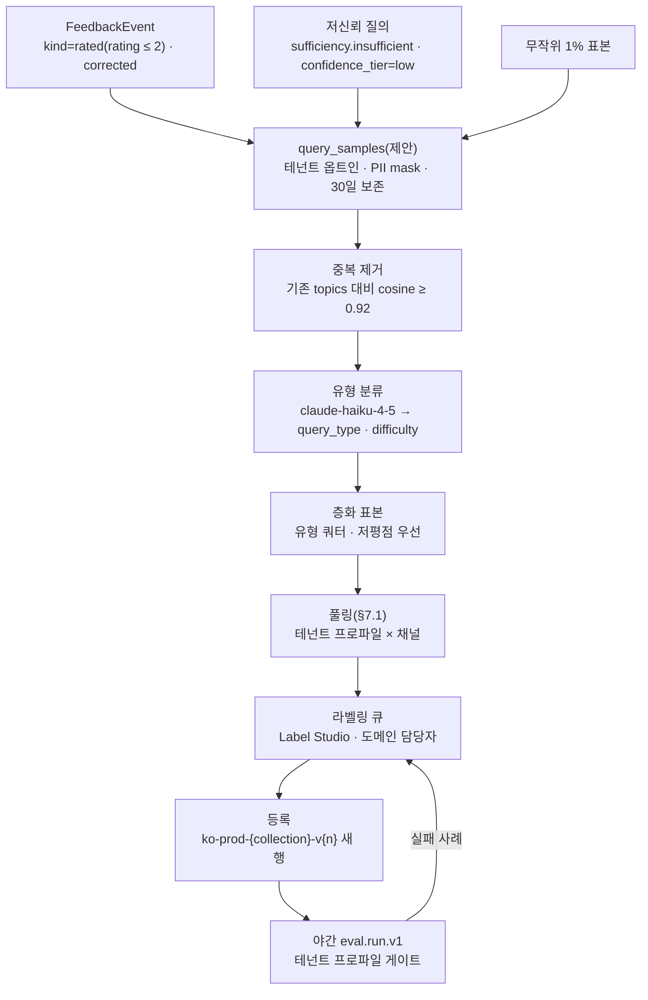

# 골든 데이터셋 구축

## 목적

바이블 §15 리스크 1은 "한국어 문서 수준 골든셋(golden set) 부재"다. 브리프 원칙 7(Evaluation-Driven)과 확정 결정 D-12에 따라 모든 품질 기본값은 프로파일 `gate`로 정당화되어야 하는데, 게이트의 판정 근거인 사람 라벨 골든셋이 아직 없다. 이 문서는 그 골든셋을 **만드는 절차**를 확정한다: 어떤 문서를 모으고(코퍼스 선정), 어떻게 질의를 합성하고(LLM 프롬프트·모델·비용), 무엇으로 걸러내고(역검색·중복·자연성), 사람이 어떻게 판정하며(등급 0~3·정답 구간·일치도·도구), 판정 편향을 어떻게 줄이고(풀링), 어디에 어떤 형식으로 저장·버전 관리하며(스키마·라이선스), 프로덕션 질의와 대화형 질의를 어떻게 흘려 넣어 얼마나 자주 갱신하는가.

정본 관계는 브리프 > 바이블 > ADR > 이 문서다(바이블 §1.1). 계약 필드·열거 철자는 바이블 §5.6·§5.7과 [평가·피드백·사이드카 계약](../03-contracts/16-eval-feedback-and-sidecar-contracts.md)(이하 16)을 그대로 쓰고, 정답 구간의 좌표·표 선형화·오프셋 사상은 [ParsedDocument](../03-contracts/03-parsed-document.md)(이하 03-계약)·[NormalizedDocument](../03-contracts/04-normalized-document.md)(이하 04-계약)·[ChunkSet](../03-contracts/05-chunk-set.md)(이하 05-계약)을, 대화 턴 형식은 [질의 요청·질의 계획](../03-contracts/09-query-request-and-query-plan.md)(이하 09-계약)을 따른다(07-tech-landscape 문서는 "09 문서"·"13 문서"로 구분해 부른다). 메트릭 정의·검정·게이트 판정 규칙은 [평가 전략](01-evaluation-strategy.md)(이하 01)과 [리트리벌 메트릭과 하네스](02-retrieval-metrics-and-harness.md)(이하 02; 동시 작성 중이므로 이 문서는 바이블 §5.6·§7.3·§13.3과 [ADR-0023](../06-adr/0023-evaluation-qrels-answer-spans-and-linear-ndcg.md)을 정본으로 삼는다)를 따른다. 이 문서가 새로 정하는 것은 **구축 절차·질의 분류·라벨 지침·크기 목표·갱신 주기**이며, 바이블에 없는 이름은 "제안" 또는 "초안 목표"로 표기한다.

## 범위

- 포함: 골든셋 목록과 이름·크기 목표, 코퍼스 선정(공공기관 공개 HWPX/HWP/PDF/HTML, 기업 문서 유형 표본, 영어 혼합)과 수집·고정 절차, 합성 질의 생성(질의 유형·난이도·부정 예시 분류, 프롬프트 템플릿 전문, 모델·API 파라미터, 비용 추정), 품질 필터(역검색 검증·중복 제거·언어 자연성), 사람 라벨링(가이드라인, 등급 0~3 정의, 정답 구간 규칙, Cohen κ 목표, 도구, 처리량 추정), qrels 확장(풀링, UMBRELA형 자동 라벨), 스키마·저장 위치·버전 관리·라이선스, 프로덕션 질의 샘플링 → 라벨링 루프, 대화형 질의셋, 갱신 주기와 건강도 지표, 보안·프라이버시.
- 제외: 메트릭 계산식·검정 이름·Holm 보정·`evaluator` 플러그인(02), 판정 프롬프트의 교정 프로토콜과 생성 품질 지표(04), 외부 셋 실행 절차·베이스라인 수치(05), 인터리빙·피드백 API 상세(06), 계약 스키마 전문(16), 관리 API 업로드 절차([관리 API](../05-api/04-management-api.md), 작성 예정), 파서·청커 자체의 정확도 평가(04-pipelines).

## 1. 원칙과 전체 흐름

**결정:** 골든셋은 다음 다섯 원칙으로 구축한다(D-12; [ADR-0023](../06-adr/0023-evaluation-qrels-answer-spans-and-linear-ndcg.md), [ADR-0030](../06-adr/0030-single-coordinate-system-and-score-ledger.md)).

| # | 원칙 | 근거 | 이 문서의 장치 |
|---|------|------|----------------|
| G1 | **진실값은 문서 ID + 정답 구간** — qrels는 문서 단위(`QrelsRecord.doc_id = document_id`), 정답은 `AnswerSpanRecord{doc_version, element_path, char_start, char_end}`이며 `element_path`는 **블록 단위**다(표 셀은 표 블록 경로 + 선형화 `text` 구간, §6.2). 청크 판정은 저장하지 않는다 | D-12, 바이블 §2.1 K1, 16 §2.2, 03-계약 §6 | 라벨 도구는 블록(`element_path`) 위에서 구간을 고르고, 변환기가 원문 코드포인트로 사상한다(§6.4) |
| G2 | **합성은 후보, 사람이 진실** — LLM이 만든 질의·자동 라벨은 후보이며 게이트 데이터셋은 `label_provenance=human`만이다 | ADR-0023 F6, 16 EF-6, 01 P4 | 합성·자동 라벨은 별도 `EvalDataset`(`synthetic`·`umbrela`)으로 등록하고 `human` 셋과 파일을 섞지 않는다(§2) |
| G3 | **풀링으로 편향 완화** — 생성 원본 문서만 정답으로 두면 그 문서를 잘 찾는 시스템이 과대평가된다. 여러 프로파일·채널의 상위 결과를 합쳐 모두 판정한다 | 09 문서 §메트릭 정의 `Judged@k`, 바이블 §7.3 `judged@10` | §7 풀링 절차, `judged@10 < 0.7` 시 증분 풀링 |
| G4 | **불변·콘텐츠 주소화** — 골든셋 바이트가 바뀌면 다른 `dataset_id`다(`content_hash`). 정정판은 같은 `name`의 새 행, 의미 변경은 새 `name` | 16 §2.3 EF-1·EF-2, 브리프 원칙 4 | §8.4 버전 규칙, `EvalRun.dataset_id` 고정 |
| G5 | **공개 가능성과 프라이버시** — 공개 셋은 공공누리 제1유형 문서만, 기업·프로덕션 셋은 테넌트 스코프·PII 정책 적용 후 비공개 | D-02, ADR-0001, 09 문서 §골든셋 구축, 바이블 §10 | §3.1·§3.2 코퍼스 분리, §9·§12 정책 |

```mermaid
flowchart LR
    subgraph corpus["코퍼스(§3)"]
        SEL["선정<br/>KOGL 제1유형 · 기업 표본 · 영어 혼합"] --> ING["수집 POST /v1/ingest<br/>metadata · acl · license"]
        ING --> FIX["고정<br/>doc_version · IndexCommit · corpus_manifest"]
    end
    subgraph synth["합성 질의(§4)"]
        FIX --> SAMP["청크 층화 표본<br/>genre · format · evidence_type"]
        SAMP --> GEN["Claude 배치 생성<br/>synth-*-v1 프롬프트"]
    end
    subgraph filter["품질 필터(§5)"]
        GEN --> RR["역검색 검증<br/>LocalRunner · reverse_rank"]
        RR --> DD["중복 제거<br/>dense cosine · 형태소 Jaccard"]
        DD --> NAT["자연성<br/>규칙 + claude-haiku-4-5"]
    end
    subgraph label["라벨링(§6·§7)"]
        NAT --> POOL["풀링<br/>프로파일 × 채널 top-20 합집합"]
        POOL --> HUM["사람 판정 0~3 + 정답 구간<br/>Label Studio"]
        HUM --> QA["일치도 κ · 조정"]
    end
    subgraph publish["저장·등록(§8)"]
        QA --> CONV["변환기<br/>qrels · answer_spans · topics JSONL"]
        CONV --> REG["POST /v1/eval/datasets<br/>content_hash · license"]
        REG --> RUN["eval.run.v1 게이트 런"]
    end
    PROD["프로덕션 샘플(§9)<br/>FeedbackEvent · 저신뢰 질의"] --> RR
    RUN -->|"judged@10 < 0.7 · stale > 5%"| POOL
```



## 2. 데이터셋 목록과 크기 목표

**결정:** 프로파일 기본 게이트(`eval.datasets[0]`, `gate.dataset` 생략 시 기준)는 `ko-public-v1`이고 `allganize-ko`는 외부 종단 회귀 게이트다(바이블 §7.3 `eval.datasets: [ko-public-v1, allganize-ko]`, §7.4). 포맷별·출처별 진단 셋은 같은 코퍼스 컬렉션 위의 **별도 `EvalDataset`**(질의 부분집합)으로 등록하며, 특정 게이트가 `gate.dataset`으로 지정할 때만 게이트가 된다. 01 미해결 이슈 9가 위임한 이름은 아래 표로 확정한다(D-12; [ADR-0023](../06-adr/0023-evaluation-qrels-answer-spans-and-linear-ndcg.md)). 규모는 모두 **초안 목표**이며 근거는 O-01 CC 전환 조건(사람 라벨 qrels ≥ 200, 바이블 §3.2), Allganize KO 규모(질의 300), 그리고 검정력이다: 질의 단위 쌍대 차이의 표준편차를 σ ≈ 0.2(nDCG@10, 미실측 가정)로 두면 α = 0.05·검정력 0.8에서 검출 가능한 최소 차이는 약 2.8σ/√n이므로 n = 1,000이면 약 0.018, n = 300이면 약 0.032다. 즉 1,000 질의는 회귀 게이트 `max_regression 0.01`을 단독으로 검출하기엔 부족하고 0.02 수준의 변화를 판정하는 규모다(σ 실측과 사전 검정력 계산은 05 문서가 확정, 01 미해결 이슈 8; 02 §7.6).

| `name` | `corpus_collection_id` | `label_provenance` / `judgment_level` | 용도 | 문서 / 질의(초안 목표) | 게이트 |
|--------|------------------------|---------------------------------------|------|------------------------|--------|
| `ko-public-v1` | 공공문서 코퍼스 컬렉션(HWPX·HWP·PDF·HTML·영어 혼합, 단일 컬렉션) | `human` / `graded`(`relevance_max=3`) | **프로파일 게이트**, 베이스라인, ADR 근거 | 2,000 / 1,000 | 기본(`eval.datasets[0]`) |
| `ko-public-hwpx-v1` · `ko-public-pdf-v1` · `ko-public-html-v1` | 동일 컬렉션 | `human` / `graded` | 포맷별 파서·청킹 회귀 진단(`TopicRecord.metadata.source_format ∈ {hwpx, hwp5}` / `{pdf}` / `{html}` 필터로 `ko-public-v1`에서 파생, 파일만 분리) | 1,000·500·300 / 500·250·120 | `gate.dataset` 지정(포맷 게이트) |
| `ko-public-synth-v1` | 동일 컬렉션 | `synthetic` / `graded` | 자동 필터를 통과한 전 후보, 개발 스모크·새 프로파일 초기 베이스라인 | 2,000 / 약 2,500 | 불가(EF-6) |
| `ko-public-umbrela-v1` | 동일 컬렉션 | `umbrela` / `graded` | 풀 확장 자동 라벨(§7.3), `judged@10` 보강 후보 | 2,000 / 1,000(판정 수 ≥ 30,000) | 불가(EF-6) |
| `ko-conv-v1` | 동일 컬렉션 | `human` / `graded` | 대화형 질의(§10), 재작성·`conversation[]` 효과 | — / 100 대화 × 평균 4턴 ≈ 400 | `gate.dataset` 지정(대화 게이트) |
| `ko-prod-{collection_short}-v{n}` | 테넌트 실제 컬렉션 | `human` / `graded` | 프로덕션 샘플 회귀(§9), 테넌트 비공개 | 컬렉션 의존 / 분기 100~300 | `gate.dataset` 지정(테넌트 프로파일) |
| `kopub-vdr-v1` | KoPub VDR 이미지 코퍼스 컬렉션 | `human` / `binary` | `korean-gov` 스캔·시각 문서(`visual_pages`) | 361 / 600(외부 셋 변환) | `gate.dataset` 지정(`korean-gov`) |
| `allganize-ko` | Allganize KO PDF 컬렉션 | `human` / `binary`(문서·페이지 정답 → `answer_spans` 재라벨 시 `graded`) | 외부 1차 종단 회귀(바이블 §7.3) | 63 / 300 | 기본(`eval.datasets[1]`, 외부 종단 회귀) |
| `ko-canary-v1` | `ko-public-v1` 컬렉션의 제한 문서 부분집합 | `human` / `binary`(`relevance ∈ {0, 1}`) | 교차 주체 누출 테스트(§12; 01 미해결 이슈 7) | 20 / 40 | 불가(보안 테스트, `recall@100 = 0` 기대; §12) |

`ko-public-v1`의 문서 2,000건·질의 1,000개 배분(초안 목표):

| 포맷(`SourceFormat`) | 문서 | 질의 | 비고 |
|----------------------|------|------|------|
| `hwpx` | 700 | 350 | 고시·훈령·공고·계획서·회의록; 표·각주·개조식 포함 |
| `hwp5` | 300 | 150 | Java 사이드카 변환 경로(D-18) 회귀; 배포용 문서 30건 포함(`quality=degraded` 표기) |
| `pdf`(디지털) | 350 | 180 | 2단·표·각주 포함 |
| `pdf`(스캔, `SourceKind=scanned`) | 150 | 70 | OCR 경로(O-08) 회귀 |
| `html` | 300 | 120 | 보도자료·정책 페이지·위키·기술 문서·포럼 |
| 영어·혼합(`lang=en` 또는 혼합, `docx`·`pdf`·`html`) | 200 | 130 | 영어 질의 80 + 한국어 질의 → 영어 문서 교차 언어 50 |
| 합계 | 2,000 | 1,000 | 사람 라벨 qrels 행 ≈ 25,000(질의당 풀 문서 ≈ 25), `answer_spans` ≈ 2,500 |

§5.3의 노이즈 변형(약 130개)은 위 1,000개 **밖**의 추가 질의다: 변형마다 새 `query_id`로 원본의 qrels·`answer_spans` 행을 복제하므로 파일 행 수는 늘지만, 원본과 상관된 표본이라 전체 평균·검정에는 넣지 않고 `metadata.noise` 부분군 비교에만 쓴다(§5.3).

`ko-sentence-v1`(문장 분리·형태소 표본, 01 §9.1 4종의 4번)은 리트리벌 qrels가 없어 `EvalDataset`이 아니다. 저장 위치 `eval/samples/ko-sentence-v1/`은 제안이며(미해결 이슈 1) 이 문서는 다루지 않는다.

## 3. 코퍼스 선정

### 3.1 한국 공공기관 공개 문서(공공누리 제1유형)

**결정:** 공개 골든셋의 코퍼스는 공공누리(KOGL) 제1유형(출처 표시) 문서만으로 구성한다(D-02; [ADR-0001](../06-adr/0001-license-grade-table-and-d02-interpretation.md); 09 문서 §골든셋 구축). AI Hub 자료는 내국인 한정·재배포 불가이므로 조직 내부 시드(`ko-prod-*` 계열)로만 쓴다(01 §5.3).

선정 기준은 **장르·구조·포맷의 층화**다. 바이블 §5.7 `Genre`를 코퍼스 층화 키로 쓰고, 각 층이 검증하려는 파이프라인 위험을 명시한다.

| `Genre` | 문서 예 | 비율(초안) | 검증 대상 |
|---------|---------|-----------|-----------|
| `law_article` | 고시·훈령·예규·조례·행정규칙(법제처·부처 고시) | 25% | 조항 경로 heading, `document_order` 순서, 조문 단위 청킹 |
| `outline_report` | 업무 계획·추진 실적·보고서(개조식 번호 문단) | 30% | 개조식 문장 분리(13 문서 §실패 모드), 부모 확장, 표 행 그룹 |
| `manual` | 업무 매뉴얼·안내서·지침서 | 15% | 절차형 질의, 목차(`toc`) 제거, 긴 문서 small-to-big |
| `form` | 서식·신청서·공고문(표 중심) | 10% | 표 직렬화(`TableSerialization`), `form_field` 블록, 헤더 행 반복 |
| `narrative` | 보도자료·연설문·백서 서술부 | 10% | 산문 청킹, 문장 윈도우 |
| `web_article` | 정책 포털·기관 홈페이지 HTML | 10% | Trafilatura → Docling 본문 추출, 보일러플레이트 |

문서 단위 포함·제외 규칙:

| 규칙 | 처리 |
|------|------|
| 라이선스 표기가 제1유형이 아니거나 확인 불가 | 제외. `corpus_manifest.jsonl.license`(§8.1 제안)에 `LicenseRef-KOGL-1`만 허용 |
| 암호화 HWP/HWPX(`parse.document_encrypted`) | 제외(자격 증명 없는 공개 문서) |
| 배포용 HWP(`allow_distribution_documents` 텍스트 전용, `quality=degraded`) | `hwp5` 층에 30건 **포함**해 degraded 경로를 회귀 대상으로 둔다. 질의 생성 원본으로는 쓰지 않고 풀링 판정에만 등장 |
| 같은 `content_hash` 중복(개정판·재게시) | `dedup_policy=skip_if_same_hash`로 1건만; 개정판 쌍은 `ConflictKind=version` 검증용으로 최대 50쌍 의도적 포함 |
| 개인정보(담당자 연락처 외 고유식별정보) | PII 정책 `mask` 적용 후 수집(`CollectionSpec.policies.pii_policy`); 마스킹 토큰이 정답 구간에 걸리는 질의는 생성 금지(§4.5 규칙 6) |
| 페이지 수 | 문서당 2~200쪽; 200쪽 초과 문서는 최대 20건(장문 부모 확장·MLDR형 회귀) |
| 이미지 전용·표 전용 페이지 | 스캔 층에서 `page_status`가 `ok`인 페이지가 50% 미만이면 제외 |

수집은 `POST /v1/ingest`(D-08)로 하며 `IngestRequest.metadata`에 `doc_type`, `department`, `doc_date`, `genre`, `tags`(바이블 §5.7 `FilterableField`)와 컬렉션 선언 커스텀 키 `custom.kogl_type`, `custom.source_url`, `custom.domain`(§3.2; 셋 모두 제안이며 컬렉션 `filterable_fields`에 선언해야 필터 가능 — 바이블 §5.4 `metadata.custom`, §5.7 `custom.{key}`)을 채운다. 바이블 §5.4 `IngestRequest.metadata` 키 집합은 닫혀 있으므로 최상위에 새 키를 더하지 않는다. ACL은 `visibility=public`(캐너리 문서만 `restricted`, §12).

### 3.2 기업 문서 유형 표본

공개 가능한 한국 기업 내부 문서는 존재하지 않으므로 기업 셋은 두 갈래로 다룬다.

| 갈래 | 구성 | 등록 | 공개 |
|------|------|------|------|
| 테넌트 실 문서 | 파일럿 테넌트의 실제 컬렉션(사규·품의서·회의록·기술 보고서·계약 서식·공문). 질의는 §9 프로덕션 샘플링 + 도메인 담당자 작성 | `ko-prod-{collection_short}-v{n}`, `license: LicenseRef-Proprietary`(SPDX 패턴 적합, 확인 필요 as of 2026-09) | 불가(테넌트 RLS) |
| 공개 대체 표본 | 공공기관이 제1유형으로 공개한 **기업형 문서**(공기업 사규·감사 보고서·입찰 제안 요청서·기술 규격서·회의록) 150건을 `ko-public-v1`의 `outline_report`·`manual`·`form` 층 안에 `IngestRequest.metadata.custom.domain = "enterprise_like"`(§3.1 커스텀 키; 나머지 문서는 `"public_admin"`)로 표시 | `ko-public-v1` 일부 | 가능 |

기업 문서 유형별 "질의 습성"(약어·사내 용어·결재 단계·기간 조건)은 §4.5 프롬프트의 `domain` 힌트로만 반영하고, 합성 기업 문서(LLM이 만든 가짜 사규)는 코퍼스에 넣지 않는다 — 파서·청커가 실제 포맷 산물을 보지 못해 L0 회귀 가치가 없기 때문이다(미해결 이슈 2).

### 3.3 영어 혼합

브리프 원칙 6(Korean-First, Multilingual-Ready)에 따라 코퍼스의 10%(200건)를 영어·혼합 문서로 둔다: 국제기구·해외 정부의 공개 기술 문서(퍼블릭 도메인 또는 CC BY), 국내 기관의 영문 보도자료·이중 언어 안내서(제1유형). 질의는 (a) 영어 질의 → 영어 문서 80개, (b) 한국어 질의 → 영어 문서 교차 언어 50개(`metadata.cross_lingual=true`)로 나눈다. 교차 언어 질의는 BGE-M3 dense의 다국어 정렬을 검증하며 lexical 채널은 적중하지 못하는 것이 정상이므로 `ExplainCode` `dense_only_hit` 비율의 진단 지표가 된다. `TopicRecord.language`는 질의 언어(`ko`/`en`), 문서 언어는 `IndexRecord.lang`에서 온다.

### 3.4 코퍼스 고정과 매니페스트

수집이 끝나면 코퍼스를 **고정**한다: 모든 문서의 `documents.current_doc_version`과 current `IndexCommit`을 기록하고, 이후 라벨링은 이 `doc_version`의 `ParsedDocument`(콘텐츠 주소화 산출물, 바이블 §13.3) 위에서 진행한다. `AnswerSpanRecord.doc_version`은 이 값이다. 문서 목록·라이선스·포맷·장르는 `corpus_manifest.jsonl`(§8.1 제안)에 남겨 재현·감사·공개 배포 시 원본 URL 목록으로 쓴다. 이 파일의 행은 02 §4.4가 CI 재수집용으로 제안한 `CorpusManifestRecord{external_id, source_uri, blake3}`를 포함하는 상위 집합이며 `blake3`는 원본 바이트 해시 = `doc_version`이다(바이블 §6.2). `external_id`를 반드시 채우는 이유는 인덱스 영향 변경을 섀도 컬렉션에서 비교할 때 `document_id`가 달라져 골든셋 `doc_id`를 `external_id` 기준으로 재매핑해야 하기 때문이다(02 §4.4, `rag eval datasets register --doc-id-map external_id`). 코퍼스 교체(재수집으로 `doc_version` 변경)는 §11 stale 절차를 따른다.

고정 시 검사 하나를 더한다: `type=table` 블록의 `Block.text`가 `""`인 문서(어댑터가 03-계약 §6 선형화를 생략)는 **표 근거 질의의 생성·라벨 대상에서 제외**하거나 선형화를 내는 파서 경로로 재파싱한다. 선형화가 없으면 `TableCell.provenance.char_*`가 `0, 0`이고 표 청크의 `original_char_*`도 `0, 0`이라(03-계약 P-13, 05-계약 §5 규칙 4) 표 셀 정답 구간을 표현할 수도, 02 §2.2 교차로 적중할 수도 없다(§6.2). 제외 문서 수는 `corpus_manifest.jsonl`에 `table_text_missing=true`(제안)로 남긴다.

## 4. 합성 질의 생성

**결정:** 합성 질의 생성기는 자체 Claude 프롬프트(`synth-*-v1`, §4.3·§4.5)를 1차로 하고, RAGAS `TestsetGenerator`·DeepEval `Synthesizer`는 개발 스모크용 2차로만 둔다. 01 §5.1·매트릭스 `eval_framework` 행·09 문서 §골든셋 구축 흐름은 RAGAS를 1차로 적었으나 이 문서가 채택하지 않는 이유는 (a) `TestsetGenerator`는 LangChain `Document`·지식그래프 변환을 입력으로 삼아 정답 인용을 HWPX `Block` 좌표(`element_path`·원문 코드포인트, G1)에 묶을 수 없고, (b) 합성기 4종(single/multi-hop × specific/abstract)으로는 §4.2의 `query_type` 7종·난이도·`evidence_type` 쿼터를 통제할 수 없으며, (c) `TopicRecord.metadata` 키(§8.2)를 생성 시점에 직접 기록해야 하고, (d) 한국어 프롬프트를 자체 소유해야 하기 때문이다(09 문서 §합성 질의 생성 "프롬프트 영어(교체 가능)"). 01 §5.1 합성 행 문구의 patch 제안은 미해결 이슈 15다.

### 4.1 입력 단위와 표본화

생성 입력은 `GET /v1/documents/{document_id}/content?view=chunks`로 얻는 리프 청크(`Chunk.level=0`, 자식 512 토큰, D-19)와 그 부모(`level=1`) 발췌, 결정적 `context_prefix`(문서 제목·heading 경로·캡션, [ADR-0029](../06-adr/0029-three-text-rule-and-deterministic-context-prefix.md))다. 청크는 구현 산물이므로 **생성 입력으로만** 쓰고, 정답 구간은 청크가 아닌 원문 블록 좌표로 저장한다(G1). 청크 텍스트(`text`)는 접두어 미포함 표시 원문이며 `block_refs[]`로 `element_path`·`original_char_*`에 역사상된다(바이블 §6.3).

표본화(초안 목표): 리프 청크 약 50,000개(문서 2,000 × 평균 25) 중 **층화 표본 2,500개**(5%)를 `genre × source_format × evidence_type`(단락·표·그림 캡션·각주·목록)로 비례 추출한다. 문서당 최대 3개 청크, heading 경로당 1개. 표 청크(`item_kind ∈ {table, table_part}`)는 전체의 20% 이상을 강제한다(01 §9.1 "표·수치 20%"). 다중 홉용으로 같은 문서의 다른 절 또는 같은 장르의 다른 문서에서 청크 쌍 400개를 추출하고(`entity_ids`·`heading_path` 공유 기준), 무응답용으로 청크 300개를 별도 추출한다. 문서의 `custom.domain`(§3.1·§3.2)은 그 문서에서 생성한 질의의 `TopicRecord.metadata.domain`으로 전파한다(문서 측은 컬렉션 선언 `custom.*` 필터 키, 질의 측은 16의 열린 `metadata` 키).

### 4.2 질의 유형·난이도·부정 예시

**결정:** 질의 유형은 `TopicRecord.metadata.query_type` 값 7종으로 분류하고, 홉 수·근거 종류·난이도는 직교 축으로 기록한다(16 `TopicRecord.metadata`는 스칼라 열린 객체이므로 계약 변경 없음; 키 이름은 02 §4.2가 제안한 `domain`·`hops`·`evidence_type`·`answerable`을 채택하고 이 문서가 나머지를 더한다 — §8.2). 01 §9.1의 분포(단일 홉 사실형 40%·다중 홉 20%·표·수치 20%·비사실형 장문 10%·무응답 10%)는 아래 표의 교차 배분으로 실현된다.

| `query_type` | 정의 | 예(공공문서) | 목표 비율(초안) | 01 §9.1 대응 |
|--------------|------|--------------|-----------------|--------------|
| `factual` | 단일 사실·수치·날짜·주체·정의를 묻는다 | "정보공개 청구서 처리 기한은 며칠인가?" | 30% | 단일 홉 사실형 |
| `procedural` | 절차·순서·제출 방법·요건·구비 서류 | "국고보조금 정산 보고는 어떤 순서로 하나?" | 15% | 단일 홉 사실형·비사실형 일부 |
| `comparative` | 둘 이상의 대상·기간·조건 비교 | "2025년과 2026년 지원 한도가 어떻게 달라졌나?" | 10% | 다중 홉·표·수치 일부 |
| `aggregative` | 표·목록에서 합계·개수·최대·조건 만족 항목 집계 | "지원 대상 사업 중 예산이 10억 이상인 것은?" | 15% | 표·수치 |
| `explanatory` | 취지·배경·이유·영향을 설명하는 장문 답 | "이 지침이 개정된 배경은 무엇인가?" | 10% | 비사실형 장문 |
| `ambiguous` | 둘 이상 해석이 가능하거나 조건이 누락된 현실적 질의(문서가 여러 해석 중 하나 이상에 답함) | "신청 기한이 언제야?"(사업이 여러 개) | 10% | 단일 홉 사실형 |
| `unanswerable` | 코퍼스에 답이 없다(부정 예시, §4.4) | "정보공개 청구 수수료 환불 기한은?"(문서에 없음) | 10% | 무응답 |

직교 축(모두 `metadata` 스칼라):

| 키 | 값 | 목표 |
|----|----|------|
| `hops` | integer ≥ 1 — 답에 필요한 서로 다른 블록(다른 절 또는 다른 문서)의 수; `1` = 단일 홉, `≥ 2` = 다중 홉 | 20% `≥ 2`(주로 `comparative`·`aggregative`·`explanatory`) |
| `evidence_type` | `paragraph`/`table`/`figure`/`footnote`/`list` — 정답 구간이 놓인 블록 종류(바이블 §5.7 `BlockType` 매핑; 02 §4.2의 4값에 `footnote` 추가) | `table` ≥ 20%, `footnote` ≥ 3% |
| `difficulty` | `1` 표면 일치(질의 핵심어가 정답 블록에 그대로) / `2` 의역(동의어·한자어↔고유어·어순·형태 변화) / `3` 추론(계산·조건 결합·다중 홉·표 셀 조합) | 1:2:3 = 25:45:30 |
| `answerable` | `false`는 `query_type=unanswerable`과 동치 | 10% `false` |
| `cross_lingual`, `noise`, `noise_of` | 교차 언어 여부; `spacing`(띄어쓰기 오류)·`typo`(오타)·`colloquial`(구어체) 주입 표지와 원본 `query_id`(§5.3) | 교차 5%; 노이즈 합계 13%(1,000개 밖 추가분) |

### 4.3 모델·API 파라미터

**결정:** 합성 질의는 `claude-sonnet-5`로 생성하고, 다중 홉·애매 유형의 어려운 표본과 UMBRELA형 자동 판정(§7.3)은 `claude-opus-5`, 대량 자연성 채점(§5.3)은 `claude-haiku-4-5`로 나눈다. 판정 모델은 평가 대상 프로파일의 리랭커(`bge-reranker-v2-m3`·`Qwen3-Reranker`)·보강 모델과 다른 계열이어야 하며(ADR-0023 준수 10, 16 EF-11) Claude 계열은 이 조건을 만족한다. 외부 LLM 호출은 O-05 정책을 그대로 따른다(전송 조건은 코퍼스의 공개 여부가 아니라 테넌트 옵트인 + PII 정책 적용 텍스트다): 공개 코퍼스를 보유한 평가 테넌트도 `tenants.policies.llm_enrichment_allowed = true`로 옵트인하고(바이블 §13.1) §3.1의 `pii_policy=mask` 적용 텍스트만 전송하며, 테넌트 코퍼스(`ko-prod-*`)는 해당 테넌트의 옵트인이 있을 때만 같은 조건으로 전송한다([ADR-0016](../06-adr/0016-llm-enrichment-default-off-and-budget-policy.md); 바이블 §3.2 O-05).

| 항목 | 값 | 근거 |
|------|----|------|
| 모델 ID | `claude-sonnet-5` / `claude-opus-5` / `claude-haiku-4-5`(날짜 접미 없음) | Anthropic 모델 목록(as of 2026-06 캐시; 확인 필요 as of 2026-09) |
| 호출 방식 | Message Batches(`POST /v1/messages/batches`, 비동기, 표준 단가의 50%) | 지연 무관·대량 |
| 사고(thinking) — `claude-sonnet-5`·`claude-opus-5` | `thinking: {type: "adaptive"}`, `output_config.effort: "medium"`(생성) / `"high"`(다중 홉·판정) | 5 계열은 `budget_tokens`·`temperature`를 받지 않는다(400)(claude-api 참조, as of 2026-06 캐시; 확인 필요 as of 2026-09 — 미해결 이슈 11) → 다양성은 유형·난이도·표본 층화로 확보 |
| 사고 — `claude-haiku-4-5`(자연성 채점 §5.3, 유형 분류 §9) | `thinking` 생략(기본) 또는 `{type: "enabled", budget_tokens ≥ 1024}`; `output_config.effort` 미사용(오류); `temperature: 0` 허용 | Haiku 4.5는 adaptive thinking·`effort`를 지원하지 않는다(claude-api 참조, as of 2026-06 캐시; 확인 필요 as of 2026-09) |
| 출력 형식 | `output_config.format`(구조화 출력, §4.5 JSON 스키마 — 미지원 제약을 뺀 형태), `max_tokens` 4,096 | 형식 위반 0; 길이·개수·범위 제약은 §5.3 규칙 필터가 후검증 |
| 프롬프트 캐싱 | 시스템 프롬프트(규칙 + 출력 예 1개, §4.5; 약 1,300 토큰)에 `cache_control`(안정 접두), 문서 조각·요청은 뒤에. 최소 캐시 접두는 `claude-opus-5` 512·`claude-sonnet-5` 1,024·`claude-haiku-4-5` 4,096 토큰이므로 Haiku 호출(자연성 채점)은 캐시 없이 보낸다 | 생성 요청 입력의 약 절반이 반복; 접두 토큰 수·최소값은 확인 필요(as of 2026-09) |
| 재시도 | 스키마 위반·`self_check` 실패 응답은 1회 재생성 후 폐기 | 비용 상한 |
| 기록 | `TopicRecord.metadata.generator_model`, `prompt_version`(예 `synth-query-v1`) | 재현·편향 분석 |

### 4.4 부정 예시(정답 없는 질의)

무응답 질의는 `ContextPack.sufficiency`·`confidence_tier` 보정(바이블 §5.7 `SufficiencyStatus`)과 `relevance_gate` 임계 판정에 필수다(01 §9.1). 세 하위 종류를 `metadata.unanswerable_kind`(제안)로 구분한다.

| `unanswerable_kind` | 생성 방법 | 검증 |
|---------------------|-----------|------|
| `out_of_scope` | 문서 장르·기관은 같지만 코퍼스가 다루지 않는 주제(예: 같은 부처의 다른 사업) | 풀 상위 20 문서 모두 사람 판정 0(EF-3 `relevance=0` 행으로 기록 → `judged@k` 유지) |
| `false_premise` | 문서에 없는 조항 번호·연도·수치를 전제로 묻는다 | 전제가 문서에 없음을 라벨러가 확인 |
| `near_miss` | 유사 주제의 문서는 있으나 정확히 그 항목은 없다(가장 어려움) | 풀 상위 문서 등급 ≤ 1 확인; 등급 2 이상이 나오면 `answerable=true`로 재분류 |

qrels 표현: 무응답 질의는 풀 문서에 대해 `relevance=0` 행을 가지며(`relevance ≥ 1` 행 없음 → 관련 집합 `R_q = ∅`) `answer_spans`가 없다. 02 §2.1은 `R_q = ∅` 질의를 IR 메트릭 평균에서 제외하고 `ContextPack.sufficiency` 보정에만 쓰며 런 매니페스트에 `unanswerable_query_count`로 남기도록 확정했고, 02 §4.5 V2는 topics에만 있는 질의도 허용한다. 이 문서는 `judged@k` 계산과 라벨 감사를 위해 **`relevance=0` 행을 남기는 쪽**을 택한다(두 표현 모두 `R_q = ∅`이므로 02 규칙과 양립). `sufficiency` 정확도·`relevance_gate` 오탐률 메트릭 키는 미해결 이슈 3이다.

### 4.5 프롬프트 템플릿 전문(`synth-query-v1`)

시스템 프롬프트(캐시 접두 = 아래 규칙 + 뒤의 "응답 예" 1개를 `출력 예:` 절로 이어 붙인 것; 한국어 원문 고정. few-shot 3개는 접두를 늘리고 유형·문체 편향을 만들어 두지 않는다):

```text
당신은 한국 공공기관·기업 문서를 검색하는 사용자를 모사하는 질의 작성자다. 주어진 문서 조각을 읽고,
그 조각이 답을 담고 있는 검색 질의를 만든다.

규칙
1. 질의는 문서를 보지 않은 실제 사용자가 검색창에 입력할 문장이어야 한다. "이 문서", "위 내용",
   "해당 조각", "본문에 따르면" 같은 지시 표현을 쓰지 않는다.
2. 조각의 문장을 그대로 복사하지 않는다. 핵심 용어(기관명·제도명·법령명)는 유지하되 표현은 바꾼다
   (동의어, 한자어와 고유어 교체, 어순 변경, 조사·어미 변화). 난이도 2 이상은 조각에 없는 표현으로 묻는다.
3. 질의는 조각(과 상위 문맥)만으로 답할 수 있어야 한다. 답이 되는 구간을 조각에서 원문 그대로
   인용한다(공백·문장부호 포함, 한 글자도 수정 금지). 표 조각이면 답이 되는 셀 텍스트를 인용한다.
4. 요청된 유형과 난이도를 따른다.
   유형: factual(단일 사실·수치·날짜·주체·정의), procedural(절차·순서·제출 방법·요건),
   comparative(둘 이상의 대상·기간·조건 비교), aggregative(표·목록에서 합계·개수·최대·조건 만족 항목),
   explanatory(취지·배경·이유·영향을 설명하는 답), ambiguous(조건이 누락되어 둘 이상 해석이 가능하지만
   조각이 그중 하나에는 답하는 현실적 질의).
   난이도: 1 = 질의 핵심어가 조각에 그대로 있음, 2 = 의역·동의어로만 이어짐, 3 = 계산·조건 결합·추론 필요.
5. 언어는 요청값을 따른다. 한국어 질의는 존댓말 의문문, 평서형 의문문, 명사구 검색어(전체의 20% 이내)를
   고루 쓰고 어색한 번역투를 피한다.
6. 조각에 개인정보(이름·연락처·주민등록번호·계좌)나 마스킹 토큰이 있으면 그 정보를 묻는 질의를 만들지 않는다.
7. 각 질의에 대해 self_check를 정직하게 채운다. answerable_from_chunk가 false이거나
   copies_chunk_phrase·contains_pii가 true인 질의는 만들지 말고 다른 질의로 대체한다.
8. 출력은 지정된 JSON 스키마만 따른다. 설명 문장을 덧붙이지 않는다.
```

사용자 프롬프트(요청마다 치환; `{{…}}`는 플레이스홀더):

```text
[문서 정보]
제목: {{document_title}}
장르: {{genre}}
포맷: {{source_format}}
제목 경로: {{heading_path}}
도메인 힌트: {{domain}}

[상위 문맥(부모 청크 발췌, 참고용 — 여기서만 답이 나오는 질의는 만들지 않는다)]
{{parent_excerpt}}

[문서 조각(정답 출처)]
{{chunk_text}}

[요청]
질의 수: {{n_queries}}
유형: {{target_types}}
난이도: {{target_difficulty}}
언어: {{language}}
```

구조화 출력 스키마(`output_config.format`에 전달). Anthropic 구조화 출력은 `minimum`·`maximum`·`minLength`·`maxLength`·`minItems`·`maxItems`를 지원하지 않고, Python·TypeScript SDK의 `parse()` 경로만 이를 제거해 클라이언트에서 검증한다 — Message Batches는 `params`를 그대로 보내므로 스키마에 이런 제약이 있으면 요청이 실패한다(claude-api 참조; 확인 필요 as of 2026-09). 따라서 스키마에는 넣지 않고 질의 4~300자·`answer_quote` 1~1,000자·`rationale` ≤ 400자·질의 수 1~3은 §5.3 규칙 필터가 후검증한다:

```json
{
  "type": "object",
  "properties": {
    "queries": {
      "type": "array",
      "items": {
        "type": "object",
        "properties": {
          "query": {"type": "string"},
          "query_type": {"type": "string", "enum": ["factual", "procedural", "comparative", "aggregative", "explanatory", "ambiguous"]},
          "difficulty": {"type": "integer", "enum": [1, 2, 3]},
          "answer_quote": {"type": "string"},
          "rationale": {"type": "string"},
          "self_check": {
            "type": "object",
            "properties": {
              "answerable_from_chunk": {"type": "boolean"},
              "copies_chunk_phrase": {"type": "boolean"},
              "contains_pii": {"type": "boolean"}
            },
            "required": ["answerable_from_chunk", "copies_chunk_phrase", "contains_pii"],
            "additionalProperties": false
          }
        },
        "required": ["query", "query_type", "difficulty", "answer_quote", "rationale", "self_check"],
        "additionalProperties": false
      }
    }
  },
  "required": ["queries"],
  "additionalProperties": false
}
```

응답 예(형식 예시):

```json
{
  "queries": [
    {
      "query": "정보공개 청구를 접수한 기관은 며칠 안에 공개 여부를 결정해야 하나요?",
      "query_type": "factual",
      "difficulty": 2,
      "answer_quote": "공공기관은 청구서를 접수한 날부터 10일 이내에 공개 여부를 결정하여야 한다.",
      "rationale": "'처리 기한'을 '며칠 안에 결정'으로 의역하고 주체를 '접수한 기관'으로 바꿈",
      "self_check": {"answerable_from_chunk": true, "copies_chunk_phrase": false, "contains_pii": false}
    }
  ]
}
```

이 응답 예가 시스템 프롬프트 말미의 `출력 예:`에 들어가 캐시 접두의 일부가 된다(§4.3). 변형 템플릿은 시스템 규칙을 공유하고 사용자 프롬프트와 스키마만 바꾼다(전문은 `rag_platform/eval/datasets/prompts/`에 버전 파일로 보관, 제안; 변형 스키마도 위와 같은 이유로 길이·개수 제약을 두지 않는다).

| `prompt_version` | 입력 | 추가 규칙 | 출력 차이 |
|------------------|------|-----------|-----------|
| `synth-multihop-v1` | 조각 A·B(같은 문서의 다른 절 또는 다른 문서) + 각 제목 경로 | 질의는 A·B **둘 다** 없으면 답할 수 없어야 한다; 한쪽만으로 답하면 폐기 | `answer_quote_a`, `answer_quote_b`, `hop_relation`(`compare`/`combine`/`condition`) |
| `synth-unanswerable-v1` | 조각 + 문서 요약(제목·heading 목록) | §4.4 세 종류 중 지정된 종류로, 코퍼스 어휘를 쓰되 답이 없어야 한다; 왜 없는지 `why_unanswerable` | `unanswerable_kind`, `why_unanswerable`, `answer_quote` 없음 |
| `synth-conv-v1` | 문서 1~2개의 조각 2~3개 | 3~5턴 대화; 2턴 이후는 지시어("그건", "그 기한은")·생략·후속 조건으로 이어지고 각 턴은 독립 재작성 `standalone_query`를 함께 낸다 | `turns[]{role, text, standalone_query, answer_quote, source}` |
| `umbrela-ko-v1` | 질의 + 문서 발췌(상위 청크 3개 + 제목) | UMBRELA 0~3 척도의 한국어 판정(§6.1 등급 정의와 동일 문구) | `relevance`, `justification` |
| `naturalness-ko-v1` | 질의 1개 + 문서 제목 | 1~5 자연성(검색창 입력 개연성, 문법, 지시 표현 여부) | `score`, `issues[]` |

### 4.6 비용 추정

가정: Anthropic 공개 단가(as of 2026-06 캐시; 확인 필요 as of 2026-09) `claude-sonnet-5` 입력 $2 / 출력 $10 per MTok, `claude-opus-5` $5 / $25, `claude-haiku-4-5` $1 / $5; 캐시 읽기는 입력 단가의 10%로 가정(확인 필요 as of 2026-09); Batches 50% 할인. 캐시 접두는 §4.3 규약대로 생성 프롬프트 약 1,300 토큰·판정 프롬프트 약 1,500 토큰(Sonnet 5 최소 1,024·Opus 5 최소 512 이상)이고, Haiku 4.5 자연성 채점은 접두가 최소 4,096 토큰에 못 미쳐 전부 비캐시 입력으로 계산한다. 토큰 수는 13 문서의 팽창률(한국어 1자 ≈ 1 토큰, Claude 한/영 비 1.88배)로 환산한 **초안 추정**이며 첫 배치 실측(`usage` 필드)으로 갱신한다.

| 단계 | 모델 | 호출 수 | 호출당 토큰(비캐시 입력 / 캐시 읽기 / 출력) | 정가(USD) | Batches(USD) |
|------|------|---------|---------------------------------------------|-----------|--------------|
| 단일 조각 생성(질의 2개) | `claude-sonnet-5` | 2,500 | 1,400 / 1,300 / 600 | 23 | 12 |
| 다중 홉 생성(§4.3 `effort: high`) | `claude-opus-5` | 400 | 2,800 / 1,300 / 800 | 14 | 7 |
| 무응답 생성 | `claude-sonnet-5` | 300 | 1,400 / 1,300 / 400 | 2 | 1 |
| 대화형 생성(150 대화) | `claude-sonnet-5` | 150 | 3,000 / 1,300 / 1,500 | 3 | 2 |
| 자연성 채점(캐시 없음) | `claude-haiku-4-5` | 6,000 | 1,300 / 0 / 60 | 10 | 5 |
| UMBRELA형 자동 판정(풀 확장) | `claude-opus-5` | 30,000 | 1,400 / 1,500 / 80 | 293 | 146 |
| 합계 | | | | 약 345 | 약 173 |

자동 판정을 `claude-sonnet-5`로 내리면 117(정가)/59(Batches)로 줄지만, 판정 정확도는 §7.3의 κ·τ 교정을 통과해야 하므로 모델 선택은 교정 결과가 결정한다. LLM 비용은 사람 라벨링 비용(§6.6, 약 500 라벨러-시간)에 비해 작다.

## 5. 품질 필터

세 필터는 순서대로 적용하고 결과를 `TopicRecord.metadata`(`reverse_rank`, `dedup_cluster`, `naturalness_score`)에 남긴다. 필터를 통과한 전 후보가 `ko-public-synth-v1`이 되고, 그중 사람 라벨링 표본이 `ko-public-v1`로 간다.

### 5.1 역검색 검증(reverse retrieval)

**결정:** 생성 질의를 하네스와 같은 경로(`LocalRunner` + `pipelines.query.run`, 코퍼스 컬렉션의 프로파일)로 실행해 생성 원본 문서의 융합 순위(`fused` `RankedSet`, 깊이 `hydrate.top_n`)를 `reverse_rank`로 기록한다. 백엔드를 직접 질의하지 않는다(ADR-0023 준수 5; 16 EF-8).

| 판정 | 조건 | 처리 |
|------|------|------|
| 정답 구간 미해소 | `answer_quote`가 NFC 정규화 후 원본 블록 `text`에 부분 문자열로 없음. 표는 `TableData.cells[].text`의 셀 하나와 대조하고 일치 셀의 `TableCell.provenance.char_*`(표 블록 선형화 `text` 기준, 03-계약 §6)를 구간 후보로 잡는다; 두 셀 이상에 걸친 인용은 셀별로 나눈다 | 폐기(LLM이 인용을 고쳤거나 환각) |
| 원본 미회수 | 원본 `document_id`가 `hydrate.top_n`(기본 `rerank.top_n_in`; `standard`는 100, 바이블 §5.5) 안에 없음 | 폐기 후보 → `difficulty=3`이면 사람 검토 큐로(진짜 어려운 질의일 수 있음), 아니면 폐기 |
| 과도하게 쉬움 | `reverse_rank=1`이고 `difficulty=1`이고 형태소 4-gram 중첩 > 0.6 | 유지하되 전체의 25% 상한(초과분 폐기) |
| 정상 | 그 외 | 통과; 채널별 적중(`ExplainCode` `dense_only_hit` 등)을 진단 로그에 남긴다 |

무응답 질의는 원본이 없으므로 이 필터를 건너뛰고 §4.4 검증으로 대신한다. 역검색은 필터일 뿐 라벨이 아니다 — 원본 문서를 자동으로 `relevance=3`으로 두지 않고 §7 풀에 넣어 사람이 판정한다(G3).

### 5.2 중복 제거

| 단계 | 방법 | 임계(초안) |
|------|------|-----------|
| 정확 중복 | NFC + 공백 정규화 + 문장부호 제거 후 문자열 일치 | 동일 |
| 의미 중복 | 질의 임베딩(BGE-M3 dense, `EmbeddingMode=query`) 코사인 | ≥ 0.92 → 같은 `dedup_cluster` |
| 어휘 중복 | 플랫폼 `korean_analyzer`(`ctx.analyzer`, [ADR-0021](../06-adr/0021-korean-analyzer-kiwi-promotion-and-interim-mecab-kss.md)) NNG/NNP 토큰 집합 Jaccard | ≥ 0.8 → 같은 클러스터 |
| 클러스터 대표 선택 | 난이도 높음 > 유형 희소 > 자연성 점수 순 | 클러스터당 1개 |
| 문서 편중 | 같은 `document_id` 질의 ≤ 3, 같은 `heading_path` ≤ 1 | 초과분은 유형 균형에 유리한 것만 |
| 기존 셋 대비 | 등록된 모든 `ko-public-*`·`ko-prod-*` 토픽과 위 기준 교차 | 중복이면 신규 폐기 |

### 5.3 언어 자연성

| 검사 | 규칙 | 처리 |
|------|------|------|
| 길이 | 8~150자(명사구 검색어는 4자 이상) | 범위 밖 폐기 |
| 지시 표현 | "이 문서", "위 내용", "해당 조각", "본문", "위 표" 등 금지 목록(`prompts/banned_phrases_ko.txt`, 제안) | 폐기 |
| 조각 복사 | 형태소 4-gram 중첩률 ≤ 0.6(§5.1과 공유) | 초과 폐기 |
| 자기완결성 | 대화형 셋을 제외하고 선행 문맥 없이 이해 가능(대명사·"그", "해당" 주어 금지) | 폐기 |
| LLM 채점 | `naturalness-ko-v1`(`claude-haiku-4-5`) 1~5 | 3 미만 폐기; 200개 표본을 사람이 재채점해 κ ≥ 0.6 확인 후 임계 조정 |
| 노이즈 주입 | 통과 질의의 일부에 규칙으로 변형: 띄어쓰기 오류 5%(`noise=spacing`), 오타 3%(`typo`, 자모 단위 1글자), 구어체 5%(`colloquial`). 변형 질의는 `query_id = {원본}-spacing` / `-typo` / `-colloquial`이고 변환기가 원본의 qrels·`answer_spans` 행을 `query_id`만 바꿔 **복제**한다(`QrelsRecord`·`AnswerSpanRecord`는 `(query_id, doc_id)` 키라 공유할 수 없다, 16 EF-3·EF-4; 02 §4.5 V2·V3 충족). `metadata.noise_of`(제안)에 원본 `query_id`를 둔다. 변형은 §2의 1,000개 밖 추가분(약 130개)이며 원본과 상관된 표본이므로 02 §7 쌍대 검정·전체 평균·`judged@k` 분모에서는 원본만 세고, 리포트는 `--by metadata.noise` 부분군으로만 비교한다 | 실사용 분포 반영; 13 문서 §실패 모드 "띄어쓰기 교정 과분리" 회귀 |

## 6. 사람 라벨링

### 6.1 등급 정의(0~3)

**결정:** `judgment_level=graded`, `relevance_max=3`이며 등급 문구는 TREC RAG 2024·UMBRELA 척도에 맞춘다(09 문서 §벤치마크 프로그램). 이진화는 `rel ≥ 1`(nDCG 선형 이득은 등급 그대로, ADR-0023).

| 등급 | 이름 | 정의 | `answer_spans` |
|------|------|------|----------------|
| 0 | 무관 | 질의 주제와 무관하거나 키워드만 우연히 겹친다 | 없음 |
| 1 | 관련 | 같은 주제·제도를 다루지만 질의에 답하지 않는다(배경·인접 조항·상위 정책) | 없음 |
| 2 | 부분 답 | 답의 일부만 있거나 조건·예외가 빠져 추론이 필요하다; 다중 홉의 한 홉 | **필수**(부분 답 구간) |
| 3 | 완전 답 | 질의에 직접·완전하게 답하는 구간이 있다 | **필수** |

문서 등급은 그 문서 안 최고 등급 블록으로 정한다(문서 단위 qrels, 16 EF-3). 하나의 질의에 등급 3 문서가 여럿이면 모두 3이다(개정판 쌍은 최신판만 3, 구판은 2로 두고 `labeling_log.jsonl`에 `flags=[version_conflict]`를 남긴다 — (질의, 문서) 쌍 단위 메모이므로 질의 단위 `TopicRecord.metadata`에는 두지 않는다, §8.1).

### 6.2 라벨링 가이드라인(요지)

| 주제 | 지침 |
|------|------|
| 판단 근거 | 문서 내용만으로 판단한다. 라벨러의 배경지식으로 답을 보충하지 않는다. 질의의 전제가 문서와 다르면(`false_premise`) 0이다 |
| 정답 구간 최소성 | 질의에 답하는 **최소 문장·셀·항목**을 고른다. 문장 중간에서 끊지 않는다(문장 분리 경계 우선). 여러 구간이 함께 필요하면 여러 레코드를 만든다(같은 `query_id, doc_id`) |
| 표 | 정답 셀과 그 **행 헤더 셀**(`header_kind=row`, 같은 데이터 행)을 각각 구간으로 고른다; 표 전체·열 헤더 행은 고르지 않는다. 셀은 `Block`이 아니므로 구간의 `element_path`는 **표 블록**의 `Block.provenance.element_path`(예 `/hp:sec[0]/hp:p[8]/hp:tbl[0]`, 03-계약 §3.1)이고, `char_start/char_end`는 그 셀의 `TableCell.provenance.char_*`(표 블록 선형화 `text` 기준, 03-계약 §6·P-13; 셀 provenance가 없으면 변환기가 같은 규칙으로 재계산, §6.4)를 복사한 값이다. 정답 셀과 행 헤더 셀은 같은 `element_path`의 별도 레코드다. 열 헤더 행(`header_row_indices`)은 모든 표 청크 `text`에 반복되지만 청크 좌표 구간(05-계약 §5 규칙 4)에 들지 않아 적중할 수 없으므로 구간으로 고르지 않는다 |
| 각주·미주 | 각주 본문이 답이면 각주 블록(`footnote`)을 고르고, 본문 참조 문장은 고르지 않는다 |
| 개조식·번호 문단 | 번호와 함께 한 항목 전체를 고른다; 상위 항목이 조건이면 함께 고른다 |
| OCR·변환 오류 | 스캔 문서의 오인식 글자는 그대로 두고 구간을 고른다(`text_source=ocr`). 뜻을 알 수 없을 정도면 등급을 한 단계 내리고 `labeling_log.jsonl`에 `flags=[ocr_illegible]`(§8.1)을 남긴다 |
| 배포용·`quality=degraded` 문서 | 구조가 무너져 있어도 텍스트로 답이 확인되면 등급을 매긴다(경로 회귀 목적) |
| `ambiguous` 질의 | 라벨러가 택한 해석을 `labeling_log.jsonl`의 `note`(해석 메모, PII 금지)로 남기고, 문서가 다른 해석에 답하면 등급 1 |
| `unanswerable` 질의 | 풀의 모든 문서가 0 또는 1이어야 한다. 2 이상이 나오면 질의를 `answerable=true`로 재분류하고 유형을 다시 고른다(질의를 고치지 않는다) |
| 교차 언어 | 한국어 질의에 영어 문서가 답하면 언어와 무관하게 등급을 매긴다 |
| 대화형 | 선행 턴을 모두 읽고 마지막 턴이 실제로 묻는 것을 판정한다. `standalone_query`와 어긋나면 메모 |
| 금지 | 문서 본문·질의를 도구 밖(메신저·개인 메모)으로 옮기지 않는다; PII를 메모에 적지 않는다 |

### 6.3 라벨러 간 일치도

**결정:** 등급은 이차 가중 Cohen κ(quadratic-weighted Cohen's kappa), 셋 이상 라벨러는 Krippendorff α로 측정하고, 라운드 통과 조건은 κ ≥ 0.6(최소)·0.7(목표)이다(초안 목표; 09 문서 §LLM-judge 교정의 κ ≥ 0.6과 같은 기준을 사람에게도 적용). 구간 일치는 같은 `(query_id, doc_id)`의 코드포인트 IoU ≥ 0.5를 일치로 보고 일치율 ≥ 80%(초안 목표)다.

| 절차 | 규칙 |
|------|------|
| 교정 셋 | 착수 전 50건(등급·구간 정답 포함)을 모든 라벨러가 판정; κ ≥ 0.6 미달 라벨러는 재교육 후 재시험 |
| 이중 라벨 | 라운드마다 무작위 20%를 두 명이 독립 판정 |
| 조정(adjudication) | 등급 차이 ≥ 2 또는 구간 IoU < 0.5는 제3 라벨러(선임)가 확정하고 사유를 `labeling_log.jsonl`(§8.1 제안)에 기록 |
| 드리프트 | 주 단위로 라벨러별 등급 분포·평균 등급을 비교; 편차 > 0.3 등급이면 교정 회의 |
| 보고 | 라운드 κ·α·구간 일치율·조정 건수를 데이터셋 `README.md`(제안)에 기록; κ < 0.6 라운드의 라벨은 게이트 셋에 넣지 않는다 |

### 6.4 도구

**결정:** 정답 구간(`answer_spans`) 라벨링은 Label Studio Community(Apache-2.0; 텍스트 span 라벨링·웹훅)를 분리 서비스로 두고, 등급만 매기는 경량 검수는 Langfuse annotation queue(MIT, OTLP 분리 서비스)를 쓴다(매트릭스 `eval_framework` 행 2차; 09 문서 §골든셋 구축). Argilla 2.x(Apache-2.0)는 대안이다. 버전은 확인 필요(as of 2026-09).

| 구성 | 내용 |
|------|------|
| 태스크 단위 | (질의, 풀 문서 1건). 화면: 질의(+선행 턴), 문서 `NormalizedDocument.display_text`를 블록 단위로 렌더(`element_path` 앵커 유지), 표 블록은 `table_cell_views[]`(04-계약 §2.9; `pii_policy ≠ keep`이면 필수)의 셀 `display_text`를 격자로 렌더, 풀에 든 청크의 블록을 하이라이트(사전 힌트; 라벨러는 다른 블록도 고를 수 있다) |
| 라벨 | 등급 0~3(단일 선택), 구간(다중; 표는 셀 단위 선택), 플래그(`version_conflict`·`ocr_illegible`)와 메모 → `labeling_log.jsonl` `flags`·`note`(§8.1) |
| 변환기 | 하네스 소유 `rag eval datasets import --from label-studio`(제안; 02 §5.4의 `rag eval datasets register`·`validate`와 같은 명령 그룹). (a) 텍스트 블록: Label Studio 문자 오프셋(표시 텍스트 기준) → `NormalizedBlock.offset_map`(`to_original`, 04-계약 §3.4)으로 원문 `Block.text` 코드포인트 → `AnswerSpanRecord{element_path = 블록 경로}`. (b) 표 셀: 셀 렌더 오프셋 → `table_cell_views[].offset_map`으로 셀 원문 `TableCell.text` 오프셋 → `TableCell.provenance.char_start`를 더해 표 블록 선형화 `text` 좌표(셀 provenance가 없으면 03-계약 §6 규칙을 `TableData.cells[].text`에 적용해 재계산 — 05-계약 §5 규칙 4 `table_original_range`와 같은 함수) → `AnswerSpanRecord{element_path = 표 블록 경로}`(§6.2). 등급 → `QrelsRecord`. 왕복 테스트: 변환된 구간의 텍스트가 `ParsedDocument` 원문(표는 선형화 `Block.text`) 부분 문자열과 일치해야 하며 표 셀에도 적용한다. 등록은 `rag eval datasets register`, 검증은 `rag eval datasets validate`(02 §4.5 V1~V7) |
| 인증·접근 | 라벨러는 `group:eval-labelers` 주체; 문서는 `service:eval-harness`가 렌더한 사본만 도구에 적재(원본 스토리지 직접 접근 없음); 도구는 `tenants/{tenant_id}/…` 외부 네트워크 차단 |
| 프라이버시 | 문서는 `pii_policy` 적용 텍스트; 질의 본문은 도구와 `topics.jsonl` 밖(이벤트·로그·`per_query.jsonl`)에 싣지 않는다(00 I-16, 16 EF-5) |

### 6.5 라벨러 구성

도메인 라벨러 2명(행정·법령 문서 경험) + 선임 조정자 1명(PS-03 검색 품질 엔지니어 겸임 가능, 01 §11 RACI). 라벨러는 문서 출처 기관과 이해관계가 없어야 하며, 합성 질의를 만든 프롬프트나 모델 출력(`rationale`·`answer_quote`)을 보지 않는다(생성 편향 차단).

### 6.6 처리량·비용 추정(초안)

| 작업 | 단위 | 수량 | 단위 시간 | 합계(시간) |
|------|------|------|-----------|-----------|
| 등급 판정 | (질의, 풀 문서) | 1,200 질의 × 20 문서 = 24,000 | 40초 | 267 |
| 정답 구간 | (질의, 등급 ≥ 2 문서) | 1,200 × 2.5 = 3,000 | 2분 | 100 |
| 이중 라벨(20%) | 위 두 작업의 20% | — | — | 73 |
| 조정 | 불일치 건(이중 라벨의 약 15%) | 약 720 | 3분 | 36 |
| 교정·교육 | 라벨러 3명 | 3 × 8시간 | — | 24 |
| 무응답·대화형 추가 검수 | 질의 | 500 | 3분 | 25 |
| 합계 | | | | 약 525(3명 × 약 4.5주) |

질의 1,200개를 라벨링해 자연성·무응답 재분류·κ 미달 라운드 제외 후 1,000개를 남기는 것을 목표로 한다. 비용은 라벨러 시급 × 525시간이며 조직별로 다르다.

## 7. qrels 확장 — 풀링

### 7.1 풀 구성

**결정:** 판정 대상 문서는 생성 원본이 아니라 **여러 시스템의 상위 결과 합집합(pool)** 이며, 풀은 문서 단위로 접는다(청크 → 문서: 문서별 첫 등장 순위, 01 §2.2 접기 규칙). 풀에 없는 문서는 판정하지 않고 `judged@k`로 그 비율을 감시한다(09 문서 §메트릭 정의; 바이블 §7.3 `judged@10: {warn_below: 0.7}`).

| # | 시스템(같은 `LocalRunner` 경로) | 깊이 | 목적 | 컬렉션·ID 사상 |
|---|----------------------------------|------|------|----------------|
| 1 | 코퍼스 프로파일 전체(`standard`: 3-way 하이브리드 + 리랭크 + 후처리) | 20 | 기본 | 코퍼스 컬렉션 그대로(`doc_id = document_id`) |
| 2 | `mode=dense` | 20 | dense 편향 문서 포함 | 동일 |
| 3 | `mode=lexical` | 20 | 형태소 BM25 편향 문서 포함 | 동일 |
| 4 | `mode=sparse` | 20 | learned sparse 편향 문서 포함 | 동일 |
| 5 | `lite` 프로파일(Qdrant 단독 `sparse_bm25`) | 20 | 경량 경로 회귀 | 컬렉션은 `profile_hash` 하나에 바인딩되고(바이블 §5.6) `standard` 컬렉션에는 `sparse_bm25` 벡터가 없으므로, 같은 `corpus_manifest.jsonl`(`external_id` 필수)로 재수집한 **섀도 컬렉션**(§3.4)에서 실행한다. `document_id`는 `(tenant_id, collection_id, external_id or source_uri)`로 확정되어 컬렉션이 다르면 ULID가 다르므로(바이블 §5.4), 회수 문서를 `external_id` 기준으로 `corpus_collection_id`의 `document_id`로 **재매핑한 뒤** 풀에 합친다(02 §4.4 `--doc-id-map external_id`와 같은 사상; 16 EF-3). 매핑 실패 문서는 풀에서 제외하고 `labeling_log.jsonl`에 `reason_code=pool_unmapped` 행(`note`에 `external_id`)으로 남긴다 |
| 6 | `retrieval_variant=quality`(LLM 플래너·multi-query) | 20 | 재작성 의존 문서 포함 | `quality`는 컬렉션 프로파일이 허용한 변형만 가능하다(바이블 §5.5). `premium`, 또는 `standard`의 `query.transform`에 LLM 플래너·multi-query를 더한 파생 프로파일의 섀도 컬렉션에서 실행하고 5와 같이 재매핑한다; 그런 컬렉션을 두지 않으면 이 시스템은 생략 |
| 7 | 외부 BM25 베이스라인 run(Pyserini/bm25s, TREC run 파일 import) | 20 | 플랫폼 외부 편향 완화; 하네스 자체 검증(01 §9.2) | run 파일의 문서 ID는 플랫폼 ULID가 아니므로 코퍼스 내보내기 때 `external_id`를 문서 ID로 쓰고 import 시 `document_id`로 재매핑한다; 실패 처리는 5와 같다 |
| + | 생성 원본 문서(`reverse_rank` 무관) | — | 항상 포함 | 코퍼스 컬렉션 |

기대 풀 크기는 질의당 25~35 문서(중첩 감안, 초안 추정)이며 §6.6 추정은 20으로 잡았으므로 실측 후 라벨링 시간을 갱신한다. 풀은 프로파일 게이트가 비교할 후보 프로파일(청크 그리드 O-09, CC 융합 O-01, late interaction O-04, LLM 접두어 O-05)의 상위 결과가 이미 포함되도록 **M2 후보 프로파일 런을 풀 시스템에 추가**한다(매트릭스 §M2 평가 게이트 목록).

### 7.2 증분 풀링

새 프로파일·모델의 야간 런에서 `judged@10 < 0.7`(경고)이면 그 프로파일의 미판정 상위 10 문서를 모아 라벨링 라운드를 열고, 같은 `name`의 새 행(정정판, G4)으로 등록한다. 이렇게 하면 게이트 참조(`name` 최신 행 해소, 16 EF-1)가 자동으로 확장된 qrels를 쓰고 과거 `EvalRun`은 `dataset_id`로 재현성을 유지한다. 증분 라운드는 분기 1회를 기본으로 하되(§11) 게이트 ADR 발의 직전에는 필수다.

### 7.3 UMBRELA형 자동 라벨(`umbrela`)

**결정:** 자동 판정은 `ko-public-umbrela-v1`로 **분리 등록**하고 게이트에 쓰지 않는다(16 EF-6). 용도는 (a) 풀 확장 후보의 사전 선별(등급 0 예측 문서를 사람 큐 뒤로), (b) 미판정 문서가 많은 새 컬렉션의 임시 베이스라인, (c) 시스템 순위 비교(Kendall τ)다(09 문서 §LLM-judge 교정 UMBRELA).

| 규칙 | 값 |
|------|----|
| 프롬프트·모델 | `umbrela-ko-v1`, `claude-opus-5`(교정 통과 시 `claude-sonnet-5`로 하향 가능) |
| 입력 | 질의 + 문서 제목 + 풀 시스템이 회수한 상위 청크 3개(`text`, 접두어 제외) — 문서 전체가 아니라 회수 청크만 보여 사람 판정(문서 전체)과 다름을 `metadata.judge_scope=chunks`(제안)로 기록 |
| 교정 | 사람 라벨 200쌍과 이차 가중 κ ≥ 0.6, 시스템 순위 τ ≥ 0.9(초안 목표, 09 문서)를 통과한 `prompt_version`만 확장 라벨링 허용; 프로토콜은 04 문서 |
| 기록 | `EvalRun.judge_model`과 같은 표기(`{model_id}`)를 `TopicRecord.metadata.judge_model`·`prompt_version`에 기록 |
| 금지 | `human` 파일에 `umbrela` 행을 섞는 것; 사람 라벨러에게 자동 등급을 먼저 보여주는 것(앵커링) |

### 7.4 편향 통제 요약

| 편향 | 통제 |
|------|------|
| 원본 문서 편향(생성 원본만 정답) | 풀링(§7.1) + 원본 자동 등급 부여 금지(§5.1) |
| 시스템 편향(풀에 든 시스템만 유리) | 채널 단독·경량·외부 BM25·후보 프로파일 포함(섀도 컬렉션·외부 run의 문서는 §7.1 `external_id` 사상 규칙으로 코퍼스 `document_id`에 맞춘다), `judged@10` 감시, 증분 풀링 |
| 판정기 순환(LLM 리랭커 편애) | 자동 라벨 분리 등록, 판정 모델 계열 분리(EF-11) |
| 라벨러 앵커링 | 모델 출력·자동 등급 비노출, 이중 라벨·조정 |
| 질의 분포 편향(LLM이 좋아하는 문장형) | 유형·난이도·명사구·노이즈 쿼터(§4.2·§5.3), 프로덕션 샘플 유입(§9) |

## 8. 스키마·저장 위치·버전 관리·라이선스

### 8.1 파일 레이아웃

바이블 §13.3의 평가 셋 키 `eval/datasets/{dataset_id}/{qrels|answer_spans}.jsonl`과 16 §9의 `topics.jsonl`(제안)을 그대로 쓰고, 이 문서는 구축 산출물 세 파일을 **제안**으로 더한다(미해결 이슈 4). 모든 파일은 JSON Lines, UTF-8, `ensure_ascii=false`, 불변(재등록 = 새 `dataset_id`).

| 파일 | 레코드 | 정본 | 비고 |
|------|--------|------|------|
| `qrels.jsonl` | `QrelsRecord{query_id, iteration, doc_id, relevance}` | 바이블 §13.3, 16 §2.2 | `EvalDataset.qrels_ref` |
| `answer_spans.jsonl` | `AnswerSpanRecord{query_id, doc_id, doc_version, element_path, char_start, char_end}` | 바이블 §13.3, 16 §2.2 | `EvalDataset.answer_spans_ref`(필수, 바이블 §5.6). 구간이 없는 셋(`kopub-vdr-v1`·재라벨 전 `allganize-ko`·`ko-canary-v1`)은 **0행** `answer_spans.jsonl`(0바이트, 유효한 빈 JSON Lines; `blake3`는 빈 바이트 해시 `af1349b9f5f9a1a6a0404dea36dcc9499bcb25c9adc112b7cc9a93cae41f3262`)을 등록하며 02 §4.5 V3는 행이 없어 통과한다(16에 빈 파일 허용 명시 제안, 미해결 이슈 4) |
| `topics.jsonl` | `TopicRecord{query_id, query, language, metadata}` | 16 §2.2(제안, 16 미해결 이슈 2) | `EvalDataset.topics_ref`; `metadata` 키는 §8.2 |
| `conversations.jsonl` | `{conversation_id, turns: [{role, text}]}` | **제안**(§10) | `TopicRecord.metadata.conversation_id`로 연결; `turns[].role ∈ {user, assistant}`, `text` 1..4,000 코드포인트, 턴 ≤ 10(바이블 §5.5 `conversation` ≤ 10턴 + 09-계약 §2.2 `ConversationTurn.text`) |
| `corpus_manifest.jsonl` | `{external_id, source_uri, blake3, document_id, doc_version, source_format, genre, license, kogl_type, table_text_missing?, collected_at}` — 앞 세 필드는 02 §4.4 `CorpusManifestRecord`, `blake3 = doc_version` | **제안**(§3.4) | 공개 배포 시 원본 URL·라이선스 목록; CI 재수집 입력; 섀도 컬렉션·외부 run `doc_id` 재매핑 키(`external_id`, §7.1); 본문 없음 |
| `labeling_log.jsonl` | `{query_id, doc_id?, labeler_role, round, relevance?, adjudicated, reason_code, flags?, note?}` — `flags ⊆ {version_conflict, ocr_illegible}`, `note`는 해석 메모(PII 금지), `reason_code ∈ {adjudication, auto_reanchor, pool_unmapped, …}` | **제안**(§6.1~§6.3·§7.1) | 라벨러 식별자는 역할 코드만(개인 식별 없음); (질의, 문서) 쌍 단위 플래그·메모는 이 파일에만 둔다(질의 단위 `TopicRecord.metadata`에 두지 않는다) |
| `README.md`, `LICENSE` | 구축 절차·라운드 κ·변경 이력·라이선스 고지 | **제안** | 공개 배포 필수 |

### 8.2 `TopicRecord.metadata` 키 규약(제안)

16이 `metadata`를 스칼라 값 열린 객체로 두었고 02 §4.2가 권장 키 4개(`domain`, `hops`, `evidence_type`, `answerable`)를 제안하며 확정을 이 문서에 위임했으므로(02 미해결 이슈 12), 키 목록은 아래 표로 확정하고 `rag eval datasets validate`(02 §5.4)가 알려진 키의 값 형식을 검사한다(알 수 없는 키는 통과). 16 예시 2의 `multi_hop`은 `hops`로 대체한다(16 patch 제안, 미해결 이슈 13).

| 키 | 값 | 필수 | 출처 절 |
|----|----|------|---------|
| `query_type` | `factual`/`procedural`/`comparative`/`aggregative`/`explanatory`/`ambiguous`/`unanswerable` | Y | §4.2 |
| `difficulty` | 1/2/3 | Y | §4.2 |
| `hops` | integer ≥ 1(02 §4.2) | Y | §4.2 |
| `answerable`, `cross_lingual` | boolean | Y/N | §4.2·§3.3 |
| `evidence_type` | `paragraph`/`table`/`figure`/`footnote`/`list`(02 §4.2 + `footnote`) | 답 있는 질의 Y | §4.2 |
| `unanswerable_kind` | `out_of_scope`/`false_premise`/`near_miss` | `unanswerable`만 | §4.4 |
| `source_format`, `genre`, `domain` | `SourceFormat`·`Genre` 열거값(바이블 §5.7) / 자유 문자열(`public_admin`, `enterprise_like` …) | Y/Y/N | §3 |
| `origin` | `synthetic`/`production`/`expert`/`external` | Y | §4·§9 |
| `generator_model`, `prompt_version`, `judge_model` | 문자열(`claude-sonnet-5`, `synth-query-v1`, …) | 합성·자동 라벨 Y | §4.3·§7.3 |
| `reverse_rank`, `dedup_cluster`, `naturalness_score` | integer / 문자열 / 1..5 | 합성 Y | §5 |
| `noise`, `noise_of` | `spacing`/`typo`/`colloquial` / 원본 `query_id` | 노이즈 변형만 | §5.3 |
| `conversation_id`, `turn_index`, `standalone_query` | 문자열 / integer / 문자열 | 대화형만 | §10 |
| `label_round`, `kappa_round` | integer / number | Y(human) | §6.3 |
| `judge_scope` | `chunks`·`document` | `umbrela`만 | §7.3 |

(질의, 문서) 쌍 단위 판정 메모(`version_conflict`·`ocr_illegible`·해석 메모)는 어느 문서에 해당하는지 표현할 수 없어 여기에 두지 않고 `labeling_log.jsonl`의 `flags`·`note`에 둔다(§8.1).

### 8.3 예시

`topics.jsonl` 한 행(합성 → 사람 라벨 통과, 표 근거):

```json
{
  "query_id": "kopub-0412",
  "query": "지원 대상 사업 가운데 2026년 예산이 10억 원을 넘는 사업은 무엇인가요?",
  "language": "ko",
  "metadata": {
    "query_type": "aggregative",
    "difficulty": 3,
    "hops": 1,
    "answerable": true,
    "evidence_type": "table",
    "source_format": "hwpx",
    "genre": "outline_report",
    "domain": "public_admin",
    "origin": "synthetic",
    "generator_model": "claude-sonnet-5",
    "prompt_version": "synth-query-v1",
    "reverse_rank": 4,
    "dedup_cluster": "c-0193",
    "naturalness_score": 4,
    "label_round": 2,
    "kappa_round": 0.71
  }
}
```

같은 질의의 `qrels.jsonl` 세 행(풀 문서 중 일부)과 `answer_spans.jsonl` 두 행(같은 데이터 행의 행 헤더 셀과 정답 셀; `element_path`는 **표 블록**, 오프셋은 표 블록 선형화 `text` 기준 `TableCell.provenance.char_*`, §6.2):

```json
{"query_id": "kopub-0412", "iteration": "0", "doc_id": "01J9ZQ6M0N1P2Q3R4S5T6V7W8X", "relevance": 3}
```

```json
{"query_id": "kopub-0412", "iteration": "0", "doc_id": "01J9ZQ7P1Q2R3S4T5V6W7X8Y9Z", "relevance": 1}
```

```json
{"query_id": "kopub-0412", "iteration": "0", "doc_id": "01J9ZQ8R2S3T4V5W6X7Y8Z9A0B", "relevance": 0}
```

```json
{"query_id": "kopub-0412", "doc_id": "01J9ZQ6M0N1P2Q3R4S5T6V7W8X", "doc_version": "e078c857ebd01652ff4bf9a6b873f10213fb07d7a9e19de5129e302be1f54deb", "element_path": "/hp:sec[0]/hp:p[8]/hp:tbl[0]", "char_start": 215, "char_end": 229}
```

```json
{"query_id": "kopub-0412", "doc_id": "01J9ZQ6M0N1P2Q3R4S5T6V7W8X", "doc_version": "e078c857ebd01652ff4bf9a6b873f10213fb07d7a9e19de5129e302be1f54deb", "element_path": "/hp:sec[0]/hp:p[8]/hp:tbl[0]", "char_start": 251, "char_end": 260}
```

첫 행은 격자 `(row=4, col=0)` 행 헤더 셀(14자), 둘째 행은 `(row=4, col=3)` 정답 셀(9자)이며 오프셋은 앵커 셀 행 우선·U+0009/U+000A 구분 선형화 문자열(03-계약 §6) 안의 위치다. 표 청크의 `block_refs[0]`은 같은 `element_path`와 데이터 행 4를 포함하는 `original_char_*` 구간을 갖므로(05-계약 §5 규칙 4) 02 §2.2 조건 3·4가 성립한다.

`POST /v1/eval/datasets` 요청 본문(readOnly 필드 `dataset_id`·`tenant_id`·`content_hash`·`created_at` 없음, 16 §2.1). 아래 예시의 `relevance_max`·`topics_ref`·`language`는 바이블 §5.6 `EvalDataset` 필드 표(`dataset_id, name, content_hash, qrels_ref, answer_spans_ref, corpus_collection_id, judgment_level, label_provenance, license, created_at`)에 **없는** 선택(N) 필드로, 16 §2.1이 "미등재"로 제안한 것이다(16 미해결 이슈 1·2; 이 문서 미해결 이슈 4). 바이블 반영 전까지 하네스는 세 필드가 생략된 요청도 유효한 것으로 다룬다:

```json
{
  "schema_version": "1.0.0",
  "name": "ko-public-v1",
  "qrels_ref": {"uri": "s3://rag-artifacts/eval/datasets/01J9ZR0D4T7V9W2X4Y6Z8A0B1C/qrels.jsonl", "blake3": "1d034f5c94e61b636c76f281ae0a3f7988e420cb4eeb4563f2db54d26d0159ae", "media_type": "application/x-ndjson", "size_bytes": 1482300},
  "answer_spans_ref": {"uri": "s3://rag-artifacts/eval/datasets/01J9ZR0D4T7V9W2X4Y6Z8A0B1C/answer_spans.jsonl", "blake3": "fe386b346210b9f4bc55a21ef2dc3ac4d9407ac128fa48e663ccdb48213d0f2c", "media_type": "application/x-ndjson", "size_bytes": 602114},
  "topics_ref": {"uri": "s3://rag-artifacts/eval/datasets/01J9ZR0D4T7V9W2X4Y6Z8A0B1C/topics.jsonl", "blake3": "e0c02e581d953800f39ebbb71ab5bb3fb4f9c750b7c90b91a969edb25bfe0c4b", "media_type": "application/x-ndjson", "size_bytes": 614400},
  "corpus_collection_id": "01J9ZQ5A1B2C3D4E5F6G7H8J9K",
  "judgment_level": "graded",
  "relevance_max": 3,
  "label_provenance": "human",
  "license": "CC-BY-4.0 AND LicenseRef-KOGL-1",
  "language": "ko"
}
```

### 8.4 버전 관리

| 규칙 | 내용 |
|------|------|
| 불변성 | 파일 바이트 변경 = 새 `content_hash` = 새 `dataset_id`(16 EF-2). 파일을 덧쓰지 않는다 |
| 정정판(같은 `name`) | 라벨 오류 수정, 증분 풀링 라벨 추가, stale 구간 재고정, 노이즈 변형 추가(원본 행 복제, §5.3). 프로파일 `name` 참조는 최신 행으로 해소되므로 게이트에 즉시 반영된다(16 EF-1). 정정판은 §2 크기 목표·질의 유형 분포를 ±5pp 안에서 유지해야 한다 |
| 개정판(새 `name`, `-v2`) | 등급 척도 변경(`relevance_max`), 질의 분포 목표 변경, 코퍼스 문서 20% 이상 교체, `judgment_level` 변경, 레코드 스키마 major. 바이블 §7.3 `eval.datasets` 갱신은 프로파일 `version` 증가(§7.4) |
| 진단 파생 셋 | `ko-public-{format}-v1`은 `ko-public-v1` 정정판마다 함께 재생성(`topics.metadata.source_format` 필터, 결정적 스크립트) |
| 재현성 | `EvalRun.dataset_id`는 등록 당시 행을 가리키므로 과거 런은 정정판과 무관하게 재현된다 |
| 원본 보관 | 라벨 도구 원본 내보내기·프롬프트 파일·표본 추출 시드는 `rag_platform/eval/datasets/{name}/`(코드 저장소; 데이터 자체는 오브젝트 스토리지, `manifest.yaml`이 `ArtifactRef` 나열 — 제안, 바이블 §12 `eval/datasets/` 위치) |
| 변경 이력 | 데이터셋 `README.md`에 행별 `dataset_id`·`content_hash`·변경 사유·라운드 κ 표 |

### 8.5 라이선스

| 데이터셋 | `EvalDataset.license` | 근거·비고 |
|----------|-----------------------|-----------|
| `ko-public-*`(공개) | `CC-BY-4.0 AND LicenseRef-KOGL-1` | 질의·판정·구간은 프로젝트 저작물(CC BY 4.0), 원문 문서는 공공누리 제1유형. 공공누리는 SPDX 목록에 없어 `LicenseRef-KOGL-1`(16 §2.3; 확인 필요 as of 2026-09). 16 예시 1의 `LicenseRef-KOGL-1` 단독 표기와의 정합은 미해결 이슈 5 |
| `ko-conv-v1` | 동일 | 대화문은 합성 + 사람 검수 |
| `allganize-ko` | `MIT` | 원 저작자 표기 유지(09 문서) |
| `kopub-vdr-v1` | `CC-BY-SA-4.0` | SA 조건: 파생 라벨도 동일 조건 공개 |
| `ko-prod-*`, `ko-canary-v1` | `LicenseRef-Proprietary` | 테넌트 소유, 배포·공개 불가; 등록만 가능 |
| NC·ND 셋(KorQuAD, CRAG, BERGEN) | 등록 금지 | ADR-0023 준수 11, CI 라이선스 게이트 |

공개 배포물은 문서 본문을 포함하지 않는다(ID·오프셋·질의·판정만) — 재현하려는 외부 사용자는 `corpus_manifest.jsonl`의 원본 URL로 같은 문서를 수집하고 `doc_version`(콘텐츠 해시) 일치를 확인한다. 배포 채널(코드 저장소 릴리스·Hugging Face 데이터셋)은 미해결 이슈 6이다.

## 9. 프로덕션 질의 샘플링 → 라벨링 루프

**결정:** 프로덕션 질의는 `label_provenance` 값이 아니라 **질의 출처**(`metadata.origin=production`)이며, 검수를 거쳐 `human` 셋 `ko-prod-{collection_short}-v{n}`으로 등록된다(01 §5.1). 질의 본문은 콘텐츠이므로 테넌트 옵트인과 PII 정책 적용 후에만 수집·보관한다(바이블 §6.5 콘텐츠 캡처 기본 끔, §10).



| 단계 | 규칙 |
|------|------|
| 출처 | (a) `FeedbackEvent.kind=rated`이고 `rating ≤ 2`, `kind=corrected`(정정 코멘트는 `pii_policy_applied` 텍스트만); (b) `ContextPack.sufficiency.status=insufficient` 또는 `confidence_tier=low`인 질의; (c) 무작위 1%(분포 기준선) |
| 수집 조건 | 테넌트 정책 `eval_sampling_allowed`(제안, 바이블 §13.1 `tenants.policies`에 없음 — 미해결 이슈 7) 옵트인; 질의 본문은 `pii_policy` 적용 후 `query_samples`(제안 표; `query_id`, `tenant_id`, `collection_ids`, `query_masked`, `source_kind`, `created_at`, 30일 보존)에만 저장; 이벤트·로그에는 싣지 않는다 |
| 중복·분류 | §5.2 기준으로 기존 토픽과 중복 제거; `claude-haiku-4-5`로 `query_type`·`difficulty` 예측(라벨러가 확정) |
| 표본 | 컬렉션당 분기 100~300개; 유형 쿼터는 §4.2 목표에 맞추되 저평점·`insufficient` 질의는 전량 포함(오답 회귀) |
| 라벨링 | §6과 동일(도메인 담당자가 라벨러); `unanswerable` 재분류 허용 |
| 등록 | 매월 라벨링 라운드 뒤 같은 `name`의 새 행(정정판); 신규 `ko-prod-{collection_short}-v{n}` `name`의 **최초 등록**과 테넌트 프로파일 `eval.datasets` 추가(프로파일 `version` 증가)는 분기 1회 |
| 순환 | 야간 런의 질의별 실패(`per_query.jsonl` `ndcg@10 = 0`)를 다음 라벨링 라운드의 우선 검토로 되돌린다 |
| 주기 | 표본 주 1회; 라벨링 라운드 → 정정판 등록(같은 `name`) 월 1회; 신규 `name` 최초 등록·프로파일 `eval.datasets` 갱신 분기 1회(§11과 같은 문구) |

## 10. 대화형 질의셋(`ko-conv-v1`)

**결정:** 대화형 질의는 마지막 사용자 턴을 `TopicRecord.query`로, 선행 턴을 `conversations.jsonl`(제안)로 두고, 하네스가 `QueryRequest.conversation[]`(≤ 10턴, `{role, text}`, 바이블 §5.5)에 선행 턴을 채워 실행한다. 턴마다 qrels·`answer_spans`를 갖는다(질의 = 턴).

| 항목 | 규칙 |
|------|------|
| `query_id` | `kconv-{conversation_id}-t{turn_index}`(예 `kconv-0007-t3`); 1턴은 선행 턴이 없어 독립 질의와 같다(`turn_index=1`) |
| `conversations.jsonl` | `{conversation_id, turns: [{role: user\|assistant, text}]}`; `assistant` 턴은 이전 턴의 정답 구간을 바탕으로 생성한 짧은 답(200자 이내)이며 `conversation[]`은 재작성 입력일 뿐 팩·렌더·LLM 공급자 페이로드에 전달되지 않는다(09-계약 §2.2·§13) |
| 생성 | `synth-conv-v1`(§4.5): 문서 1~2개, 3~5턴, 2턴 이후는 지시어·생략·조건 추가·주제 전환 1회 이상; 각 턴에 `standalone_query`(독립 재작성) 동봉 |
| 라벨링 | 라벨러가 선행 턴을 보고 판정(§6.2); `standalone_query`는 라벨러가 수정해 확정하고 `metadata.standalone_query`에 저장 → 규칙 기반 대화 재작성(`rewritten_queries[role=rewrite]`, `standard` 이상)의 진단 기준 |
| 크기 | 100 대화 × 평균 4턴 ≈ 400 턴 질의(초안 목표); 150 대화를 생성해 자연성·일관성 검수 후 100 선별 |
| 지표 | 대화 게이트는 `conversation[]`을 준 런과 뺀 런의 `ndcg@10` 차이(재작성 효과)로 정의하며 계산은 02가 확정 |
| 제약 | `turns[].text` 1..4,000 코드포인트(09-계약 §2.2 `ConversationTurn.text`), 턴 ≤ 10(바이블 §5.5 `conversation`); 마지막 턴은 항상 `user` |

## 11. 갱신 주기와 건강도

| 주기 | 작업 | 산출물 |
|------|------|--------|
| 매일(야간) | `eval.run.v1`이 `name` 최신 행으로 게이트 런; `judged@10`·stale 비율 수집 | `EvalReport`, `rag_eval_metric_value{metric}` |
| 매주 | 프로덕션 표본 추출(§9); 라벨러 드리프트 점검(§6.3) | `query_samples` 큐, 드리프트 메모 |
| 매월 | 라벨링 라운드(프로덕션 표본·증분 풀·오류 정정) → 정정판 등록(같은 `name`; §9 주기 행과 같은 문구) | 같은 `name` 새 행 |
| 분기 | 증분 풀링 라운드(§7.2), 신규 `ko-prod-*` `name` 최초 등록·프로파일 `eval.datasets` 갱신(§9), 질의 유형 분포 감사(목표 ±5pp), κ 보고 | 새 `name` 행, `README.md` 갱신 |
| 반기 | 코퍼스 재수집 점검(원본 개정 여부) → stale 구간 재고정(아래) | `corpus_manifest.jsonl` 갱신 |
| 연 1회 | 개정판 검토(`-v2`): 척도·분포·코퍼스 교체 | 새 `name`, 프로파일 `version` 증가 |

stale 구간(`AnswerSpanRecord.doc_version ≠ documents.current_doc_version`, 01 §5.2가 위임) 처리:

| 규칙 | 값(초안 목표) |
|------|---------------|
| 감시 | 데이터셋 stale 구간 비율을 야간 런이 계산해 건강도 패널에 올린다(01 §12) |
| 경고 | 비율 > 5% → 재고정 라운드 예약(15 `EvalGate`에 `warn_above`가 없어 형식은 미해결 이슈 8) |
| 재라벨 의무 | 비율 > 10% 또는 게이트 ADR 발의 직전 |
| 자동 재고정 | 구 `doc_version`의 `ParsedDocument` 산출물(콘텐츠 주소화, 불변)에서 구간 텍스트를 추출 → 새 `doc_version`의 원문 블록에서 NFC 정확 일치가 **유일**하면 새 `element_path`·오프셋으로 새 레코드 생성(`labeling_log`에 `reason_code=auto_reanchor`); 다중 일치·불일치는 사람 큐 |
| 문서 삭제·누락 | 문서가 컬렉션에서 사라지면 해당 `(query_id, doc_id)` 행은 정정판에서 제거하고 질의는 남긴다(다른 관련 문서가 없으면 `answerable` 재검토). 런 시작 검증의 누락 문서 비율(02 §4.4 `missing_doc_count`; 02가 이 문서에 위임)은 **≤ 5%면 경고 + 회수 실패로 계량, > 5%면 `EvalRun.failed`**(초안 목표) — 게이트 수치가 코퍼스 결손으로 왜곡되는 것을 막는다 |

건강도 지표(데이터셋 단위, 계산은 하네스; 게이트 아님):

| 지표 | 목표(초안) | 조치 |
|------|-----------|------|
| `judged@10`(게이트 프로파일) | ≥ 0.7(바이블 §7.3 `warn_below`) | 증분 풀링 |
| stale 구간 비율 | ≤ 5% | 재고정 라운드 |
| 질의당 판정 문서 수 | ≥ 20 | 풀 시스템 추가 |
| 질의당 `relevance ≥ 1` 문서 수(답 있는 질의) | 1~5 | > 5면 `ambiguous` 재분류 검토 |
| 유형 분포 편차 | 목표 ±5pp | 다음 라운드 쿼터 조정 |
| 라운드 κ | ≥ 0.6 | 미달 라운드 제외·재교육 |
| 무응답 비율 | 10% ±3pp | 생성 쿼터 조정 |

## 12. 보안·프라이버시

| 관심사 | 규칙 |
|--------|------|
| 실행 주체 | 골든셋 런은 서버 주입 `service:eval-harness` 주체로 실행되고 코퍼스 컬렉션의 모든 `doc_id`가 가시 집합에 있어야 한다(16 EF-12; 전용 역할 정의는 02-architecture/07). `ko-canary-v1`만 예외로 제한 주체(`service:eval-harness-limited`, 제안)로 실행한다 |
| 누출 테스트 `ko-canary-v1` | 코퍼스 컬렉션에 `acl.visibility=restricted`, `allow_principals=[group:eval-canary-owner]`인 문서 20건을 넣고, 그 문서만이 답인 질의 40개를 `relevance=1`로 라벨한다(`judgment_level=binary`, `relevance_max=1` — 16 EF-3·02 §4.5 V4; 누출 판정은 이진으로 충분). 제한 주체 런의 기대값은 모든 질의에서 `recall@100 = 0`이며 1건이라도 회수되면 보안 회귀 실패다(바이블 §10.2 사전 필터 불변식; 01 미해결 이슈 7). 정식 게이트 형식은 02·02-architecture/07이 확정 |
| 질의 본문 | `topics.jsonl`·라벨 도구·`query_samples`에만 존재; 이벤트·로그·오류·`per_query.jsonl`·트레이스에 싣지 않는다(00 I-16, 16 EF-5) |
| PII | 공개 코퍼스는 `pii_policy=mask` 적용 문서만; 프로덕션 질의는 마스킹 후 저장; 라벨 메모에 PII 금지 |
| 외부 LLM | 공개 코퍼스도 예외 없이 O-05 조건을 따른다: 평가 테넌트의 `tenants.policies.llm_enrichment_allowed = true` 옵트인 + `pii_policy=mask` 적용 텍스트만 전송(§4.3); 테넌트 코퍼스는 해당 테넌트의 옵트인이 있을 때만 |
| 저장 접근 | `eval/` 키에 테넌트 접두가 없으므로(바이블 §13.3) 접근 통제는 `eval_datasets` 원장 RLS 단일 방어다(16 미해결 이슈 2); `tenants/{tenant_id}/eval/…` 이관 제안에 동의한다(미해결 이슈 9) |
| 라벨 도구 | 분리 서비스, 외부 네트워크 차단, 문서 사본만 적재, 라벨러는 역할 코드로만 기록 |

## 결정 사항 요약

- **결정:** 골든셋은 문서 ID + 정답 구간(`QrelsRecord`·`AnswerSpanRecord`) 진실값, 합성은 후보·사람이 진실, 풀링으로 편향 완화, 콘텐츠 주소화 불변, 공개 가능성·프라이버시 분리의 다섯 원칙으로 구축한다(D-12; [ADR-0023](../06-adr/0023-evaluation-qrels-answer-spans-and-linear-ndcg.md), [ADR-0030](../06-adr/0030-single-coordinate-system-and-score-ledger.md)).
- **결정:** 프로파일 기본 게이트는 `ko-public-v1`(공공문서 2,000건·질의 1,000개, `human`·`graded` 0~3, 초안 목표)이고 `allganize-ko`는 외부 종단 회귀 게이트이며, 포맷별 진단 셋 `ko-public-{hwpx|pdf|html}-v1`, 합성 `ko-public-synth-v1`, 자동 라벨 `ko-public-umbrela-v1`, 대화형 `ko-conv-v1`, 프로덕션 `ko-prod-{collection_short}-v{n}`, 시각 문서 `kopub-vdr-v1`, 누출 테스트 `ko-canary-v1`(`binary`, `relevance ∈ {0, 1}`)은 별도 `EvalDataset`으로 등록하고 `gate.dataset`으로 지정할 때만 게이트가 된다(01 미해결 이슈 9 확정; [ADR-0023](../06-adr/0023-evaluation-qrels-answer-spans-and-linear-ndcg.md)).
- **결정:** 공개 코퍼스는 공공누리 제1유형 문서만으로 `Genre` 6종·`SourceFormat`별 층화 구성하고(배포용 HWP·개정판 쌍·스캔 PDF·영어 혼합 10% 포함), 기업 문서는 테넌트 실 문서(`ko-prod-*`, 비공개)와 공개 기업형 문서 표본(`custom.domain = "enterprise_like"`)으로 나누며 LLM 합성 문서는 코퍼스에 넣지 않는다; 표 블록 `text`가 비어 있는 문서는 표 근거 질의 대상에서 제외한다(D-02; [ADR-0001](../06-adr/0001-license-grade-table-and-d02-interpretation.md)).
- **결정:** 합성 질의는 `query_type` 7종(`factual`·`procedural`·`comparative`·`aggregative`·`explanatory`·`ambiguous`·`unanswerable`) × 난이도 1~3 × `hops`·`evidence_type` 직교 축(02 §4.2 권장 키 채택)으로 층화하고, `claude-sonnet-5`(생성)·`claude-opus-5`(다중 홉·자동 판정)·`claude-haiku-4-5`(자연성; adaptive thinking·`effort`·캐시 없이)를 Message Batches + 구조화 출력(미지원 길이·범위 제약은 §5.3 후검증) + 프롬프트 캐싱으로 호출한다; 자체 프롬프트가 1차이고 RAGAS `TestsetGenerator`·DeepEval `Synthesizer`는 스모크용 2차다. 프롬프트 `synth-query-v1` 전문과 변형 5종을 버전 관리하며 LLM 비용은 초안 추정 약 345 USD(정가)/173 USD(Batches)다. 외부 LLM 전송은 공개 코퍼스도 테넌트 `llm_enrichment_allowed` 옵트인 + PII 마스킹 텍스트라는 O-05 조건을 그대로 따른다([ADR-0016](../06-adr/0016-llm-enrichment-default-off-and-budget-policy.md)).
- **결정:** 품질 필터는 역검색 검증(하네스 동일 경로 `LocalRunner`, `reverse_rank`, 원본 자동 정답 부여 금지) → 중복 제거(정확·dense 코사인 ≥ 0.92·형태소 Jaccard ≥ 0.8, 문서당 ≤ 3) → 언어 자연성(규칙 + `naturalness-ko-v1` ≥ 3, 노이즈 변형 13%를 1,000개 밖 추가분으로 주입 — 새 `query_id`로 qrels·`answer_spans` 행 복제, `metadata.noise_of` 연결, 부분군 비교만) 순이다([ADR-0021](../06-adr/0021-korean-analyzer-kiwi-promotion-and-interim-mecab-kss.md), [ADR-0003](../06-adr/0003-orchestrator-neutral-pipeline-and-non-durable-local-runner.md)).
- **결정:** 사람 라벨링은 등급 0(무관)·1(관련)·2(부분 답, 구간 필수)·3(완전 답, 구간 필수)의 문서 단위 판정 + 최소 구간 규칙이며(표 셀 구간은 표 블록 `element_path` + 선형화 `text` 기준 `TableCell.provenance.char_*`, 열 헤더 행은 고르지 않는다), 이차 가중 Cohen κ ≥ 0.6(최소)/0.7(목표)·구간 IoU ≥ 0.5 일치율 ≥ 80%(초안 목표), 20% 이중 라벨과 선임 조정을 거친다; 도구는 Label Studio Community(구간) + Langfuse annotation queue(등급)이고 변환기는 하네스가 소유한다(09 문서 §골든셋 구축; [ADR-0023](../06-adr/0023-evaluation-qrels-answer-spans-and-linear-ndcg.md)).
- **결정:** 판정 대상은 프로파일 전체·채널 단독 3종·`lite`·`quality` 변형·외부 BM25·후보 프로파일의 top-20 합집합(문서 접기; 섀도 컬렉션·외부 run 문서는 `external_id` 기준으로 코퍼스 `document_id`에 재매핑)이며, `judged@10 < 0.7`이면 증분 풀링 라운드를 열어 같은 `name`의 새 행으로 등록한다; UMBRELA형 자동 라벨은 κ ≥ 0.6·τ ≥ 0.9 교정을 통과한 프롬프트만 쓰고 `umbrela` 셋으로 분리 등록해 게이트에 쓰지 않는다(16 EF-1·EF-6; [ADR-0023](../06-adr/0023-evaluation-qrels-answer-spans-and-linear-ndcg.md)).
- **결정:** 저장은 바이블 §13.3 `eval/datasets/{dataset_id}/{qrels|answer_spans}.jsonl` + 16 `topics.jsonl`이며 `conversations.jsonl`·`corpus_manifest.jsonl`·`labeling_log.jsonl`은 제안이다; 버전은 `content_hash` 불변 + 정정판(같은 `name`) / 개정판(`-v2`) 규칙, 라이선스는 공개 셋 `CC-BY-4.0 AND LicenseRef-KOGL-1`, 프로덕션 셋 `LicenseRef-Proprietary`, NC·ND 셋 등록 금지다(D-02; [ADR-0001](../06-adr/0001-license-grade-table-and-d02-interpretation.md), [ADR-0023](../06-adr/0023-evaluation-qrels-answer-spans-and-linear-ndcg.md)).
- **결정:** 프로덕션 질의는 `FeedbackEvent`(저평점·정정)·저신뢰 질의·무작위 1%를 테넌트 옵트인·PII 마스킹 후 주 1회 표본화해 월 1회 라벨링 → 정정판 등록(같은 `name`), 분기 1회 신규 `ko-prod-*` `name` 최초 등록·프로파일 `eval.datasets` 갱신하는 루프로 흘리고, 대화형 셋 `ko-conv-v1`은 마지막 턴을 `TopicRecord.query`, 선행 턴을 `conversations.jsonl`로 두어 `QueryRequest.conversation[]`로 실행한다; stale 구간은 5% 경고·10% 재라벨·자동 재고정(유일 일치) 규칙을 따른다(01 §5.1·§5.2 위임 확정; [ADR-0027](../06-adr/0027-security-context-injection-and-acl-enforcement-points.md)).

## 미해결 이슈

| # | 이슈 | 제안 |
|---|------|------|
| 1 | `ko-sentence-v1`(문장 분리·형태소 표본)은 qrels가 없어 `EvalDataset`이 아니며 저장 위치·레코드 형식이 바이블에 없다 | `eval/samples/{name}/` 키(바이블 §13.3 patch)와 L0 표본 레코드 형식을 04-pipelines/09·02에서 확정 |
| 2 | 기업 문서 유형은 공개 코퍼스가 없어 테넌트 실 문서(비공개)와 공개 기업형 문서 표본으로만 다뤘다. 합성 기업 문서(LLM 생성 사규 등)를 파서·청커 회귀용 `synthetic` 코퍼스로 둘지 미정(매트릭스 PDF 셋의 SynthDoG-ko 보강과 같은 성격, 01 미해결 이슈 8) | 게이트 셋과 분리된 별도 `EvalDataset`·별도 컬렉션으로만 허용하는 규칙을 05 문서가 확정; 채택 시 `metadata.origin=synthetic_corpus` 추가 |
| 3 | 무응답 질의의 IR 평균 제외는 02 §2.1이 확정했으나, 무응답 질의를 분모로 하는 `sufficiency` 정확도·`relevance_gate` 오탐률 메트릭 키와 계산식이 없다. 또한 이 문서는 무응답 질의에 `relevance=0` 행을 남기고 02 V2는 topics-only도 허용하므로 두 표현이 공존한다 | 02·04에 `sufficiency_accuracy`, `gate_false_positive_rate`(제안) 정의 추가 후 바이블 §5.6 `metrics` 키 예시에 반영(minor); 무응답 표현은 "게이트 셋은 `relevance=0` 행 필수(judged@k 감사용)"로 02 V2 문구 보강(patch) |
| 4 | `conversations.jsonl`·`corpus_manifest.jsonl`·`labeling_log.jsonl`·`README.md`·`LICENSE`와 `EvalDataset`의 참조 필드(`conversations_ref`·`corpus_manifest_ref`, N)가 바이블 §5.6·§13.3과 16에 없다. 이 문서가 §2·§6.1·§8.3에서 쓰는 `relevance_max`·`topics_ref`·`language`도 바이블 §5.6 `EvalDataset` 필드 표에 없는 16 §2.1 제안 필드(N, 미등재; 16 미해결 이슈 1·2)다. 정답 구간이 없는 셋(`binary` 외부 셋·캐너리)의 `answer_spans_ref`(필수)가 0행 파일을 가리켜도 되는지도 16이 명시하지 않는다 | 16 제안 필드 3개(`relevance_max`·`topics_ref`·`language`)의 바이블 §5.6 등재(minor)는 16 미해결 이슈 1·2를 따른다; 16에 선택 필드 2개 추가(minor) + "`answer_spans.jsonl`은 0행(0바이트) 허용, `blake3`는 빈 바이트 해시" 문구 추가(patch) + 바이블 §13.3 `eval/datasets/{dataset_id}/` 행에 파일명 추가(patch); 확정 전 하네스는 파일명 규약으로 찾는다 |
| 5 | 공개 셋 라이선스 표현 `CC-BY-4.0 AND LicenseRef-KOGL-1`은 이 문서의 결정이며 16 예시 1은 `LicenseRef-KOGL-1` 단독이다. 공공누리 `LicenseRef-*` 표기와 결합식의 법무 확인이 필요하다 | 법무 검토 후 16 예시 1 갱신(patch) 또는 이 문서 §8.5 수정; `LicenseRef-Proprietary`도 함께 확인(as of 2026-09) |
| 6 | 공개 골든셋 배포 채널(코드 저장소 릴리스·Hugging Face 데이터셋)과 문서 본문 미포함 배포의 재현 절차(외부 사용자가 원본 URL로 재수집해 `doc_version` 일치 확인)가 확정되지 않았다 | 10-development/08(릴리스)와 05 문서에서 확정; 원본 URL 소멸 대비로 `corpus_manifest.jsonl`에 아카이브 URL 열 추가 검토 |
| 7 | 프로덕션 질의 수집에 필요한 테넌트 정책 `eval_sampling_allowed`와 저장 표 `query_samples`(30일 보존)가 바이블 §13.1 `tenants.policies`·핵심 테이블에 없다. 콘텍스트 캡처 기본 끔(§6.5)과의 관계도 명시가 필요하다 | 바이블 §13.1 `tenants.policies`에 `eval_sampling_allowed`(기본 `false`) 추가 + `query_samples` 표 추가(minor); 02-architecture/07·09-operations/05와 공동 확정 |
| 8 | stale 구간 비율 경고(> 5%)와 유형 분포 편차 경고는 15 `EvalGate`의 `warn_below`로 표현할 수 없다(`warn_above` 없음); 건강도 지표는 게이트가 아니므로 계약 위치도 미정 | 15 `EvalGate`에 `warn_above`(N) 추가(minor) 또는 건강도 지표를 `EvalReport.metrics` 런 단위 키(`stale_span_ratio`, `judged@10`)로만 두고 대시보드 임계로 처리 |
| 9 | `eval/` 오브젝트 키에 테넌트 접두가 없어 질의 본문 접근 통제가 원장 RLS 단일 방어다(16 미해결 이슈 2; 01 미해결 이슈 7) | `tenants/{tenant_id}/eval/…` 이관(바이블 §13.3 minor)에 동의; 확정 전 `topics.jsonl` 업로드 경로에 버킷 정책으로 `eval/` 접두 쓰기 권한을 하네스 주체로 한정 |
| 10 | `ko-canary-v1` 실행 주체 `service:eval-harness-limited`와 "기대 `recall@100 = 0`" 게이트 형식(실패 = 1건 이상 회수)은 이 문서 제안이다; 16 EF-12(모든 `doc_id` 가시)와 충돌하므로 캐너리 런은 별도 모드가 필요하다 | 02-architecture/07이 주체·역할을, 02가 `EvalRun` 옵션(`leak_test=true`, N) 또는 별도 `JobKind`를 확정 |
| 11 | LLM 단가(as of 2026-06 캐시)·캐시 읽기 단가(10% 가정)·모델별 최소 캐시 접두(Opus 5 512 / Sonnet 5 1,024 / Haiku 4.5 4,096 토큰)·Sonnet 5·Opus 5의 `budget_tokens`·`temperature` 미지원(400, §4.3)·Haiku 4.5의 `thinking`/`effort` 지원 범위·토큰 팽창률(13 문서 소표본)은 모두 확인 필요이며 비용 표(약 345/173 USD)는 초안 추정이다. Haiku 자연성 채점은 접두가 최소값에 못 미쳐 비캐시로 계산했다 | 첫 배치 실행의 `usage`(입력·캐시·출력 토큰, `cache_read_input_tokens`)로 §4.3 접두 규약·§4.6 표를 실측치로 갱신(patch); Haiku 접두를 4,096 토큰 이상으로 늘려 캐시하는 편이 싼지 비교 |
| 12 | 라벨 도구(Label Studio Community·Langfuse·Argilla) 버전·라이선스와 Label Studio의 문자 오프셋 기준(UTF-16 코드 유닛 여부)이 미확인이다 — 코드포인트 사상 변환기의 정확성에 직접 영향 | 도구 선정 시 오프셋 단위를 확인하고 변환기에 왕복 테스트(§6.4)를 CI로 고정; 확인 결과를 이 문서에 반영(patch) |
| 13 | `TopicRecord.metadata` 키 규약(§8.2)은 02 §4.2 권장 키(`domain`·`hops`·`evidence_type`·`answerable`)를 채택해 이 문서가 확정했고(02 미해결 이슈 12) 나머지 키는 이 문서의 제안이다. 16 예시 2는 `multi_hop`(boolean)을 쓰며 02 §4.2 `evidence_type` 값에는 `footnote`가 없다 | 16 §2.2 `TopicRecord.metadata` 의미 열에 "권장 키는 08-evaluation/03 §8.2" 참조 추가 + 예시 2의 `multi_hop: false`를 `hops: 1`로 갱신(patch); 02 §4.2 값 집합에 `footnote` 추가(patch); 값 집합을 열거 타입으로 승격할지는 M2 이후 판단 |
| 14 | 크기 목표(문서 2,000·질의 1,000·질의당 풀 20~35·라벨 525시간)와 임계값(코사인 0.92·Jaccard 0.8·4-gram 0.6·κ 0.6/0.7·IoU 0.5)은 초안이다 | M1 파일럿(문서 200·질의 100)으로 임계와 처리량을 실측한 뒤 갱신; 검정력 계산은 05 문서 |
| 15 | 01 §5.1 합성 행·매트릭스 `eval_framework` 행·09 문서 §골든셋 구축 흐름은 합성 질의 생성기를 RAGAS `TestsetGenerator` 1차로 적었으나 이 문서는 자체 Claude 프롬프트를 1차로 확정했다(§4 도입부 근거 (a)~(d)) | 01 §5.1 합성 행을 "자체 프롬프트 1차(08/03 §4.5), RAGAS `TestsetGenerator`·DeepEval `Synthesizer`는 스모크용 2차"로 patch; 매트릭스 행은 07 소유자가 동일 문구로 갱신 |
| 16 | 표 정답 구간은 표 블록 `element_path` + 선형화 `text` 기준 `TableCell.provenance.char_*`로 확정했으나(§6.2·§8.3), (a) `TableCell.provenance`는 03-계약 §2.8에서 선택(N)이라 어댑터가 채우지 않으면 변환기가 03-계약 §6 규칙으로 재계산해야 하고, (b) 열 헤더 행 셀은 05-계약 §5 규칙 4의 청크 구간에 들지 않아 구간으로 고를 수 없으며, (c) 선형화 생략(`text = ""`) 표는 적중이 불가능해 §3.4에서 제외한다. 이 세 규칙은 02 §2.2·16 EF-4에 아직 없다 | 05-계약 `table_original_range`(Pydantic)를 하네스 변환기가 재사용하도록 공용 함수로 승격(05 patch); 02 §2.2 규칙 보충에 "표 스팬은 표 블록 `element_path` + 선형화 구간이며 열 헤더 행 셀은 스팬으로 두지 않는다"를, 16 EF-4 의미 열에 "표 셀은 `TableCell.provenance.char_*`" 참조를 추가(patch); `TableCell.provenance` 필수화(Y)는 03-계약 minor 후보 |
| 17 | `labeling_log.jsonl` 확장 필드(`flags`·`note`·`doc_id?`·`reason_code` 열거 `adjudication`·`auto_reanchor`·`pool_unmapped`), `TopicRecord.metadata.noise_of`, `corpus_manifest.jsonl.table_text_missing`은 이 문서의 제안이다 | 02 §4.2 권장 키에 `noise_of` 추가(patch); `labeling_log` 레코드는 02 §4.2 또는 16 §9에 제안 레코드로 등재(minor); `rag eval datasets validate`가 `noise_of` 참조 무결성(원본 `query_id` 존재)을 검사 |
| 18 | 풀 시스템 5(`lite`)·6(`quality`)·7(외부 BM25)은 섀도 컬렉션 재수집과 `external_id` 재매핑을 전제로 하며(§7.1), `quality` 변형을 허용하는 `standard` 파생 프로파일의 정의·섀도 컬렉션 운영 비용·재수집 시 `doc_version` 일치 검증은 확정되지 않았다 | 05 문서가 풀링 런 절차(섀도 컬렉션 생성 → 풀 런 → 재매핑 → 폐기)와 비용을 확정; 파생 프로파일은 04-pipelines/14·15 문서가 `query.transform` 확장으로 정의; 재매핑 실패율이 5%를 넘으면 풀 시스템에서 제외하는 규칙(초안 목표) |

## 참조

- [설계 브리프](../00-vision/00-design-brief.md) — §2 R3·R6, §3 원칙 4·6·7·9, §4 D-02·D-06·D-08·D-12·D-18·D-19, §5 O-01·O-04·O-05·O-08·O-09, §7 검색 품질, §8 문서 맵, §9 문서 규약
- [설계 바이블](../02-architecture/00-design-bible.md) — §1.1~1.2, §2.1 K1, §3.1 D-12, §3.2 O-01·O-05·O-09, §3.3 ADR-0023, §5.1 `EvalDataset`/`EvalRun`/`EvalReport`, §5.3 `Provenance`·`BlockRef`·`Acl`, §5.5 `QueryRequest.conversation`·`mode`·`retrieval_variant`, §5.6 `EvalDataset`·`FeedbackEvent`·`CollectionSpec.policies`, §5.7 `JudgmentLevel`·`LabelProvenance`·`Genre`·`SourceFormat`·`SourceKind`·`BlockType`·`ItemKind`·`RetrievalMode`·`SufficiencyStatus`·`ExplainCode`·`FilterableField`·`FeedbackKind`, §6.1 `dataset_id`·주체, §6.3 오프셋·언어, §6.5 콘텐츠 캡처, §7.3 `eval.datasets`·`eval.gates`, §7.4, §10.2, §12 `eval/datasets/`, §13.1 `eval_*`·`tenants.policies`, §13.3 평가 셋 키, §14 `/v1/eval/datasets`·`/v1/documents/{document_id}/content`, §15 리스크 1·3·7
- [기술 지형 종합: 선정 매트릭스](../07-tech-landscape/00-summary-and-selection-matrix.md) — `eval_framework`·`ir_metrics`·`license_scanner`·`korean_tokenizer` 행, §운영·평가 공통 요구(골든셋 4종·M2 게이트 목록)
- [평가 프레임워크·벤치마크·관측성](../07-tech-landscape/09-evaluation-and-observability.md) — §한국어·다국어 리트리벌 벤치마크 데이터, §메트릭 정의, §TREC 포맷, §벤치마크 프로그램(UMBRELA·TREC RAG 척도), §LLM-judge 교정, §골든셋 구축, §리소스 요구
- [한국어 NLP](../07-tech-landscape/13-korean-nlp-tokenization-and-language-resources.md) — §C 한국어 리트리벌 벤치마크 자원, §토큰 팽창률과 청크 크기 함의, §실패 모드(개조식·띄어쓰기), §표준 모델 매핑
- [계약 개요](../03-contracts/00-contract-overview.md) — §2 소유 규칙, §3 봉투, §4.3 `Provenance`, §4.4 `Acl`, JSON Lines 규칙, I-16
- [ParsedDocument](../03-contracts/03-parsed-document.md) — §2.7 `TableData`, §2.8 `TableCell.provenance`, §2.9 `Provenance`, §3.1 `element_path` 문법, §6 표 선형화 `text`, P-13
- [NormalizedDocument](../03-contracts/04-normalized-document.md) — §2.9 `table_cell_views[]`, §3.3 `offset_map`, §3.4 `to_original`
- [ChunkSet](../03-contracts/05-chunk-set.md) — §3.6 `BlockRef.original_char_*`, §3.7 `table_ref.row_range`, §5 규칙 4(표 청크 원문 구간), §7 표 청크
- [평가·피드백·사이드카 계약](../03-contracts/16-eval-feedback-and-sidecar-contracts.md) — §2 `EvalDataset`·`QrelsRecord`·`AnswerSpanRecord`·`TopicRecord`, §2.3 `content_hash`·`name` 해소·라이선스, §4.5 `PerQueryRecord`, §9 산출물 저장, EF-1~EF-6·EF-11·EF-12, 미해결 이슈 2·17
- [질의 요청·질의 계획](../03-contracts/09-query-request-and-query-plan.md) — §2.2 `ConversationTurn.text`(1..4,000 코드포인트), §13 대화 경계
- [평가 전략](01-evaluation-strategy.md) — P1~P6, §2.2 접기 규칙, §4 메트릭 키, §5 골든셋 종류·저장 형식·라이선스·stale 규칙, §9 한국어 벤치마크 계획, §11 RACI, 미해결 이슈 7·8·9·15
- [리트리벌 메트릭과 하네스](02-retrieval-metrics-and-harness.md) — §2.1 `R_q = ∅` 질의 제외, §2.4 접기, §4.2 `TopicRecord.metadata` 권장 키, §4.4 코퍼스 스냅숏·`CorpusManifestRecord`·`--doc-id-map`, §4.5 검증 V1~V7, §5.4 CLI, §7.6 표본 크기, 미해결 이슈 4·5·6·12
- [LLM-judge와 생성 품질](04-llm-judge-and-generation-quality.md), [벤치마크 계획과 베이스라인](05-benchmark-plan-and-baselines.md), [온라인 피드백 루프](06-online-feedback-loop.md) — 위임 항목(판정 교정 프로토콜, 검정력 계산·외부 셋 절차, 피드백 귀속)의 확정 문서
- ADR(바이블 §3.3): [0001](../06-adr/0001-license-grade-table-and-d02-interpretation.md), [0003](../06-adr/0003-orchestrator-neutral-pipeline-and-non-durable-local-runner.md), [0016](../06-adr/0016-llm-enrichment-default-off-and-budget-policy.md), [0021](../06-adr/0021-korean-analyzer-kiwi-promotion-and-interim-mecab-kss.md), [0023](../06-adr/0023-evaluation-qrels-answer-spans-and-linear-ndcg.md), [0027](../06-adr/0027-security-context-injection-and-acl-enforcement-points.md), [0029](../06-adr/0029-three-text-rule-and-deterministic-context-prefix.md), [0030](../06-adr/0030-single-coordinate-system-and-score-ledger.md)
- 설계·운영 문서(문서 맵 경로; 일부 작성 예정): [멀티테넌시·보안 아키텍처](../02-architecture/07-multi-tenancy-and-security-architecture.md), [관리 API](../05-api/04-management-api.md)(작성 예정), [정규화·클리닝](../04-pipelines/09-normalization-and-cleaning.md), [보안·컴플라이언스](../09-operations/05-security-and-compliance.md), [릴리스 프로세스](../10-development/08-release-process.md)(작성 예정)
