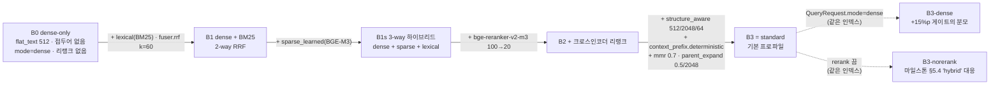
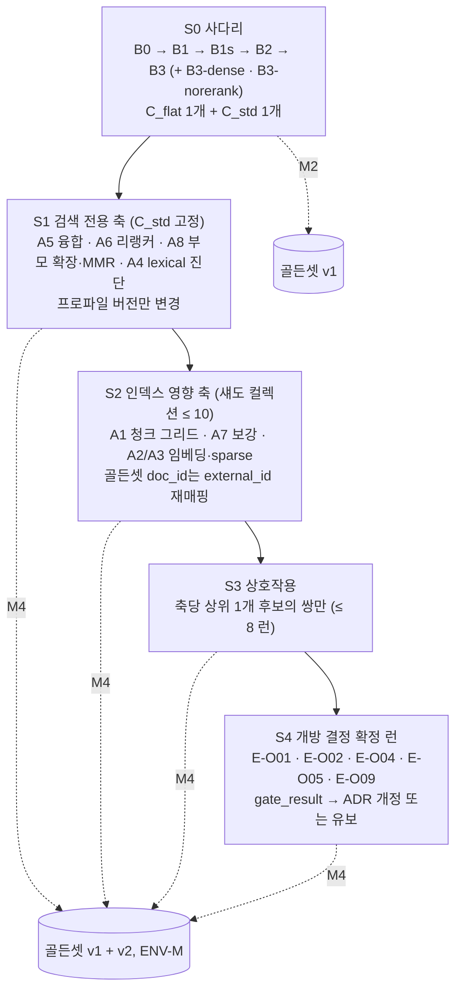
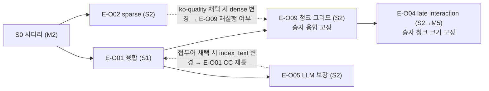

# 벤치마크 계획과 베이스라인

## 목적

이 문서는 [평가 전략](01-evaluation-strategy.md)이 위임한 "외부 셋 실행 절차·베이스라인 수치"와 [리트리벌 메트릭과 하네스](02-retrieval-metrics-and-harness.md)(이하 02)가 위임한 "벤치마크 컬렉션·지연 목표 판정 런·표본 크기 계획"을 **실행 가능한 벤치마크 계획(benchmark plan)** 으로 확정한다. 구체적으로 (1) 브리프 §7 "베이스라인 dense-only 대비 +15%p"의 기준이 되는 **베이스라인 사다리 B0~B3**의 프로파일 정의, (2) 청킹·임베딩·sparse·lexical·융합·리랭커·문맥 보강·부모 확장 여덟 축의 **실험 매트릭스**와 조합 폭발을 막는 **단계적 ablation 순서**, (3) 내부 골든셋과 공개 한국어·영어 셋의 **역할 배정**, (4) 브리프 §7 성공 기준의 판정 규칙, (5) 지연·처리량·비용의 **측정 절차**, (6) 결과를 재현 가능하게 만드는 **하드웨어·환경 명세 기록**, (7) 결과 보고 **템플릿**(표·그래프), (8) 바이블이 "실측 후 ADR 개정"으로 미룬 개방 결정 **O-01·O-02·O-04·O-05·O-09**를 닫는 실험 설계, (9) [마일스톤](../11-roadmap/01-milestones.md)과 연계한 일정, (10) 데이터 편향을 중심으로 한 리스크를 정한다.

정본 관계는 브리프 > 바이블 > ADR > 이 문서다(바이블 §1.1). 메트릭 공식·판정 규칙·검정·Holm 보정·리포트 형식은 02가 정본이고, 게이트 형식(`EvalGate`·`GateSpec`)은 [컬렉션·프로파일·정책 계약](../03-contracts/15-collection-profile-and-policy-contracts.md)(이하 15), 결과 계약(`EvalDataset`·`EvalRun`·`EvalReport`)은 [평가·피드백·사이드카 계약](../03-contracts/16-eval-feedback-and-sidecar-contracts.md)(이하 16)이 정본이다. 이 문서는 새 계약 필드·열거값·기본 파라미터를 만들지 않는다. 바이블에 없는 이름은 "제안"으로 표기하고 `## 미해결 이슈`에 모은다. 이 문서의 모든 수치 목표는 브리프 §7·바이블 §7.2의 값을 그대로 인용하며, 새로 도입한 수치(런 수·반복 횟수·표본 크기·분할 비율)는 **초안 목표**다.

## 범위

- 포함: 베이스라인 B0~B3(+ 보조 B1s·B3-dense·B3-norerank)의 프로파일 정의와 `lite` 대응, 실험 축 A1~A8과 수준, 단계 S0~S4의 ablation 순서와 런 수 산정, 실험 명명 규약(`profile_id`·`experiment_id`), 데이터셋 레지스트리(내부 `ko-public-v1` 4종, 공개 한국어 8종, 공개 영어 보조 셋)와 분할·용도 규칙, 벤치마크 컬렉션(`bench-ko-1m`·`bench-ingest-100p`, 제안), 브리프 §7 성공 기준의 판정 규칙, 지연·처리량·비용·저장량 측정 절차, 하드웨어·환경 명세 기록 규약(`manifest.json` 확장 제안), 결과 보고 템플릿(표 T1~T5, 그래프 G1~G5), 개방 결정별 실험 설계(E-O01·E-O02·E-O04·E-O05·E-O09), 일정, 리스크.
- 제외: 메트릭 계산식·접기·스팬 판정·통계 검정·게이트 판정 규칙(02), 골든셋 라벨링 절차·검수 도구·stale 재라벨·분할 규약의 확정([골든 데이터셋 구축](03-golden-dataset-construction.md)), LLM-judge 프롬프트·교정·비용([LLM-judge와 생성 품질](04-llm-judge-and-generation-quality.md)), 인터리빙·피드백 귀속([온라인 피드백 루프](06-online-feedback-loop.md)), 부하 테스트 도구·SLO 알림([확장과 성능](../09-operations/04-scaling-and-performance.md)), 배포 형상·Helm 값([배포 아키텍처](../02-architecture/08-deployment-architecture.md)), O-03·O-06·O-07·O-08·O-10의 실험(각 소유 문서: O-08은 [PDF 파서](../04-pipelines/05-parser-pdf.md), O-03은 [고급 리트리벌](../04-pipelines/18-advanced-retrieval-graph-raptor-agentic.md)).

## 1. 전제: 실험 단위·정본·용어

| 전제 | 정본 | 이 문서에서의 결과 |
|------|------|--------------------|
| 평가 대상은 삼중항 `(dataset_id, profile_hash, index_commit_ids)` | 16 §3.1, 02 §1, [평가 전략](01-evaluation-strategy.md) §6, `index_commit_ids` current 정의는 03-contracts/08 §8 IC-5(CR-40) | 모든 벤치마크 런은 `EvalRun` 하나다. 두 구성의 차이는 삼중항 중 **정확히 하나**만 바꾼 두 런의 `EvalReport.comparison`으로만 말한다(§2.1 단일 변경 원칙) |
| 검색 전용 변경 vs 인덱스 영향 변경 | [평가 전략](01-evaluation-strategy.md) §6.1 | 융합·리랭커·후처리·팩 축은 같은 컬렉션에 프로파일 두 버전을 적용해 두 런(`profile_hash`만 변화). 청커·임베더·sparse 모델·보강 축은 섀도(blue/green) 컬렉션을 채운 뒤 두 컬렉션에 두 런(`profile_hash` + `index_commit_ids` 변화, 골든셋 `doc_id`는 `external_id`로 재매핑, 02 §4.4) |
| 같은 코드 경로 | D-17, 바이블 §11.1 `local` 모드, 02 §1 | 베이스라인 수치는 `pipelines.query.run`이 `LocalRunner`로 낸 `RankedSet`·`ContextPack`에서만 나온다. 백엔드 직접 질의, 외부 라이브러리 자체 평가(`mteb` 실행 등)로 얻은 수치는 "모델 선별용 참고치"이며 베이스라인 표에 섞지 않는다 |
| 게이트 메트릭 | 바이블 §7.2 `eval.gates`, §7.3 `eval:`, 02 §3.5 | 정본 키 `ndcg@10`(선형 이득, `postprocessed`), `recall@20`(`fused`), `mrr`, `judged@10`, `span_hit_rate@k`(`pack`). 진단 키 `channel_{c}_recall@100`·`fused_recall@100`·`reranked_ndcg@10`·`parent_ratio@k` 등은 02 §3.5 단계 접두 키 |
| 통계 | D-12, 02 §7 | 쌍대 Fisher 무작위화 검정, Holm 보정(`correction: holm`), 부트스트랩 신뢰구간(B = 1,000, 릴리스 층 2,000), 그리드는 Tukey HSD. 유의성 없는 우위는 승격 근거가 아니다(P5) |
| 게이트 값 | 바이블 §7.4, 15 §3.7(`GateSpec` 선택 키 형식, CR-37) | `gate`가 붙은 값(`leaf_max_tokens`, `fallback.overlap_ratio`, `fusion`, `rerank`, `generated_prefix`)은 `EvalReport.gate_result.passed`와 ADR 없이 바뀌지 않는다. 이 문서의 모든 실험은 그 `gate_result`를 만들기 위한 것이다 |
| 일정 | [마일스톤](../11-roadmap/01-milestones.md) §1.2·§10.2 | 하네스 초판 M1, 골든셋 v1과 베이스라인 사다리 M2, ENV-M 공식 지연·처리량 M3, 축 ablation·개방 결정 게이트·ADR 개정·벤치마크 공개 M4, late interaction GA M5 |

용어: **베이스라인(baseline)** 은 비교의 기준이 되는 고정 구성의 런이다. **사다리(ladder)** 는 B0에서 B3까지 한 번에 한 구성 요소만 더해 가는 베이스라인 열이다. **축(axis)** 은 한 확장 지점 또는 한 파라미터의 수준 집합이고, **ablation** 은 기준 구성에서 한 축의 수준만 바꿔 기여를 재는 실험이다. **섀도 컬렉션(shadow collection)** 은 인덱스 영향 변경을 평가하기 위해 같은 코퍼스를 다른 프로파일로 채운 별도 `collection_id`다(바이블 §11.2 `reindex.collection.v1` blue/green).

## 2. 베이스라인 정의(B0~B3)

### 2.1 사다리와 단일 변경 원칙

**결정:** 베이스라인은 `standard` 프로파일(바이블 §7.1·§7.3)을 종점(B3)으로 하고, 한 단(rung)마다 **구성 요소 하나**를 더하는 사다리 B0 → B1 → B1s → B2 → B3으로 정의한다. 작업 지시의 "B1 +BM25 RRF"는 문자 그대로 dense + BM25 2-way 융합(B1)으로 두고, D-07의 3-way 하이브리드를 완성하는 sparse 레그 추가를 별도 단 B1s로 둔다 — sparse 레그는 BGE-M3 단일 패스의 부산물이라 비용이 0이지만(ADR-0014 F1) 기여를 따로 재야 O-02 판정과 lexical 레그 유지 근거(ADR-0014 재검토 조건 6)를 같은 표에서 읽을 수 있기 때문이다([ADR-0013](../06-adr/0013-fusion-rrf-k60-then-convex-combination-and-postprocess-order.md), [ADR-0014](../06-adr/0014-sparse-representation-bge-m3-lexical-leg-kept.md)). B2 → B3은 인덱스 영향 변경(청커·접두어)과 검색 전용 변경(부모 확장·MMR)을 함께 담으므로 사다리 표에서는 "기본 프로파일 종점"으로만 읽고, 각 요소의 개별 기여는 §3 축의 leave-one-out(B3에서 요소 하나만 끔)으로 잰다 — A7은 `structure_aware`를 유지하고 결정적 접두어만 뺀 섀도 컬렉션 `bench-a7-no-prefix`(§3.1·§3.2 S2), A8은 `C_std`에서 `parent_expand`·`mmr`만 끈 프로파일 버전(검색 전용), A6은 `rerank`만 끈 `bench-b3-norerank`(아래 규칙), A1은 S2 청크 그리드다. `C_flat`(B0~B2)과 `C_std`의 차이는 청커와 접두어가 동시에 바뀐 총기여이므로 개별 기여의 근거로 쓰지 않는다.



### 2.2 베이스라인 프로파일 표

베이스라인은 `extends: standard`의 평가 전용 프로파일로 선언한다(`profile_id`는 바이블 §6.1 kebab-case; 값은 모두 바이블 §7.2·§7.3의 `standard` 값이거나 그 값을 끄는 것이다). 표의 빈 칸은 "위 단과 같음"이다.

| 항목(YAML 경로) | B0 `bench-b0` | B1 `bench-b1` | B1s `bench-b1s` | B2 `bench-b2` | B3 `standard` |
|-----------------|---------------|---------------|-----------------|---------------|---------------|
| `ingest.chunk.plugin` / 크기 | `chunker.flat_text`, `max_tokens: 512`, `overlap_ratio: 0`, `sentence_window_n: 0`, 부모 없음 | | | | `chunker.structure_aware`, `leaf_max_tokens` 512 / `parent_max_tokens` 2048 / `merge_min_tokens` 64, `table_row_group_tokens` 256, `fallback` flat_text 384 / 0.10 / ±2 |
| `ingest.chunk.tokenizer` | `hf:BAAI/bge-m3` + `[tiktoken:o200k_base]` | | | | 동일 |
| `ingest.enrich.deterministic` | `[enricher.korean_keywords, enricher.gliner2_entities, enricher.derived_meta]`(접두어 없음: `enricher.deterministic_prefix` 제외) | | | | `[enricher.deterministic_prefix, enricher.korean_keywords, enricher.gliner2_entities, enricher.derived_meta]` |
| `ingest.enrich.generated_prefix.enabled` | false | | | | false |
| `ingest.embed` | `embedder.vllm_pooling_bge_m3` dense 1024d + sparse(`vocab_id: xlm-roberta-250k`) — 색인은 항상 두 벡터를 적재(채널만 끔) | | | | 동일 |
| `ingest.index.backends` | Qdrant(`dense`, `sparse_learned`) + OpenSearch(Nori) — 색인은 항상 두 백엔드 | | | | 동일 |
| `query.channels` | `dense`만 | `dense` + `lexical`(`retriever.opensearch_bm25`) | `dense` + `sparse` + `lexical` | | 동일 |
| `query.fusion` | 단일 채널(융합 없음; `fused_score` = `1/(60+rank)`) | `fuser.rrf`, `k: 60`, `weights {dense: 1.0, lexical: 1.0}` | `weights {dense: 1.0, sparse: 1.0, lexical: 1.0}`, `variant_query_weight: 0.5` | | 동일 |
| `query.hydrate.top_n` | 100 | | | | 100 |
| `query.rerank` | 없음(`hydrate` 순서 그대로) | | | `reranker.tei_cross_encoder`, `BAAI/bge-reranker-v2-m3`, 100→20, `max_tokens_per_text` 512, `timeout_ms` 300, `sigmoid` | 동일 |
| `query.postprocess.order` | `[relevance_gate, dedup]`(`tau` 0.3, `dedup` 0.95; 리랭크가 없는 단의 `final_score`는 min-max `fused` — 아래 규칙) | | | | `[relevance_gate, dedup, mmr, parent_expand, dedup]`(`mmr.lambda` 0.7, `parent_expand` 0.5 / 2048 / `artifact_store`) |
| `query.pack` | `k_max` 20, 24,000 / 4,000, `litm_alternating`, `anthropic_search_result` | | | | 동일 |
| `QueryRequest` | `mode: dense`, `retrieval_variant: default`, `top_k = pack.k_max`, `explain: true` | `mode: hybrid` | | | `mode: hybrid` |
| 인덱스(컬렉션) | 섀도 컬렉션 `C_flat`(B0~B2 공유) | | | | 컬렉션 `C_std` |

규칙:

- B0~B2는 **같은 섀도 컬렉션 `C_flat`** 을 공유하므로 B0→B1→B1s→B2는 검색 전용 비교다(`profile_hash`만 변화). 색인은 항상 dense·sparse·lexical 세 표현을 모두 적재하고 **채널만 끈다** — 이렇게 하면 `C_flat` 하나로 세 단을 비교할 수 있고 `channel_{c}_recall@100` 진단(02 §8.2)도 같은 인덱스에서 나온다.
- B0의 "고정 512 토큰 청킹"은 `chunker.flat_text`(kiwi 문장 → semchunk, 07-tech-landscape/04 §프로파일 표)를 1차 청커로 두고 `max_tokens` 512·오버랩 0으로 고정한 것이다. 문장 윈도우·부모는 없다. 결정적 접두어를 끄는 이유는 "소박한 RAG" 출발점을 만들기 위한 것이며, 접두어 자체의 기여(D-19 "문맥 보강")는 청커를 고정한 B3 leave-one-out(A7 `bench-a7-no-prefix`, §3.1)에서 따로 잰다.
- B0의 `fused_score`는 단일 채널 RRF 기여값이다(`fuser.rrf`가 채널 하나만 받아도 `Σ contribution = fused_score` 불변식이 성립하도록). `ScoreBreakdown.sparse`·`.lexical`은 `null`이다.
- 리랭크가 없는 단(B0·B1·B1s, 보조 B3-dense·B3-norerank)에서 `relevance_gate`가 보는 `final_score`는 바이블 §5.5 `RankedSet`의 정의대로 **min-max 정규화한 `fused`** 이고(`ScoreBreakdown.normalization=minmax`), 리랭크 단(B2·B3)에서는 `rerank_normalized`(`sigmoid`)다. 따라서 리랭크 없는 단에서 `max(final_score)`는 항상 1.0이라 게이트 자체는 실패하지 않으며(`sufficiency.status`는 바이블 §9.1 "리랭크 생략 + 캘리브레이션 없음 → `unknown`"), 항목별 컷 `final_score < tau`는 `hydrate.top_n` 100 안의 융합 순위 하위(단일 채널 RRF k=60이면 대략 48위 이하)만 `omitted.reason=below_threshold`로 떨어뜨려 `k_max` 20 팩과 `ndcg@10`·`recall@20`·`span_hit_rate@10`에 영향이 없다. 다만 `tau` 0.3은 리랭커 `sigmoid` 점수를 기준으로 정한 값(바이블 §7.2 `relevance_gate.tau`, §5.7 `ScoreNormalization`, 바이블 미해결 이슈 2)이므로 두 종류의 단에서 **같은 뜻이 아니다**. 후처리 순서를 단마다 바꾸면 단일 변경 원칙(B1s → B2가 리랭크와 게이트 두 가지를 바꾸게 됨)이 깨지므로 순서는 `standard`와 같게 유지하고, 리랭크 없는 단의 런에는 진단 키 `omitted_below_threshold_count`·`postprocessed_recall@20`(02 §8 후처리 손실, 제안)을 함께 요청해 컷이 정답 항목을 떨어뜨리지 않았음을 확인한다. **결정:** 리랭크 없는 구성의 게이트 점수 기준은 바이블 §5.5 `RankedSet.final_score` 정의(min-max `fused`)를 그대로 적용하고 별도 `tau` 등가 환산을 두지 않는다(#99) — `bench-*` 프로파일의 게이트 검증 예외 규칙(15 문서·ADR-0031)만 미해결 이슈 1로 남긴다.
- 보조 단 **B3-norerank**(`bench-b3-norerank`)는 `C_std`에서 B3의 `query.rerank`만 끈 구성(`hydrate` 순서 그대로, 후처리·팩은 B3과 동일)이다. [마일스톤](../11-roadmap/01-milestones.md) §5.4의 "베이스라인 `EvalReport` 3종(dense-only / hybrid / hybrid+rerank)"을 **같은 컬렉션**에서 B3-dense / B3-norerank / B3으로 사상하고(§10 M2), §3.1 A6 leave-one-out과 E-O01의 "리랭커 끔" 조건(§9.1)에도 같은 런을 재사용한다. B2(`C_flat` + 리랭크)와 혼동하지 않는다.
- 평가 전용 프로파일은 컬렉션에 바인딩되지 않으며 `gate`가 붙은 값을 바꾸므로 `rag profile validate`의 "게이트 값 변경 금지" 규칙과의 관계는 미해결 이슈 1이다.

### 2.3 dense-only 기준의 두 정의

브리프 §7의 "베이스라인 dense-only 대비 +15%p"에는 dense-only 기준이 두 가지로 읽힐 수 있다. 이 문서는 둘을 모두 실행하고 역할을 나눈다.

| 기준 | 정의 | 역할 |
|------|------|------|
| **B3-dense** | `C_std`(standard 인덱스)에 `QueryRequest.mode=dense`, 리랭크 없음, 후처리 `relevance_gate → dedup`(`final_score`는 min-max `fused`, §2.2 규칙) — [평가 전략](01-evaluation-strategy.md) §6.2가 정한 "같은 컬렉션·같은 데이터셋·`mode=dense`" 런 | **+15%p 게이트의 분모**(검색 전용 비교, 하이브리드·리랭크·후처리의 순기여) |
| **B0** | `C_flat`(flat 512, 접두어 없음) + `mode=dense` | 사다리의 출발점, 외부 공개 비교표의 "소박한 RAG" 기준(청킹·보강 기여까지 포함한 총기여) |

**결정:** 브리프 §7 "+15%p"의 판정은 [평가 전략](01-evaluation-strategy.md) §3·§6.2의 해석을 따라 `comparison.deltas["ndcg@10"] ≥ 0.15`(B3 vs B3-dense, 같은 `dataset_id`, Holm 보정 p < 0.05)로 하고, `recall@20`의 델타는 **보고만** 한다(게이트 아님). [평가 전략](01-evaluation-strategy.md) §3 표(검색 품질 행)가 이 문서에 위임한 "`recall@20` 병기 여부"를 이 문서가 "병기·비게이트"로 확정한다. B0 대비 델타는 T1 표(§8.1)에 함께 실어 총기여를 보이되 게이트에는 쓰지 않는다([ADR-0023](../06-adr/0023-evaluation-qrels-answer-spans-and-linear-ndcg.md), [ADR-0031](../06-adr/0031-profile-schema-extends-and-quality-gates.md)).

주의: 절대 게이트와 +15%p 게이트는 독립이며, 둘은 **B3 ≥ max(0.80, B3-dense + 0.15)** 일 때 동시에 성립한다(예: B3-dense 0.72, B3 0.88이면 둘 다 통과). 실측 B3-dense가 B3 − 0.15를 넘으면 — 즉 하이브리드·리랭크·후처리의 순기여가 15%p 미만이면 — 절대 게이트와 무관하게 +15%p 게이트만 실패하며, 그 경우 브리프 §7 문구의 재검토(예: "+15%p"를 B0 기준 총기여로 옮기거나 상대 개선률로 바꿈)를 ADR로 발의한다(미해결 이슈 2). 실측 전에는 어느 쪽도 단정하지 않는다.

### 2.4 `lite` 대응

`lite`(Qdrant 단독, GPU 0; 바이블 §7.1)는 OpenSearch·`sparse_learned`·리랭커 GPU가 없으므로 사다리가 짧다. PR CI(02 §12)는 이 사다리의 종점을 쓴다.

| 단 | `lite` 대응 프로파일 | 차이 |
|----|----------------------|------|
| B0-lite `bench-lite-b0` | bge-m3 dense ONNX int8 in_process, `mode=dense`, flat_text 512 | `lite`는 `embedding_space_id`에 `quantization` int8이 포함되어 `standard`와 다른 공간이다(마일스톤 §4.6). 절대값을 `standard` 사다리와 비교하지 않는다 |
| B1-lite `bench-lite-b1` | + `channel=lexical`(`retriever.qdrant_sparse_bm25`, `sparse_bm25` `modifier: idf`), `fuser.rrf` k=60 | `lite`의 lexical 레그는 플랫폼 형태소 + BM25 TF 포화값(ADR-0012). B1s 단은 없다(`sparse_learned` 미생성) |
| B2-lite `bench-lite-b2` | + gte-multilingual-reranker-base @ TEI CPU 30→10(바이블 §7.1 `lite` 리랭커 옵션) | 리랭커 생략 구성(`lite` 기본)도 함께 잰다 |
| B3-lite = `lite` | + `structure_aware` 512/2048/64 + 결정적 접두어 | `lite`는 `mmr` 끔·`parent_expand` 끔(바이블 §7.2)이므로 small-to-big 기여는 `lite`에서 재지 않는다 |

`lite` 사다리의 게이트는 바이블 §7.2 `lite` 열(`ndcg@10 ≥ 0.70`, `recall@20 ≥ 0.85`)이며 M1-D06(마일스톤 §4.5)은 "B1-lite가 B0-lite보다 nDCG@10이 낮지 않다"는 부호 판정만 요구한다.

## 3. 실험 매트릭스와 조합 폭발 통제

### 3.1 축(A1~A8)과 수준

축은 작업 지시의 여덟 개를 그대로 쓰고, 수준은 바이블 §3.2·§7.1·§7.3과 선정 매트릭스 §개방 결정 권고가 이미 후보로 명시한 값만 넣는다. 기본값은 `[기본]`으로 표시하며 B3 = `standard`의 값이다. "종류"는 [평가 전략](01-evaluation-strategy.md) §6.1의 변경 분류다.

| 축 | 파라미터(YAML 경로) | 수준 | 종류 | 근거 |
|----|---------------------|------|------|------|
| A1 청킹 전략 × 크기 | `ingest.chunk.plugin`, `leaf_max_tokens`, `fallback.overlap_ratio` | `structure_aware` × leaf {256, 384, [기본]512, 768}; `flat_text` × {256, 384, 512, 768} × 오버랩 {0, [기본]0.10, 0.15}(오버랩은 `flat_text`만); 옵션 `semantic_splitter`, `late_chunking`(mean pooling 모델 강제; 경계 3변형) | 인덱스 영향 | 바이블 §3.2 O-09 "M2 그리드", §7.3 `gate.grid`, ADR-0019, 07-tech-landscape/04 §O-09 |
| A2 임베딩 모델 | `ingest.embed.dense`(+ 짝이 되는 sparse) | [기본]`BAAI/bge-m3`(dense+sparse 단일 패스); `ko-quality` = KURE-v1 + PIXIE-Splade-v1.5; `quality-max` = Qwen3-Embedding-4B(MRL 1024) + sparse 구성 미정(ADR-0014 재검토 4 확정 전까지 S2 조건부, 미해결 이슈 9); 감시 목록(harrier-oss-v1-0.6b, pplx-embed-v1-0.6b, PIXIE-Rune-v1.5, voyage-4-nano)은 `mteb` 선별 후 상위 1~2개만 | 인덱스 영향 | 바이블 §7.1 임베딩 행, ADR-0010, 07-tech-landscape/05 §프로파일별 조합·`watchlist` |
| A3 sparse 유무·종류 | `query.channels[channel=sparse]`, `ingest.embed.sparse` | 끔(B1) / [기본]BGE-M3 sparse(`xlm-roberta-250k`) / PIXIE-Splade-v1.5 또는 splade-ko-v1(`ax-encoder-50k`) / `unified-opensearch` inference-free-splade-ko-v1(라이선스 확인 후) | 채널 끔은 검색 전용, 모델 교체는 인덱스 영향 | 바이블 §3.2 O-02, ADR-0014 |
| A4 lexical 유무 | `query.channels[channel=lexical]` | 끔 / [기본]OpenSearch Nori BM25 / (`lite`) Qdrant `sparse_bm25` | 검색 전용 | D-07·D-15; lexical 레그 제거는 D-07 개정 사안이라 **진단만**(ADR-0014 재검토 6) |
| A5 융합 | `query.fusion.method`, `k`, `weights`, `variant_query_weight` | [기본]`rrf` k=60 1:1:1; `rrf` k ∈ {10, 30, 100}; `convex_minmax`(ranx `optimize_fusion` 가중 0.05 단위 튠); `convex_zscore`; `dbsf`; 변형 질의 가중 {0.5[기본], 1.0}(`quality` 변형에서만) | 검색 전용 | 바이블 §3.2 O-01, ADR-0013, 선정 매트릭스 O-01 게이트 |
| A6 리랭커 | `query.rerank` | 없음(B1s) / [기본]`bge-reranker-v2-m3` 100→20 / `dragonkue/bge-reranker-v2-m3-ko`(모델 ID만 교체) / `Qwen3-Reranker-0.6B`·`-4B` @ vLLM 또는 SGLang 50→20 / `gte-multilingual-reranker-base` @ TEI CPU 30→10 / `late_interaction_rerank`(KURE-v2 MaxSim 300→100 → 크로스인코더 50→20, `premium` 슬롯) | 검색 전용(`late_interaction_rerank`는 인덱스 영향: 멀티벡터 저장 필요) | 바이블 §7.1 리랭커 행, §7.3 `rerank.gate`, ADR-0010, 07-tech-landscape/07 §리랭커 |
| A7 문맥 보강 | `ingest.enrich.deterministic`, `generated_prefix`, `contextual_doc_summary` | 없음(`bench-a7-no-prefix`, §2.1; B0~B2의 `C_flat`은 청커도 다르므로 총기여 보고에만) / [기본]결정적 `context_prefix` / + `enricher.llm_context_prefix` / + `enricher.doc_summary_autocontext` / `hypothetical_questions`(`index_text` 부착만) | 인덱스 영향 | 바이블 §3.2 O-05, §7.3 `generated_prefix.gate`, ADR-0016 |
| A8 부모 확장(small-to-big) | `query.postprocess.parent_expand`, `sentence_window`, `mmr` | 끔 / [기본]`ratio_threshold` 0.5·`max_parent_tokens` 2048 / 0.4(`premium` 값) / `sentence_window` ±2(`flat_text`만) / `mmr.lambda` {끔, [기본]0.7} | 검색 전용(부모 번들은 `ChunkSet`에 이미 있음) | 바이블 §7.2·§8.2, 마일스톤 §7.3 "small-to-big·후처리" |

여덟 축의 수준을 모두 교차하면 대략 `(4 + 12 + 2) × 4 × 4 × 3 × 7 × 6 × 5 × 5` ≈ 9 × 10^5 구성이고, 그중 인덱스 영향 축(A1 18 × A2 4 × A3 모델 교체 3 × A7 5)의 조합만 1,080개의 섀도 컬렉션을 요구한다. 전수 탐색은 불가능하므로 아래 순서로 통제한다.

### 3.2 단계적 ablation 순서(S0~S4)

**결정:** 조합 폭발은 (1) **사다리 → 검색 전용 축 → 인덱스 영향 축 → 상호작용 → 개방 결정 확정** 순서, (2) 축마다 **B3을 기준으로 한 수준씩만 바꾸는 좌표 하강(one-factor-at-a-time)**, (3) 앞 단계의 승자를 다음 단계의 기준으로 고정, (4) 상호작용은 **축당 상위 1개 후보끼리의 쌍(pair)만**, (5) 인덱스 영향 축은 **섀도 컬렉션 상한**(초안 목표: 단계당 10개)으로 통제한다. 근거: 검색 전용 축은 같은 인덱스에서 프로파일 버전만 바꿔 분 단위로 돌 수 있고(02 §5.2), 인덱스 영향 축은 재수집·재임베딩 비용이 크며(마일스톤 §4.6 blue/green), 좌표 하강은 유의하지 않은 미세 우위로 기본값이 흔들리는 것을 막는 P5·그리드 규칙 (d)와 정합한다([ADR-0031](../06-adr/0031-profile-schema-extends-and-quality-gates.md)).



| 단계 | 기준(고정) | 변인 | 데이터셋(§4) | 산출 | 마일스톤 |
|------|-----------|------|--------------|------|----------|
| S0 사다리 | — | B0, B1, B1s, B2, B3, B3-dense, B3-norerank | `ko-public-v1`, `allganize-ko`; 회귀용 `miracl-ko`·`mldr-ko`(`C_std` 계열 세 구성만) | T1 사다리 표, +15%p 판정, 채널 진단 | M2(마일스톤 §5.4 "베이스라인 `EvalReport` 3종") |
| S1 검색 전용 | B3(`C_std`) | A5 6수준, A6 5수준, A8 4수준, A4 1수준(lexical 끔, 진단) | `ko-public-v1`(tune/holdout 분할), `allganize-ko` | T2 축 표, O-01 후보(CC 가중), 리랭커 후보 델타 | M4 |
| S2 인덱스 영향 | S1 승자 프로파일 | A1: `structure_aware` leaf {256, 384, 768} 3개 + `flat_text` 384 × 오버랩 {0, 0.15} 2개 = 5 컬렉션(E-O09 (1)(2), §9.5); A7: `bench-a7-no-prefix`(접두어 없음, §2.1) + `enricher.llm_context_prefix` + `enricher.doc_summary_autocontext` = 3 컬렉션(E-O05 (−)(1)(2), §9.4); A2/A3: `ko-quality` 2 컬렉션(E-O02 (i) sparse만 교체·(ii) 전체, §9.2) — 합 **10 = 상한**. 조건부 `quality-max`(ADR-0014 재검토 4로 sparse 레그 확정 후, 미해결 이슈 9)·`unified-opensearch`(라이선스 확정 후)는 상한 안에 자리가 없으면 M5 | `ko-public-v1`, `mldr-ko`(장문·부모 확장), `allganize-ko` | T2 축 표, O-09 그리드(Tukey), O-05 ablation, O-02 sparse 비교 | M4 |
| S3 상호작용 | S2 승자 | 축당 상위 1개 후보의 쌍: (A1 최고 크기 × A8 부모 확장), (A5 CC × A6 리랭커), (A7 LLM 접두어 × A6 리랭커), (A7 LLM 접두어 × 문서 요약 결합 = E-O05 (3), 섀도 1), (A2 `ko-quality` × A5 CC) 등 ≤ 8 런 | `ko-public-v1` holdout | 상호작용 표(T2 부록) | M4 |
| S4 개방 결정 확정 | S3 결과 | §9의 E-O01·E-O02·E-O04·E-O05·E-O09 | 각 실험 정의 | `EvalReport.gate_result`, ADR 개정안 또는 유보 기록(M4-D02) | M4(O-04 GA는 M5) |

승자 고정 규칙: 어느 축에서도 **Holm 보정 p < 0.05로 기본값을 유의하게 이기는 수준이 없으면 기본값을 유지**하고(02 §7.5 (d)), 유의한 수준이 여럿이면 지연·비용(§6)이 낮은 쪽을 택한다. 승자가 바뀌면 그 축의 `gate` 값 변경은 §1.2 minor 절차(ADR + `gate_result`)를 따르며, 이 문서가 임의로 기본값을 바꾸지 않는다.

### 3.3 런 수 산정(초안 목표)

| 단계 | 구성 수 | 데이터셋 수 | 런 수 | 섀도 컬렉션 | 비고 |
|------|--------:|------------:|------:|------------:|------|
| S0 | 7(B0, B1, B1s, B2, B3, B3-dense, B3-norerank) | 2(+ 회귀 2) | 14(+ 6: 회귀 2셋은 `C_std` 계열 B3·B3-dense·B3-norerank 3 구성만) | 1(`C_flat`) | `C_std`는 운영 컬렉션 재사용; 회귀 셋 코퍼스에는 `C_flat`을 만들지 않는다 |
| S1 | 16 | 2 | 32 | 0 | 융합 튠은 tune 분할, 게이트는 holdout |
| S2 | 10(A1 5, A7 3, A2/A3 2; §3.2) | 3 | ≤ 30 | 10(= 상한; 조건부 2는 M5) | `mldr-ko`는 A1·A8 관련 구성만 |
| S3 | ≤ 8 | 1 | ≤ 8 | ≤ 2(E-O05 (3) 결합 1 포함) | 인덱스 영향 쌍은 기존 섀도 재사용 우선 |
| S4 | §9 표 | — | ≈ 20 | 1(O-04 멀티벡터; O-02·O-05·O-09의 섀도는 S2에 계수) | 나머지는 S1~S3 런 재사용 |
| 지연·처리량(§6) | 사다리 5 + S1 승자 + `premium` | `bench-ko-1m` | 7 × 3 반복 | 1(`bench-ko-1m`; O-04 멀티벡터는 같은 컬렉션에 재적재) | `--concurrency 1`, ENV-M |
| 합계 | — | — | ≈ 130 런(20 + 32 + 30 + 8 + 20 + 21) | ≤ 15 컬렉션(1 + 10 + 2 + 1 + 1; + 조건부 2는 M5) | 전수 약 9 × 10^5 구성 대비 약 10^4분의 1 |

컬렉션 수는 `ko-public-v1` 코퍼스의 섀도 컬렉션만 센다 — 2차 셋(`allganize-ko`)·회귀 셋(`miracl-ko`·`mldr-ko`)의 코퍼스 컬렉션은 각 `EvalDataset.corpus_collection_id`가 가리키는 별도 컬렉션이며 데이터셋 등록 시 한 번 만들어지므로 이 표에 계수하지 않는다. 런 하나의 비용은 02 §5.2의 배치 50·동시성 8(야간) 기준으로 질의 300~1,000건에서 분 단위이며, 섀도 컬렉션 하나는 `ko-public-v1` 코퍼스(문서 ≥ 300건) 재수집·재임베딩으로 GPU 1장에서 시간 단위다(수치는 M2 실측으로 갱신).

### 3.4 실험 명명(`profile_id`·`experiment_id`)

- 평가 전용 프로파일 `profile_id`는 `bench-{단}` 또는 `bench-{축}-{수준}`(kebab-case, 바이블 §6.1): `bench-b0`, `bench-b1`, `bench-b1s`, `bench-b2`, `bench-lite-b0`, `bench-a5-rrf-k30`, `bench-a5-convex-minmax`, `bench-a6-dragonkue`, `bench-a1-leaf-256`, `bench-a7-llm-prefix`, `bench-a2-ko-quality`. 모두 `extends: standard`(또는 `lite`), `tier`는 부모와 동일, `version`은 `0.1.x`로 시작한다. B3은 `standard` 자체다.
- `EvalRun.experiment_id`(16 §3.1, `QueryRequest.experiment_id`와 같은 값 공간, ≤ 128자)는 **런 묶음 키**로 쓴다: `bench-{마일스톤}-{단계}-{주제}` 형식(제안), 예 `bench-m2-s0-ladder`, `bench-m4-s1-fusion`, `bench-m4-s4-o09-grid`. 온라인 인터리빙의 `experiment_id`(06 문서)와 접두 `bench-`로 구분한다.
- 섀도 컬렉션 이름(`CollectionSpec`의 표시 이름, ID는 ULID)은 `bench-{코퍼스}-{프로파일}`(예 `bench-kopub-v1-flat512`)로 하고 컬렉션 `metadata`에 `experiment_id`를 기록한다(제안; 15 문서 필드 확인 필요).
- 골든셋 재등록: 섀도 컬렉션마다 `rag eval datasets register --doc-id-map external_id --corpus-collection <collection_id>`(02 §5.4 제안)로 같은 qrels·`answer_spans`를 다른 `dataset_id`로 등록한다. `EvalDataset.name`은 `{원 이름}@{컬렉션 표시 이름}`(제안)으로 구분한다.

## 4. 데이터셋

데이터셋의 포맷·검증·등록은 02 §4(`EvalDataset`, `topics.jsonl`·`qrels.jsonl`·`answer_spans.jsonl`, V1~V7)가 정본이고, 라벨링 절차·검수·stale 재라벨은 [골든 데이터셋 구축](03-golden-dataset-construction.md)이 소유한다. 이 절은 **어느 셋을 어느 실험에 어떤 역할로 쓰는가**만 정한다. 라이선스는 07-tech-landscape/09 §벤치마크 데이터 표의 확인값이며, 미확인 항목은 "확인 필요(as of 2026-09)"다. 게이트 데이터셋은 `label_provenance=human`만 가능하다(02 V5).

### 4.1 내부 골든셋(`ko-public-v1` 계열)

[평가 전략](01-evaluation-strategy.md) §9.1의 4종을 그대로 쓴다. 모두 공공누리 제1유형 문서(공개 가능), `judgment_level=graded`(0~3), `answer_spans` 100%(코퍼스 4는 예외).

| `EvalDataset.name`(제안; 01 §9.1 4종의 이름) | 코퍼스 | 규모(초안 목표, 01 문서) | 이 문서에서의 역할 | 실험 |
|--------------------|--------|--------------------------|--------------------|------|
| `ko-public-v1` | HWPX/HWP 공공문서 ≥ 300건, 질의 ≥ 300(사람 라벨 qrels ≥ 200) | 01 §9.1 #1 | **1차 게이트 셋**. 사다리·모든 축·개방 결정의 판정 입력. tune/holdout 분할(§4.3) | S0~S4 전부 |
| `ko-public-v1-pdf` | PDF 5종 × ≥ 50p(디지털·스캔·2단·표·각주·공문서) | 01 §9.1 #2 | 표·스캔 문서의 청킹·부모 확장·OCR 영향(O-09 표 행 그룹, A8) | S2 A1·A8, O-08은 소유 문서 |
| `ko-public-v1-html` | HTML ≥ 200페이지 | 01 §9.1 #3 | `flat_text` 폴백 경로(구조 빈약 문서)의 크기·오버랩·문장 윈도우 | S2 A1(`flat_text` 오버랩 그리드), A8 `sentence_window` |
| `ko-public-v1-small` | `ko-public-v1`의 소형 분할(질의 ≤ 100, 초안 목표; 02 §12) | 02 §12 | PR CI(`lite`, `LocalRunner`, `file://` 재수집) | 회귀 게이트만 |
| (문장 분리·형태소 표본) | 문장 ≥ 2,000 | 01 §9.1 #4 | L0 분석기 회귀 — 리트리벌 qrels가 아니므로 이 문서의 벤치마크 표에 넣지 않는다 | — |

`ko-public-v1`의 질의 분포(단일 홉 사실형 40% / 다중 홉 20% / 표·수치 20% / 비사실형 장문 10% / 무응답 10%, 01 §9.1 초안 목표)는 `TopicRecord.metadata`(`domain`, `hops`, `evidence_type`, `answerable`; 02 §4.2 권장 키)로 기록되어 있어야 §8의 부분군 분해(T4)가 가능하다.

### 4.2 공개 한국어·영어 셋

| `EvalDataset.name`(제안) | 원천(07/09 §벤치마크 데이터) | 라이선스 | `label_provenance` | 역할 | 사용 실험 |
|--------------------------|-------------------------------|----------|--------------------|------|-----------|
| `allganize-ko` | Allganize RAG-Evaluation-Dataset-KO, PDF 63건·질의 300, 5도메인 | MIT | `human`(문서·페이지 단위 → `answer_spans` 재라벨 필요, 03 문서) | 자체 셋 완성 전 1차 외부 종단 회귀; `standard` `eval.datasets[1]`(바이블 §7.3) | S0·S1·S2 2차 셋, O-04 |
| `miracl-ko` | MIRACL-ko dev 213 질의(train 868), 위키 문단 | Apache-2.0 | `human` | dense·sparse 1차 검색 회귀, Pyserini BM25 재현 런으로 하네스 자체 검증(02 §12 `test_public_baseline`) | S0 회귀, O-02 |
| `mrtydi-ko` | Mr.TyDi-ko | Apache-2.0 | `human` | 위키 회귀 보조; MIRACL과 중복이 크므로 릴리스 층만 | 릴리스 회귀 |
| `mldr-ko` | MLDR-ko dev 200 / test 200, 문서 6,176(평균 7,832 토큰) | MIT | `human` | **장문**: 청크 크기·부모 확장·sparse 장문 우위(O-09, A8, O-02) | S2 A1·A8, O-02, O-09 |
| `kostrategyqa` | Ko-StrategyQA dev 1,150 qrels | CC BY 4.0(MTEB 메타데이터 기준; 원 카드 태그 없음 — 확인 필요 as of 2026-09) | `human` | 다중 홉 회귀(O-03 승격 조건, 소유 문서 18) | 선택 |
| `lawirko` | LawIRKo 3,560 질의:문서 1:1 | MIT | `human` | 법령 조문 장르(`law_article` 라우팅), 정확 일치·lexical 레그 진단 | S1 A4 진단, O-02 |
| `kopub-vdr` | SDS KoPub VDR T2I/T2IT, 공공문서 이미지 361건·600쌍 | CC BY-SA 4.0 | `human` | `visual_pages` 전략·스캔 PDF 간접 평가(O-04 페이지 이미지 분기) | E-O04 (c)만 |
| `autorag-retrieval` | AutoRAGRetrieval 질의 114 / 문서 720 | MIT(MTEB 메타데이터 기준) | `human` | 개발 스모크(`lite` 소형) | 스모크 |
| `miracl-en` | MIRACL en 분할 | Apache-2.0 | `human` | **영어 보조**: 한국어 특화 튠(사용자 사전·형태소)이 다국어 품질을 깨뜨리지 않는지 부호 확인; 공개 논문 수치(BGE-M3 논문 MIRACL nDCG@10)와의 정합성 점검 | S0 회귀(보고만) |
| `mldr-en` | MLDR en 분할 | MIT | `human` | 영어 장문 보조(O-09 그리드의 언어 편향 점검) | E-O09 보조 |
| `beir-scifact`, `beir-nfcorpus` | BEIR SciFact·NFCorpus | 데이터셋별 상이 — 확인 필요(as of 2026-09) | `human` | 공개 청킹 연구(late chunking, 07-tech-landscape/04 §12)와 같은 셋에서의 재현 점검 | E-O09 보조(라이선스 확인 후) |
| 등록 금지 | KorQuAD(CC BY-ND), CRAG(CC BY-NC), BERGEN(CC BY-NC-SA), AI Hub(내국인·재배포 불가) | — | — | 내부 참고만; 배포물·공개 비교표 금지(01 §9.2, 07/09 §리스크) | — |

**결정:** 게이트 판정은 **한국어 셋만**(`ko-public-v1` 1차, `allganize-ko` 2차) 사용하고, 영어 셋은 **보고 전용 보조**(부호·정합성 점검)로만 쓴다. 영어 셋에서의 하락은 게이트 실패가 아니라 §11 리스크 R7(다국어 회귀)의 경보다. 근거: 브리프 원칙 6(Korean-First, Multilingual-Ready) — 기본값은 한국어 골든셋으로 정당화하되 다국어 모델을 채택했으므로 다국어 부호를 관찰한다([ADR-0023](../06-adr/0023-evaluation-qrels-answer-spans-and-linear-ndcg.md) Korean-First 동인).

공개 셋의 코퍼스는 `ir_datasets`(02 §10)로 받아 `IngestRequest`로 **플랫폼에 수집**한 컬렉션이어야 한다(02 §4.4 "코퍼스 = 컬렉션 스냅숏"). 원본 qrels의 `doc_id`는 수집 시 `external_id`로 넣고 등록 시 `--doc-id-map external_id`로 `document_id`(ULID)에 매핑한다. 문단 단위 코퍼스(MIRACL·Mr.TyDi)는 문단 하나가 문서 하나이므로 청킹 축(A1)의 판정에는 쓰지 않는다(청크 = 문서가 되어 그리드가 무의미).

### 4.3 분할과 용도 규칙

**결정:** 튠에 쓴 데이터로 게이트를 판정하지 않는다. `ko-public-v1`은 질의 단위로 `tune`과 `holdout` 두 분할로 나누고(비율 초안 목표 40 : 60, 층화 키 `metadata.domain`·`evidence_type`; 분할 규약의 정본은 03 문서), 다음 규칙을 강제한다([ADR-0013](../06-adr/0013-fusion-rrf-k60-then-convex-combination-and-postprocess-order.md) 하네스 게이트 행 "홀드아웃 과적합 확인", 02 §8.3).

| 용도 | 분할 | 예 |
|------|------|----|
| 파라미터 튠(ranx `optimize_fusion`의 CC 가중, `rrf_k` 탐색, `relevance_gate.tau`·`confidence_tiers` 캘리브레이션) | `tune`만 | E-O01 2단계 |
| 게이트 판정(`min`·`max_regression`·`min_delta`·`grid`·`min_qrels`) | `holdout`만 | 모든 `gate_result` |
| 사다리 보고(T1) | 전체(분할 무관; 튠이 없음) | S0 |
| `min_qrels: 200`(O-01 CC 전환 조건) 계수 | `holdout`의 `rel ≥ 1` qrels 행 수 | E-O01 |

두 분할은 `EvalDataset` 두 행(`ko-public-v1-tune`, `ko-public-v1-holdout`, 제안)으로 등록하고 같은 `corpus_collection_id`를 가리킨다. `EvalReport.comparison`은 같은 `dataset_id`끼리만 만들어지므로(02 §7.6) 분할 혼용은 기계적으로 막힌다.

### 4.4 벤치마크 컬렉션(지연·처리량용)

브리프 §7 지연 목표의 조건 "100만 청크"는 어느 골든셋 코퍼스보다 크다(`ko-public-v1` 문서 300건 ≈ 청크 2~5만). [평가 전략](01-evaluation-strategy.md) 미해결 이슈 11이 이 문서에 위임한 대로 다음 컬렉션을 정의한다(모두 제안; 이름은 표시 이름, ID는 ULID).

| 컬렉션 | 구성 | 규모(초안 목표) | 용도 |
|--------|------|-----------------|------|
| `bench-ko-1m` | (1) `ko-public-v1` 4종 코퍼스 전체, (2) `mldr-ko` 문서 6,176, (3) `miracl-ko`·`mrtydi-ko` 문단 코퍼스 중 공개 라이선스 분할, (4) 부족분은 (1)~(3) 문서의 **결정적 변형**(문단 순서 재배열·제목 치환 등 시드 고정 변환; LLM 생성 아님)으로 채워 정확히 100만 청크(`IndexCommit.stats` 합) | LP-M(NFR §3.4): 청크 1,000,000, 문서 약 6,250 | 리트리벌 p95 지연(§6.1), 인덱스 크기·RAM(§6.3), `shard_key` 승격 임계 확인 |
| `bench-ko-100k` | `bench-ko-1m`의 1/10 표본(문서 단위) | LP-S: 청크 100,000 | `lite` 단일 노드 지연(ENV-S), 개발 스모크 |
| `bench-ingest-100p` | 텍스트 PDF 100페이지 1건 + 스캔 PDF 100페이지 1건(공공누리 제1유형 원본에서 선정; 스캔은 인쇄 후 300dpi 재스캔) + HWPX 100페이지 상당 1건 | 문서 3건 | 수집 처리량(§6.2), M3-D04·M4-D05 |

`bench-ko-1m`은 지연·용량 측정 전용이며 **품질 게이트에 쓰지 않는다**(결정적 변형 문서는 qrels가 없다). 질의는 `ko-public-v1` topics(≥ 300) + `kostrategyqa` dev 질의에서 1,000건(초안 목표)을 시드 고정 표본으로 뽑아 `bench-queries-1k`(topics만 있는 `EvalDataset`; qrels 없음 → IR 메트릭 없이 지연 키만 산출, 02 §2.1 무응답 규칙과 동일하게 IR 평균에서 제외)로 등록한다. 결정적 변형 문서는 `label_provenance=synthetic`이 아니라 qrels 자체가 없으므로 게이트 데이터셋 규칙(V5)과 충돌하지 않는다.

## 5. 성공 기준

브리프 §7의 여섯 행과 바이블 §7.2 `eval.gates`를 이 문서의 실험에 사상한다. 판정 규칙(절대·회귀·후보·그리드)은 02 §7.5, 게이트 형식은 15 §3.7이다.

| 기준 | 목표(정본) | 판정 런 | 게이트 형식(15) | 판정 시점 |
|------|------------|---------|-----------------|-----------|
| 검색 품질 절대 | `ndcg@10 ≥ 0.80`, `recall@20 ≥ 0.92`(`standard`·`premium`·`korean-gov`); `lite` 0.70 / 0.85 | B3(`standard`) on `ko-public-v1-holdout`; B3-lite on `ko-public-v1-small` | `eval.gates.ndcg@10: {min: 0.80}`, `recall@20: {min: 0.92}` | M2-D02(골든셋 v1), M4-D01(v2) |
| dense-only 대비 | +15%p | B3 vs B3-dense(§2.3), 같은 `dataset_id` | `comparison.deltas["ndcg@10"] ≥ 0.15` 그리고 `p_values["ndcg@10"] < 0.05`(후보 게이트 (b) 형식 `min_delta: 0.15`를 `standard` 프로파일에 두는 것은 제안; `recall@20` 델타 보고만) | M2-D02 |
| 판정 품질 | `judged@10 ≥ 0.7`(경고) | 모든 게이트 런 | `judged@10: {warn_below: 0.7}` — 미달은 `warned_gates`, 풀링 보강 큐(03 문서) | 상시 |
| 회귀 | 베이스라인 대비 `ndcg@10` 하락 ≤ 0.01 또는 비유의 | PR CI·야간(02 §12) | `max_regression: 0.01, p: 0.05, correction: holm` | 상시 |
| 리트리벌 p95 지연 | `< 800ms`(GPU) / `< 1.5s`(CPU), 하이브리드+리랭크 Top-10, 100만 청크 | B3 on `bench-ko-1m`, ENV-M LP-M, `--concurrency 1`(§6.1) | `eval.gates.latency_p95_ms: {max: 800}`(01 문서 초안, 키 어휘는 02 미해결 이슈 2) | M2-D11(예비, L4 단일 노드) → M3-D04(공식) |
| 수집 처리량 | 텍스트 PDF 100p `< 30s`, 스캔 PDF 100p `< 5min`(GPU OCR) | `bench-ingest-100p`, 유휴 워커, ENV-M(§6.2) | 게이트 아님(야간 리포트·회귀 알림, 01 §3) | M3-D04 텍스트, M4-D05 스캔 |
| 재현성 | 동일 `IngestRequest` + 동일 프로파일 → 동일 `commit_hash`; 같은 삼중항·시드 재실행 IR 메트릭 차 ≤ 0.001(02 §11 초안) | 모든 섀도 컬렉션 재수집 시 자동 | CI 적합성 키트 + `test_reproducibility` | 상시 |
| 개방 결정 게이트 | §9 표의 값(바이블 §3.2·§7.3 그대로) | E-O01~E-O09 | 각 `GateSpec` | M4 |

절대 게이트와 회귀 게이트는 독립이며 하나라도 실패하면 `passed=false`다(01 §7.2). 지연 게이트는 IR 게이트와 **다른 런**(동시성 1, `bench-ko-1m`)에서만 산출되므로 두 런의 `gate_result`를 릴리스 노트에 함께 첨부한다.

## 6. 지연·비용 측정 방법

### 6.1 리트리벌 지연

**결정:** 지연 목표(브리프 §7)의 판정 런은 (1) 컬렉션 `bench-ko-1m`, (2) 참조 환경 ENV-M(NFR §1.4)과 부하 프로파일 LP-M, (3) `rag eval run --dataset bench-queries-1k --profile <p> --concurrency 1`(02 §5.2: 동시성 1인 런에서만 `latency_p95_ms` 산출), (4) 질의 임베딩·리랭크 캐시 **콜드**(Valkey `qemb:`·`rr:` 키 제거 후 시작; CLI 플래그 `--cold-cache`는 제안, 02 §5.3 `--no-query-embedding-cache` 제안과 통합), (5) 워밍업 100질의(측정 제외, 초안 목표) 후 1,000질의, (6) 3회 반복의 **중앙값 p95**를 보고한다. `QueryRequest.retrieval_variant=default`, `top_k = pack.k_max`, `explain=false`(프로덕션 기본; `explain=true`와의 순위 동일성은 02 미해결 이슈 11의 적합성 항목)다. 근거: 브리프 §7의 조건(100만 청크·Top-10·하이브리드+리랭크)을 그대로 재현하고, 동시성 > 1의 자원 경합·캐시 히트가 지연을 왜곡하는 것을 막는다([ADR-0003](../06-adr/0003-orchestrator-neutral-pipeline-and-non-durable-local-runner.md) 같은 코드 경로).

| 측정 항목 | 원천 | 키(02 §3.4) | 비고 |
|-----------|------|-------------|------|
| 종단 p50 / p95 / p99 | 질의별 `pipelines.query.run` 실제 경과 시간 | `latency_p95_ms`(런 단위); p50·p99는 `manifest.json`에 병기(제안) | 브리프 §7 판정은 p95 |
| 스테이지별 p95 | `ContextPack.diagnostics.latency_ms.{plan, retrieve, fuse, hydrate, rerank, postprocess, pack}` | `{stage}_latency_p95_ms` | 바이블 §8.3 예산표(plan 20 / 임베딩 40 / retrieve 120 / fuse 5 / hydrate 15 / rerank 250 / postprocess 60 / pack 40 / render 15, 초안)와 행별 대조 → 초과 스테이지가 튠 대상 |
| 채널별 p95 | `rag_retrieve_latency_seconds{channel}` 히스토그램(런 구간) | 보고 | dense·sparse·lexical 어느 레그가 임계인지 |
| 저하 발생 비율 | `ContextPack.degraded[]`의 `{rerank, timeout}`·`{channel.*, timeout}` 개수 / 질의 수 | `degraded_ratio`(제안, 런 단위) | 지연 목표를 "리랭크 생략으로" 맞추면 무효 — `rerank_skipped_query_count`(02 §11)가 0이어야 유효한 지연 런 |
| 캐시 상태 | 콜드 / 웜 두 런 | `cache_state`(§7 매니페스트) | 웜 런은 참고치(운영 p95 추정) |

CPU 목표(`< 1.5s`)는 `lite`(B3-lite, ENV-S 8 vCPU / 32GB, `bench-ko-100k` 또는 NFR LP-S) 및 `standard`에서 GPU를 제외한 구성(NFR-PERF-02; CPU 리랭크 구성의 실현 가능성은 NFR ISS-NFR-11이 [리랭킹](../04-pipelines/16-reranking.md)에 위임)에서 같은 절차로 잰다. 부하(동시 QPS 20, LP-M) 시험은 k6/Locust 기반 NFR 검증 M1(부하)이며 [확장과 성능](../09-operations/04-scaling-and-performance.md)이 소유한다 — 이 문서의 지연 런은 **단일 스트림 알고리즘 지연**이고 부하 시험은 **용량**을 재므로 둘을 혼동하지 않는다.

### 6.2 수집 처리량

`bench-ingest-100p` 3건을 유휴 상태의 ENV-M(워커·서빙 모두 대기, 큐 비어 있음)에 `POST /v1/ingest`로 한 건씩 넣고 `JobStatus.started_at`~`finished_at`(01 §3) 차를 3회 반복 중앙값으로 잰다. 스테이지 분해는 `rag_ingest_stage_duration_seconds{stage}`(fetch / parse / normalize / chunk / enrich / embed / index)로 보고한다. `standard`(RapidOCR CPU)와 `premium`(`ocr-gpu`) 두 프로파일을 모두 잰다. 캐시(`stage_key` 적중)는 첫 수집이므로 없다; 재수집 시 캐시 적중율 100%·서빙 호출 0(M2-D06)은 별도 재현성 항목이다.

### 6.3 비용·저장량

비용은 **질의당 GPU·LLM 비용**과 **컬렉션당 저장량**으로 나누어 모든 구성에 대해 같은 표(T3)에 적는다. 화폐 환산은 하지 않고 자원량으로 보고한다(환경마다 단가가 다르며, LLM 비용만 `usage_ledger`의 `cost_usd`를 그대로 쓴다).

| 항목 | 원천 | 단위 | 비고 |
|------|------|------|------|
| 인덱스 바이트(벡터별) | `rag_index_bytes_total{vector}`(`dense`, `sparse_learned`, `sparse_bm25`, `late_interaction`), `IndexCommit.stats.bytes_*` 합 | 바이트 / 100만 청크로 정규화 | O-04 인덱스 단계의 주 비용(07-tech-landscape/05 저장량 계산: KURE-v2 128d fp16 약 77GB, turbo4 약 19GB — 계산값, 실측 대체) |
| 렉시컬 인덱스 | OpenSearch 인덱스 크기(`_source` 포함·미포함) | 바이트 | 배포 아키텍처 §7.2 산식과 대조 |
| Qdrant RAM | Qdrant 컬렉션 통계 | 바이트 | 배포 아키텍처 §7.1 산식(`벡터 수 × 1024 × 4B × 1.5`)과 대조 |
| 수집 GPU 시간 | `JobStatus.cost.gpu_seconds`(임베딩·OCR·LLM 서빙 점유 초; 산정 방식은 [오케스트레이션](../02-architecture/06-orchestration-and-workflows.md)·09-operations 확정) | GPU 초 / 1,000문서 | `ko-quality`·`quality-max`(임베딩 약 7배 연산, 07/05 §결정 논리)의 비용 근거 |
| LLM 보강 비용 | `EnrichedChunkSet.budget_used{llm_tokens_in, llm_tokens_out, cost_usd}` → `usage_ledger`, `rag_enrich_llm_tokens_total`, `rag_enrich_llm_cost_usd_total` | `cost_per_doc_usd`(02 §3.4; 정의 확정은 04 문서) | O-05 게이트 `max_cost_per_doc_usd: 0.05`의 입력 |
| 질의 GPU 점유 | 리랭커·임베딩 서버의 질의 구간 `took_ms` 합(`RankedSet.rerank.took_ms`, 질의 임베딩 스팬) | GPU ms / 질의(근사) | Qwen3-Reranker-4B(50→20) vs bge-reranker-v2-m3(100→20) 비교의 비용 축; 정확한 GPU 사용률은 DCGM 계열 지표로 09-operations가 보완 |
| 처리량 | 임베딩 서버 chunks/s(`bench-ingest-100p` 수집 중 `embed` 스테이지) | chunks/s | 배포 아키텍처 §7.3의 "GPU 1장 150 chunks/s 가정" 실측 대체 |

## 7. 하드웨어·환경 명세 기록

**결정:** 모든 벤치마크 런은 `manifest.json`(02 §11 제안)에 **`environment` 객체(제안)** 를 추가해 아래 항목을 기록하고, 이 객체가 없는 런의 지연·처리량·비용 수치는 보고서에 실을 수 없다. 참조 환경 이름은 NFR §1.4(ENV-S / ENV-M / ENV-L)와 부하 프로파일(LP-S / LP-M / LP-L)을 그대로 쓴다. 근거: 브리프 §9.8 "근거 없는 수치 금지", NFR §1.4 "벤치마크 리포트는 사용한 환경을 반드시 명시", 07-tech-landscape/05 §리스크 "서빙 스택 간 벡터 불일치".

| 그룹 | 필드(제안) | 내용 | 원천 |
|------|-----------|------|------|
| 참조 환경 | `reference_env`, `load_profile` | `ENV-M` / `LP-M` 등. 축소 환경이면 `reference_env: null` + `deviation` 서술(외삽 금지, 마일스톤 §6.6) | NFR §1.4·§3.4 |
| 노드 | `nodes[]{role, count, vcpu, ram_gb, storage}` | `api`, `worker-cpu`, `qdrant`, `opensearch`, `postgresql`, `valkey`, `temporal` | 배포 아키텍처 §7.3 |
| GPU | `gpus[]{role, model, count, vram_gb, sharing}` | `embedding-server`, `reranker-server`, `ocr-gpu`, `sparse-encoder-server`; `sharing ∈ {dedicated, mig, time_slicing}` | 배포 아키텍처 §6.2 |
| 드라이버·런타임 | `driver`, `cuda`, `kernel`, `container_runtime` | 문자열 | — |
| 서빙 | `serving{<role>{engine, image_digest, model_id, dtype, quantization, max_batch_tokens}}` | `engine ∈ {vllm, tei, in_process, sglang, llamacpp}`; `model_id`는 `{repo}@{revision}`(§6.1); `image_digest`는 `Producer.image_digest`와 같은 값 | 바이블 §5.3 `Producer`, ADR-0009 |
| 백엔드 | `backends{qdrant, opensearch, postgresql, valkey, temporal}` | 버전 문자열, Qdrant 양자화(`none`, `int8`, `turbo4`), HNSW `m`·`ef` | 바이블 §7.3 `hnsw` |
| 컬렉션 | `collection{display_name, chunk_count, index_generation, tenant_isolation_tier}` | `bench-ko-1m` 등 | `CollectionSpec.stats` |
| 측정 조건 | `concurrency`, `warmup_queries`, `repetitions`, `cache_state{query_embedding, rerank, page_cache}`, `explain` | §6.1 절차 값 | 02 §11 `concurrency` 확장 |

`manifest.json`의 `environment` 발췌(값은 형식 예시; `<...>`는 자리표시자):

```json
{
  "schema_version": "0.1.0",
  "run_id": "01J9ZR5E3H7K9M2N4P6Q8S0T1V",
  "experiment_id": "bench-m3-latency-ladder",
  "environment": {
    "reference_env": "ENV-M",
    "load_profile": "LP-M",
    "nodes": [
      {"role": "api", "count": 3, "vcpu": 2, "ram_gb": 4, "storage": null},
      {"role": "worker-cpu", "count": 4, "vcpu": 4, "ram_gb": 16, "storage": null},
      {"role": "qdrant", "count": 3, "vcpu": 8, "ram_gb": 32, "storage": "nvme"},
      {"role": "opensearch", "count": 3, "vcpu": 8, "ram_gb": 32, "storage": "nvme"}
    ],
    "gpus": [
      {"role": "embedding-server", "model": "<gpu-model>", "count": 1, "vram_gb": 24, "sharing": "dedicated"},
      {"role": "reranker-server", "model": "<gpu-model>", "count": 1, "vram_gb": 24, "sharing": "dedicated"}
    ],
    "driver": "<driver-version>",
    "cuda": "<cuda-version>",
    "serving": {
      "embedding-server": {"engine": "vllm", "image_digest": "sha256:<digest>", "model_id": "BAAI/bge-m3@<sha>", "dtype": "fp16", "quantization": null, "max_batch_tokens": 32768},
      "reranker-server": {"engine": "tei", "image_digest": "sha256:<digest>", "model_id": "BAAI/bge-reranker-v2-m3@<sha>", "dtype": "fp16", "quantization": null, "max_batch_tokens": null}
    },
    "backends": {"qdrant": "1.19.x", "opensearch": "3.8.x", "postgresql": "<version>", "valkey": "<version>", "temporal": null},
    "collection": {"display_name": "bench-ko-1m", "chunk_count": 1000000, "index_generation": 1, "tenant_isolation_tier": "payload_filter"},
    "concurrency": 1,
    "warmup_queries": 100,
    "repetitions": 3,
    "cache_state": {"query_embedding": "cold", "rerank": "cold", "page_cache": "warm"},
    "explain": false
  }
}
```

ENV-M의 GPU 장수(NFR §1.4: 임베딩 1장 + 리랭커 7장, L4/A10급 24GB)는 LP-M 피크 QPS 20을 위한 용량 산정이며(NFR §3.5), 단일 스트림 지연 런에는 임베딩 1장 + 리랭커 1장으로 충분하다. 위 예시는 지연 런의 축소 배치를 나타내며 용량 시험은 NFR §1.4 전체 형상을 쓴다. ENV-M을 확보하지 못하면 축소 환경 측정값을 외삽하지 않고 "측정 연기"를 릴리스 노트에 명시한다(마일스톤 미해결 이슈 13).

## 8. 결과 보고 템플릿

리포트는 `rag eval compare`가 만드는 `comparison.json`·`comparison.md`(02 §9)의 **상위 문서**로, 벤치마크 리포트 하나가 여러 `comparison`을 묶는다. 저장 위치는 `eval/reports/{experiment_id}/report.md`(제안; 02 §6.4 키 규약 확장). 모든 표의 수치는 `EvalReport.metrics`·`comparison`·`manifest.json`에서 기계 생성하며 손으로 옮기지 않는다. 아래 표의 값 칸은 자리표시자다.

### 8.1 표

**T1 사다리 표**(데이터셋별 1장, `ko-public-v1-holdout` 필수): 행 = B0, B1, B1s, B2, B3, B3-dense; 열 = `ndcg@10`, `recall@20`, `mrr`, `span_hit_rate@10`, `judged@10`, `latency_p95_ms`(지연 런에서 join), 직전 단 대비 `delta(ndcg@10)`·95% CI·`p_holm`, B3-dense 대비 델타. 사다리 각 단은 직전 단을 `baseline_run_id`로 갖는 `comparison`이므로 델타·p값은 계약 값이다.

```text
## T1 사다리 — ko-public-v1-holdout, n=<query_count>, ENV-M, profile_hash 열 생략
| 단       | ndcg@10 | recall@20 | mrr    | span_hit@10 | judged@10 | p95(ms) | Δ ndcg@10 vs 직전 | 95% CI            | p(holm) |
|----------|--------:|----------:|-------:|------------:|----------:|--------:|------------------:|-------------------|--------:|
| B0       |  <v>    |  <v>      |  <v>   |  <v>        |  <v>      |  <v>    | —                 | —                 | —       |
| B1       |  <v>    |  <v>      |  <v>   |  <v>        |  <v>      |  <v>    | <Δ>               | [<lo>, <hi>]      | <p>     |
| B1s      |  <v>    |  <v>      |  <v>   |  <v>        |  <v>      |  <v>    | <Δ>               | [<lo>, <hi>]      | <p>     |
| B2       |  <v>    |  <v>      |  <v>   |  <v>        |  <v>      |  <v>    | <Δ>               | [<lo>, <hi>]      | <p>     |
| B3       |  <v>    |  <v>      |  <v>   |  <v>        |  <v>      |  <v>    | <Δ>               | [<lo>, <hi>]      | <p>     |
| B3-dense |  <v>    |  <v>      |  <v>   |  <v>        |  <v>      |  <v>    | (B3 − B3-dense) <Δ> ≥ 0.15 ? | [<lo>, <hi>] | <p>     |
게이트: ndcg@10 min 0.80 → <pass|fail>; recall@20 min 0.92 → <pass|fail>; +15%p(min_delta 0.15) → <pass|fail>; judged@10 warn 0.7 → <ok|warn>
```

**T2 축 ablation 표**(축별 1장): 행 = 축의 수준(기본값 `[기본]` 포함), 열 = 게이트 메트릭 + 축 고유 진단 키(A5: `fused_recall@100`, `fusion_gain_recall@100`; A6: `reranked_ndcg@10`, `rerank_gain_ndcg@10`, `rerank_latency_p95_ms`; A8: `parent_ratio@10`, `span_precision@10`, `pack_tokens` 평균; A1: `span_hit_rate@10`, `span_recall@10`, 청크 수, 평균 `token_counts[primary]`; A7: `cost_per_doc_usd`; A2/A3: `channel_dense_recall@100`, `channel_sparse_recall@100`, 인덱스 바이트) + 기본값 대비 `delta`·CI·`p_holm`, 그리드 축은 Tukey `p`와 `GateOutcome.condition=grid` 결과. 스팬·다양성 키의 요청 깊이는 이 문서 전체에서 k = 10으로 통일한다(T1 `span_hit_rate@10`·§9.5와 동일; 02 §3.5 `pack` 단계 k ≤ `pack.k_max`). `pack.k_max` 깊이(20)의 값이 필요하면 `…@20`을 보조 키로 병기하고 표에 "요청 깊이"를 적는다.

**T3 지연·비용 표**: 행 = 구성(사다리 5 + S1 승자 + `premium` 변형), 열 = `latency_p50/p95/p99_ms`, `{stage}_latency_p95_ms` 7열, `degraded_ratio`, 인덱스 바이트(벡터별), Qdrant RAM, OpenSearch 인덱스, 수집 GPU 초 / 1,000문서, `cost_per_doc_usd`, 질의 GPU ms. 환경 열은 `manifest.environment.reference_env`.

**T4 부분군 표**: `comparison.json.by`(02 §9)의 `metadata.domain`·`evidence_type`·`hops`·`answerable` 분해. 각 부분군의 `query_count`와 `ndcg@10` 델타. `query_count < 30`인 부분군은 회색 처리(02 §7.6 `low_query_count`).

**T5 게이트 결과 표**: `EvalReport.gate_result.failed_gates[]`·`warned_gates[]`의 `GateOutcome{gate_path, metric, condition, expected, observed, dataset, severity}`를 그대로 옮긴 표. 개방 결정 실험(§9)은 이 표의 행이 ADR 개정안의 "게이트 근거" 절에 그대로 붙는다.

### 8.2 그래프

그래프는 표의 시각화일 뿐이며 표 없는 그래프는 싣지 않는다. 축·오차 막대·표본 수를 그림 안에 명시한다.

| ID | 그래프 | x축 / y축 / 표식 | 읽는 법 |
|----|--------|------------------|---------|
| G1 사다리 막대 | B0~B3(+B3-dense) `ndcg@10`·`recall@20` 막대 + 95% 부트스트랩 CI 오차 막대(02 §7.3) | 단 / 값 / 데이터셋별 색 | 오차 막대가 겹치는 인접 단은 유의한 개선이 아닐 수 있다(p값은 T1 참조). 게이트 선(0.80·0.92)을 수평선으로 |
| G2 청크 그리드 히트맵 | A1 그리드 `leaf_max_tokens` × `overlap_ratio` → `ndcg@10`(`structure_aware`는 오버랩 열이 0 하나) | 크기 / 오버랩 / 셀 색 = 값, 셀 글자 = Tukey 보정 p(기본 셀 대비) | 기본 셀(512 / 0.10)보다 유의하게 밝은 셀이 없으면 기본 유지(02 §7.5 (d)). `span_hit_rate@10` 히트맵을 나란히 |
| G3 지연-품질 파레토 | 구성별 `latency_p95_ms`(x) vs `ndcg@10`(y), 점 크기 = 질의 GPU ms 또는 인덱스 바이트 | 로그 x축, 800ms·1,500ms 수직선 | 수직선 왼쪽에서 y가 최대인 점이 프로파일 후보. 오른쪽 점은 지연 목표 밖 |
| G4 부분군 델타 | `metadata.domain`·`evidence_type`별 `ndcg@10` 델타(후보 − 기본) 수평 막대 + CI | 델타 / 부분군 | 전체 평균이 양수라도 특정 부분군(표·수치, 법령)이 음수면 편향 경보(§11 R1) |
| G5 채널 회수 분해 | 질의별 `channel_{dense,sparse,lexical}_recall@100` 적중 집합의 배타·중복 비율 누적 막대(`lexical_only_hit`·`dense_only_hit`·`sparse_only_hit`·`multi_channel_hit` 비율) | 구성 / 비율 | 한 채널의 배타 기여가 0에 가까우면 그 레그의 가치가 낮다는 신호(lexical 레그 제거는 D-07 개정 사안이라 신호로만) |

### 8.3 서술 규칙

- 수치는 소수 3자리, 델타는 부호와 함께, p값은 Holm 보정값(`p_holm`)을 기본으로 하고 진단 키는 `p_raw`라고 명시한다(02 §7.2).
- "개선"이라는 단어는 `p_holm < 0.05`이고 CI가 0을 포함하지 않을 때만 쓴다. 그 외는 "차이 없음" 또는 "방향만".
- 모든 절대 수치 옆에 데이터셋 이름·`query_count`·`reference_env`를 붙인다. 리더보드·모델 카드 수치(07-tech-landscape/05)는 "참고치" 열에만 넣고 우리 런과 같은 표에 섞지 않는다.
- 유보(hold) 결정은 "실패"가 아니라 "유의한 차이 없음 → 기본 유지"로 기록하고 M4-D02의 "채택/기각/유보"에 대응시킨다.
- 공개 비교표(M4-D04)에는 `ko-public-v1`·공개 셋 결과만 싣고, `allganize-ko`의 재라벨 `answer_spans`는 원 라이선스(MIT) 고지와 함께 배포 여부를 03 문서가 정한다.

## 9. 개방 결정 확정 실험

바이블 §3.2가 `resolved`로 기록했지만 "실측 후 ADR 개정"을 조건으로 남긴 다섯 결정의 실험을 정의한다. 각 실험의 **게이트 값은 바이블 §3.2·§7.3과 해당 ADR의 값을 그대로** 쓰고, 이 문서는 고정 조건·변인·런·판정 절차만 더한다. 판정 결과는 `EvalReport.gate_result`로 남고, ADR 개정 또는 유보는 [마일스톤](../11-roadmap/01-milestones.md) §10.2 일정을 따른다.

### 9.1 E-O01 융합: RRF → convex combination 전환

| 항목 | 내용 |
|------|------|
| 질문 | 컬렉션 골든셋 ≥ 200 qrels에서 튠된 `convex_minmax`가 `rrf`(k=60, 1:1:1)를 유의하게 이기는가; `rrf_k`·채널 가중의 기본값을 바꿀 근거가 있는가 |
| 정본 | 바이블 §3.2 O-01, §7.3 `fusion.gate: {promote_to: convex_minmax, min_qrels: 200, tool: ranx.optimize_fusion}`, [ADR-0013](../06-adr/0013-fusion-rrf-k60-then-convex-combination-and-postprocess-order.md) 하네스 게이트 행 |
| 고정 | B3(`C_std`), 리랭커 켬·끔 두 조건(리랭커가 융합 차이를 덮을 수 있으므로 `fused` 단계 지표를 주로 봄), `hydrate.top_n` 100 |
| 변인 | `fusion.method ∈ {rrf, convex_minmax, convex_zscore, dbsf}`; `rrf.k ∈ {10, 30, 60, 100}`; CC 가중은 ranx `optimize_fusion` 그리드 0.05 단위(선정 매트릭스 O-01 게이트) |
| 데이터 | 튠: `ko-public-v1-tune`; 판정: `ko-public-v1-holdout`(`rel ≥ 1` qrels ≥ 200 확인 = `min_qrels`); 2차 `allganize-ko`; 회귀 `miracl-ko` |
| 지표 | 1차 `fused_recall@100`·`fused_ndcg@10`(`fused` 단계 run), 게이트 `ndcg@10`(postprocessed), 진단 `fusion_gain_recall@100`(02 §8.3) |
| 절차 | (1) `ranx fuse`로 오프라인 4방법 × k 그리드를 같은 `CandidateSet` 채널 run에 적용 — `fuser_equivalence` 키트로 자체 `fuser`와 순위 일치 확인; (2) CC 가중을 tune에서 튠; (3) holdout에서 후보(튠된 CC, 최고 k의 RRF)와 기본(rrf k=60)을 별도 프로파일 버전 런으로 실행; (4) 3개 이상 시스템이므로 Tukey HSD + 기본 대비 쌍대 Fisher/Holm; (5) 다중 컬렉션 강등 규칙(`profile_mismatch`)은 M4-D07 통합 테스트로 별도 |
| 판정 | `convex_minmax` 승격: holdout `ndcg@10` Holm p < 0.05 개선 **그리고** `min_qrels` 충족 → 컬렉션 프로파일 `version` 증가·blue/green(ADR 개정 아님, ADR-0013 재검토 1). `rrf_k` 또는 가중 기본값 변경: 여러 컬렉션(초안 목표 ≥ 3)에서 일관 우세일 때만 §7.2 변경 ADR(minor). `dbsf`·`convex_zscore`: sparse 롱테일 컬렉션 옵션으로만(재검토 2) |
| 런 수 | holdout 기준 8~10 런(+ 리랭커 끔 조건 동수) |
| 일정 | M4(S1). 컬렉션별 CC 전환은 운영 중 상시 절차 |

### 9.2 E-O02 sparse 표현

| 항목 | 내용 |
|------|------|
| 질문 | BGE-M3 sparse(`xlm-roberta-250k`)를 `ko-quality`의 PIXIE-Splade-v1.5(`ax-encoder-50k`)로 바꾸면 1차 검색 회수가 3종 셋에서 **일관** 우세인가; sparse 레그 자체의 기여(B1 → B1s)는 얼마인가 |
| 정본 | 바이블 §3.2 O-02, [ADR-0014](../06-adr/0014-sparse-representation-bge-m3-lexical-leg-kept.md) F7·평가 게이트 행: 지표 `Recall@100`·`Judged@100`, MIRACL-ko·LawIRKo·자체 공공문서 셋 3종 일관 우세; `ko-quality` 교체 게이트 `ndcg@10 +2p`(D-16) |
| 고정 | dense·lexical 레그 고정(B1s 구조), `fusion` rrf k=60, 리랭커 끔(1차 검색 지표) 및 켬(게이트 지표) |
| 변인 | A3 수준: 끔(B1) / BGE-M3 sparse(B1s, 기본) / PIXIE-Splade-v1.5(섀도 컬렉션, dense는 KURE-v1 = `ko-quality` 전체) / (`unified-opensearch`) inference-free-splade-ko-v1 — 라이선스 확인 후에만 |
| 데이터 | `ko-public-v1-holdout`(자체 공공문서), `miracl-ko`, `lawirko`; 장문 보조 `mldr-ko`(sparse 장문 우위 가설, ADR-0014 F1) |
| 지표 | `channel_sparse_recall@100`, `fused_recall@100`, `fused_judged@100`(ADR-0014 F7의 `Judged@100`은 `postprocessed` 깊이 20을 넘으므로 02 §3.5 단계 접두 키로 `fused` 단계에서 잰다), 게이트 `ndcg@10`; 비용: 질의 임베딩 p95(별도 인코더 추가 시 40ms 예산 초과 여부), 인덱스 바이트 `sparse_learned` |
| 절차 | `ko-quality`는 dense도 바뀌므로 sparse 단독 기여를 분리하기 위해 두 섀도 컬렉션을 둔다 — (i) `bge-m3 dense + PIXIE-Splade sparse`(sparse만 교체), (ii) `KURE-v1 + PIXIE-Splade`(`ko-quality` 전체). (i)가 O-02 판정, (ii)가 D-16 교체 게이트 |
| 판정 | O-02 교체: (i)가 3종 셋 **모두**에서 `fused_recall@100` Holm p < 0.05 우세 → ADR-0014 개정(`standard` 기본 sparse 교체, `vocab_id` 변경 = blue/green). 일부 셋만 우세 → `ko-quality` 옵션 유지(유보). D-16 교체: (ii)가 `ko-public-v1-holdout` `ndcg@10 +0.02` 이상·유의 → ADR-0010 재검토 2 절차. lexical 레그 제거는 이 실험의 결론이 될 수 없다(D-07 개정 사안, ADR-0014 재검토 6) |
| 런 수 | 4 구성 × 3~4 셋 × 리랭커 2조건 ≈ 24~32 런, 섀도 컬렉션 2(§3.2 S2 A2/A3에 계수; `unified-opensearch` +1은 조건부 → 자리가 없으면 M5) |
| 일정 | M4(S2). inference-free-splade-ko-v1은 라이선스 확정 시점에 추가 |

### 9.3 E-O04 late interaction 위치

| 항목 | 내용 |
|------|------|
| 질문 | KURE-v2(128d)를 (a) 인덱스 단계 4번째 채널 `late_interaction`으로 둘 때와 (b) 리랭크 단계 `late_interaction_rerank`(prefetch 300 → MaxSim 100 → 크로스인코더 50→20)로 둘 때, dense+sparse+lexical 3-way 대비 nDCG@10·p95·인덱스 크기가 어떠한가 |
| 정본 | 바이블 §3.2 O-04, §8.1 11단계, [ADR-0010](../06-adr/0010-bge-m3-rationale-and-late-interaction-slot.md) 재검토 1: 인덱스 단계는 dense+sparse 융합 대비 **+2p 이상**, 리랭크 단계는 크로스인코더 GPU 병목의 대안으로 실측될 때 승격 검토; 두 구성 모두 질의 시 후보 재인코딩 금지 |
| 고정 | `premium` 프로파일 골격(Qdrant multivector `MultiVectorConfig(MAX_SIM)`, `m=0`, turbo4), 크로스인코더 bge-reranker-v2-m3, `hydrate.top_n` 100 |
| 변인 | (0) B3 기준(3-way + 리랭크 100→20); (a) `channels[].channel=late_interaction` 추가(4-way RRF, 가중 1:1:1:1 및 MaxSim 채널 가중 {0.5, 1.0}); (b) `QueryPlan.late_interaction_rerank{enabled: true, top_n_in: 300, top_n_out: 100}` + 크로스인코더 50→20; (c) 페이지 이미지 `visual_pages`는 별도 컬렉션·`kopub-vdr`에서 ColQwen 계열 비교(07/05 §Late interaction) — 이 문서는 (a)(b)만 판정하고 (c)는 [고급 리트리벌](../04-pipelines/18-advanced-retrieval-graph-raptor-agentic.md)에 위임 |
| 데이터 | `ko-public-v1-holdout` + `allganize-ko`(마일스톤 §10.2 O-04 행), 장문 `mldr-ko` 보조 |
| 지표 | `ndcg@10`, `recall@20`, `channel_late_interaction_recall@100`(a), `rerank_gain_ndcg@10`(b, 크로스인코더 입력이 100→50으로 줄었을 때의 손실 여부), `latency_p95_ms`·`retrieve_latency_p95_ms`(a)·`rerank_latency_p95_ms`(b), `rag_index_bytes_total{vector="late_interaction"}`(a·b 공통; 07/05 계산값 fp16 약 77GB / turbo4 약 19GB per 100만 청크의 실측 대체), 저장 압축(turbo4·1-bit TurboQuant) 수준별 품질 손실 |
| 절차 | 섀도 컬렉션 1개에 `late_interaction` 벡터를 추가 적재(`embedding_profile_hash` 변경)하고 (0)(a)(b)를 프로파일 버전으로 전환. 저장량은 `bench-ko-1m`에 같은 벡터를 적재해 실측(멀티벡터 적재 비용 자체가 O-04 결정의 절반) |
| 판정 | (a) 승격: `ndcg@10` ≥ 기준 + 0.02(Holm p < 0.05) **그리고** p95 800ms 유지 **그리고** 인덱스 바이트 증분이 운영 허용치(배포 아키텍처 §7.2 형상) 이내. (b) 승격: `ndcg@10` 비열위(회귀 게이트 통과)이면서 `rerank_latency_p95_ms` 감소 또는 크로스인코더 GPU 점유 감소가 유의. 둘 다 아니면 "기본 끔·`premium` 실험 슬롯 유지" 유보. 결과는 ADR-0010 개정 + 바이블 §3.2 O-04 갱신; MaxSim 기여 재융합 여부(현재 순서 필터)도 함께 확정(바이블 미해결 이슈 3) |
| 전제 확인 | KURE-v2 라이선스 표기 불일치(07 문서 MIT vs 05·14 Apache-2.0) → `models.lock` 등재 전 모델 카드 재확인(ADR-0010 재검토 4, 확인 필요 as of 2026-09); vLLM `token_embed` 서빙 실측(확인 필요 as of 2026-09); KURE-v2는 12개월 관찰 규칙(선정 매트릭스 리스크 #9) 대상이므로 M4 결과가 좋아도 GA는 M5 |
| 런 수 | 3 구성 × 가중·압축 변형 3 × 2 셋 ≈ 18 런 + 지연 런 3 × 3 반복 |
| 일정 | M4 실험 → M5 GA(마일스톤 §10.2) |

### 9.4 E-O05 LLM 보강

| 항목 | 내용 |
|------|------|
| 질문 | `generated_prefix`(청크당 LLM 문맥 접두어) 또는 `contextual_doc_summary`(문서·섹션 1회 요약)가 결정적 접두어만 켠 기본 대비 `ndcg@10 +0.03` 이상이면서 문서당 비용이 상한 이내인가 |
| 정본 | 바이블 §3.2 O-05, §7.3 `generated_prefix.gate: {metric: ndcg@10, min_delta: 0.03, max_cost_per_doc_usd: 0.05}`, [ADR-0016](../06-adr/0016-llm-enrichment-default-off-and-budget-policy.md) 골든셋 게이트 행(Holm p < 0.05 동시 충족) |
| 고정 | B3 골격(`C_std` 코퍼스), 동일 `profile_hash` 외 조건, LLM 모델·프롬프트 버전 고정(`generated_by`, `prompt_hash`), 외부 API 없이 온프레미스(`ingest-llm` 큐) 우선 |
| 변인 | A7 수준: (0) 결정적 접두어만(기본) / (1) + `enricher.llm_context_prefix` / (2) + `enricher.doc_summary_autocontext` / (3) (1)+(2) / (4) `hypothetical_questions`를 `index_text`에만 부착(바이블 이슈 10 ablation); 대조 (−) 접두어 없음 = `bench-a7-no-prefix`(§2.1; 청커는 `C_std`와 같고 결정적 접두어만 없음 — `C_flat`(B0~B2)은 청커도 다르므로 여기서 쓰지 않는다)으로 결정적 접두어 자체의 기여 |
| 데이터 | `ko-public-v1-holdout`(장르별 분해 필수: `law_article`·`outline_report`·`narrative`), `allganize-ko`(PDF·표), 장문 `mldr-ko` |
| 지표 | 게이트 `ndcg@10`·`p_holm`; 비용 `cost_per_doc_usd`(`usage_ledger`), `rag_enrich_llm_tokens_total`, 수집 지연(`rag_ingest_stage_duration_seconds{stage="enrich"}`), `partial` 잡 비율; 진단 `channel_lexical_recall@100`(접두어가 BM25 입력 `index_text`에 들어가므로 lexical 레그 변화가 크게 나올 것으로 기대 — 07/07 Contextual Retrieval 행의 BM25 결합 효과와 대조) |
| 절차 | S2: 섀도 컬렉션 3개((−), (1), (2); §3.2 S2 A7) + `C_std`(0). (3) 결합은 S3 상호작용 단계의 섀도 1개(§3.2 S3), (4) `hypothetical_questions`는 (1)·(2) 중 하나가 승격 후보일 때만 M5 잔여(§10). 온프레미스 LLM이면 `max_cost_per_doc_usd`가 GPU 초로만 나타나므로 `gpu_seconds` 기준 보조 지표를 병기(ADR-0016 재검토 2) |
| 판정 | 승격 후보: 수준별로 `deltas["ndcg@10"] ≥ 0.03` ∧ `p_holm < 0.05` ∧ `cost_per_doc_usd ≤ 0.05`(초안 목표) **셋 모두** — 그리고 다수 장르·다수 컬렉션(초안 목표 ≥ 2 장르, ≥ 2 컬렉션)에서 성립할 때 `premium`(또는 `contextual_llm` 파생 프로파일) 기본값 승격을 ADR-0016 개정으로 검토. `lite`·`standard`·`korean-gov` 기본은 어떤 결과에도 끔 유지(ADR-0016 재검토 1). 결정적 접두어(0 vs −)의 기여는 별도 보고(D-19 근거 보강). `premium` `enrichment_budget_tokens` 재산정은 AM-52 보류(§7.1·§7.2·§4.2, 04-pipelines/11 소유)이므로 이 실험의 `cost_per_doc_usd` 실측치가 AM-52 재발의(측정 후 minor)의 근거가 된다 — `lite` `page_route`(같은 AM-52, 04-pipelines/05 소유)는 §6.2 수집 처리량의 `standard`/`premium` OCR 비교가 근거를 보탠다 |
| 런 수 | S2: 4 구성((−)(0)(1)(2)) × 3 셋 = 12 런, 섀도 컬렉션 3; S3: (3) 1 구성 × 3 셋 = 3 런, 섀도 1; (4)는 M5 |
| 일정 | M4(S2; `ingest-llm` 큐·`usage_ledger`는 M3 인프라 전제) |

### 9.5 E-O09 청크 크기·오버랩

| 항목 | 내용 |
|------|------|
| 질문 | `structure_aware` 리프 512 / `flat_text` 384·오버랩 10%가 한국어 골든셋에서 최적 셀인가; 부모 2048·표 행 그룹 256·문장 윈도우 ±2는 유지되는가; 한국어 팽창률 계수는 얼마인가 |
| 정본 | 바이블 §3.2 O-09 "M2 그리드 {256, 384, 512, 768} × {0, 10%, 15%}", §7.3 `leaf_max_tokens.gate: {metric: ndcg@10, grid: [256, 384, 512, 768], dataset: ko-public-v1}`, `fallback.overlap_ratio.gate: {grid: [0, 0.10, 0.15]}`, [ADR-0019](../06-adr/0019-chunk-size-tokenizer-defaults-and-recount-stage.md) 하네스 게이트 행: 지표 nDCG@10·Recall@20·IoU·Span hit rate@k, Holm p < 0.05로 현행 대비 우세한 셀만 승격, 팽창률 계수 재측정 |
| 고정 | 예산 토크나이저 `hf:BAAI/bge-m3`(결정 사항, 변인 아님), 부모 2048, 표 256, 결정적 접두어 켬, B3 검색 경로 |
| 변인 | (1) `structure_aware` × `leaf_max_tokens ∈ {256, 384, 512[기본], 768}`(오버랩 없음 — 구조 청커에 오버랩 파라미터가 없다, ADR-0019 A4); (2) `flat_text` × `max_tokens ∈ {256, 384[기본], 512, 768}` × `overlap_ratio ∈ {0, 0.10[기본], 0.15}`(`ko-public-v1-html`·TXT 코퍼스에서만 의미); (3) 부모 `parent_max_tokens ∈ {1024, 2048[기본]}`와 `parent_expand.ratio_threshold ∈ {0.4, 0.5[기본]}`(A8, 검색 전용); (4) 선택: `semantic_splitter`, `late_chunking` 경계 3변형(07/04 §12) |
| 데이터 | `ko-public-v1-holdout`(HWPX 구조 문서: (1)(3)), `ko-public-v1-html`((2)), `ko-public-v1-pdf`(표 행 그룹), `mldr-ko`(장문·부모 확장), 영어 보조 `mldr-en`·BEIR(라이선스 확인 후; 언어 편향 점검) |
| 지표 | 게이트 `ndcg@10`(Tukey, 규칙 (d)), `recall@20`, `span_hit_rate@10`(청크 단위 정답 포착 — O-09의 핵심 지표, 02 §3.3), `span_precision@10`(노이즈), `parent_ratio@10`; 부가: 청크 수·평균 `token_counts[hf:BAAI/bge-m3]`·`pack_tokens` 평균·`rag_pack_tokens_count`, `embed.token_overflow` 건수(절단 시 `quality=degraded` 봉투, 바이블 §4.2·§4.4 AM-07); 팽창률: 코퍼스 전체 문자당 토큰 비(bge-m3 / o200k_base), 장르(`Genre`)별 |
| 절차 | 그리드 각 점은 별도 프로파일 버전·섀도 컬렉션. (1)은 섀도 3개(512는 `C_std`); (2)는 S2 상한(§3.2 S2 A1 5개) 안에서 **오버랩 축 2개**(384 × {0, 0.15}; 384 × 0.10은 `C_std`의 `fallback`)만 M4에 채우고, **크기 축 3셀**(256·512·768 × 0.10)은 M5 잔여 셀(§10)로 미룬다 — `flat_text`의 크기 축은 (1)의 리프 그리드와 방향이 겹치는 반면 오버랩은 `flat_text`에만 있으므로 오버랩 축을 먼저 둔다; 상위 후보 주변 셀은 S3 상호작용 단계에서만 채움. (3)은 `C_std`에서 프로파일 버전만. 전체 비교는 Tukey HSD(02 §7.4) |
| 판정 | 규칙 (d): 최고 후보 셀이 현행(512 / 384·0.10)보다 Tukey 보정 p < 0.05로 유의하게 낫지 않으면 현행 유지·"초안 목표" 표기 제거(ADR-0019 재검토 1). 유의하면 §7.2 값 변경 ADR-0019 개정(minor) + `chunker_config_hash` 변경 = 전 컬렉션 blue/green 재청킹(비용 큼 — 승격 전 §6.3 비용 표 첨부). 팽창률 계수는 결과와 무관하게 프로파일에 고정(장르별 편차가 크면 `genre_rules` 오버라이드 검토, ADR-0019 재검토 2) |
| 런 수 | M4: (1) 4 + (2) 3 + (3) 4 = 11 구성 × 2~3 셋 ≈ 25 런, 섀도 컬렉션 5(§3.2 S2 A1); M5 잔여: (2) 크기 축 3 구성, 섀도 3 |
| 일정 | M4(S2: (1)·(2) 오버랩 축·(3)) → M5((2) 크기 축 잔여 셀) |

### 9.6 실험 간 의존



인덱스 영향 결정(E-O02 dense 교체, E-O09 청크 크기)이 바뀌면 그 위에서 튠한 검색 전용 결정(E-O01 CC 가중)은 재튠 대상이다. 순서를 지키기 위해 S2 결과가 확정된 뒤 E-O01의 CC 가중을 한 번 더 튠하고(재튠 1회로 제한), 그 뒤에는 컬렉션별 상시 절차로 넘긴다.

## 10. 일정(로드맵 연계)

[마일스톤](../11-roadmap/01-milestones.md)의 ID·주차·DoD를 그대로 쓴다. [평가 전략](01-evaluation-strategy.md) §9.3은 게이트 판정을 M2로 적었으나 마일스톤 문서(§1.2, §10.2)가 "골든셋 v1은 M2, 게이트 실험·ADR 개정은 M4"로 배정했고 마일스톤 체계의 소유 문서이므로 이 문서는 후자를 따른다(미해결 이슈 3).

| 마일스톤(주차, 초안) | 이 문서의 작업 | 산출물·DoD | 선행 조건 |
|-----------------------|----------------|------------|-----------|
| M1 기반(W1~W10) | 하네스 초판으로 `lite` 사다리 B0-lite·B1-lite를 픽스처 골든셋(`synthetic`)에서 실행; `bench-*` 프로파일 스키마·`experiment_id` 규약 확정; `manifest.environment` 제안 구현 | M1-D06(B1-lite ≥ B0-lite 부호), M1-D09(첫 `EvalReport`) | 하네스 `[eval]`, `LocalRunner`, `lite` 종단 |
| M2 한국어 1급(W11~W20) | 골든셋 v1 등록(`ko-public-v1` 4종, `allganize-ko`, `miracl-ko`, `mldr-ko`); S0 사다리 B0~B3·B3-dense·B3-norerank on `standard`; `C_flat` 섀도 컬렉션; 예비 지연 런(L4급 단일 노드, `bench-ko-100k` 또는 골든셋 코퍼스; M2-D11) | 마일스톤 §5.4 "베이스라인 `EvalReport` 3종(dense-only / hybrid / hybrid+rerank)" = B3-dense·B3-norerank·B3(§2.2 규칙, 같은 `C_std`) + 사다리 B0·B1·B1s·B2; M2-D02(0.80 / 0.92 / +15%p) | OpenSearch·vLLM·TEI, 사람 라벨 qrels ≥ 200 |
| M3 운영(W21~W30) | `bench-ko-1m`·`bench-ingest-100p` 구축; ENV-M 공식 지연·처리량 런(§6.1·§6.2), T3 표; 축소 환경이면 "측정 연기" 기록 | M3-D04(p95 800ms GPU / 1.5s CPU, 텍스트 PDF 100p < 30s), 벤치마크 리포트(ENV-M) | ENV-M 확보(마일스톤 이슈 13), Temporal `eval.run.v1` |
| M4 품질(W31~W38) | S1(검색 전용 축) → S2(인덱스 영향 축, 섀도 ≤ 10) → S3(상호작용) → S4(E-O01·E-O02·E-O04·E-O05·E-O09); 골든셋 v2로 사다리 재실행; 공개 비교표 | M4-D01(v2 게이트), M4-D02(게이트 15종 채택/기각/유보 + ADR 개정: 0013 절차·0014·0016·0019, 0010은 개정안), M4-D04(공개 비교표), M4-D05(스캔 PDF 100p < 5min), M4-D08(캘리브레이션) | M2 골든셋 v1, M3 ENV-M·`ingest-llm`·`usage_ledger` |
| M5 확장(W39~W48) | E-O04 GA 판정(12개월 관찰 규칙 고려), E-O09 (2) 크기 축 잔여 셀(§9.5), E-O05 (4)(§9.4), S2 조건부 A2/A3(`quality-max`·`unified-opensearch`, §3.2), `korean-gov`(`kopub-vdr`·사람 라벨 100%), 그래프·멀티모달 벤치는 소유 문서 | ADR-0010 개정 반영, 벤치마크 리포트 갱신 | M4 결과 |
| 1.0 GA(W49~W52) | 릴리스 벤치마크 리포트 동결(`EvalReport` 아카이브를 릴리스 태그에 연결), 공개 셋 재실행으로 회귀 확인 | C5 릴리스 노트 | — |
| 상시 | PR CI(`ko-public-v1-small`, `lite`, 회귀 게이트), 야간 `eval.run.v1`(전량 + `--diagnostics`), 컬렉션별 CC 전환(≥ 200 qrels 도달 시) | 02 §12 3층 | — |

M2의 사다리는 골든셋 v1의 사람 라벨이 완성되는 W16~W20 사이에만 유효한 게이트가 되므로, 그 전(W11~W15)에는 `synthetic`·`umbrela` 라벨로 파이프라인만 검증하고 수치는 보고서에 싣지 않는다(V5).

## 11. 리스크

| ID | 리스크 | 영향 | 완화 |
|----|--------|------|------|
| R1 도메인 편향 | `ko-public-v1`은 공공문서(행정·법령) 편중이고 `allganize-ko`는 5도메인 × 60질의라 부분군이 작다. 전체 평균이 특정 장르에서의 악화를 가린다 | 기본값이 공공문서에 과적합 | T4 부분군 표·G4를 모든 게이트 런에 의무화; 부분군 `query_count < 30`은 회색 처리; M4 골든셋 v2에서 도메인 확장(기업·기술 문서) |
| R2 질의 분포 편향 | 합성 질의(RAGAS `TestsetGenerator`)는 코퍼스 문장을 되풀이하는 경향이 있어 lexical 레그를 과대평가하고, 사람 질의는 의역이 많아 dense를 과대평가한다 | B1 vs B1s, A3·A4 판정 왜곡 | 게이트는 `human` 라벨만(V5); `TopicRecord.metadata`에 질의 출처(`synthetic`/`human`/`production`) 기록(03 문서 제안)하고 출처별 분해 보고 |
| R3 판정 순환성 | LLM-judge·UMBRELA 라벨러가 LLM 리랭커(Qwen3-Reranker)를 쓴 구성을 편애할 수 있다(07/09 §LLM-judge 교정, Clarke & Dietz) | A6 리랭커 승격 오판 | 최종 게이트는 사람 라벨 qrels; judge 모델 계열과 리랭커 계열 분리; judge 결과는 `warn`만 |
| R4 튠-판정 누출 | CC 가중·`tau`·`confidence_tiers`를 튠한 질의로 게이트를 판정하면 과적합이 유의한 개선으로 보인다 | E-O01 오판 | §4.3 분할 강제(`dataset_id` 분리로 `comparison` 자체가 불가); `min_qrels`는 holdout 기준 |
| R5 풀링 편향 | 새 채널·모델(sparse 교체, late interaction)이 찾은 문서가 qrels에 없어 `judged@10`이 떨어지고 새 구성이 과소평가된다 | E-O02·E-O04 과소평가 | `judged@10 warn_below 0.7`(경고 → 미판정 상위 문서 라벨 큐, 16 예시 detail); 후보 구성의 top-10 미판정 문서를 M4 라벨 배치에 포함(03 문서) |
| R6 문서 버전 stale | 코퍼스 재수집·파서 개정으로 `doc_version`이 바뀌면 `answer_spans`가 stale이 되어 `span_hit_rate`의 분모가 줄어든다 | O-09 판정력 저하 | `stale_span_ratio`를 매니페스트에 기록(02 V7), 초안 임계 초과 시 재라벨 후 재실행(03 문서) |
| R7 다국어 회귀 | 한국어 사용자 사전·형태소 튠이 영어·다국어 질의를 악화시킬 수 있다 | Multilingual-Ready 원칙 위반을 늦게 인지 | `miracl-en`·`mldr-en` 보고 전용 런을 릴리스 층에 포함; 하락은 경보(게이트 아님) |
| R8 리더보드 vs 내부 역전 | MTEB-ko·AutoRAG 순위가 서로 역전되고(07/05 §한국어 특화 dense), 카드 자체 보고치(KURE-v2)는 검증 전이다 | 후보 선별 오류 | 리더보드는 후보 선별에만; 채택은 내부 골든셋(원칙 7); 신규 모델 12개월 관찰(선정 매트릭스 리스크 #9) |
| R9 하드웨어·캐시 혼입 | GPU 종류·MIG·time-slicing·캐시 상태·동시성이 지연을 수십 % 흔든다 | 지연 게이트 오판 | §7 `environment` 없는 수치 금지; 콜드/웜 분리; `--concurrency 1`; ENV-M 외 환경은 "측정 연기" |
| R10 다중 비교 | 축 8개·수준 수십 개를 동시에 비교하면 우연한 유의가 나온다 | 기본값 흔들림 | 좌표 하강 + Holm(패밀리는 정본 키만) + 그리드 Tukey + 규칙 (d); 진단 키는 패밀리 밖 |
| R11 표본 크기 | `allganize-ko` 300질의·`miracl-ko` dev 213·`mldr-ko` 200은 0.01 게이트를 검출하기에 작을 수 있다(02 §7.6) | 회귀를 놓침 | 부트스트랩 구간 폭으로 사후 검정력 추정; 사전 검정력 계산은 03 문서; `ko-public-v1` 질의 ≥ 300에서 시작하되 v2에서 확대 |
| R12 라이선스·재배포 | 공개 비교표에 CC BY-ND·CC BY-NC 셋 결과나 `allganize-ko` 재라벨 스팬을 실으면 라이선스 위반 | 공개 불가 | 등록 금지 목록(§4.2); 데이터셋 레지스트리 `license` 필수(16); 공개 표는 `ko-public-v1`·Apache/MIT/CC BY 셋만 |
| R13 섀도 컬렉션 비용 | 인덱스 영향 축 하나가 재수집·재임베딩 시간 단위를 소비하고 GPU를 점유해 M4 8주 안에 S2가 끝나지 않을 수 있다 | 일정 지연 | S2 상한 10, 그리드 최소 설계(§9.5), `stage_key` 캐시로 parse·normalize 재사용(chunk 이후만 재실행), 잔여 셀은 M5 |

## 결정 사항 요약

- **결정:** 베이스라인은 `standard`를 종점으로 하는 사다리 B0(dense-only, `chunker.flat_text` 512·오버랩 0·접두어 없음·`mode=dense`) → B1(+ lexical BM25, `fuser.rrf` k=60) → B1s(+ `sparse_learned`, 3-way) → B2(+ `bge-reranker-v2-m3` 100→20) → B3(= `standard`: `structure_aware` 512/2048/64 + 결정적 `context_prefix` + `mmr` 0.7 + `parent_expand` 0.5/2048)이며, B0~B2는 섀도 컬렉션 `C_flat` 하나를 공유하고 채널만 끈다. `lite` 대응 사다리는 B0-lite → B1-lite(`sparse_bm25` lexical) → B2-lite → `lite`다([ADR-0013](../06-adr/0013-fusion-rrf-k60-then-convex-combination-and-postprocess-order.md), [ADR-0014](../06-adr/0014-sparse-representation-bge-m3-lexical-leg-kept.md)).
- **결정:** 브리프 §7 "+15%p"는 B3 vs **B3-dense**(같은 `standard` 인덱스, `QueryRequest.mode=dense`)의 `comparison.deltas["ndcg@10"] ≥ 0.15`·Holm p < 0.05로 판정하고 `recall@20` 델타는 보고만 한다. B0 대비 델타는 총기여로 병기한다([ADR-0023](../06-adr/0023-evaluation-qrels-answer-spans-and-linear-ndcg.md), [ADR-0031](../06-adr/0031-profile-schema-extends-and-quality-gates.md)).
- **결정:** 실험 매트릭스는 축 A1~A8을 S0(사다리) → S1(검색 전용 축) → S2(인덱스 영향 축, 섀도 컬렉션 ≤ 10) → S3(축당 상위 1개 후보의 쌍, ≤ 8 런) → S4(개방 결정 확정)의 좌표 하강으로 통제하며, 어느 축에서도 Holm 보정 p < 0.05의 승자가 없으면 기본값을 유지한다. 총 런 약 130·섀도 컬렉션 ≤ 15(초안 목표, §3.3)([ADR-0031](../06-adr/0031-profile-schema-extends-and-quality-gates.md)).
- **결정:** 게이트 판정은 한국어 셋(`ko-public-v1` 1차, `allganize-ko` 2차)만 쓰고 영어 셋(`miracl-en`, `mldr-en`, BEIR 일부)은 보고 전용이다. `ko-public-v1`은 `tune`/`holdout`으로 분할해 튠과 판정을 분리하며 `min_qrels`는 holdout 기준이다([ADR-0013](../06-adr/0013-fusion-rrf-k60-then-convex-combination-and-postprocess-order.md), [ADR-0023](../06-adr/0023-evaluation-qrels-answer-spans-and-linear-ndcg.md)).
- **결정:** 지연 목표는 `bench-ko-1m`(100만 청크, LP-M)·ENV-M·`--concurrency 1`·콜드 캐시·워밍업 100·1,000질의·3회 반복 중앙값 p95로 판정하고, 부하(QPS) 시험과 분리한다. 처리량은 `bench-ingest-100p`의 `JobStatus` 시각 차로 잰다([ADR-0003](../06-adr/0003-orchestrator-neutral-pipeline-and-non-durable-local-runner.md)).
- **결정:** 모든 벤치마크 런은 `manifest.json`에 `environment`(참조 환경·노드·GPU·드라이버·서빙 이미지 digest·모델 revision·백엔드 버전·캐시 상태·동시성)를 기록해야 하며, 이 기록이 없는 지연·비용 수치는 보고서에 싣지 않는다(브리프 §9.8, NFR §1.4).
- **결정:** 개방 결정 실험 E-O01·E-O02·E-O04·E-O05·E-O09의 게이트 값은 바이블 §3.2·§7.3과 각 ADR의 값을 그대로 쓰고(CC 전환 `min_qrels 200`, sparse 교체 3종 셋 일관 우세·`ko-quality +2p`, late interaction 인덱스 단계 `+2p`·p95 800ms, LLM 보강 `min_delta 0.03`·`max_cost_per_doc_usd 0.05`, 청크 그리드 Tukey 규칙 (d)), 결과는 M4에서 `EvalReport.gate_result`와 함께 ADR 개정 또는 유보로 기록한다([ADR-0010](../06-adr/0010-bge-m3-rationale-and-late-interaction-slot.md), [ADR-0013](../06-adr/0013-fusion-rrf-k60-then-convex-combination-and-postprocess-order.md), [ADR-0014](../06-adr/0014-sparse-representation-bge-m3-lexical-leg-kept.md), [ADR-0016](../06-adr/0016-llm-enrichment-default-off-and-budget-policy.md), [ADR-0019](../06-adr/0019-chunk-size-tokenizer-defaults-and-recount-stage.md)).
- **결정:** 결과 보고는 표 T1(사다리)·T2(축)·T3(지연·비용)·T4(부분군)·T5(게이트)와 그래프 G1~G5로 고정하고, 모든 수치는 `EvalReport`·`comparison.json`·`manifest.json`에서 기계 생성한다. "개선"은 `p_holm < 0.05`이고 CI가 0을 포함하지 않을 때만 쓴다.

## 미해결 이슈

| # | 이슈 | 제안 |
|---|------|------|
| 1 | 평가 전용 프로파일(`bench-*`)은 `gate`가 붙은 값(`leaf_max_tokens`, `fusion`, `rerank`, `generated_prefix`)을 바꾸므로 `rag profile validate`의 "게이트 값은 `gate_result.passed` 없이 변경 불가" 규칙과 충돌한다. `Profile.tier`에도 평가용 값이 없다(리랭크 없는 구성의 게이트 점수 기준은 §2.2에서 확정 — 해소(v1.3, #99)) | 15 문서·ADR-0031에 "컬렉션에 바인딩되지 않은 프로파일(`profile_id` 접두 `bench-`, 제안)은 게이트 검증을 경고로 낮춘다" 규칙 추가(minor). `chunker.flat_text`를 1차 청커로 허용하는지도 함께 확인 |
| 2 | 절대 게이트(`standard` `ndcg@10 ≥ 0.80`)와 +15%p 게이트는 독립이며 B3 ≥ max(0.80, B3-dense + 0.15)일 때 동시에 성립한다(§2.3). 실측 B3-dense가 B3 − 0.15를 넘으면(하이브리드·리랭크·후처리의 순기여 < 15%p) 절대 게이트와 무관하게 +15%p 게이트만 실패한다 | M2 실측 후 두 게이트가 양립하지 않으면 브리프 §7 "+15%p" 문구 개정 ADR 발의(기준을 B0 총기여로 옮기거나 상대 개선률로). 실측 전에는 어느 쪽도 단정하지 않는다 |
| 3 | [평가 전략](01-evaluation-strategy.md) §9.3은 게이트 판정을 M2로, [마일스톤](../11-roadmap/01-milestones.md) §10.2는 M4로 적는다 | 이 문서는 마일스톤을 따른다. 01 문서 §9.3 표를 "M2 골든셋 v1·사다리, M4 게이트 판정"으로 patch |
| 4 | `manifest.json`의 `environment` 객체, `p50/p99`, `degraded_ratio`, 런 산출물 키 `eval/reports/{experiment_id}/report.md`는 제안이다 | 02 §6.4·§11 매니페스트 스키마에 편입(02 미해결 이슈 8·9와 공동); 16 `EvalRun.options`(N) 제안과 정합 |
| 5 | `bench-ko-1m`의 "결정적 변형 문서"(문단 재배열·제목 치환) 생성 규약과 `bench-queries-1k`(qrels 없는 topics 전용 `EvalDataset`)의 등록 가능성 | 03 문서가 변형 규약을, 16이 qrels 없는 데이터셋 허용 여부(V2·V3 통과 조건)를 확정 |
| 6 | `ko-public-v1-tune`/`-holdout` 분할 비율 40 : 60과 층화 키, 섀도 컬렉션 재등록 시 `EvalDataset.name` 표기 `{원 이름}@{컬렉션}` | 03 문서 분할 규약; 16 `name` 유일성 규칙 확인 |
| 7 | `--cold-cache`·`--repetitions` CLI 플래그와 Valkey `qemb:`·`rr:` 키 삭제 절차 | 02 §5.4 CLI 표에 추가(02 미해결 이슈 3 `--no-query-embedding-cache`와 통합), 10-development 확정 |
| 8 | 질의 GPU 점유(GPU ms / 질의)의 정의가 `took_ms` 합 근사다 | 09-operations/03이 DCGM 계열 GPU 사용률 지표와 연결하면 T3 열을 교체 |
| 9 | `quality-max`(Qwen3-Embedding-4B)의 sparse 레그 구성이 바이블 §7.1에 없어 A2 수준 정의가 불완전하다 | ADR-0014 재검토 4대로 프로파일 정의 시 확정; 그때까지 A2/A3는 `ko-quality`만 실행하고 `quality-max`는 S2 조건부 컬렉션(§3.2·§3.3)으로 둔다 |
| 10 | 영어 보조 셋 중 BEIR SciFact·NFCorpus의 데이터셋 라이선스, `kostrategyqa` 원 카드 라이선스 태그 부재 | 등록 전 확인(as of 2026-09); 미확인 시 보고서에서 제외 |
| 11 | KURE-v2 라이선스 표기(MIT vs Apache-2.0)와 vLLM `token_embed` 서빙 실측 | ADR-0010 재검토 4; `models.lock` 등재 전 카드 확인, M4 E-O04 착수 조건 |
| 12 | 온프레미스 LLM에서 `max_cost_per_doc_usd`가 GPU 초로만 나타나 E-O05 비용 게이트가 무의미해질 수 있다 | ADR-0016 재검토 2대로 `gpu_seconds` 기준 보조 게이트 지표를 04 문서·09-operations가 정의 |
| 13 | 이 문서의 런 수·반복 횟수·워밍업·표본 크기·분할 비율·섀도 컬렉션 상한은 모두 초안 목표다 | M2 사다리 실측으로 런당 비용을 재고 M4 계획을 갱신(이 문서 minor 개정) |

## 참조

- [설계 브리프](../00-vision/00-design-brief.md) — §2 R3, §3 원칙 5·6·7·8, §4 D-07·D-12·D-16·D-19, §5 O-01·O-02·O-04·O-05·O-09, §7 품질 목표, §9 문서 규약
- [설계 바이블](../02-architecture/00-design-bible.md) — §1.1~1.2, §3.1 D-07·D-12·D-16·D-19, §3.2 O-01·O-02·O-04·O-05·O-09, §3.3 ADR 목록, §5.1 인벤토리, §5.3 `Producer`·`ScoreBreakdown`, §5.5 `QueryRequest`·`QueryPlan`·`RankedSet`·`ContextPack`, §5.6 `EvalDataset`/`EvalRun`/`EvalReport`·`Profile`, §5.7 `RetrievalMode`·`RetrievalVariant`·`FusionMethod`·`Channel`·`VectorName`·`PostprocessStep`·`JudgmentLevel`·`LabelProvenance`, §6.1 `profile_id`·`model_id`·`tokenizer_id`, §6.5 메트릭 정본 목록, §7.1~7.4 프로파일·파라미터·YAML·게이트, §8.1~8.3 검색 경로·지연 예산, §11.1~11.2, §13.3, §15 리스크 #1·#9·#10
- [기술 지형 종합: 선정 매트릭스](../07-tech-landscape/00-summary-and-selection-matrix.md) — §프로파일별 기본 조합, §개방 결정 권고 O-01·O-02·O-04·O-05·O-09(게이트 열), §운영·평가 공통 요구(골든셋 4종·M2 게이트 목록), §종합 리스크 #1·#9
- [리트리벌 메트릭과 하네스](02-retrieval-metrics-and-harness.md) — §2 판정 단위·접기, §3 메트릭 키·단계 접두 키, §4 데이터셋·코퍼스 스냅숏·V1~V7, §5 실행 흐름·캐시·CLI, §6 결과 스키마·런 산출물, §7 검정·Holm·부트스트랩·그리드·게이트 규칙, §8 단계별 진단, §9 리포트 형식, §11 재현성 매니페스트, §12 CI, 미해결 이슈 2·3·6·8·9·11
- [평가 전략](01-evaluation-strategy.md) — §3 브리프 §7 측정 매핑, §6 변경 분류·비교 방식·dense-only 베이스라인 정의, §7 게이트 계층, §9 한국어 우선 벤치마크 계획(골든셋 4종·외부 셋 역할·단계), 미해결 이슈 11
- [임베딩·스파스·멀티벡터 모델과 서빙](../07-tech-landscape/05-embedding-models-and-serving.md) — §후보 표, §Learned sparse 비교, §Late interaction·저장량 계산, §프로파일별 조합(`ko-quality`·`ko-late-interaction`·`quality-max`·`watchlist`), §리소스 요구, §개방 결정 O-02·O-04
- [리트리벌 기법: 질의 이해·융합·리랭킹·후처리](../07-tech-landscape/07-retrieval-techniques-fusion-reranking.md) — §2 융합 알고리즘 비교·3-way 함의, §3 리랭커·서빙 매트릭스·점수표, §4 후처리, §리소스 요구, §개방 결정 O-01·O-04
- [평가 프레임워크·벤치마크·관측성](../07-tech-landscape/09-evaluation-and-observability.md) — §한국어·다국어 리트리벌 벤치마크 데이터(라이선스), §벤치마크 프로그램, §골든셋 구축, §리소스 요구, §개방 결정 의견
- [청킹 전략과 라이브러리](../07-tech-landscape/04-chunking-strategies-and-libraries.md) — §12 late chunking 경계 3변형, §15 청크 크기·오버랩 실증 연구 종합, §프로파일별 조합, §개방 결정 O-09
- [계약 개요](../03-contracts/00-contract-overview.md) — §2 인벤토리·소유 문서, §3 봉투, §4 공용 타입(`Producer`·`ScoreBreakdown`), §6 명명 요약
- [컬렉션·프로파일·정책 계약](../03-contracts/15-collection-profile-and-policy-contracts.md) — §3.6 `eval` 필드, §3.7 게이트 값 형식(`GateSpec`), §3.8 `profile_hash`, `EvalGate`
- [평가·피드백·사용자 사전·사이드카 계약](../03-contracts/16-eval-feedback-and-sidecar-contracts.md) — §2 `EvalDataset`, §3 `EvalRun`(`experiment_id`·`baseline_run_id`), §4 `EvalReport`·`GateOutcome`·조건 열거
- [마일스톤](../11-roadmap/01-milestones.md) — §1.2 단계 표기 대응, §1.3 가정(GPU·ENV-M), §4~§8 M1~M5 범위·DoD(M1-D06·D09, M2-D02·D11, M3-D04, M4-D01·D02·D04·D05·D08), §10.1 KPI 측정 시점, §10.2 게이트 기반 ADR 개정 일정, 미해결 이슈 13
- [비기능 요구사항](../01-requirements/02-non-functional-requirements.md) — §1.4 참조 환경 ENV-S/M/L, §3.3 지연 예산, §3.4 부하 프로파일 LP-S/M/L, NFR-PERF-01·02·08, ISS-NFR-11
- [배포 아키텍처](../02-architecture/08-deployment-architecture.md) — §6 GPU 스케줄링·공유 방식, §7 사이징(산식·인덱스 규모·컴퓨트·`lite` 단일 노드)
- ADR(바이블 §3.3 번호·slug): [0003 오케스트레이터 중립 파이프라인·LocalRunner](../06-adr/0003-orchestrator-neutral-pipeline-and-non-durable-local-runner.md), [0010 BGE-M3 근거·late_interaction 슬롯](../06-adr/0010-bge-m3-rationale-and-late-interaction-slot.md), [0013 융합 2단계 전략·후처리 순서](../06-adr/0013-fusion-rrf-k60-then-convex-combination-and-postprocess-order.md), [0014 sparse 표현](../06-adr/0014-sparse-representation-bge-m3-lexical-leg-kept.md), [0016 LLM 보강 기본 끔·비용 정책](../06-adr/0016-llm-enrichment-default-off-and-budget-policy.md), [0019 청크 크기·토크나이저 기본값](../06-adr/0019-chunk-size-tokenizer-defaults-and-recount-stage.md), [0023 평가 하네스](../06-adr/0023-evaluation-qrels-answer-spans-and-linear-ndcg.md), [0031 프로파일 게이트](../06-adr/0031-profile-schema-extends-and-quality-gates.md)
- 08-evaluation 형제 문서(문서 맵 경로): [골든 데이터셋 구축](03-golden-dataset-construction.md), [LLM-judge와 생성 품질](04-llm-judge-and-generation-quality.md), [온라인 피드백 루프](06-online-feedback-loop.md)
- 관련 설계 문서(문서 맵 경로): [PDF 파서](../04-pipelines/05-parser-pdf.md), [리랭킹](../04-pipelines/16-reranking.md), [고급 리트리벌](../04-pipelines/18-advanced-retrieval-graph-raptor-agentic.md), [오케스트레이션과 워크플로우](../02-architecture/06-orchestration-and-workflows.md), [확장과 성능](../09-operations/04-scaling-and-performance.md), [관측성](../09-operations/03-observability.md)
