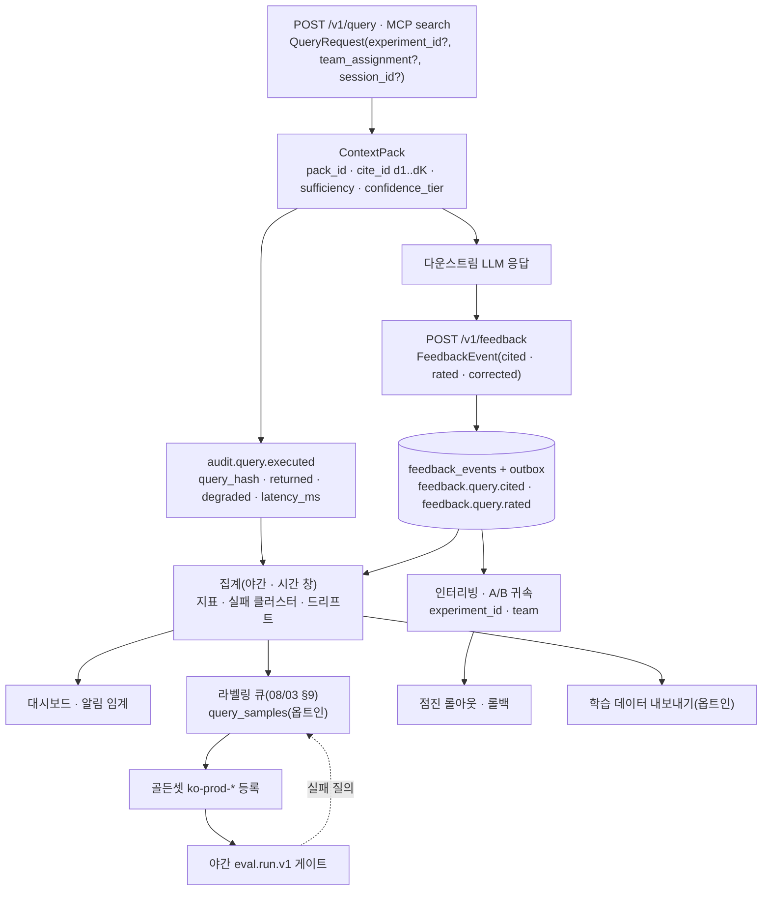
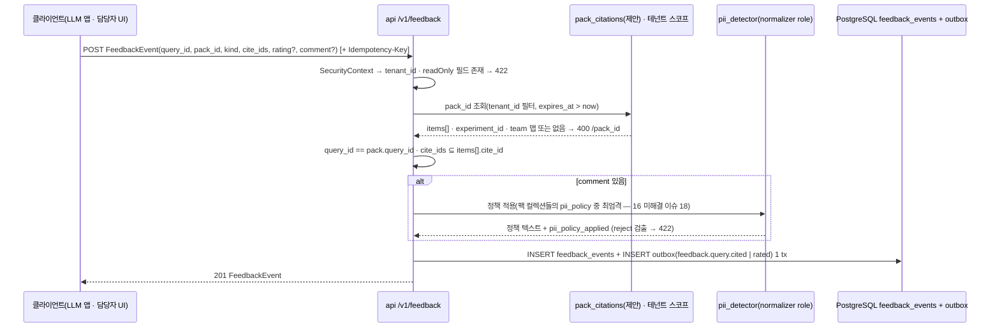
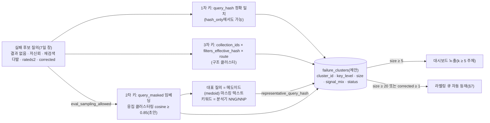
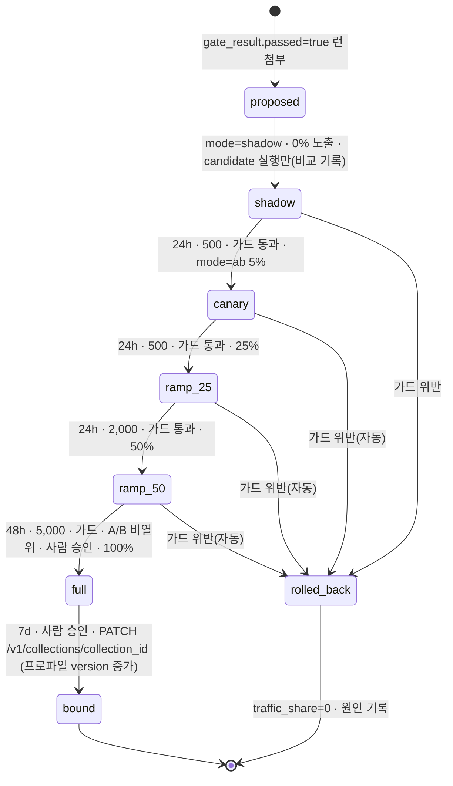
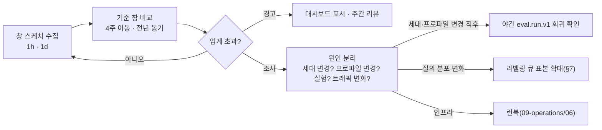

# 온라인 피드백 루프

## 목적

이 문서는 [평가 전략](01-evaluation-strategy.md) §2.4가 정의한 **L3 운영 계층**을 운영 가능한 설계로 풀어 쓴다. 골든셋 없이 운영 트래픽에서 얻는 신호 — 다운스트림 LLM 응답이 인용한 `cite_id`, 사용자 평점·정정, 그리고 결과 없음·저신뢰·재질의 같은 암묵 신호 — 를 어떻게 수집(`POST /v1/feedback`)·저장·익명화·집계하고, 어떻게 골든셋 보충(라벨링 큐), 인터리빙(interleaving) 실험, 프로파일 점진 롤아웃(카나리, canary), 드리프트(drift) 감지, 학습 데이터 내보내기, 알림으로 되먹이는지를 한 곳에 고정한다.

정본 관계는 브리프 > 바이블 > ADR > 이 문서다(바이블 §1.1). `FeedbackEvent`의 필드·필수 여부·`FeedbackKind` 철자는 바이블 §5.6·§5.7과 [평가·피드백·사이드카 계약](../03-contracts/16-eval-feedback-and-sidecar-contracts.md) §5를 **그대로** 쓰고, 이벤트는 바이블 §5.7 카탈로그의 `feedback.query.cited`·`feedback.query.rated` 두 종만 쓴다. 이 문서가 새로 정하는 것은 **절차·집계·실험 설계**이며, 바이블에 없는 테이블·필드·메트릭·정책 키는 모두 "제안"으로 표기하고 "## 미해결 이슈"에 모았다.

## 범위

- 포함: 신호 분류(명시·암묵·운영)와 신뢰도, `POST /v1/feedback` 수집 규약(요청·검증·인용 맵 역추적·이벤트 투영·예시), 저장 스키마와 보존, 프라이버시(질의 텍스트 보존 모드·`comment` PII 정책·집계 익명화), 집계 대시보드와 **질의 실패 클러스터**(결과 없음·저점수·재검색 다발), 골든셋 보충 루프(실패 질의 → 라벨링 큐)의 인계 규약, 인터리빙 실험(팀 드래프트, team-draft) 설계·귀속·판정, 점진적 롤아웃(검색 전용 변경의 트래픽 램프, 인덱스 영향 변경의 재색인 모드 A `blue_green`·모드 B `rolling_canary`에 얹는 온라인 가드), 드리프트 감지(임베딩 분포·질의 분포·결과 분포·지연 회귀), 학습 데이터 내보내기 훅, 알림 임계, 책임.
- 제외: `FeedbackEvent` 스키마 전문·불변식([03-contracts/16 §5](../03-contracts/16-eval-feedback-and-sidecar-contracts.md)), 이벤트 봉투·릴레이·웹훅([03-contracts/12](../03-contracts/12-jobs-events-and-status.md), [05-api/07](../05-api/07-webhooks-and-events.md)), 리트리벌 API 응답 형식([05-api/03](../05-api/03-retrieval-api.md)), 오프라인 메트릭·검정([02](02-retrieval-metrics-and-harness.md)), 라벨링 절차·검수 도구([03](03-golden-dataset-construction.md) §6·§9), LLM-judge 프롬프트([04](04-llm-judge-and-generation-quality.md)), 관측 스택 배포·알림 라우팅([09-operations/03](../09-operations/03-observability.md)), 리랭커·임베더 **파인튜닝 파이프라인**(브리프 §6 비범위 — 이 문서는 데이터 내보내기 훅만 제공한다).

## 1. 루프 전체 구조

L3의 소비자는 사람이 아니라 LLM이다. 따라서 "클릭"은 없고, (1) LLM 응답이 실제로 인용한 `cite_id`, (2) 사람(담당자·최종 사용자)의 명시 평점·정정, (3) 검색 경로가 스스로 남기는 결과 품질 신호(`sufficiency`·`confidence_tier`·`degraded`·지연)가 신호다(ADR-0023 F7; 바이블 §5.6 `FeedbackEvent`). 루프는 다음 여덟 단계로 닫힌다.



| 단계 | 입력 | 출력 | 정본·소유 |
|------|------|------|-----------|
| 1 수집 | `FeedbackEvent` 요청 | `feedback_events` 행 + 아웃박스 이벤트 | 바이블 §5.6·§14, 16 §5 |
| 2 감사 신호 | 검색 경로 | `audit.query.executed`(ID·해시·상태만) | 바이블 §8.1 14단계, 12 §6.4 |
| 3 집계 | 1·2 + Prometheus | 지표·실패 클러스터·드리프트 창 | 이 문서 §6·§10 |
| 4 보충 | 실패 클러스터 | 라벨링 큐 항목 | 이 문서 §7 → [03 §9](03-golden-dataset-construction.md) |
| 5 실험 | `experiment_id`·팀 배정 + `cited` | 승률·판정 | 이 문서 §8 |
| 6 롤아웃 | 오프라인 게이트 통과 변형 | 트래픽 램프·롤백 | 이 문서 §9, [02-architecture/06](../02-architecture/06-orchestration-and-workflows.md) §2.5 모드 A/B |
| 7 내보내기 | 1·2 + 옵트인 질의 표본 | 학습 데이터 JSONL | 이 문서 §11 |
| 8 알림 | 3·5·6 | 경고·페이지 | 이 문서 §12 → [09-operations/03](../09-operations/03-observability.md) |

**결정:** 온라인 루프는 오프라인 게이트를 **대체하지 않는다**. 프로파일 품질 기본값의 변경 근거는 여전히 `EvalReport.gate_result.passed`(바이블 §7.4)이며, 온라인 신호는 (a) 골든셋이 실사용 분포를 대표하지 못하는 부분을 보충하고, (b) 오프라인 차이가 작은 두 변형의 우열을 인터리빙으로 가르고, (c) 승격된 변형의 롤아웃을 감시하는 데 쓴다([ADR-0023](../06-adr/0023-evaluation-qrels-answer-spans-and-linear-ndcg.md) 준수 10; 01 §1 P4·P5).

## 2. 신호 분류

### 2.1 명시 신호(`FeedbackKind`, 바이블 §5.7 그대로)

| `kind` | 의미 | 필수 동반 필드(16 EF-19) | 1차 용도 | 2차 용도 |
|--------|------|--------------------------|----------|----------|
| `cited` | 다운스트림 LLM 응답(또는 사람)이 실제로 인용한 팩 항목 | `cite_ids` ≥ 1 | 인터리빙·A/B 팀 귀속(§8) | 긍정 예(§11), 항목 인용률 |
| `rated` | 응답(또는 팩)에 대한 1..5 평점; `cite_ids`는 평점이 가리키는 항목(비어 있을 수 있음) | `rating` | 저평점 질의 수집(§7), A/B 보조 지표 | 평균 평점 추세 |
| `corrected` | 정정 코멘트("d2의 기한이 고시 원문과 다름") | `comment`(PII 정책 적용 후) | 오답 사례 → 라벨링 큐 최우선(§7) | 부정 예(§11), 문서 정정 제보 |

평점의 해석(초안 정의): `rating ≤ 2` 부정, `3` 중립, `≥ 4` 긍정. 인터리빙의 승패에는 `cited`만 쓰고 `rated`는 A/B 보조 지표로만 쓴다(16 §5.2 "쌍대 비교의 절대 점수는 승률").

### 2.2 암묵 신호(검색 경로 파생; 새 `FeedbackKind` 없음)

암묵 신호는 클라이언트가 보내지 않는다. 검색 경로가 이미 남기는 `audit.query.executed`(12 §6.4 `AuditQueryExecutedData`)와 팩의 `sufficiency`·`confidence_tier`(11 §2.5)에서 **집계기가 파생**한다. 클릭·재검색·이탈을 별도 `FeedbackKind` 값으로 추가하는 것은 바이블 §5.7 열거 변경(minor ADR)이므로 이 문서는 제안으로만 둔다(미해결 이슈 1).

| 신호 | 파생 규칙(초안) | 원천 필드 | 잡음 |
|------|----------------|-----------|------|
| 결과 없음 | `returned.chunk_count = 0` 또는 `sufficiency.status = insufficient` | 감사 `data.returned`; 팩 `sufficiency`(감사 `data`에는 없음 — 미해결 이슈 2) | 무응답이 정답인 질의(골든셋 무응답 10%) |
| 저점수 | `confidence_tier = low` 또는 `sufficiency.status = unknown`(리랭크 생략 + 캘리브레이션 없음) | 팩 `confidence_tier`(감사 `data` 미등재 — 미해결 이슈 2) | 캘리브레이션 전 컬렉션에서 과다 발생 |
| 재질의(같은 질의 반복) | 같은 `session_id`(또는 `principal_hash`) 안에서 5분(초안) 이내 같은 `query_hash` 재실행 | 감사 `query_hash`; `session_id`는 감사 `data`에 없음(미해결 이슈 2) | 에이전트 루프의 의도된 반복(`cursor` "더 보기") |
| 재검색(다른 질의로 재시도) | 같은 세션 5분 이내 다른 `query_hash`이고 직전 질의가 결과 없음·저점수 | 감사 + 세션 상관 | 주제 전환 |
| 세션 길이 | 세션당 질의 수·지속 시간; 결과 없음 뒤 세션 종료(이탈) | 감사 + 세션 상관 | 에이전트 `budget.max_tool_calls` |
| 저하 | `degraded[]` 비어 있지 않음(채널 타임아웃·리랭크 폴백·`acl_recheck` 불가) | 감사 `data.degraded[]` | 품질 문제가 아니라 가용성 문제 — 별도 패널 |
| 지연 | `latency_ms` > 프로파일 `latency_budget_ms.total` | 감사 `data.latency_ms`, `rag_query_latency_seconds` | 콜드 캐시 |

에이전트 반복 검색(`QueryRequest.session_id`·`cursor`·`exclude_ids`, 바이블 §5.5)은 실패가 아니라 정상 루프이므로, 재질의·재검색 판정은 `cursor`로 이어진 요청과 `stop_signal.sufficient = false`인 에이전트 루프를 제외한다.

### 2.3 신호 신뢰도와 용도 매핑

| 용도 | 1차 신호 | 보조 신호 | 쓰지 않는 신호 |
|------|----------|-----------|----------------|
| 인터리빙 승패(§8) | `cited` | — | `rated`(팀 귀속 불가), 암묵 신호 |
| A/B 지표(§9) | `cited` 인용률, `rated` 평균, 결과 없음·저점수 비율 | 지연 p95, 저하율 | `corrected`(희소) |
| 라벨링 큐 우선순위(§7) | `corrected`, `rated ≤ 2` | 결과 없음·저점수·재검색 다발 클러스터 | `cited` |
| 드리프트(§10) | 결과 없음·저점수 비율, 평균 최고 점수(FR-OBS-07) | 임베딩·질의 분포, 지연 | 개별 피드백 |
| 학습 데이터(§11) | `cited`(긍정, 가중 1.0)·`rated ≥ 4`(긍정, 가중 0.8), `rated ≤ 2`·`corrected`(부정) | 반환됐으나 미인용(약한 부정) | 암묵 신호 |

## 3. 피드백 수집 API(`POST /v1/feedback`)

### 3.1 요청·응답 규약

| 항목 | 규약 | 근거 |
|------|------|------|
| 경로·메서드 | `POST /v1/feedback`, 본문 `FeedbackEvent`(클라이언트 필드만), 응답 **201** + 저장된 `FeedbackEvent` | 바이블 §14; [05-api/01 §9.3](../05-api/01-api-design-guidelines.md) |
| 인증·인가 | `SecurityContext` 서버 주입; `tenant_id`는 본문에 없다(있으면 422, E1). 인가 액션 `submit_feedback`(05-api/01) | 바이블 §10.3 E1·E2 |
| 서버 필드(readOnly, 정본) | `feedback_id`·`tenant_id`·`created_at`·`pii_policy_applied`(16 N) — 본문에 오면 422 | 16 EF-17, E1 |
| 서버 필드(제안) | `experiment_id`(16 N)는 서버가 팩의 `QueryRequest.experiment_id`에서 채우고 본문에 오면 422로 처리한다 — **이 문서 제안**(미해결 이슈 3). 16 EF-17의 readOnly 목록에는 없고 클라이언트 전송 허용 여부는 16 미해결 이슈 16이 미정으로 둔 상태다 | 16 §5.1 `experiment_id` 행, 16 미해결 이슈 16 |
| 멱등성 | `Idempotency-Key` **선택·권장**(05-api/01 §6: 자원 생성이라 필수 아님). 부재 시 중복 저장이 가능하므로 집계기가 `(tenant_id, pack_id, kind, principal_hash, sorted(cite_ids))` 5분 창(초안)으로 중복을 접는다(제안). 같은 키에서 `rating`·`comment`가 다르면 최근 `created_at` 행을 **정정**으로 해석해 집계에 쓴다(원장 행은 모두 보존; 미해결 이슈 15) | D-08은 `POST /v1/ingest*`만 필수 |
| 레이트리밋 | `query` 클래스(`rl:{tenant}:{window}`, 50 req/s 초안) | 05-api/01 §레이트리밋 |
| 크기 | 8KB(바이블 §5.1); `cite_ids ≤ 20`, `comment ≤ 2,000`자 | 16 §5.1 |
| 지연 | 인용 맵 조회 + PII 정책 적용 + 1 트랜잭션. p95 목표 100ms(초안 목표; `comment`가 있으면 PII 탐지기 시간 추가) | 이 문서 |

### 3.2 필드 표(바이블 §5.6 + 16 선택 필드)

| 필드 | 타입 | 필수 | 기록 주체 | 설명 |
|------|------|------|-----------|------|
| `schema_version` | string(semver) | N(16) | 서버 | 계약 버전(16 §5.1; 바이블 §5.6 미등재 — 16 미해결 이슈 1) |
| `feedback_id` | string(ulid) | Y | 서버 | 발급형 ID(바이블 §6.1) |
| `tenant_id` | string(ulid) | Y | 서버 | `SecurityContext.tenant_id` |
| `query_id` | string(ulid) | Y | 클라이언트 | `= ContextPack.query_id`; `pack_id`와 불일치면 400 |
| `pack_id` | string(ulid) | Y | 클라이언트 | 인용 맵 키. 보존 창(30일 초안) 밖이면 400 |
| `kind` | enum(FeedbackKind) | Y | 클라이언트 | `cited, rated, corrected` |
| `cite_ids` | array<string> | Y | 클라이언트 | `d{rank}`; 팩 `items[].cite_id` 부분집합, 유일, ≤ 20 |
| `rating` | integer(1..5) \| null | N | 클라이언트 | `rated`면 필수 |
| `comment` | string \| null | N | 클라이언트 → 서버 변환 | `corrected`면 필수; 저장 전 PII 정책 적용(§5.2) |
| `experiment_id` | string | N(16) | 서버(제안) | 팩의 실험 귀속 키. 서버 채움·readOnly 처리는 이 문서 제안(미해결 이슈 3; 16 미해결 이슈 16) |
| `pii_policy_applied` | enum(PiiPolicy) | N(16) | 서버 | `comment` 저장 시 항상 기록(`≠ reject`) |
| `created_at` | string(date-time) | Y | 서버 | 수신 시각 |

### 3.3 인용 맵 역추적

`cite_id`는 팩 확정 후 불변(D-20, `citation_align`)이므로 `pack_id`의 인용 맵 `{cite_id → chunk_id, record_id, document_id, collection_id, doc_version}`으로 결정적으로 역추적된다(16 §5.2). 검색 핫패스는 PostgreSQL을 쓰지 않으므로([ADR-0034](../06-adr/0034-retrieval-hot-path-postgres-independence-and-hydrate.md)) 맵은 응답 뒤 비동기로 남고, 저장 위치는 16 미해결 이슈 7(감사 이벤트 `data.citations[]` 또는 `pack_citations` 표)로 미정이다.

**결정:** 이 문서는 16 미해결 이슈 7의 대안 (b) **`pack_citations` 표**를 작업 가정으로 삼는다(제안; 확정은 03-contracts/16·02-architecture/04). 이유: (1) 인터리빙은 항목별 **팀 배정**을 함께 저장해야 하는데(§8.3) 감사 이벤트 `data`는 12가 `additionalProperties: false`로 닫아 두어 실험 필드를 넣기 어렵고, (2) 피드백 접수 경로가 감사 저장소(OpenSearch 감사 인덱스일 수 있음, 07 §8.3)에 의존하면 `korean-gov` 배치에서 경로가 갈라진다. 표 정의(제안):

| 컬럼 | 타입 | 설명 |
|------|------|------|
| `pack_id` | ulid PK | |
| `tenant_id` | ulid | RLS `FORCE`(바이블 §13.1 규칙) |
| `query_id`, `plan_id`, `profile_hash` | ulid / ulid / hex64 | 상관·변형 식별 |
| `experiment_id`, `team_assignment` | text \| null | `QueryPlan` 값 복사(09 §7.2) |
| `principal_hash` | hex64 | 질의 주체 `H("principal", tenant_id, subject)`(바이블 §6.2 1.3.0 AM-40, 12 §6.4와 동일 값) — k-익명성 계수·세션 상관용. 주체 문자열은 저장하지 않는다 |
| `items` | jsonb | `[{cite_id, chunk_id, record_id, document_id, collection_id, doc_version, level, item_kind, team?}]` — `team`은 인터리빙 모드에서만(§8.3). 본문·헤더·주체 없음 |
| `sufficiency_status`, `confidence_tier` | enum | 암묵 신호 집계 입력(§2.2) |
| `language`, `relaxed_applied_keys` | bcp47 / array<FilterableField> \| null | 팩 `render_hints.language`(11 §2.7)·`diagnostics.relaxed_applied_keys`(11 §2.8, N) 복사 — 질의 분포 드리프트 입력(§10.2). `QueryPlan`·감사 `data`에 없는 값이라 여기서만 집계할 수 있다(미해결 이슈 2) |
| `created_at`, `expires_at` | timestamptz | `expires_at = created_at + 30d`(초안); `maintenance.cleanup.v1`이 정리 |

기록 주체는 api 프로세스의 `render` 뒤 백그라운드 태스크(`audit.query.executed` 아웃박스 기록과 같은 지점, 바이블 §8.1 14단계)이며, 실패해도 질의 응답에는 영향이 없다(기록 실패는 `rag_pack_citation_unresolved_total`이 아니라 별도 카운터 제안, 미해결 이슈 9). 인용 맵이 없으면(기록 지연·유실) `POST /v1/feedback`은 400 `contract.violation`(`/pack_id`)이다. 이 코드는 비재시도 오류이고(바이블 §5.7 카탈로그) §3.4가 미존재·타 테넌트·보존 창 밖·기록 지연을 존재 비노출을 위해 같은 응답으로 묶으므로, 클라이언트는 "아직 기록 안 됨"과 "없음"을 구분할 수 없어 재시도 지침을 두지 않는다. 대신 클라이언트는 팩 수신 직후가 아니라 **다운스트림 LLM 응답이 끝난 시점**에 피드백을 보내고(그 사이에 비동기 기록이 끝난다), 기록 지연·유실율은 A6 알림으로 관측한다. 기록 지연 창에 한정한 다른 응답 코드(존재를 누설하지 않는 503 + `Retry-After` 등)는 미해결 이슈 14에서 다룬다.

### 3.4 검증과 오류

| 검사 | 실패 시 | 근거 |
|------|---------|------|
| 스키마·`kind`별 필수(`cited ⇒ cite_ids ≥ 1`, `rated ⇒ rating`, `corrected ⇒ comment`) | 400 `contract.violation`(`errors[].location.pointer`) | 16 EF-19 |
| 본문에 readOnly 필드(`tenant_id`·`feedback_id`·`created_at`·`pii_policy_applied`) | 422 `contract.violation` | 16 EF-17, E1(정본) |
| 본문에 `experiment_id` | 422 `contract.violation` — **이 문서 제안**(서버가 팩에서 채움; 16 미해결 이슈 16 확정 전) | 미해결 이슈 3 |
| `pack_id` 미존재·타 테넌트·보존 창 밖 | 400 `contract.violation`(`/pack_id`) — 존재 여부를 누설하지 않도록 세 경우 같은 응답 | 16 EF-18, E2 |
| `query_id ≠ pack.query_id` | 400 `contract.violation`(`/query_id`) | 16 EF-18 |
| `cite_ids ⊄ items[].cite_id`(`omitted[]` 항목 참조 포함) | 400 `contract.violation`(`/cite_ids/{i}`) | 16 EF-18 |
| `comment` PII: 적용 정책 `reject`에서 검출 | 422 `normalize.pii_policy_violation`(HTTP 매핑은 13 §3.3 공동 제안) | 16 EF-19, E4 |
| PII 탐지기 불가 | `comment`가 있는 요청은 503 + `Retry-After`(`normalize.pii_detector_unavailable`은 재시도 가능 코드); `keep` 폴백 금지 | E4 "PII 모델 로딩 실패 시 `keep` 폴백 금지" |
| 레이트리밋 | 429 `api.rate_limited` | E3 |

### 3.5 예시

요청(클라이언트 → 서버, `cited`; readOnly 필드 없음):

```json
{
  "query_id": "01J9ZS0Q1R2S3T4V5W6X7Y8Z9A",
  "pack_id": "01J9ZS0P2Q3R4S5T6V7W8X9Y0Z",
  "kind": "cited",
  "cite_ids": ["d1", "d3"]
}
```

응답 201(서버가 `feedback_id`·`tenant_id`·`experiment_id`·`created_at`을 채움; 16 예시 11과 동일 형식):

```json
{
  "schema_version": "1.0.0",
  "feedback_id": "01J9ZS1F2G3H4J5K6M7N8P9Q0R",
  "tenant_id": "01J9ZQ4K7X2M8N3P5R6S7T8V9W",
  "query_id": "01J9ZS0Q1R2S3T4V5W6X7Y8Z9A",
  "pack_id": "01J9ZS0P2Q3R4S5T6V7W8X9Y0Z",
  "kind": "cited",
  "cite_ids": ["d1", "d3"],
  "experiment_id": "interleave-2026w39-cc-vs-rrf",
  "created_at": "2026-09-22T09:00:07.318Z"
}
```

요청(`corrected`; `comment` 원문에 전화번호가 포함되어 있었다고 가정):

```json
{
  "query_id": "01J9ZS0Q1R2S3T4V5W6X7Y8Z9A",
  "pack_id": "01J9ZS0P2Q3R4S5T6V7W8X9Y0Z",
  "kind": "corrected",
  "cite_ids": ["d2"],
  "comment": "d2 항목의 처리 기한이 고시 원문과 다릅니다. 담당자 02-1234-5678 로 확인 요청했습니다."
}
```

응답 201(`mask` 정책 적용 후 텍스트만 저장; 원문은 어디에도 남지 않는다. 같은 팩이므로 서버가 `experiment_id`를 같은 값으로 채우고, 값이 없는 선택 필드 `rating`은 16 EF-29에 따라 `null` 대신 생략한다 — 위 `cited` 응답과 같은 표기):

```json
{
  "schema_version": "1.0.0",
  "feedback_id": "01J9ZS1G3H4J5K6M7N8P9Q0R1S",
  "tenant_id": "01J9ZQ4K7X2M8N3P5R6S7T8V9W",
  "query_id": "01J9ZS0Q1R2S3T4V5W6X7Y8Z9A",
  "pack_id": "01J9ZS0P2Q3R4S5T6V7W8X9Y0Z",
  "kind": "corrected",
  "cite_ids": ["d2"],
  "comment": "d2 항목의 처리 기한이 고시 원문과 다릅니다. 담당자 <KR_PHONE> 로 확인 요청했습니다.",
  "experiment_id": "interleave-2026w39-cc-vs-rrf",
  "pii_policy_applied": "mask",
  "created_at": "2026-09-22T09:03:41.020Z"
}
```

### 3.6 이벤트 투영

`cited → feedback.query.cited`, `rated`·`corrected → feedback.query.rated`(`data.kind`로 구분)이며 원장 INSERT와 같은 트랜잭션의 아웃박스 행이다(바이블 §5.7 카탈로그, 16 EF-20, [ADR-0017](../06-adr/0017-event-delivery-outbox-cloudevents-no-broker.md)). `data`는 12 소유 `FeedbackQueryEventData{feedback_id, query_id, pack_id, kind, cite_ids, rating(nullable)}`이고 `comment`·`experiment_id`·주체는 없다(E12). 웹훅 구독자(예: 앱 개발자의 품질 알림)는 이 이벤트로 "내 팩에 정정이 들어왔다"를 알 수 있고, 내용은 관리 API 조회(05-api/04 제안)로 얻는다. 아래 예시의 `source: "urn:rag:api"`는 바이블 §6.5 1.3.0 "CloudEvents `source` 컴포넌트 = §2.3 컨테이너 이름(`api`·`worker`)"(AM-13)과 일치한다 — 피드백은 `POST /v1/feedback`(api 프로세스)이 발행하므로 항상 `urn:rag:api`이고 `urn:rag:worker`는 쓰지 않는다.

```json
{
  "specversion": "1.0",
  "id": "01J9ZS1H4J5K6M7N8P9Q0R1S2T",
  "source": "urn:rag:api",
  "type": "feedback.query.rated",
  "time": "2026-09-22T09:03:41.020Z",
  "subject": "tenant/01J9ZQ4K7X2M8N3P5R6S7T8V9W/query/01J9ZS0Q1R2S3T4V5W6X7Y8Z9A",
  "datacontenttype": "application/json",
  "tenantid": "01J9ZQ4K7X2M8N3P5R6S7T8V9W",
  "data": {
    "feedback_id": "01J9ZS1G3H4J5K6M7N8P9Q0R1S",
    "query_id": "01J9ZS0Q1R2S3T4V5W6X7Y8Z9A",
    "pack_id": "01J9ZS0P2Q3R4S5T6V7W8X9Y0Z",
    "kind": "corrected",
    "cite_ids": ["d2"],
    "rating": null
  }
}
```

### 3.7 접수 흐름



## 4. 저장 스키마와 보존

| 저장소 | 내용 | 보존(초안 목표) | 근거 |
|--------|------|-----------------|------|
| PostgreSQL `feedback_events`(바이블 §13.1) | `feedback_id` PK + `FeedbackEvent` 컬럼(`comment`는 정책 적용 텍스트) + 내부 컬럼 `submitter_principal_hash`(제안; **계약 필드가 아니며** 응답·이벤트에 나가지 않는다 — 중복 접기·개인 삭제 요청용, 16 §5.2 "주체는 계약 필드가 아니다"와 양립); 인덱스 `(tenant_id, created_at)`, `(tenant_id, pack_id)`, `(tenant_id, experiment_id, created_at)` | 원장 행 **1년**(`comment` 포함). 컬럼 단위 `NULL` 처리는 하지 않는다 — `corrected ⇒ comment`(16 EF-19, §3.2)를 깨서 관리 API 조회(§3.6)가 돌려주는 `FeedbackEvent`가 스키마 검증에 실패하기 때문이다. 만료 행은 통째로 삭제하고 집계 `feedback_windows`(13개월)와 `failure_clusters`만 남는다(정정 내용은 라벨링 큐로 이미 소비됨; 미해결 이슈 17) | 바이블 §13.1, RLS `FORCE`; 미해결 이슈 16·17 |
| PostgreSQL `pack_citations`(제안, §3.3) | 인용 맵 + 팀 배정 + `sufficiency_status`·`confidence_tier` | 30일(`expires_at`) | 16 미해결 이슈 7 |
| PostgreSQL `query_samples`(08/03 §9 제안) | 테넌트 옵트인 시 PII 정책 적용 질의 텍스트 + `source_kind` | 30일 | [03 §9](03-golden-dataset-construction.md) 미해결 이슈 7 |
| PostgreSQL `failure_clusters`(제안, §6.2) | 클러스터 요약(ID·해시·계수만) | 열린 클러스터 무기한, 종결 후 180일 | 이 문서 |
| PostgreSQL `experiments`·`rollouts`(제안, §8·§9) | 실험 레지스트리·롤아웃 상태 | 무기한(감사 대상) | 이 문서 |
| 집계 창 `feedback_windows`(제안, §6·§10) | 시간 창 × 컬렉션 × 프로파일 해시의 계수·분포 스케치(원 벡터·텍스트 없음) | 13개월(전년 동기 비교) | 이 문서 |
| Prometheus | 저카디널리티 카운터·히스토그램만(§6.5 라벨 규칙) | 관측 스택 정책 | 바이블 §6.5 |

모든 표는 `tenant_id` + RLS `FORCE`(바이블 §13.1)이며, 테넌트 삭제는 RLS 범위 CASCADE로 함께 지운다(07 §테넌트 삭제). 문서 삭제(`delete.document.v1`)는 피드백 행을 지우지 않는다 — 행은 `document_id`가 아니라 `pack_id`·`cite_id`를 가리키고, 역추적 시 `documents` 행이 없으면 "삭제된 문서"로 집계된다(학습 데이터 내보내기에서는 제외, §11).

## 5. 프라이버시

### 5.1 질의 텍스트 보존 모드

질의 원문은 그 자체가 PII·기밀을 담을 수 있으므로 기본은 해시만이다(NFR-PRV-04; 바이블 §6.5 콘텐츠 캡처 기본 끔; [02-architecture/07 §8.2](../02-architecture/07-multi-tenancy-and-security-architecture.md)). 이 문서는 07 §8.2의 세 모드에 온라인 루프의 필요를 사상하고, 어떤 기능이 어떤 모드를 요구하는지 고정한다.

| 모드(07 §8.2) | 저장 내용 | 기본 | 온라인 루프에서 가능한 것 | 불가능한 것 |
|------|-----------|------|----------------------------|-------------|
| `hash_only` | `query_hash = blake3_hex(utf8(normalized_query))`, 반환 문서 ID, 상태 | 전 프로파일 | 지표 집계, 정확 일치 재질의 탐지, `query_hash` 단위 실패 클러스터, 인터리빙 승패, 드리프트(분포 스케치) | 의미 클러스터, 라벨링 큐에 질의 본문 전달, 학습 데이터 내보내기 |
| `query_samples` 옵트인(08/03 §9 제안; 테넌트 정책 `eval_sampling_allowed`) | PII 정책 적용 질의 텍스트(`query_masked`), 30일 | 끔 | 위 + 의미 클러스터(마스킹 텍스트 임베딩), 라벨링 큐 인계, 학습 데이터 내보내기 | 원문 복원 |
| `encrypted_text` 옵트인(07 §8.2 제안) | 테넌트 DEK로 암호화한 정규화 질의(감사 저장소) | 끔 | 규제 조사·오남용 탐지(복호 권한 = `unmask_pii`) | 집계기·라벨링 큐는 **읽지 않는다**(용도 분리) |
| 평문 보존 | — | **금지** | — | — |

**결정:** 온라인 루프의 모든 기능은 `hash_only`에서 **동작해야 하고**(저하된 형태로), 질의 본문이 필요한 기능(의미 클러스터·라벨링 큐 인계·학습 데이터)은 `eval_sampling_allowed` 옵트인 테넌트에서만 켜진다. 옵트인 시에도 표본은 `query_samples`에만 있고 이벤트·로그·트레이스·`per_query.jsonl`에는 실리지 않는다(00 I-16, 16 EF-5; [03 §12](03-golden-dataset-construction.md)). `encrypted_text`는 감사 용도이며 집계기 입력이 아니다.

### 5.2 `comment` PII 정책

`comment`는 저장 전에 `pii_detector`(normalizer role, `normalizer.presidio_ko`; 07 §7)를 통과하고 원문은 어디에도 남지 않는다(16 EF-19). 정책 원천은 16 미해결 이슈 18(팩 컬렉션들의 `CollectionSpec.policies.pii_policy` 중 최엄격, 엄격도 `reject > exclude > tokenize > mask > keep`)을 따른다. `keep`은 E4의 `keep` 불가 항목(고유식별정보·계좌·카드)에 적용되지 않으며, 라벨링 큐·학습 데이터·대시보드 어디에도 `comment` 원문은 없고 정책 텍스트만 흐른다. `tokenize`(`encrypt`)로 저장된 토큰은 라벨러에게 복호되지 않는다(라벨러는 정정 **취지**만 필요).

### 5.3 집계 익명화

| 규칙 | 값(초안 목표) | 근거 |
|------|---------------|------|
| 주체 표기 | 원 주체 대신 `principal_hash = H("principal", tenant_id, subject)`(바이블 §6.2 1.3.0 AM-40, 12 §6.4). 질의 주체는 감사 `data.principal_hash`·`pack_citations.principal_hash`(§3.3)에서, 피드백 제출 주체는 `feedback_events.submitter_principal_hash`(§4, 내부 컬럼)에서 얻는다. `query_hash`도 같은 바이블 §6.2 1.3.0 표(AM-40, `H("query", normalized_query)`)를 따르며 피드백 원장(`feedback_events`·`pack_citations`)과 감사 이벤트를 잇는 상관 키다 | E13, 12 §6.4 |
| k-익명성(k-anonymity) | 대시보드·클러스터는 서로 다른 질의 주체 `principal_hash` **5개 이상**이 기여했을 때만 노출; 미만은 "소표본"으로 숨김 | 소수 사용자의 질의 패턴 식별 방지 |
| 최소 집계 단위 | 시간 창 1h(운영 패널) / 1d(품질 패널) × 컬렉션 × `profile_hash`; 개별 질의는 드릴다운에서도 `query_id`·`query_hash`만 | 바이블 §6.5 저카디널리티 |
| Prometheus 라벨 | `profile_id`·`outcome`·`kind`(제안) 등 저카디널리티만; `tenant_id`·`collection_id`·`experiment_id` 라벨 금지 → PostgreSQL 데이터소스로 분해 | 바이블 §6.5, 01 §12 |
| 트레이스 | `experiment_id`·팀은 스팬 속성 `rag.*`로 남길 수 있으나(07-tech-landscape/09 §온라인 실험) 콘텐츠는 없음; `korean-gov`는 `NO_CONTENT` 잠금 | E13, [ADR-0022](../06-adr/0022-observability-genai-semconv-pin-and-license-boundary.md) |
| 삭제권 | 테넌트 삭제 CASCADE; 개인 삭제 요청은 `principal_hash` 기준으로 `feedback_events`·`query_samples` 행 삭제(제안 런북) | NFR-PRV-03, 07 §테넌트 삭제 |

## 6. 집계 대시보드

### 6.1 지표 정의

집계기는 야간 배치(`maintenance` 큐, 스케줄 `ScheduleOverlapPolicy.SKIP`; 워크플로우 타입은 제안 `feedback.aggregate.v1`, 미해결 이슈 4)와 시간 창 증분으로 실행되며 입력은 `feedback_events`·`pack_citations`·감사 저장소(`audit.query.executed`)·Prometheus다. 모든 비율의 분모는 같은 창·컬렉션·`profile_hash`의 질의 수다.

| 지표 | 정의 | 원천 | 방향 |
|------|------|------|------|
| 인용률 | `cited` 피드백이 1건 이상인 질의 / 피드백 대상 질의 | `feedback_events` | 높을수록 좋음 |
| 항목 인용률 | 인용된 항목 수 / 반환 항목 수(K) — 팩이 얼마나 낭비 없이 채워졌는가 | `feedback_events` + `pack_citations.items` | 높을수록 좋음 |
| 인용 순위 분포 | 인용된 `cite_id`의 `d{rank}` 분포(상위 3개 집중도) | 동일 | 리랭크 품질 진단 |
| 평균 평점·부정 비율 | `rated` 평균, `rating ≤ 2` 비율 | `feedback_events` | |
| 정정률 | `corrected` 건수 / 질의 수 | `feedback_events` | 낮을수록 좋음 |
| 결과 없음 비율 | §2.2 규칙 | 감사 + `pack_citations` | FR-OBS-07 |
| 저신뢰 비율 | `confidence_tier = low` 비율 | `pack_citations` | FR-OBS-07 |
| 평균 최고 점수 | 질의별 `max(final_score)` 평균 — 팩에 없으므로 `explain` 또는 `RankedSet` 표본에서만(미해결 이슈 2) | 표본 | FR-OBS-07 |
| 재질의·재검색률 | §2.2 규칙 | 감사(세션 상관) | 낮을수록 좋음 |
| 저하율 | `degraded[]` 비어 있지 않은 질의 비율(컴포넌트별) | 감사 `data.degraded[]` | 가용성 |
| 지연 p95 | `rag_query_latency_seconds{profile_id}` | Prometheus | 브리프 §7 |
| 인터리빙 승률 | §8.4 | `feedback_events` × `pack_citations.items[].team` | 실험 |

### 6.2 질의 실패 클러스터

실패 질의를 하나씩 보는 대신 **반복되는 실패**를 묶어 라벨링·튠 대상으로 만든다. 클러스터링은 텍스트 보존 모드에 따라 세 단계로 저하된다(§5.1).



| 단계 | 규칙(초안) |
|------|-----------|
| 후보 선정 | 7일 창에서 §2.2 실패 신호 또는 `rated ≤ 2`·`corrected`가 붙은 질의. 에이전트 루프(`cursor` 연속, `stop_signal.sufficient=false`)와 `route = no_retrieval`은 제외 |
| 1차 키 | `query_hash` 정확 일치 — 같은 질의가 반복 실패(FAQ형 결손). 텍스트 없이 가능 |
| 2차 키(옵트인) | `query_masked`를 컬렉션 임베딩 모델로 임베딩(`EmbeddingMode = query`, `qemb:` 캐시 재사용) → 응집 클러스터링(평균 연결, cosine ≥ 0.85 초안; 기존 `topics.jsonl`과의 중복 제거 임계 0.92(08/03 §5.2)보다 느슨) → 대표 질의 = 메도이드. 임베딩 벡터는 클러스터링 후 폐기(저장 금지) |
| 3차 키 | `(collection_ids, filters.effective_hash, route)` — "특정 필터 조합에서 항상 0건"류의 구조 문제. 텍스트 없이 가능. `filters.effective_hash`는 바이블 §6.2 1.3.0 정의(CR-17)를 따른다: 입력은 `QueryPlan.filters`에 저장된 계획 필터 트리(security + strategy + user + self_query)이고 `as_of`는 리터럴 대신 바인드 이름 `":as_of"`로 직렬화해 시각마다 해시가 바뀌지 않는다 |
| 키 적용 방식 | 1·2·3차 키는 같은 후보 집합에 **독립** 적용한다(순차 아님). 한 질의는 `key_level`이 다른 여러 클러스터에 속할 수 있고, 라벨링 큐 등재는 2차(대표 질의 있음) > 1차 > 3차 순으로 하나만 쓴다. 2차 키의 메도이드 `query_hash`는 `failure_clusters.representative_query_hash`에 저장한다 |
| 신호 혼합 | 클러스터마다 `signal_mix = {empty, low_confidence, requery, low_rating, corrected}` 계수 |
| 노출·등재 임계 | `size ≥ 5`(서로 다른 `principal_hash` ≥ 5)면 대시보드; `size ≥ 20` 또는 `corrected ≥ 1`이면 라벨링 큐 자동 등재(§7). 값은 초안 목표이며 파일럿 후 프로파일 `eval` 절 운영 설정으로 이관(미해결 이슈 5) |
| 종결 | 라벨링 → 골든셋 등록 → 야간 런에서 대표 질의의 `ndcg@10 ≥ eval.gates.ndcg@10.min`이면 `resolved`; 14일간 새 후보가 없으면 `stale` |

`failure_clusters` 행(제안; ID·해시·계수만, 본문 없음):

```json
{
  "cluster_id": "01J9ZT0A1B2C3D4E5F6G7H8J9K",
  "tenant_id": "01J9ZQ4K7X2M8N3P5R6S7T8V9W",
  "collection_ids": ["01J9ZQ5A1B2C3D4E5F6G7H8J9K"],
  "profile_hash": "9f3a6c1e2b7d4a8f0c5e9b3d7a1f6e2c4b8d0a9f3e7c1b5d2a6f8e0c4b9d3a7f",
  "key_level": 2,
  "representative_query_hash": "4c1d9e7f2a6b8c0d3e5f7a9b1c2d4e6f8a0b2c4d6e8f0a1b3c5d7e9f1a3b5c7d",
  "size": 27,
  "distinct_principals": 9,
  "signal_mix": {"empty": 14, "low_confidence": 9, "requery": 11, "low_rating": 3, "corrected": 1},
  "sample_query_ids": ["01J9ZS0Q1R2S3T4V5W6X7Y8Z9A", "01J9ZS2R3S4T5V6W7X8Y9Z0A1B"],
  "first_seen_at": "2026-09-15T02:11:40.000Z",
  "last_seen_at": "2026-09-21T17:48:02.000Z",
  "status": "queued"
}
```

### 6.3 패널

대시보드는 관측 스택 분리 컨테이너(Grafana; AGPL 불가 환경은 Perses)에서 Prometheus + PostgreSQL 데이터소스로 그린다(D-11; 01 §12). 이 문서는 01 §12 "온라인 신호" 패널을 다음으로 세분한다.

| 패널 | 데이터 | 질문 |
|------|--------|------|
| 피드백 유입 | `rag_feedback_events_total{kind}`(제안, 01 미해결 이슈 6) + `feedback_events` 일별 계수 | 신호가 들어오고 있나(0이면 앱 연동 결함) |
| 인용 품질 | 인용률·항목 인용률·인용 순위 분포(컬렉션·`profile_hash`별) | 팩 상위가 실제로 쓰이나(`litm_alternating` 효과 포함) |
| 부정 신호 | 부정 평점 비율·정정률·결과 없음·저신뢰·재검색률 시계열 | 어디서 실패가 늘었나 |
| 실패 클러스터 | `failure_clusters` 상위 N(크기·최근성·정정 포함) + 상태 | 무엇을 먼저 라벨링·튠해야 하나 |
| 실험 | `experiment_id`별 승/패/무, 승률 신뢰구간, 표본 진행률(§8.4) | 어느 변형이 이기고 있나, 언제 끝나나 |
| 롤아웃 | 단계·트래픽 비율·가드 지표 상태(§9) | 지금 롤백해야 하나 |
| 드리프트 | PSI·중심 이동·질의 길이/언어/라우트 분포·지연 p95 대 SLO(§10) | 입력·출력 분포가 바뀌었나 |
| 라벨링 루프 | 큐 적체·등재→등록 리드타임·야간 런 재실패율(08/03 §9) | 루프가 닫히고 있나 |

## 7. 골든셋 보충 루프(실패 질의 → 라벨링 큐)

[골든 데이터셋 구축](03-golden-dataset-construction.md) §9가 라벨링 절차(중복 제거·유형 분류·층화·풀링·라벨링·등록·순환)를 소유한다. 이 문서는 **무엇을 어떤 순서로 큐에 넣는지**(인계 규약)만 정한다.

| 항목 | 규약 |
|------|------|
| 전제 | 테넌트 `eval_sampling_allowed` 옵트인(08/03 미해결 이슈 7). 옵트아웃 테넌트의 실패 클러스터는 대시보드에만 남고 큐로 가지 않는다(질의 본문 없이 라벨 불가) |
| 입력 단위 | `query_samples` 행(`query_id`, `query_masked`, `source_kind`, `collection_ids`) — `source_kind` 값 제안: `feedback_corrected`, `feedback_low_rating`, `empty_result`, `low_confidence`, `requery_burst`, `cluster_representative`, `random`(08/03 §9의 무작위 1%) |
| 우선순위 | (1) `corrected`(정정 내용 = 라벨 힌트, 전량), (2) `rated ≤ 2`(전량), (3) 실패 클러스터 대표 질의(크기 내림차순, 클러스터당 대표 1 + 표본 2), (4) 결과 없음·저신뢰 단발(층화 쿼터 안에서), (5) 무작위 |
| 중복 제거 | 기존 `topics.jsonl`·큐 항목과 cosine ≥ 0.92(08/03 §5.2); 같은 클러스터의 나머지는 대표에 접어 라벨 1회로 클러스터 전체를 닫는다 |
| 라벨 힌트 | `corrected`의 정책 텍스트 `comment`, 인용 항목의 `document_id`·`doc_version`·`chunk_id`(부정 후보), 팩의 반환 문서 목록. 라벨러는 정답 문서·구간을 **새로** 판정하며 힌트를 정답으로 복사하지 않는다(08/03 §6.2) |
| 쿼터(초안 목표) | 컬렉션당 분기 100~300개(08/03 §9)의 30% 이상을 실패 유래로 채운다 — 실사용 실패 분포 반영 |
| 등록 | `ko-prod-{collection_short}-v{n}`(`label_provenance = human`, 라이선스 `LicenseRef-Proprietary`) 새 행; 프로파일 `eval.datasets[]`에 추가(프로파일 `version` 증가) |
| 순환 종결 | 야간 런의 `per_query.jsonl`에서 실패 유래 질의의 `ndcg@10` 개선 여부를 클러스터 `status`에 반영(§6.2 종결) |
| 주기 | 표본 주 1회, 라벨링 월 1회, 등록 분기 1회(08/03 §11) |

이 루프의 산출물은 사람 라벨이므로 게이트 데이터셋이 될 수 있다(01 §5.1). 피드백 자체(`cited`·`rated`)를 qrels로 직접 등록하는 것은 금지한다 — 사람 판정이 아니며 `LabelProvenance`에 해당 값이 없다(미해결 이슈 10).

## 8. 인터리빙 실험

### 8.1 언제 쓰는가

오프라인 A/B(01 §6.2)가 유의한 차이를 내지 못하거나 골든셋이 실사용 분포를 대표하지 못할 때, 두 **검색 전용 변형**(융합·리랭커·후처리·팩 파라미터; 인덱스 불변, 01 §6.1)을 같은 질의에서 나란히 실행해 한 팩에 교차 배치하고, 다운스트림이 인용한 항목의 팀 귀속으로 승패를 매긴다(D-12; ADR-0023 F7; 07-tech-landscape/09 §온라인 실험). 인덱스 영향 변형(파서·청커·보강기·임베더·분석기·사전)은 인터리빙 대상이 아니며 §9.2의 재색인 경로([02-architecture/06](../02-architecture/06-orchestration-and-workflows.md) §2.5 모드 A `blue_green` / 모드 B `rolling_canary`)다.

**결정:** 인터리빙 방식은 **팀 드래프트(team-draft interleaving)**, 배치 단위는 **`RankedSet(stage=postprocessed)` 두 개의 병합 → 단일 `pack`**, 귀속 신호는 `FeedbackEvent.kind=cited`의 `cite_ids`다([ADR-0023](../06-adr/0023-evaluation-qrels-answer-spans-and-linear-ndcg.md), [ADR-0024](../06-adr/0024-context-pack-ordering-and-anthropic-search-result-renderer.md)). 팩의 `reorder`(`litm_alternating`)·`citation_align`은 병합 뒤 한 번만 실행되므로 `cite_id`는 여전히 관련도순 연속 `d1..dK`이고 렌더 위치와 분리된다(D-20). "관련도"는 병합 순서(드래프트 순)로 정의한다.

### 8.2 실험 레지스트리(제안)

바이블 §14에는 실험 관리 엔드포인트가 없다. 이 문서는 `experiments` 표와 관리 API(`/v1/experiments`, 05-api/04 확정)를 제안하고(미해결 이슈 6), 확정 전에는 운영자 설정 파일로 같은 필드를 적재한다.

| 필드 | 타입 | 설명 |
|------|------|------|
| `experiment_id` | string(≤ 128) | `QueryRequest.experiment_id`·`EvalRun.experiment_id`·`FeedbackEvent.experiment_id`(16 N)와 같은 값 공간 |
| `tenant_id`, `collection_ids` | ulid, array | 적용 범위 |
| `mode` | enum[`ab`, `interleave`, `shadow`] | `ab` = 요청 단위 팀 배정·배정 팀 서빙(`traffic_share`로 노출 비율), `interleave` = 항목 단위 팀(§8, 정확히 2팀), `shadow` = candidate를 실행만 하고 서빙하지 않음(비교 기록만). 램프(§9.1)는 한 실험 행으로 진행하며 `rollouts.stage = shadow`에서는 `mode = shadow`, `canary` 진입 시 같은 행의 `mode`를 `ab`로 전환한다(전환은 `audit.admin.action`). `mode = ab`의 `traffic_share = 0`은 shadow가 아니라 "노출 없음"이다 |
| `variants[]` | `{team, profile_id, profile_version, profile_hash, traffic_share}` | 팀 이름은 `QueryRequest.team_assignment` 값 공간(≤ 64); `interleave`는 정확히 2팀·`traffic_share`는 실험 노출 비율 |
| `assignment` | enum[`session`, `principal`, `request`] | 서버 배정 단위(§8.3) |
| `guards` | object | §9.1 가드 임계(지연·결과 없음·저하율) |
| `stop_rule` | object | `{min_attributable_queries, max_days, alpha}`(§8.4) |
| `state` | enum[`draft`, `running`, `paused`, `concluded`] | |
| `started_at`, `ends_at`, `concluded_at` | date-time | |

검증 규칙(제안, `rag profile validate` 확장): 실험 변형 프로파일은 컬렉션 바인딩 프로파일을 `extends`(15 단일 상속)하고 **`ingest` 절이 동일**해야 한다(`embedding_profile_hash`·`analyzer_id`·`dictionary_hash`·`chunker_config_hash` 불변). 그래야 같은 인덱스 세대에 두 `query` 절을 적용할 수 있다.

```json
{
  "experiment_id": "interleave-2026w39-cc-vs-rrf",
  "tenant_id": "01J9ZQ4K7X2M8N3P5R6S7T8V9W",
  "collection_ids": ["01J9ZQ5A1B2C3D4E5F6G7H8J9K"],
  "mode": "interleave",
  "variants": [
    {"team": "control", "profile_id": "standard", "profile_version": "1.4.0", "profile_hash": "9f3a6c1e2b7d4a8f0c5e9b3d7a1f6e2c4b8d0a9f3e7c1b5d2a6f8e0c4b9d3a7f", "traffic_share": 0.2},
    {"team": "treatment", "profile_id": "standard-cc", "profile_version": "1.0.0", "profile_hash": "1b7e4d9a3c6f8e2b5d0a7c9e1f3b6d8a2c4e6f8a0b1d3f5a7c9e1b3d5f7a9c1e", "traffic_share": 0.2}
  ],
  "assignment": "session",
  "guards": {"latency_p95_ms_max": 800, "empty_result_ratio_max": 0.15, "degraded_ratio_max": 0.05},
  "stop_rule": {"min_attributable_queries": 785, "max_days": 28, "alpha": 0.05},
  "state": "running",
  "started_at": "2026-09-22T00:00:00.000Z",
  "ends_at": "2026-10-20T00:00:00.000Z",
  "concluded_at": null
}
```

### 8.3 실행 흐름과 팀 귀속

```mermaid
sequenceDiagram
    participant C as 클라이언트
    participant PL as plan
    participant R as pipelines.query.run(변형 A) · (변형 B)
    participant TD as team_draft(병합)
    participant PK as pack · render
    participant M as pack_citations(items[].team)
    participant F as /v1/feedback
    C->>PL: QueryRequest(experiment_id?, team_assignment?, session_id?)
    PL->>PL: 실험 해소(레지스트리) · 노출 표본 판정(traffic_share) · rng = seed(experiment_id, query_id)
    par 변형 A
        PL->>R: QueryPlan(profile_hash_A) → RankedSet(postprocessed) A
    and 변형 B
        PL->>R: QueryPlan(profile_hash_B) → RankedSet(postprocessed) B
    end
    R-->>TD: A · B (둘 중 하나가 timeout·degraded면 실험 제외 → 단일 변형 경로)
    TD->>PK: 병합 RankedSet(final_rank = 드래프트 순) + items[].team
    PK->>M: pack_id · cite_id → team 맵(비동기)
    PK-->>C: ContextPack(cite_id d1..dK; team 미노출)
    C->>F: FeedbackEvent(cited, cite_ids)
    F->>M: cite_ids → team 계수 → 질의 승/패/무 기록
```

| 항목 | 규칙 |
|------|------|
| 노출 판정 | 요청이 실험 범위(`tenant_id`·`collection_ids`)에 들고 `H("assign", experiment_id, tenant_id, unit)`(제안 라벨, 바이블 §6.2 미등재 — 미해결 이슈 7)의 버킷이 `traffic_share` 안이면 실험 노출. `unit`은 §8.2 `assignment`에 따라 `session_id`(`session`; 없으면 `principal_hash`로 폴백) / `principal_hash`(`principal`) / `query_id`(`request`)다. `QueryRequest.experiment_id`가 명시되면 그 실험만 검사(등록되지 않은 값은 "기록만", 09 §7.2) |
| `team_assignment` | `ab`·`shadow` 모드에서는 배정 팀 이름(`QueryPlan.team_assignment`가 `profile_id`·`profile_hash`를 결정, 09 §7.2). `interleave` 모드에서는 요청 단위 팀이 없으므로 `QueryPlan.team_assignment`에 `interleaved`(제안 값; 자유 문자열 필드라 열거 변경 없음)를 기록하고 항목 단위 팀은 `pack_citations.items[].team`에만 둔다 |
| 결정성 | 드래프트의 동전 던지기 `rng`는 `H("interleave", experiment_id, query_id)`(제안 라벨) 시드 — 같은 질의 재생 시 같은 병합 |
| 제외 규칙 | `route = no_retrieval`; 한 변형이 `retrieve.channel_timeout`·`rerank.timeout` 등 `degraded`를 기록; 두 변형의 상위 K가 동일(판별 불가 → 무승부로도 세지 않고 "동일"로 기록); `budget.max_latency_ms`가 두 변형 실행을 허용하지 않을 때(사전 저하 순서에서 실험을 가장 먼저 끈다, 바이블 §8.1 6단계 확장 제안) |
| 비용 | 검색 2회(임베딩·`plan` 캐시는 공유), 지연은 `max(A, B)` + 병합(수 ms). `traffic_share`로 상한; `premium quality`(2,500ms) 변형은 실험 노출 시 `default` 예산 안에서만 |
| 노출 금지 | `team`·`experiment_id`는 LLM 컨텍스트·MCP 슬림 팩에 나가지 않는다(11 §8.2 제외 목록과 같은 취급). `explain=true` 응답의 `scores`에는 팀을 붙일 수 있다(운영자 디버그) |
| 귀속 | `cited.cite_ids`의 팀 계수 `n_a`, `n_b`: `n_a > n_b` A 승, `<` B 승, `=` 무승부. `rated`·`corrected`는 귀속하지 않는다. 한 팩에 `cited`가 여러 건이면 합집합으로 1회 판정 |
| 공통 항목 | 두 변형 상위에 모두 있는 항목은 팀 드래프트 표준대로 **선택한 팀**에 귀속한다. 민감도 분석으로 "공통 항목 제외" 승률을 병기(둘이 갈리면 표본 부족으로 해석) |

팀 드래프트 병합(레퍼런스 의사코드; `results`는 `final_rank` 순, 중복 판정 키는 `chunk_id`):

```python
import random

def team_draft(results_a: list, results_b: list, k: int, rng: random.Random) -> list[tuple[object, str]]:
    """두 RankedSet(postprocessed).results 를 팀 드래프트로 병합한다.
    반환: [(RankedResult, team)] 길이 <= k. team in {"a", "b"}.
    같은 chunk_id 는 한 번만 들어가며 먼저 선택한 팀에 귀속된다(표준 team-draft)."""
    lists = {"a": results_a, "b": results_b}
    picks = {"a": 0, "b": 0}
    merged: list[tuple[object, str]] = []
    seen: set[str] = set()

    def next_unseen(team: str):
        for r in lists[team]:
            if r.chunk_id not in seen:
                return r
        return None

    while len(merged) < k:
        if picks["a"] < picks["b"]:
            order = ["a", "b"]
        elif picks["b"] < picks["a"]:
            order = ["b", "a"]
        else:
            order = ["a", "b"] if rng.random() < 0.5 else ["b", "a"]
        picked = False
        for team in order:
            r = next_unseen(team)
            if r is None:
                continue
            merged.append((r, team))
            seen.add(r.chunk_id)
            picks[team] += 1
            picked = True
            break
        if not picked:
            break
    return merged
```

병합 결과의 `RankedSet`은 `stage = postprocessed`를 유지하고 `final_rank`를 드래프트 순으로 재부여한다. `score_breakdown`은 원 변형의 값을 그대로 두며(K3 점수 원장은 팀별 원장이므로 합산하지 않음), `explain`에는 변형 식별을 위한 코드가 없으므로(바이블 §5.7 `ExplainCode`) 팀은 `pack_citations`에만 남는다(미해결 이슈 8).

### 8.4 판정과 표본 규칙

| 항목 | 규칙 |
|------|------|
| 귀속 가능 질의 | 실험 노출 질의 중 `cited` 피드백이 있고 무승부·"동일"이 아닌 질의. 이 수가 분모다 |
| 통계량 | A 승률 `p̂ = wins_a / (wins_a + wins_b)`; 귀무가설 `p = 0.5`; 양측 이항 검정(부호 검정) + Wilson 95% 신뢰구간 |
| 판정 | 신뢰구간이 0.5를 제외하면 승자 확정; `min_attributable_queries`에 도달했는데도 포함하면 "차이 없음"으로 종결 |
| 표본 크기(초안 목표) | 고정 표본 근사 `n = (z_{1−α/2} + z_{1−β})² · p(1−p) / δ²`(p = 0.5, α = 0.05, 검정력 0.8): 승률 차 δ = 0.10 → 약 196, δ = 0.05 → 약 785, δ = 0.025 → 약 3,139 귀속 가능 질의. 기본 `min_attributable_queries = 785`(δ = 0.05). "A/B 대비 1~2자릿수 적은 표본" 같은 감도 주장은 1차 출처 미확인이라 쓰지 않는다(07-tech-landscape/09; 01 미해결 이슈 12 — 이 문서는 출처 대신 고정 표본 공식과 파일럿으로 답한다) |
| 순차 판정 | 1차 구현은 고정 표본(들여다보기 금지 — 중간 판정은 대시보드 표시만). 알파 소비(alpha spending) 순차 검정은 파일럿에서 실험 기간이 4주를 넘길 때 도입(미해결 이슈 11) |
| 효과 크기 보고 | 승률·신뢰구간·귀속 가능 질의 수·제외 사유 분포·인용 순위 분포 차이·지연 차이. 오프라인 `EvalReport.comparison`과 나란히 표시(01 §12 "오프라인 승자가 온라인에서도 이기나") |
| 결과 기록 | `EvalRun.experiment_id`(N)로 오프라인 런과 연결; 온라인 결과는 `experiments` 행의 `result` jsonb(제안)에 기록. `EvalReport`에 넣지 않는다(다른 계약) |
| 후속 | 승자가 현재 기본값과 다르면 프로파일 값 변경 PR에 오프라인 `gate_result.passed=true` 런과 함께 인터리빙 결과를 첨부한다. 온라인 결과 단독으로는 기본값을 바꾸지 못한다(바이블 §7.4) |

## 9. 점진적 롤아웃(프로파일 카나리)

### 9.1 검색 전용 변경: 트래픽 램프

오프라인 게이트(`EvalReport.gate_result.passed=true`, 01 §7.3)와 필요 시 인터리빙(§8)을 통과한 `query` 절 변형을 전 트래픽에 한 번에 적용하지 않고 단계적으로 노출한다. 메커니즘은 §8.2 레지스트리의 실험 행 하나(팀 = `current`·`candidate`)이며, `shadow` 단계는 `mode = shadow`(candidate 실행만), `canary` 이후는 `mode = ab`로 전환해 `traffic_share`만 단계마다 올린다(§8.2 `mode` 행). 컬렉션 바인딩 `CollectionSpec.profile_hash`는 램프 중 불변이며, 100%에 도달한 뒤 `PATCH /v1/collections/{collection_id}`로 프로파일 버전을 올려 바인딩을 바꾼다(검색 전용 변경이므로 재색인 없이 `collection.profile.changed`만 발생 — `reindex_required=false`, 12 §6.3).



| 단계 | `traffic_share`(초안 목표) | 최소 체류 | 최소 질의 수(초안) | 판정 |
|------|-----------------------------|-----------|---------------------|------|
| `shadow` | 0(candidate를 실행하되 서빙하지 않음; 상위 K 겹침률·지연·`degraded`만 비교) | 24h | 500 | 지연 p95 ≤ 가드, `degraded` 비율 ≤ 가드, 겹침률(Jaccard@K) 기록 |
| `canary` | 0.05 | 24h | 500 | 아래 가드 전부 |
| `ramp_25` | 0.25 | 24h | 2,000 | 동일 |
| `ramp_50` | 0.50 | 48h | 5,000 | 동일 + A/B 지표(인용률·부정 평점 비율) 비열위 |
| `full` | 1.0 | 7d | — | 동일; 이후 바인딩 변경 |

가드 지표와 자동 롤백 임계(초안 목표; 각 단계에서 candidate 대 current, 같은 창):

| 가드 | 임계 | 근거 |
|------|------|------|
| 지연 p95 | candidate > 프로파일 `latency_budget_ms.total`(800 / 1,500) **또는** current 대비 +20% | 브리프 §7, 바이블 §7.2 |
| 결과 없음 비율 | current 대비 +3pp 초과 | FR-OBS-07 |
| 저신뢰 비율 | current 대비 +5pp 초과 | FR-OBS-07 |
| 저하율 | candidate 절대 5% 초과 | 가용성 |
| 부정 평점 비율 / 정정률 | current 대비 +3pp / +1pp(표본 ≥ 100일 때만) | §6.1 |
| 인용률 | current 대비 −5pp(표본 ≥ 300일 때만) | §6.1 |

롤백은 `traffic_share = 0`(즉시, 재배포 없음)이며 원인 지표를 `rollouts` 행(제안)에 기록하고 `audit.admin.action`으로 남긴다. 사람 승인은 `ramp_50 → full`과 `full → bound`에서만 요구한다(나머지는 자동 진행 가능; 운영자 정책).

### 9.2 인덱스 영향 변경: 재색인 모드 A/B에 얹는 온라인 가드

파서·청커·보강기·임베더·분석기·사전 변경은 `profile_hash`뿐 아니라 인덱스 세대(또는 물리 대상)를 바꾸므로 [오케스트레이션과 워크플로우](../02-architecture/06-orchestration-and-workflows.md) §2.5 `reindex.collection.v1`이 정본이며, 그 0단계 규칙이 경로를 가른다: 새 프로파일의 `embedding_profile_hash` **또는** `lexical_profile_hash`가 바뀌면 **모드 A(`blue_green`)**, 두 해시가 모두 같으면 **모드 B(`rolling_canary`)**. 이 문서는 어느 모드의 오프라인 게이트도 바꾸지 않고, 온라인 가드를 **어디에 걸 수 있는지**만 정한다(제안).

| 변경 | 06 §2.5 모드 | 오프라인 게이트(정본) | 온라인 가드(이 문서 제안) |
|------|---------------|------------------------|-----------------------------|
| 청커·보강기·파서 지문(두 해시 불변) | 모드 B `rolling_canary`(**미정(O-11):** 두 물리 해시 불변 변경의 재색인 모드 B 자체가 보류다 — AM-45로 ADR-0039+ 개정 전까지 자동 실행 불가이며 부모 잡은 `failed`, 이 표의 카나리 절차는 O-11 해결 뒤에만 성립한다. 그때까지는 04-pipelines/19 잠정 규칙의 운영자 대안(변경 묶기 또는 새 컬렉션 이관)으로만 처리한다): 카나리 표본(B-1: 프로파일 `eval.datasets[]` 코퍼스 문서 + 무작위 1%, 최소 50) → 새 세대 적재·플립(B-2) → 게이트(B-3) → 나머지 롤링(B-4) → `profile_hash` 1회 갱신(B-5) | B-3 `eval.run.v1`(카나리 커밋) | 카나리 플립 뒤 24h(초안) 동안 **카나리 문서를 반환한 질의**(`pack_citations.items[].document_id ∈ carried_state.canary_ids`)의 결과 없음·저신뢰·부정 평점 비율이 §9.1 가드를 넘으면 B-4 롤링을 **보류**한다. 자동 롤백은 없다 — 세대 복원은 사가 보상이 아니라 재적재이므로 운영자 결정(06 B-3) |
| 임베더·분석기·사전(`embedding_profile_hash`·`lexical_profile_hash` 중 하나 이상 변경) | 모드 A `blue_green`: green 물리 대상 채움 → 게이트(A-6) → alias 교체(A-7, 렉시컬 → 벡터) → blue 정리(A-8, 롤백 창 24h 초안) | A-6 `eval.run.v1`(green 커밋) | 교체 전에는 실트래픽이 green을 보지 않아 카나리 문서 표본이 **존재하지 않는다**. 가능한 것은 (1) A-6 뒤·A-7 전 green 대상 **shadow 질의**(§8.2 `mode = shadow` 실험의 candidate 채널을 green 물리 대상으로 향하게 — 채널 `collection_alias`를 green으로 바꾼 변형; 메커니즘은 미해결 이슈 18) 비교 기록, (2) A-7 교체 뒤 A-8 롤백 창 동안 컬렉션 전체에 §9.1 가드를 적용하고 위반 시 운영자가 alias를 blue로 되돌릴지 결정. 어느 쪽도 자동 롤백은 없다 |

두 모드 모두 온라인 가드는 오프라인 게이트(`EvalReport.gate_result.passed`)를 대체하지 않고 **추가 보류 조건**일 뿐이다(§1 결정). 가드 위반은 `rollouts` 행(제안)에 기록하고 `audit.admin.action`으로 남긴다.

### 9.3 두 경로의 관계

| 변경 종류 | 오프라인 | 온라인 비교 | 롤아웃 | 바인딩 변경 |
|-----------|----------|-------------|--------|-------------|
| 검색 전용(`query` 절) | 같은 컬렉션 두 런(01 §6.1) | 인터리빙 또는 A/B(§8) | 트래픽 램프(§9.1) | `PATCH /v1/collections/{collection_id}` → `reindex_required=false` |
| 인덱스 영향 — 청커·보강기·파서(`ingest` 절, 두 해시 불변) | 섀도 컬렉션 두 런(01 §6.1) | 불가(인덱스가 다름) — 카나리 문서의 온라인 가드만 | 모드 B `rolling_canary`(§9.2, 06 §2.5) | B-5에서 워크플로우가 1회 갱신 |
| 인덱스 영향 — 임베더·분석기·사전(`embedding_profile_hash`·`lexical_profile_hash` 변경) | 섀도 컬렉션 두 런(01 §6.1) | 불가 — green shadow 질의(제안) 또는 교체 후 롤백 창의 §9.1 가드 | 모드 A `blue_green`(§9.2, 06 §2.5) | A-7 alias 교체 시 워크플로우가 1회 갱신 |

## 10. 드리프트 감지

드리프트는 "품질이 나빠졌다"가 아니라 "입력·출력 분포가 기준 창과 달라졌다"의 신호다. 골든셋 회귀(야간 런)는 코퍼스가 바뀌지 않는 한 잡지 못하는 변화 — 사용자 질의 성격 변화, 코퍼스 주제 이동, 임베딩 서빙 교체 부작용, 인프라 지연 — 를 여기서 잡는다(FR-OBS-07; US-OBS-06 AC-3).

### 10.1 임베딩 분포 드리프트

| 대상 | 스케치(창별 저장; 원 벡터 저장 금지) | 통계 | 임계(초안 목표) |
|------|--------------------------------------|------|-----------------|
| 질의 임베딩(`EmbeddingMode = query`, `plan` 5단계 출력) | 표본율 5%: 중심(centroid) 벡터, 노름 평균·분산, 기준 중심에 대한 코사인 유사도 히스토그램(20구간) | 중심 이동 `1 − cos(c_window, c_baseline)`; 유사도 히스토그램의 모집단 안정성 지수(Population Stability Index, PSI) `Σ (p_i − q_i) · ln(p_i / q_i)` | PSI ≥ 0.1 경고, ≥ 0.2 조사(신용평가 관행값을 초안으로 차용); 중심 이동 임계는 파일럿 후 |
| 문서 임베딩(`embed` 스테이지, 세대별) | 세대 적재 시 `EmbeddedChunkSet` 표본 1%의 중심·노름·기준 중심 유사도 히스토그램 | 이전 세대 대비 PSI; 같은 `embedding_space_id`에서만 비교(공간이 다르면 비교 자체가 무의미 — `embed.space_mismatch` 영역) | PSI ≥ 0.2 조사 |
| 서빙 교체 | 같은 공간의 서빙 교체는 코사인 ≥ 0.9999 동등성 게이트(D-16)가 프로파일 로딩에서 판정 | — | 게이트 실패 = 교체 거부(온라인 감시 대상 아님) |

기준 창(baseline)은 직전 4주 이동 창이며, 계절성이 큰 테넌트는 전년 동기 창을 병기한다(집계 창 보존 13개월, §4). 스케치는 임베딩 역전(inversion)으로 질의를 복원할 수 없도록 중심·히스토그램만 저장하고 표본 벡터는 창 종료 시 폐기한다.

### 10.2 질의 분포 드리프트

질의 본문 없이 계산한다. 원천은 `QueryPlan`의 구조 필드(바이블 §5.5)가 기본이고, `QueryPlan`에 없는 두 값 — 언어와 0건 완화 결과 — 는 팩·감사 필드에서 얻는다(행마다 명시). `QueryPlan`에는 질의 언어 필드가 없다(바이블 §5.5; `lang`은 블록·청크·레코드·항목 `header.lang`, `language`는 문서·팩 `render_hints.language`, §6.3).

| 차원 | 원천 | 통계 | 의미 |
|------|------|------|------|
| 길이 | `QueryPlan.normalized_query` 코드포인트 수(집계기는 길이만 수신) | 히스토그램 PSI | 대화형·장문 질의 증가 |
| 언어(대리 지표) | 팩 `render_hints.language`(BCP 47; 11 §2.7 — `pack_citations`에 복사, §3.3) 비율. 지시문 언어이므로 질의 언어의 대리 지표다; 질의 언어 판정 필드 `QueryPlan.lang`(N) 추가는 미해결 이슈 19 | 카이제곱 | 영문 질의 유입 → 다국어 프로파일 검토 |
| 라우트·복잡도·전략 | `QueryPlan.route`·`complexity`·`strategy` 비율 | 카이제곱 | `multi` 급증 = 다중 홉 수요 |
| 필터 사용·0건 완화 | `QueryPlan.filters.user`·`filters.self_query` 비null 비율; **0건 완화 발생 비율** = 감사 `data.degraded[]`(12 §6.4)에 `{component: self_query_filter, reason: filter_relaxed}`(바이블 §5.7 `DegradedComponent`·`DegradedReason`)가 있는 질의 비율 — 완화 결과는 `CandidateSet.filters_applied`·`degraded[]`에만 남고 플랜은 불변이다(09 §5.3·P-5). 제거된 필드의 분포는 팩 `diagnostics.relaxed_applied_keys`(11 §2.8, N; `pack_citations` 경유, 미해결 이슈 2) | 비율 변화 | 0건 완화 증가 = 메타데이터 결손 |
| 사전 미등재율 | `QueryPlan.lexical_terms` 중 사용자 사전·분석기 사전에 없는 형태소 비율 | 비율 변화 | 신조어·기관명 → `UserDictEntry` 보충(16 §6) |
| 컬렉션 혼합 | `QueryPlan.collection_ids`(봉투) 조합 분포 | 비율 변화 | 교차 컬렉션 질의 증가 → `convex_*` 강등 빈도 |
| 재작성 변형 수 | `QueryPlan.rewritten_queries[]` 길이(`quality` 변형) | 평균 | 비용 |

### 10.3 결과 분포 드리프트(FR-OBS-07)

| 지표 | 원천 | 창 | 임계(초안 목표) |
|------|------|-----|-----------------|
| 결과 없음 비율 | §2.2 | 1h / 1d | 7일 기준 대비 +3pp(1d) |
| 저신뢰 비율 | `confidence_tier = low` | 1h / 1d | +5pp(1d) |
| 평균 최고 점수 | `max(final_score)` 표본(`explain` 표본 1%, 제안) | 1d | 7일 기준 대비 −0.05 |
| `judged@10` | 야간 `eval.run.v1` | 1d | `warn_below 0.7`(바이블 §7.3) — 풀링 드리프트(01 §2.4) |
| 인용률 | §6.1 | 1d | 7일 기준 대비 −5pp |
| 인용 순위 집중도 | 상위 3개 인용 비율 | 1d | −10pp(팩 상위가 덜 쓰임 → 리랭크·순서 점검) |
| 세대 혼합 | `diagnostics.index_generations_seen` 길이 > 1 비율 | 1h | 5% 초과 지속 = 플립 지연·정리 실패 |

### 10.4 지연 회귀

| 지표(바이블 §6.5 정본) | 임계(초안 목표) | 조치 |
|------|------|------|
| `rag_query_latency_seconds{profile_id}` p95 | 15분 창에서 프로파일 `latency_budget_ms.total` 초과 | 페이지(운영) |
| 동일 p95, 7일 같은 시간대 기준 대비 | +20% 이상 1h 지속 | 경고 → 스테이지 분해 |
| `rag_plan_latency_seconds`, `rag_retrieve_latency_seconds{channel}`, `rag_hydrate_latency_seconds`, `rag_rerank_latency_seconds`, `rag_postprocess_latency_seconds`, `rag_pack_latency_seconds` | 바이블 §8.3 예산 분배 대비 +50% | 스테이지 소유자 알림 |
| `rag_rerank_fallback_total` 증가율 | 질의 대비 2% 초과 | 리랭커 서빙 점검 |
| `rag_hydrate_missing_total` | 질의 대비 0.5% 초과 | 플립 경합·정리 점검 |

### 10.5 드리프트 판정 절차



드리프트 이벤트는 바이블 §5.7 카탈로그에 없다. 이 문서는 새 이벤트를 만들지 않고 Prometheus 알림 규칙(§12)과 대시보드로만 노출하며, 이벤트가 필요해지면(외부 소비자 구독) `eval.drift.detected`를 minor ADR로 제안한다(미해결 이슈 12).

## 11. 학습 데이터 활용 훅

리랭커·임베더 파인튜닝 파이프라인은 브리프 §6 비범위다. 플랫폼은 **피드백을 학습 가능한 형태로 내보내는 훅**만 제공한다.

**결정:** 내보내기는 (1) 테넌트 옵트인(`eval_sampling_allowed` + 제안 `training_export_allowed`, 미해결 이슈 13) 아래에서만, (2) PII 정책 적용 질의 텍스트(`query_samples.query_masked`)만, (3) 청크 참조는 재청킹에 불변인 좌표(`document_id` + `doc_version` + `block_refs[]{element_path, original_char_start, original_char_end}`, K1)로, (4) `tenants/{tenant_id}/derived/feedback_exports/` 아래 JSON Lines 산출물로 생성한다(바이블 §13.3 `derived` 규약; kind 이름은 제안). 내보내기 실행은 `audit.admin.action`으로 기록한다.

| 항목 | 규칙 |
|------|------|
| 긍정 예 | `cited.cite_ids`(가중 1.0); `rated ≥ 4`의 `cite_ids`(가중 0.8) |
| 부정 예 | `rated ≤ 2`·`corrected`의 `cite_ids`(가중 1.0, 명시); 같은 팩에서 `cited`가 1건 이상인데 인용되지 않은 반환 항목(가중 0.3, 약한 부정; 반환 K가 `top_k`보다 작으면 제외) |
| 질의 텍스트 | `query_samples.query_masked`가 있을 때만 레코드 생성; 없으면 레코드를 만들지 않는다(`query_hash`만으로는 학습 불가) |
| 청크 좌표 해소 | `pack_citations.items[].record_id`로 현재 세대 payload(`block_refs`)를 읽고, 세대가 정리됐으면 `IndexCommit.artifact_refs.chunk_set`의 `ChunkSet` 산출물에서 `chunk_id`로 해소; 둘 다 없으면 레코드에 `resolved=false` |
| 제외 | 삭제된 문서(`documents` 행 없음), `acl.visibility = restricted` 문서(내보내기 주체가 볼 수 없는 것은 원천 차단 — `service:export` 주체의 가시 집합, E10 준용), `classification ≥ confidential` |
| 형식 | `feedback-pairs-v1` JSON Lines; 한 행 = 한 질의; `positives[]`·`negatives[]`는 위 좌표 + `weight` + `source` |
| 소비 예 | 리랭커 파인튠 삼중항(query, positive_text, negative_text)은 소비자가 좌표를 `GET /v1/documents/{document_id}/content?view=chunks`로 해소해 만든다(플랫폼은 텍스트를 내보내지 않는다 — 좌표만); 융합 가중 튠(ranx `optimize_fusion`)의 의사 qrels로는 쓰지 않는다(사람 라벨 아님, §7) |
| 실행 | CLI `rag feedback export --tenant … --since … --until …`(제안; 바이블 §12 `cli/` 명령 목록(`up ingest query reprocess reindex eval profile plugin cache serve mcp`)에 `feedback`이 없다 — 10-development 확정), 산출물 `ArtifactRef` 반환 |

```json
{
  "schema": "feedback-pairs-v1",
  "query_id": "01J9ZS0Q1R2S3T4V5W6X7Y8Z9A",
  "query_masked": "정보공개 청구 처리 기한은 며칠인가",
  "language": "ko",
  "collection_ids": ["01J9ZQ5A1B2C3D4E5F6G7H8J9K"],
  "profile_hash": "9f3a6c1e2b7d4a8f0c5e9b3d7a1f6e2c4b8d0a9f3e7c1b5d2a6f8e0c4b9d3a7f",
  "positives": [
    {
      "document_id": "01JAB3C4D5E6F7G8H9JKMNPQRS",
      "doc_version": "7c1e9f3a2b4d6e8f0a1c3e5b7d9f1a3c5e7b9d1f3a5c7e9b1d3f5a7c9e1b3d5f",
      "chunk_id": "c4d5e6f7a8b9c0d1e2f3a4b5c6d7e8f9a0b1c2d3e4f5a6b7c8d9e0f1a2b3c4d5",
      "block_refs": [{"element_path": "/hp:sec[0]/hp:p[17]", "original_char_start": 0, "original_char_end": 145}],
      "weight": 1.0,
      "source": "cited",
      "resolved": true
    }
  ],
  "negatives": [
    {
      "document_id": "01JAB3C4D5E6F7G8H9JKMNPQRT",
      "doc_version": "8d2f0a4b3c5e7f9a1b3d5f7a9c1e3b5d7f9a1c3e5b7d9f1a3c5e7b9d1f3a5c7e",
      "chunk_id": "d5e6f7a8b9c0d1e2f3a4b5c6d7e8f9a0b1c2d3e4f5a6b7c8d9e0f1a2b3c4d5e6",
      "block_refs": [{"element_path": "/hp:sec[0]/hp:p[42]", "original_char_start": 12, "original_char_end": 210}],
      "weight": 0.3,
      "source": "returned_not_cited",
      "resolved": true
    }
  ],
  "exported_at": "2026-09-22T03:00:00.000Z"
}
```

## 12. 알림 임계

알림 라우팅·억제·온콜은 [관측성](../09-operations/03-observability.md)과 [런북](../09-operations/06-runbooks.md)이 소유한다. 이 문서는 온라인 루프가 발화하는 규칙과 임계(초안 목표)를 고정한다. 라벨은 바이블 §6.5 화이트리스트만 쓰고 테넌트·컬렉션 분해는 PostgreSQL 데이터소스 알림으로 한다.

| # | 규칙 | 창 | 임계(초안 목표) | 심각도 | 조치 |
|---|------|-----|-----------------|--------|------|
| A1 | 리트리벌 p95 > `latency_budget_ms.total` | 15m | 800ms(GPU) / 1,500ms(CPU) | 페이지 | 스테이지 분해(§10.4) → 런북 |
| A2 | 결과 없음 비율 급증 | 1h vs 7d 기준 | +3pp 그리고 절대 10% 초과 | 경고 | 실패 클러스터 확인, 세대·플립 점검 |
| A3 | 저신뢰 비율 급증 | 1d vs 7d | +5pp | 경고 | 캘리브레이션 재계산(`calibrations`), 리랭커 점검 |
| A4 | 저하율 | 15m | 5% 초과 | 페이지 | 채널·리랭커 서빙 가용성 |
| A5 | 피드백 유입 급감 | 24h(평일) | 0건 또는 직전 4주 같은 요일 평균의 10% 미만 | 경고 | 앱 연동·인용 맵 기록 점검 |
| A6 | 인용 맵 기록 실패율 | 1h | 1% 초과 | 경고 | api 백그라운드 태스크·PG 점검 |
| A7 | 정정 유입 | 1d | 컬렉션당 5건 초과 또는 같은 문서에 3건 | 정보 | 라벨링 큐 최우선, 문서 소유자 통지 |
| A8 | 실패 클러스터 신규 대형 | 1d | `size ≥ 50` | 경고 | 큐 등재 확인, 구조 키(필터·컬렉션) 점검 |
| A9 | 실험 가드 위반 | 15m | §8.2 `guards` | 경고 | 실험 `paused` |
| A10 | 롤아웃 가드 위반 | 15m / 1h | §9.1 표 | 페이지 | 자동 롤백(`traffic_share=0`) + 통지 |
| A11 | 드리프트 PSI | 1d | ≥ 0.2(조사), ≥ 0.1(경고) | 경고 | §10.5 절차 |
| A12 | `judged@10` 미달 | 야간 런 | < 0.7(바이블 §7.3) | 경고 | 풀링·라벨링 라운드(08/03 §7) |
| A13 | 세대 혼합 지속 | 1h | `index_generations_seen` 길이 > 1인 질의 5% 초과 | 경고 | `maintenance.cleanup.v1`·플립 지연 점검 |
| A14 | `rag_rerank_fallback_total` 증가 | 15m | 질의 대비 2% | 경고 | 리랭커 타임아웃·서빙 |

메트릭 이름 중 바이블 §6.5 정본이 아닌 것(`rag_feedback_events_total{kind}`, `rag_pack_empty_result_total`, `rag_pack_low_confidence_total`, `rag_pack_citation_map_failed_total`, `rag_plan_query_drift_psi_ratio`)은 제안이며(미해결 이슈 9), 확정 전 대시보드는 PostgreSQL 집계 표에서 같은 값을 읽는다.

## 13. 책임과 운영 주기

| 활동 | PS-03 품질 엔지니어 | PS-01 운영자 | PS-04 앱 개발자 | PS-06 보안 담당 | architecture |
|------|------|------|------|------|------|
| 피드백 API 연동(`cited`·`rated`·`corrected` 전송) | C | I | R/A | I | I |
| 실패 클러스터 검토·큐 등재 승인 | R/A | I | C | I | I |
| 실험 설계·판정·종결 | R/A | C(용량) | I | I | C(프로파일 변형 검증) |
| 롤아웃 단계 승인(`ramp_50 → full`, `bound`) | R | A | I | I | I |
| 드리프트 리뷰(주간) | R | C | I | I | I |
| 텍스트 보존·내보내기 옵트인 승인 | C | C | I | R/A | I |
| 알림 규칙·런북 | C | R/A | I | I | I |
| 메트릭·필드·이벤트 추가(minor ADR) | R(발의) | I | I | C | A |

주기: 실시간(알림 A1·A4·A10), 시간 창(집계·가드), 야간(클러스터·드리프트·`eval.run.v1`), 주간(드리프트·큐 리뷰), 월간(라벨링 라운드), 분기(골든셋 등록·실험 회고).

## 결정 사항 요약

- **결정:** 온라인 루프의 명시 신호는 바이블 §5.7 `FeedbackKind` 세 값(`cited`·`rated`·`corrected`)과 `POST /v1/feedback`(201 `FeedbackEvent`) 하나이며, 이벤트는 `feedback.query.cited`·`feedback.query.rated`(`corrected`는 `rated` 이벤트의 `data.kind`)만 쓴다. 클릭·재검색·이탈 같은 암묵 신호는 새 `kind`가 아니라 `audit.query.executed`·팩 `sufficiency`·`confidence_tier`에서 집계기가 파생한다(바이블 §5.6·§5.7·§14; [ADR-0023](../06-adr/0023-evaluation-qrels-answer-spans-and-linear-ndcg.md), [ADR-0017](../06-adr/0017-event-delivery-outbox-cloudevents-no-broker.md)).
- **결정:** 온라인 신호는 오프라인 게이트를 대체하지 않는다. 프로파일 기본값 변경 근거는 `EvalReport.gate_result.passed`이고, 온라인은 골든셋 보충·인터리빙 우열·롤아웃 감시에 쓴다(바이블 §7.4; [ADR-0031](../06-adr/0031-profile-schema-extends-and-quality-gates.md)).
- **결정:** 질의 텍스트는 기본 `hash_only`이며 모든 루프 기능은 이 모드에서 저하된 형태로 동작해야 한다. 질의 본문이 필요한 의미 클러스터·라벨링 큐 인계·학습 데이터 내보내기는 테넌트 `eval_sampling_allowed` 옵트인의 PII 정책 적용 `query_samples`에서만 켜지고, `comment`는 팩 컬렉션들의 최엄격 `pii_policy` 적용 후에만 저장된다. 대시보드·클러스터는 서로 다른 `principal_hash` 5개 이상(초안)에서만 노출한다(NFR-PRV-04; 바이블 §6.5·§10.3 E4·E12·E13; [ADR-0022](../06-adr/0022-observability-genai-semconv-pin-and-license-boundary.md), [ADR-0027](../06-adr/0027-security-context-injection-and-acl-enforcement-points.md)).
- **결정:** 인용 맵은 16 미해결 이슈 7의 대안 (b) `pack_citations` 표(테넌트 스코프, 30일)를 작업 가정으로 삼고, 인터리빙의 항목별 팀 배정을 같은 표에 둔다(제안; [ADR-0034](../06-adr/0034-retrieval-hot-path-postgres-independence-and-hydrate.md) 핫패스 PG 미의존 유지 — 비동기 기록).
- **결정:** 실패 질의는 `query_hash` 정확 일치(1차) → 옵트인 시 마스킹 텍스트 임베딩 응집 클러스터링(2차) → 컬렉션·필터 해시·라우트 구조 키(3차)로 클러스터링하고, `size ≥ 20` 또는 `corrected ≥ 1`이면 라벨링 큐에 자동 등재한다. 큐 우선순위는 `corrected` > `rated ≤ 2` > 클러스터 대표 > 단발 실패 > 무작위이며, 피드백 자체를 qrels로 등록하지 않는다([03 §9](03-golden-dataset-construction.md); [ADR-0023](../06-adr/0023-evaluation-qrels-answer-spans-and-linear-ndcg.md)).
- **결정:** 인터리빙은 검색 전용 변형 두 개를 같은 질의에서 실행해 `RankedSet(postprocessed)`를 팀 드래프트로 병합한 뒤 단일 `pack`을 만들고, `cited.cite_ids`의 팀 계수로 질의 승패를 매긴다. 판정은 양측 이항 검정 + Wilson 신뢰구간이고 기본 최소 귀속 가능 질의 수는 고정 표본 공식(δ = 0.05, α = 0.05, 검정력 0.8)의 약 785(초안 목표)다. 감도에 대한 정량 주장은 1차 출처 확인 전 쓰지 않는다(D-12; [ADR-0023](../06-adr/0023-evaluation-qrels-answer-spans-and-linear-ndcg.md), [ADR-0024](../06-adr/0024-context-pack-ordering-and-anthropic-search-result-renderer.md)).
- **결정:** 검색 전용 변경의 롤아웃은 `shadow(0) → canary(5%) → 25% → 50% → 100%`(초안 목표) 트래픽 램프이며 컬렉션 바인딩은 100% 뒤 `PATCH /v1/collections/{collection_id}`로 바꾼다. 가드(지연 p95·결과 없음·저신뢰·저하율·부정 평점·인용률) 위반은 `traffic_share = 0`으로 자동 롤백한다. 인덱스 영향 변경은 [02-architecture/06](../02-architecture/06-orchestration-and-workflows.md) §2.5 모드 A/B 규칙(`embedding_profile_hash`·`lexical_profile_hash` 중 하나라도 바뀌면 모드 A `blue_green`, 둘 다 같으면 모드 B `rolling_canary`)이 정본이고, 이 문서는 모드 B 카나리 문서의 온라인 가드(B-4 롤링 보류)와 모드 A 교체 후 롤백 창의 §9.1 가드 적용만 제안한다([ADR-0026](../06-adr/0026-index-commit-generation-saga-and-ledger.md), [ADR-0013](../06-adr/0013-fusion-rrf-k60-then-convex-combination-and-postprocess-order.md)).
- **결정:** 드리프트는 임베딩 분포(중심 이동·PSI, 스케치만 저장), 질의 분포(`QueryPlan` 구조 필드 + 팩 `render_hints.language`·감사 `degraded[]`의 `filter_relaxed`), 결과 분포(FR-OBS-07: 결과 없음·저신뢰·평균 최고 점수·`judged@10`), 지연 회귀(바이블 §6.5 정본 메트릭 대 §7.2 예산)의 네 축으로 감시하고 새 이벤트 없이 알림 규칙으로 노출한다(D-11; [ADR-0022](../06-adr/0022-observability-genai-semconv-pin-and-license-boundary.md)).
- **결정:** 학습 데이터는 파인튜닝 비범위(브리프 §6) 아래 **내보내기 훅**만 제공한다: 옵트인 테넌트, 마스킹 질의, 재청킹 불변 좌표(`document_id`·`doc_version`·`block_refs`), `tenants/{tenant_id}/derived/feedback_exports/` JSON Lines, `audit.admin.action` 기록. 텍스트는 내보내지 않고 좌표만 내보낸다(K1; [ADR-0030](../06-adr/0030-single-coordinate-system-and-score-ledger.md)).

## 미해결 이슈

| # | 이슈 | 제안 |
|---|------|------|
| 1 | 클릭·재검색·이탈을 명시 `FeedbackKind`로 받을지(예 `requeried`, `abandoned`) | 바이블 §5.7 `FeedbackKind` minor ADR 후보. 채택 전 암묵 신호는 §2.2 파생만; 파일럿에서 파생 정확도가 낮으면 발의 |
| 2 | `AuditQueryExecutedData`(12 §6.4)에 `sufficiency_status`·`confidence_tier`·`route`·`session_id_hash`·`experiment_id`·`team_assignment`가 없어 암묵 신호·세션 상관·A/B 귀속을 감사 스트림만으로 계산할 수 없다. 이 문서는 `pack_citations`(제안)에 같은 값을 두어 우회한다 | 12에 N 필드 6개 추가(`additionalProperties: false` 유지, 값은 열거·해시만이라 E12 준수; minor). `session_id_hash = H("session", tenant_id, session_id)`는 §6.2 라벨 추가(patch) |
| 3 | `FeedbackEvent.experiment_id`를 클라이언트가 보낼 수 있는지(16 미해결 이슈 16). 16 EF-17의 readOnly 목록은 `feedback_id`·`tenant_id`·`created_at`·`pii_policy_applied` 네 개뿐이다 | 서버 채움·readOnly로 확정 권고(팩이 정본; 클라이언트 값은 위조 가능) — 05-api/04·16 minor. 확정 전까지 §3.1·§3.4의 "본문에 오면 422"는 이 문서 제안이다 |
| 4 | 집계 워크플로우 타입 `feedback.aggregate.v1`, `JobKind` 없음(`JobStatus` 미생성 내부 스케줄; 12 §3.1 `maintenance.cleanup.v1`과 같은 부류) | 바이블 §11.2 표에 행 추가(patch); `JobKind` 추가는 불필요 |
| 5 | 클러스터 임계(cosine 0.85, 노출 5, 등재 20, k-익명 5), 롤아웃 단계·가드 임계, 드리프트 PSI 0.1/0.2, 알림 임계는 모두 초안 목표다 | M2 파일럿(테넌트 1~2개, 8주) 후 프로파일 `eval` 절 또는 테넌트 정책의 운영 설정으로 이관; 15 `Profile.eval` 스키마 minor |
| 6 | 실험 레지스트리(`experiments`·`rollouts` 표, `/v1/experiments` API)와 롤아웃 상태 기계는 바이블 §13.1·§14에 없다 | 05-api/04·02-architecture/04에 제안(minor). 확정 전 운영자 설정 파일 |
| 7 | 배정·시드 해시 라벨 `H("assign", experiment_id, tenant_id, unit)`(`unit` = `session_id` / `principal_hash` / `query_id`, §8.3), `H("interleave", experiment_id, query_id)`, `H("session", tenant_id, session_id)`는 바이블 §6.2 표에 없다 | §6.2 표 행 추가(patch) |
| 8 | 병합 `RankedSet`의 항목이 어느 변형에서 왔는지 `explain`(`ExplainCode`)으로 표현할 수 없다 | `ExplainCode`에 `interleave_team_a`·`interleave_team_b` 추가는 §5.7 minor 후보; 채택 전 팀은 `pack_citations`에만 |
| 9 | 제안 메트릭 `rag_feedback_events_total{kind}`(01 미해결 이슈 6), `rag_pack_empty_result_total`, `rag_pack_low_confidence_total`, `rag_pack_citation_map_failed_total`, `rag_plan_query_drift_psi_ratio`와 라벨 `kind`·`route`는 바이블 §6.5 정본 목록·라벨 화이트리스트에 없다 — 1.3.0(AM-41)이 정본 메트릭 목록에 `rag_eval_last_run_timestamp_seconds`·`rag_serving_gpu_seconds_total`과 라우터 메트릭·스팬을 더했지만 라벨 규약은 불변이라 `rag_feedback_events_total{kind}`는 여전히 미등재다(새 라벨 `kind` 대기) | §6.5 minor ADR; 확정 전 PostgreSQL 집계 표에서 읽음 |
| 10 | 피드백 유래 라벨을 `EvalDataset`으로 등록할 수 있는 `LabelProvenance` 값(예 `feedback`)이 없다 | 채택하지 않음을 권고(사람 라벨만 게이트, 01 P4). 내보내기(§11)는 별도 산출물로 유지 |
| 11 | 순차 검정(알파 소비) 도입 여부와 방법 | 파일럿에서 실험 기간 > 4주 사례가 나오면 08/02와 공동 확정 |
| 12 | 드리프트 이벤트(`eval.drift.detected`) 필요성 | 외부 소비자 구독 요구가 생기면 §5.7 카탈로그 minor ADR |
| 13 | 텍스트 보존·내보내기 옵트인 정책 키 `eval_sampling_allowed`(08/03 제안)·`training_export_allowed`(이 문서 제안)가 바이블 §13.1 `tenants.policies`에 없다 | 08/03 미해결 이슈 7과 공동으로 §13.1 minor; 09-operations/05 동의 필요 |
| 14 | `pack_citations` 기록이 api 백그라운드 태스크라 프로세스 종료 시 유실될 수 있고, 기록 지연 창의 피드백도 같은 400 `contract.violation`(비재시도)을 받아 클라이언트가 "미기록"과 "없음"을 구분할 수 없다(§3.3) | 아웃박스(`audit.query.executed`)에 `citations[]`를 함께 싣는 대안 (a)와의 트레이드오프를 16·02-architecture/04가 확정; 유실율은 A6 알림으로 관측. 기록 지연 창에 한정한 응답 코드(존재를 누설하지 않는 503 + `Retry-After` 등)는 05-api/01·13과 공동 검토 |
| 15 | `rated`의 `cite_ids`가 비어 있을 때 평점을 "팩 전체"로 해석하는 규칙, 한 팩에 여러 주체의 상반된 평점이 올 때의 집계(평균 대 최근값), 같은 주체가 같은 항목에 다른 `rating`·`comment`를 재전송했을 때 최근 `created_at` 우선(§3.1 초안)은 이 문서 초안이다 | 파일럿 후 §6.1 정의 확정 |
| 16 | 피드백 제출 주체는 계약 필드가 아니므로(16 §5.2) 중복 접기·개인 삭제 요청·제출 감사를 위한 `feedback_events.submitter_principal_hash` 내부 컬럼과 `pack_citations.principal_hash`는 이 문서 제안이다. 16 §5.2는 감사가 필요하면 별도 감사 이벤트를 12가 정의하도록 위임했다 | 바이블 §13.1 `feedback_events` 행에 내부 컬럼 명시(patch); 제출 감사 이벤트(`audit.feedback.submitted`, 제안)는 12·§5.7 minor 후보 — 채택 전 제출 주체는 원장 컬럼에만 있고 응답·이벤트·대시보드에 나가지 않는다 |
| 17 | `feedback_events` 보존은 원장 행 1년(`comment` 포함) 통째 삭제로 정했다(§4). 감사 목적의 2년 보존이 필요하면 `comment`를 고정 대체 텍스트(예 `"<REDACTED:retention>"`)로 치환해야 하는데, 이는 `corrected ⇒ comment`(16 EF-19)의 의미 예외다 | 보존 2년이 요구되면 16 EF-19에 "보존 만료 후 대체 텍스트 허용" 예외를 minor로 등재; 그 전까지 1년 통째 삭제 + 집계 `feedback_windows` 13개월 |
| 18 | 모드 A(`blue_green`) 재색인의 교체 전 green 물리 대상에 실트래픽을 shadow로 보내는 메커니즘(§9.2) — `QueryPlan.channels[].collection_alias`를 green으로 바꾼 candidate 변형 — 은 바이블 §5.5·06 §2.5에 없다 | 02-architecture/06 A-6~A-7 사이 선택 단계(`shadow_query`, 제안)로 등재할지 06·04-pipelines/15와 공동 검토(minor). 채택 전 모드 A의 온라인 가드는 교체 후 롤백 창의 §9.1 가드만 |
| 19 | 질의 언어 판정 필드가 `QueryPlan`에 없어(바이블 §5.5·§6.3) §10.2 언어 분포는 팩 `render_hints.language`(지시문 언어)를 대리 지표로 쓴다 | `QueryPlan.lang`(N, BCP 47; `plan` 1단계 언어 판정 결과) 추가를 바이블 §5.5·03-contracts/09 minor로 제안 |

## 참조

- [설계 브리프](../00-vision/00-design-brief.md) — §2 R3·R6, §3 원칙 7·8·9·10, §4 D-08·D-11·D-12·D-20, §6 비범위(파인튜닝 파이프라인), §7 품질 목표, §9 문서 규약
- [설계 바이블](../02-architecture/00-design-bible.md) — §1.1~1.2, §3.1 D-12, §3.3 ADR 목록, §5.1 인벤토리, §5.3 `CloudEventEnvelope`·`SecurityContext`, §5.5 `QueryRequest`(`experiment_id`·`team_assignment`·`session_id`)·`RankedSet`·`ContextPack`, §5.6 `FeedbackEvent`·`EvalRun`, §5.7 `FeedbackKind`·`PiiPolicy`·`ExplainCode`·이벤트 카탈로그(`feedback.*`)·오류 카탈로그, §6.1·§6.2·§6.5, §7.2 `latency_budget_ms`·`eval.gates`, §7.4, §8.1 검색 경로(5·6·13·14단계), §9.1 패커 규칙, §10.3 E1~E4·E12·E13, §11.2 큐·스케줄, §13.1 `feedback_events`·`tenants.policies`·`calibrations`, §13.3 `derived`, §14 `/v1/feedback`·`/v1/collections/{collection_id}`
- [기술 지형 종합: 선정 매트릭스](../07-tech-landscape/00-summary-and-selection-matrix.md) — `eval_framework`·`ir_metrics`·`tracing/observability`·`pii_detector` 행, §운영·평가 공통 요구
- [평가 프레임워크·벤치마크·관측성](../07-tech-landscape/09-evaluation-and-observability.md) — §온라인 실험(A/B·인터리빙), §평가 하네스 아키텍처(온라인 피드백 루프), §프라이버시 파이프라인
- [평가 전략](01-evaluation-strategy.md) — §1 원칙 P4·P5, §2.4 L3 운영, §5.1 프로덕션 샘플, §6.2 인터리빙, §7.3 게이트가 구속하는 것, §12 대시보드, 미해결 이슈 6·12
- [리트리벌 메트릭과 하네스](02-retrieval-metrics-and-harness.md) — 검정·신뢰구간(§7)
- [골든 데이터셋 구축](03-golden-dataset-construction.md) — §5.2 중복 제거, §6 사람 라벨링, §9 프로덕션 질의 샘플링 → 라벨링 루프(`query_samples`·`eval_sampling_allowed`), §11 갱신 주기, §12 보안·프라이버시
- [LLM-judge와 생성 품질](04-llm-judge-and-generation-quality.md), [벤치마크 계획과 베이스라인](05-benchmark-plan-and-baselines.md)
- [계약 개요](../03-contracts/00-contract-overview.md) — §1.3 단일 좌표계(K1), §4 공용 타입, I-16
- [질의 요청·질의 계획 계약](../03-contracts/09-query-request-and-query-plan.md) — `experiment_id`·`team_assignment`·`session_id`, §7.2 요청 → 플랜 사상
- [Context Pack 계약](../03-contracts/11-context-pack.md) — §2.5 `sufficiency`·`stop_signal`, §2.8 `diagnostics`, §8.2 슬림 팩 제외 목록
- [Job·Event·Status 계약](../03-contracts/12-jobs-events-and-status.md) — §5 봉투, §6.4 `AuditQueryExecutedData`, §6.5 `FeedbackQueryEventData`, §7 아웃박스
- [평가·피드백·사용자 사전·사이드카 계약](../03-contracts/16-eval-feedback-and-sidecar-contracts.md) — §5 `FeedbackEvent`(필드·인용 맵·PII·이벤트 투영), EF-17~EF-20, 미해결 이슈 7·16·18
- [컬렉션·프로파일·정책 계약](../03-contracts/15-collection-profile-and-policy-contracts.md) — `Profile.extends`, `CollectionSpec.policies.pii_policy`
- [오케스트레이션과 워크플로우](../02-architecture/06-orchestration-and-workflows.md) — §2.5 `reindex.collection.v1` 0단계 모드 분기(`embedding_profile_hash`·`lexical_profile_hash`), 모드 A `blue_green`(A-6~A-8), 모드 B `rolling_canary`(B-1~B-5)
- [멀티테넌시·보안 아키텍처](../02-architecture/07-multi-tenancy-and-security-architecture.md) — §7 PII, §8.2 질의 텍스트 보존 정책, §8.3 감사 저장소, 테넌트 삭제
- [저장소 아키텍처](../02-architecture/04-storage-architecture.md) — 표 추가 제안 대상
- [API 설계 지침](../05-api/01-api-design-guidelines.md) — §6 멱등성(`POST /v1/feedback` 선택), §9.3 엔드포인트 표(201), 레이트리밋 클래스
- [리트리벌 API](../05-api/03-retrieval-api.md), [관리 API](../05-api/04-management-api.md), [웹훅과 이벤트](../05-api/07-webhooks-and-events.md)
- [질의 이해](../04-pipelines/14-query-understanding.md) — 플랜 캐시에서 제외되는 실험 필드, 실험군 정의 예
- [후처리와 컨텍스트 패킹](../04-pipelines/17-post-processing-and-context-packing.md) — `reorder`·`citation_align`·`sufficiency`
- [관측성](../09-operations/03-observability.md), [런북](../09-operations/06-runbooks.md), [보안과 컴플라이언스](../09-operations/05-security-and-compliance.md)
- [기능 요구사항](../01-requirements/01-functional-requirements.md) — FR-EVL-09(온라인 피드백 수집), FR-OBS-07(품질 드리프트 지표); [비기능 요구사항](../01-requirements/02-non-functional-requirements.md) — NFR-PRV-03·04·06; [사용자 스토리](../01-requirements/04-user-stories-and-acceptance-criteria.md) — US-OBS-06 AC-3
- ADR: [0013 융합·후처리 순서](../06-adr/0013-fusion-rrf-k60-then-convex-combination-and-postprocess-order.md), [0017 이벤트 전달](../06-adr/0017-event-delivery-outbox-cloudevents-no-broker.md), [0022 관측성 규약](../06-adr/0022-observability-genai-semconv-pin-and-license-boundary.md), [0023 평가 하네스](../06-adr/0023-evaluation-qrels-answer-spans-and-linear-ndcg.md), [0024 Context Pack 순서·렌더러](../06-adr/0024-context-pack-ordering-and-anthropic-search-result-renderer.md), [0026 IndexCommit 세대 사가](../06-adr/0026-index-commit-generation-saga-and-ledger.md), [0027 SecurityContext·강제 지점](../06-adr/0027-security-context-injection-and-acl-enforcement-points.md), [0030 단일 좌표계·점수 원장](../06-adr/0030-single-coordinate-system-and-score-ledger.md), [0031 프로파일 게이트](../06-adr/0031-profile-schema-extends-and-quality-gates.md), [0034 검색 핫패스 PG 미의존](../06-adr/0034-retrieval-hot-path-postgres-independence-and-hydrate.md)
