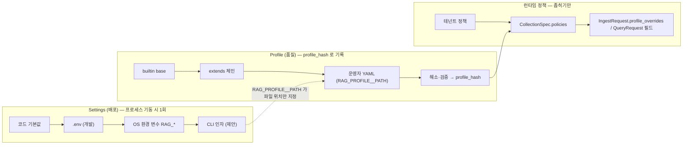

# 설정 레퍼런스

## 목적

이 문서는 RAG Platform을 배포·운영하는 사람이 **어떤 값을 어디에 두고, 바꾸면 무엇이 일어나는지**를 한 곳에서 찾을 수 있게 한다. 설정은 두 층으로 나뉜다 — 프로세스가 "어디에 연결되는지"를 담는 배포 설정(`Settings`, 환경 변수 `RAG_*`)과 파이프라인이 "무엇을 어떻게 하는지"를 담는 품질 설정(`Profile`, YAML). 두 층의 경계, 환경 변수 전체 목록(정본과 제안의 구분), 프로파일 YAML의 주석 스키마와 내장 프로파일 4종의 파일 전문, 비밀 참조 문법, 검증 규칙과 오류 메시지, 무재기동 반영 가능 항목, 그리고 변경이 재색인을 요구하는지의 영향 표를 담는다.

정본은 설계 바이블(Design Bible)이다. 환경 변수의 접두·중첩 규약과 이름이 확정된 9개 변수는 바이블 §6.6, 프로파일의 최상위 키·정본 YAML·검증 규칙은 바이블 §5.6·§7.3·§7.4, 스키마 파일은 [`schemas/profile.schema.json`](../../schemas/profile.schema.json)([컬렉션·프로파일·정책 계약](../03-contracts/15-collection-profile-and-policy-contracts.md) 소유)이다. 이 문서는 새 계약 타입·열거값·이벤트·오류 코드를 만들지 않으며, 바이블 §6.6에 없는 환경 변수와 프로파일 스키마에 없는 키는 모두 **제안**으로 표기해 출처 문서를 적고 "## 미해결 이슈"에 모았다.

## 범위

- **포함**: 설정 계층과 우선순위(§1), 환경 변수 표 — 정본 9개 + 제안(§2), 프로파일 YAML 주석 스키마(§3), 내장 프로파일 4종(`lite`, `standard`, `premium`, `korean-gov`) 파일 전문(§4), 비밀 참조 문법(§5), 검증 규칙·오류 메시지·종료 코드(§6), 무재기동 반영 항목(§7), 설정 변경 영향 표(§8).
- **제외**: 배포 절차·compose·Helm values 자체 → [배포 가이드](01-deployment-guide.md)·[배포 아키텍처](../02-architecture/08-deployment-architecture.md); 프로파일 계약의 필드별 의미·Pydantic 모델 → [컬렉션·프로파일·정책 계약](../03-contracts/15-collection-profile-and-policy-contracts.md); 관측 백엔드 구성 → [관측성](03-observability.md); 비밀 관리 제공자별 운영 절차·mTLS → [보안과 컴플라이언스](05-security-and-compliance.md); 재색인 실행 절차 → [갱신·삭제·재색인](../04-pipelines/19-update-delete-and-reindexing.md).
- **수치**: 프로파일 값은 바이블 §7.2의 "초안 목표"를 그대로 옮긴 것이다. 제안 환경 변수의 기본값은 출처 문서의 초안 값이며, 출처가 없는 것은 "초안 목표"로 표기했다.
- **연계 문서**: 프로파일 SLO 키가 가리키는 메트릭 `rag_acl_propagation_seconds`·`rag_outbox_lag_seconds`의 정본은 [관측성](03-observability.md) §4.2 메트릭 카탈로그이고, `RAG_OTEL__*`·프로파일 `observability` 키의 관측 측 설명은 같은 문서 §2.5, `content_capture` 어휘 확장은 같은 문서 미해결 이슈 4다. 비밀 제공자 운영 규약은 [보안과 컴플라이언스](05-security-and-compliance.md) §2, `POST /v1/profiles/validate`·`PATCH /v1/tenants/{tenant_id}/policies`의 응답 형식은 [관리 API](../05-api/04-management-api.md) §2.1·§4.2, 프로파일 사본 바이트 동일 검사·골든 예시 회귀는 [CI/CD](../10-development/05-ci-cd.md)가 소유한다.

---

## 1. 설정 계층

### 1.1 두 층과 그 사이의 벽

**결정:** 설정은 `Settings`(배포)와 `Profile`(품질)의 두 층이며 서로 침범하지 않는다. 환경 변수로 프로파일 값을 덮어쓰는 경로는 **없다** — 그렇게 하면 `IndexCommit`·`QueryPlan`·`ContextPack`에 기록되는 `profile_hash`가 실제 동작을 대표하지 못한다([컴포넌트 아키텍처](../02-architecture/02-component-architecture.md) §5.1, [ADR-0031](../06-adr/0031-profile-schema-extends-and-quality-gates.md)). 반대로 프로파일에는 호스트명·경로·비밀·엔드포인트를 넣지 않는다([플러그인 아키텍처](../02-architecture/05-plugin-architecture.md) §4 규칙 "결정성"). 이 문서의 작성 지시가 제시한 "기본값 < 프로파일 YAML < 환경 변수 < 런타임 API" 단일 사다리는 바이블과 어긋나므로 채택하지 않고, 아래처럼 층별로 별도의 우선순위를 둔다.

| 층 | 무엇을 담는가 | 원천(낮은 우선순위 → 높은 우선순위) | 변경 효과 | 검증 시점 |
|----|---------------|--------------------------------------|-----------|-----------|
| `Settings` | 연결 주소, 자격 증명 참조, 프로세스 역할·포트·풀 크기, 캐시 TTL, 자원 한계 | 코드 기본값 < `.env` 파일(개발 전용, 저장소 커밋 금지) < OS 환경 변수 `RAG_*` < CLI 인자(`rag serve …` 플래그; `ServeSettings`와 1:1, 제안) | 프로세스 재기동. 산출물·해시에 영향 없음 | 기동 시 `Settings()` 생성 — 실패 = 기동 실패(§6.1) |
| `Profile` | 파서 체인, 정규화, 청커, 보강, 임베더, 인덱스 백엔드, 검색 전략, 예산, 스테이지 정책, 보안·관측·평가 게이트 | 내장 `base` < `extends` 체인(`lite → standard → premium`, `korean-gov extends standard`) < 운영자 YAML(`RAG_PROFILE__PATH`; 같은 `profile_id`면 내장을 대체, 새 ID면 추가) | `version` 증가 → `profile_hash` 변경 → 컬렉션 blue/green(§8) | `rag profile validate`, `POST /v1/profiles/validate`, 컬렉션 생성·변경, 워커 기동 시 캐시 적재(§6.2) |
| 런타임 정책(관리 API) | 프로파일을 **좁히기만** 하는 값 | 프로파일 기본값 < 테넌트 정책(`PATCH /v1/tenants/{tenant_id}/policies`) < 컬렉션 정책(`CollectionSpec.policies`) < 요청 필드 | 즉시(캐시 무효화 이벤트, §7) | 관리 API 검증기(프로파일 검증기와 동일 함수) |

"좁히기만"의 규칙은 다음과 같다. PII는 `Profile.ingest.normalize.pii.policy`·`CollectionSpec.policies.pii_policy`·`IngestRequest.pii_policy` 중 **가장 엄격한 값**이 적용되고(바이블 §5.6, 15 §3.4), 아웃바운드 egress는 프로파일 `runtime.egress` **AND** 테넌트 `egress_policy`의 합성이며 결과가 공집합이면 `profile.invalid`다(15 §8, [ADR-0038](../06-adr/0038-outbound-egress-policy-and-webhook-signing.md)). LLM 보강은 프로파일 `queues.enrich_llm` + 테넌트 `llm_enrichment_allowed` + 컬렉션 `llm_enrichment_allowed`가 모두 참이어야 켜진다(O-05, [ADR-0016](../06-adr/0016-llm-enrichment-default-off-and-budget-policy.md)). 요청 단위 편차는 `IngestRequest.profile_overrides`의 화이트리스트 키(`parse.pdf.route`, `enrich.generated_prefix`; 바이블 §5.4, ADR-0031)와 `QueryRequest`의 선택 필드(`renderer`, `ordering_strategy`, `strategy_hint`, `retrieval_variant`, `response_format`, `mode`, `filters`)로만 허용되며, 그 밖의 키는 422 `contract.violation`이다.



### 1.2 무엇이 어느 층에 속하는가 — 판정 규칙

| 질문 | 예 | 층 |
|------|----|----|
| 값이 바뀌면 같은 문서·같은 질의의 산출물(`IndexCommit.commit_hash`, `ContextPack.content_hash`)이 달라질 수 있는가 | 청크 크기, 융합 `k`, 리랭커 모델, 렌더러 | `Profile` |
| 값이 환경(스테이징·운영, 리전, 클러스터)마다 다르지만 산출물은 같아야 하는가 | DSN, 오브젝트 스토리지 URI, 사이드카 URL, 포트, 풀 크기 | `Settings` |
| 값이 비밀이거나 비밀의 위치인가 | API 키, 서명 키, 버킷 자격 증명 | `Settings`의 `*_REF`(§5) 또는 계약의 `credentials_ref`·`secret_ref` |
| 값이 테넌트·컬렉션·요청마다 다르며 프로파일보다 넓어질 수 없는가 | PII 정책, LLM 옵트인, 허용 호스트 | 런타임 정책 |
| 값이 오케스트레이터의 재시도·타임아웃·큐인가 | `start_to_close`, `heartbeat`, `task_queue` | `Profile`(`StagePolicy`; 셸이 적용, 스테이지 코드 금지) |

스테이징과 운영의 프로파일 YAML은 **바이트 동일**해야 하고 환경 차이는 전부 `Settings`에 있다([배포 아키텍처](../02-architecture/08-deployment-architecture.md) 결정 사항). 이 규칙을 CI가 `rag profile diff`로 검사한다.

---

## 2. 환경 변수(`Settings`)

### 2.1 규약(바이블 §6.6)

- 접두 `RAG_`, 절(section)과 필드의 중첩 구분자 `__`(pydantic-settings `env_prefix="RAG_"`, `env_nested_delimiter="__"`). 예: `RAG_PG__DSN`, `RAG_FETCH__S3__ENDPOINT_URL`(2단 중첩).
- 비밀은 `RAG_SECRETS__PROVIDER=env|openbao|aws_kms` 제공자를 통한 **간접 참조**(§5)로만 다룬다. 값이 비밀 그 자체인 변수(`RAG_PG__DSN` 등)는 컨테이너 시크릿 마운트로 주입하고 `.env`·로그·트레이스에 두지 않는다(`SecretStr`, telemetry redaction).
- 모델은 `extra="forbid"`이며 조립 지점(`api`·`orchestration`·`cli`·`eval`·`mcp`)은 `check_unknown_env()`를 호출해 `RAG_` 접두 변수 중 모델이 모르는 이름이 있으면 기동을 중단한다(컴포넌트 아키텍처 §5.2; 최상위 오타 `RAG_VALKY__URL`은 pydantic이 조용히 무시하므로 별도 검사가 필요하다). 클라이언트 SDK의 `RAG_PLATFORM_*`은 예외 접두다(미해결 이슈 12).
- 타입 표기: `string(uri)`, `string(path)`, `string(duration)`(`30s`, `5m`, `24h`; 프로파일과 동일 문법), `string(secret_ref)`(§5 문법), `array<T>`(쉼표 구분 또는 JSON 배열), `enum[...]`.
- "지위" 열: **정본** = 바이블 §6.6이 이름을 확정한 변수. **제안(출처)** = 다른 설계 문서가 이름을 제안했거나 이 문서가 처음 제안하는 변수(선택, 기본값 있음). 제안 변수는 바이블 §6.6 minor 개정으로 확정된다(미해결 이슈 1).
- 이 문서의 표는 `rag_platform.settings` 모델에서 **생성**되어 CI가 문서 ↔ 코드 diff를 검사한다([ADR-0036](../06-adr/0036-naming-and-identifier-conventions.md) 준수 확인 8). 표에 없는 변수는 존재하지 않는다.

### 2.2 프로세스 역할 `RAG_SERVE__*`

`rag serve api|worker|relay` 인자와 1:1이다(컴포넌트 아키텍처 §5.2 `ServeSettings` 제안). 워커 역할은 큐 하나만 폴링한다.

| 이름 | 타입 | 기본 | 설명 | 민감 | 지위 |
|------|------|------|------|------|------|
| `RAG_SERVE__HOST` | string | `0.0.0.0` | `api` 바인드 주소 | N | 제안(02 §5.2) |
| `RAG_SERVE__PORT` | integer | `8000` | `api` HTTP 포트(`/v1`, `/mcp`, `/healthz`, `/readyz`) | N | 제안(02 §5.2) |
| `RAG_SERVE__METRICS_PORT` | integer | `9090` | `GET /metrics` 전용 포트(api·worker·relay 공통). `0`이면 api 메인 포트에 마운트 | N | 제안(01-deploy compose `9090`) |
| `RAG_SERVE__WORKERS` | integer | `1` | uvicorn 워커 수(`api`). 초안 권고 vCPU 수 | N | 제안(02 §5.2) |
| `RAG_SERVE__PROCESSES` | integer | `1` | `ingest-cpu` 워커 프로세스 다중화(GIL 대응). 초안 권고 vCPU 수 | N | 제안(02 §5.2) |
| `RAG_SERVE__MAX_CONCURRENT_ACTIVITIES` | integer | `1` | 프로세스당 Temporal 액티비티 고정 슬롯(리소스 튜너와 상호 배타, 바이블 §4.4). `ingest-cpu`는 1 유지, `ingest-io` 32·GPU 큐 4·`ingest-llm` 8(초안, 02 미해결 7) | N | 제안(02 §5.2) |
| `RAG_SERVE__QUEUE` | string(kebab) | `null` | 워커가 폴링할 태스크 큐(`ingest-io`, `ingest-cpu`, `ingest-gpu-ocr`, `ingest-gpu-embed`, `ingest-llm`, `maintenance`, `relay`, `lite`의 `ingest`). `rag serve worker --queue`와 동일 | N | 제안(이 문서) |
| `RAG_SERVE__DISPATCHER` | boolean | `true` | 디스패처 조정 틱(문서 직렬화·테넌트 동시성, 바이블 §11.2) 실행 여부. 검색 전용 `api-query` 인스턴스는 `false` | N | 제안(08 미해결 3) |
| `RAG_SERVE__SURFACES` | array<enum[ingest, query, admin, events, mcp]> | 전체 | 이 `api` 인스턴스가 라우트를 등록할 표면. `api-query`는 `[query, mcp]` | N | 제안(08 미해결 3) |
| `RAG_SERVE__SHUTDOWN_GRACE_S` | integer | `120` | SIGTERM 후 드레인 유예(초). 큐별 60/120/300 초안 | N | 제안(08 미해결 8) |

### 2.3 API 표면 `RAG_API__*`

| 이름 | 타입 | 기본 | 설명 | 민감 | 지위 |
|------|------|------|------|------|------|
| `RAG_API__PUBLIC_BASE_URL` | string(uri) | `null`(운영 필수) | `status_url`·`events_url`·`Location`·MCP PRM `resource`의 절대 URL 기준(인그레스 외부 호스트). `https` 필수, `orchestrator=local`만 `http://localhost` 허용 | N | 제안(05-api/01 §8) |
| `RAG_API__CORS_ALLOWED_ORIGINS` | array<string(uri)> | `[]` | 정확한 오리진 목록. 빈 값 = CORS 비활성. `*` 불가 | N | 제안(05-api/01 §15) |
| `RAG_API__TRUSTED_PROXIES` | array<string(cidr)> | `[]` | `X-Forwarded-For`·`X-Forwarded-Proto`를 신뢰할 인그레스 소스 CIDR | N | 제안(05-api/01 §19) |
| `RAG_API__MAX_BODY_BYTES` | integer | `8388608` | 앱 측 요청 본문 상한(인그레스 8MB와 일치). 계약 한계(`IngestRequest` 64KB × 배치 100건, `ContextPack` 512KB, 바이블 §5.1)보다 작게 설정하면 기동 실패(§6.1 S-7) | N | 제안(이 문서) |
| `RAG_API__SSE_MAX_CONNECTIONS_PER_TENANT` | integer | `100` | 테넌트당 동시 SSE 연결 상한(초안). 초과는 429 `api.rate_limited` | N | 제안(05-api/01 미해결 7) |
| `RAG_API__PUBLIC_RATE_LIMIT_RPS` | integer | `20` | 비인증 경로(`/healthz`·`/readyz`·PRM·401 시도)의 **IP 키** 한도(초안). 테넌트·클래스 한도는 프로파일 소유(§2.19) | N | 제안(05-api/01 §11 `public` 클래스) |
| `RAG_API__CURSOR_HMAC_KEY_REF` | string(secret_ref) | `null`(운영 필수) | 키셋 커서 토큰 서명 키(05-api/01 §7; 테넌트 바인딩 HMAC-SHA256) | 참조 | 제안(05-api/01 §7) |
| `RAG_API__IDEMPOTENCY_TTL` | string(duration) | `24h` | `idempotency_keys.expires_at`과 Valkey `idem:` 캐시 TTL(바이블 §13.4 값) | N | 제안(이 문서) |

### 2.4 PostgreSQL 원장 `RAG_PG__*`

| 이름 | 타입 | 기본 | 설명 | 민감 | 지위 |
|------|------|------|------|------|------|
| `RAG_PG__DSN` | string(secret) | 필수 | 원장 DSN, 애플리케이션 역할 `rag_app`(`NOBYPASSRLS`). TLS 옵션은 DSN 파라미터(`sslmode`, `sslrootcert`, `sslcert`/`sslkey`) | Y | **정본** |
| `RAG_PG__DSN_OWNER` | string(secret) | `null` | 마이그레이션 훅(`rag ledger migrate`) 전용 소유자 DSN(`rag_owner`). 상주 프로세스에는 주입하지 않는다 | Y | 제안(01-deploy 미해결 3) |
| `RAG_PG__DSN_MAINTENANCE` | string(secret) | `null`(→ `DSN`) | `relay`·정합성 검사·cleanup 프로세스의 역할 `rag_maintenance` DSN | Y | 제안(01-deploy 미해결 3) |
| `RAG_PG__POOL_MIN` | integer | `2` | 프로세스 풀 최소 | N | 제안(02 §5.2) |
| `RAG_PG__POOL_MAX` | integer | `16` | 프로세스 풀 최대 | N | 제안(02 §5.2) |
| `RAG_PG__STATEMENT_TIMEOUT_MS` | integer | 역할별 `api` 5000 / `worker` 60000 / `maintenance` 600000 | 트랜잭션마다 `SET LOCAL statement_timeout`(초안) | N | 제안(04-storage §2.5) |
| `RAG_PG__POOLER_MODE` | enum[session, transaction] | `session` | 외부 풀러(PgBouncer) 트랜잭션 모드면 준비 문장 비활성·`SET LOCAL app.tenant_id` 프롤로그 재발행 | N | 제안(04-storage §2.5) |

### 2.5 오브젝트 스토리지 `RAG_OBJECT_STORE__*`

| 이름 | 타입 | 기본 | 설명 | 민감 | 지위 |
|------|------|------|------|------|------|
| `RAG_OBJECT_STORE__URI` | string(uri) | 필수 | `s3://bucket[/prefix]` 또는 `file:///path`만([ADR-0011](../06-adr/0011-kv-and-object-storage-valkey-rustfs-seaweedfs.md)). 키 레이아웃은 바이블 §13.3. `file://`는 개발·`lite` 단일 노드 전용 | N | **정본** |
| `RAG_OBJECT_STORE__ENDPOINT_URL` | string(uri) | `null` | S3 호환 엔드포인트(RustFS·SeaweedFS·관리형). 미설정 시 공급자 공개 엔드포인트 | N | 제안(02 §5.2) |
| `RAG_OBJECT_STORE__REGION` | string | `null` | | N | 제안(이 문서) |
| `RAG_OBJECT_STORE__ADDRESSING_STYLE` | enum[path, virtual] | `path` | 로컬 S3 호환 구현은 `path` | N | 제안(이 문서) |
| `RAG_OBJECT_STORE__CREDENTIALS_REF` | string(secret_ref) | `null` | 버킷 전용 자격 증명. 미설정 시 워커 주변 자격 증명(IRSA 등); 운영은 설정 권장 | 참조 | 제안(04-storage §3.3) |
| `RAG_OBJECT_STORE__SSE_MODE` | enum[none, sse_s3, sse_kms] | `sse_s3` | 저장 암호화 요청 헤더. `file://`는 무시 | N | 제안(07 §6.3) |
| `RAG_OBJECT_STORE__SSE_KMS_KEY_REF` | string(secret_ref) | `null` | `sse_kms`의 기본 KEK 참조. 테넌트별 KEK는 접두 `tenants/{tenant_id}/` 버킷 정책으로(07 §6.3) | 참조 | 제안(07 §6.3) |

### 2.6 Valkey `RAG_VALKEY__*`

Valkey는 `lite`를 포함한 모든 프로파일의 필수 컨테이너다(레이트리밋 E3·MCP 커서·`aclrev` 힌트의 전제, 컴포넌트 아키텍처 §5.2). 구성 부재는 기동 실패, 런타임 불가만 `degraded`다.

| 이름 | 타입 | 기본 | 설명 | 민감 | 지위 |
|------|------|------|------|------|------|
| `RAG_VALKEY__URL` | string(uri, secret) | 필수 | `redis://` 또는 `rediss://`(TLS) Redis 프로토콜 URL 하나(서버 구현체 미검사, ADR-0011) | Y | **정본** |
| `RAG_VALKEY__POOL_MAX` | integer | `32` | | N | 제안(이 문서) |
| `RAG_VALKEY__COMMAND_TIMEOUT_MS` | integer | `200` | 연결·명령 상한. 초과 시 캐시는 미스로, 레이트리밋은 프로파일 `fail_mode`로 처리 | N | 제안(이 문서) |

### 2.7 인덱스 백엔드 `RAG_QDRANT__*`, `RAG_OPENSEARCH__*`

어댑터 연결 설정이다(배포 아키텍처 §4.2 `externals.qdrant`·`externals.opensearch`). 어떤 백엔드를 쓰는지는 프로파일 `ingest.index.backends[]`가 정한다.

| 이름 | 타입 | 기본 | 설명 | 민감 | 지위 |
|------|------|------|------|------|------|
| `RAG_QDRANT__URL` | string(uri) | `null`(qdrant 백엔드 사용 시 필수) | REST URL(`http://qdrant:6333`); gRPC 포트는 URL 포트 + 1(Qdrant 기본 6334) | N | 제안(08 §4.2) |
| `RAG_QDRANT__API_KEY_REF` | string(secret_ref) | `null` | | 참조 | 제안(08 §4.2) |
| `RAG_QDRANT__PREFER_GRPC` | boolean | `true` | 바이블 §3.2 O-10 | N | 제안(08 §4.2) |
| `RAG_QDRANT__TIMEOUT_MS` | integer | `5000` | 클라이언트 요청 상한. 채널 `timeout_ms`는 프로파일 | N | 제안(이 문서) |
| `RAG_OPENSEARCH__URL` | string(uri) | `null`(opensearch 백엔드 사용 시 필수) | | N | 제안(08 §4.2) |
| `RAG_OPENSEARCH__ADMIN_CREDENTIALS_REF` | string(secret_ref) | `null`(standard 이상 필수) | 컬렉션 생성 시 인덱스 템플릿·alias 생성, 정합성 검사·cleanup에만 사용(`api` 관리 표면·`maintenance` 워커) | 참조 | 제안(이 문서) |
| `RAG_OPENSEARCH__JWT_SIGNING_KEY_REF` | string(secret_ref) | `null`(standard 이상 필수) | 요청별 테넌트 JWT(E8, DLS 이중 방어) 서명 키. JWKS를 Security 플러그인에 등록, 회전은 `kid` 병행 | 참조 | 제안(08 §4.2) |
| `RAG_OPENSEARCH__JWT_TTL_S` | integer | `60` | E8 토큰 TTL 상한(≤ 60s, 07 §6.1) | N | 제안(이 문서) |
| `RAG_OPENSEARCH__TIMEOUT_MS` | integer | `5000` | | N | 제안(이 문서) |

### 2.8 Temporal·프로파일 로딩 `RAG_TEMPORAL__*`, `RAG_PROFILE__*`

| 이름 | 타입 | 기본 | 설명 | 민감 | 지위 |
|------|------|------|------|------|------|
| `RAG_TEMPORAL__ADDRESS` | string(host:port) | `null` | frontend 주소. 미설정 → `LocalRunner`(개발·CI·하네스만, 바이블 §11.1). 프로파일 `runtime.orchestrator=temporal`과의 정합은 §6.1 S-5 | N | **정본** |
| `RAG_TEMPORAL__NAMESPACE` | string | `default` | Helm `standard` values는 `rag` | N | 제안(02 §5.2) |
| `RAG_PROFILE__PATH` | string(path) | `null` | 운영자 프로파일 YAML **파일** 또는 **디렉터리**(`*.yaml` 전부 로드). 미설정 → 내장 5종(`base, lite, standard, premium, korean-gov`)만. 파일의 `profile_id`가 내장과 같으면 내장을 대체한다 | N | **정본** |
| `RAG_PROFILE__ID` | string(kebab) | `lite` | CLI(`rag up`, `rag ingest`)와 `POST /v1/collections`에서 `profile_id` 생략 시 기본 프로파일 | N | 제안(02 §5.2) |

### 2.9 서비스별 TLS(공통 패턴)

`korean-gov`처럼 메시 없이 서비스별 TLS·mTLS를 켤 때 쓰는 변수다. `{SECTION}`은 `QDRANT`, `OPENSEARCH`, `TEMPORAL`, `VALKEY`, `SIDECAR` 중 하나이며 PostgreSQL은 DSN 파라미터를 쓴다.

| 이름 | 타입 | 기본 | 설명 | 민감 | 지위 |
|------|------|------|------|------|------|
| `RAG_{SECTION}__TLS_CA_BUNDLE` | string(path) | `null` | 서버 인증서 검증 CA 번들. 인증서 검증을 끄는 옵션은 없다(07 §6.2) | N | 제안(이 문서) |
| `RAG_{SECTION}__CLIENT_CERT_REF` | string(secret_ref) | `null` | mTLS 클라이언트 인증서·키 참조 | 참조 | 제안(이 문서) |

### 2.10 사이드카·모델 서빙·모델 미러 `RAG_SIDECAR__*`, `RAG_MODELS__*`

사이드카·서빙 주소는 Kubernetes Service DNS만 허용하며 프로파일의 `image` 값은 논리 이름이다(배포 아키텍처 §5.5). 프로파일이 사이드카·서빙을 요구하는데 해당 URL이 없으면 §6.1 S-6에 따라 기동 실패다. 내장 `lite`는 임베더 `in_process`·리랭커 `enabled: false`·사이드카 없는 라우터이므로(§4.1) 이 절의 변수를 하나도 요구하지 않는다 — 리랭커를 켠 `lite` 파생 프로파일(§4.1 오버라이드 예시)만 `RAG_SIDECAR__RERANKER_SERVER_URL`이 필수가 된다.

| 이름 | 타입 | 기본 | 설명 | 민감 | 지위 |
|------|------|------|------|------|------|
| `RAG_SIDECAR__PARSER_WORKERS_URL` | string(uri) | `null` | Java 사이드카(HWP 5.0 → HWPX, 암호화 HWPX, 배포용 텍스트) `POST /v1/convert` | N | 제안(08 §5.5) |
| `RAG_SIDECAR__LO_SIDECAR_URL` | string(uri) | `null` | GPL 사이드카(`optIn.loSidecar`). 미설정이면 라우터 `doc`는 `parse.unsupported_format` | N | 제안(08 §5.5) |
| `RAG_SIDECAR__OCR_GPU_URL` | string(uri) | `null` | PaddleOCR PP-OCRv5 server 사이드카(`premium`) | N | 제안(08 §5.5) |
| `RAG_SIDECAR__EMBEDDING_SERVER_URL` | string(uri) | `null` | vLLM pooling(BGE-M3 3-in-1) 또는 TEI. `in_process` 임베더(`lite`)는 불필요 | N | 제안(08 §5.5) |
| `RAG_SIDECAR__SPARSE_ENCODER_SERVER_URL` | string(uri) | `null` | `ko-quality` learned sparse 서빙 | N | 제안(08 §4.2) |
| `RAG_SIDECAR__RERANKER_SERVER_URL` | string(uri) | `null` | TEI(CPU·GPU) 또는 vLLM/SGLang 리랭커. `api` 프로세스가 사용 | N | 제안(08 §5.5) |
| `RAG_SIDECAR__LLM_SERVER_URL` | string(uri) | `null` | LLM 보강·LLM 플래너·판정자용 OpenAI 호환 서빙(온프레미스 vLLM Qwen3 계열). 외부 API는 테넌트 옵트인 + `EgressPolicy.allowed_hosts` 등재 | N | 제안(이 문서) |
| `RAG_SIDECAR__LLM_API_KEY_REF` | string(secret_ref) | `null` | | 참조 | 제안(이 문서) |
| `RAG_SIDECAR__CONNECT_TIMEOUT_MS` | integer | `5000` | 연결 상한. 변환 데드라인은 `StagePolicy`·`ConvertRequest.deadline_ms` | N | 제안(이 문서) |
| `RAG_MODELS__MIRROR_URI` | string(uri) | `null` | 가중치·사전·OCR 모델 미러 루트(`models/{repo}/{revision}/…`, 바이블 §13.3). 미설정 → 최초 실행 시 직접 다운로드(개발만) | N | 제안(08 §3.4) |
| `RAG_MODELS__LOCK_PATH` | string(path) | `/config/models.lock` | `models.lock`(id, revision, sha256, license, grade, territory) 위치. 기동 시 sha256·등급 검증 | N | 제안(08 §3.4) |
| `RAG_MODELS__CACHE_DIR` | string(path) | `/models` | 로컬 캐시. `HF_HOME`과 같은 볼륨이어야 한다(§2.18) | N | 제안(08 §3.4) |
| `RAG_MODELS__OFFLINE` | boolean | `false` | `true`면 런타임 다운로드 차단(`HF_HUB_OFFLINE=1`과 동일 강제). 운영·에어갭은 `true` | N | 제안(08 §3.4) |

### 2.11 인증·인가 `RAG_AUTH__*`

| 이름 | 타입 | 기본 | 설명 | 민감 | 지위 |
|------|------|------|------|------|------|
| `RAG_AUTH__OIDC_ISSUER` | string(uri) | `null`(프로파일 `authn=oidc`면 필수) | OIDC 발급자. JWKS는 `{issuer}/.well-known/openid-configuration`으로 발견 | N | **정본** |
| `RAG_AUTH__AUDIENCE` | string | `null`(→ `RAG_API__PUBLIC_BASE_URL`) | `aud` 검증 값. MCP PRM `resource`와 동일 | N | 제안(02 §5.2) |
| `RAG_AUTH__JWKS_CACHE_TTL_S` | integer | `300` | JWKS 캐시. 조회 실패 시 캐시로 검증, 만료 시 401 | N | 제안(02 §5.2) |
| `RAG_AUTH__GROUPS_CACHE_TTL_S` | integer | `600` | 그룹 확장 캐시 `groups:{tenant}:{subject}`(바이블 §13.4 5~15분 범위) | N | 제안(이 문서) |
| `RAG_AUTH__MTLS_CA_BUNDLE` | string(path) | `null` | 프로파일 `authn=mtls` 클라이언트 인증서 CA | N | 제안(이 문서) |
| `RAG_AUTH__CEDAR_POLICY_PATH` | string(path) | `/config/cedar` | Cedar 정책·스키마 파일 디렉터리. `policy_version`은 프로파일 `security.authz.policy_version` | N | 제안(이 문서) |

### 2.12 비밀 제공자 `RAG_SECRETS__*`

| 이름 | 타입 | 기본 | 설명 | 민감 | 지위 |
|------|------|------|------|------|------|
| `RAG_SECRETS__PROVIDER` | enum[env, openbao, aws_kms] | `env` | `credentials_ref`·`secret_ref`·`*_REF`를 해소하는 `KeyProvider` 구현 | N | **정본** |
| `RAG_SECRETS__ENV__FILE` | string(path) | `null` | `env` 제공자의 개발 전용 키 파일(`.env` 문법). 운영 프로파일(`orchestrator=temporal`)에서 설정되면 기동 실패 | N | 제안(이 문서) |
| `RAG_SECRETS__OPENBAO__ADDRESS` | string(uri) | `null`(provider=openbao면 필수) | | N | 제안(이 문서) |
| `RAG_SECRETS__OPENBAO__AUTH_METHOD` | enum[kubernetes, approle, token] | `kubernetes` | | N | 제안(이 문서) |
| `RAG_SECRETS__OPENBAO__AUTH_ROLE` | string | `null` | `kubernetes`·`approle` 역할 이름 | N | 제안(이 문서) |
| `RAG_SECRETS__OPENBAO__TRANSIT_MOUNT` | string | `transit` | 테넌트 DEK `wrap/unwrap` 마운트(07 §6.3) | N | 제안(이 문서) |
| `RAG_SECRETS__AWS_KMS__REGION` | string | `null` | | N | 제안(이 문서) |
| `RAG_SECRETS__CACHE_TTL_S` | integer | `300` | 해소 값 프로세스 캐시. 회전 반영 지연 상한 | N | 제안(이 문서) |

### 2.13 관측성·로그 `RAG_OTEL__*`, `RAG_LOG__*`

| 이름 | 타입 | 기본 | 설명 | 민감 | 지위 |
|------|------|------|------|------|------|
| `RAG_OTEL__EXPORTER_OTLP_ENDPOINT` | string(uri) | `null` | OTel Collector OTLP 엔드포인트. 미설정 → 내보내기 끔(계측은 유지) | N | **정본** |
| `RAG_OTEL__EXPORTER_OTLP_PROTOCOL` | enum[grpc, http/protobuf] | `grpc` | | N | 제안(이 문서) |
| `RAG_OTEL__CONTENT_CAPTURE` | enum[none] | `none` | 트레이스 콘텐츠 캡처. **v1은 `none`만 허용**(02 §5.2; [관측성](03-observability.md) §2.5). 프로파일 `observability.content_capture_locked=true`면 재정의 불가(§6.1 S-8). 다른 값의 어휘는 미해결 이슈 6 | N | **정본** |
| `RAG_OTEL__TRACES_SAMPLER_RATIO` | number(0..1) | `1.0` | 부모 기반 비율 샘플러 | N | 제안(이 문서) |
| `RAG_LOG__LEVEL` | enum[debug, info, warning, error] | `info` | structlog 레벨 | N | 제안(이 문서) |
| `RAG_LOG__FORMAT` | enum[json, console] | `json` | 필드는 바이블 §6.5(`event, level, tenant_id_hash, job_id, trace_id, stage, code`) | N | 제안(이 문서) |

### 2.14 캐시 TTL `RAG_CACHE__*`

기본값은 바이블 §13.4의 Valkey 키 TTL이다. `aclrev:`는 프로파일(`2 × acl_propagation_slo`), `idem:`은 §2.3, `groups:`는 §2.11에서 정하고, `tok:`(7d)·`rr:`(60s)는 콘텐츠 해시 키라 튠 대상이 아니다.

| 이름 | 타입 | 기본 | 설명 | 민감 | 지위 |
|------|------|------|------|------|------|
| `RAG_CACHE__QEMB_TTL` | string(duration) | `24h` | 질의 임베딩 `qemb:{space}:{hash}` | N | 제안(이 문서) |
| `RAG_CACHE__PLAN_TTL` | string(duration) | `5m` | 플랜 `plan:{tenant}:{profile_hash}:{hash}` | N | 제안(이 문서) |
| `RAG_CACHE__PTXT_TTL` | string(duration) | `24h` | 부모 텍스트 번들 `ptxt:{tenant}:{chunk_set_blake3}` | N | 제안(이 문서) |
| `RAG_CACHE__CURSOR_TTL` | string(duration) | `10m` | MCP 커서 핸들 `cursor:{tenant}:{ulid}`(D-13) | N | 제안(이 문서) |

### 2.15 수집 원천 `RAG_FETCH__*`

프로파일 `ingest.fetch`는 `{plugin, max_bytes, policy}`와 플러그인 `config_schema` 키만 갖고, 네트워크 목적지·경로·자격 증명은 여기에 둔다([수집과 원천 해소](../04-pipelines/02-fetching-and-source-resolution.md) §2.3). §2.5 `RAG_OBJECT_STORE__*`(플랫폼 산출물 버킷)와 구별된다.

| 이름 | 타입 | 기본 | 설명 | 민감 | 지위 |
|------|------|------|------|------|------|
| `RAG_FETCH__S3__ENDPOINT_URL` | string(uri) | 공급자 공개 엔드포인트 | 테넌트 `s3://` 원천의 운영자 신뢰 엔드포인트(E16 판정은 스킴 + `allowed_hosts`만) | N | 제안(04-pipelines/02) |
| `RAG_FETCH__S3__REGION` | string | `null` | | N | 제안(04-pipelines/02) |
| `RAG_FETCH__S3__ADDRESSING_STYLE` | enum[path, virtual] | `virtual` | | N | 제안(04-pipelines/02) |
| `RAG_FETCH__GS__ENDPOINT_URL` | string(uri) | 공급자 기본 | | N | 제안(04-pipelines/02) |
| `RAG_FETCH__AZ__ACCOUNT_SUFFIX` | string | 공급자 기본 | `az://{container}/{path}`의 계정 접미 | N | 제안(04-pipelines/02) |
| `RAG_FETCH__FILE__ALLOWED_ROOTS` | array<string(path)> | `[]` | `file://` 허용 루트. 빈 값 = 모두 거부(`fetch.egress_denied`). `orchestrator=local`에서만 의미 | N | 제안(04-pipelines/02) |
| `RAG_FETCH__SMB__SERVERS` | array<string(host)> | `[]` | `smb://` 플러그인 서버 허용 목록 | N | 제안(04-pipelines/02) |
| `RAG_FETCH__SPOOL_DIR` | string(path) | 워커 임시 볼륨 | 스트리밍 다운로드 스풀 | N | 제안(04-pipelines/02) |
| `RAG_FETCH__CLAMD__ADDRESS` | string(host:port) | `null` | 악성 스캔 훅 `clamd`(프로파일 `malware_scan.enabled` 시 필수) | N | 제안(04-pipelines/02) |

### 2.16 워커 자원 한계·플러그인 `RAG_WORKER__*`, `RAG_PLUGINS__*`

| 이름 | 타입 | 기본 | 설명 | 민감 | 지위 |
|------|------|------|------|------|------|
| `RAG_WORKER__HELPER_RLIMIT_AS_BYTES` | integer | `4294967296` | `helper_process` 주소 공간 상한(4GiB, 초안 목표) | N | 제안(05 §11.2) |
| `RAG_WORKER__DECOMPRESS_MAX_RATIO` | integer | `100` | 컨테이너 포맷 압축 해제 폭탄 상한 — 압축비(초안 목표) | N | 제안(05 §11.2) |
| `RAG_WORKER__DECOMPRESS_MAX_BYTES` | integer | `1073741824` | 펼친 크기 상한 1GiB(초안 목표) | N | 제안(05 §11.2) |
| `RAG_PLUGINS__ALLOW_UNVERIFIED` | boolean | `false` | 서명·적합성 리포트 없는 플러그인 로딩 허용(개발 전용). `true`면 기동 시 경고 로그, `orchestrator=temporal`이면 기동 실패 | N | 제안(05 §11.1) |
| `RAG_PLUGINS__SIGNING_KEYS_PATH` | string(path) | `/config/plugin-keys` | 배포 아티팩트 서명 검증 공개키(Sigstore 또는 조직 키 — 확인 필요 as of 2026-09) | N | 제안(이 문서) |

### 2.17 `answer` 레퍼런스·릴레이·MCP `RAG_ANSWER__*`, `RAG_RELAY__*`, `RAG_MCP__*`

`POST /v1/answer`는 레퍼런스 구현이며 기본 비활성이다([리트리벌 API](../05-api/03-retrieval-api.md) §5.1). 공급자 호출은 `EgressPolicy.allowed_hosts`에 공급자 호스트가 등재된 배포에서만 가능하다.

| 이름 | 타입 | 기본 | 설명 | 민감 | 지위 |
|------|------|------|------|------|------|
| `RAG_ANSWER__ENABLED` | boolean | `false` | 라우트 등록 여부 | N | 제안(05-api/03) |
| `RAG_ANSWER__MODEL` | string | `null`(enabled면 필수) | 대상 LLM 식별자(배포 값, 계약 상수 아님) | N | 제안(05-api/03) |
| `RAG_ANSWER__BASE_URL` | string(uri) | 공급자 기본 | 프록시·리전 엔드포인트 | N | 제안(이 문서) |
| `RAG_ANSWER__API_KEY_REF` | string(secret_ref) | `null`(enabled면 필수) | | 참조 | 제안(05-api/03) |
| `RAG_ANSWER__EFFORT` | enum[low, medium, high] | `medium` | 공급자 파라미터 이름·허용값 확인 필요(as of 2026-09) | N | 제안(05-api/03) |
| `RAG_RELAY__MODE` | enum[temporal, procrastinate] | `temporal` | 아웃박스 릴레이 실행기. `lite`는 `procrastinate`(06 §3.6) | N | 제안(08 §4.2 `relay.mode`) |
| `RAG_RELAY__POLL_INTERVAL_MS` | integer | `1000` | `LISTEN/NOTIFY` 깨우기와 병행하는 폴링 주기; 배치 크기는 `select_unpublished(limit=100)` 고정 | N | 제안(이 문서) |
| `RAG_RELAY__CA_BUNDLE` | string(path) | `null` | 웹훅 수신자 사설 CA 신뢰 추가 | N | 제안(05-api/07 미해결 7) |
| `RAG_MCP__AUTHORIZATION_SERVERS` | array<string(uri)> | `[RAG_AUTH__OIDC_ISSUER]` | RFC 9728 PRM `authorization_servers`. `/mcp` 마운트 여부는 `RAG_SERVE__SURFACES` | N | 제안(이 문서) |

### 2.18 비-`RAG_` 환경 변수(서드파티 패스스루)

| 이름 | 소비자 | 값·규칙 | 출처 |
|------|--------|---------|------|
| `HF_HOME` | Hugging Face 라이브러리(임베더·리랭커 `in_process`, 토크나이저) | `RAG_MODELS__CACHE_DIR`과 같은 볼륨(`/models/hf`) | 08 §3.4 |
| `HF_HUB_OFFLINE` | 동일 | 운영·에어갭 `1`. `RAG_MODELS__OFFLINE=true`가 이를 강제 | 08 §3.4 |
| `OMP_NUM_THREADS` | Docling·ONNX Runtime(`ingest-cpu`) | `4`(프로파일 `parse.options.pdf.threads`와 일치) | 바이블 §7.1 |
| `IMAGE_DIGEST` | 사이드카·서빙 컨테이너 | 자기 이미지 digest(`sha256:…`) → `Producer.image_digest` | 08 §4.2 |

### 2.19 프로파일이 소유하는 값(환경 변수가 없는 것)

다음은 자주 환경 변수로 오해되지만 **프로파일 키**이며 `Settings`에 대응 변수가 없다: 레이트리밋 저장소·실패 모드(`security.rate_limit{store, fail_mode}`), 테넌트 동시 잡 상한(`runtime.tenant_concurrent_jobs_max`), 스테이지 타임아웃·재시도·큐(`ingest.*.policy`, `runtime.queues`), 채널 `top_k`·`timeout_ms`, 지연 예산, 토큰 예산, 원본 크기 상한(`ingest.fetch.max_bytes`), egress 허용 스킴·CIDR, ACL 전파·아웃박스 SLO, 정합성 검사·스냅샷 주기. 테넌트·클래스별 요청 속도 한도(`query` 50 / `ingest` 20 / `admin` 10 req/s, API 키 하위 50%; 07 §10 초안)는 프로파일 `security.rate_limit`이 소유하되 현재 스키마는 닫힌 객체라 `limits` 키가 없다 — 미해결 이슈 4.

---

## 3. 프로파일 YAML 주석 스키마

정본 스키마는 [`schemas/profile.schema.json`](../../schemas/profile.schema.json)(`$id = urn:rag:schema:profile:1`)이고 필드 의미는 [컬렉션·프로파일·정책 계약](../03-contracts/15-collection-profile-and-policy-contracts.md) §3이다. 아래는 그 스키마를 운영자가 읽는 순서로 펼친 **주석 예시**다. 표기: `# 타입 | 필수 | 설명`. `Y`는 필수, `N`은 선택, `(N, 제안)`은 스키마에 없는 키(플러그인 `config_schema` 또는 스키마 확장 제안). 스테이지 값 객체는 열린 객체라 `plugin`·`policy`·`isolation`·`image`·`then`·`fallback`(셸 예약 키) 외의 키는 해당 플러그인 `config_schema`가 검증한다.

```yaml
schema_version: "1.0.0"          # string(semver) | Y | 계약 버전
profile_id: standard             # string(kebab) | Y | 내장 base, lite, standard, premium, korean-gov
version: "1.0.0"                 # string(semver) | Y | 값 변경 = version 증가 = profile_hash 변경 = blue/green
extends: lite                    # string(kebab) | null | Y(nullable) | 단일 상속·깊은 병합, 배열은 자식 값으로 교체; null 은 base 만
tier: standard                   # enum(ProfileTier) | Y | lite | standard | premium | korean-gov
license_policy:                  # object | Y
  max_grade: B                   # enum(LicenseGrade) A|B|C|D | Y | PluginMeta.license_grade <= max_grade; X 불가
  territory: [KR]                # array<ISO 3166-1 alpha-2> | Y | 플러그인 territory 대조
runtime:                         # object | Y
  orchestrator: temporal         # enum[local, temporal] | Y | local = LocalRunner(개발·CI·하네스)
  queues:                        # object<stage, kebab> | Y | 필수 키 fetch parse normalize chunk enrich embed index; 선택 detect ocr enrich_llm recount
    fetch: ingest-io             # 폴백: detect·ocr → parse, recount → chunk, enrich_llm 은 폴백 없음(LLM 보강 켜면 profile.invalid)
  tenant_concurrent_jobs_max: 32 # integer(>=1) | Y | 디스패처가 jobs.state=running 수로 강제
  acl_propagation_slo: 5m        # string(duration) | Y | rag_acl_propagation_seconds SLO(관측성 §4.2)
  outbox_lag_slo: 5s             # string(duration) | Y | rag_outbox_lag_seconds SLO(관측성 §4.2)
  egress:                        # EgressPolicy | Y | fetch·웹훅 릴레이 공통, 테넌트 정책과 AND
    allowed_schemes: [https, s3, gs, az]   # array<string> | Y | file 은 orchestrator=local 만, http 는 테넌트 옵트인
    allowed_hosts: null          # array<string> | null | N | ".go.kr" 접미 또는 소문자 정확 일치, IP 리터럴 불가
    deny_cidrs: [...]            # array<cidr> | Y | 기본 9개 CIDR 을 포함해야 함(규칙 12, 축소 불가)
    max_redirects: 3             # integer(>=0) | Y | 홉마다 전 규칙 재검사
    resolve_pin: true            # boolean | Y | 해석 IP 검사 후 고정 연결
    max_bytes: 209715200         # integer | N | 기본 ingest.fetch.max_bytes; connect_timeout_ms(N, 5000)·allowed_ports(N, [443]) 도 같은 위치
  consistency_check: {sample_every: 1h, full_every: 24h}   # object | N | maintenance.consistency.v1 주기; snapshot: {every, replicate_region?}(N) 도 같은 위치
ingest:                          # object | Y | 각 스테이지 값 = {plugin, policy: StagePolicyPartial, ...config_schema 키}
  fetch:
    plugin: fetcher.fsspec_httpx # plugin_id | Y
    max_bytes: 209715200         # integer | Y | 원본 상한(바이블 §5.1 200MB); EgressPolicy.max_bytes 기본
    policy: {start_to_close: 5m, heartbeat: 30s, max_attempts: 5}   # StagePolicyPartial | N | 로더가 §4.4 기본값으로 완성
  parse:                         # 닫힌 객체 | plugin 키 없음(플랫폼 합성 parser.router)
    router:                      # ParseRouter | Y | SourceFormat 13값 전부(hwpx hwp5 hwp3 pdf docx doc rtf odt html txt md json unknown)
      hwpx: [parser.hwpx_python_hwpx]                    # RouteChain: array<plugin_id | RouteStep{plugin, isolation?, image?, then?}>
      hwp3: parse.unsupported_variant                    # RouteTerminal: parse.unsupported_format | parse.unsupported_variant
      pdf: {born_digital: ..., scanned: ..., mixed: page_route}   # PdfRoute | mixed 는 plugin_id 또는 page_route
      json: {split: json_array, then: txt}               # SplitRoute{split: enum(SplitHint), then: enum(SourceFormat)}
    options:                     # ParseOptions | Y(ocr 필수)
      pdf: {layout_model: heron, table_model: tableformer_accurate, threads: 4}   # object | N | PDF 파서 config_schema
      ocr: {plugin: rapidocr, lang: [korean], version: PPOCRV5, model: MOBILE}     # OcrOptions | Y | 4키 필수(규칙 6)
      page_timeout: {cpu: 60s, gpu: 20s}                 # object | N | 페이지 하트비트 타임아웃
    policy: {...}                # StagePolicyPartial | N | parse(텍스트) 행; policy_ocr(N, 큐 queues.ocr)·policy_detect(N, 1m·3회) 도 같은 위치
  normalize:
    analyzer: {plugin: normalizer.mecab_ko, fallback: null, user_dictionary: collection}   # PluginRef | Y | role=korean_analyzer(lite 필수, 규칙 9)
    sentence_splitter: {plugin: normalizer.kss_punct, fallback: normalizer.regex_sentences} # PluginRef | Y | role=sentence_splitter
    pii: {plugin: normalizer.presidio_ko, policy: mask, tokenize_mode: hash, recognizers: [KR_RRN, KR_PHONE, KR_BANK_ACCOUNT, KR_CARD, KR_PASSPORT]}
                                 # PiiConfig | Y(plugin, policy) | policy enum(PiiPolicy) mask|tokenize|exclude|keep|reject — 컬렉션·요청 값 중 가장 엄격한 값; tokenize_mode enum(PiiTokenizeMode) hash|encrypt(N); 탐지기 실패 시 keep 폴백 금지
  chunk:
    plugin: chunker.structure_aware    # plugin_id | Y
    tokenizer: hf:BAAI/bge-m3          # tokenizer_id | Y | = 임베딩 모델 토크나이저(규칙 4)
    secondary_tokenizers: [tiktoken:o200k_base]   # array<tokenizer_id> | N | token_counts 병기
    leaf_max_tokens: {value: 512, gate: {metric: ndcg@10, grid: [256, 384, 512, 768], dataset: ko-public-v1}}   # integer | GatedValue | Y
    parent_max_tokens: 2048            # integer | Y | 부모는 반환 단위만(임베딩 안 함)
    merge_min_tokens: 64               # integer(>=0) | Y
    fallback: {plugin: chunker.flat_text, max_tokens: 384, overlap_ratio: {value: 0.10, gate: {grid: [0, 0.10, 0.15]}}, sentence_window_n: 2}   # object | N
    table_row_group_tokens: 256        # integer | N | 헤더 행 반복; genre_rules: {law_article: {heading_regex, split_on}}(N, 청커 config_schema) 도 같은 위치
  recount: {plugin: chunker.token_counter}   # RecountConfig | N | role=token_counter; 임베더 교체 시에만(O-09)
  enrich:
    deterministic: [enricher.deterministic_prefix, enricher.korean_keywords, enricher.gliner2_entities, enricher.derived_meta]   # array<plugin_id> | Y | 실행 순서
    generated_prefix: {enabled: false, plugin: enricher.llm_context_prefix, gate: {metric: ndcg@10, min_delta: 0.03, max_cost_per_doc_usd: 0.05}}   # Y(enabled) | 모든 프로파일 false
    contextual_doc_summary: {enabled: false, plugin: enricher.doc_summary_autocontext}   # N
    budget: {enrichment_budget_tokens: 0, corpus_multiplier_max: 1.5, queue: ingest-llm}  # Y(앞 두 키) | 컬렉션 policies 가 컬렉션 값
    policy: {...}                # N | enrich(결정적) 행; policy_llm(N, 큐 queues.enrich_llm) 도 같은 위치
  embed:                         # dense 필수 + sparse 또는 sparse_bm25 중 하나 이상(D-07 3-way)
    dense: {plugin: embedder.vllm_pooling_bge_m3, model_id: BAAI/bge-m3, revision: "<sha>", dim: 1024, normalized: true, dtype: fp16}   # Y(plugin model_id revision dim normalized)
    sparse: {plugin: embedder.vllm_pooling_bge_m3, vocab_id: xlm-roberta-250k}   # learned sparse | vocab_id 불일치 → embed.space_mismatch
    sparse_bm25: {plugin: embedder.sparse_bm25, k1: 1.2, b: 0.75}               # lite 플랫폼 BM25(ADR-0012)
    late_interaction: {enabled: false, plugin: ..., model_id: ..., revision: ..., dim: 128}   # Y(enabled) | 백엔드 supports_multivector=false 면 자동 비활성 + degraded
    equivalence_gate: {cosine_min: 0.9999, sample: 1000}   # Y | 같은 공간 안 서빙 교체 게이트(D-16)
    batch_max_tokens: 32768      # integer | N
  index:
    backends:                    # array<IndexBackendConfig>(1..8) | Y | plugin 유일, role=vector 정확히 1개
      - {plugin: index_backend.qdrant, role: vector, named_vectors: [dense, sparse_learned], tenant_isolation: payload_filter, hnsw: {m: 0, payload_m: 16}}
      - {plugin: index_backend.opensearch, role: lexical, analyzer: {index: nori_mixed, search: nori_discard, stop_tags: ["J*", "E*", "S*"]}, routing: tenant_id, dls: true}
    commit: {strategy: insert_then_delete, flip_order: [lexical, vector], cleanup_delay: 1h}   # Y | flip_order 항목은 backends[].role
    reindex_rollback_window: 24h # string(duration) | (N, 제안) | blue 물리 대상 보존 창(04-pipelines/19)
    reindex_max_share: 0.75      # number(0..1) | (N, 제안) | 재색인 자식이 점유할 수 있는 tenant_concurrent_jobs_max 비율
    # tiering 은 여기 금지(스키마 false) — security.tiering 이 정본
query:                           # object | Y
  transform: [query_transformer.korean_normalize, query_transformer.rule_router, query_transformer.regex_self_query]   # array<plugin_id> | Y | 파이프 순서
  channels:                      # array<ChannelConfig>(1..7) | Y | channel 유일; top_k <= 300
    - {channel: dense, retriever: retriever.qdrant_dense, top_k: 100, timeout_ms: 250, weight: 1.0}   # weight N(fusion.weights 와 일치)
  fusion: {method: rrf, k: 60, weights: {dense: 1.0, sparse: 1.0, lexical: 1.0}, variant_query_weight: 0.5, gate: {promote_to: convex_minmax, min_qrels: 200, tool: ranx.optimize_fusion}}   # Y | k 필수(규칙 3)
  hydrate: {top_n: 100, backend: index_backend.qdrant, with_vectors: false}   # Y | top_n >= max(rerank.top_n_in, pack.k_max)(규칙 11)
  rerank: {enabled: true, plugin: reranker.tei_cross_encoder, model_id: BAAI/bge-reranker-v2-m3, response_schema: tei, backend: tei, top_n_in: 100, top_n_out: 20, max_tokens_per_text: 512, timeout_ms: 300, normalization: sigmoid, gate: {candidate: dragonkue/bge-reranker-v2-m3-ko, min_delta_pt: 2}}
                                 # RerankConfig | Y | enabled: boolean(N) — false 면 나머지 선택(lite 기본), 부모가 false 로 끈 것을 자식이 켤 때는 true 명시(깊은 병합) | response_schema tei|cohere; backend tei|vllm|sglang|llamacpp|in_process|qdrant_maxsim; normalization sigmoid|minmax|identity
  postprocess:                   # 닫힌 객체 | Y
    order: [relevance_gate, dedup, mmr, parent_expand, dedup]   # array<PostprocessStep> | Y | 고정 순서의 부분 수열(D-07); reorder·citation_align 은 pack 내부
    relevance_gate: {tau: 0.3}   # Y
    dedup: {cosine_threshold: 0.95, minhash: {num_perm: 128, seed: 42, scheme: affine32, threshold: 0.8}}   # Y
    mmr: {lambda: 0.7}           # N | sentence_window: {n}(N)·compress: {plugin}(N; order 에 넣어야 실행) 도 같은 위치
    parent_expand: {ratio_threshold: 0.5, max_parent_tokens: 2048, text_store: artifact_store}   # N | text_store artifact_store|vector_payload
  pack:                          # PackConfig | Y
    k_max: 20                    # integer(1..20) | Y | ContextPack 항목 상한(바이블 §5.1)
    max_context_tokens: 24000    # integer | Y
    reserved_answer_tokens: 4000 # integer | Y
    ordering: litm_alternating   # enum(OrderingStrategy) litm_alternating|relevance_desc|document_order | Y
    renderer: anthropic_search_result   # enum(Renderer) | Y | instructions_template_id: {id}@{n}(N) 도 같은 위치
    tokenizer: {provider: anthropic, model: "<target-model-id>", count_method: exact_api, calibration_ratio: null, safety_margin: 0.10}   # Y | exact_api 는 anthropic·gemini 만
    table_format_preference: [html, markdown, json]   # array<TableFormat> | Y
    overflow_policy: [downgrade_tables, truncate]     # array<OverflowPolicy> | Y
    confidence_tiers: {high: 0.7, medium: 0.4}        # Y
    data_marking: none           # enum(DataMarking) none|delimit|datamark | N ; citation_style enum(CitationStyle) native|bracket_id | N
  latency_budget_ms: {total: 800, plan: 60, retrieve: 120, rerank: 250, postprocess: 60, pack: 40}   # Y(total) | 부분 합 <= total
security:                        # object | Y
  authn: oidc                    # enum(AuthMethod) oidc|api_key|mtls | Y
  authz: {plugin: cedar, policy_version: "2026-09"}   # 닫힌 객체 | Y | cedar | static_roles
  rate_limit: {store: valkey, fail_mode: closed}      # 닫힌 객체 | Y | store valkey|memory(local 만), fail_mode open|closed
  tenant_isolation_tier: payload_filter               # enum(TenantIsolationTier) | Y | 새 컬렉션 기본 등급
  tiering: {shard_key_threshold_chunks: 1000000, threshold_qps: null, index_per_tenant: opt_in, promotion_window: 24h}   # TieringPolicy | Y
observability:                   # 닫힌 객체 | Y
  content_capture: none          # enum none|span_only|event_only|span_and_event | Y | 전 프로파일 none
  tenant_id_hash: true           # boolean | Y
  content_capture_locked: false  # boolean | N | true 면 RAG_OTEL__CONTENT_CAPTURE 재정의 불가
eval:                            # object | Y
  datasets: [ko-public-v1, allganize-ko]   # array<EvalDataset.name> | Y | GateSpec.dataset 생략 시 [0]
  gates:                         # object<MetricKey, EvalGate{min?, max?, max_regression?, p?, correction?, warn_below?}> | Y
    ndcg@10: {min: 0.80, max_regression: 0.01, p: 0.05, correction: holm}
    recall@20: {min: 0.92}
    judged@10: {warn_below: 0.7}
```

게이트 보유 값 `{value, gate}`는 `EvalReport.gate_result.passed=true`와 ADR 없이 바꿀 수 없다(바이블 §7.4). `GateSpec`은 `{metric?, dataset?, grid | min_delta | min_delta_pt | min_qrels | candidate | promote_to, tool?, max_cost_per_doc_usd?}`이고 `metric` 생략은 `ndcg@10`, `dataset` 생략은 `eval.datasets[0]`이다(15 §3.7).

---

## 4. 내장 프로파일 4종 — 파일 전문

파일 위치는 `rag_platform/profiles/builtin/{profile_id}.yaml`이다. 각 파일은 `extends` 해소 **전**의 전문이며, 자식은 부모와 다른 값만 적는다(배열은 전체 교체이므로 한 항목을 바꾸더라도 배열 전체를 다시 적는다). 값은 바이블 §7.1~§7.3의 초안 목표이며, `<sha>`·`<target-model-id>`는 `models.lock`과 배포가 채우는 플레이스홀더다. 해소 결과는 `GET /v1/profiles/{profile_id}`가 돌려주고 `rag profile diff lite standard`가 차이를 보인다. `base`(`extends: null`)는 컬렉션에 바인딩할 수 없는 조상이며 내용 경계는 미해결 이슈 3이다 — 이 문서의 `lite`는 `base`에 의존하지 않도록 필수 키를 모두 자체 선언한다.

### 4.1 `lite` — 단일 노드, GPU 0, 사이드카 0

```yaml
schema_version: "1.0.0"
profile_id: lite
version: "1.0.0"
extends: base
tier: lite
license_policy: {max_grade: B, territory: [KR]}
runtime:
  orchestrator: temporal                 # 운영은 Temporal 단일 바이너리 + PG(--durable). 개발 LocalRunner 는 §6.1 S-5·미해결 이슈 2
  queues: {fetch: ingest, parse: ingest, normalize: ingest, chunk: ingest, enrich: ingest, embed: ingest, index: ingest}
  tenant_concurrent_jobs_max: 4
  acl_propagation_slo: 15m
  outbox_lag_slo: 30s
  egress:
    allowed_schemes: [https, s3, gs, az]   # file 스킴은 orchestrator=local 에서만 유효(15 P-4)
    deny_cidrs: [10.0.0.0/8, 172.16.0.0/12, 192.168.0.0/16, 127.0.0.0/8, 169.254.0.0/16, 0.0.0.0/8, "::1/128", "fc00::/7", "fe80::/10"]
    max_redirects: 3
    resolve_pin: true
  consistency_check: {full_every: 24h}
  snapshot: {every: 24h}
ingest:
  fetch: {plugin: fetcher.fsspec_httpx, max_bytes: 209715200, policy: {start_to_close: 5m, heartbeat: 30s, max_attempts: 5}}
  parse:
    router:
      hwpx: [parser.hwpx_python_hwpx]
      hwp5: [{plugin: parser.hwp5_unhwp, isolation: helper_process}, parser.hwp5_hwp_hwpx_parser]   # 사이드카 없음; 배포용은 parse.distribution_document
      hwp3: parse.unsupported_variant
      pdf:  {born_digital: parser.pdf_fast_pdftext, scanned: parser.pdf_docling_standard, mixed: page_route}
      docx: [parser.docx_docling_docx2python]
      doc:  parse.unsupported_format         # lo-sidecar 없음
      rtf:  [parser.rtf_striprtf]            # quality=degraded
      odt:  [parser.odt_odfdo]
      html: [parser.html_trafilatura_docling]
      txt:  [parser.text_charset_markdown_it]
      md:   [parser.text_charset_markdown_it]
      json: {split: json_array, then: txt}
      unknown: parse.unsupported_format
    options:
      ocr: {plugin: rapidocr, lang: [korean], version: PPOCRV5, model: MOBILE}
      page_timeout: {cpu: 60s, gpu: 20s}
  normalize:
    analyzer: {plugin: normalizer.mecab_ko, user_dictionary: collection}      # lite 는 플랫폼 측 korean_analyzer 필수(규칙 9)
    sentence_splitter: {plugin: normalizer.kss_punct, fallback: normalizer.regex_sentences}
    pii: {plugin: normalizer.presidio_ko, policy: mask, recognizers: [KR_RRN, KR_PHONE, KR_BANK_ACCOUNT, KR_CARD, KR_PASSPORT]}
  chunk:
    plugin: chunker.structure_aware
    tokenizer: hf:BAAI/bge-m3
    secondary_tokenizers: [tiktoken:o200k_base]
    leaf_max_tokens: {value: 512, gate: {metric: ndcg@10, grid: [256, 384, 512, 768], dataset: ko-public-v1}}
    parent_max_tokens: 2048
    merge_min_tokens: 64
    fallback: {plugin: chunker.flat_text, max_tokens: 384, overlap_ratio: {value: 0.10, gate: {grid: [0, 0.10, 0.15]}}, sentence_window_n: 2}
  enrich:
    deterministic: [enricher.deterministic_prefix, enricher.korean_keywords, enricher.derived_meta]
    generated_prefix: {enabled: false}
    budget: {enrichment_budget_tokens: 0, corpus_multiplier_max: 1.5}
  embed:
    dense: {plugin: embedder.inprocess_sentence_transformers, model_id: BAAI/bge-m3, revision: "<sha>", dim: 1024, normalized: true, dtype: int8_onnx}
    sparse_bm25: {plugin: embedder.sparse_bm25, k1: 1.2, b: 0.75}            # 형태소 토큰 + TF 포화값 → Qdrant modifier: idf(ADR-0012)
    late_interaction: {enabled: false}
    equivalence_gate: {cosine_min: 0.9999, sample: 1000}
    batch_max_tokens: 8192
  index:
    backends:
      - {plugin: index_backend.qdrant, role: vector, named_vectors: [dense, sparse_bm25], tenant_isolation: payload_filter, hnsw: {m: 0, payload_m: 16}}
    commit: {strategy: insert_then_delete, flip_order: [vector], cleanup_delay: 1h}   # 렉시컬 백엔드가 없으므로 vector 만(미해결 이슈 5)
query:
  transform: [query_transformer.korean_normalize, query_transformer.rule_router, query_transformer.regex_self_query]
  channels:
    - {channel: dense,   retriever: retriever.qdrant_dense,       top_k: 50, timeout_ms: 400}
    - {channel: lexical, retriever: retriever.qdrant_sparse_bm25, top_k: 50, timeout_ms: 400}   # sparse_bm25 는 항상 channel=lexical
  fusion: {method: rrf, k: 60, weights: {dense: 1.0, lexical: 1.0}, variant_query_weight: 0.5}   # 단일 컬렉션 질의는 Qdrant Fusion.RRF(k=60) 위임 가능
  hydrate: {top_n: 30, backend: index_backend.qdrant, with_vectors: false}   # 30 은 리랭커를 켠 파생 프로파일의 top_n_in 30 을 그대로 수용하는 값(규칙 11)
  rerank: {enabled: false}   # 사이드카 0: 리랭커 생략(바이블 §7.1 "TEI CPU 또는 생략", 15 §3.10). 질의 응답은 degraded[{rerank, skipped_by_policy}]; 켜는 방법은 아래 오버라이드 예시
  postprocess:
    order: [relevance_gate, dedup]
    relevance_gate: {tau: 0.20}
    dedup: {cosine_threshold: 0.95, minhash: {num_perm: 128, seed: 42, scheme: affine32, threshold: 0.8}}
  pack:
    k_max: 10
    max_context_tokens: 12000
    reserved_answer_tokens: 2000
    ordering: litm_alternating
    renderer: xml_documents
    tokenizer: {provider: tiktoken, model: o200k_base, count_method: exact_local, calibration_ratio: null, safety_margin: 0.10}
    table_format_preference: [markdown, json]
    overflow_policy: [downgrade_tables, truncate]
    confidence_tiers: {high: 0.7, medium: 0.4}
    citation_style: bracket_id
  latency_budget_ms: {total: 1500}
security:
  authn: api_key
  authz: {plugin: static_roles, policy_version: "2026-09"}
  rate_limit: {store: valkey, fail_mode: closed}    # 개발(orchestrator=local)만 open 허용(바이블 §7.2)
  tenant_isolation_tier: payload_filter
  tiering: {shard_key_threshold_chunks: 1000000, threshold_qps: null, index_per_tenant: opt_in, promotion_window: 24h}
observability: {content_capture: none, tenant_id_hash: true}
eval:
  datasets: [ko-public-v1]
  gates: {ndcg@10: {min: 0.70, max_regression: 0.01, p: 0.05, correction: holm}, recall@20: {min: 0.85}}
```

내장 `lite`는 리랭커를 끈 채 배포된다 — 절 제목의 "사이드카 0", 바이블 §7.1의 컨테이너 5(app, PostgreSQL, Qdrant, Valkey, 오브젝트 스토리지), [배포 가이드](01-deployment-guide.md) §3.2의 `reranker` "선택" 서비스와 일치하며, 기본 `compose.lite.yaml`만으로 `rag up --profile lite`가 §6.1 S-6에 걸리지 않는다. 바이블 §7.1·§7.2가 `lite` 열에 적은 리랭커 값(gte-multilingual-reranker-base @ TEI CPU, 30→10 / 512 / 700ms)은 **운영자 오버라이드 프로파일**로 제공한다. 환경 변수로 프로파일 값을 덮어쓸 수 없으므로(§1.1) 아래 파일을 `RAG_PROFILE__PATH`에 두고 `RAG_SIDECAR__RERANKER_SERVER_URL`을 함께 설정한다(TEI 컨테이너 기동은 배포 가이드 §3.4 `reranker` 서비스). `profile_id`를 `lite`로 두면 내장을 대체하고, 아래처럼 새 ID면 추가된다(§2.8 `RAG_PROFILE__PATH`).

```yaml
# 운영자 오버라이드: lite + TEI CPU 리랭커(바이블 §7.1 lite 열 "gte-multilingual-reranker-base @ TEI CPU(30→10)")
schema_version: "1.0.0"
profile_id: lite-rerank
version: "1.0.0"
extends: lite
tier: lite
license_policy: {max_grade: B, territory: [KR]}
query:
  rerank: {enabled: true, plugin: reranker.tei_cross_encoder, model_id: Alibaba-NLP/gte-multilingual-reranker-base, response_schema: tei, backend: tei, top_n_in: 30, top_n_out: 10, max_tokens_per_text: 512, timeout_ms: 700, normalization: sigmoid}
  # hydrate.top_n 30 ≥ max(top_n_in 30, k_max 10) 이므로 부모 값 그대로(규칙 11). latency_budget_ms.total 1500 은 CPU 리랭크 700ms 를 포함한 바이블 §7.2 값
```

### 4.2 `standard` — 기본, 멀티테넌트, GPU 1(바이블 §7.3 정본)

```yaml
schema_version: "1.0.0"
profile_id: standard
version: "1.0.0"
extends: lite
tier: standard
license_policy: {max_grade: B, territory: [KR]}
runtime:
  orchestrator: temporal
  queues: {fetch: ingest-io, parse: ingest-cpu, ocr: ingest-cpu, normalize: ingest-cpu, chunk: ingest-cpu, enrich: ingest-cpu, enrich_llm: ingest-llm, embed: ingest-gpu-embed, index: ingest-io}
  tenant_concurrent_jobs_max: 32
  acl_propagation_slo: 5m
  outbox_lag_slo: 5s
  egress:
    allowed_schemes: [https, s3, gs, az]
    allowed_hosts: null
    deny_cidrs: [10.0.0.0/8, 172.16.0.0/12, 192.168.0.0/16, 127.0.0.0/8, 169.254.0.0/16, 0.0.0.0/8, "::1/128", "fc00::/7", "fe80::/10"]
    max_redirects: 3
    resolve_pin: true
    max_bytes: 209715200
    connect_timeout_ms: 5000
    allowed_ports: [443]
  consistency_check: {sample_every: 1h, full_every: 24h}
  snapshot: {every: 6h, replicate_region: false}
ingest:
  fetch: {plugin: fetcher.fsspec_httpx, max_bytes: 209715200, policy: {start_to_close: 5m, heartbeat: 30s, max_attempts: 5, backoff: {initial: 1s, max: 1m, coefficient: 2.0}}}
  parse:
    router:
      hwpx: [parser.hwpx_python_hwpx]
      hwp5: [{plugin: parser.hwp5_java_sidecar, isolation: sidecar, image: parser-workers}, {plugin: parser.hwp5_unhwp, isolation: helper_process}, parser.hwp5_hwp_hwpx_parser]
      hwp3: parse.unsupported_variant
      pdf:  {born_digital: parser.pdf_docling_standard, scanned: parser.pdf_docling_standard, mixed: page_route}
      docx: [parser.docx_docling_docx2python]
      doc:  [{plugin: parser.office_lo_sidecar, isolation: sidecar, image: lo-sidecar, then: docx}]   # optIn.loSidecar 꺼짐이면 parse.unsupported_format
      rtf:  [{plugin: parser.office_lo_sidecar, isolation: sidecar, image: lo-sidecar, then: docx}, parser.rtf_striprtf]
      odt:  [{plugin: parser.office_lo_sidecar, isolation: sidecar, image: lo-sidecar, then: docx}, parser.odt_odfdo]
      html: [parser.html_trafilatura_docling]
      txt:  [parser.text_charset_markdown_it]
      md:   [parser.text_charset_markdown_it]
      json: {split: json_array, then: txt}
      unknown: parse.unsupported_format
    options:
      pdf: {layout_model: heron, table_model: tableformer_accurate, threads: 4}
      ocr: {plugin: rapidocr, lang: [korean], version: PPOCRV5, model: MOBILE}
      page_timeout: {cpu: 60s, gpu: 20s}
    policy: {start_to_close: 15m, heartbeat: 60s, max_attempts: 3, resumable: true}
    policy_ocr: {start_to_close: 60m, heartbeat: 60s, max_attempts: 3, resumable: true}
    policy_detect: {start_to_close: 1m, heartbeat: null, max_attempts: 3, resumable: false}
  normalize:
    analyzer: {plugin: normalizer.mecab_ko, user_dictionary: collection}      # [kiwi] extra 설치 시 normalizer.kiwi + fallback normalizer.mecab_ko(ADR-0021 승격 조건)
    sentence_splitter: {plugin: normalizer.kss_punct, fallback: normalizer.regex_sentences}
    pii: {plugin: normalizer.presidio_ko, policy: mask, recognizers: [KR_RRN, KR_PHONE, KR_BANK_ACCOUNT, KR_CARD, KR_PASSPORT]}
    policy: {start_to_close: 5m, heartbeat: null, max_attempts: 3}
  chunk:
    plugin: chunker.structure_aware
    tokenizer: hf:BAAI/bge-m3
    secondary_tokenizers: [tiktoken:o200k_base]
    leaf_max_tokens: {value: 512, gate: {metric: ndcg@10, grid: [256, 384, 512, 768], dataset: ko-public-v1}}
    parent_max_tokens: 2048
    merge_min_tokens: 64
    fallback: {plugin: chunker.flat_text, max_tokens: 384, overlap_ratio: {value: 0.10, gate: {grid: [0, 0.10, 0.15]}}, sentence_window_n: 2}
    table_row_group_tokens: 256
    genre_rules: {law_article: {heading_regex: "^제\\d+조", split_on: [항]}}
    policy: {start_to_close: 5m, heartbeat: null, max_attempts: 3}
  enrich:
    deterministic: [enricher.deterministic_prefix, enricher.korean_keywords, enricher.gliner2_entities, enricher.derived_meta]
    generated_prefix: {enabled: false, plugin: enricher.llm_context_prefix, gate: {metric: ndcg@10, min_delta: 0.03, max_cost_per_doc_usd: 0.05}}
    contextual_doc_summary: {enabled: false, plugin: enricher.doc_summary_autocontext}
    budget: {enrichment_budget_tokens: 0, corpus_multiplier_max: 1.5, queue: ingest-llm}
    policy: {start_to_close: 5m, heartbeat: 60s, max_attempts: 3, resumable: true}
    policy_llm: {start_to_close: 30m, heartbeat: 60s, max_attempts: 5, backoff: {initial: 1s, max: 5m, coefficient: 2.0}, resumable: true}
  embed:
    dense:  {plugin: embedder.vllm_pooling_bge_m3, model_id: BAAI/bge-m3, revision: "<sha>", dim: 1024, normalized: true, dtype: fp16}
    sparse: {plugin: embedder.vllm_pooling_bge_m3, vocab_id: xlm-roberta-250k}
    late_interaction: {enabled: false}
    equivalence_gate: {cosine_min: 0.9999, sample: 1000}
    batch_max_tokens: 32768
    policy: {start_to_close: 20m, heartbeat: 60s, max_attempts: 5, backoff: {initial: 1s, max: 5m, coefficient: 2.0}, resumable: true}
  index:
    backends:
      - {plugin: index_backend.qdrant, role: vector, named_vectors: [dense, sparse_learned], tenant_isolation: payload_filter, hnsw: {m: 0, payload_m: 16}}
      - {plugin: index_backend.opensearch, role: lexical, analyzer: {index: nori_mixed, search: nori_discard, stop_tags: ["J*", "E*", "S*"]}, routing: tenant_id, dls: true}
    commit: {strategy: insert_then_delete, flip_order: [lexical, vector], cleanup_delay: 1h}
    policy: {start_to_close: 10m, heartbeat: 30s, max_attempts: 5}
query:
  transform: [query_transformer.korean_normalize, query_transformer.rule_router, query_transformer.regex_self_query]
  channels:
    - {channel: dense,   retriever: retriever.qdrant_dense,    top_k: 100, timeout_ms: 250}
    - {channel: sparse,  retriever: retriever.qdrant_sparse,   top_k: 100, timeout_ms: 250}
    - {channel: lexical, retriever: retriever.opensearch_bm25, top_k: 100, timeout_ms: 250}
  fusion: {method: rrf, k: 60, weights: {dense: 1.0, sparse: 1.0, lexical: 1.0}, variant_query_weight: 0.5, gate: {promote_to: convex_minmax, min_qrels: 200, tool: ranx.optimize_fusion}}
  hydrate: {top_n: 100, backend: index_backend.qdrant, with_vectors: false}
  rerank: {enabled: true, plugin: reranker.tei_cross_encoder, model_id: BAAI/bge-reranker-v2-m3, response_schema: tei, backend: tei, top_n_in: 100, top_n_out: 20, max_tokens_per_text: 512, timeout_ms: 300, normalization: sigmoid, gate: {candidate: dragonkue/bge-reranker-v2-m3-ko, min_delta_pt: 2}}   # enabled: true 는 lite 의 {enabled: false} 를 깊은 병합으로 덮기 위해 필수(바이블 §7.3 에는 없는 선택 키, 미해결 이슈 15)
  postprocess:
    order: [relevance_gate, dedup, mmr, parent_expand, dedup]
    relevance_gate: {tau: 0.3}
    dedup: {cosine_threshold: 0.95, minhash: {num_perm: 128, seed: 42, scheme: affine32, threshold: 0.8}}
    mmr: {lambda: 0.7}
    parent_expand: {ratio_threshold: 0.5, max_parent_tokens: 2048, text_store: artifact_store}
  pack:
    k_max: 20
    max_context_tokens: 24000
    reserved_answer_tokens: 4000
    ordering: litm_alternating
    renderer: anthropic_search_result
    instructions_template_id: rag-answer-ko@1
    tokenizer: {provider: anthropic, model: "<target-model-id>", count_method: exact_api, calibration_ratio: null, safety_margin: 0.10}
    table_format_preference: [html, markdown, json]
    overflow_policy: [downgrade_tables, truncate]
    confidence_tiers: {high: 0.7, medium: 0.4}
    citation_style: native
  latency_budget_ms: {total: 800, plan: 60, retrieve: 120, rerank: 250, postprocess: 60, pack: 40}
security:
  authn: oidc
  authz: {plugin: cedar, policy_version: "2026-09"}
  rate_limit: {store: valkey, fail_mode: closed}
  tenant_isolation_tier: payload_filter
  tiering: {shard_key_threshold_chunks: 1000000, threshold_qps: null, index_per_tenant: opt_in, promotion_window: 24h}
observability: {content_capture: none, tenant_id_hash: true}
eval:
  datasets: [ko-public-v1, allganize-ko]
  gates: {ndcg@10: {min: 0.80, max_regression: 0.01, p: 0.05, correction: holm}, recall@20: {min: 0.92}, judged@10: {warn_below: 0.7}}
```

### 4.3 `premium` — GPU, 품질 우선(`standard` 대비 차이만)

```yaml
schema_version: "1.0.0"
profile_id: premium
version: "1.0.0"
extends: standard
tier: premium
license_policy: {max_grade: B, territory: [KR]}
runtime:
  queues: {fetch: ingest-io, parse: ingest-cpu, ocr: ingest-gpu-ocr, normalize: ingest-cpu, chunk: ingest-cpu, enrich: ingest-cpu, enrich_llm: ingest-llm, embed: ingest-gpu-embed, index: ingest-io}
  tenant_concurrent_jobs_max: 64
ingest:
  parse:
    options:
      ocr: {plugin: paddleocr, lang: [korean], version: PPOCRV5, model: SERVER}   # pdf_scanned_gpu; 사이드카 ocr-gpu(RAG_SIDECAR__OCR_GPU_URL)
    policy_ocr: {start_to_close: 60m, heartbeat: 60s, max_attempts: 3, resumable: true, isolation: sidecar}
  enrich:
    generated_prefix: {enabled: false, plugin: enricher.llm_context_prefix, gate: {metric: ndcg@10, min_delta: 0.03, max_cost_per_doc_usd: 0.05}}   # 여전히 기본 끔(컬렉션 옵트인, O-05)
    contextual_doc_summary: {enabled: false, plugin: enricher.doc_summary_autocontext}
    budget: {enrichment_budget_tokens: 20000, corpus_multiplier_max: 1.5, queue: ingest-llm}
  embed:
    late_interaction: {enabled: false, plugin: embedder.pylate_late_interaction, model_id: nlpai-lab/KURE-v2, revision: "<sha>", dim: 128}   # M2 게이트 후 켬(O-04)
    batch_max_tokens: 65536
  index:
    backends:                                # 배열 교체: 두 백엔드를 다시 적는다
      - {plugin: index_backend.qdrant, role: vector, named_vectors: [dense, sparse_learned, late_interaction], tenant_isolation: payload_filter, hnsw: {m: 0, payload_m: 16}, multivector: {quantization: turbo4}}
      - {plugin: index_backend.opensearch, role: lexical, analyzer: {index: nori_mixed, search: nori_discard, stop_tags: ["J*", "E*", "S*"]}, routing: tenant_id, dls: true}
query:
  transform: [query_transformer.korean_normalize, query_transformer.rule_router, query_transformer.regex_self_query, query_transformer.llm_self_query, query_transformer.multi_query, query_transformer.hyde]   # LLM 변환 3종은 retrieval_variant=quality 에서만 실행(플러그인 config_schema)
  channels:
    - {channel: dense,   retriever: retriever.qdrant_dense,    top_k: 150, timeout_ms: 250}
    - {channel: sparse,  retriever: retriever.qdrant_sparse,   top_k: 150, timeout_ms: 250}
    - {channel: lexical, retriever: retriever.opensearch_bm25, top_k: 150, timeout_ms: 250}
  rerank:
    plugin: reranker.vllm_sequence_classifier   # 바이블 §7.1 "Qwen3-Reranker-4B @ vLLM/SGLang"; 어댑터 ID 는 05 §13.1 제안
    model_id: Qwen/Qwen3-Reranker-4B
    response_schema: cohere                     # vLLM /rerank 응답 형식 확인 필요(as of 2026-09)
    backend: vllm
    top_n_in: 50
    top_n_out: 20
    max_tokens_per_text: 1024
    timeout_ms: 600
    normalization: sigmoid
    gate: {candidate: BAAI/bge-reranker-v2-m3, min_delta_pt: 2}   # 부모의 gate 는 깊은 병합으로 남으므로 반드시 덮어쓴다
  postprocess:
    parent_expand: {ratio_threshold: 0.4, max_parent_tokens: 2048, text_store: artifact_store}
    compress: {plugin: postprocessor.compress_exit}   # order 에 compress 를 넣은 자식 프로파일에서만 실행(라이선스 검토 대기)
  pack:
    max_context_tokens: 32000
```

### 4.4 `korean-gov` — 공공·규제, ISMS-P(`standard` 대비 차이만)

```yaml
schema_version: "1.0.0"
profile_id: korean-gov
version: "1.0.0"
extends: standard
tier: korean-gov
license_policy: {max_grade: B, territory: [KR]}
runtime:
  tenant_concurrent_jobs_max: 32           # 등급별 8/32/128 은 테넌트 정책으로 축소(미해결 이슈 7)
  acl_propagation_slo: 1m
  outbox_lag_slo: 2s
  egress:
    allowed_schemes: [https, s3]
    allowed_hosts: null                    # 테넌트 정책에서 [".go.kr"] 등으로 좁히기를 권장(15 §8 예시 8)
    deny_cidrs: [10.0.0.0/8, 172.16.0.0/12, 192.168.0.0/16, 127.0.0.0/8, 169.254.0.0/16, 0.0.0.0/8, "::1/128", "fc00::/7", "fe80::/10", 100.64.0.0/10]
    max_redirects: 2
    resolve_pin: true
  consistency_check: {full_every: 1h}
  snapshot: {every: 1h, replicate_region: true}
ingest:
  parse:
    router:                                # 변경한 키만 적어도 되지만 각 키의 배열은 전체 교체
      hwpx: [parser.hwpx_python_hwpx, {plugin: parser.hwpx_hwpxlib_sidecar, isolation: sidecar, image: parser-workers}]   # 암호화 HWPX(credentials_ref); 플러그인 ID 는 05 §13.1 제안
      hwp5: [{plugin: parser.hwp5_java_sidecar, isolation: sidecar, image: parser-workers}, {plugin: parser.hwp5_unhwp, isolation: helper_process}, parser.hwp5_hwp_hwpx_parser, {plugin: parser.hwp5_tika_distribution, isolation: sidecar, image: parser-workers}]   # 배포용 텍스트는 테넌트 allow_distribution_documents 시 quality=degraded
    options:
      ocr: {plugin: rapidocr, lang: [korean], version: PPOCRV5, model: MOBILE, vertical_fallback: {plugin: tesseract, lang: [kor_vert]}, airgapped: {plugin: tesseract, lang: [kor, eng]}}   # vertical_fallback·airgapped 는 (N, 제안)
  normalize:
    analyzer: {plugin: normalizer.mecab_ko, user_dictionary: collection, user_dictionary_required: true}   # 컬렉션 사용자 사전 필수(ADR-0021)
    pii: {plugin: normalizer.presidio_ko, policy: tokenize, tokenize_mode: encrypt, recognizers: [KR_RRN, KR_PHONE, KR_BANK_ACCOUNT, KR_CARD, KR_PASSPORT], reject_entities: [KR_RRN]}   # reject_entities 는 (N, 제안)
query:
  pack:
    ordering: document_order
    renderer: xml_documents
    table_format_preference: [html, markdown]
    data_marking: datamark
    citation_style: bracket_id
# security 는 standard 와 같다(oidc + cedar + payload_filter). mTLS 계층은 배포 매니페스트, 규제 테넌트의 index_per_tenant 는 컬렉션 생성 시 선택(tiering.index_per_tenant: opt_in)
observability: {content_capture: none, tenant_id_hash: true, content_capture_locked: true}
# eval 은 standard 와 같다. KoPub 골든셋은 EvalDataset 등록 후 datasets 에 추가
```

---

## 5. 비밀 참조 문법

**결정:** 비밀 값은 어떤 설정·계약·로그에도 직접 나타나지 않는다. 모든 비밀은 `{provider}:{path}` 형식의 **간접 참조** 문자열로 적고 `KeyProvider`(바이블 §12 `security/key_provider`)가 해소한다. 참조 문자열의 형식은 `IngestRequest.credentials_ref`의 `$defs/CredentialsRef`(`^[a-z][a-z0-9_]*:[^\s]{1,240}$`, 1..256자)와 같다([수집 요청 계약](../03-contracts/01-ingest-request.md) §8.3). 제공자 집합은 바이블 §6.6의 `env | openbao | aws_kms`이며 작성 지시가 제시한 `file:`·`vault:` 접두는 정본이 아니다(미해결 이슈 8). 참조가 쓰이는 자리는 셋이다: (1) `Settings`의 `*_REF` 변수(§2), (2) 계약 필드 `IngestRequest.credentials_ref → SourceDocument → ConvertRequest`, (3) 원장 `subscriptions.secret_ref`(웹훅 서명 키).

| 제공자 | 문법 | 해소 | 용도·제약 |
|--------|------|------|-----------|
| `env` | `env:{VAR_NAME}` | 프로세스 환경 변수 `VAR_NAME`의 값(또는 `RAG_SECRETS__ENV__FILE` 파일의 같은 키). `VAR_NAME`은 `RAG_` 접두를 쓰지 않는다(`check_unknown_env` 충돌 방지) | 개발·CI·`lite` 단일 노드. `orchestrator=temporal` 운영 프로파일에서 `RAG_SECRETS__PROVIDER=env`는 기동 경고, `RAG_SECRETS__ENV__FILE` 설정은 기동 실패 |
| `openbao` | `openbao:{mount}/data/{path}[#{field}]` | KV v2 읽기. `#{field}` 생략 시 `value` 필드. Transit 연산(`wrap/unwrap`)은 참조가 아니라 `RAG_SECRETS__OPENBAO__TRANSIT_MOUNT` + 키 이름 `tenant/{tenant_id}`(07 §6.1 제안 명명) | `standard` 이상 권장, `korean-gov` 필수(테넌트 DEK). 예 `openbao:secret/data/tenants/01J9ZQ4K7X2M8N3P5R6S7T8V9W/sources/zip-password` |
| `aws_kms` | `aws_kms:{secret_id}[#{json_key}]` | AWS Secrets Manager 비밀(KMS로 복호)을 읽고 JSON이면 `json_key`를 고른다 — 서비스 조합은 확인 필요(as of 2026-09) | 클라우드 배포 |

규칙:

- **형식만 API가 검증**하고 제공자·경로의 유효성은 해소 시점에 판정한다. 해소 실패는 용도별 카탈로그 코드로 나타난다 — 수집 원천은 `fetch.access_denied`, 암호화 문서는 `parse.document_encrypted`(비재시도), 백엔드 자격 증명은 기동 실패(§6.1 S-3), 웹훅 서명 키는 `outbox.relay_failed`(재시도). 새 오류 코드는 만들지 않는다.
- 해소 값은 프로세스 메모리에 `RAG_SECRETS__CACHE_TTL_S` 동안만 보관하고 회전은 참조를 바꾸지 않고 값만 바꾼다(회전 반영 지연 ≤ TTL). 웹훅 키 회전은 신·구 키 동시 유효 유예를 갖는다(05-api/07 §3.4).
- 참조 문자열은 로그·트레이스·`Warning`·`StageError.detail`·`ProblemDetails.detail`·이벤트 `data`에 **기록하지 않는다**(E13, IR-10). CI가 로그 스캔으로 비밀 패턴을 검사한다.
- `credentials_ref`는 사이드카에 그대로 전달되고 사이드카가 자기 제공자로 해소한다(값 전달 금지, 05 §11.2). `helper_process`에는 전달하지 않는다. 스테이지 코드는 환경 변수·비밀에 직접 접근할 수 없다(린트) — 비밀은 `ctx`가 아니라 `credentials_ref`를 받은 셸·`SidecarStage`가 다룬다.

---

## 6. 검증 규칙과 오류 메시지

### 6.1 `Settings` 검증(기동 시, fail-closed)

`Settings()` 생성과 조립 지점의 후속 검사가 모두 통과해야 프로세스가 기동된다. 실패는 표준 오류에 한 줄 메시지(형식 `settings: {규칙} — {상세}`)를 남기고 종료 코드 **2**로 끝난다(`rag run-stage`의 `profile.invalid` 종료 코드 2와 통일; [파이프라인 프레임워크](../04-pipelines/01-pipeline-framework.md) §13, 제안). 값은 메시지에 넣지 않고 변수 이름만 넣는다.

| # | 규칙 | 메시지(예) |
|---|------|-----------|
| S-1 | 필수 절·필드 누락(`RAG_PG__DSN`, `RAG_OBJECT_STORE__URI`, `RAG_VALKEY__URL`; 프로파일이 요구하는 조건부 필수 포함) | `settings: missing required — RAG_VALKEY__URL` |
| S-2 | 미지 변수(`check_unknown_env`; 최상위·하위 키 오타) | `settings: unknown variable — RAG_VALKY__URL (did you mean RAG_VALKEY__URL?)` |
| S-3 | 타입·열거·형식 위반(정수, `duration`, `secret_ref` 패턴, URI 스킴: `RAG_OBJECT_STORE__URI`는 `s3`·`file`만); 백엔드 자격 증명 참조 해소 실패 | `settings: invalid value — RAG_SECRETS__PROVIDER must be one of env, openbao, aws_kms` |
| S-4 | 제공자 필수 하위 설정(`provider=openbao`면 `OPENBAO__ADDRESS`; `provider=aws_kms`면 `AWS_KMS__REGION`) | `settings: provider openbao requires — RAG_SECRETS__OPENBAO__ADDRESS` |
| S-5 | 오케스트레이터 정합: 로드된 프로파일 `runtime.orchestrator=temporal`인데 `RAG_TEMPORAL__ADDRESS`가 없으면 실패; `orchestrator=local`이면 `RAG_TEMPORAL__ADDRESS`는 무시(경고) | `settings: profile standard requires orchestrator temporal — RAG_TEMPORAL__ADDRESS is not set` |
| S-6 | 프로파일이 요구하는 서빙·사이드카 URL 부재(`rerank`가 켜져 있고 `backend`가 `tei`·`vllm`·`sglang`이면 `RAG_SIDECAR__RERANKER_SERVER_URL`, 외부 임베더면 `EMBEDDING_SERVER_URL`, `image: parser-workers`면 `PARSER_WORKERS_URL`). `lo-sidecar` 부재는 실패가 아니라 라우터 항목 비활성 + 경고 | `settings: profile requires sidecar parser-workers — RAG_SIDECAR__PARSER_WORKERS_URL is not set` |
| S-7 | 한계 정합: `RAG_API__MAX_BODY_BYTES ≥ max(100 × 65536, 524288)`; `RAG_PG__POOL_MIN ≤ POOL_MAX`; `RAG_SERVE__MAX_CONCURRENT_ACTIVITIES ≥ 1` | `settings: limit conflict — RAG_API__MAX_BODY_BYTES below contract maxima (6553600)` |
| S-8 | 잠금: 프로파일 `observability.content_capture_locked=true`인데 `RAG_OTEL__CONTENT_CAPTURE != none` | `settings: locked by profile korean-gov — RAG_OTEL__CONTENT_CAPTURE must be none` |
| S-9 | 운영 금지 값: `orchestrator=temporal`에서 `RAG_PLUGINS__ALLOW_UNVERIFIED=true`, `RAG_SECRETS__ENV__FILE` 설정, `RAG_API__PUBLIC_BASE_URL`이 `http` | `settings: forbidden in durable mode — RAG_PLUGINS__ALLOW_UNVERIFIED` |

S-5~S-9는 프로파일 해소 후에 실행되므로 `RAG_PROFILE__PATH`의 파일이 `profile.invalid`면 그 오류가 먼저 보고된다.

### 6.2 프로파일 검증(로딩 시)

`rag profile validate`, `POST /v1/profiles/validate`, `POST /v1/collections`, `PATCH /v1/collections/{collection_id}`, 워커 기동 시 캐시 적재는 **같은 검증기**를 호출한다(ADR-0031 준수 확인 4). 위반은 `profile.invalid`(422; 런타임 구성이면 500) · `plugin.license_denied`(422) · `plugin.capability_unsupported`(422)이며, `ProblemDetails.errors[]`의 각 `StageError{stage: "loader", location.pointer}`가 **해소된 프로파일** 안의 JSON 포인터를 가리킨다([오류 모델](../03-contracts/13-error-model.md) `ErrorLocation`). `detail`은 `rule {n}: {요약}` 형식이고 콘텐츠·비밀을 담지 않는다. 규칙 번호 1~12는 바이블 §7.4(15 §3.9 표와 같은 번호), `P-1`~`P-13`은 15 "## 불변식" 표의 프로파일 불변식 번호, `E-1`은 15 §8 `EgressPolicy` 합성 규칙·불변식 `E-1`이며, `detail`의 규칙 번호는 이 번호를 그대로 쓴다(운영자가 15 불변식 표와 대조할 수 있게). 15에 번호가 없는 규칙은 "(제안)"으로 표기한다.

| # | 규칙 | 코드 | `location.pointer` | `detail`(예) |
|---|------|------|--------------------|--------------|
| 1 | `plugin` 값은 등록된 entry point; `license_grade ≤ license_policy.max_grade`(C/D/X는 `optIn`, D 모델은 `model_license_ack`); `territory` 대조; `license_grade=B ∧ linkage=static_bundled` 거부 | `plugin.license_denied` / `profile.invalid`(미등록) | 해당 `plugin` 키 | `rule 1: plugin parser.office_lo_sidecar grade C exceeds max_grade B (optIn.loSidecar required)` |
| 2 | 요구 능력 ↔ `capabilities()`; `supports_multivector=false` → `late_interaction` 자동 비활성 + `degraded`; `korean_analyzer=false` 백엔드 단독이면 플랫폼 측 분석기 필수 | `plugin.capability_unsupported` | `/ingest/index/backends/{i}` | `rule 2: index_backend.pgvector does not support multivector required by embed.late_interaction` |
| 3 | `query.fusion.k` 필수 | `profile.invalid` | `/query/fusion/k` | `rule 3: fusion.k is required for method rrf` |
| 4 | `ingest.chunk.tokenizer` = 임베딩 모델 토크나이저; `pack.tokenizer.provider`와 카운터 일치 | `profile.invalid` | `/ingest/chunk/tokenizer` | `rule 4: chunk.tokenizer hf:BAAI/bge-m3 differs from embedder tokenizer hf:nlpai-lab/KURE-v1` |
| 5 | late chunking ↔ mean pooling 모델 | `profile.invalid` | `/ingest/embed/dense` | `rule 5: late chunking requires pooling=mean` |
| 6 | `parse.options.ocr.{plugin, lang, version, model}` 필수 | `profile.invalid` | `/ingest/parse/options/ocr` | `rule 6: ocr.version is required (PPOCRV5)` |
| 7 | `filters.relaxable_keys`에 보안·전략 키 금지 | `profile.invalid` | 해당 키 | `rule 7: relaxable key tenant_id is forbidden` |
| 8 | `embedding_space_ids` 재계산 일치 | `profile.invalid` | `/ingest/embed` | `rule 8: embedding_space_ids.dense mismatch (recomputed H("space", …))` |
| 9 | `tier=lite`는 플랫폼 측 `korean_analyzer` 필수 | `profile.invalid` | `/ingest/normalize/analyzer` | `rule 9: lite requires normalizer role korean_analyzer` |
| 10 | `parse.router`는 `SourceFormat` 13값 전부 | `profile.invalid` | `/ingest/parse/router` | `rule 10: parse.router missing key(s): rtf, odt` |
| 11 | `query.hydrate.top_n ≥ max(rerank.top_n_in, pack.k_max)` | `profile.invalid` | `/query/hydrate/top_n` | `rule 11: hydrate.top_n 50 < max(rerank.top_n_in 100, pack.k_max 20)` |
| 12 | `runtime.egress.deny_cidrs ⊇` 기본 9개 CIDR | `profile.invalid` | `/runtime/egress/deny_cidrs` | `rule 12: deny_cidrs missing 169.254.0.0/16` |
| P-1 | `extends` 비순환·부모 존재; `extends: null ⇔ profile_id = base`; `base`는 컬렉션 바인딩 불가 | `profile.invalid` | `/extends` | `rule P-1: extends cycle standard -> custom -> standard` |
| P-2 | 규칙 3·6·10·11·12는 스키마(`required`·`minItems`·`maximum`) 또는 모델 검증기가 강제한다는 메타 불변식 — 별도 메시지 없이 해당 규칙 번호(`rule 3:` … `rule 12:`)로 보고 | 해당 규칙의 코드 | 해당 규칙의 포인터 | — |
| P-3 | `profile_hash = H("profile", canonical_json(resolved))`; 같은 `(profile_id, version)`은 하나의 해시만 갖는다 — 운영자 YAML이 내장 또는 원장 `profiles`에 이미 있는 `(profile_id, version)`을 다른 내용으로 다시 정의하면 거부(값을 바꾸면 `version`을 올린다); `profile.schema.json`에 `default` 키워드 없음 | `profile.invalid` | `/version` | `rule P-3: profile standard@1.0.0 is already registered with a different profile_hash (bump version)` |
| P-4 | `file` 스킴·`rate_limit.store=memory`는 `orchestrator=local`에서만; `http`는 테넌트 정책도 `http`를 포함할 때만 유효(AND) | `profile.invalid` | `/runtime/egress/allowed_schemes` | `rule P-4: scheme file requires runtime.orchestrator=local` |
| P-5 | `tier=korean-gov`는 `content_capture=none` + `content_capture_locked=true`; `enrich.generated_prefix.enabled=true`면 `gate` 필수 | `profile.invalid` | `/observability`, `/ingest/enrich/generated_prefix` | `rule P-5: korean-gov requires content_capture_locked=true` |
| P-6 | `query.hydrate.backend ∈ backends[role=vector].plugin`; `backends[].tenant_isolation`이 있으면 `security.tenant_isolation_tier`와 같고 그 등급이 모든 vector·lexical 백엔드의 `capabilities.tenant_isolation[]`에 있다(`tiering.index_per_tenant=disabled`면 `index_per_tenant` 컬렉션 생성 거부는 컬렉션 불변식 C-4) | `profile.invalid` / `plugin.capability_unsupported` | `/query/hydrate/backend`, `/security/tenant_isolation_tier` | `rule P-6: tenant_isolation_tier shard_key unsupported by index_backend.qdrant capabilities` |
| P-7 | 게이트 보유 값은 `{value, gate}`; `gate`는 `grid \| min_delta \| min_delta_pt \| min_qrels \| candidate \| promote_to` 중 하나 이상; `grid`가 있으면 `value ∈ grid` | `profile.invalid` | `/ingest/chunk/leaf_max_tokens` | `rule P-7: leaf_max_tokens.value 640 is not in gate.grid [256, 384, 512, 768]` |
| P-8 | `ingest.embed`는 `dense` + (`sparse` 또는 `sparse_bm25`); `channels`에 `lexical`이 있으면 렉시컬 백엔드(OpenSearch) 또는 `sparse_bm25`가 존재 | `profile.invalid` | `/ingest/embed`, `/query/channels/{i}` | `rule P-8: channel lexical requires a lexical backend or embed.sparse_bm25` |
| P-9 | `ingest.index.tiering` 금지(정본 `security.tiering`); 완성된 `StagePolicy`가 스키마 통과, `non_retryable_error_codes`는 카탈로그 `no` 코드만, `isolation ∈ PluginMeta.isolation_supported`; 선택 큐 폴백은 `detect·ocr → parse`, `recount → chunk`만(15 §3.4)이고 LLM 보강 켬(`generated_prefix`·`contextual_doc_summary`)은 `queues.enrich_llm` 필수 | `profile.invalid` | `/runtime/queues/enrich_llm`, `/ingest/{stage}/policy` | `rule P-9: enrich.generated_prefix.enabled=true requires queues.enrich_llm` |
| P-10 | `postprocess.order`는 고정 순서 `[relevance_gate, dedup, mmr, parent_expand, dedup, sentence_window, compress]`의 부분 수열; 나열된 단계(`dedup`·`relevance_gate` 제외)는 설정 객체를 가진다 | `profile.invalid` | `/query/postprocess/order` | `rule P-10: postprocess.order lists mmr without postprocess.mmr` |
| P-11 | `channels[].channel` 유일; `fusion.weights` 키 집합 = 채널 집합; `channels[].weight`가 있으면 `fusion.weights[channel]`과 같다 | `profile.invalid` | `/query/fusion/weights` | `rule P-11: fusion.weights has key lexical without channel lexical` |
| P-12 | `latency_budget_ms` 부분 합 ≤ `total`; `pack.tokenizer.count_method=exact_api ⇒ provider ∈ {anthropic, gemini}`; `chunk.tokenizer = hf:{embed.dense.model_id}`(규칙 4의 정밀 형태) | `profile.invalid` | `/query/latency_budget_ms`, `/query/pack/tokenizer` | `rule P-12: latency_budget_ms parts sum 830 exceeds total 800` |
| P-13 | 바이블 §5.1 한계 상한: `pack.k_max ≤ 20`, `channels[].top_k ≤ 300`(스키마 `maximum`); `eval.gates` 키·`GateSpec.metric`은 `MetricKey`, `eval.datasets[]`·`GateSpec.dataset`은 `EvalDataset.name`; `ingest.*.policy*`는 §4.4 행에 1:1이고 `publish` 행은 변경 불가 | `profile.invalid` | `/query/pack/k_max` | `rule P-13: pack.k_max 25 exceeds ContextPack item limit 20` |
| E-1 | `EgressPolicy` 합성(프로파일 AND 테넌트) 결과의 `allowed_schemes`·`allowed_ports`·`allowed_hosts`(양쪽 지정 시) 중 하나라도 공집합이면 거부; `allowed_hosts` 항목은 소문자 호스트명(선택적 선행 `.`, IP 리터럴 불가) | `profile.invalid` | `/runtime/egress/allowed_hosts/{i}` | `rule E-1: allowed_hosts item 10.0.0.5 is an IP literal` |
| (제안) | `ingest.index.commit.flip_order[] ⊆ backends[].role`(중복 없음) — 15 불변식에 번호가 없는 이 문서의 제안(미해결 이슈 5); 확정 전 `detail` 접두는 `rule flip_order:` | `profile.invalid` | `/ingest/index/commit/flip_order` | `rule flip_order: role lexical has no backend in ingest.index.backends` |
| G | 게이트 보유 값 변경에 `EvalReport.gate_result.passed=true`·ADR 링크 부재(CI 전용, 런타임 아님) | CI 실패 | — | `gate: leaf_max_tokens changed without passing EvalRun` |

`POST /v1/profiles/validate` 실패 응답 예시(규칙 10·11·1 동시 위반):

```json
{
  "type": "urn:rag:error:profile.invalid",
  "title": "Profile invalid",
  "status": 422,
  "detail": "3 validation rule(s) failed for profile standard-ko-hybrid@1.1.0",
  "instance": "/v1/profiles/validate",
  "code": "profile.invalid",
  "retryable": false,
  "trace_id": "4bf92f3577b34da6a3ce929d0e0e4736",
  "errors": [
    {
      "code": "profile.invalid",
      "type": "urn:rag:error:profile.invalid",
      "retryable": false,
      "stage": "loader",
      "detail": "rule 10: parse.router missing key(s): rtf, odt",
      "location": {"pointer": "/ingest/parse/router"}
    },
    {
      "code": "profile.invalid",
      "type": "urn:rag:error:profile.invalid",
      "retryable": false,
      "stage": "loader",
      "detail": "rule 11: hydrate.top_n 50 < max(rerank.top_n_in 100, pack.k_max 20)",
      "location": {"pointer": "/query/hydrate/top_n"}
    },
    {
      "code": "plugin.license_denied",
      "type": "urn:rag:error:plugin.license_denied",
      "retryable": false,
      "stage": "loader",
      "plugin_id": "parser.office_lo_sidecar",
      "detail": "rule 1: plugin parser.office_lo_sidecar grade C exceeds max_grade B (optIn.loSidecar required)",
      "location": {"pointer": "/ingest/parse/router/doc/0/plugin"}
    }
  ]
}
```

성공 응답은 `{profile_hash, resolved: Profile, diff_from_current?: [...]}`이며 형식은 [관리 API](../05-api/04-management-api.md)가 확정한다. CLI 종료 코드(제안): 0 통과, 2 `profile.invalid`·`Settings` 실패, 3 `plugin.license_denied`/`plugin.capability_unsupported`, 4 `contract.violation`(스키마 위반).

---

## 7. 무재기동 반영(핫 리로드) 가능 항목

**결정:** `Settings`(`RAG_*`)는 어느 것도 핫 리로드하지 않는다 — 변경은 프로세스 재기동(Kubernetes 롤링 재기동, compose `rag up` 재실행)으로만 반영된다(컴포넌트 아키텍처 §5.1 "변경 효과: 재기동"). 파일 감시·`SIGHUP` 재로딩은 제공하지 않는다. 대신 아래 항목은 원장·이벤트·캐시 TTL 경로로 **재기동 없이** 반영된다.

| 항목 | 변경 경로 | 반영 방식 | 반영 지연(초안 목표) |
|------|-----------|-----------|----------------------|
| 컬렉션 ↔ 프로파일 바인딩(`profile_hash`) | `PATCH /v1/collections/{collection_id}` | `collection.profile.changed` → `api`·워커의 `collspec:{collection_id}` 캐시 무효화; 워커는 새 `profile_hash`를 원장 `profiles.resolved`에서 해소해 `PluginRegistry.build` 1회 | 다음 요청·다음 액티비티부터. `ingest.*` 변경은 §8의 재색인이 끝난 뒤 alias 교체 시점 |
| 컬렉션 정책(`CollectionSpec.policies`, `filterable_fields`, `license_policy`) | 동일 | 동일 이벤트 경로 | 동일 |
| 테넌트 정책(`llm_enrichment_allowed`, `allow_distribution_documents`, `classification_max`, `egress_policy`) | `PATCH /v1/tenants/{tenant_id}/policies` | 원장 갱신 + `api` 캐시 무효화(전용 이벤트 없음 — 미해결 이슈 9) | 캐시 TTL 이내 |
| 문서 ACL | `PATCH /v1/documents/{document_id}/acl` | `acl.update.v1` payload 갱신 + `aclrev:` 회수 힌트(E9) → `pack.acl_recheck`가 즉시 반영 | `runtime.acl_propagation_slo`(lite 15m / standard 5m / korean-gov 1m); 힌트는 즉시 |
| 사용자 사전 | `PUT /v1/collections/{collection_id}/dictionary` | `dictionary_hash` 변경 → 응답이 렉시컬 재색인 제안. 질의 측 분석기는 재색인 완료 후 alias 교체로 전환 | 재색인 종료 시 |
| API 키 발급·폐기·만료 | 관리 CLI/API(`api_keys`) | 원장 조회(`api_keys.hash`); 캐시 없음 | 즉시 |
| OIDC 서명 키·비밀 회전(참조 불변) | IdP·비밀 제공자 측 | JWKS 캐시 재조회 / `KeyProvider` 캐시 만료 후 재해소 | ≤ `RAG_AUTH__JWKS_CACHE_TTL_S`(300s) / ≤ `RAG_SECRETS__CACHE_TTL_S`(300s); 웹훅 키는 신·구 병행 유예 |
| 웹훅 구독·샘플링 | `/v1/subscriptions` | 릴레이가 매 배치마다 원장 조회 | 다음 배치(≤ `RAG_RELAY__POLL_INTERVAL_MS`) |
| 잡 우선순위 | `PATCH /v1/jobs/{job_id}` | Temporal `execute_update(set_priority)` | 즉시 |
| Cedar 정책 파일, 플러그인 설치·업그레이드, 모델 가중치(`models.lock`) | `RAG_AUTH__CEDAR_POLICY_PATH` 내용, 이미지·init 컨테이너 | **재기동**(파일 감시 없음). `policy_version`은 프로파일 `version` 증가로 추적; 출력에 영향 주는 플러그인 변경은 지문 변경 → `stage_key` 미스로 자연 재계산 | 재기동 |

프로파일 교체 시 워커의 플러그인 인스턴스 처리(`close → init` 대 프로세스 재기동)는 [플러그인 아키텍처](../02-architecture/05-plugin-architecture.md) 미해결 이슈 9가 오케스트레이션 문서에 위임한 항목이며, 확정 전까지는 `profile_hash`당 인스턴스를 새로 만들고 이전 해시 인스턴스는 참조가 끊기면 `close()`한다.

---

## 8. 설정 변경 영향 표(재색인 필요 여부)

프로파일 값 변경은 항상 `version` 증가 → `profile_hash` 변경 → 컬렉션 blue/green이지만, 물리 재색인의 **범위**는 바뀐 YAML 경로가 정한다([스키마 버전 관리와 호환성](../03-contracts/14-schema-versioning-and-compatibility.md) §6.3~§6.4, [갱신·삭제·재색인](../04-pipelines/19-update-delete-and-reindexing.md) §5.1). "없음"은 바인딩 교체만으로 새 해시가 `QueryPlan`·`ContextPack`에 즉시 기록되고 `IndexCommit.profile_hash`는 다음 세대부터 바뀐다는 뜻이다.

| 변경 경로 | 재색인 | 시작 스테이지 | 물리 교체 | 비고 |
|-----------|--------|---------------|-----------|------|
| `Settings`(`RAG_*` 전부) | **없음** | — | — | 재기동만. 산출물·해시 무영향(§1.1). 단 서빙 이미지 교체(`image_digest`)는 `embed` 동등성 게이트(코사인 ≥ 0.9999) 통과가 조건 |
| `query.*`(채널·융합·리랭크·후처리·팩·지연 예산) | **없음** | — | 바인딩 교체 | 재색인 0건 blue/green(14 §6.4) |
| `runtime.queues`, `tenant_concurrent_jobs_max`, `*_slo`, `consistency_check`, `snapshot`, `egress` | **없음** | — | 바인딩 교체 | 14 §6.3에 행이 없어 15 미해결 이슈 10이 "바인딩 교체만" 추가를 제안 — 이 문서도 동일 입장 |
| `security.authn`, `authz`, `rate_limit`, `license_policy`, `observability.*`, `eval.*` | **없음** | — | 바인딩 교체 | `license_policy` 축소는 검증 규칙 1로 기존 플러그인이 거부될 수 있음 |
| `security.tenant_isolation_tier`, `tiering` | 예(테넌트 단위) | `index`(재적재) | 테넌트 전용 물리 대상 blue/green(`tier.promotion.v1`) | [ADR-0028](../06-adr/0028-tenant-isolation-tiering-policy.md) |
| `ingest.fetch.*` | **없음**(신규 수집부터) | — | — | `fetch`는 캐시 제외이므로 기존 산출물 무영향 |
| `ingest.parse.router`, `options`(모델·사이드카 이미지 포함) | 예 | `parse` | 문서 세대 플립; 컬렉션 전체면 `reindex.collection.v1` | 블록 경계·`element_path` 변경 가능 → 재처리 권고. 파서 minor·patch는 스케줄 없음(다음 재처리 때 자연 재계산) |
| `ingest.normalize.analyzer`, `pii`, 사용자 사전(`dictionary_hash`) | 예 | `normalize` | 렉시컬 blue/green(`rag_lex_{hash12'}`); 벡터는 임베딩 캐시 적중으로 복사(`lite`는 `sparse_bm25` 공간이 바뀌어 벡터도 교체) | `analyzer_id`·`dictionary_hash`는 `lexical_profile_hash`도 변경 |
| `ingest.chunk.*`(`plugin`, `tokenizer`, `leaf_max_tokens`, `fallback`, `table_row_group_tokens`, `genre_rules`) | 예(전체) | `chunk` | 문서 세대 플립(새 `chunk_id` 집합) | 보강·임베딩 전체 재실행(임베딩 캐시는 `embed_text` 동일 청크만 적중) |
| `ingest.enrich.deterministic`, `generated_prefix`, `contextual_doc_summary`, `budget` | 예 | `enrich` | 세대 플립(같은 `chunk_id`, 새 `index_generation`) | LLM 보강 켬은 컬렉션·테넌트 옵트인과 `queues.enrich_llm` 선행 |
| `ingest.embed.dense`·`sparse`·`late_interaction`(모델·revision·차원·정규화·양자화·`vocab_id`) | 예(벡터만) | `embed`(+ `recount`: 새 `tokenizer_id`가 `token_counts`에 없을 때) | 벡터 blue/green(`rag_vec_{hash12'}`) → 게이트 → alias | 청킹·보강 산출물은 `stage_key` 캐시 재사용([ADR-0019](../06-adr/0019-chunk-size-tokenizer-defaults-and-recount-stage.md)) |
| `ingest.index.backends`(추가·교체·`named_vectors`·분석기 매핑) | 예 | `index`(재적재; 산출물 보존 시 캐시 적중) | 새 물리 인덱스 채움 → alias → `CollectionSpec.backends` 갱신 | `lite → standard` 승격(OpenSearch 신설) 포함 |
| `ingest.embed.equivalence_gate`·`batch_max_tokens`, `ingest.index.commit`(`flip_order`, `cleanup_delay`), `reindex_rollback_window`·`reindex_max_share`(제안), `ingest.*.policy`(`StagePolicy`) | **없음** | — | — | 지문에 들어가지 않으므로 캐시 적중 유지; 다음 커밋·다음 액티비티·다음 재색인부터 적용 |
| 컬렉션·테넌트 정책, 문서 ACL·메타데이터(접두어 무영향) | **없음** | — | payload만 갱신(`acl.update.v1`) | 메타데이터가 결정적 접두어(제목 등)에 영향 주면 `reprocess from_stage=enrich` 제안 응답 |

재색인 실행·롤백 절차와 비용 추정은 [갱신·삭제·재색인](../04-pipelines/19-update-delete-and-reindexing.md) §5, 판정 근거는 [ADR-0031](../06-adr/0031-profile-schema-extends-and-quality-gates.md)·[ADR-0026](../06-adr/0026-index-commit-generation-saga-and-ledger.md)·[ADR-0037](../06-adr/0037-artifact-cache-scope-and-stage-key-composition.md)이다.

---

## 결정 사항 요약

- **결정:** 설정은 `Settings`(환경 변수 `RAG_*`, 배포)와 `Profile`(YAML, 품질)의 두 층이며 환경 변수가 프로파일 값을 덮어쓰는 경로는 없다. 작성 지시의 "프로파일 < 환경 변수 < 런타임 API" 단일 사다리는 채택하지 않고, 층별 우선순위(코드 기본값 < `.env` < OS 환경 변수 < CLI 인자 / `base` < `extends` 체인 < 운영자 YAML / 프로파일 < 테넌트 정책 < 컬렉션 정책 < 요청 필드, 마지막 층은 좁히기만)를 둔다([ADR-0031](../06-adr/0031-profile-schema-extends-and-quality-gates.md)).
- **결정:** 환경 변수는 접두 `RAG_`·중첩 `__`(pydantic-settings)이며 정본은 바이블 §6.6의 9개(`RAG_PG__DSN`, `RAG_OBJECT_STORE__URI`, `RAG_VALKEY__URL`, `RAG_TEMPORAL__ADDRESS`, `RAG_PROFILE__PATH`, `RAG_AUTH__OIDC_ISSUER`, `RAG_OTEL__EXPORTER_OTLP_ENDPOINT`, `RAG_OTEL__CONTENT_CAPTURE`, `RAG_SECRETS__PROVIDER`)다. 나머지 §2 변수는 모두 제안(선택, 기본값 있음)이고 표는 `rag_platform.settings` 모델에서 생성되어 CI가 문서 ↔ 코드 diff를 검사한다([ADR-0036](../06-adr/0036-naming-and-identifier-conventions.md)). 미지 `RAG_` 변수는 기동 실패다.
- **결정:** 비밀은 `{provider}:{path}` 간접 참조(`env`, `openbao`, `aws_kms`)로만 다루고 `KeyProvider`가 해소한다. `file:`·`vault:` 접두는 정본이 아니다. 참조 문자열도 로그·트레이스·오류 `detail`에 기록하지 않는다([ADR-0038](../06-adr/0038-outbound-egress-policy-and-webhook-signing.md), [ADR-0011](../06-adr/0011-kv-and-object-storage-valkey-rustfs-seaweedfs.md)).
- **결정:** 내장 프로파일 4종의 파일 전문은 §4가 정본 운영 사본이며 CI 골든 예시로 등록한다(15 미해결 이슈 12 종결). `lite`는 `base`에 의존하지 않도록 필수 키를 자체 선언하고, `premium`·`korean-gov`는 `standard` 대비 차이만 적되 배열은 전체 교체한다. `korean-gov`는 `content_capture_locked: true`로 `RAG_OTEL__CONTENT_CAPTURE` 재정의를 차단한다([ADR-0022](../06-adr/0022-observability-genai-semconv-pin-and-license-boundary.md)).
- **결정:** `Settings` 검증은 기동 시 fail-closed(S-1~S-9, 종료 코드 2)이고 프로파일 검증은 바이블 §7.4 12규칙 + 15 불변식 `P-1`~`P-13`·`E-1`을 단일 검증기로 실행하며(`detail`의 규칙 번호는 15 표 번호 그대로) 위반은 `profile.invalid`·`plugin.license_denied`·`plugin.capability_unsupported`의 `ProblemDetails.errors[].location.pointer`로 보고한다. 새 오류 코드는 만들지 않는다([ADR-0018](../06-adr/0018-api-rest-sse-mcp-no-grpc-rfc9457.md)).
- **결정:** `Settings`는 핫 리로드하지 않는다. 컬렉션 바인딩·정책·ACL·사전·구독·비밀 회전·JWKS는 이벤트·TTL 경로로 무재기동 반영되고, 재색인 범위는 바뀐 YAML 경로가 정한다(`query.*`·`runtime.*`·`security.rate_limit` 등은 바인딩 교체만, `ingest.*`는 §8 표의 시작 스테이지부터)([ADR-0026](../06-adr/0026-index-commit-generation-saga-and-ledger.md), [ADR-0037](../06-adr/0037-artifact-cache-scope-and-stage-key-composition.md)).
- **결정:** `lite`의 `ingest.index.commit.flip_order`는 렉시컬 백엔드가 없으므로 `[vector]`다(바이블 §7.2 "동일" 표기의 patch 제안, 미해결 이슈 5).
- **결정:** 내장 `lite`는 `query.rerank: {enabled: false}`로 배포한다(바이블 §7.1 `lite` 열 "TEI CPU 또는 생략", 15 §3.10 "또는 `enabled: false`"). 바이블 §7.2의 `lite` 리랭커 값(30→10 / 512 / 700ms)은 §4.1의 운영자 오버라이드 프로파일 `lite-rerank`(또는 같은 ID 대체본)로 제공하고, S-6의 fail-closed 규칙에는 예외를 두지 않는다. `standard`는 깊은 병합으로 상속되는 `enabled: false`를 덮기 위해 `enabled: true`를 명시한다(미해결 이슈 15; [ADR-0031](../06-adr/0031-profile-schema-extends-and-quality-gates.md)).

## 미해결 이슈

1. **바이블 §6.6 minor 개정.** §2의 제안 변수 전체와 절 이름(`SERVE, API, PG, OBJECT_STORE, VALKEY, QDRANT, OPENSEARCH, TEMPORAL, PROFILE, SIDECAR, MODELS, AUTH, SECRETS, OTEL, LOG, CACHE, FETCH, WORKER, PLUGINS, ANSWER, RELAY, MCP`), 그리고 `RAG_SERVE__SURFACES` 값 집합(`ingest, query, admin, events, mcp`; 배포 아키텍처 §5.3 `querySplit.paths[]`와 일치 필요)을 §6.6 표로 등재하는 ADR(minor). 확정 전까지 코드 모델이 정본이고 이 표는 생성물이다.
2. **개발 모드와 `runtime.orchestrator`.** 내장 `lite`는 `orchestrator: temporal`인데 `rag up --profile lite`(비 `--durable`)는 `LocalRunner`로 돈다. 환경 변수로 프로파일을 덮어쓸 수 없으므로 (a) 내장 `lite-local`(`orchestrator: local`, `rate_limit.store: memory`, `allowed_schemes`에 `file`) 프로파일 추가(바이블 §7 내장 목록 minor), (b) `rag up`이 개발용 파생 프로파일을 생성·등록(해시가 달라지므로 정합) 중 택1. S-5는 (a)·(b) 어느 쪽과도 양립한다.
3. **`base` 프로파일의 내용 경계.** `extends: null`인 `base`가 어떤 키를 소유하는지 바이블 §7에 없다(05 미해결 16). 이 문서의 `lite`는 필수 키를 자체 선언하므로 `base`는 빈 조상에 가깝다 — 03-contracts/15가 확정하면 `lite` 파일을 축소한다.
4. **레이트리밋 한도의 프로파일 키.** 클래스별 한도(`query`/`ingest`/`admin`, API 키 하위 비율)는 프로파일 `security.rate_limit` 소유가 맞지만 현재 스키마는 닫힌 객체다. `security.rate_limit.limits{query_rps, ingest_rps, admin_rps, api_key_share}`(N) 추가를 03-contracts/15에 제안하고, 확정 전 값은 코드 상수(07 §10 초안 50/20/10, 0.5)다.
5. **`lite`의 `flip_order`와 규칙 등재.** 바이블 §7.2 행은 4 프로파일 "동일 `[lexical, vector]`"이지만 `lite`는 렉시컬 백엔드가 없어 `flip_order[] ⊆ backends[].role`(§6.2 "(제안)" 행) 위반이 된다. `lite` 열을 `[vector]`로 정정하는 patch와, 이 규칙을 03-contracts/15 불변식 표에 번호를 붙여 등재하는 것(그때 §6.2 `detail` 접두를 그 번호로 바꾼다)을 함께 요청한다.
6. **`RAG_OTEL__CONTENT_CAPTURE` 값 어휘.** `Settings`는 v1 `none`만, 프로파일 `content_capture`는 `none, span_only, event_only, span_and_event`다(15 미해결 이슈 4). OTel GenAI 캡처 모드 상수와 대조 후 두 어휘를 일치시킨다 — [관측성](03-observability.md) 미해결 이슈 4(`span_only` 도입 조건·`Settings.otel.content_capture` 타입 확장 ADR)와 같은 ADR에서 처리한다.
7. **`korean-gov` 테넌트 등급별 동시성.** 바이블 §7.2 `tenant_concurrent_jobs_max` "등급별 8/32/128"은 스키마상 정수 하나다. 테넌트 정책(`tenants.tier`)으로 프로파일 값을 좁히는 규칙(`min(profile, tenant_cap)`)을 07 문서·05-api/04와 확정한다.
8. **비밀 제공자 확장.** 작성 지시의 `file:`·`vault:`는 채택하지 않았다. `file`은 `env` 제공자의 `RAG_SECRETS__ENV__FILE`로 흡수했고, HashiCorp Vault(BUSL, D-02 C 등급)는 OpenBao 어댑터의 API 호환으로 다루되 별도 제공자 이름을 두지 않는다. `aws_kms`의 Secrets Manager 결합, 그리고 `gcp_secret_manager`·`azure_key_vault` 추가는 09-operations/05에서 결정 후 바이블 §6.6 minor.
9. **테넌트 정책 변경 이벤트.** `PATCH /v1/tenants/{tenant_id}/policies`에 대응하는 캐시 무효화 이벤트가 바이블 §5.7 카탈로그에 없다(`collection.profile.changed`만 존재). `tenant.policy.changed` 추가 ADR(minor) 또는 `audit.admin.action`의 `resource.type=tenant_policy`로 무효화하는 규약 중 택1.
10. **재색인 파라미터의 프로파일 위치.** `ingest.index.reindex_rollback_window`(24h)·`reindex_max_share`(0.75)를 이 문서는 `ingest.index`의 선택 키(열린 객체)로 두었다(04-pipelines/19 미해결 10, 06 미해결 4). `profile.schema.json`에 명시 등재(minor)와 `runtime` 소속 여부는 03-contracts/15가 확정한다. 보존 기간(`outbox` 7일, `jobs`·`job_events` 90일, GC 유예 1h; 03 데이터 흐름 미해결 17)도 같은 ADR에서 `runtime.retention{…}`(N)으로 제안한다.
11. **역할별 DSN 주입 규칙.** `RAG_PG__DSN_OWNER`는 마이그레이션 훅 Job에만, `RAG_PG__DSN_MAINTENANCE`는 `relay`·`maintenance` 워커에만 주입한다는 규칙을 Helm 템플릿과 컴포넌트 아키텍처 §5.2 `PgSettings`에 반영(01-deploy 미해결 3).
12. **클라이언트 SDK 환경 변수.** `RAG_PLATFORM_BASE_URL`·`RAG_PLATFORM_API_KEY`·`RAG_PLATFORM_TOKEN`·`RAG_PLATFORM_ACCEPT_LANGUAGE`([클라이언트 SDK](../05-api/06-client-sdks.md) 제안)는 서버 접두 `RAG_`와 겹치지 않도록 `RAG_PLATFORM_` 접두를 유지한다. 서버 `check_unknown_env`는 `RAG_PLATFORM_` 접두를 예외로 둔다(같은 컨테이너에서 CLI가 서버에 접속하는 경우).
13. **프로파일 예시의 제안 키.** `korean-gov`의 `vertical_fallback`·`airgapped`·`user_dictionary_required`·`reject_entities`, `premium`의 `multivector.quantization`·`reranker.vllm_sequence_classifier`·`response_schema: cohere`(vLLM)는 플러그인 `config_schema` 또는 스키마 확장 제안이다(05 미해결 6). 확정 전 `rag profile validate`는 이 키를 해당 플러그인 `config_schema`로 검증하며, 플러그인이 없는 환경에서는 `profile.invalid`가 된다.
14. **PostgreSQL 최소 버전.** [배포 가이드](01-deployment-guide.md) §2가 "원장 최소 버전은 설정 레퍼런스 확정"으로 위임했다. Temporal 요구(12+)와 RLS·`pg_partman`·`SET LOCAL` 요건만으로는 상한이 없으므로 16 이상을 초안 권고로 두고 04-storage·10-development/02에서 확정한다(이 문서는 버전을 단정하지 않는다).
15. **`lite` 리랭커 기본 끔과 `standard`의 `enabled: true`.** 내장 `lite`가 `rerank: {enabled: false}`이므로 `extends` 깊은 병합상 `standard`(따라서 `premium`·`korean-gov`)는 `rerank.enabled: true`를 명시해야 한다. 바이블 §7.3 `standard` YAML에는 `enabled` 키가 없어 이 문서 §4.2가 선택 키를 하나 더 갖는다 — 바이블 §7.3에 `enabled: true`를 추가하는 patch, 또는 `RerankConfig.enabled` 생략을 "부모 값과 무관하게 켬"으로 해석하는 병합 규칙(15 §3.8, ADR-0031 minor) 중 하나로 확정한다. `lite-rerank` 오버라이드 프로파일을 내장 목록에 넣을지(바이블 §7 내장 5종 → 6종, minor)도 미해결 이슈 2의 `lite-local`과 함께 결정한다.

## 참조

- [설계 브리프](../00-vision/00-design-brief.md) — §3 원칙 1·4·8·9, §4 D-02·D-08·D-09·D-11·D-14·D-15·D-16·D-17, §7 재현성·보안, §8 문서 맵, §9 문서 규약
- [설계 바이블](../02-architecture/00-design-bible.md) — §1 우선순위·변경 절차, §2.3 컨테이너 책임, §3.1~3.3 결정 레지스터·ADR 목록, §4.4 `StagePolicy`, §5.1 인벤토리, §5.3 `EgressPolicy`·`TieringPolicy`·`StagePolicy`, §5.6 `Profile`·`CollectionSpec`, §5.7 열거·오류 카탈로그, §6.1~6.7 명명(특히 §6.6 환경 변수), §7.1~7.4 프로파일 정본, §8.3 지연 예산, §10.4 격리 수준, §11.1~11.2·§11.6 오케스트레이션·개발 모드, §13.1~13.4 저장소·Valkey 키, §14 API 표면
- [컴포넌트 아키텍처](../02-architecture/02-component-architecture.md) — §5.1~5.4 설정 모델(`Settings`·`Profile` 두 층, `check_unknown_env`, 로딩·해소·검증 순서), §6.2 HTTP 상태 매핑 · [플러그인 아키텍처](../02-architecture/05-plugin-architecture.md) — §4 `config_schema` 규칙, §11 보안, §12 프로파일 발췌 · [오케스트레이션과 워크플로우](../02-architecture/06-orchestration-and-workflows.md) — §3.6 릴레이 · [저장소 아키텍처](../02-architecture/04-storage-architecture.md) — §2.5 풀·타임아웃, §3 오브젝트 스토리지 · [멀티테넌시·보안 아키텍처](../02-architecture/07-multi-tenancy-and-security-architecture.md) — §3 인증·JWKS, §6 비밀·암호화, §10 레이트리밋 · [배포 아키텍처](../02-architecture/08-deployment-architecture.md) — §3.4 모델 캐시, §4.2 values ↔ 환경 변수, §5.5 서비스 디스커버리, 미해결 이슈 3·5·8
- [계약 개요](../03-contracts/00-contract-overview.md) — §2 인벤토리·소유, §4.21~4.23 정책 타입 · [수집 요청 계약](../03-contracts/01-ingest-request.md) — §8.3 `credentials_ref` · [오류 모델](../03-contracts/13-error-model.md) — `ErrorLocation`, 상태 매핑 · [스키마 버전 관리와 호환성](../03-contracts/14-schema-versioning-and-compatibility.md) — §6.3~6.4 재처리·blue/green · [컬렉션·프로파일·정책 계약](../03-contracts/15-collection-profile-and-policy-contracts.md) — §3 `Profile`, §3.4 큐 폴백, §3.9 검증 규칙, §3.10 프로파일 차이, §8 `EgressPolicy` 합성, "## 불변식" `C-4`·`P-1`~`P-13`·`E-1`, 예시 2, 미해결 이슈 4·10·12
- [파이프라인 프레임워크](../04-pipelines/01-pipeline-framework.md) — §4.2 프로파일 해소, §7.2 캐시 제외, §10.3 `StagePolicy` 적용, §13 CLI 종료 코드 · [수집과 원천 해소](../04-pipelines/02-fetching-and-source-resolution.md) — §2.3 `RAG_FETCH__*` · [갱신·삭제·재색인](../04-pipelines/19-update-delete-and-reindexing.md) — §5.1 프로파일 변경 판정, 미해결 이슈 10
- [API 설계 지침](../05-api/01-api-design-guidelines.md) — §7 커서 서명 키, §8 `PUBLIC_BASE_URL`, §15 CORS, §19 신뢰 프록시 · [리트리벌 API](../05-api/03-retrieval-api.md) — §5.1 `RAG_ANSWER__*` · [클라이언트 SDK](../05-api/06-client-sdks.md) — 환경 변수 접두 · [웹훅과 이벤트](../05-api/07-webhooks-and-events.md) — §3.4 시크릿, 미해결 이슈 7
- [배포 가이드](01-deployment-guide.md) — §3.3 `.env.example`, §5.1 PostgreSQL 역할, 미해결 이슈 3 · [기술 지형 종합: 선정 매트릭스](../07-tech-landscape/00-summary-and-selection-matrix.md) — §프로파일별 기본 조합
- 스키마: [`schemas/profile.schema.json`](../../schemas/profile.schema.json), [`schemas/egress-policy.schema.json`](../../schemas/egress-policy.schema.json), [`schemas/stage-policy.schema.json`](../../schemas/stage-policy.schema.json), [`schemas/tiering-policy.schema.json`](../../schemas/tiering-policy.schema.json)
- ADR: [0001](../06-adr/0001-license-grade-table-and-d02-interpretation.md), [0003](../06-adr/0003-orchestrator-neutral-pipeline-and-non-durable-local-runner.md), [0011](../06-adr/0011-kv-and-object-storage-valkey-rustfs-seaweedfs.md), [0012](../06-adr/0012-lite-profile-qdrant-only-client-bm25.md), [0016](../06-adr/0016-llm-enrichment-default-off-and-budget-policy.md), [0018](../06-adr/0018-api-rest-sse-mcp-no-grpc-rfc9457.md), [0019](../06-adr/0019-chunk-size-tokenizer-defaults-and-recount-stage.md), [0021](../06-adr/0021-korean-analyzer-kiwi-promotion-and-interim-mecab-kss.md), [0022](../06-adr/0022-observability-genai-semconv-pin-and-license-boundary.md), [0026](../06-adr/0026-index-commit-generation-saga-and-ledger.md), [0028](../06-adr/0028-tenant-isolation-tiering-policy.md), [0031](../06-adr/0031-profile-schema-extends-and-quality-gates.md), [0036](../06-adr/0036-naming-and-identifier-conventions.md), [0037](../06-adr/0037-artifact-cache-scope-and-stage-key-composition.md), [0038](../06-adr/0038-outbound-egress-policy-and-webhook-signing.md)
- [관측성](03-observability.md) — §2.5 환경 변수·프로파일 키, §4.2 메트릭 카탈로그(`rag_acl_propagation_seconds`, `rag_outbox_lag_seconds`), 미해결 이슈 4 · [보안과 컴플라이언스](05-security-and-compliance.md) — §2 시크릿 관리 절차(`KeyProvider` 운영 규약), §4 키 회전 · [관리 API](../05-api/04-management-api.md) — §2.1 테넌트 정책, §4.1~4.2 프로파일 조회·검증 · [CI/CD](../10-development/05-ci-cd.md) — 골든 예시 회귀, 프로파일 사본 바이트 동일 검사, 승격 시 프로파일 diff
