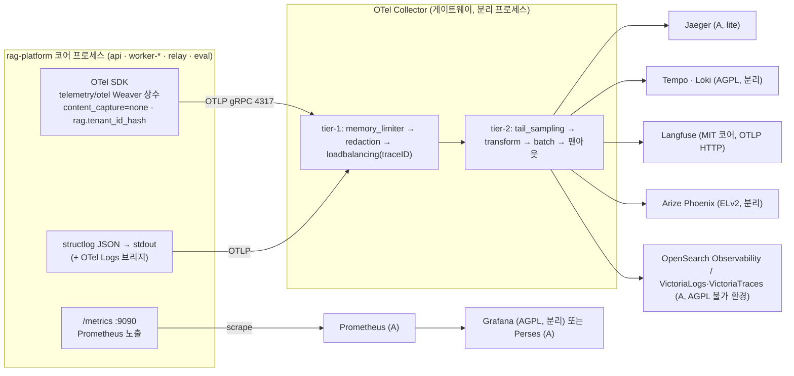
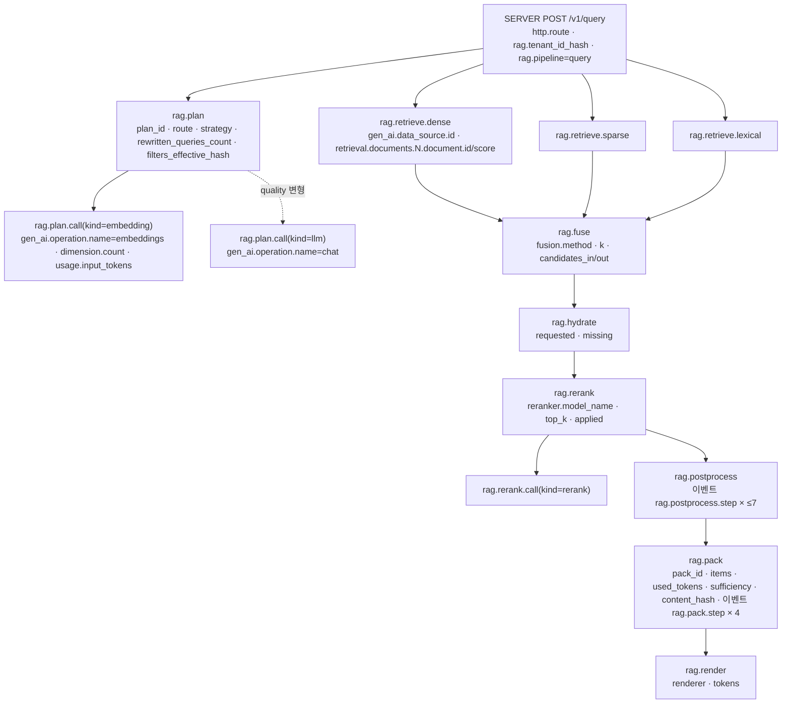

# 관측성

## 목적

이 문서는 브리프 원칙 8(Observable & Explainable)과 확정 결정 D-11(관측성, 개정 v1.1)을 **운영 가능한 구성**으로 확정한다. 설계 바이블 §6.5(이벤트·메트릭·스팬·로그 규약)와 [ADR-0022](../06-adr/0022-observability-genai-semconv-pin-and-license-boundary.md)가 정한 이름·경계를 **그대로** 쓰되, 그 문서들이 표로만 확정한 항목을 (1) OpenTelemetry(OTel) SDK·수집기(Collector) 파이프라인·샘플링 정책, (2) 트레이스 스팬(span) 규약과 `gen_ai.*` 매핑, (3) 메트릭 카탈로그, (4) 구조화 로그 표준과 PII 마스킹, (5) 대시보드·알림 규칙, (6) RAG 특화 트레이싱, (7) 비용 계측, (8) 데이터 보존으로 풀어 쓴다. 다른 설계 문서(01-pipeline-framework §9, 05-api §11·§12, 03-contracts/13 §8 등)가 "09-operations/03과 합의 후 등재"로 미뤄 둔 메트릭·스팬 제안을 이 문서가 한 곳에서 수용·판정한다.

## 범위

- **포함**: OTel Python SDK 설정(리소스·전파자·익스포터·환경 변수), Weaver 레지스트리 운영, Collector 파이프라인(redaction → tail sampling → transform → batch → 팬아웃)과 두 계층 토폴로지, 샘플링 정책(수집 100% / 검색 tail 샘플링), 스팬 이름·속성 표(`rag.{stage}`, `gen_ai.*`, OpenInference `retrieval.*`·`reranker.*`), 메트릭 카탈로그(바이블 §6.5 정본 25종 전부 + 제안 38종, 라벨 값 어휘, 버킷), 로그 필드 표준·PII 마스킹·질의 텍스트 로깅 정책, Grafana 대시보드 4종 패널 목록, 알림 규칙 표, RAG 특화 트레이싱(단계별 페이로드 요약·Langfuse/Phoenix 옵션), 비용 계측(LLM 토큰·GPU 시간·`usage_ledger` 정합), 신호별 보존 정책, 프로파일별 스택(`lite`·`standard`·`premium`·`korean-gov`, AGPL 불가 대안), 검증·CI.
- **제외**: 관측 백엔드(Prometheus·Tempo·Loki·Grafana·Langfuse·Jaeger·OpenSearch Observability·Perses) 자체의 설치·HA·튠 — 플랫폼은 OTLP 엔드포인트 값만 받는다([배포 아키텍처](../02-architecture/08-deployment-architecture.md) §3.1, [배포 가이드](01-deployment-guide.md) §2.4); 감사 이벤트(`audit.*`)의 저장소·보존 — [멀티테넌시·보안 아키텍처](../02-architecture/07-multi-tenancy-and-security-architecture.md) §8과 [보안과 컴플라이언스](05-security-and-compliance.md); 평가 지표의 정의·게이트 — [평가 전략](../08-evaluation/01-evaluation-strategy.md); 런북 본문 — [런북](06-runbooks.md); 환경 변수 전체 목록 — [설정 레퍼런스](02-configuration-reference.md).
- **정본 규칙**: 메트릭·스팬·로그 이름의 정본은 바이블 §6.5다. 이 문서의 "정본" 표기는 §6.5에 있는 것, "제안"은 §6.5 minor 개정(바이블 §1.2)을 기다리는 것이다. 제안 항목은 구현되더라도 CI 이름 대조(ADR-0022 준수 표 3)에서 허용 목록에 별도 등재되기 전에는 노출하지 않는다.

---

## 1. 관측 아키텍처 개관

**결정:** 플랫폼 코드는 OpenTelemetry Python SDK만 안다. 모든 신호(트레이스·메트릭·로그)는 OTLP로 OTel Collector에 보내고, Collector가 redaction·transform·tail sampling·팬아웃을 맡는다. C 등급 백엔드(Grafana·Tempo·Loki AGPL, Phoenix ELv2)와 Langfuse는 **OTLP 대상·분리 컨테이너**로만 존재하며 코어 이미지·`uv.lock`·Helm 이미지 목록에 없다(D-11, [ADR-0022](../06-adr/0022-observability-genai-semconv-pin-and-license-boundary.md), [ADR-0001](../06-adr/0001-license-grade-table-and-d02-interpretation.md)).



프로파일별 스택은 바이블 §7.1 "관측성" 행을 따른다.

| 프로파일 | 트레이스 | 메트릭 | 로그 | LLM 관측 UI | Collector | 비고 |
|----------|----------|--------|------|-------------|-----------|------|
| `lite` | Jaeger(all-in-one) | Prometheus | stdout JSON(compose 로그) | 없음(선택 Langfuse) | 선택(`compose.observability.yaml`); 없으면 SDK → Jaeger 직접 + 헤드 샘플링(§2.4) | 컨테이너 5 + 선택 3 |
| `standard` | Tempo(분리) | Prometheus + Grafana(분리) | Loki(분리) | Langfuse(OTLP HTTP) | 게이트웨이 2계층(§2.3) | 기본 |
| `premium` | `standard` 동일 | 동일 + DCGM GPU 메트릭 | 동일 | 동일 | 동일 | GPU 노드 exporter 추가 |
| `korean-gov` | AGPL 허용 시 `standard`; 불가 시 OpenSearch Observability(Trace Analytics) 또는 VictoriaTraces + Jaeger | Prometheus 또는 VictoriaMetrics + **Perses** | OpenSearch(Data Prepper) 또는 VictoriaLogs | Langfuse EE(보존·감사) 또는 미사용 | 게이트웨이 2계층, `NO_CONTENT` 잠금 | 관측 클러스터는 검색 OpenSearch와 분리 |

관측 신호와 도메인 이벤트는 분리된다(바이블 §10.3 E12, [ADR-0017](../06-adr/0017-event-delivery-outbox-cloudevents-no-broker.md)): 잡 상태·감사는 아웃박스 CloudEvents가 정본이고, 스팬·메트릭·로그는 어떤 계약 판정에도 쓰이지 않는다. 과금 정본은 PostgreSQL `usage_ledger`(§9)다.

---

## 2. OpenTelemetry 설정

### 2.1 SDK 구성(모든 코어 프로세스 공통)

| 항목 | 값 | 근거·비고 |
|------|----|-----------|
| 계측 API | `opentelemetry-api`/`-sdk`(Apache-2.0)만. `langfuse`·`arize-phoenix*`·`traceloop-sdk` 등 벤더 SDK 임포트 금지(CI 린트) | ADR-0022 준수 표 8 |
| 속성 상수 | `rag_platform.telemetry.otel`(Weaver 생성 모듈)만. `telemetry/` 밖에서 `gen_ai.`·`retrieval.`·`reranker.`·`rag.` 접두 문자열 리터럴 금지 | ADR-0022 준수 표 2, [저장소 구조](../10-development/01-repository-structure.md) `check_span_literals` |
| 리소스 속성 | `service.name = rag-platform-{role}`(`api`, `api-query`, `worker-io`, `worker-cpu`, `worker-gpu-ocr`, `worker-gpu-embed`, `worker-llm`, `worker-maintenance`, `relay`, `eval`), `service.version`(패키지 버전), `service.instance.id`(파드/컨테이너 ID), `deployment.environment.name`(`dev`·`staging`·`prod`), 제안 `rag.pipeline`은 스팬 속성(§3.2) | 표준 semconv 리소스 키; 배포 역할은 `rag serve` 인자 |
| 전파자 | W3C `tracecontext` + `baggage`. baggage에는 `rag.request_id`만 허용, `tenant_id`·주체·질의 금지(전파자 필터) | 05-api §11: 인바운드 `traceparent` 승계 |
| 트레이스 익스포터 | OTLP gRPC → `RAG_OTEL__EXPORTER_OTLP_ENDPOINT`(정본, 바이블 §6.6); `BatchSpanProcessor`(큐 2,048, 배치 512, 지연 5s — 초안) | 미설정이면 익스포터 없음(콘솔 익스포터는 `dev`만) |
| 헤드 샘플러 | `parentbased_always_on`(Collector가 tail 샘플링). Collector 없는 `lite`는 `RagHeadSampler`(§2.4) | — |
| 메트릭 | **Prometheus 풀(pull) 정본**: OTel `MeterProvider` + Prometheus 리더, `GET /metrics` 포트 9090(바이블 §14, 배포 가이드 §2.5). 선택 OTLP 푸시(`RAG_OTEL__METRICS_EXPORTER=prometheus\|otlp`, 제안) | 이름 변환으로 단위 접미가 중복되지 않도록 익스포터 옵션(`add_metric_suffixes` 상당, 확인 필요 as of 2026-09)을 끄고 CI 스냅샷이 최종 노출 이름을 §6.5와 대조 |
| 로그 | structlog JSON → stdout 항상; `RAG_OTEL__EXPORTER_OTLP_ENDPOINT`가 설정되면 OTel Logs 브리지(`LoggingHandler`)도 켠다(`RAG_OTEL__LOGS_BRIDGE=true`, 제안). 두 경로의 필드는 동일(§6) | 컨테이너 로그 수집(노드 에이전트)과 OTLP 중 배포 환경이 택1 |
| 콘텐츠 캡처 | `RAG_OTEL__CONTENT_CAPTURE=none`(정본; v1은 `none`만 허용 — [컴포넌트 아키텍처](../02-architecture/02-component-architecture.md) §5.2 `Literal["none"]`). `korean-gov`는 프로파일 `observability.content_capture` 오버라이드를 `rag profile validate`가 거부(`profile.invalid`, 제안 규칙 (13)) | 바이블 §10.3 E13, ADR-0022 준수 표 4 |
| 테넌트 식별자 | 스팬 `rag.tenant_id_hash`, 로그 `tenant_id_hash`만. 값은 `H("tenant", tenant_id)`(바이블 §6.2 `H()`; 소문자 hex 64) — 제안(바이블은 "해시"만 명시) | 키 있는 HMAC 전환은 미해결 이슈 3 |
| 자동 계측 | OTel contrib 공식 계측기 우선(`opentelemetry-instrumentation-fastapi`, `-httpx`, `-asyncpg`(확인 필요), `-openai-v2`), 공식이 없는 대상만 OpenInference(Anthropic)·OpenLLMetry(Qdrant). 같은 호출에 계측기 하나만 활성 | 09 문서 §역할별 1차·2차·폴백(권고), ADR-0022 중립 항 |
| Temporal | `temporalio.contrib.opentelemetry.TracingInterceptor`가 워크플로우·액티비티 스팬을 한 트레이스로 연결(바이블 §11.1) | 액티비티 재시도는 같은 트레이스의 새 스팬(`rag.attempt`) |

SDK 초기화는 조립 지점(`rag serve`, `LocalRunner` 진입점) 한 곳에서만 수행하고, 라이브러리로 임베딩된 경우(`pipelines`를 직접 호출) 호스트 애플리케이션의 `TracerProvider`를 그대로 쓴다. `pipelines`·`retrieval`·`render`·`adapters`는 `telemetry.get_tracer(component)`·`get_meter()` 포트만 사용한다(바이블 §12 의존 방향).

### 2.2 Weaver 레지스트리 운영

**결정:** `gen_ai.*`는 `open-telemetry/semantic-conventions-genai` 저장소의 **고정 커밋**, `rag.*`는 자체 레지스트리 YAML(`src/rag_platform/telemetry/registry/`)에서 OTel Weaver로 상수 모듈을 생성하고 `schema_url`을 고정한다([ADR-0022](../06-adr/0022-observability-genai-semconv-pin-and-license-boundary.md) 준수 표 1). OpenInference 속성은 `openinference-semantic-conventions` 패키지 상수를 **재수출**(re-export)해 같은 모듈에서 제공한다(레지스트리 YAML 아님).

```yaml
# src/rag_platform/telemetry/registry/registry_manifest.yaml  (제안; 값은 구현 시 확정)
name: rag-platform
schema_base_url: "https://rag-platform.dev/otel/schemas/"   # 확정 전 플레이스홀더
semconv_version: "1.0.0"
dependencies:
  - name: semconv-genai
    registry_path: "https://github.com/open-telemetry/semantic-conventions-genai/archive/<commit-sha>.zip[model]"
```

```yaml
# src/rag_platform/telemetry/registry/rag.yaml (발췌; 전체 속성은 §3.2 표)
groups:
  - id: registry.rag
    type: attribute_group
    brief: rag-platform 자체 속성(저카디널리티 우선, 콘텐츠 금지)
    attributes:
      - id: rag.tenant_id_hash
        type: string
        stability: development
        brief: H("tenant", tenant_id) 소문자 hex. 평문 tenant_id는 어떤 신호에도 없다.
      - id: rag.profile_hash
        type: string
        stability: development
        brief: 해소된 프로파일 해시(바이블 §6.2)
      - id: rag.plan_id
        type: string
        stability: development
        brief: QueryPlan.plan_id (ULID)
      - id: rag.degraded_count
        type: int
        stability: development
        brief: 현 스테이지까지 누적된 DegradedEntry 수
      - id: rag.pipeline
        type:
          members:
            - {id: ingest, value: "ingest", stability: development}
            - {id: query, value: "query", stability: development}
            - {id: eval, value: "eval", stability: development}
            - {id: maintenance, value: "maintenance", stability: development}
            - {id: relay, value: "relay", stability: development}
        stability: development
        brief: 샘플링 정책 분기 키(스팬 생성 시점에 설정)
```

CI(ADR-0022 준수 표 1): `weaver registry check`(린트) → `weaver registry diff`(고정 커밋 ↔ 체크아웃) → `weaver registry generate`(플래그는 확인 필요 as of 2026-09) → 커밋된 `telemetry/otel/*.py`와 재생성 결과 diff = 0. 커밋 이동은 diff 결과·대시보드 갱신·redaction 허용 목록 갱신을 한 PR에 담는다.

### 2.3 Collector 파이프라인

**결정:** `standard` 이상은 **2계층 게이트웨이**다. tier-1(수신·메모리 제한·redaction·`loadbalancing` 익스포터 `routing_key: traceID`)이 같은 trace의 스팬을 같은 tier-2 인스턴스로 보내고, tier-2가 tail sampling·transform·팬아웃을 수행한다. [배포 아키텍처](../02-architecture/08-deployment-architecture.md) §2.2의 `otel-collector` Deployment 2 replicas는 tier-1이며 tier-2는 StatefulSet(헤드리스 서비스, k8s resolver)로 둔다(배포 아키텍처 값 `observability.otelCollector` 확장 제안, 미해결 이슈 5). replicas=1이면 단일 계층으로 접는다.

```yaml
# deploy/helm/rag-platform/files/observability/otel-collector.yaml (tier-2 발췌; 프로세서 필드명은 확인 필요 as of 2026-09)
receivers:
  otlp:
    protocols:
      grpc: {endpoint: 0.0.0.0:4317}
      http: {endpoint: 0.0.0.0:4318}
processors:
  memory_limiter: {check_interval: 1s, limit_percentage: 80, spike_limit_percentage: 20}
  redaction/content:
    allow_all_keys: false
    allowed_keys:
      - ^gen_ai\.(operation\.name|provider\.name|request\.model|response\.model|data_source\.id|retrieval\.top_k|embeddings\.dimension\.count|usage\..*|response\.(id|finish_reasons)|token\.type)$
      - ^rag\..*
      - ^retrieval\.documents\.\d+\.document\.(id|score)$
      - ^reranker\.(model_name|top_k|(input|output)_documents\.\d+\.document\.(id|score))$
      - ^(server|http|url|network|error|exception\.type|otel|service|deployment)\..*
    blocked_values:                      # 2차 방어: 허용 키 값 안의 KR PII 패턴
      - "\\b\\d{6}-?[1-4]\\d{6}\\b"     # 주민등록번호
      - "\\b01[016789]-?\\d{3,4}-?\\d{4}\\b"
      - "[A-Za-z0-9._%+-]+@[A-Za-z0-9.-]+\\.[A-Za-z]{2,}"
    summary: info
  tail_sampling:
    decision_wait: 10s                   # premium quality 2.5s + 여유; 수집은 always 정책이라 대기 무관
    num_traces: 200000
    policies:
      - {name: ingest-always, type: string_attribute, string_attribute: {key: rag.pipeline, values: [ingest, maintenance, relay]}}
      - {name: errors, type: status_code, status_code: {status_codes: [ERROR]}}
      - {name: degraded, type: numeric_attribute, numeric_attribute: {key: rag.degraded_count, min_value: 1}}
      - {name: slow-query, type: latency, latency: {threshold_ms: 800}}   # 프로파일 latency_budget_ms.total
      - {name: eval-sample, type: and, and: {and_sub_policy: [
          {name: is-eval, type: string_attribute, string_attribute: {key: rag.pipeline, values: [eval]}},
          {name: p5, type: probabilistic, probabilistic: {sampling_percentage: 5}}]}}
      - {name: query-baseline, type: probabilistic, probabilistic: {sampling_percentage: 10}}
  transform/langfuse:
    trace_statements:
      - context: span
        statements:
          - set(attributes["langfuse.observation.type"], "retriever") where attributes["gen_ai.operation.name"] == "retrieval"
          - set(attributes["langfuse.observation.type"], "generation") where attributes["gen_ai.operation.name"] == "chat"
          - set(attributes["langfuse.observation.type"], "embedding") where attributes["gen_ai.operation.name"] == "embeddings"
          - set(attributes["langfuse.observation.type"], "span") where attributes["langfuse.observation.type"] == nil
  batch: {timeout: 5s, send_batch_size: 1024}
exporters:
  otlp/tempo: {endpoint: "${env:TEMPO_OTLP_ENDPOINT}"}
  otlphttp/langfuse:
    endpoint: "${env:LANGFUSE_OTLP_ENDPOINT}"          # https://<langfuse>/api/public/otel (HTTP만, gRPC 미지원)
    headers: {Authorization: "Basic ${env:LANGFUSE_BASIC_AUTH}"}
  otlphttp/loki: {endpoint: "${env:LOKI_OTLP_ENDPOINT}"}   # Loki 3.x OTLP 수신, 확인 필요
service:
  pipelines:
    traces/store:    {receivers: [otlp], processors: [memory_limiter, redaction/content, tail_sampling, batch], exporters: [otlp/tempo]}
    traces/langfuse: {receivers: [otlp], processors: [memory_limiter, redaction/content, tail_sampling, transform/langfuse, batch], exporters: [otlphttp/langfuse]}
    logs:            {receivers: [otlp], processors: [memory_limiter, redaction/content, batch], exporters: [otlphttp/loki]}
```

규칙:

1. **순서 고정** `redaction → (tail_sampling) → transform → batch → exporter`(ADR-0022 준수 표 9). transform은 redaction 뒤에 와서 벤더 속성이 허용 목록 검사를 우회하지 않게 한다.
2. redaction은 **허용 목록 방식**(`allow_all_keys: false`)이다. `gen_ai.input.messages`·`gen_ai.output.messages`·`gen_ai.system_instructions`·`gen_ai.retrieval.query.text`·`gen_ai.retrieval.documents`·`retrieval.documents.*.document.content`·`reranker.query`·`exception.stacktrace`는 허용 목록에 없으므로 값이 도착해도 폐기된다. SDK가 `none`에서 이 속성을 만들지 않으므로 이는 2차 방어다(E13).
3. redaction processor의 로그·메트릭 지원은 알파 단계(ADR-0022 F8)이므로 로그 PII 마스킹의 1차 방어는 structlog 프로세서(§6.2)다.
4. Langfuse 파이프라인은 `content_capture ≠ none`인 프로파일에서만 `gen_ai.input.messages → langfuse.observation.input` 복사 문장을 추가한다(v1에는 해당 프로파일이 없다).
5. Collector 자체 메트릭(`otelcol_exporter_send_failed_*`, `otelcol_processor_tail_sampling_*`)은 Prometheus가 스크레이프하고 §8 알림에 포함한다.
6. 노드 에이전트 DaemonSet(컨테이너 로그·노드 메트릭)을 병행할 때도 같은 `redaction/content` 블록을 넣는다. `NO_CONTENT`는 SDK(원천)에서 강제되므로 에이전트 계층은 2차 방어이며, 두 계층의 설정은 같은 Helm 템플릿 조각에서 생성한다 — 배포 아키텍처 미해결 이슈 9 해소.
7. `lo-sidecar`(GPL, `rag-optin` 네임스페이스 egress 0)에는 OTLP 예외를 **허용하지 않는다**. 사이드카 관측은 워커 측 `rag.parse.call` 스팬과 `ConvertResponse.took_ms`·`warnings`로 충분하다. A 등급 사이드카(`parser-workers`·`ocr-gpu`)는 `ConvertRequest.trace_id`를 이어받아 자체 OTLP를 보낼 수 있다(NetworkPolicy 표에 이미 `otel` 허용) — 배포 아키텍처 미해결 이슈 12 해소.

### 2.4 샘플링 정책

**결정:** 수집(`ingest`·`maintenance`·`relay`) 트레이스는 **100% 보존**, 검색(`query`) 트레이스는 Collector **tail sampling**, 평가(`eval`) 트레이스는 확률 표본이다. 어떤 정책에서도 오류(`ERROR`)·저하(`rag.degraded_count ≥ 1`)·지연 예산 초과 트레이스는 보존한다.

| 파이프라인(`rag.pipeline`) | 정책 | 근거 |
|---------------------------|------|------|
| `ingest`, `maintenance`, `relay` | 항상 보존. 장시간 워크플로우(OCR 60m)는 `decision_wait`를 넘겨 스팬이 나눠 도착하므로 tail 정책이 아닌 `string_attribute` 항상 정책으로 결정을 캐시한다 | 문서당 스팬 10~20개로 저볼륨, 재처리·감사 가치 높음 |
| `query` | 보존: `status=ERROR` ∪ `rag.degraded_count ≥ 1` ∪ 지연 > `query.latency_budget_ms.total`(프로파일 값; `standard` 800ms) ∪ 확률 10%(초안 목표) | QPS가 볼륨을 지배; 정상·빠른 질의는 표본으로 충분 |
| `eval` | 확률 5%(초안 목표) + 오류 | 하네스 런은 수천 질의; 품질 판정은 `EvalReport`가 정본 |
| `lite`(Collector 없음) | SDK `RagHeadSampler`(제안): 루트 스팬 생성 시 `rag.pipeline` 속성으로 분기 — `ingest` 항상, `query` `traceidratio` 10%. 오류·지연 기반 보존은 불가(문서화된 한계) | 헤드 샘플링은 결과를 모른다 |

확률값은 Helm `observability.sampling.{query_percent, eval_percent}`(제안)로 조정하며, 변경은 대시보드의 "표본 비율" 패널(§7.2)에 반영된다. 메트릭·로그는 샘플링하지 않는다(로그는 §6.4의 레벨 정책만).

### 2.5 환경 변수·프로파일 키

| 키 | 정본/제안 | 기본 | 의미 |
|----|-----------|------|------|
| `RAG_OTEL__EXPORTER_OTLP_ENDPOINT` | 정본(바이블 §6.6) | 없음 | Collector OTLP gRPC 엔드포인트(Helm `externals.otel.endpoint`) |
| `RAG_OTEL__CONTENT_CAPTURE` | 정본 | `none` | v1은 `none`만; `korean-gov` 잠금 |
| `RAG_OTEL__METRICS_EXPORTER` | 제안 | `prometheus` | `prometheus`(풀) \| `otlp`(푸시) |
| `RAG_OTEL__LOGS_BRIDGE` | 제안 | `false` | OTel Logs 브리지 켬 |
| `RAG_OTEL__LOG_LEVEL` | 제안 | `info` | structlog 최소 레벨 |
| `RAG_OTEL__TENANT_HASH_KEY_REF` | 제안 | 없음 | 설정 시 `tenant_id_hash`를 HMAC으로(§6.2, 미해결 이슈 3) |
| `OTEL_SERVICE_NAME`, `OTEL_RESOURCE_ATTRIBUTES`, `OTEL_TRACES_SAMPLER` | OTel 표준 | SDK 기본 | 플랫폼 접두를 붙이지 않고 표준 변수를 그대로 존중 |
| 프로파일 `observability: {content_capture, tenant_id_hash}` | 정본(바이블 §5.6·§7.3) | `{none, true}` | `tenant_id_hash: false`는 어떤 프로파일에서도 허용하지 않는다(검증 규칙 제안) |

전체 목록·타입은 [설정 레퍼런스](02-configuration-reference.md)가 소유한다.

---

## 3. 트레이스 스팬 규약

### 3.1 스팬 이름·종류

바이블 §6.5 패턴 `rag.{stage}`가 정본이다. 셸(`StageShell.execute`·`invoke_inline`)이 스테이지 스팬을 만들고, 플러그인은 스팬을 만들지 않는다([파이프라인 프레임워크](../04-pipelines/01-pipeline-framework.md) §9). 플러그인 내부의 외부 호출(모델 서버·사이드카·LLM)만 SDK 데코레이터 `@instrumented_call(kind=…)`가 자식 스팬 `rag.{stage}.call`을 붙인다. 자식 스팬 이름의 `{stage}`는 **파이프라인 접두를 제외한 스테이지명**이다: 수집 스테이지 스팬 `rag.ingest.embed`의 자식은 `rag.embed.call`(`rag.ingest.embed.call`이 아님), 질의 스테이지 스팬 `rag.rerank`의 자식은 `rag.rerank.call`이다. 부모 파이프라인은 `rag.pipeline` 속성(§3.2)으로 구분한다.

| 스팬 이름 | 종류(kind) | 부모 | 정본/제안 | 생성 주체 |
|-----------|-----------|------|-----------|-----------|
| HTTP 서버 스팬(`POST /v1/query` 등, `http.route` 템플릿) | SERVER | 인바운드 `traceparent` | HTTP semconv | FastAPI 계측기 |
| `rag.ingest.{stage}` — `fetch, detect, parse, normalize, chunk, recount, enrich, embed, index, publish` | INTERNAL | Temporal 액티비티 스팬(`TracingInterceptor`) 또는 `LocalRunner` 루트 | 정본(`rag.ingest.parse` 예시) | 셸 |
| `rag.plan`, `rag.retrieve.{channel}`, `rag.fuse`, `rag.hydrate`, `rag.rerank`, `rag.postprocess`, `rag.pack`, `rag.render` | INTERNAL(`rag.retrieve.*`는 CLIENT) | HTTP 서버 스팬 | 정본 | 셸 `invoke_inline` |
| `rag.{stage}.call` — `kind ∈ {embedding, rerank, llm, sidecar, ocr, source}`; `{stage}`는 접두 없는 스테이지명(`rag.fetch.call`, `rag.parse.call`, `rag.enrich.call`, `rag.embed.call`, `rag.plan.call`, `rag.rerank.call`) | CLIENT | 해당 스테이지 스팬(`rag.ingest.{stage}` 또는 `rag.{stage}`) | 제안(01 §9.1·05 §9) | `@instrumented_call` |
| `rag.answer` | INTERNAL | `POST /v1/answer` 서버 스팬 | 제안(05-api/03 §11) | `api` |
| `rag.outbox.publish` | INTERNAL | 릴레이 루프 | 제안(05-api/07) | `relay` |
| `rag.mcp.{tool}` — `search, get_document, list_collections` | INTERNAL | `/mcp` 서버 스팬 | 제안 | `mcp` |
| `rag.eval.run` | INTERNAL | 하네스 루트 | 제안 | `eval` |

`rag.retrieve.{channel}`의 `{channel}`은 `Channel` 열거값(`dense, sparse, lexical, graph, tree, visual, late_interaction`)이며 컬렉션·변형은 속성으로 구분한다(스팬 이름 카디널리티 고정). 스팬 상태는 `StageFailure`에서 `ERROR`, 폴백·저하는 `UNSET`(정상)이며 `rag.degraded_count`로 표현한다.

### 3.2 `rag.*` 속성

| 속성 | 타입 | 붙는 스팬 | 정본/제안 | 값·비고 |
|------|------|-----------|-----------|---------|
| `rag.tenant_id_hash` | string | 모든 `rag.*` 스팬 | 정본 | `H("tenant", tenant_id)`(§2.1) |
| `rag.profile_hash` | string | 모든 `rag.*` 스팬 | 정본 | 바이블 §6.2 |
| `rag.plan_id` | string(ulid) | 질의 스팬 | 정본 | |
| `rag.degraded_count` | int | 질의 스팬 | 정본 | 누적 `DegradedEntry` 수 |
| `rag.pipeline` | enum | 루트에 가까운 첫 `rag.*` 스팬 | 제안 | 샘플링 분기(§2.4) |
| `rag.plugin_id`, `rag.plugin_version` | string | 스테이지·call 스팬 | 제안(01 §9.1) | `{extension_point}.{implementation}` |
| `rag.stage_key`, `rag.cache_hit` | string(hex64), boolean | `rag.ingest.*` | 제안(01 §9.1) | 캐시 적중이면 실행 생략 스팬(수 ms) |
| `rag.isolation_mode`, `rag.quality`, `rag.warnings_count`, `rag.attempt`, `rag.force`, `rag.force_equivalent` | enum / enum / int / int / bool / bool | `rag.ingest.*` | 제안(01 §9.1) | `IsolationMode`·`Quality` 열거 |
| `rag.job_id`, `rag.document_id`, `rag.commit_id` | string(ulid) | `rag.ingest.*` | 제안 | 트레이스는 고카디널리티 허용(메트릭 라벨 금지와 무관) |
| `rag.query_id`, `rag.pack_id` | string(ulid) | 질의 스팬 | 제안 | `ContextPack.trace_id`와 역방향 상관 |
| `rag.error.code`, `rag.error.retryable` | string, boolean | 실패 스팬 | 제안(03-contracts/13 §8) | `exception.type = code`, `exception.message = title_en`; `detail`·`stacktrace`는 스팬에 없음 |
| `rag.image_digest` | string | `rag.*.call(kind=sidecar\|ocr)` | 제안 | `Producer.image_digest` |
| 단계별 페이로드 요약 속성 | — | §5 표 | 제안 | ID·해시·개수만 |

### 3.3 `gen_ai.*` 매핑 — 모델 호출

고정 커밋의 GenAI 규약(연산명 `retrieval`·`embeddings`·`chat`, 콘텐츠 속성 Opt-In)을 아래처럼 쓴다. 속성명은 모두 Weaver 상수다.

| 호출 | 스팬 | `gen_ai.operation.name` | 필수·권고 속성 | 금지(캡처 끔) |
|------|------|-------------------------|----------------|---------------|
| 채널 검색 | `rag.retrieve.{channel}` | `retrieval` | `gen_ai.data_source.id = collection_id`(조건 필수), `gen_ai.retrieval.top_k = channels[].top_k`, `server.address`(백엔드), `error.type`(실패 시). `gen_ai.provider.name`은 자체 리트리버라 생략. OpenInference `openinference.span.kind=RETRIEVER`, `retrieval.documents.{i}.document.id = record_id`, `.document.score`(상위 `k_trace` 개, 기본 10 — 초안) | `gen_ai.retrieval.query.text`, `gen_ai.retrieval.documents`(Opt-In 구조 속성; OpenInference와 중복이라 채택 보류, 미해결 이슈 6), `retrieval.documents.*.document.content` |
| 질의 임베딩 | `rag.plan` 자식 `rag.plan.call(kind=embedding)` | `embeddings` | `gen_ai.provider.name`(자체 서빙은 커스텀 값 `vllm`·`tei`·`in_process` — 확인 필요, 미해결 이슈 7), `gen_ai.request.model = model_id`, `gen_ai.response.model`, `gen_ai.embeddings.dimension.count`, `gen_ai.usage.input_tokens`, `server.address`·`server.port` | 입력 텍스트 |
| 문서 임베딩 배치 | `rag.ingest.embed` 자식 `rag.embed.call(kind=embedding)` | `embeddings` | 위와 동일 + `rag.embed.batch_size`, `rag.embed.batch_tokens` | 동일 |
| 크로스인코더 리랭크 | `rag.rerank` 자식 `rag.rerank.call(kind=rerank)` | 표준 값 없음 → **설정하지 않음**(ADR-0022 F3). 스팬 이름 `rag.rerank`와 `openinference.span.kind=RERANKER`로 식별 | `gen_ai.request.model`, `server.address`, `reranker.model_name`, `reranker.top_k`, `reranker.input_documents.{i}.document.id`, `reranker.output_documents.{i}.document.id/score`(상위 `k_trace`) | `reranker.query`, `*.document.content` |
| LLM 보강·플래너·판정·`answer` | `rag.enrich.call(kind=llm)`, `rag.plan.call(kind=llm)`, `rag.eval.run` 자식, `rag.answer` 자식 | `chat` | `gen_ai.provider.name`(Required; `anthropic`, `openai`, `gcp.gemini` 등 잘 알려진 값), `gen_ai.request.model`, `gen_ai.response.model`, `gen_ai.usage.input_tokens`, `gen_ai.usage.output_tokens`, `gen_ai.usage.cache_read.input_tokens`, `gen_ai.usage.cache_write.input_tokens`, `gen_ai.response.finish_reasons`, `gen_ai.response.id`, `gen_ai.request.max_tokens`, `gen_ai.request.temperature`, `error.type` | `gen_ai.input.messages`, `gen_ai.output.messages`, `gen_ai.system_instructions`, `gen_ai.tool.definitions`, `gen_ai.prompt.variable.*` |
| 사이드카 변환 | `rag.parse.call(kind=sidecar\|ocr)` | 해당 없음(GenAI 아님) | `server.address`, `http.request.method`, `rag.image_digest`, `rag.plugin_id`; `ConvertRequest.trace_id`로 컨텍스트 전파 | `ConvertRequest.options` 값 |
| 원천 다운로드 | `rag.fetch.call(kind=source)` | 해당 없음 | `url.scheme`, `server.address`(호스트만), `http.response.status_code`, `rag.fetch.bytes` | 경로·쿼리 문자열(`url.full` 금지) |

`gen_ai.evaluation.result` 이벤트(하네스 판정 결과)는 [ADR-0023](../06-adr/0023-evaluation-qrels-answer-spans-and-linear-ndcg.md)·[평가 전략](../08-evaluation/01-evaluation-strategy.md)이 사용 방식을 정하며, 이 문서는 이벤트 속성 `gen_ai.evaluation.name`·`gen_ai.evaluation.score.value`만 허용 목록에 둔다(`gen_ai.evaluation.explanation`은 판정 근거 텍스트가 콘텐츠를 인용할 수 있어 차단).

### 3.4 트레이스 상관(correlation)

| 경계 | 전파 수단 | 정본 위치 |
|------|-----------|-----------|
| 클라이언트 → API | W3C `traceparent`(유효하면 승계, 샘플링 플래그는 서버 정책) | [리트리벌 API](../05-api/03-retrieval-api.md) §11 |
| API → 응답 | `ContextPack.trace_id`, `ProblemDetails.trace_id`, `AnswerResponse.trace_id`(소문자 hex 32) | 바이블 §5.3·§5.5 |
| API → Temporal → 워커 | `TracingInterceptor`(헤더 전파), 액티비티 재시도는 새 스팬 `rag.attempt` | 바이블 §11.1 |
| 워커 → 사이드카 | `ConvertRequest.trace_id` + HTTP `traceparent` | 바이블 §5.6 |
| 잡 → 이벤트 | `CloudEventEnvelope.data`에 `trace_id`를 넣지 않는다(ID·해시·상태만). 상관은 `job_id`·`query_id`로 로그·스팬을 조인. CloudEvents Distributed Tracing 확장(`traceparent`) 채택은 미해결 이슈 8 | 바이블 §10.3 E12, §5.3 `CloudEventEnvelope` |
| 로그 ↔ 스팬 | structlog `trace_id`·`span_id`(§6.1) | 바이블 §6.5 |
| 감사 | `AuditQueryExecutedData.trace_id` | [잡·이벤트·상태 계약](../03-contracts/12-jobs-events-and-status.md) |

---

## 4. 메트릭 카탈로그

### 4.1 규약

- 이름 `rag_<stage>_<name>_<unit>`, 단위 `seconds, bytes, total, count, ratio`(바이블 §6.5). `_count` 단위는 **분포(histogram)** 또는 **게이지**이며 타입 열이 구분한다. histogram의 파생 시계열(`_bucket`, `_sum`, `_count`)은 Prometheus 규약대로 붙는다(`rag_pack_tokens_count_count`는 허용된 결과).
- 라벨은 저카디널리티만: 정본 허용 집합 `stage, channel, backend_id, profile_id, outcome, renderer, queue`. 정본 목록이 이미 쓰는 `vector, component, metric`은 해당 메트릭에 한정된 정본 라벨로 본다(허용 집합 명시는 미해결 이슈 1). 제안 라벨 `code, status, route, kind`는 §6.5 개정 전 노출 금지.
- **`tenant_id` 라벨 금지**(해시도 금지). 테넌트 단위 관측은 로그 `tenant_id_hash`·스팬 `rag.tenant_id_hash`·원장 `usage_ledger`로 한다([ADR-0022](../06-adr/0022-observability-genai-semconv-pin-and-license-boundary.md) 대안 D 기각).
- `outcome` 값 집합은 메트릭 가족별로 고정한다(§4.3). `profile_id`는 kebab-case 프로파일 ID, `backend_id`는 `index_backend.qdrant` 같은 `plugin_id`(서빙 서버 메트릭에서는 `embedder.*`·`reranker.*` 플러그인 ID), `queue`는 **Temporal 태스크 큐 이름만**(바이블 §11.2: `ingest-io, ingest-cpu, ingest-gpu-ocr, ingest-gpu-embed, ingest-llm, maintenance`; `lite`는 `ingest`·`maintenance`). 태스크 큐가 아닌 공유 서빙 파드의 GPU 시간은 `queue` 값을 만들지 않고 별도 메트릭 `rag_serving_gpu_seconds_total{backend_id}`(제안)로 분리한다(§9.2).
- 검색 QPS는 별도 카운터 없이 `rate(rag_query_latency_seconds_count[5m])`로 얻는다. 오류율은 `outcome="error"` 비율, 코드별 오류율은 `rag_stage_errors_total{stage, code}`(제안)로 얻는다.
- 히스토그램 버킷(초안 목표): 질의 측 지연 `[0.005, 0.01, 0.025, 0.05, 0.1, 0.25, 0.5, 0.8, 1, 1.5, 2.5, 5]`; 수집 스테이지 `[1, 5, 15, 30, 60, 120, 300, 600, 1200, 1800, 3600]`; 지연·SLO 계열(`outbox`·`acl`·`queue_wait`) `[0.1, 0.5, 1, 2, 5, 10, 30, 60, 300, 900]`; 토큰 `[1, 4, 16, 64, 256, 1024, 4096, 16384, 65536]`(GenAI 규약 `gen_ai.client.token.usage` 버킷의 부분집합); 개수 `[0, 1, 5, 10, 20, 50, 100, 300]`.

### 4.2 카탈로그

"정본" 25종은 바이블 §6.5 목록 전부다. "제안" 38종은 다른 설계 문서가 이 문서로 위임한 항목을 판정·정리한 것이다(총 63종).

**수집 처리량·지연·실패·큐**

| 이름 | 타입 | 라벨 | 설명 | 정본/제안(출처) |
|------|------|------|------|-----------------|
| `rag_ingest_stage_duration_seconds` | histogram | `stage, queue, outcome` | 스테이지 액티비티 실행 시간(캐시 적중은 `outcome=cache_hit`) | 정본 |
| `rag_ingest_jobs_total` | counter | `queue, outcome` | 종료 잡 수(`outcome ∈ JobState 종결값`) — 처리량·실패율 | 제안 |
| `rag_ingest_stage_cache_hit_total` | counter | `stage` | `stage_key` 캐시 적중 | 제안(01 §9.2) |
| `rag_stage_errors_total` | counter | `stage, code` | `StageError` 코드별 실패(라벨 `code` 신설) | 제안(03-contracts/13 §8) |
| `rag_job_queue_wait_seconds` | histogram | `queue` | 잡 `created_at → started_at`(디스패처·Temporal 큐 대기) | 제안(02-architecture/06 이슈 7) |
| `rag_dispatch_waiting_jobs_count` | gauge | `queue` | `queued` 체류 잡 수(`waiting_for` 포함) | 제안(02-architecture/06 이슈 7) |
| `rag_fetch_bytes_total` | counter | `outcome` | 다운로드 바이트(`ok, not_modified, reused, error`) | 제안(04-pipelines/02 §11) |
| `rag_parse_page_status_total` | counter | `outcome` | 페이지 결과(`PageStatus` 값) | 제안(04-pipelines/03) |
| `rag_parse_fallback_total` | counter | `stage` | 파서 폴백 체인 진입 수(`stage=parse`) | 제안(04-pipelines/03·04) |
| `rag_parser_sidecar_unavailable_total` | counter | `backend_id` | `parse.sidecar_unavailable` 발생 | 정본 |
| `rag_normalize_pii_spans_total` | counter | `outcome` | PII 정책 적용 구간 수(`mask, tokenize, exclude, reject`) | 제안(03-contracts/04) |
| `rag_pii_detector_errors_total` | counter | `stage` | `normalize.pii_detector_unavailable` | 정본 |
| `rag_egress_denied_total` | counter | `component` | `fetch.egress_denied`·`outbox.egress_denied`(`component ∈ {fetch, relay}`) | 정본 |
| `rag_gpu_seconds_total` | counter | `queue` | GPU 태스크 큐(`ingest-gpu-embed`, `ingest-gpu-ocr`, 판정 시 `ingest-llm`·`maintenance`) 액티비티 벽시계 초 × 슬롯(§9.2); `usage_ledger(meter=gpu_seconds)`와 정합 대상 | 제안 |

**임베딩·인덱스**

| 이름 | 타입 | 라벨 | 설명 | 정본/제안(출처) |
|------|------|------|------|-----------------|
| `rag_embed_batch_tokens_count` | histogram | `backend_id` | 배치당 입력 토큰(`batch_max_tokens` 대비 충전율) | 제안(04-pipelines/12 이슈 11) |
| `rag_embed_truncated_total` | counter | `backend_id` | `embed.token_overflow` 절단 청크 수 | 제안(04-pipelines/12 이슈 11) |
| `rag_embed_cache_total` | counter | `outcome` | 청크 임베딩 캐시 `H("embed", …)` 적중(`hit, miss, bypass, error`) | 제안(04-pipelines/12 `rag_embed_cache_hit_ratio` 대체) |
| `rag_index_bytes_total` | gauge | `vector` | 백엔드 적재 바이트. `vector ∈ VectorName ∪ {lexical}`(`lexical` 값은 04-pipelines/13 이슈 8 수용) | 정본 |
| `rag_index_records_count` | gauge | `backend_id` | `is_current=true` 레코드 수(정합성 검사 잡이 갱신) | 제안 |
| `rag_consistency_mismatch_total` | counter | `backend_id` | `index.consistency.mismatch` | 정본 |
| `rag_delete_propagation_seconds` | histogram | `backend_id` | 삭제 잡 접수 → 양 백엔드 반영 | 제안(04-pipelines/19) |

**검색 지연·품질·캐시**

| 이름 | 타입 | 라벨 | 설명 | 정본/제안(출처) |
|------|------|------|------|-----------------|
| `rag_query_latency_seconds` | histogram | `profile_id, outcome` | `POST /v1/query`·MCP `search` 종단 지연; QPS = `rate(_count)` | 정본 |
| `rag_plan_latency_seconds` | histogram | `profile_id, outcome` | `plan`(`outcome=llm_fallback`·`cache_hit` 포함) | 정본 |
| `rag_embed_query_latency_seconds` | histogram | `profile_id, outcome` | 질의 임베딩(`cache_hit` 시 0 근사) | 정본 |
| `rag_retrieve_latency_seconds` | histogram | `channel, backend_id, outcome` | 채널 런 지연 | 정본 |
| `rag_retrieve_channel_runs_total` | counter | `channel, outcome` | 채널 런 결과(`ChannelRunStatus` 값) — 채널 타임아웃·오류율 | 제안 |
| `rag_retrieve_candidates_count` | histogram | `channel` | 채널 런당 반환 후보 수 | 제안(07-tech-landscape/09 변형) |
| `rag_hydrate_latency_seconds` | histogram | `backend_id` | payload 배치 조회 | 정본 |
| `rag_hydrate_missing_total` | counter | `backend_id` | 세대 플립 경합 누락 | 정본 |
| `rag_rerank_latency_seconds` | histogram | `profile_id, outcome` | 리랭커 호출(폴백은 `outcome=fallback`) | 정본 |
| `rag_rerank_fallback_total` | counter | `profile_id` | `rerank.timeout`·5xx 폴백 | 정본 |
| `rag_postprocess_latency_seconds` | histogram | `profile_id` | 후처리 전체 | 정본 |
| `rag_pack_latency_seconds` | histogram | `profile_id, outcome` | 패킹(`count_api_failed`는 `outcome=fallback`) | 정본 |
| `rag_pack_tokens_count` | histogram | `profile_id` | `budget.used_tokens` | 정본 |
| `rag_pack_items_count` | histogram | `profile_id` | 최종 K | 제안 |
| `rag_pack_omitted_total` | counter | `outcome` | `omitted[].reason`(`OmitReason` 값) | 제안 |
| `rag_pack_citation_unresolved_total` | counter | `renderer` | `citation_align`·렌더에서 `cite_id`↔`segments` 불일치 | 정본 |
| `rag_acl_recheck_denied_total` | counter | `profile_id` | `omitted(acl_denied)` | 정본 |
| `rag_query_degraded_total` | counter | `component` | `DegradedEntry.component`별 저하 | 제안(02-architecture/09) |
| `rag_render_latency_seconds` | histogram | `renderer` | 렌더러 지연(정본 라벨 `renderer`의 첫 사용) | 제안 |
| `rag_embed_query_cache_total` | counter | `outcome` | Valkey `qemb:` | 제안 |
| `rag_plan_cache_total` | counter | `outcome` | Valkey `plan:` | 제안(04-pipelines/14 `rag_plan_cache_hit_total` 대체) |
| `rag_postprocess_parent_text_cache_total` | counter | `outcome` | Valkey `ptxt:`(부모 번들) | 제안 |
| `rag_pack_token_cache_total` | counter | `outcome` | Valkey `tok:` | 제안 |
| `rag_answer_latency_seconds` | histogram | `outcome` | `POST /v1/answer` 레퍼런스 | 제안(05-api/03 §11) |

**토큰·비용·평가·피드백**

| 이름 | 타입 | 라벨 | 설명 | 정본/제안(출처) |
|------|------|------|------|-----------------|
| `rag_enrich_llm_tokens_total` | counter | `stage, outcome` | LLM 보강 토큰(입력+출력; `usage_ledger.llm_tokens`와 증분 일치) | 정본 |
| `rag_enrich_llm_cost_usd_total` | counter | `stage` | 가격표 기반 추정 비용 | 정본 |
| `rag_answer_llm_tokens_total` | counter | `outcome` | `answer` 토큰(입력+출력) | 제안(05-api/03) |
| `rag_answer_llm_cost_usd_total` | counter | — | `answer` 추정 비용 | 제안 |
| `rag_eval_judge_cost_usd_total` | counter | — | LLM-judge 추정 비용 | 제안(08-evaluation/04 이슈 5) |
| `rag_eval_metric_value` | gauge | `metric, profile_id` | 최근 야간 런 값(`metric ∈ {ndcg@10, recall@20, mrr, span_hit_rate@k, judged@10, …}` + 청킹 내재 지표) | 정본 |
| `rag_eval_last_run_timestamp_seconds` | gauge | `profile_id` | 프로파일별 최근 `eval.run.v1` 완료 시각(unix 초); `RagEvalStale` 알림(§8) 원천 | 제안(이 문서) |
| `rag_serving_gpu_seconds_total` | counter | `backend_id` | 공유 서빙 파드(`embedding-server`·`reranker-server`·`ocr-gpu`) 가동 초 × GPU 슬롯; 태스크 큐가 아니므로 `rag_gpu_seconds_total`과 분리(§9.2), 원장 정합 대상 아님 | 제안(이 문서) |
| `rag_feedback_events_total` | counter | `kind` | `FeedbackKind` 값(라벨 `kind` 신설) | 제안(08-evaluation/01 이슈 6) |

**이벤트·웹훅·ACL·API**

| 이름 | 타입 | 라벨 | 설명 | 정본/제안(출처) |
|------|------|------|------|-----------------|
| `rag_outbox_lag_seconds` | histogram | `queue` | `published_at − time`; SLO `runtime.outbox_lag_slo` | 정본 |
| `rag_acl_propagation_seconds` | histogram | `backend_id` | ACL 갱신 접수 → 백엔드 반영; SLO `runtime.acl_propagation_slo` | 정본 |
| `rag_authz_errors_total` | counter | `outcome` | 인가 엔진 오류·정책 미로딩(fail-closed Deny) | 정본 |
| `rag_webhook_delivery_total` | counter | `outcome` | `delivered, retried, exhausted, egress_denied` | 제안(05-api/07) |
| `rag_webhook_delivery_latency_seconds` | histogram | `outcome` | 전송 → 응답 | 제안(05-api/07) |
| `rag_webhook_pending_count` | gauge | — | `pending`·`retry_scheduled` 전달 레코드 수 | 제안(05-api/07) |
| `rag_api_problems_total` | counter | `code, status` | RFC 9457 응답 수(라벨 `code`·`status` 신설; 429는 `code=api.rate_limited`) | 제안(05-api/01 §21) |
| `rag_api_idempotency_total` | counter | `outcome` | `new, replayed, conflict, mismatch` | 제안(05-api/01) |
| `rag_api_sse_connections_count` | gauge | `route` | 현재 SSE 연결(라벨 `route` 신설) | 제안(05-api/01) |

채택하지 않은 제안: `rag_stage_duration_seconds`(정본 `rag_ingest_stage_duration_seconds`로 대체), `rag_query_candidates_count{stage}`(채널·팩 개수 메트릭으로 분리), `rag_valkey_keys_total`·`rag_valkey_memory_bytes`(Valkey exporter 영역), `rag_embed_server_errors_total`(`rag_stage_errors_total{stage="embed"}`로 흡수), `rag_api_rate_limited_total{class}`(`rag_api_problems_total`로 흡수), `rag_webhook_sampled_out_total{type}`(라벨 `type` 24값은 허용 가능하나 전달 원장 SQL로 대체), `rag_eval_metric_value`의 `dataset_id` 라벨(PostgreSQL 데이터소스로 분해, 08-evaluation/01 결정).

### 4.3 `outcome` 값 어휘

| 메트릭 가족 | 값 | 출처 |
|-------------|----|------|
| 스테이지·질의 지연(`rag_ingest_stage_duration_seconds`, `rag_*_latency_seconds`) | `ok, degraded, partial, error, fallback, cache_hit`(질의 측에 `llm_fallback` 추가) | [오류 모델](../03-contracts/13-error-model.md) §8 초안; 01 §9.2의 `failed`는 `error`로 정렬 |
| 캐시(`rag_*_cache_total`) | `hit, miss, bypass, error` | 이 문서 |
| 채널 런 | `ok, timeout, error, disabled` | `ChannelRunStatus` |
| 잡 종료 | `succeeded, partial, failed, cancelled` | `JobState` 종결값 |
| 페이지 | `ok, timeout, ocr_failed, skipped` | `PageStatus` |
| 팩 제외 | `OmitReason` 8값 | 바이블 §5.7 |
| 웹훅 | `delivered, retried, exhausted, egress_denied` | 05-api/07 |
| 멱등 | `new, replayed, conflict, mismatch` | 05-api/01 |
| `fetch` 바이트 | `ok, not_modified, reused, error` | 04-pipelines/02 |
| PII | `mask, tokenize, exclude, reject` | `PiiPolicy` 부분집합 |
| 인가 오류 | `engine_error, policy_missing, jwks_error` | 이 문서(07-multi-tenancy 이슈 13의 세 메트릭을 하나로 흡수) |

### 4.4 외부 메트릭(플랫폼이 만들지 않음)

| 원천 | 수집 | 대시보드 용도 |
|------|------|---------------|
| Temporal 서버·SDK(`temporal_*`) | Prometheus 스크레이프 | 큐 백로그(`schedule_to_start` 지연), 워커 슬롯, 워크플로우 실패 |
| Qdrant `/metrics`, OpenSearch exporter, PostgreSQL exporter, Valkey exporter | Prometheus | 저장소 용량·지연·연결 |
| vLLM `/metrics`, TEI `/metrics` | Prometheus | 서빙 큐·토큰 처리량·GPU 캐시 |
| NVIDIA DCGM exporter(`DCGM_FI_DEV_GPU_UTIL`, 메모리) | Prometheus | GPU 활용·비용(§9.2) |
| KEDA `keda_scaler_*` | Prometheus | 스케일 결정 |
| OTel Collector `otelcol_*` | Prometheus | 드롭·큐·샘플링 판정 |
| OTel GenAI 클라이언트 메트릭(`gen_ai.client.token.usage`, `gen_ai.client.operation.duration`) | 공식 자동 계측기가 있을 때만(플랫폼 코드는 만들지 않음) | 공급자 SDK 교차 검증 |

---

## 5. RAG 특화 트레이싱

### 5.1 질의 트레이스 구조



### 5.2 단계별 페이로드 요약(스팬에 붙이는 것)

**결정:** 스팬에는 각 단계 **페이로드의 요약**(ID·해시·개수·열거값)만 붙이고, 원문·점수 분해·후보 목록 전체는 계약(`QueryPlan`·`CandidateSet`·`RankedSet`·`ContextPack`)과 `explain=true` 응답이 정본이다(바이블 §6.5 "점수 분해는 스팬 이벤트 아닌 `RankedSet`에", [ADR-0030](../06-adr/0030-single-coordinate-system-and-score-ledger.md)). 아래 속성은 모두 제안(Weaver `rag.*` 레지스트리 등재 대상)이다.

| 단계 | 스팬 | 요약 속성(제안) | 절대 붙이지 않는 것 |
|------|------|-----------------|---------------------|
| 질의 접수 | 서버 스팬 | `rag.query_id`, `rag.query_hash = blake3_hex(utf8(normalized_query))`(라벨 없음; 감사 `AuditQueryExecutedData.query_hash`와 동일 식, §6.3), `rag.collection_count`, `rag.retrieval_variant`, `rag.response_format`, `rag.renderer` | 질의 원문, 필터 값, 주체 목록 |
| 계획 | `rag.plan` | `rag.plan_id`, `rag.route`, `rag.strategy`, `rag.complexity`, `rag.rewritten_queries_count`, `rag.lexical_terms_count`, `rag.filters_effective_hash`, `rag.channels_count`, `rag.latency_budget_ms`, `rag.plan.cache_hit`, `rag.degraded_count` | `normalized_query`, `lexical_terms[]`, `filters.*` 트리 |
| 후보 | `rag.retrieve.{channel}` | `gen_ai.data_source.id`, `gen_ai.retrieval.top_k`, `rag.channel_run_id`, `rag.variant_role`(`QueryRole`), `rag.returned`, `rag.total_hits`, `rag.truncated`, `rag.index_generation_seen`(정수 배열), `rag.channel_run_status`, `retrieval.documents.{0..k_trace-1}.document.id/score` | `payload_slim.text_preview`, `heading_path` |
| 융합·하이드레이트 | `rag.fuse`, `rag.hydrate` | `rag.fusion.method`, `rag.fusion.k`, `rag.fusion.downgraded_from`, `rag.candidates_in`, `rag.candidates_out`, `rag.hydrate.requested`, `rag.hydrate.missing` | `score_breakdown` |
| 순위 | `rag.rerank` | `reranker.model_name`, `reranker.top_k`, `rag.rerank.applied`, `rag.rerank.skipped_reason`, `rag.rerank.top_n_in/out`, `reranker.input_documents.{i}.document.id`, `reranker.output_documents.{i}.document.id/score`(상위 `k_trace`) | `reranker.query`, 리랭크 입력 텍스트 |
| 후처리 | `rag.postprocess` + 스팬 이벤트 `rag.postprocess.step{step, removed, added, took_ms}` | `rag.relevance_gate.passed`, `rag.relevance_gate.max_score`(0..1 스칼라 1개), `rag.postprocess.n_in/n_out` | 항목별 점수 |
| 팩 | `rag.pack` + 스팬 이벤트 `rag.pack.step{step, removed, took_ms}` | `rag.pack_id`, `rag.pack.items`, `rag.pack.used_tokens`, `rag.pack.max_context_tokens`, `rag.pack.count_method`, `rag.pack.omitted_count`, `rag.pack.sufficiency_status`, `rag.pack.classification_max`, `rag.pack.content_hash`, `rag.pack.ordering`, `rag.pack.acl_recheck.denied`, `rag.pack.acl_recheck.hint_hits`, `rag.pack.index_generations_seen` | `items[].text`, `segments`, `header.title`, `source_uri` |
| 렌더 | `rag.render` | `rag.renderer`, `rag.render.tokens`, `rag.render.count_method` | 렌더 결과 |
| 수집 공통 | `rag.ingest.{stage}` | `rag.job_id`, `rag.document_id`, `rag.stage_key`, `rag.cache_hit`, `rag.quality`, `rag.warnings_count`, `rag.attempt`, `rag.artifact_blake3`, `rag.artifact_size_bytes`; `parse`: `rag.parse.source_format`(`SourceFormat`), `rag.parse.source_kind`, `rag.parse.parser_chain_length`, `rag.parse.page_count_bucket`(`1-10, 11-50, 51-200, 200+`); `chunk`: `rag.chunk.count`, `rag.chunk.parent_count`; `embed`: `rag.embed.batch_count`, `rag.embed.cache_hits`; `index`: `rag.commit_id`, `rag.index_generation`, `rag.commit_status` | 블록·청크 텍스트, `metadata` 원값, `source_uri` 경로 |

`k_trace`(문서 단위 속성 상한)는 기본 10, 프로파일 `observability.trace_documents_top_k`(제안)로 0(끔)~20까지. `korean-gov`는 0을 권고한다(레코드 ID는 콘텐츠가 아니지만 문서 존재 자체가 민감할 수 있음).

스팬 속성 예시(`rag.pack`; 실제 값은 Weaver 상수로 설정):

```json
{
  "rag.tenant_id_hash": "3f9c2a7d1e0b4c6a8f1d2e3c4b5a69788796a5b4c3d2e1f0a9b8c7d6e5f4a3b2",
  "rag.profile_hash": "b7e1d4c2a9f0e8d6c5b4a3928170f6e5d4c3b2a1908f7e6d5c4b3a291807f6e5",
  "rag.plan_id": "01J9ZQ9R2S3T4V5W6X7Y8Z9A0B",
  "rag.query_id": "01J9ZQ9Q1R2S3T4V5W6X7Y8Z9A",
  "rag.pack_id": "01J9ZQ9S3T4V5W6X7Y8Z9A0B1C",
  "rag.pipeline": "query",
  "rag.degraded_count": 1,
  "rag.pack.items": 14,
  "rag.pack.used_tokens": 18342,
  "rag.pack.max_context_tokens": 24000,
  "rag.pack.count_method": "exact_api",
  "rag.pack.omitted_count": 6,
  "rag.pack.sufficiency_status": "sufficient",
  "rag.pack.classification_max": "internal",
  "rag.pack.ordering": "litm_alternating",
  "rag.pack.acl_recheck.denied": 1,
  "rag.pack.acl_recheck.hint_hits": 1,
  "rag.pack.index_generations_seen": [7, 8],
  "rag.pack.content_hash": "c4d5e6f7a8b9c0d1e2f3a4b5c6d7e8f9a0b1c2d3e4f5a6b7c8d9e0f1a2b3c4d5"
}
```

### 5.3 Langfuse·Phoenix 익스포터 옵션

전용 익스포터는 없다(ADR-0022 F6). 두 백엔드는 OTLP를 수신하므로 Collector 파이프라인 하나를 추가하는 것이 "옵션 켬"이다.

| 백엔드 | 파이프라인 | 비고 |
|--------|-----------|------|
| Langfuse(MIT 코어) | `traces/langfuse`: `otlphttp` → `/api/public/otel`(HTTP만), `transform/langfuse`가 `langfuse.observation.type` 부착(§2.3). 관측 타입 매핑 `retrieval → retriever`, `chat → generation`, `embeddings → embedding`, 그 외 `span` | 기본(`none`)에서 입력·출력은 비어 보인다(의도). 프로젝트 분리는 테넌트가 아니라 **배포 환경** 단위(테넌트별 프로젝트는 `tenant_id` 노출 경로가 되므로 금지) |
| Arize Phoenix(ELv2, 분리 컨테이너) | `traces/phoenix`: `otlp` gRPC 4317 또는 HTTP 6006. OpenInference 속성을 네이티브로 해석하므로 transform 불필요 | 라이선스 C 등급: 사용자가 별도 배포, 호스티드 제공 금지 조항은 사용자 책임 고지 |
| Opik·OpenLIT(Apache-2.0) | `otlphttp` 파이프라인 추가 | Langfuse 폴백 |

플랫폼 코드는 어느 경우에도 바뀌지 않는다. Helm 값은 `externals.otel.endpoint`만이며 백엔드별 익스포터 설정은 Collector ConfigMap(운영 자산)에 있다.

---

## 6. 로그

### 6.1 구조화 JSON 필드 표준

structlog JSON 1행 = 1이벤트. 정본 7필드(바이블 §6.5)와 제안 필드를 구분한다.

| 필드 | 타입 | 정본/제안 | 규칙 |
|------|------|-----------|------|
| `event` | string | 정본 | 저카디널리티 이벤트 이름(snake_case, 점 구분: `stage.started`, `stage.finished`, `stage.failed`, `http.request`, `relay.published`, `dispatcher.started`, `cache.invalidated` …). 자유 문장 금지 |
| `level` | string | 정본 | `debug, info, warning, error, critical` |
| `tenant_id_hash` | string(hex64) | 정본 | `H("tenant", tenant_id)`; 평문 `tenant_id` 키는 프로세서가 제거 |
| `job_id` | string(ulid) \| null | 정본 | 수집 문맥 |
| `trace_id` | string(hex32) | 정본 | 현재 스팬의 trace-id |
| `stage` | string \| null | 정본 | 스테이지·서브스텝명 또는 `api`·`relay`·`dispatcher` |
| `code` | string \| null | 정본 | `StageError.code` 카탈로그 값(§5.7); 오류·경고 이벤트에만 |
| `timestamp` | string(date-time) | 제안 | RFC 3339 UTC 밀리초 |
| `logger`, `service.name`, `service.instance.id` | string | 제안 | 리소스 속성 사본(OTLP 브리지에서는 리소스로 이동) |
| `span_id` | string(hex16) | 제안 | |
| `request_id`, `query_id`, `plan_id`, `pack_id`, `document_id`, `commit_id`, `event_id` | string(ulid) | 제안 | 문맥 ID(있을 때만) |
| `plugin_id`, `attempt`, `outcome`, `retryable`, `duration_ms` | string / int / string / bool / int | 제안(01 §9.3, 03-contracts/13 §8) | `outcome`은 §4.3 어휘 |
| `route`, `method`, `status` | string / string / int | 제안(05-api/03 §11) | `http.request` 이벤트; `route`는 템플릿(실제 경로·쿼리 문자열 금지) |
| `message` | string | 제안 | 코드별 고정 영문 문구(`title_en`) — `info` 이상 |
| `detail` | string | 제안 | 인스턴스 진단(영문, ≤1,024) — **`debug`에서만** |
| `warnings_count`, `degraded_count` | int | 제안 | 품질 삼중항 요약 |

예시(`stage.failed`, 워커):

```json
{
  "timestamp": "2026-09-22T09:00:05.120Z",
  "event": "stage.failed",
  "level": "error",
  "logger": "rag_platform.orchestration.context",
  "service.name": "rag-platform-worker-cpu",
  "tenant_id_hash": "3f9c2a7d1e0b4c6a8f1d2e3c4b5a69788796a5b4c3d2e1f0a9b8c7d6e5f4a3b2",
  "job_id": "01J9ZQ4K7X2M8N3P5R6S7T8V9W",
  "document_id": "01J9ZQ6M0N1P2Q3R4S5T6V7W8X",
  "trace_id": "4bf92f3577b34da6a3ce929d0e0e4736",
  "span_id": "00f067aa0ba902b7",
  "stage": "parse",
  "plugin_id": "parser.hwp5_java_sidecar",
  "attempt": 1,
  "code": "parse.document_encrypted",
  "retryable": false,
  "outcome": "error",
  "message": "Document is encrypted",
  "duration_ms": 412
}
```

### 6.2 PII 마스킹(structlog 프로세서 체인)

**결정:** 로그 PII 방어의 1차는 **원천(structlog 프로세서)**이다. 순서는 고정이며 플러그인은 `structlog.get_logger()`만 쓰고 필드를 직접 넣지 않는다(01 §9.3).

| # | 프로세서 | 동작 |
|---|----------|------|
| 1 | `bind_context` | 셸이 `tenant_id_hash`·`job_id`·`trace_id`·`stage`를 `bind_contextvars`로 주입(헬퍼 프로세스는 기동 인자로 전파) |
| 2 | `hash_tenant` | 키 `tenant_id`가 남아 있으면 `tenant_id_hash`로 치환·삭제. `RAG_OTEL__TENANT_HASH_KEY_REF`가 있으면 HMAC-SHA256(키, tenant_id) hex(제안) |
| 3 | `drop_forbidden_keys` | 거부 목록 삭제: `text, embed_text, index_text, context_prefix, display_text, query, original_query, normalized_query, dense_query_text, rewritten_queries, lexical_terms, messages, prompt, completion, content, metadata, acl, principals, subject, authorization, cookie, credentials, secret, password, token, api_key, source_uri, url, path`. `SecretStr`는 항상 `"***"` |
| 4 | `allowlist_fields`(운영 기본) | `level ≥ info`에서는 §6.1 표의 키만 통과, 미지 키는 삭제 + `dropped_keys_count` 증가. `debug`는 거부 목록만 적용(`RAG_OTEL__LOG_FIELD_POLICY=allowlist\|denylist`, 제안; `korean-gov`는 `allowlist` 잠금) |
| 5 | `mask_kr_pii` | 남은 문자열 값에 KR 패턴 정규식 마스킹(주민등록번호·전화·이메일·카드·계좌·여권; Presidio KR 인식기 5종과 같은 패턴 소스, [정규화](../04-pipelines/09-normalization-and-cleaning.md) `KR_*`) → `***`. 로그 경로에 Presidio 모델은 쓰지 않는다(지연) |
| 6 | `truncate` | 문자열 값 ≤1,024자, 레코드 ≤8KB; 초과는 절단 + `truncated=true` |
| 7 | `render_json` | `ensure_ascii=false`, 키 정렬 없음(순서 = 가독) |

검증: 적합성 키트 `security_invariants`가 골든 문서 수집·질의 후 수집된 로그 전량에서 테넌트 ULID 평문·문서 본문 문자열·질의 원문을 검색한다(ADR-0022 준수 표 5·6). 예외 스택트레이스는 `error` 레벨에서 프레임 파일·줄 번호만(`exception.stacktrace` 로컬 변수 미포함 — `structlog.processors.format_exc_info` 대신 축약 포매터, 제안).

### 6.3 질의 텍스트 로깅 정책

**결정:** 질의 원문(`original_query`·`normalized_query`·`dense_query_text`·재작성 변형)은 **어떤 레벨에서도 운영 로그·스팬에 기록하지 않는다**. 로그·스팬·감사는 `query_hash = blake3_hex(utf8(normalized_query))`만 공유한다. 이 식은 **라벨 없는** BLAKE3(바이블 §6.2 `content_hash` 계열과 같은 방식)이며 바이블 §6.2 `H(label, …)` 결합식이 아니다 — 감사 이벤트 `audit.query.executed`의 `AuditQueryExecutedData.query_hash`([잡·이벤트·상태 계약](../03-contracts/12-jobs-events-and-status.md))와 [멀티테넌시·보안 아키텍처](../02-architecture/07-multi-tenancy-and-security-architecture.md) §8.2 `hash_only` 행이 이 식으로 확정했으므로, 같은 식을 써야 사후 조사 시 로그·스팬·감사 세 신호를 조인할 수 있다. 바이블 §6.2 해시 표 등재(라벨 규약과의 병존 해소)는 03-contracts/12 미해결 이슈 8이 다루며, 그 결과가 바뀌면 이 문서의 세 곳(§5.2·§6.3·결정 사항 요약)을 함께 고친다. 규제 조사용 `encrypted_text`(테넌트 DEK 암호화)는 감사 싱크의 영역이며 관측 스택에는 오지 않는다.

| 모드 | 조건 | 기록 |
|------|------|------|
| `hash_only`(기본) | 모든 프로파일 | `query_hash`, 길이 버킷(`rag.query_len_bucket ∈ {0-16, 17-64, 65-256, 257+}` 제안) |
| 개발 콘솔 | `runtime.orchestrator=local` **and** `deployment.environment.name=dev` **and** `RAG_OTEL__LOG_QUERY_TEXT=true`(제안) | 콘솔 익스포터·stdout에만 `debug` 레벨로 원문; OTLP 경로에는 절대 없음 |
| `korean-gov` | 항상 | 개발 콘솔 모드 포함 모든 원문 로깅을 프로파일 검증이 거부 |

`rag query --explain` CLI는 응답 `ContextPack`을 표준 출력에 그리는 것이므로 로그가 아니다(사용자 터미널).

### 6.4 레벨·볼륨

| 레벨 | 대상 | 운영 기본 |
|------|------|-----------|
| `debug` | 스테이지 내부 진행, 캐시 키, `detail` | 끔 |
| `info` | `stage.started/finished`, `http.request`(1행/요청), `relay.published`, `job.state.changed` 사본 | 켬. 질의 QPS가 높으면 `http.request` `info`를 1/10 표본(`RAG_OTEL__LOG_SAMPLE_HTTP=10`, 제안) — 오류·저하는 항상 |
| `warning` | 폴백·저하·경고 코드(`—` 열) | 켬 |
| `error` | `StageFailure`, 5xx, 릴레이 소진 | 켬 |
| `critical` | 기동 실패, 정책 미로딩, PII 탐지기 불가로 잡 실패 | 켬 |

---

## 7. 대시보드

**결정:** Grafana 대시보드 4종(`rag-ingest`, `rag-retrieval`, `rag-quality`, `rag-cost`)을 JSON 모델로 `deploy/observability/dashboards/`(제안 경로)에 두고 Perses 동등 스펙을 함께 생성한다(AGPL 불가 환경). 데이터소스는 Prometheus(메트릭)·Tempo/Jaeger(트레이스 링크)·PostgreSQL(원장 — 테넌트·데이터셋 분해)·Loki(로그 링크)다. 모든 패널은 `profile_id` 변수로 필터되며 `tenant_id` 변수는 존재하지 않는다(테넌트 분해는 PostgreSQL 패널만).

### 7.1 `rag-ingest`(수집)

| 패널 | 질의(PromQL 초안) | 유형 |
|------|-------------------|------|
| 잡 처리량 | `sum by (outcome) (rate(rag_ingest_jobs_total[5m]))` | 시계열 |
| 잡 실패·부분 비율 | `sum(rate(rag_ingest_jobs_total{outcome=~"failed\|partial"}[30m])) / sum(rate(rag_ingest_jobs_total[30m]))` | 게이지 |
| 스테이지 p50/p95 | `histogram_quantile(0.95, sum by (le, stage) (rate(rag_ingest_stage_duration_seconds_bucket[5m])))` | 시계열(스테이지별) |
| 큐 대기 p95 | `histogram_quantile(0.95, sum by (le, queue) (rate(rag_job_queue_wait_seconds_bucket[5m])))` | 시계열 |
| 디스패처 적체 | `rag_dispatch_waiting_jobs_count` + Temporal `schedule_to_start` | 시계열 |
| 캐시 적중률 | `sum by (stage) (rate(rag_ingest_stage_cache_hit_total[1h])) / sum by (stage) (rate(rag_ingest_stage_duration_seconds_count[1h]))` | 막대 |
| 오류 코드 Top 10 | `topk(10, sum by (stage, code) (increase(rag_stage_errors_total[1h])))` | 표 |
| 페이지 상태 | `sum by (outcome) (rate(rag_parse_page_status_total[1h]))` | 누적 막대 |
| 파서 폴백·사이드카 불가 | `rate(rag_parse_fallback_total[1h])`, `rate(rag_parser_sidecar_unavailable_total[1h])` | 시계열 |
| 임베딩 배치 충전율 | `histogram_quantile(0.5, rate(rag_embed_batch_tokens_count_bucket[15m])) / on() group_left() <batch_max_tokens>` | 게이지 |
| 인덱스 바이트 | `rag_index_bytes_total` by `vector` | 시계열 |
| 정합성 불일치·hydrate 누락 | `increase(rag_consistency_mismatch_total[24h])`, `increase(rag_hydrate_missing_total[1h])` | 스탯 |
| PII·egress | `increase(rag_pii_detector_errors_total[1h])`, `sum by (component) (increase(rag_egress_denied_total[1h]))` | 스탯 |

### 7.2 `rag-retrieval`(검색)

| 패널 | 질의(PromQL 초안) | 유형 |
|------|-------------------|------|
| QPS | `sum(rate(rag_query_latency_seconds_count[1m]))` | 스탯·시계열 |
| 종단 p50/p95/p99 vs 예산 | `histogram_quantile(0.95, sum by (le, profile_id) (rate(rag_query_latency_seconds_bucket[5m])))`, 임계선 `latency_budget_ms.total` | 시계열 |
| 오류·저하 비율 | `sum(rate(rag_query_latency_seconds_count{outcome=~"error\|degraded"}[5m])) / sum(rate(rag_query_latency_seconds_count[5m]))` | 게이지 |
| 스테이지 지연 분해 | `rag_plan_latency_seconds`, `rag_embed_query_latency_seconds`, `rag_retrieve_latency_seconds`, `rag_hydrate_latency_seconds`, `rag_rerank_latency_seconds`, `rag_postprocess_latency_seconds`, `rag_pack_latency_seconds` p95 | 누적 시계열(바이블 §8.3 예산 표와 대조) |
| 리트리버별 지연 | `histogram_quantile(0.95, sum by (le, channel, backend_id) (rate(rag_retrieve_latency_seconds_bucket[5m])))` | 시계열 |
| 채널 런 결과 | `sum by (channel, outcome) (rate(rag_retrieve_channel_runs_total[5m]))` | 누적 막대 |
| 채널 후보 수 분포 | `rag_retrieve_candidates_count` p50 by `channel` | 시계열 |
| 리랭커 지연·폴백 | `rag_rerank_latency_seconds` p95, `rate(rag_rerank_fallback_total[5m]) / rate(rag_rerank_latency_seconds_count[5m])` | 시계열 |
| 캐시 히트 | `rag_embed_query_cache_total`, `rag_plan_cache_total`, `rag_postprocess_parent_text_cache_total`, `rag_pack_token_cache_total` hit 비율 | 막대 |
| 저하 컴포넌트 | `sum by (component) (rate(rag_query_degraded_total[15m]))` | 막대 |
| 팩 토큰·항목 수 | `rag_pack_tokens_count` p50/p95, `rag_pack_items_count` p50 | 시계열 |
| 팩 제외 사유 | `sum by (outcome) (rate(rag_pack_omitted_total[15m]))` | 누적 막대 |
| ACL 재검증 거부·전파 | `rate(rag_acl_recheck_denied_total[15m])`, `rag_acl_propagation_seconds` p99 vs SLO | 시계열 |
| 표본 비율 | `otelcol_processor_tail_sampling_count_traces_sampled` / 전체 | 게이지 |
| 예시 트레이스 | Tempo/Jaeger 링크: `rag.degraded_count>0` 또는 지연 > 예산 | 트레이스 목록 |

### 7.3 `rag-quality`(품질)

| 패널 | 질의 | 유형 |
|------|------|------|
| 게이트 추세 | `rag_eval_metric_value{metric=~"ndcg@10\|recall@20\|mrr\|span_hit_rate@k"}` by `profile_id`, 게이트 임계선(`eval.gates`) | 시계열 |
| `judged@10` | `rag_eval_metric_value{metric="judged@10"}` | 시계열(풀링 편향 경고) |
| LLM-judge 지표 | `rag_eval_metric_value{metric=~"context_.*\|faithfulness\|answer_.*"}` | 시계열 |
| 청킹 내재 지표 | `rag_eval_metric_value{metric=~"chunk_.*"}`(04-pipelines/10 §9 등재 시) | 시계열 |
| 인용 미해결 | `rate(rag_pack_citation_unresolved_total[1h])` by `renderer` | 시계열 |
| 충분성 분포 | 스팬 속성 `rag.pack.sufficiency_status` 집계(Tempo TraceQL 메트릭) 또는 PostgreSQL `eval_reports` | 막대 |
| 피드백 | `rate(rag_feedback_events_total[1d])` by `kind` | 시계열 |
| 데이터셋별 분해 | PostgreSQL `eval_reports` 조인(`dataset_id`는 라벨이 아님) | 표 |
| 리랭크 정규 점수 분포 | PostgreSQL `calibrations.score_quantiles` | 히트맵 |

### 7.4 `rag-cost`(비용)

| 패널 | 질의 | 유형 |
|------|------|------|
| LLM 토큰 | `sum by (stage) (increase(rag_enrich_llm_tokens_total[1d]))`, `increase(rag_answer_llm_tokens_total[1d])` | 시계열 |
| 추정 비용(USD/일) | `increase(rag_enrich_llm_cost_usd_total[1d]) + increase(rag_answer_llm_cost_usd_total[1d]) + increase(rag_eval_judge_cost_usd_total[1d])` | 스탯 |
| GPU 시간 | `sum by (queue) (increase(rag_gpu_seconds_total[1d]))`(수집·판정 큐), `sum by (backend_id) (increase(rag_serving_gpu_seconds_total[1d]))`(공유 서빙), DCGM 활용률 | 시계열 |
| 서빙 처리량 | vLLM·TEI `/metrics` 토큰·요청 | 시계열 |
| 저장 비용 | `rag_index_bytes_total` by `vector` × 단가(변수) | 스탯 |
| 테넌트 상위 10 | PostgreSQL `usage_ledger` (`meter ∈ {llm_tokens, gpu_seconds, bytes_indexed, queries}`) | 표(원장이 정본) |
| 예산 소진 | 컬렉션 `enrichment_budget_tokens` 대비 사용(PostgreSQL) | 게이지 |
| 원장-메트릭 정합 | `usage_ledger.llm_tokens` 일 합 − `increase(rag_enrich_llm_tokens_total[1d])` | 스탯(0이어야 함, §9.3) |

---

## 8. 알림 규칙

**결정:** 알림은 Prometheus 규칙 파일(`deploy/observability/alerts/rag-platform.rules.yaml`, 제안 경로)로 배포하고 `promtool test rules`로 CI 검증한다. 심각도는 `critical`(즉시 호출), `warning`(근무 시간 티켓), `info`(대시보드 표시). 런북 ID는 [장애 모드와 복원력](../02-architecture/09-failure-modes-and-resilience.md) §9의 RB-01~RB-12를 재사용하고, 부재한 항목은 RB-13~RB-18(제안)로 [런북](06-runbooks.md)에 추가를 요청한다. 임계값은 모두 초안 목표이며 프로파일 값(`latency_budget_ms`, `*_slo`)을 우선 참조한다.

| 알림 | 조건(PromQL 초안, `for`) | 심각도 | 런북 |
|------|--------------------------|--------|------|
| `RagRetrievalP95OverBudget` | `histogram_quantile(0.95, sum by (le, profile_id) (rate(rag_query_latency_seconds_bucket[5m]))) > latency_budget_ms.total/1000`, 10m | warning | RB-13 검색 지연 초과(제안) |
| `RagRetrievalErrorRate` | `sum(rate(rag_query_latency_seconds_count{outcome="error"}[5m])) / sum(rate(rag_query_latency_seconds_count[5m])) > 0.01`, 5m | critical | RB-04 Qdrant 장애 / RB-11 Valkey 장애 |
| `RagRetrievalUnavailable` | `increase(rag_api_problems_total{code="retrieve.unavailable"}[5m]) > 0` | critical | RB-04 |
| `RagChannelTimeoutRatio` | `sum by (channel) (rate(rag_retrieve_channel_runs_total{outcome="timeout"}[5m])) / sum by (channel) (rate(rag_retrieve_channel_runs_total[5m])) > 0.05`, 10m | warning | RB-04(dense·sparse) / RB-13(lexical, OpenSearch) |
| `RagRerankFallbackRatio` | `rate(rag_rerank_fallback_total[10m]) / rate(rag_rerank_latency_seconds_count[10m]) > 0.10`, 10m | warning | RB-06 사이드카·모델 서버 재기동 |
| `RagHydrateMissingBurst` | `increase(rag_hydrate_missing_total[15m]) > 100` | warning | RB-03 커밋 사가·정합성 |
| `RagConsistencyMismatch` | `increase(rag_consistency_mismatch_total[24h]) > 0` | warning | RB-03 |
| `RagAclPropagationSlo` | `histogram_quantile(0.99, sum by (le) (rate(rag_acl_propagation_seconds_bucket[15m]))) > acl_propagation_slo`, 15m | critical | RB-10 ACL 전파 지연 |
| `RagAclRecheckDeniedSustained` | `rate(rag_acl_recheck_denied_total[30m]) > 1`(초당), 30m | info | RB-10 |
| `RagOutboxLagSlo` | `histogram_quantile(0.99, sum by (le) (rate(rag_outbox_lag_seconds_bucket[5m]))) > outbox_lag_slo`, 5m | `korean-gov` critical / 그 외 warning | RB-08 아웃박스 재발행 |
| `RagWebhookExhausted` | `increase(rag_webhook_delivery_total{outcome="exhausted"}[15m]) > 0` | warning | RB-08 |
| `RagWebhookBacklog` | `rag_webhook_pending_count > 10000`, 15m | warning | RB-08 |
| `RagIngestJobFailureRatio` | `sum(rate(rag_ingest_jobs_total{outcome="failed"}[30m])) / sum(rate(rag_ingest_jobs_total[30m])) > 0.05`, 30m | warning | RB-07 포이즌 문서 격리 / RB-06 |
| `RagPoisonDocument` | 같은 `code`가 `stage=parse`에서 `increase(rag_stage_errors_total[1h]) > 50` | warning | RB-07 |
| `RagQueueWaitHigh` | `histogram_quantile(0.95, sum by (le, queue) (rate(rag_job_queue_wait_seconds_bucket[15m]))) > 600`, 15m | warning | RB-02 Temporal 불가(KEDA·워커 슬롯 확인 포함) |
| `RagDispatcherBacklog` | `rag_dispatch_waiting_jobs_count > 1000`, 30m | info | RB-02 |
| `RagSidecarUnavailable` | `increase(rag_parser_sidecar_unavailable_total[10m]) > 20` | warning | RB-06 |
| `RagPiiDetectorErrors` | `increase(rag_pii_detector_errors_total[10m]) > 0` | critical(E4 `keep` 폴백 금지 → 잡 실패) | RB-06 |
| `RagEgressDenied` | `sum by (component) (increase(rag_egress_denied_total[1h])) > 10` | warning(보안 검토) | [보안과 컴플라이언스](05-security-and-compliance.md) 절차 / RB-14 egress 거부 급증(제안) |
| `RagAuthzEngineErrors` | `increase(rag_authz_errors_total[5m]) > 0` | critical(fail-closed → 403 폭주) | RB-15 인가 엔진·정책 로딩(제안) |
| `RagIndexCapacity` | `predict_linear(rag_index_bytes_total[7d], 30*86400) > capacity_bytes`(변수) | info | RB-05 디스크 풀 |
| `RagCitationUnresolved` | `rate(rag_pack_citation_unresolved_total[1h]) > 0`, 1h | warning | RB-16 인용 좌표 불일치(제안; 바이블 §15 리스크 7) |
| `RagEvalGateRegression` | `rag_eval_metric_value{metric="ndcg@10"} < eval.gates["ndcg@10"].min` 야간 런 후 | warning | RB-12 임베딩·모델 버전 불일치 |
| `RagEvalStale` | `time() - rag_eval_last_run_timestamp_seconds > 2*86400`(제안 게이지, §4.2; 등재 전 "등재 대기", 미해결 이슈 2) | info | 08-evaluation 야간 스케줄 확인 |
| `RagLlmDailyCostBudget` | `increase(rag_enrich_llm_cost_usd_total[1d]) + increase(rag_answer_llm_cost_usd_total[1d]) > daily_budget_usd`(변수) | warning | RB-17 LLM 비용 상한(제안; O-05 정책) |
| `RagTokenCountFallbackRatio` | `rate(rag_query_degraded_total{component="token_count"}[15m]) / rate(rag_query_latency_seconds_count[15m]) > 0.10`, 15m | info | RB-13 |
| `RagCollectorDropping` | `increase(otelcol_exporter_send_failed_spans[5m]) > 0 or increase(otelcol_processor_refused_spans[5m]) > 0` | warning | RB-18 관측 스택(제안) |
| `RagMetricsAbsent` | `up{job=~"rag-platform.*"} == 0`, 5m | critical | RB-18 |
| `RagGpuIdleWithBacklog` | `avg(DCGM_FI_DEV_GPU_UTIL) < 10 and rag_dispatch_waiting_jobs_count{queue=~"ingest-gpu.*"} > 100`, 30m | info | RB-06(서빙 큐 정체) |

알림 라벨은 `severity`, `profile_id`, `runbook`(RB-ID)만 붙이고 `tenant_id`는 없다. 알림 본문에는 메트릭 값과 대시보드·트레이스 검색 링크만 넣는다.

---

## 9. 비용 계측

### 9.1 원천과 정본

| 항목 | 정본(과금·테넌트 단위) | 관측(집계·추세) | 정합 규칙 |
|------|------------------------|-----------------|-----------|
| LLM 토큰(보강) | `EnrichedChunkSet.budget_used{llm_tokens_in, llm_tokens_out}` → `JobStatus.cost` → `usage_ledger(meter=llm_tokens)` | `rag_enrich_llm_tokens_total{stage, outcome}`(입력+출력) | 일 합계 허용 오차 0([보강](../04-pipelines/11-enrichment.md) §계량; [ADR-0016](../06-adr/0016-llm-enrichment-default-off-and-budget-policy.md)) |
| LLM 토큰(`answer`·플래너 `quality`·판정) | 공급자 `usage` → `usage_ledger(meter=llm_tokens)`(테넌트), `EvalRun`·`eval_reports`(판정) | `rag_answer_llm_tokens_total`, `rag_eval_judge_cost_usd_total`, 스팬 `gen_ai.usage.*` | 스팬은 표본이므로 정합 대상 아님 |
| 비용(USD) | `JobStatus.cost.cost_usd`, `usage_ledger` | `rag_*_cost_usd_total` | 가격표 `pricing.yaml`(제안: `{provider, model, input_usd_per_1m, output_usd_per_1m, cache_read_usd_per_1m, cache_write_usd_per_1m, valid_from}`) 버전을 `pricing_version`으로 `JobStatus.cost`에 기록(선택 필드 제안) |
| GPU 시간 | `JobStatus.cost.gpu_seconds` → `usage_ledger(meter=gpu_seconds)` | `rag_gpu_seconds_total{queue}`(태스크 큐 액티비티), `rag_serving_gpu_seconds_total{backend_id}`(공유 서빙, 원장 미귀속), DCGM | §9.2 계산식 |
| 저장 | `IndexCommit.stats.bytes_*` → `usage_ledger(meter=bytes_indexed)` | `rag_index_bytes_total{vector}` | 커밋 시점 증분 |
| 질의 수 | `usage_ledger(meter=queries)` | `rag_query_latency_seconds_count` | 감사 이벤트 수와 일치 |

### 9.2 GPU 시간 계산(초안)

| 경로 | 식 | 비고 |
|------|----|------|
| 수집 GPU 큐(`ingest-gpu-embed`, `ingest-gpu-ocr`) | 액티비티 벽시계 초 × 액티비티가 점유한 GPU 슬롯 수(MIG 분할은 분할 비율) | `stage.embed`·`stage.parse(OCR)` 종료 시 셸이 `JobStatus.cost.gpu_seconds`에 가산 |
| 공유 서빙(`embedding-server`·`reranker-server`·`ocr-gpu`)의 질의 측 사용 | 테넌트 귀속 불가 → `usage_ledger(meter=queries)`로 대체하고 GPU 비용은 `rag_serving_gpu_seconds_total{backend_id}`(서빙 파드 가동 초 × 슬롯, 제안; `backend_id`는 `embedder.*`·`reranker.*`·`parser.*` 플러그인 ID)로 집계만. `rag_gpu_seconds_total`의 `queue` 라벨은 Temporal 태스크 큐 이름만 허용하므로(§4.1) 서빙 값을 섞지 않는다 | 정확 귀속은 서빙 서버 요청별 토큰 비례 배분(2단계, 미해결 이슈 9) |
| 판정 LLM(셀프호스팅) | `eval.run.v1` 액티비티 벽시계 × 슬롯 | `maintenance` 큐 |

### 9.3 정합 검사

`maintenance.consistency.v1`(바이블 §11.2)에 **계량 정합 서브체크**를 제안한다: 전일 `usage_ledger` 일 합계와 Prometheus `increase(rag_enrich_llm_tokens_total[1d])`·`increase(rag_gpu_seconds_total[1d])`(태스크 큐 GPU 초만; `rag_serving_gpu_seconds_total`은 원장에 없으므로 비교 대상 아님)를 비교해 오차가 0(토큰) / 1%(GPU 초, 스크레이프 경계) 를 넘으면 `rag_consistency_mismatch_total{backend_id="usage_ledger"}` 증가 + 로그 `event=metering.mismatch`. 메트릭 리셋(프로세스 재시작)에 의한 오차는 `increase()`가 보정하지만, 스크레이프 누락 구간은 원장이 맞다.

---

## 10. 데이터 보존

**결정:** 관측 데이터는 개인정보 저장소가 아니다(콘텐츠 없음, 테넌트 해시). 보존은 신호·프로파일별 아래 값(초안 목표)으로 두고, 감사 로그(`audit.*`)의 법정 보존(1년/2년/권한 변경 3년, 07-multi-tenancy §8.3)은 관측 보존과 **분리**된 저장소·정책이다.

| 신호 | `lite` | `standard`·`premium` | `korean-gov` | 저장 위치·비고 |
|------|--------|----------------------|--------------|----------------|
| 트레이스(표본) | 3일(Jaeger Badger) | 14일(Tempo 오브젝트 스토리지) | 30일(OpenSearch Observability 인덱스 롤오버 또는 Tempo) | 오류·저하 트레이스도 같은 TTL |
| 메트릭(원시 15s) | 15일 | 15일 + 장기 저장 13개월(5m 다운샘플; Thanos/Mimir는 AGPL → Prometheus 원격 쓰기 대상으로만, VictoriaMetrics는 A) | 13개월 | 용량 계획·연간 추세 |
| 애플리케이션 로그 | 7일 | 14일(Loki) | 30일(OpenSearch/VictoriaLogs) | `info` 표본 정책 §6.4 |
| Langfuse 관측 | 미사용 | 30일 — 보존 정책 기능은 EE 전용이므로 ClickHouse TTL 또는 주기 삭제 잡으로 구현(확인 필요 as of 2026-09) | EE(보존·감사) 또는 미사용 | 콘텐츠 없음(`none`) |
| Collector 큐(디스크) | 없음 | 1시간 분량 | 1시간 | 백엔드 장애 시 완충 |
| 대시보드·알림 정의 | Git(코드) | Git | Git | 데이터가 아님 |

테넌트 삭제(07-multi-tenancy §12) 시 관측 데이터는 **보존 만료로 소멸**한다(즉시 삭제 없음): 남는 값은 `tenant_id_hash`·문서 ULID·해시·개수이며 문서 본문·질의는 없다. `tenant_id_hash`의 역산 가능성(테넌트 ULID 목록 보유자)은 HMAC 키 전환(미해결 이슈 3)으로 낮춘다. 법률 검토 필요 항목은 07-multi-tenancy 미해결 이슈 14와 함께 다룬다.

용량 추정(초안, `standard` 일 10만 문서·10 QPS 가정): 수집 트레이스 문서당 스팬 12 × 2KB = 24KB → 2.4GB/일(100%); 질의 트레이스 스팬 15 × 1.5KB = 22.5KB → 표본 10% + 오류·저하 ~5% → 약 2.9GB/일; 로그 `info` 표본 후 약 1GB/일; 메트릭 시계열 수 ≈ 63 메트릭 × 라벨 조합(≤ 200) × 히스토그램 버킷(≤ 14) ≈ 15만 이하. 실측은 [확장과 성능](04-scaling-and-performance.md)에서 갱신한다.

---

## 11. 검증·CI

| # | 검사 | 수단 | 위치 |
|---|------|------|------|
| 1 | 속성명은 Weaver 상수만, `gen_ai.*` 고정 커밋 diff = 0 | `weaver registry diff/generate`, `check_span_literals` | CI(ADR-0022 준수 표 1·2) |
| 2 | 노출 메트릭 이름·라벨 ↔ §6.5 정본 + 이 문서 "정본" 표 | 런타임 `/metrics` 스냅샷 대조(제안 항목은 허용 목록 등재 전 실패) | CI(준수 표 3) |
| 3 | 본문·질의·테넌트 ULID 평문이 스팬·로그에 없음 | 적합성 키트 `security_invariants`(골든 문서 수집·질의 후 전량 검색) | CI(준수 표 5·6) |
| 4 | 후보별 점수 이벤트 없음 | 질의 트레이스 스팬 이벤트 이름 검사(`rag.postprocess.step`·`rag.pack.step`만 허용) | CI(준수 표 7) |
| 5 | Collector 설정: 프로세서 순서, redaction 허용 목록에 콘텐츠 키 부재, `allow_all_keys: false`, tail 정책에 `ingest-always`·`errors` 존재 | 설정 스키마 검증 + `otelcol validate` + 통합 테스트(OTLP 수신 → 모의 exporter) | CI(준수 표 9), Helm 템플릿 테스트 |
| 6 | 대시보드 JSON이 참조하는 메트릭이 카탈로그에 존재 | 대시보드 린트 스크립트 | CI |
| 7 | 알림 규칙 | `promtool check rules` + `promtool test rules`(합성 시계열) | CI |
| 8 | `korean-gov` 잠금 | `rag profile validate`: `observability.content_capture ≠ none`·`tenant_id_hash=false`·`RAG_OTEL__LOG_QUERY_TEXT` 거부 | 프로파일 검증(§7.4 규칙 추가 제안) |
| 9 | 코어 배포물에 벤더 SDK·C 등급 이미지 없음 | `uv.lock` 라이센스 게이트 거부 목록(`langfuse`, `arize-phoenix*`, `traceloop-sdk`), 이미지 목록 검사 | CI(준수 표 8, [CI/CD](../10-development/05-ci-cd.md)) |

---

## 결정 사항 요약

- **결정:** 계측 API는 OTel Python SDK만, 속성은 Weaver 생성 상수만, C 등급 관측 백엔드는 OTLP 대상·분리 컨테이너만. 플랫폼 코드는 백엔드를 모른다. [ADR-0022](../06-adr/0022-observability-genai-semconv-pin-and-license-boundary.md), [ADR-0001](../06-adr/0001-license-grade-table-and-d02-interpretation.md)
- **결정:** Collector는 `standard` 이상 2계층 게이트웨이(tier-1 redaction·`loadbalancing(traceID)`, tier-2 tail sampling·transform·팬아웃), 프로세서 순서 `redaction → tail_sampling → transform → batch` 고정, redaction은 허용 목록 방식. 노드 에이전트 병행 시 같은 redaction 블록. `lo-sidecar` OTLP 예외 불허(배포 아키텍처 이슈 9·12 해소). [ADR-0022](../06-adr/0022-observability-genai-semconv-pin-and-license-boundary.md), [ADR-0033](../06-adr/0033-sidecar-convert-contract-and-isolation-ladder.md)
- **결정:** 샘플링은 수집·유지보수·릴레이 100%, 검색은 tail(오류·저하·예산 초과 보존 + 10% 표본), 평가 5%. `lite`(Collector 없음)는 `RagHeadSampler`. 메트릭·로그는 미표본. [ADR-0022](../06-adr/0022-observability-genai-semconv-pin-and-license-boundary.md)
- **결정:** 스팬 이름 `rag.{stage}`(정본), 자식 호출 `rag.{stage}.call`(제안). 모델 호출은 `gen_ai.operation.name ∈ {retrieval, embeddings, chat}`로 매핑하고 리랭크는 값을 설정하지 않으며 OpenInference `reranker.*`로 식별. 콘텐츠 속성(`gen_ai.*.messages`, `retrieval.documents.*.document.content`, `reranker.query`, `gen_ai.retrieval.query.text`)은 v1에서 생성·전송·저장 모두 없음. [ADR-0022](../06-adr/0022-observability-genai-semconv-pin-and-license-boundary.md), [ADR-0036](../06-adr/0036-naming-and-identifier-conventions.md)
- **결정:** 단계별 페이로드 요약은 ID·해시·개수·열거값만 스팬 속성으로, 점수 분해·후보 전체는 `RankedSet`·`explain`이 정본. 문서 단위 속성은 상위 `k_trace`(기본 10, `korean-gov` 0 권고). [ADR-0030](../06-adr/0030-single-coordinate-system-and-score-ledger.md)
- **결정:** 메트릭 카탈로그는 바이블 §6.5 정본 25종 + 제안 38종(총 63종), `tenant_id` 라벨 금지, `queue` 라벨은 Temporal 태스크 큐 이름만(공유 서빙 GPU 초는 `rag_serving_gpu_seconds_total{backend_id}`로 분리), `outcome` 값 어휘는 메트릭 가족별 고정(스테이지·질의 가족은 `ok, degraded, partial, error, fallback, cache_hit`), QPS는 `rag_query_latency_seconds_count` 파생. 제안 라벨 `code, status, route, kind`·`rag_index_bytes_total{vector="lexical"}`은 §6.5 minor 개정 전 노출 금지. [ADR-0036](../06-adr/0036-naming-and-identifier-conventions.md)
- **결정:** 로그는 structlog JSON 정본 7필드 + 제안 필드, 프로세서 체인 7단(테넌트 해시 → 거부 목록 → 허용 목록 → KR PII 정규식 → 절단) 고정. 질의 원문은 어떤 레벨·신호에도 없고 `query_hash = blake3_hex(utf8(normalized_query))`(라벨 없음; 감사 `AuditQueryExecutedData.query_hash`·07-multi-tenancy §8.2와 동일 식)로만 상관. 개발 콘솔 예외는 `local`·`dev`·명시 플래그 3중 조건, `korean-gov` 거부. [ADR-0027](../06-adr/0027-security-context-injection-and-acl-enforcement-points.md)
- **결정:** Grafana 대시보드 4종(`rag-ingest`, `rag-retrieval`, `rag-quality`, `rag-cost`) + Perses 동등 스펙, 테넌트 분해는 PostgreSQL 패널만. 알림 29종은 Prometheus 규칙으로 배포하고 RB-01~RB-12 재사용, RB-13~RB-18 신설 요청. [ADR-0017](../06-adr/0017-event-delivery-outbox-cloudevents-no-broker.md)
- **결정:** 비용 정본은 `JobStatus.cost`·`usage_ledger`, 메트릭은 집계·추세용. 보강 토큰은 일 합계 오차 0 정합을 `maintenance.consistency.v1` 서브체크로 검증. GPU 시간은 큐 액티비티 벽시계 × 슬롯, 공유 서빙은 2단계. [ADR-0016](../06-adr/0016-llm-enrichment-default-off-and-budget-policy.md)
- **결정:** 보존은 트레이스 3/14/30일, 메트릭 15일 + 장기 13개월, 로그 7/14/30일(프로파일별), 감사 보존과 분리, 테넌트 삭제는 보존 만료로 처리. [ADR-0022](../06-adr/0022-observability-genai-semconv-pin-and-license-boundary.md)

## 미해결 이슈

1. **§6.5 라벨 허용 집합 명시(patch)**: 정본 목록이 이미 쓰는 `vector, component, metric`을 허용 집합에 명시하고, 제안 라벨 `code`(≤100값), `status`(HTTP), `route`(템플릿), `kind`(`FeedbackKind`)와 `rag_index_bytes_total{vector="lexical"}` 값을 minor 개정으로 등재 — ADR-0022 minor + 바이블 §6.5 갱신 요청(architecture).
2. **제안 메트릭 38종 등재**: §4.2 "제안" 행 전부(`rag_eval_last_run_timestamp_seconds` 게이지·`rag_serving_gpu_seconds_total` 카운터 포함). 등재 전에는 노출 금지이므로 대시보드·알림 중 제안 메트릭 참조 패널은 "등재 대기" 표시.
3. **`tenant_id_hash` 함수 확정**: 기본 `H("tenant", tenant_id)`(무키)는 테넌트 ULID 목록 보유자가 역산 가능. `RAG_OTEL__TENANT_HASH_KEY_REF`(HMAC-SHA256) 전환 여부와 키 회전 시 상관 단절 처리(로그·스팬·감사 `principal_hash`와 동일 정책 필요) — [보안과 컴플라이언스](05-security-and-compliance.md)와 합의.
4. **`content_capture` 확장 모드**: v1은 `none`만. `span_only`(PII 정책 적용 후 텍스트) 도입 조건(테넌트 옵트인, 관측 스택 접근 통제, Langfuse EE 마스킹 부재)과 `Settings.otel.content_capture` 타입 확장은 별도 ADR.
5. **Collector 2계층 배포 값**: `observability.otelCollector{mode, replicas, config}`에 tier-2 StatefulSet(`tailSampling.replicas`, `decisionWait`, `sampling.query_percent`, `sampling.eval_percent`) 추가 — [배포 아키텍처](../02-architecture/08-deployment-architecture.md) §4.2·[배포 가이드](01-deployment-guide.md) 개정 요청.
6. **`gen_ai.retrieval.documents`(Opt-In 구조 속성) vs OpenInference `retrieval.documents.N.*`**: 바이블 §6.5는 OpenInference를 지정. 고정 커밋에 `gen_ai.retrieval.documents`·`gen_ai.retrieval.top_k`가 있으므로 Stable 승격 시 OpenInference 문서 속성을 `gen_ai.retrieval.documents`로 교체할지 재검토(ADR-0022 재검토 조건).
7. **자체 서빙의 `gen_ai.provider.name` 값**: 잘 알려진 값에 vLLM·TEI가 없다. 커스텀 값 `vllm`·`tei`·`in_process` 채택 또는 OpenAI 호환 엔드포인트 경유 시 `openai` 사용 — 확인 필요(as of 2026-09), Weaver 레지스트리에 열거로 고정 후 결정. `rag.plan`에 `gen_ai.operation.name=plan`(에이전트 계획 연산) 부여 여부도 함께.
8. **CloudEvents Distributed Tracing 확장(`traceparent`·`tracestate`)**: `CloudEventEnvelope`에 확장 속성 추가 시 소비자가 트레이스를 이어갈 수 있으나 바이블 §5.3 미등재 — [잡·이벤트·상태 계약](../03-contracts/12-jobs-events-and-status.md)·[웹훅과 이벤트](../05-api/07-webhooks-and-events.md)와 합의(minor).
9. **공유 서빙 GPU 비용의 테넌트 귀속**: 요청별 토큰 비례 배분(vLLM·TEI 응답 `usage` 기반) 알고리즘과 `usage_ledger` meter 이름(`gpu_seconds_serving` 제안). 귀속이 확정되면 `rag_serving_gpu_seconds_total{backend_id}`(§9.2)도 §9.3 정합 검사 대상에 넣는다 — [확장과 성능](04-scaling-and-performance.md)·과금 정책과 합의.
10. **런북 RB-13~RB-18 신설**: 검색 지연 초과, egress 거부 급증, 인가 엔진·정책 로딩, 인용 좌표 불일치, LLM 비용 상한, 관측 스택 장애 — [런북](06-runbooks.md) 작성자에게 요청(ID는 09-failure-modes §9 표 확장).
11. **`rag.*` 제안 속성의 Weaver 등재**: §3.2·§5.2의 제안 속성 전부를 `registry/rag.yaml`에 등재하고 `schema_url` 초기값 확정 — 구현 M1.
12. **Prometheus 이름 변환 검증**: OTel Python Prometheus 리더가 단위 접미를 중복 부착하지 않는 옵션의 정확한 이름과 `_count` 단위 히스토그램(`rag_pack_tokens_count_count`)의 수용 여부 — 구현 시 확인(as of 2026-09), 필요하면 §6.5 단위 규칙에 각주.
13. **로그 `info` 표본화**: `http.request` 1/10 표본이 SLO 계산(로그 기반)과 충돌하지 않는지 — 메트릭이 SLO 정본이므로 문제없다고 보나 [API 설계 가이드라인](../05-api/01-api-design-guidelines.md) §21과 확인.
14. **Langfuse 보존·매핑 재확인 절차**: EE 경계·현행 `gen_ai.input.messages` 매핑 지원·ClickHouse TTL 방식을 분기별 재확인하는 운영 절차(07-tech-landscape/09 미해결 이슈 6) — 이 문서 개정 이력에 기록.
15. **OpenSearch Observability 기능 범위**: `korean-gov` AGPL 불가 환경의 1차 대안으로 지정했으나 TraceQL 상당 질의·서비스 맵·스팬 속성 필터 범위는 확인 필요(as of 2026-09). 부족 시 VictoriaTraces(WIP) 성숙 전까지 Jaeger + OpenSearch 저장소 조합.

## 참조

- [설계 브리프](../00-vision/00-design-brief.md) — §3 원칙 8·9, §4 D-02·D-11(개정 v1.1)·D-14·D-15, §7 품질 목표, §9.9 메트릭 명명
- [설계 바이블](../02-architecture/00-design-bible.md) — §1.2 변경 절차, §2.2·§2.3 OTel Collector, §3.1 D-11, §3.3 ADR-0022, §4.2~4.4 스테이지·정책, §5.3 `DegradedEntry`·`StageError`·`ProblemDetails`·`CloudEventEnvelope`, §5.5 `QueryPlan`·`CandidateSet`·`RankedSet`·`ContextPack.diagnostics`, §5.6 `JobStatus.cost`·`Profile.observability`, §5.7 열거·오류 카탈로그, §6.2 `H()`, §6.5, §6.6, §7.1~7.4, §8.3 지연 예산, §10.3 E12·E13, §11.2 워크플로우·큐, §12 `telemetry/`, §13.1 `usage_ledger`, §13.4 Valkey 키, §14 `/metrics`, §15 리스크 7·9·10
- [ADR-0022 관측성 규약 고정과 라이선스 경계](../06-adr/0022-observability-genai-semconv-pin-and-license-boundary.md) — 사실 F1~F9, 대안 A~G, 준수 확인 표 1~9, 재검토 조건
- [기술 지형 종합: 선정 매트릭스](../07-tech-landscape/00-summary-and-selection-matrix.md) — 프로파일별 기본 조합 "관측성" 행, 운영·평가 공통 요구(CI 게이트·관측 메트릭 표준), 종합 리스크 7·8
- [평가 프레임워크·벤치마크·관측성](../07-tech-landscape/09-evaluation-and-observability.md) — §관측성 후보, §관측성 규약 비교, §LLM 관측성 백엔드 비교, §비AGPL 대안, §역할별 1차·2차·폴백, §표준 모델 매핑, §메트릭 이름, §프라이버시 파이프라인, §실패 모드, 미해결 이슈 5·6
- [컴포넌트 아키텍처](../02-architecture/02-component-architecture.md) — §3.1 `telemetry` 모듈, §5.2 `OtelSettings`
- [배포 아키텍처](../02-architecture/08-deployment-architecture.md) — §2.2 `otel-collector`, §3.1 이미지 목록, §4.2 `externals.otel.endpoint`·`observability.*`, §5.1~5.2 네트워크·NetworkPolicy, 미해결 이슈 9·12
- [멀티테넌시·보안 아키텍처](../02-architecture/07-multi-tenancy-and-security-architecture.md) — §8 감사 로그·§8.2 질의 텍스트 보존·§8.3 보존, §12 삭제, 미해결 이슈 7·13·14
- [장애 모드와 복원력](../02-architecture/09-failure-modes-and-resilience.md) — §9 런북 색인 RB-01~RB-12
- [오케스트레이션과 워크플로우](../02-architecture/06-orchestration-and-workflows.md) — 정본 메트릭 사용, 미해결 이슈 7(큐 대기 메트릭)
- [파이프라인 프레임워크](../04-pipelines/01-pipeline-framework.md) — §9 관측성 자동 계측(스팬·메트릭·로그), §10 오류 분류
- [계약 개요](../03-contracts/00-contract-overview.md) — §4.10~4.12 `StageError`·`ProblemDetails`·`CloudEventEnvelope`, §7 `H()`
- [오류 모델](../03-contracts/13-error-model.md) — §8 관측 채널 규칙(`outcome` 초안, `rag.error.*`, `rag_stage_errors_total`)
- [잡·이벤트·상태 계약](../03-contracts/12-jobs-events-and-status.md) — `AuditQueryExecutedData.trace_id`·`query_hash`
- [Context Pack 계약](../03-contracts/11-context-pack.md) — `trace_id`, `diagnostics`
- [리트리벌 API](../05-api/03-retrieval-api.md) — §11 관측성 필드
- [API 설계 가이드라인](../05-api/01-api-design-guidelines.md) — §21 API 메트릭 제안
- [웹훅과 이벤트](../05-api/07-webhooks-and-events.md) — §12 릴레이 메트릭·알림 제안
- [평가 전략](../08-evaluation/01-evaluation-strategy.md) — `rag_eval_metric_value` 사용·라벨 규칙
- [배포 가이드](01-deployment-guide.md) — §2.4 외부 의존(관측), §2.5 포트(9090 `/metrics`, 4317)
- 관련 운영·개발 문서(문서 맵): [설정 레퍼런스](02-configuration-reference.md), [확장과 성능](04-scaling-and-performance.md), [보안과 컴플라이언스](05-security-and-compliance.md), [런북](06-runbooks.md), [백업과 재해 복구](07-backup-and-disaster-recovery.md), [CI/CD](../10-development/05-ci-cd.md), [코딩 표준](../10-development/03-coding-standards.md), [저장소 구조](../10-development/01-repository-structure.md)
- 관련 ADR(바이블 §3.3): [ADR-0001](../06-adr/0001-license-grade-table-and-d02-interpretation.md), [ADR-0016](../06-adr/0016-llm-enrichment-default-off-and-budget-policy.md), [ADR-0017](../06-adr/0017-event-delivery-outbox-cloudevents-no-broker.md), [ADR-0023](../06-adr/0023-evaluation-qrels-answer-spans-and-linear-ndcg.md), [ADR-0027](../06-adr/0027-security-context-injection-and-acl-enforcement-points.md), [ADR-0030](../06-adr/0030-single-coordinate-system-and-score-ledger.md), [ADR-0033](../06-adr/0033-sidecar-convert-contract-and-isolation-ladder.md), [ADR-0036](../06-adr/0036-naming-and-identifier-conventions.md)
- 외부(고정 커밋 사본): `docs/12-appendix/sources/otel-genai-semconv/spans.md`·`metrics.md` — `gen_ai.operation.name` 값, retrieval 스팬 속성(`gen_ai.data_source.id`, `gen_ai.retrieval.top_k`, Opt-In `gen_ai.retrieval.documents`·`gen_ai.retrieval.query.text`), `gen_ai.client.token.usage` 버킷
