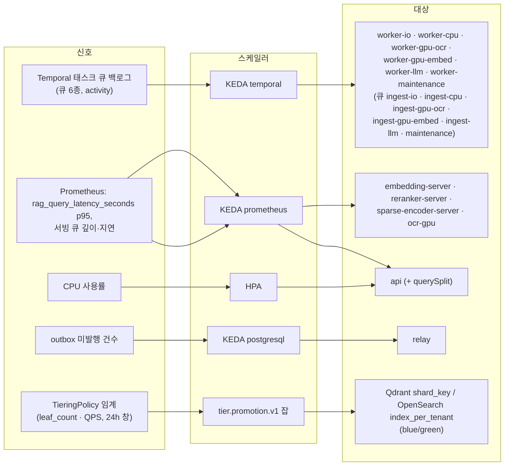
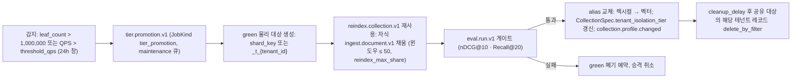
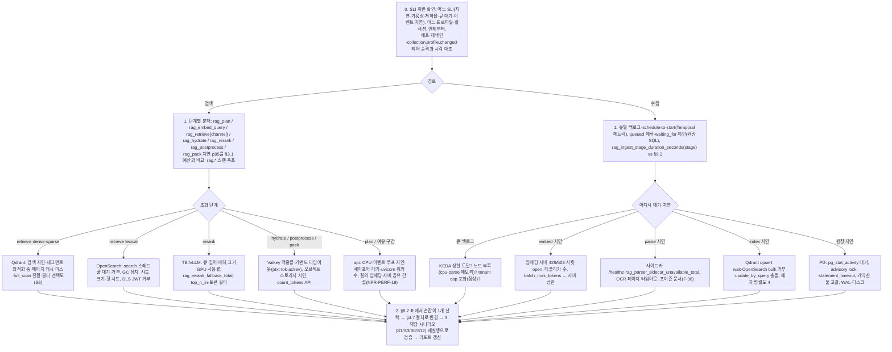

# 확장과 성능

## 목적

플랫폼을 **어느 축으로, 어떤 신호로, 얼마나** 늘리고 줄이는지, 주어진 청크 수·질의율(QPS)·수집률에서 **어떤 리소스가 얼마나** 필요한지, 그리고 지연 목표(브리프 §7: 하이브리드+리랭크 Top-10, 100만 청크, GPU p95 < 800ms / CPU < 1.5s)를 지키기 위해 **무엇을 어떻게 조정**하는지를 운영자 관점에서 한 곳에 고정한다. 설계 바이블은 지연 예산(§8.3), 스테이지 정책과 큐(§4.4·§11.2), 프로파일 파라미터(§7.2), 물리 명명(§13.4)을 이미 확정했고, [오케스트레이션과 워크플로우](../02-architecture/06-orchestration-and-workflows.md) §9는 워커 사이징의 방법(Little의 법칙)을, [배포 아키텍처](../02-architecture/08-deployment-architecture.md) §6~7은 오토스케일 대상과 S/M/L 저장소 사이징을, [실패 모드와 회복력](../02-architecture/09-failure-modes-and-resilience.md) §3~5는 저하 사다리·타임아웃·벌크헤드를 정했다. 이 문서는 그것들을 **바꾸지 않고** 다음을 덧붙인다.

- 스케일 축 8종의 단위·신호·범위·한계를 한 표로 모은 확장 모델과, 바이블이 위임한 **API 레플리카 산정**·**PostgreSQL 읽기 복제** 규칙.
- 청크 수·QPS·수집률을 입력으로 받는 **용량 모델(산정식)** 과 세 규모(LP-S/M/L) 예시.
- 검색·수집 경로의 **지연 예산 분해**를 측정 지표·내부 타임아웃·튜닝 손잡이와 함께 재구성한 표.
- 백엔드·서빙·캐시·연결 풀의 **성능 튜닝 가이드**, **부하 테스트 계획**(k6·Locust·omes, 시나리오, 합격 SLO), **핫스팟(대형 테넌트) 대응**, **비용 최적화**, **병목 진단 절차**.

## 범위

- 포함: `standard` 프로파일을 기준으로 한 확장·용량·튜닝·부하 테스트·비용·진단. `lite`·`premium`·`korean-gov` 차이는 표에 병기한다.
- 제외: 배포 매니페스트·Helm 값의 정의([배포 아키텍처](../02-architecture/08-deployment-architecture.md), [배포 가이드](./01-deployment-guide.md)), 알림 규칙·대시보드([관측성](./03-observability.md)), 장애 복구 절차([런북](./06-runbooks.md)), 백업·복구([백업과 재해 복구](./07-backup-and-disaster-recovery.md)), 검색 품질 게이트와 벤치마크 리포트 형식([벤치마크 계획과 베이스라인](../08-evaluation/05-benchmark-plan-and-baselines.md)), 스테이지 알고리즘(04-pipelines).
- 정본 관계: 지연 예산 값(바이블 §8.3), `StagePolicy`·큐(§4.4·§11.2), 프로파일 파라미터(§7.2), 물리 명명·Valkey 키(§13.4), 메트릭 이름(§6.5)은 바이블이 정본이다. 이 문서는 새 계약 필드·열거·메트릭을 만들지 않으며 필요한 것은 "(제안)"으로 표시하고 `## 미해결 이슈`에 남긴다. 외부 도구(k6, Locust, KEDA, TEI, vLLM, Qdrant, OpenSearch)의 버전·API는 07-tech-landscape에 근거가 있을 때만 단정하고 그 외는 "확인 필요(as of 2026-09)"로 둔다.
- 수치 표기: 바이블·NFR·다른 설계 문서에서 온 값은 출처를 적고, 이 문서가 새로 놓는 값은 모두 **초안 목표** 또는 **초안 가정**이다. 부하 테스트(§5)와 골든셋 코퍼스 색인 실측으로 갱신하며, 갱신 결과는 이 문서가 소유한다([저장소 아키텍처](../02-architecture/04-storage-architecture.md) §8.3, [인덱싱](../04-pipelines/13-indexing.md) §11이 "09-operations/04에서 실측으로 교체"로 위임).

---

## 1. 확장 모델

### 1.1 원칙

**결정:** 확장은 다음 네 원칙을 따른다. (1) **검색 경로는 무상태**다 — `plan → render`는 `api` 프로세스 안에서 실행되고 PostgreSQL을 읽지 않으므로([ADR-0034](../06-adr/0034-retrieval-hot-path-postgres-independence-and-hydrate.md), 바이블 §11.1) `api` 레플리카와 인덱스 백엔드 레플리카만 늘리면 QPS가 늘어난다. (2) **수집 경로의 확장 신호는 큐 백로그 하나**다 — Temporal 태스크 큐 6종의 대기 액티비티 수가 KEDA `temporal` 스케일러의 입력이고(바이블 §11.2), 워커 파드 수가 늘어도 GPU 용량은 늘지 않는다. GPU 용량은 **서빙·사이드카 계층**(`embedding-server`, `reranker-server`, `ocr-gpu`)에서 별도 신호(Prometheus 큐 깊이·지연)로 확장한다(배포 아키텍처 P7: 워커는 HTTP 클라이언트). (3) **인덱스는 재샤딩하지 않는다** — Qdrant는 `shard_number`를 노드 수의 2배로 미리 잡고(04 §4.6), OpenSearch 샤드 수는 생성 후 불변이므로 규모가 커지면 새 물리 대상을 채워 alias를 교체한다(04 §4.5·§5.6, [ADR-0026](../06-adr/0026-index-commit-generation-saga-and-ledger.md)); 대형 테넌트는 `TieringPolicy` 승격으로 물리 배치를 바꾼다([ADR-0028](../06-adr/0028-tenant-isolation-tiering-policy.md)). (4) **테넌트 상한이 처리량 상한을 규정**한다 — `runtime.tenant_concurrent_jobs_max`(standard 32)와 레이트리밋이 워커·GPU 용량보다 먼저 걸리도록 두어 한 테넌트의 부하가 다른 테넌트의 슬롯을 점유하지 못하게 한다(06 §8.2).



### 1.2 스케일 축

| 축 | 확장 단위 | 스케일러 · 신호 | 범위(초안 목표) | 한계·주의 | 근거 |
|----|-----------|-----------------|-----------------|-----------|------|
| 수집 워커(큐별) | 큐당 Deployment 1개(`worker-io`, `worker-cpu`, `worker-gpu-ocr`, `worker-gpu-embed`, `worker-llm`, `worker-maintenance` — 08 §3.1; 큐 이름 `ingest-*`·`maintenance`와 구분), 파드 = 프로세스 × 슬롯(`max_concurrent_activities`) | KEDA `temporal`(`taskQueue`, `queueTypes: activity`, `targetQueueSize` 5) | `ingest-io` 1~4, `ingest-cpu` 1~32, `ingest-gpu-embed` 1~2, `ingest-llm` 1~N(예산 정책), `maintenance` 1~2; 모두 `minReplicaCount: 1` | 백로그 기반 0→1은 인플라이트를 세지 못한다(`minReplicaCount` 1 이상); CPU 바운드 스테이지는 GIL 때문에 슬롯이 아니라 **프로세스**를 늘린다(바이블 §4.4); `ingest-cpu` 파드는 Docling 모델 메모리(프로세스당 약 2GB 가정)로 노드 메모리가 먼저 찬다 | 바이블 §11.2, 06 §3.6, §9.3, 08 §6.4, 07-tech-landscape/08 |
| GPU 워커 | `ingest-gpu-ocr`(premium)·`ingest-gpu-embed` 워커 파드 — **GPU를 갖지 않는 HTTP 클라이언트** | KEDA `temporal`(같은 방식) | `ingest-gpu-embed` 1~2(슬롯 8, 액티비티당 배치 2 → 프로세스당 in-flight ≤ 16) | 워커를 늘려도 서빙이 병목이면 429/503 → 어댑터 백오프 → 백로그로 역류할 뿐이다; GPU 큐는 `cooldownPeriod` 300s로 진동을 막는다 | 08 §6.4, 12 §5 |
| 모델 서빙 | 모델당 Deployment 1개(`embedding-server-<slug>`, `reranker-server-<slug>`, `sparse-encoder-server`, `ocr-gpu`) | KEDA `prometheus`(TEI·vLLM 큐 깊이·지연 메트릭; 메트릭 이름은 확인 필요 as of 2026-09) | 임베딩 1~2(standard) / 2~4(premium), 리랭커 1~2 / 2~4, `ocr-gpu` 1~N | 0→1 < 3분(NFR-PERF-17)은 모델 캐시 볼륨이 전제; 레플리카 추가 = GPU 1장 추가(MIG 인스턴스 또는 전용); 검색 리랭커와 수집 임베딩 서버는 **별도 Deployment·GPU**(NFR-PERF-19) | 08 §6.3~6.4, [ADR-0009](../06-adr/0009-embedding-serving-vllm-pooling-tei-inprocess.md) |
| API | `api` 파드(1 vCPU / 2GB, uvicorn 워커 수는 values `api.uvicornWorkers`) | HPA CPU 60%; 선택 KEDA `prometheus` `rag_query_latency_seconds` p95 | 2~8(standard, 08 §7.3); 산정식은 §2.2 | 무상태(NFR-SCAL-04); SSE 연결(잡 이벤트·`answer`)은 테넌트당 100 상한으로 파드 메모리보다 연결 수가 먼저 제약; `api.querySplit`로 검색 전용 Deployment를 분리하면 수집 접수·SSE 폴링이 검색 p95를 흔들지 않는다 | 08 §4.2·§5.3·§6.4, 05-api/03 §8 |
| Qdrant | 노드(3 → 6), `shard_number`(물리 컬렉션당 6 고정), `replication_factor`(2), `shard_key` 전용 샤드 | 수동(용량 모델 §2) + `tier.promotion.v1`(E15) | 노드 ≤ `shard_number`(6)까지 샤드 이동으로 확장; 그 이상은 새 물리 컬렉션(blue/green) | `replication_factor` 증가는 읽기 QPS·가용성을 늘리지만 RAM·디스크가 사본 수만큼 는다; 노드 추가 시 샤드 재배치 절차와 재샤딩 지원 범위는 확인 필요(as of 2026-09); `write_consistency_factor=1`은 플립 가시성 지연을 만든다(04 §4.6) | 04 §4.6, 13 §4.1, 07-tech-landscape/06 |
| OpenSearch | 데이터 노드(3 → 6+), `number_of_shards`(물리 인덱스당 3, 생성 후 불변), `number_of_replicas`(1, 동적 변경), `index_per_tenant` 전용 인덱스 | 수동 + `tier.promotion.v1` | 한 물리 인덱스의 유효 노드 수 ≤ 샤드 × (레플리카 + 1) = 6; 샤드 10~30GB 초과 시 새 물리 인덱스(`mapping_version` 증가 → `lexical_profile_hash` 변경) + alias 교체 | JVM 힙 ≤ 32GB·노드 RAM 50%; `routing=tenant_id`는 테넌트 하나를 샤드 하나에 모으므로 대형 테넌트는 **핫 샤드**가 된다(§6) | 04 §5.6, 13 §5.1, 07-tech-landscape/06 |
| PostgreSQL(원장) | 프라이머리 1(쓰기) + 동기 복제 1(HA) + 읽기 복제 0~2(제안, §1.4) | 수동; 신호는 `pg_stat_activity` 대기·트랜잭션 지연 | 쓰기는 수직 확장만(문서당 약 16 tx, §9.4); Temporal DB는 별도 인스턴스 | 검색 핫패스는 PG를 읽지 않으므로 읽기 복제는 관리 API·잡 폴링·정합성 검사에만 효과가 있다 | 04 §2.5~2.6, §9.4, [ADR-0034](../06-adr/0034-retrieval-hot-path-postgres-independence-and-hydrate.md) |
| Valkey · Temporal · 오브젝트 스토리지 | Valkey 3노드(복제 + 페일오버); Temporal frontend 2 / history 2 / matching 1, `numHistoryShards` 512(생성 후 불변); 오브젝트 스토리지는 관리형 또는 RustFS/SeaweedFS 노드 | 수동 | Valkey `maxmemory` 2GB 권고(04 §8.2); Temporal은 omes 부하 테스트로 확정 | Valkey는 정확성에 관여하지 않아(캐시 미스 허용) 확장 압력이 낮다; Temporal 히스토리 샤드 수는 재생성 없이 못 바꾼다 | 04 §6.2·§8.2, §9.4, 08 §7.3 |

### 1.3 KEDA `temporal` ScaledObject(값은 Helm `workers.<queue>.keda` 키로 렌더)

```yaml
apiVersion: keda.sh/v1alpha1
kind: ScaledObject
metadata:
  name: worker-cpu
  namespace: rag
spec:
  scaleTargetRef:
    name: worker-cpu            # Deployment 이름(08 §3.1); 큐 이름 ingest-cpu와 구분
  minReplicaCount: 1          # 0→1 지연 회피(07-tech-landscape/08 권고)
  maxReplicaCount: 32         # 08 §7.3 피크 상한
  cooldownPeriod: 120         # GPU 큐(ingest-gpu-embed, ingest-gpu-ocr)는 300
  triggers:
    - type: temporal
      metadata:
        endpoint: temporal-frontend.rag-data.svc:7233
        namespace: rag
        taskQueue: ingest-cpu
        queueTypes: activity
        targetQueueSize: "5"
```

파라미터 이름(`endpoint`, `namespace`, `taskQueue`, `queueTypes`, `targetQueueSize`)은 07-tech-landscape/08 §KEDA 스케일러 기술(KEDA v2.17+ `temporal` 스케일러)을 따르며, 그 밖의 파라미터(활성화 임계 등)는 확인 필요(as of 2026-09)다. 큐마다 `targetQueueSize`를 다르게 둘 이유는 없다 — 큐별 처리 시간 차이는 파드 형상(프로세스 × 슬롯)이 흡수한다(§9.3).

### 1.4 PostgreSQL 읽기 복제

**결정(제안 포함):** 원장 PostgreSQL은 **쓰기 프라이머리 1 + 동기 복제 1**(HA, PITR; 04 §2.6, NFR-REL-15)을 기본으로 하고, **읽기 복제(hot standby)** 는 `standard` 이상에서 선택 사항으로 두되 다음 규칙으로만 쓴다. (1) 검색 경로는 복제본을 포함해 PostgreSQL을 **전혀** 읽지 않는다([ADR-0034](../06-adr/0034-retrieval-hot-path-postgres-independence-and-hydrate.md); 컬렉션 스펙·프로파일·현재 세대는 api 캐시 `collspec:`). (2) 복제본으로 보내는 것은 **읽기 모델**만이다 — `GET /v1/jobs`·`GET /v1/jobs/{job_id}`(폴링, NFR-PERF-16), `GET /v1/documents/{document_id}`·`/commits`, `GET /v1/collections/{collection_id}/stats`, `GET /v1/tenants/{tenant_id}/usage`, 평가 리포트 조회, `maintenance.consistency.v1`의 문서 페이지 스캔. (3) 쓰기 직후 읽기(read-your-writes)는 보장되지 않으므로 `GET /v1/jobs/{job_id}`는 복제본에서 행이 없거나(404) `updated_at`이 요청 시각보다 복제 지연 상한(초안 목표 1s) 이상 오래됐으면 프라이머리를 다시 읽는다 — 클라이언트는 `202` 직후 `status_url`을 폴링하므로 이 규칙이 없으면 첫 폴링이 404가 된다. (4) RLS `FORCE` + `SET LOCAL app.tenant_id` 규약은 읽기 전용 트랜잭션에서도 동일하게 적용한다(04 §2.4~2.5). (5) 워커의 원장 트랜잭션(시작 기록·커밋·아웃박스)은 항상 프라이머리다. 복제 DSN은 바이블 §6.6에 없으므로 `RAG_PG__READ_DSN`(제안)을 미해결 이슈 2에 등재한다. 감사 로그(`audit_log`, 연 35GB/10만 질의·일 규모, 04 §8.2)의 조회·집계도 복제본 대상이며 파티션 DROP 보존 정책(04 미해결 이슈 12)이 원장 크기를 지배한다.

### 1.5 인덱스 백엔드 확장 규칙

| 상황 | Qdrant | OpenSearch |
|------|--------|------------|
| 읽기 QPS 증가 | `replication_factor` 2 → 3(사본당 RAM·디스크 +1배); 노드 추가로 샤드 재배치 | `number_of_replicas` 1 → 2(동적); 데이터 노드 추가 |
| 레코드 수 증가(단일 물리 대상) | 노드 3 → 6까지 샤드 이동(샤드 6 고정); 그 이상은 blue/green 새 물리 컬렉션 | 샤드당 10~30GB 초과 전 `mapping_version` 증가 → 새 물리 인덱스(샤드 6 등) + alias 교체 |
| 테넌트 편중 | `shard_key` 승격(custom sharding, 테넌트 전용 샤드) 또는 `index_per_tenant`(`rag_vec_{hash12}_t_{tenant_id}`) | `index_per_tenant`(`rag_lex_{hash12}_t_{tenant_id}`, 전용 샤드 수) |
| 쓰기 폭주(대량 백필) | `indexing_threshold` 20,000·`default_segment_number` 4로 신규 세그먼트는 평면 스캔 후 백그라운드 HNSW; `max_optimization_threads`는 vCPU의 1/2(초안) | green 인덱스만 `refresh_interval` 30s → 교체 전 1s 복원(13 §11 제안); bulk 거부(`es_rejected_execution_exception`)는 `index.backend_unavailable` 재시도 |
| RAM 부족 | scalar int8(`always_ram`) + 원본 `on_disk`(기본, 04 §4.3); 페이로드 `on_disk_payload`; 그래도 부족하면 binary(게이트) | 힙 ≤ 32GB 유지, `best_compression`, `_source.excludes`(04 미해결 이슈 9) |

---

## 2. 용량 모델

### 2.1 입력 변수

| 기호 | 의미 | 출처·기본(초안 가정) |
|------|------|-----------------------|
| `R` | 인덱스 레코드 수(리프 청크; 부모는 반환 단위만이라 레코드가 아님, D-19) | 컬렉션 `stats`, `rag_index_bytes_total{vector}` |
| `N_docs`, `c` | 문서 수, 문서당 리프 청크 수(`R = N_docs × c`) | `c`는 NFR §3.5 160(평균 40페이지) / §9.1·08 §7.1 60(평균 20페이지) — **두 앵커가 다르다**(미해결 이슈 1). 이 문서의 예시는 부하 프로파일 정의를 따르는 160을 쓴다 |
| `λ` | 수집 도착률(docs/s, 피크) | §9.1 피크 계수 3 |
| `QPS` | 검색 피크 질의율(`POST /v1/query` + MCP `search`) | NFR §3.4 부하 프로파일 |
| `n_in` | 리랭커 입력 후보 수 `query.rerank.top_n_in` | 바이블 §7.2: lite 30 / standard 100 / premium 50 / korean-gov 100 |
| `rf`, `nr` | Qdrant `replication_factor`, OpenSearch `number_of_replicas` | 04 §4.6·§5.6: 2 / 1 |
| `g` | 세대 공존 계수 | 시간당 갱신 1% → 1.01; 재색인 모드 A 롤백 창 24h 동안 2.0(13 §12) |
| `U` | 목표 사용률 | 0.8(GPU·워커, NFR §3.5), 0.6(api CPU) |

### 2.2 산정식

| 대상 | 식 | 상수(초안 가정) | 출처 |
|------|----|-----------------|------|
| Qdrant RAM(사본당) | `R × 1,024 × 1 B × 1.5`(int8 상주) / `R × 1,024 × 4 B × 1.5`(float32 상주) | 1.5KB / 6.1KB per 레코드 | Qdrant Capacity Planning 공식 식, 04 §8.2 |
| Qdrant 디스크(총) | `R × 14 KB × rf × g` | dense 원본 4.1 + sparse 1.0 + payload 6.0 + payload 인덱스 1.5 ≈ 12.6KB → 반올림 14KB | 04 §8.2 |
| Qdrant 페이지 캐시 | 사본당 `R × 4 KB`(재점수 시 원본 읽기) | `rescore: true` 전제 | 04 §4.3 |
| OpenSearch 디스크(총) | `R × (7~10 KB) × (nr + 1) × g` | 프라이머리 7~10KB/레코드(`index_text` 역색인 + bigram + keyword + `_source`) | 04 §8.2 |
| OpenSearch 샤드 수 | `ceil(R × 10 KB / 30 GB)`를 넘지 않게 물리 인덱스 샤드 수 결정(기본 3) | 샤드 10~30GB | 04 §5.6, 07-tech-landscape/06 |
| 오브젝트 스토리지 | `N_docs × 3.5 MB`(원본 2 + 산출물·파생물 1.5) + 스냅샷 보존 | 3.5MB/문서 | 08 §7.1 |
| PostgreSQL 원장 | `R × 2 KB`(감사 제외) + `audit_log` `질의/일 × 1 KB × 보존일` | 2GB/100만 청크 | 04 §8.2 |
| Valkey | `질의/일 × 0.5 × 4.6 KB`(`qemb`) + 소량; `maxmemory` 2GB | 고유 질의 50% | 04 §8.2 |
| 임베딩 GPU(L4급) | `ceil(λ × c ÷ (200 청크/s × U))` = `ceil(λ × c ÷ 160)` | 200 청크/s(512 토큰, fp16; 06은 보수적으로 150) — 확인 필요(as of 2026-09) | NFR §3.5, 12 §14 |
| 리랭커 GPU(L4급) | `ceil(QPS × n_in ÷ (200 쌍/s × U))` = `ceil(QPS × n_in ÷ 160)`; A100급은 ÷2.5, H100급은 ÷6.7 | 200 쌍/s(질의 40 + 청크 400 토큰); GPU 실효 60 / 150 / 400 TFLOPS 비 | NFR §3.5, 16 §11.2 |
| `rr:` 캐시 보정 | 위 값 × (1 − 캐시 적중률); 에이전트 반복 검색·MCP `cursor`에서만 유의미 | 기본 0 | 16 §12 |
| OCR GPU(premium) | `ceil(스캔 페이지/s × t_page ÷ U)`; `t_page`는 `ocr-gpu` 실측(브리프 §7 상한 3 s/page는 문서 단위 지연 목표이며 처리량 상수가 아님) | 실측 후 채움 | §9.1, O-08 |
| api 레플리카 | `max(2, ceil(QPS × t_cpu ÷ (1,000 × vCPU_pod × 0.6)))` | `t_cpu` 80ms/질의(plan 형태소 분석 20 + fuse 5 + postprocess 30 + pack·토큰 카운트 20 + 직렬화 5; 초안 가정, 부하 테스트로 대체) | 이 문서(08 §7.3 위임) |
| 워커 파드(큐 q) | `ceil(λ × ΣS_q × 1.3 ÷ (processes × slots))` | ΣS: `ingest-io` 4.8s, `ingest-cpu` 25.5s, `ingest-gpu-embed` 1.9s; 형상 io 1×16, cpu 4×1, gpu-embed 1×8 | §9.2~9.3 |
| 테넌트 처리량 상한 | `tenant_concurrent_jobs_max ÷ S_job`(S_job ≈ 32.3s) | standard 32 → 약 1 doc/s ≈ 86,000/일 | §9.3 |
| Temporal · PG 부하 | 이벤트/s ≈ `λ × 40`, 원장 tx/s ≈ `λ × 16` | | §9.4 |

산정 입력과 결과를 기록하는 형식(부하 테스트 리포트에 첨부; `constants_draft`는 실측값으로 교체):

```json
{
  "scale": "LP-M",
  "profile_id": "standard",
  "inputs": {
    "chunks": 1000000,
    "chunks_per_document": 160,
    "ingest_documents_per_second": 1.0,
    "peak_qps": 20,
    "rerank_top_n_in": 100,
    "qdrant_replication_factor": 2,
    "opensearch_number_of_replicas": 1,
    "generation_overlap_factor": 1.01,
    "gpu_class": "l4"
  },
  "constants_draft": {
    "qdrant_ram_bytes_per_record_int8": 1536,
    "qdrant_disk_bytes_per_record": 14000,
    "opensearch_primary_bytes_per_record_min": 7000,
    "opensearch_primary_bytes_per_record_max": 10000,
    "object_storage_bytes_per_document": 3670016,
    "embedding_chunks_per_second_per_gpu": 200,
    "rerank_pairs_per_second_per_gpu": 200,
    "target_utilization": 0.8,
    "api_cpu_ms_per_query": 80,
    "api_target_cpu_utilization": 0.6,
    "worker_ingest_cpu_service_seconds": 25.5,
    "worker_ingest_cpu_slots_per_pod": 4
  },
  "outputs": {
    "qdrant_ram_gb_per_copy": 1.5,
    "qdrant_disk_gb_total": 28.3,
    "opensearch_disk_gb_total_min": 14.1,
    "opensearch_disk_gb_total_max": 20.2,
    "object_storage_gb": 22.9,
    "embedding_gpus": 1,
    "reranker_gpus": 13,
    "api_replicas_1vcpu": 3,
    "worker_ingest_cpu_pods_peak": 9
  }
}
```

### 2.3 세 규모 예시(NFR §3.4 부하 프로파일, `c = 160`, 초안 목표)

| 항목 | LP-S | LP-M(브리프 §7 기준점) | LP-L |
|------|-----:|-----------------------:|-----:|
| 레코드 `R` / 문서 | 100,000 / 625 | 1,000,000 / 6,250 | 10,000,000 / 62,500 |
| 피크 QPS / 수집 `λ` | 5 / 1 문서/분 | 20 / 1 문서/s | 100 / 5 문서/s |
| 프로파일 · 환경 | `lite`, ENV-S(8 vCPU / 32GB, GPU 0) | `standard`, ENV-M | `premium`, ENV-L |
| Qdrant RAM(사본당, int8 / fp32) | 0.15 / 0.6GB | 1.5 / 6.1GB | 15 / 61GB |
| Qdrant 디스크(총) | 1.4GB(`rf` 1) | 28GB | 283GB |
| Qdrant 노드 · 샤드 | 1 · 1 | 3 · 6 | 6+ · 6(물리 컬렉션 분할 또는 `shard_key` 승격 다수) |
| OpenSearch 디스크(총) | 없음(`lite`) | 14~20GB, 샤드 3(2.3~3.3GB/샤드) | 141~202GB; 샤드 3이면 23~34GB/샤드 → 새 물리 인덱스 샤드 6, 데이터 노드 6+ |
| 오브젝트 스토리지(스냅샷 제외) | 2.3GB | 23GB | 229GB |
| PostgreSQL 원장(감사 제외) | 0.2GB | 2GB | 20GB |
| 임베딩 GPU(L4급) | 0(CPU ONNX 4 청크/s ≥ 2.7) | 1 | 5 |
| 리랭커 GPU(L4급), `n_in` 정본 | 0(TEI CPU 30→10; §3.2 참조) | 13(2,000 쌍/s) | 63(10,000 쌍/s) |
| 리랭커 GPU, A100급 / H100급 | — | 5 / 2 | 25 / 10 |
| 리랭커 GPU(L4급), `n_in` 50 상시 저하(L2a) | — | 7 | 32 |
| api 레플리카(1 vCPU) | 1(단일 노드) | 3 | 14(또는 2 vCPU × 7) |
| `worker-cpu` 파드(피크) | 1 | 9 | 42(상한 32 초과 → 스캔 비율 축소 또는 `premium` `ingest-gpu-ocr` 분리) |
| `worker-io` / `worker-gpu-embed` | 1 / — | 1 / 1 | 2 / 2 |
| Temporal 이벤트/s · 원장 tx/s | 0.7 · 0.3 | 40 · 16 | 200 · 80 |
| 테넌트 수 전제 | 1 | ≥ 1(cap 32 ≈ 1 doc/s) | ≥ 5(standard cap) 또는 premium cap 64 × ≥ 3 |

### 2.4 해석

- **리랭커가 GPU 비용을 지배한다.** LP-M에서 임베딩 GPU 1장 대 리랭커 13장(L4급)이다. 16 §11.2의 계산도 같은 방향이다 — `standard`의 250ms 예산은 L4/A10 1장에서 `top_n_in` 100 × 전형 길이(32+320 토큰)로 364ms가 되어 **성립하지 않고**, 50에서 182ms로 성립한다. 따라서 `standard`를 L4급에 배치하면 바이블 §8.3의 저하 규칙(100→50)이 상시 경로가 되며, 정본값 100을 지키려면 A100급(145ms) 이상이 필요하다. 이 선택은 프로파일 값(`query.rerank.top_n_in`) 변경이므로 골든셋 게이트(바이블 §7.4)를 거쳐야 하고, M1 벤치마크의 필수 측정이다(16 미해결 이슈 13; 이 문서 미해결 이슈 3).
- **Qdrant는 용량이 아니라 payload 읽기가 병목이다.** 100만 청크는 3노드에 여유가 크고(RAM 1.5GB/사본), `hydrate` 100 × ~6KB 배치 읽기(04 §8.2 payload 평균 가정 6KB·상한 32KB; 바이블 §5.1·§8.3은 100 × ~10KB로 예산을 잡았고 04는 이를 하향 가정으로 명시)와 재점수용 원본 벡터 페이지 캐시가 지연을 결정한다(04 §8.3). 노드 RAM은 int8 상주분 + 원본 벡터 페이지 캐시(사본당 `R × 4KB`) + payload 인덱스로 잡는다.
- **OpenSearch는 LP-L에서 샤드 재설계가 먼저다.** 물리 인덱스 샤드 3은 LP-M 기준이며 1,000만 레코드에서 샤드당 23~34GB로 상한에 닿는다. 규모가 예측되면 처음부터 `number_of_shards` 6으로 물리 인덱스를 만들고(04 §5.6 초안값의 프로파일 오버라이드), 이미 운영 중이면 `mapping_version` 증가로 새 물리 인덱스를 채워 alias를 교체한다.
- **수집 처리량은 테넌트 상한이 먼저 걸린다.** standard 테넌트 하나는 약 1 doc/s(86,000/일)가 상한이므로 LP-L의 5 docs/s는 다중 테넌트 합계로만 달성된다. 단일 테넌트가 그 이상을 요구하면 `premium`(64) 또는 `korean-gov` 등급별 128이 답이고, 워커·GPU를 늘리는 것은 그 다음이다(§9.3).
- **`c` 가정이 결과를 2.7배 흔든다.** 08 §7.2는 `c = 60`으로 1만/10만/100만 문서를 60만/600만/6,000만 레코드로 두는데, 이 문서의 LP 표는 `c = 160`이다. 레코드 수 기준(`R`) 산정은 두 가정에 무관하므로 운영 산정은 항상 `R`로 하고 문서 수는 참고로만 쓴다(미해결 이슈 1).

---

## 3. 지연 예산 분해

### 3.1 검색 경로(`standard` GPU p95 800ms; 값은 바이블 §8.3 정본)

| 스테이지 | 예산(ms) | 누적 | 측정(바이블 §6.5 메트릭 · 스팬) | 내부 타임아웃(09 §4.1, 초안 목표) | 초과 시 축소(09 §3.1 계단) | 튜닝 손잡이 |
|----------|---------:|-----:|--------------------------------|----------------------------------|----------------------------|-------------|
| 인증·인가·레이트리밋 | 10 | 10 | `rag.plan` 상위 스팬의 선행 구간; `rag_authz_errors_total` | JWKS 캐시 히트 0, Valkey 커맨드 ≤ 10 | 없음(fail-closed) | 그룹 확장 캐시 `groups:` 5~15m, JWKS 캐시 TTL |
| plan(정규화·라우터·필터) | 20 | 30 | `rag_plan_latency_seconds`, `rag.plan` | `quality` LLM은 예산 외 | L1 multi-query 끔 | 플랜 캐시 `plan:` 5m; 형태소 분석기 프로세스 상주(Kiwi/mecab-ko 로딩은 기동 시) |
| 질의 임베딩 | 40 | 70 | `rag_embed_query_latency_seconds` | HTTP 35(연결 5 + 응답 30); 15 문서는 클라이언트 200 | L6 lexical 단독 | `qemb:` 24h 적중률; 임베딩 서버 레플리카·MIG 몫; 질의 우선 큐(확인 필요) |
| retrieve(병렬 max) | 120 | 190 | `rag_retrieve_latency_seconds{channel, backend_id, outcome}`, `rag.retrieve.{channel}` | 채널 250(`query.channels[*].timeout_ms`, 예산 초과 허용 — 느린 채널 제외용) | L6 / L6' 채널 제외 | `hnsw_ef` 128, `oversampling` 2.0, payload 인덱스(§4.1); OpenSearch 힙·샤드(§4.2); `query.retrieve_concurrency` 32(제안) |
| fuse | 5 | 195 | `rag.fuse` | — | — | 후보 수 ≤ 300 × 런 수(순수 함수) |
| hydrate(payload 배치 1회) | 15 | 210 | `rag_hydrate_latency_seconds`, `rag_hydrate_missing_total`, `rag.hydrate` | Qdrant `retrieve` 40, 1회 재시도 포함 100 | L2a `top_n` 100→50 | `on_disk_payload` 저장소 NVMe; `hydrate.with_vectors=false` 유지; payload 32KB 상한 준수 |
| rerank | 250 | 460 | `rag_rerank_latency_seconds`, `rag_rerank_fallback_total`, `rag.rerank` | `query.rerank.timeout_ms` 300(바이블 §7.2·§8.3 불일치는 09 미해결 이슈 18) | L2b `top_n_in` 100→50, L3 생략 | `top_n_in`, `max_tokens_per_text` 512, GPU 등급(§2.4), `rr:` 60s 캐시, TEI 배치 토큰 |
| postprocess(+부모 텍스트) | 60 | 520 | `rag_postprocess_latency_seconds` | Valkey `ptxt:` 10 → 오브젝트 스토리지 30 | L4 `parent_expand` 등 생략 | `ptxt:` 24h 적중률; `dedup` 벡터 재조회(`with_vectors`) 실측 |
| pack(`acl_recheck` MGET + 토큰 카운트) | 40 | 560 | `rag_pack_latency_seconds`, `rag_pack_tokens_count`, `rag_acl_recheck_denied_total` | `aclrev:` MGET 10, `count_tokens` API 25 | L5 근사 카운트·힌트 미사용 | `tok:` 7d 캐시; `count_method` `exact_local` 가능 대상은 로컬 토크나이저 |
| render + 직렬화 | 15 | 575 | `rag_query_latency_seconds`(전체) | — | — | 렌더러별 크기; `explain=false` 기본 |
| 네트워크·GC 여유 | 225 | 800 | — | retrieve·hydrate 초과분 차감 원천 | — | api 이벤트 루프 지연, uvicorn 워커 수 |

### 3.2 프로파일별 총예산

| 프로파일 | `query.latency_budget_ms.total` | 지배 구간(초안) | 비고 |
|----------|-------------------------------:|-----------------|------|
| `lite`(CPU) | 1,500 | 임베딩 ONNX int8 약 150 + TEI CPU 리랭크 top-30 700 | 16 §11.2 계산상 30 × (32+512) 토큰은 8 vCPU에서 1,730ms로 700을 넘는다 — 10~20건 × 256 토큰이 현실적(미해결 이슈 3) |
| `standard`(GPU) | 800 | rerank 250 | §3.1 |
| `premium` `default` / `quality` | 800 / 2,500 | rerank 250 / 600(Qwen3-Reranker-4B 50→20은 H100급 또는 `top_n_in` 20에서만 성립, 16 §11.2) | LLM self-query·multi-query 3은 `quality`만 |
| `korean-gov` | 800 | standard와 동일 + `document_order` 재정렬 | mTLS 왕복 추가는 여유 225 안에서 흡수 |

`QueryRequest.budget.max_latency_ms`가 총예산보다 작으면 플래너가 사전 저하(L1 → L2a → L3 → L6)를 적용하고, 남은 예산은 `QueryPlan.latency_budget_ms`로 전파되어 각 스테이지가 스스로 축소한다(바이블 §8.1 6단계, 09 §3.1). NFR §3.3의 분해(합계 약 460ms)는 **p50 추정**이며 p95 예산은 바이블 §8.3이 정본이다.

### 3.3 수집 경로(텍스트 PDF 100페이지 < 30s, NFR-PERF-08; 초안 목표)

| 스테이지 | 예산(s) | 근거·전제 | 초과 시 |
|----------|--------:|-----------|---------|
| 큐 대기(enqueue → 첫 액티비티) | ≤ 1 | NFR-PERF-18 p95 < 10s는 정상 부하, 유휴 워커 조건에서는 ≈ 0 | KEDA 파드 증설; `tenant_concurrent_jobs_max` 확인 |
| fetch | 2 | 2MB 원본, 조건부 GET(§9.2) | 원천 지연은 플랫폼 밖 |
| parse(+detect) | 20 | 0.2 s/page. `pdf_fast_cpu`(pypdfium2 + pdftext)는 달성 가능(07-tech-landscape/00 매트릭스); `standard`의 `pdf_standard`(Docling heron + TableFormer, CPU 4 thread)는 M2 "Docling CPU §7 판정" 게이트 대상, GPU L4에서는 약 11 s/100p(07-tech-landscape/00 프로파일별 기본 조합 표) | 페이지 하트비트로 진행; 프로파일 `pdf_fast_cpu` 라우팅 |
| normalize · chunk · enrich(결정적) | 3 | §9.2 각 1s | — |
| embed | 1.5 | 약 300 청크 / 200 청크/s + 대기(12 §14) | 서빙 레플리카·배치 토큰(§4.3) |
| index(사가) | 3 | Qdrant upsert 1배치 ≤ 1.0 + OpenSearch bulk ≤ 1.0 + 플립 2회 ≤ 0.5 + 원장 전이 6회 ≤ 0.2(13 §11) | 배치 병렬도 4, 백엔드 타임아웃 30s |
| publish · 상태 전이 | 0.5 | 로컬 액티비티, 원장 tx 16회(§9.4) | PG 지연 |
| 합계 | 31 | 30 이내가 되려면 큐 대기 0(유휴 워커) 또는 parse ≤ 19s(0.19 s/page)가 필요하다. parse가 2/3을 차지하므로 파서 경로가 곧 수집 지연 예산이다 | 파서 경로 선택이 1순위, 워커 증설은 큐 대기에만 효과 |

스캔 PDF 100페이지 < 5min(NFR-PERF-09)은 `premium` `ocr-gpu`에서 페이지당 ≤ 3s(문서 단위 목표)이며, `standard` CPU RapidOCR(§9.1 가정 4 s/page)은 이 목표의 대상이 아니다.

---

## 4. 성능 튜닝 가이드

모든 손잡이는 **프로파일 값**(바이블 §7.3 YAML) 또는 **백엔드 설정**(13 §4.1 `ensure_collection`, 04 §4~5)이며, 품질에 영향을 주는 값(`top_n_in`, `top_k`, 양자화, `hnsw_ef`)의 변경은 골든셋 게이트(바이블 §7.4)를 통과해야 프로파일 버전이 오른다(§4.7).

### 4.1 Qdrant: HNSW · 양자화 · 필터 인덱스

| 손잡이 | 정본·기본값 | 언제 무엇을 | 주의 |
|--------|-------------|-------------|------|
| HNSW `m` / `payload_m` | `m: 0`, `payload_m: 16`(전역 그래프 없음, `is_tenant` 테넌트별 서브그래프) — 바이블 §13.4 | 공유 컬렉션(`payload_filter`·`shard_key`)은 그대로 둔다. `index_per_tenant` 물리 컬렉션(`_t_{tenant_id}`)은 테넌트가 하나이므로 `m: 16`, `payload_m: 0`이 자연스럽다(제안; 13 문서 소유, 미해결 이슈 5) | 런타임 변경 가능(`update_collection`)이나 그래프 재구축이 백그라운드 CPU를 쓴다 |
| `ef_construct` | 128(13 §4.1) | recall 부족 시 256으로; 색인 CPU 비용 증가 | 대량 백필 전에 정하고 변경은 재최적화 유발 |
| 질의 `hnsw_ef` | 128(13 §4.4; `top_k` 미만이면 `top_k`로) | Recall@100 미달 시 200(`2 × top_k`)로 — 골든셋(테넌트 필터 포함) 측정 대상(15 미해결 이슈 4) | 지연은 `ef`에 준선형 |
| `exact` | 기본 false; `filters.user`에 `document_id eq`·`external_id eq`가 있으면 `exact=true` 플랜 규칙(15 §4.2 제안) | 좁은 필터에서 `returned < top_k`가 관측되면 | 플래너의 `full_scan_threshold` 자동 전환과 중복되지 않게 |
| 저장 양자화 `dense` | scalar int8, `quantile 0.99`, `always_ram true`, 원본 `on_disk true`, 질의 `rescore true`, `oversampling 2.0`(04 §4.3, 13 §4.1) | RAM 1/4; 재점수가 있어 nDCG 손실은 게이트(허용 하락 −0.01 초안)로 확인. 수천만 규모는 binary + `oversampling 4.0`(게이트 후) | 12 §8.3은 `standard` 기본 "끔(500만 초과 시 켬)"으로 적어 04·13과 다르다 — 저장소 소유 문서(04·13)를 따르고 정합은 미해결 이슈 6 |
| `late_interaction` 양자화 | float16 + binary 재점수; `turbo4` + 1-bit(M2) | 100만 청크 × 300 토큰 fp16 77GB → 4-bit 약 19GB | `premium` 실험 슬롯만(O-04) |
| payload 인덱스 | 필터 대상 필드 **전부** 인덱스(바이블 §13.4 + 04 §4.4 보정 5필드); 핫 필터(`tenant_id`, `collection_id`, `document_id`, `is_current`, `acl_*`) `on_disk: false`, 콜드(`lexical_terms`, `entity_ids`) `on_disk: true` | 저선택도 다중 필터에서 recall 급락·지연이 보이면 ACORN 활성 평가(15 미해결 이슈 4) | `text` 인덱스는 만들지 않는다(한국어 형태소 없음, D-15) |
| 세그먼트·옵티마이저 | `indexing_threshold 20000`, `default_segment_number 4`(standard), `max_optimization_threads` vCPU/2(초안) | 대량 백필 중 검색 p95 악화 ≤ 10%(NFR-PERF-12) 위반 시 백필 쓰기 속도 제한(`reindex_max_share`) | 세그먼트 수가 많으면 질의가 세그먼트 수에 비례해 느려진다 |
| 샤드·사본 | `shard_number 6`, `replication_factor 2`, `write_consistency_factor 1`(04 §4.6) | 읽기 QPS 부족 → `rf` 3; 노드 증설은 6까지 샤드 이동 | `rf` 증가는 RAM·디스크 사본 수배 |

### 4.2 OpenSearch: 샤드 수 · refresh · 힙

| 손잡이 | 정본·기본값 | 언제 무엇을 | 주의 |
|--------|-------------|-------------|------|
| `number_of_shards` | 3 / 물리 인덱스(04 §5.6 초안) | 샤드 10~30GB 초과 예측 시 새 물리 인덱스(`mapping_version` ↑ → `lexical_profile_hash` 변경) + alias 교체; LP-L은 6 | 생성 후 불변; `_split`/`_shrink`는 쓰지 않는다(read-only 필요) |
| `number_of_replicas` | 1(korean-gov 2) | 읽기 QPS·가용성 | 동적 변경 가능; 디스크 사본 수배 |
| `refresh_interval` | 1s(세대 플립 가시성 ≤ 1s) | 대량 백필: green 물리 인덱스만 30s로 올리고 alias 교체 전 1s 복원(13 §11 제안) | 서빙 중 인덱스에는 올리지 않는다(플립 가시성 요구) |
| custom routing | `routing=tenant_id`(단일 샤드 조회) | 대형 테넌트는 핫 샤드 → `index_per_tenant` 승격(§6) | `_routing.required: true`(E5) |
| `index.sort` | `[tenant_id, document_id, ordinal]` | 세그먼트 내 테넌트 지역성으로 필터 스캔 비용 절감 | 색인 시 정렬 비용 |
| JVM 힙 | ≤ 32GB, 노드 RAM의 50%(04 §5.6) | GC 정지가 `rag_retrieve_latency_seconds{channel="lexical"}` 꼬리를 만들면 힙 확인 → 노드 추가 | 나머지 RAM은 OS 페이지 캐시(Lucene) |
| bulk | 256 문서 또는 5MB, `refresh=false`, 30s(13 §5.2) | `es_rejected_execution_exception` 증가 → 워커 배치 병렬도(4) 축소 또는 데이터 노드 추가 | 재시도는 `record_id` 멱등 |
| 코덱·필드 | `best_compression`, `total_fields.limit 400`, `_source` 미러 필드 `enabled: false` | 디스크 절감 필요 시 `_source.excludes`(04 미해결 이슈 9) | `_source`는 재적재·디버그용 보존 |
| 분석기 | Nori `mixed`(색인) / `discard`(질의), 사용자 사전 인라인 ≤ 10,000행 | 사전 초과 시 `user_dictionary` 파일 배포 | 사전 변경 = `dictionary_hash` 변경 = 렉시컬 재색인 |

### 4.3 임베딩 배치 · 서빙

| 손잡이 | 정본·기본값 | 언제 무엇을 | 주의 |
|--------|-------------|-------------|------|
| `ingest.embed.batch_max_tokens` | lite 8,192 / standard 32,768 / premium 65,536 / korean-gov 32,768(바이블 §7.2) | 서버 상한(vLLM `max_num_batched_tokens`, TEI `--max-batch-tokens`)과 **같거나 작게**(ADR-0009 규칙 7); OOM이 보이면 서버 상한을 내리지 말고 프로파일 값을 내린다 | 8,192 토큰 XLM-R은 활성화가 시퀀스 제곱 — 4,096 토큰 초과 항목은 단독 배치(12 §6.1) |
| 요청당 항목 상한 | 256(TEI `--max-client-batch-size`, 12 §6) | — | 배치 계획은 첫 시도에 확정·재시도 불변 |
| 클라이언트 동시성 | 워커 프로세스당 슬롯 8 × 액티비티당 배치 2 = in-flight ≤ 16(12 §5) | 서버 `--max-num-seqs`·`--max-concurrent-requests`와 정합; 서버 429/503이 보이면 워커를 줄이는 게 아니라 **서빙 레플리카**를 늘린다 | 워커는 큐를 자체 구현하지 않는다(서버 동적 배칭 위임) |
| 서빙 레플리카·GPU 몫 | `serving.embedding.replicas` 1~2, MIG 2분할 시 vLLM `--gpu-memory-utilization` 0.45(01 §4.6 예시) | KEDA `prometheus` 큐 깊이; 0→1 < 3분 | 질의 임베딩이 같은 서버를 쓰므로 대량 색인 중 `rag_embed_query_latency_seconds` p95를 감시(NFR-PERF-19); 우선 큐는 확인 필요 |
| 청크 임베딩 캐시 | `H("embed", embedding_space_id, "document", embed_text)`(봉투 없음, 테넌트 내 공유) | 재색인·재처리에서 GPU 비용 0 | 서빙 교체(이미지 digest 변경)도 캐시 적중(08 §6.3) |
| CPU 폴백(`lite`) | bge-m3 ONNX int8, 배치 8,192 토큰 / 32 항목, 약 4 청크/s(8 vCPU) | 브리프 §7 수집 목표 미적용(ENV-S) | ONNX 세션은 프로세스당 1개 |

### 4.4 리랭커 후보 수 · 배치

| 손잡이 | 정본·기본값 | 언제 무엇을 | 주의 |
|--------|-------------|-------------|------|
| `query.rerank.top_n_in → top_n_out` | 30→10 / 100→20 / 50→20 / 100→20(바이블 §7.2) | L4급 GPU에서 250ms를 상시 지키려면 50(§2.4); 변경은 게이트(Recall@20·nDCG@10) | `hydrate.top_n ≥ max(top_n_in, pack.k_max)` 불변식(바이블 §7.4 (11)) |
| `max_tokens_per_text` | 512(리랭커 토크나이저 절단) | 전형 길이 320이면 지연 35% 감소(16 §11.2); 512 → 384 축소는 게이트 | 절단은 `context_prefix + "\n" + text` 앞부분 유지 |
| 서빙 배치 | TEI `--max-batch-tokens`: 100 쌍 × 544 토큰 = 54,400 이상이어야 한 요청이 한 배치 | 값이 작으면 요청이 여러 배치로 갈라져 지연 증가 | 확인 필요(as of 2026-09; TEI 기본 16,384) |
| GPU 등급 | L4/A10 60 → A100 150 → H100 400 TFLOPS 실효 비(16 §11.2 가정) | `n_in` 100 정본 유지 = A100급 이상 | premium Qwen3-Reranker-4B 50→20 @ 600ms는 H100급 |
| `rr:` 캐시 | `rr:{model}:{hash}` 60s(바이블 §13.4; 키 구성 patch 제안은 16 §12) | 에이전트 반복 검색·MCP `cursor` 재실행에서 부분 적중 | 결과 캐시가 아니라 **점수 캐시**(ACL 사전 필터 뒤에만 적용) |
| 2단 리랭크(O-04) | `late_interaction_rerank` prefetch 300 → MaxSim 100 → 크로스인코더 50→20 | 크로스인코더 입력을 절반으로 줄여 GPU 비용 감소 후보 | `premium` M2 실험 슬롯; 골든셋 근거 전 기본값 변경 금지 |

### 4.5 캐시 전략

**결정:** 캐시 대상은 바이블 §13.4 Valkey 키 표의 **중간값**만이고 검색 결과(`CandidateSet`·`RankedSet`·`ContextPack`) 캐시는 금지한다(ACL 시점성·세대 플립; 09 §3.3, 15 §9; [ADR-0034](../06-adr/0034-retrieval-hot-path-postgres-independence-and-hydrate.md), [ADR-0011](../06-adr/0011-kv-and-object-storage-valkey-rustfs-seaweedfs.md)). Valkey 커맨드 타임아웃(10ms 초안)을 넘긴 호출은 오류가 아니라 **미스**다(NFR-AVL-09).

| 키(바이블 §13.4) | TTL | 절감 대상 | 적중률 목표(초안) | 비고 |
|------------------|-----|-----------|-------------------|------|
| `qemb:{space}:{hash}` | 24h | 질의 임베딩 40ms + 임베딩 서버 GPU | ≥ 50%(04 §8.2 고유 질의 50% 가정) | 콘텐츠 해시 키(테넌트 접두 예외); 변형·HyDE는 텍스트별 |
| `plan:{tenant}:{profile_hash}:{hash}` | 5m | plan 20ms | ≥ 30% | 적중 시 `SecurityContext`·`as_of`·예산 재주입 |
| `tok:{tokenizer_id}:{hash}` | 7d | `count_tokens` API 25ms·호출 비용 | ≥ 80% | 콘텐츠 해시 키 |
| `ptxt:{tenant}:{chunk_set_blake3}` | 24h | 오브젝트 스토리지 30ms | ≥ 90% | 문서 삭제 시 `DEL`(06 §2.3) |
| `rr:{model}:{hash}` | 60s | 리랭커 GPU | 반복 검색에서만 | 점수 캐시 |
| `groups:{tenant}:{subject}` | 5~15m | 그룹 확장 | ≥ 95% | 상한 1,024 주체 |
| `collspec:{collection_id}` | 이벤트 무효화 | PG 미의존의 근거 | ≈ 100% | `collection.profile.changed` |
| `idem:{tenant}:{key}` | 24h | PG 판정 조회 | — | 정본은 PG `idempotency_keys` |

메모리는 `qemb`가 지배한다(질의 10만/일 × 50% × 4.6KB ≈ 230MB, 04 §8.2). `maxmemory` 2GB에 `allkeys-lru`류 제거 정책을 쓰되 `aclrev:`·`rl:`·`cursor:`·`idem:`은 정확성·보안에 관여하므로(회수 힌트 손실은 F-27) 제거 대상에서 보호해야 한다 — Valkey의 키별 보호 수단은 확인 필요(as of 2026-09)이며, 대안은 보안 키와 캐시 키의 **인스턴스 분리**다(미해결 이슈 7).

### 4.6 연결 풀 · 동시성 상한

| 대상 | 규약(초안 목표) | 근거 |
|------|-----------------|------|
| PostgreSQL(api) | 프로세스당 풀 10, 세션 모드; `statement_timeout` 5s(`SET LOCAL`); PgBouncer 사용 시 트랜잭션 모드 + `SET LOCAL` 프롤로그 재발행, 준비 문장 비활성 | 04 §2.5 |
| PostgreSQL(워커) | 프로세스당 풀 = `max_concurrent_activities` × 2 + 2; `statement_timeout` 60s(정합성 10m) | 스테이지당 2 tx(§9.4) |
| Qdrant | `prefer_grpc=true`; api 프로세스당 `asyncio.Semaphore(64)` = 커넥션 상한; 워커 배치 병렬도 4 × 슬롯 ≤ 64 | 09 §5.2, 13 §11 |
| OpenSearch | api 세마포어 64; 워커 bulk 병렬도 4 | 09 §5.2 |
| 리랭커 서버 | api 세마포어 32(httpx 풀 상한과 일치) | 09 §5.2 |
| 임베딩 서버 | api 세마포어 32(질의); 워커 in-flight ≤ 16/프로세스 | 09 §5.2, 12 §5 |
| LLM 공급자 | api 세마포어 8; 수집은 Valkey 테넌트 토큰 버킷 | 09 §5.2, O-05 |
| 검색 런 동시성 | `query.retrieve_concurrency` 32(제안, 15 §10): 다중 컬렉션 × 변형으로 런이 폭증할 때 풀 고갈 방지 | 15 §10 |
| Temporal 클라이언트 | 프로세스당 gRPC 채널 1(멀티플렉싱) | — |

세마포어에서 대기한 시간은 그 단계의 예산에 포함되므로, 세마포어 대기가 관측되면(§8) 상한을 올리는 것이 아니라 **백엔드 레플리카**를 늘리는 것이 정답이다 — 상한은 느린 백엔드가 이벤트 루프 전체를 점유하지 못하게 하는 벌크헤드다(09 §5.2).

### 4.7 튜닝 변경 절차

1. 증상을 §8 절차로 좁혀 **한 손잡이**만 고른다.
2. 품질 영향이 있는 값(`top_n_in`, `top_k`, `hnsw_ef`, 양자화, `max_tokens_per_text`)은 스테이징에서 골든셋 게이트(바이블 §7.4; `eval.gates` nDCG@10 ≥ 0.80·Recall@20 ≥ 0.92, 회귀 ≤ 1%p NFR-QLT-04)와 부하 테스트(§5)를 함께 통과한 뒤 프로파일 `version`을 올린다(`profile_hash` 변경 → `collection.profile.changed`).
3. 품질 영향이 없는 값(레플리카, 세마포어, 풀, `refresh_interval`, 캐시 TTL)은 Helm values로 바꾸고 부하 테스트 S1·S3만 재실행한다.
4. 백엔드 런타임 변경(HNSW·양자화·`on_disk`)은 `update_collection`으로 적용하되 재최적화가 끝날 때까지 `rag_retrieve_latency_seconds` p95를 감시한다.
5. 결과(전·후 p50/p95/p99, 저하율, GPU 사용률)를 벤치마크 리포트에 남기고 이 문서의 초안값을 갱신한다.

---

## 5. 부하 테스트 계획

### 5.1 도구

| 도구 | 용도 | 라이선스·지위 | 근거 |
|------|------|---------------|------|
| k6 | 검색 경로(`POST /v1/query`, `POST /v1/render`, MCP `search`) HTTP 부하; 오픈 루프 도착률(`constant-arrival-rate`·`ramping-arrival-rate`)로 꼬리 지연 왜곡(coordinated omission) 회피 | AGPL-3.0 — **개발 도구**로 허용(배포 산출물 미포함, NFR §14.2 규칙 3·§14.3) | NFR M1 측정 방법 |
| Locust | 수집 경로(`POST /v1/ingest` + `Idempotency-Key` ULID 생성 + `GET /v1/jobs/{job_id}` 폴링·SSE) — Python이라 계약 모델(Pydantic)을 그대로 재사용 | MIT | NFR §14.3 |
| Temporal omes + `benchmark-workers` | 오케스트레이터·PostgreSQL 한계(`throughput_stress`), `numHistoryShards`·커넥션 풀 확정 | MIT | §9.5, 07-tech-landscape/08 미해결 이슈 1 |
| 평가 하네스(`eval.run.v1`) | 부하 중 품질 회귀(같은 골든셋 질의 사용) — 부하 도구가 아니라 동반 실행 | 코어 | D-12 |

스크립트 위치는 `tests/load/`(제안; 저장소 구조 문서 소유, 미해결 이슈 8), 실행 주기는 NFR §1.3 M1(릴리스 후보마다 + 주 1회).

### 5.2 측정 조건(NFR §3.1 그대로)

| 조건 | 값 | 이유 |
|------|----|------|
| 질의 코퍼스 | 골든셋 질의(한국어 15~40 토큰) 70% + 재작성 변형 30%; 무작위 문자열 금지 | 형태소 분석·캐시 적중률·라우터 분기가 실제 분포에 의존 |
| 필터 | `tenant_id`·`collection_id`·ACL 필수 필터 포함 — 필터 없는 측정치는 무효 | D-09; 필터가 ANN 지연을 결정 |
| 캐시 | 기본 콜드(`qemb`·`plan`·`tok` 비활성 또는 플러시); 웜 측정은 S7에서 별도 | 캐시 적중률이 p95를 가린다 |
| 부하 형태 | 피크 QPS의 100%를 10분 지속, 워밍업 2분 제외; 도착률 고정(오픈 루프) | NFR §3.1 |
| 파라미터 | 프로파일 정본값(`top_k` 100, `top_n_in` 100→20, `k_max` 20, RRF k=60) — NFR §3.1의 "리랭크 후보 50"은 측정 조건 초안이며 바이블 §7.2가 정본 | 바이블 §7.2 |
| 환경 | ENV-M 기준; 리포트에 환경·`profile_hash`·이미지 digest·데이터셋 ID·git 커밋 명기 | 재현성 |
| 수집 부하 | S3에서만 동시 실행; 그 외는 수집 정지 상태 | 분리 측정 |

### 5.3 시나리오

| ID | 시나리오 | 조건 | 합격 기준 | 출처 |
|----|----------|------|-----------|------|
| S1 | 정상 검색 | 피크 QPS 10분 | p50 < 350 / p95 < 800 / p99 < 1,500ms(GPU), 오류율 < 0.1%, 저하율 ≤ 1% | NFR §3.4, 09 §10.1 |
| S2 | 버스트 | 피크 3배 30초 | 오류율 < 1%(429는 오류 아님), 회복 ≤ 60s | NFR §3.4 |
| S3 | 혼합 | S1 + 수집 처리량 목표 동시 | 검색 p95 증가 ≤ 20%(NFR-PERF-19); 수집 큐 대기 p95 < 10s(NFR-PERF-18) | NFR §3.4 |
| S4 | 대용량 단일 문서 | 5,000페이지 텍스트 PDF 1건 | 완료 ≤ 30min, 다른 잡 p95 증가 ≤ 2배 | NFR §3.4, NFR-SCAL-06 |
| S5 | 다중 테넌트 | 100 테넌트 균등 | 테넌트 간 p95 편차 ≤ 30% | NFR §3.4 |
| S6 | 부분 저하 | 리랭커 중단 상태의 S1 | fused 순서 응답, `degraded[]` 표시, p95 < 400ms | NFR §3.4, 09 F-24 |
| S7 | 콜드 vs 웜 캐시(추가, 초안) | S1을 캐시 플러시 후 / 24h 웜 상태에서 | 웜 p95 ≤ 콜드 p95 − 40ms(질의 임베딩 예산); `qemb` 적중률 ≥ 50% | §4.5 |
| S8 | 좁은 필터(추가, 초안) | `document_id eq`·희소 `tags`·좁은 `doc_date` 질의 30% | `returned < top_k` 비율 ≤ 5%, p95 목표 유지 | 15 §4.2 |
| S9 | 재색인 중 검색(추가, 초안) | 컬렉션 재색인(모드 A 백필 + alias 교체) 중 S1 | p95 증가 ≤ 10%, 1만 청크 문서 스왑 < 5s(NFR-PERF-12), `hydrate_missing` ≤ 0.1% | 13 §11, NFR-PERF-12 |
| S10 | 스케일인 중 수집(추가, 초안) | 수집 중 워커 파드 강제 종료·축소 | 재예약 성공률 100%, 결과 `IndexCommit` 해시 동일(NFR-SCAL-09, 브리프 §7 재현성) | 09 §6 |
| S11 | MCP 경로(추가, 초안) | 동일 질의 MCP `search` vs REST | 추가 지연 < 30ms(NFR-PERF-15), `cursor` 재실행 `rr:` 적중 | D-13 |
| S12 | 수집 E2E(추가, 초안) | 텍스트 PDF 100p / HWPX 100p / 스캔 PDF 100p(premium) 각 20건, 유휴 워커 | < 30s / < 30s / < 5min(NFR-PERF-08~10) | §3.3 |
| S13 | 선형성(추가, 초안) | 워커 2 → 8 확장, 임베딩 서빙 비병목 조건 | 처리량 배율 / 4 ≥ 0.8(NFR-SCAL-03) | NFR §4 |

### 5.4 합격 SLO 요약

| SLI | 목표 | 측정 | 출처 |
|-----|------|------|------|
| 검색 지연 | p95 GPU < 800ms / CPU < 1.5s(`quality` 2,500) | `rag_query_latency_seconds` | 브리프 §7, 바이블 §8.3 |
| 검색 가용성 | 성공(5xx·타임아웃 제외, 429는 성공) ≥ 99.9% | k6 `http_req_failed` | 09 §10.1 |
| 검색 저하율 | `degraded[]` 비어 있지 않은 응답 ≤ 1% | 응답 본문 파싱(k6 커스텀 Rate) | 09 §10.1 |
| 수집 E2E | 텍스트 100p < 30s, 스캔 100p < 5min(GPU) | Locust 접수 → `succeeded\|partial` | 브리프 §7 |
| 큐 대기 | enqueue → 첫 액티비티 p95 < 10s(유휴율 ≥ 30%) | Temporal schedule-to-start | NFR-PERF-18 |
| 이벤트 지연 | `rag_outbox_lag_seconds` p99 ≤ 5s(standard) | 메트릭 | 바이블 §3.2 O-06 |
| ACL 전파 | `rag_acl_propagation_seconds` p99 ≤ 5m | 메트릭 | 바이블 §7.2 |
| 콜드 스타트 | api < 30s, 모델 서버 < 3min | 파드 ready 시각 | NFR-PERF-17 |
| 회귀 | 직전 릴리스 대비 p95 +10% 초과 또는 저하율 2배 초과면 실패(초안) | 리포트 비교 | 이 문서 |

### 5.5 k6 `options` 예시(S1 + S2; 20 QPS = LP-M)

```json
{
  "scenarios": {
    "s1_steady_query": {
      "executor": "constant-arrival-rate",
      "rate": 20,
      "timeUnit": "1s",
      "duration": "12m",
      "preAllocatedVUs": 50,
      "maxVUs": 200,
      "exec": "query",
      "tags": {"scenario": "s1"}
    },
    "s2_burst_query": {
      "executor": "ramping-arrival-rate",
      "startRate": 20,
      "timeUnit": "1s",
      "preAllocatedVUs": 100,
      "maxVUs": 600,
      "startTime": "12m",
      "exec": "query",
      "tags": {"scenario": "s2"},
      "stages": [
        {"target": 20, "duration": "2m"},
        {"target": 60, "duration": "30s"},
        {"target": 20, "duration": "2m"}
      ]
    }
  },
  "thresholds": {
    "http_req_duration{scenario:s1,expected_response:true}": ["p(50)<350", "p(95)<800", "p(99)<1500"],
    "http_req_failed{scenario:s1}": ["rate<0.001"],
    "http_req_failed{scenario:s2}": ["rate<0.01"],
    "rag_degraded_rate{scenario:s1}": ["rate<0.01"]
  },
  "summaryTrendStats": ["p(50)", "p(95)", "p(99)", "max"]
}
```

`rag_degraded_rate`는 스크립트가 응답 `context_pack.degraded`의 비어 있음 여부로 기록하는 k6 커스텀 `Rate` 메트릭이다. 워밍업 2분 제외는 k6 자체 임계값이 아니라 시계열 내보내기(Prometheus remote write) 뒤 리포트 단계에서 적용한다. 429는 `expected_response` 태그 규칙(`setResponseCallback`)으로 성공으로 분류한다.

### 5.6 결과 기록과 게이트

- 리포트는 [벤치마크 계획과 베이스라인](../08-evaluation/05-benchmark-plan-and-baselines.md) 형식으로 저장하고, §2.2의 산정 JSON을 실측 상수로 갱신해 첨부한다.
- 릴리스 후보 게이트(M1): S1·S3·S6·S12 필수, 회귀 규칙(§5.4) 위반은 실패. 품질 게이트(nDCG@10·Recall@20)는 같은 코퍼스로 `eval.run.v1`을 함께 돌려 판정한다 — 성능 개선이 품질을 깎는 변경(`top_n_in` 축소 등)을 잡기 위함.
- 주 1회 정기 실행은 S1·S7·S8을 스테이징 ENV-M에서 돌리고 추세를 관측성 대시보드에 남긴다(대시보드 정의는 [관측성](./03-observability.md) 소유).

---

## 6. 핫스팟(대형 테넌트) 대응

### 6.1 감지

메트릭 라벨에 `tenant_id`가 금지되어(바이블 §6.5) Prometheus만으로는 테넌트별 지연을 볼 수 없다. 테넌트 단위 신호는 다음에서 얻는다.

| 신호 | 원천 | 판정(초안 목표) |
|------|------|-----------------|
| 테넌트 리프 청크 수(`leaf_count`) | `GET /v1/collections/{collection_id}/stats`, Qdrant `count(tenant_id, exact=True)`, OpenSearch `terms` 집계 | `TieringPolicy.shard_key_threshold_chunks` 1,000,000 초과 → `shard_key` 승격 후보(E15) |
| 테넌트 질의율 | `usage_ledger(queries)` 일 단위; `audit.query.executed`의 `principal_hash`·`latency_ms`로 오프라인 p95 | `threshold_qps`(기본 null) — 24h 창 평균 5 QPS(초안 제안, 미해결 이슈 9) 초과 시 승격 후보 |
| 테넌트 수집 압력 | 원장 `jobs.state='queued'` 체류·`waiting_for` 체인 길이(테넌트별 SQL) | 체인 8 초과 → 429(06 §8.2); `running`이 cap에 상시 도달 |
| 핫 샤드 | OpenSearch `_cat/shards` 크기·`_nodes/stats` 스레드풀 대기, Qdrant 세그먼트·샤드 통계 | 샤드 > 30GB 또는 특정 샤드 스레드풀 거부 편중 |
| 테넌트별 검색 지연 | `audit.query.executed.latency_ms` 집계(테넌트 스코프 SSE/웹훅 또는 감사 인덱스) | 테넌트 p95가 전체 p95의 1.5배 초과(S5 편차 30% 기준 확대) |

### 6.2 대응 사다리

| 단계 | 조치 | 효과 | 비용·주의 | 근거 |
|------|------|------|-----------|------|
| H1 | 레이트리밋 클래스 `query` 50 req/s(테넌트 1차, `api_key_id` 하위 50%) + `Retry-After` | 한 테넌트의 버스트가 리랭커 GPU를 독점하지 못함 | 값은 부하 테스트 후 `security.rate_limit`으로 확정 | 05-api/03 §8, 07 §10 |
| H2 | `runtime.tenant_concurrent_jobs_max`(32) · 문서 체인 8 · `reindex_max_share` 0.75 | 수집 슬롯 공정성 | 대량 온보딩은 야간 창에 cap 임시 상향(§9.5) | 06 §8.2 |
| H3 | 요청 측 `budget.max_latency_ms`·`retrieval_variant=fast` 안내 | 해당 테넌트 질의만 사전 저하 | 품질 소폭 하락(`degraded[]` 명시) | 바이블 §8.1 |
| H4 | **E15 승격: `shard_key`**(Qdrant custom sharding, 테넌트 전용 샤드) | 공유 세그먼트·옵티마이저·필터 그래프에서 분리 → 노이지 네이버 제거 | `tier.promotion.v1` blue/green(하네스 게이트 → alias 교체 → `cleanup_delay`); 승격 단위는 테넌트 × 물리 컬렉션(07 §2.2) | [ADR-0028](../06-adr/0028-tenant-isolation-tiering-policy.md) |
| H5 | **E15 승격: `index_per_tenant`**(`rag_vec_{hash12}_t_{tenant_id}`, `rag_lex_{hash12}_t_{tenant_id}`) | OpenSearch 핫 샤드 해소(전용 인덱스는 자체 샤드 수), Qdrant 전역 HNSW(`m 16`) 가능(§4.1 제안) | 물리 대상 수 상한 200(13 §12); `opt_in`(규제·대형만) | 04 §4.1·§5.6 |
| H6 | 전용 서빙·네임스페이스(`korean-gov` "테넌트 등급별 네임스페이스") | GPU까지 격리 | 비용 최대; 프로파일·Helm 분리 | 바이블 §7.1 |

OpenSearch의 실효 임계는 샤드 크기다: `routing=tenant_id`로 한 테넌트가 한 샤드에 모이므로 테넌트 프라이머리 바이트 ≈ `leaf_count × 7~10KB`이고, 30GB는 약 300만 레코드에 해당한다. 바이블의 100만 임계는 그보다 보수적이며 Qdrant 테넌트 서브그래프 크기와 함께 정한 값이다.

### 6.3 승격 절차(요약)



승격 중 검색은 이전 alias를 향하고 두 물리 대상에 같은 보안 불변식이 적용된다(`record_id`가 스코프·세대를 포함해 충돌 없음, ADR-0026). 강등은 규제 테넌트(`korean-gov`)에서 금지, 그 외는 역방향 같은 절차다(07 §2.2).

---

## 7. 비용 최적화

### 7.1 GPU

| 손잡이 | 규칙 | 절감 | 근거 |
|--------|------|------|------|
| MIG 분할 | `standard` GPU 1장을 임베딩(`3g`) + 리랭커(`1g.10gb`)로 분할; time-slicing은 개발·스테이징만(`serving.sharing: time_slicing` 명시 렌더) | GPU 2장 → 1장 | 08 §6.2 |
| 역할별 전용(premium) | 임베딩·리랭커·OCR·LLM 노드풀 분리(`gpu-embed`, `gpu-rerank`, `gpu-ocr`, `gpu-llm`) | 간섭 제거로 과잉 프로비저닝 회피 | 08 §6.1 |
| 리랭커 후보 축소 | `top_n_in` 100 → 50(게이트 후) | 리랭커 GPU 절반(§2.3) | §2.4 |
| 상위 GPU 집약 | L4 13장 ↔ A100 5장 ↔ H100 2장(LP-M) — 시간당 단가 × 장수로 비교 | 환경별 | 16 §11.2 |
| CPU 서빙 | `sparse-encoder-server`(149M, 0.3GB)는 CPU 변형; `lite` 리랭커 TEI CPU | GPU 0 | 08 §6.3 |
| 캐시 | `qemb` 24h(질의 임베딩 GPU), 청크 임베딩 `H("embed", …)`(재색인 GPU 0), `rr:` 60s | 재색인·반복 질의 GPU 0 | 바이블 §4.1·§13.4 |
| LLM 보강 기본 끔 | `ingest-llm` 큐 + `enrichment_budget_tokens` + 토큰 버킷 + `partial` | 코퍼스 토큰 수 배의 LLM 비용 회피 | O-05, [ADR-0016](../06-adr/0016-llm-enrichment-default-off-and-budget-policy.md) |

### 7.2 스팟(선점형) 인스턴스

**결정:** 스팟 노드풀은 **수집 워커와 배치 사이드카**에만 허용하고 검색 경로·데이터 계층·제어 평면에는 금지한다. 근거는 수집 경로의 회복 장치 — 하트비트·`Resumable` 재개(`heartbeat_details.page|batch_offset|chunk_offset`), `stage_key` 캐시([ADR-0037](../06-adr/0037-artifact-cache-scope-and-stage-key-composition.md)), `record_id` 멱등 upsert, 세대 사가 보상([ADR-0026](../06-adr/0026-index-commit-generation-saga-and-ledger.md)) — 가 파드 강제 종료를 **재시도 가능한 실패**로 흡수하기 때문이다(NFR-SCAL-09, 09 §6).

| 대상 | 스팟 허용 | 조건·주의 |
|------|-----------|-----------|
| `worker-cpu`, `worker-io`, `worker-maintenance`, `worker-gpu-ocr`(클라이언트), 평가 하네스 워커 | 허용 | 큐마다 온디맨드 `minReplicaCount` 1은 유지(스팟 회수 시 진행 보장); `terminationGracePeriodSeconds`는 회수 통지 창 이내로 두고 `WAIT_CANCELLATION_COMPLETED`로 사가 중단 없이 드레인(08 §10.3, F-41); 통지 창 길이는 클라우드별 확인 필요(as of 2026-09) |
| `ocr-gpu` 사이드카 | 허용(premium) | 페이지 단위 하트비트·`page_status`로 재개; 회수가 잦으면 `parse` `max_attempts` 3을 소진해 `failed`가 늘 수 있다 — 스팟 비율 상한(초안 50%)과 온디맨드 폴백 풀 필수 |
| `embedding-server` | **금지** | 질의 임베딩도 같은 서버를 쓴다(L6 저하 유발) |
| `reranker-server`, `api`, `relay` | 금지 | 검색 SLO·이벤트 지연 SLO 직접 영향 |
| PostgreSQL, Qdrant, OpenSearch, Valkey, Temporal, 오브젝트 스토리지 | 금지 | 상태 저장; 복제 재동기화 비용 |

스팟 회수로 생긴 실패가 `StagePolicy.max_attempts`를 소진하는 문제(포이즌 판정 F-36과 구분 불가)는 Temporal이 실패 원인을 가리지 않으므로 정책 수준 해법(회수 실패는 시도 수에서 제외하거나 `max_attempts` 상향)이 필요하다 — 미해결 이슈 10.

### 7.3 양자화

| 대상 | 기본 | 절감 | 조건 |
|------|------|------|------|
| `dense` 저장 | scalar int8 + 원본 `on_disk` + 재점수 | RAM 1/4(6.1 → 1.5GB/100만) | 기본 켬(04 §4.3); 손실 게이트 |
| `dense` 저장(대규모) | binary + `oversampling 4.0` 재점수 | RAM 1/32 | 수천만 레코드, 게이트 통과 시 |
| `late_interaction` | fp16 + binary → `turbo4` + 1-bit | 77GB → 약 19GB/100만 | premium M2 |
| 모델 측(lite) | bge-m3 ONNX int8 | GPU 0(속도 저하) | `embedding_space_id.quantization`에 반영 — 다른 공간(12 §8.3) |
| 리랭커 | fp16(TEI); `lite` gte-base int8 ONNX | — | 정밀도 하락은 캘리브레이션 재계산 |

저장 양자화는 `embedding_space_id`를 바꾸지 않으므로 재임베딩 없이 켜고 끌 수 있다 — 이것이 원본 `on_disk` 보존을 기본으로 둔 이유다(04 §4.3, 12 §8.3).

### 7.4 저장 계층화

| 계층 | 핫(RAM·NVMe) | 웜(디스크) | 콜드(오브젝트 스토리지·아카이브) | 근거 |
|------|--------------|------------|----------------------------------|------|
| Qdrant | int8 벡터(`always_ram`), 핫 payload 인덱스(`on_disk: false`) | 원본 벡터(`on_disk`), payload(`on_disk_payload`), 콜드 인덱스(`lexical_terms`·`entity_ids`) | 스냅샷 `snapshots/qdrant/…` 6h(보존 개수는 04 미해결 이슈 11) | 04 §4.3·§4.4·§4.6 |
| OpenSearch | 힙(≤ 32GB) + Lucene 페이지 캐시 | `best_compression` 세그먼트 | `repository-s3` 스냅샷 6h; 감사 인덱스는 ISM(핫 → 웜 → 2년 삭제, `korean-gov`) | 04 §5.5~5.6 |
| 오브젝트 스토리지 | — | 원본 `sources/`(조건부 GET 원천), 산출물(zstd, `EmbeddedChunkSet`은 레벨 1) | 30일 미접근 산출물·파생물을 저빈도 접근 클래스로 전이(제안; RustFS/SeaweedFS의 스토리지 클래스 지원은 확인 필요 as of 2026-09) | 04 §3.2~3.3 |
| PostgreSQL | `jobs`·`documents`·`index_commits` | `job_events`(90d)·`outbox`(7d) 정리 | `audit_log` 월 파티션 DROP(보존 정책) | 06 §2.7, 04 §8.2 |
| Valkey | 전부(휘발) | — | — | `maxmemory` 2GB |

### 7.5 계량

비용 원천은 `usage_ledger(tenant_id, day, meter)`의 `llm_tokens`, `gpu_seconds`, `bytes_indexed`, `queries`(바이블 §13.1)와 `rag_index_bytes_total{vector}`, `rag_enrich_llm_cost_usd_total`이다. 테넌트 단위 GPU 비용은 `gpu_seconds`로만 보이며(메트릭 `tenant_id` 라벨 금지), 리랭커 GPU 시간을 테넌트별로 적립하는 규칙(질의당 `top_n_in × 토큰 / 처리량` 환산)은 제안이다(미해결 이슈 11).

---

## 8. 병목 진단 절차

### 8.1 순서



### 8.2 증상 → 원인 → 손잡이

| 증상 | 확인 | 흔한 원인 | 손잡이 |
|------|------|-----------|--------|
| `rag_retrieve_latency_seconds{channel="dense"}` p95 > 120ms, dense·sparse 동반 | Qdrant 지연·세그먼트 상태, 페이지 캐시 미스율 | 대량 백필 중 최적화, 원본 벡터 페이지 캐시 부족(재점수), 세그먼트 과다 | 백필 속도 제한(`reindex_max_share`), 노드 RAM(사본당 `R × 4KB` 추가), `default_segment_number`, `oversampling` 2.0 → 1.5(게이트) |
| dense만 `returned < top_k`·지연 증가, 특정 필터 질의 | `filters.effective_hash`별 집계, S8 | 좁은 사용자 필터로 HNSW 후보 고갈 → 전수 재스코어 | `exact=true` 플랜 규칙, payload 인덱스 누락 점검, ACORN 평가 |
| `channel="lexical"` p95 급증·간헐 스파이크 | OpenSearch GC·스레드풀·`_cat/shards` | 힙 부족(GC), 핫 샤드(대형 테넌트), 샤드 > 30GB | 힙 ≤ 32GB·노드 추가, `index_per_tenant` 승격(H5), 새 물리 인덱스 샤드 6 |
| `rag_rerank_latency_seconds` p95 > 250ms, `rag_rerank_fallback_total` 증가 | TEI 큐 깊이·GPU 사용률, 후보 토큰 길이 분포 | L4급에서 `top_n_in` 100(§2.4), 배치 토큰 상한 작음, 레플리카 부족 | `top_n_in` 50(게이트) 또는 A100급, `--max-batch-tokens` ≥ 54,400, 레플리카 +1 |
| `rag_embed_query_latency_seconds` p95 > 40ms(미스) | 임베딩 서버 큐, 수집 배치 동시 진행 여부 | 대량 색인이 질의 임베딩과 GPU 공유(NFR-PERF-19) | `qemb` 적중률 확인, 서빙 레플리카 +1, MIG 몫 조정, 질의 우선 큐(확인 필요) |
| `rag_hydrate_latency_seconds` p95 > 40ms 또는 `rag_hydrate_missing_total` 증가 | Qdrant `retrieve` 지연, 플립 경합 빈도 | payload 디스크 느림(`on_disk_payload`), 세대 플립 중 요청 | NVMe, payload 32KB 상한 준수, 정합성 검사 조기 실행 |
| `rag_pack_latency_seconds` > 40ms, `degraded{token_count}` 증가 | `tok:` 적중률, `count_tokens` API 지연 | 외부 카운트 API 지연·한도 | `exact_local` 대상 확대, `tok:` TTL, 근사 카운트 정책 |
| `rag_query_latency_seconds` p95는 초과인데 단계 합은 예산 내 | api CPU·이벤트 루프 지연·세마포어 대기 | api 파드 부족, uvicorn 워커 부족, 세마포어 상한 대기 | api 레플리카(§2.2 식), `api.querySplit`, 백엔드 레플리카(세마포어는 올리지 않음) |
| 저하율 SLI > 1%(가용성은 정상) | `degraded[].component` 분포 | 리랭커·채널 타임아웃 상시화, Valkey 타임아웃 | 위 행들; Valkey 커맨드 타임아웃 10ms 재검토 |
| `ingest-cpu` 백로그 지속, KEDA 상한 | 노드풀 `cpu-parse` 여유, 스캔 비율 | 스캔 문서 비율 상승(20% → 30%면 파드 1.3~1.4배) | `maxReplicaCount`·노드 증설, premium `ingest-gpu-ocr` 분리 |
| `queued` 체류 증가, 백로그는 비어 있음 | 원장 `jobs.state='running'` 테넌트별 수 | `tenant_concurrent_jobs_max` 포화(정상 동작) | cap 상향(premium 64) 또는 온보딩 창 조정 — 워커 증설은 무효 |
| `rag_ingest_stage_duration_seconds{stage="embed"}` p95 > 2s/문서 | 임베딩 서버 429/503, 서킷 open | 서빙 레플리카 부족, `batch_max_tokens` > 서버 상한(OOM 재시도) | 레플리카 +1, `batch_max_tokens` ≤ 서버 상한 |
| `stage="index"` 지연, `index.backend_unavailable` 재시도 | OpenSearch bulk 거부, Qdrant upsert `wait` 지연 | 배치 병렬도 × 슬롯 > 풀(64), 데이터 노드 부족 | 병렬도 4 유지·슬롯 축소, 노드 추가, green `refresh_interval` 30s |
| 원장 tx 지연, 액티비티 전반 느림 | `pg_stat_activity` 대기 이벤트, advisory lock | 커넥션 풀 고갈, 디스패처 lock 경합, `outbox`·`job_events` 팽창 | 풀 크기(§4.6), `maintenance.cleanup.v1` 보존 확인, 읽기 복제로 폴링 분리(§1.4) |
| `rag_outbox_lag_seconds` p99 > 5s | 릴레이 파드·구독별 실패 | 수신자 5xx 정체, 릴레이 순차 처리 상한(약 10건/s, 05-api/07) | 포이즌 이벤트 격리(F-37), 릴레이 파티션 다중화(06 미해결 이슈 3) |

### 8.3 검증

변경 뒤에는 (1) 같은 시나리오를 같은 조건으로 재실행해 p50/p95/p99·저하율·오류율을 전후 비교하고, (2) 품질 게이트(`eval.run.v1`)를 함께 통과했는지 확인하고, (3) 변경한 값·근거·결과를 벤치마크 리포트와 이 문서(§2.2 상수, §3 예산 주석)에 반영한다. 한 번에 두 손잡이를 바꾸지 않는다.

---

## 9. 워크플로우 처리량과 워커 사이징 상세

이관(P2, #159, 2026-09-23): [오케스트레이션과 워크플로우](../02-architecture/06-orchestration-and-workflows.md) §9(900행 초과 대응)의 원문을 이 절로 옮겼다. 그 문서 §9에는 요약과 이 절의 링크만 남겼다. 모든 수치는 **초안 가정**이며 `temporalio/omes` + `benchmark-workers` 부하 테스트(07-tech-landscape/08 미해결 이슈 1)와 08-evaluation/05 벤치마크로 갱신한다. 방법은 Little의 법칙 `동시 실행 수 N = 도착률 λ × 서비스 시간 S`다. §2.2 산정식 표의 "§9.x" 근거 열은 이 절의 §9.x를 가리키는 자기참조로 정정되었다.

### 9.1 가정

| 항목 | 값 | 근거 |
|------|----|------|
| 일 문서 수(standard 설계점) | 100,000 | 07-tech-landscape/08 리소스 표 |
| 평균 도착률 λ_avg | 1.16 docs/s | 100,000 / 86,400 |
| 피크 계수 | 3 | 업무 시간 집중(가정) |
| 설계 도착률 λ_peak | 3.5 docs/s | λ_avg × 3 |
| 문서 구성 | 텍스트 70% / 스캔 PDF 20% / 소형 TXT·HTML 10% | 가정 |
| 평균 페이지 | 20 | 가정 |
| 평균 리프 청크 | 60 | 20p × 약 1,500 토큰 ÷ 512(가정) |
| 텍스트 파싱 속도 | 0.3 s/page | 브리프 §7 "텍스트 PDF 100p < 30s" 목표에서 역산 |
| CPU OCR 속도(standard) | 4 s/page | 가정(RapidOCR mobile CPU; 실측 필요). premium GPU는 3 s/page 이하 목표(브리프 §7) |
| 임베딩 처리량 | 150 chunks/s/GPU | 가정(BGE-M3 fp16, 512 토큰; vLLM pooling 실측 필요) |

### 9.2 스테이지 서비스 시간(초, 가정)

| 스테이지 | 텍스트 | 스캔 | 소형 | 가중 평균 S | 큐 |
|----------|-------:|-----:|-----:|------------:|----|
| fetch | 2 | 2 | 1 | 1.9 | `ingest-io` |
| parse(+detect) | 8 | 80 | 1 | 21.7 | `ingest-cpu` |
| normalize | 1 | 1 | 0.5 | 0.95 | `ingest-cpu` |
| chunk | 1 | 1 | 0.5 | 0.95 | `ingest-cpu` |
| enrich(결정적) | 2 | 2 | 1 | 1.9 | `ingest-cpu` |
| embed | 2 | 2 | 1 | 1.9 | `ingest-gpu-embed` |
| index(사가) | 3 | 3 | 2 | 2.9 | `ingest-io` |
| publish | 0.1 | 0.1 | 0.1 | 0.1 | 로컬 |
| **문서당 합계** | 19.1 | 91.1 | 7.1 | **32.3** | |

### 9.3 큐별 동시 실행 수와 워커 수(피크)

`replicas = ceil(N × 1.3(여유) / (프로세스당 슬롯 × 파드당 프로세스))`.

| 큐 | ΣS(초) | N = 3.5 × ΣS | 파드 구성(초안) | 피크 파드 | 평균 파드 | KEDA 범위 |
|----|-------:|-------------:|------------------|----------:|----------:|-----------|
| `ingest-io` | 4.8 | 16.8 | 1 프로세스 × 16 슬롯, 1 vCPU / 1GB | 2 | 1 | 1~4 |
| `ingest-cpu` | 25.5 | 89.3 | 4 프로세스 × 1 슬롯, 4 vCPU / 12GB(Docling 모델 프로세스당 약 2GB 가정) | 30 | 10 | 1~32 |
| `ingest-gpu-embed` | 1.9 | 6.7 | 1 프로세스 × 8 슬롯(HTTP), 1 vCPU / 1GB | 2 | 1 | 1~2 |
| 임베딩 서버 | — | 210 chunks/s 필요 | vLLM pooling GPU 1장 = 150 chunks/s(가정) | 2 GPU | 1 GPU | Prometheus 스케일러 |
| `ingest-llm` | 0(기본 끔) | 0 | 1 프로세스 × 4 슬롯 | 1 | 1 | 1~N(예산 정책) |
| `maintenance` | 상수 | — | 1 프로세스 × 4 슬롯 | 1 | 1 | 1~2 |

관찰: (1) 비용의 대부분은 `ingest-cpu`이며 스캔 문서 비율에 선형으로 민감하다(텍스트 70/스캔 20/소형 10 → 60/30/10이면 parse 가중 S가 21.7 → 28.9초, `ingest-cpu` ΣS가 25.5 → 32.7초로 파드 수 약 1.3배). premium은 OCR을 `ingest-gpu-ocr`로 분리해 CPU 파드를 줄인다. (2) **테넌트 상한이 처리량을 제한한다**: 잡 지속 시간이 약 32s이면 `tenant_concurrent_jobs_max=32`인 standard 테넌트의 최대 처리량은 32/32 ≈ 1 doc/s ≈ 86,000/일이다. 단일 테넌트가 100,000/일을 요구하면 cap을 올리거나(premium 64) 스캔 비율을 낮춰야 한다. 설계점 100,000/일은 다중 테넌트 합계로 해석한다. (3) 재색인 처리량은 `min(50, floor(32 × 0.75)) = 24` 동시 자식 × (1/32 s) ≈ 0.75 docs/s → 100만 문서 약 15일(전 스테이지 재실행) 또는 캐시 적중(임베더만 교체: fetch 조건부 GET 1s + 캐시 적중 4 × 0.5s + embed 2s + index 3s ≈ 8s) 시 3 docs/s → 약 4일. 대규모 재색인은 테넌트 cap 임시 상향 또는 `reindex_max_share` 조정으로 운영한다.

### 9.4 Temporal·PostgreSQL 사이징(초안)

| 구성 요소 | 추정 | 근거·비고 |
|-----------|------|-----------|
| 히스토리 이벤트 | 문서당 약 40(액티비티 8 × 3 + 워크플로우 2 + 로컬 액티비티 마커 + 재시도 여유) → 4M/일 ≈ 46/s 평균, 140/s 피크 | `numHistoryShards` 512 초안(07-tech-landscape/08), 생성 후 변경 불가이므로 여유 있게 |
| Temporal 서버 | frontend 2, history 2, matching 1 파드(각 1~2 vCPU / 2~4GB) | 07-tech-landscape/08 리소스 표 |
| Temporal PostgreSQL | 별도 DB(같은 인스턴스 가능), advanced visibility | ES·Cassandra 미도입(D-14) |
| 원장 PostgreSQL | 문서당 약 16 tx(스테이지 8 × 2: 시작 기록 + 커밋; 06 §3.1), 행 약 60(스테이지당 `jobs` UPDATE 2 + `job_events` 1~2 + `outbox` 2 + `artifacts` 1 + `lineage` 1) → 1.6M tx/일, 6M 행/일 | `outbox` 7d·`jobs`/`job_events` 90d 초안 후 `maintenance.cleanup.v1` 정리; 파티셔닝은 04-storage 문서 |
| 오브젝트 스토리지 | 문서당 산출물 6종(JSON) + 원본 + 파생물 | 콘텐츠 주소화로 재처리 시 증가 없음 |

### 9.5 사이징 절차

1. 프로파일별 `StagePolicy`·큐 맵을 확정하고 대표 코퍼스(한국어 골든셋 코퍼스, HWPX·PDF·스캔 혼합)로 스테이지별 S를 실측해 §9.2를 갱신한다.
2. 테넌트별 예상 λ_peak와 문서 구성을 받아 §9.3 공식으로 큐별 N을 구하고 KEDA `maxReplicaCount`를 정한다. `minReplicaCount: 1`은 0→1 지연 회피용이다(07-tech-landscape/08 리스크).
3. `tenant_concurrent_jobs_max`를 `λ_peak,tenant × S_job`보다 크게 잡되 클러스터 합계가 워커 용량을 넘지 않게 한다. 넘으면 `queued` 체류로 나타나며 정상 동작이다.
4. omes `throughput_stress`로 Temporal·PG 한계를 측정하고 히스토리 샤드·PG 커넥션 풀을 확정한다.
5. 재색인 전에는 `reindex_max_share`·cap을 운영 창(야간)에 맞춰 조정하고 `cleanup_delay` 동안 세대 2배 공존에 따른 저장량(바이블 미해결 이슈 17)을 확인한다.

---

## 결정 사항 요약

- **결정:** 확장 원칙 4개 — 검색 경로 무상태·PG 미의존([ADR-0034](../06-adr/0034-retrieval-hot-path-postgres-independence-and-hydrate.md)), 수집 확장 신호는 Temporal 큐 백로그 하나(KEDA `temporal`, `minReplicaCount` 1)이고 GPU 용량은 서빙·사이드카 계층에서 확장, 인덱스는 재샤딩이 아니라 blue/green 물리 대상 + alias 교체·티어 승격([ADR-0026](../06-adr/0026-index-commit-generation-saga-and-ledger.md), [ADR-0028](../06-adr/0028-tenant-isolation-tiering-policy.md)), 테넌트 상한이 처리량 상한을 규정(06 §8.2).
- **결정:** PostgreSQL 읽기 복제는 읽기 모델(잡 폴링·문서·컬렉션 통계·사용량·평가 리포트·정합성 스캔)에만 쓰고, 검색 경로는 복제본도 읽지 않으며, `GET /v1/jobs/{job_id}`는 복제 지연 시 프라이머리로 재조회한다(§1.4; DSN 키는 제안).
- **결정:** 용량 산정은 레코드 수 `R`·수집률 `λ`·`QPS`·`top_n_in`을 입력으로 하는 §2.2 산정식으로 하고, 임베딩·리랭커 GPU는 NFR §3.5 식(L4급 200/s × 0.8)에 GPU 등급 비(60:150:400 TFLOPS)를 곱해 환산한다. 리랭커가 GPU 비용을 지배하며 L4급에서 `standard` 정본 `top_n_in` 100은 250ms 예산을 넘는다(§2.4).
- **결정:** 지연 예산은 바이블 §8.3을 그대로 쓰고 이 문서는 측정 지표·내부 타임아웃·축소 계단·튜닝 손잡이 열만 덧붙인다(§3.1); 수집 경로는 텍스트 PDF 100p < 30s를 스테이지별 초안 예산으로 분해하되 parse가 2/3을 차지한다(§3.3).
- **결정:** 튜닝 손잡이는 프로파일 값 또는 백엔드 설정이며 품질 영향 값(`top_n_in`, `top_k`, `hnsw_ef`, 양자화, `max_tokens_per_text`)은 골든셋 게이트(바이블 §7.4) + 부하 테스트를 함께 통과해야 바뀐다(§4.7). 검색 결과 캐시는 금지, 중간값 캐시만 허용(09 §3.3, 15 §9; [ADR-0011](../06-adr/0011-kv-and-object-storage-valkey-rustfs-seaweedfs.md)).
- **결정:** 부하 테스트는 k6(검색, 오픈 루프 도착률)·Locust(수집)·omes(오케스트레이터)로 NFR §3.1 조건(콜드 캐시, 필수 필터, 골든셋 질의, 피크 10분)에서 S1~S13을 실행하고, S1·S3·S6·S12와 회귀 규칙(p95 +10%, 저하율 2배)이 릴리스 후보 게이트다(§5).
- **결정:** 대형 테넌트 대응 사다리 H1~H6 — 레이트리밋 → 수집 cap → 요청 예산 → `shard_key` 승격 → `index_per_tenant` 승격 → 전용 서빙(§6.2); 감지는 `usage_ledger`·`stats`·감사 이벤트로 한다(메트릭 `tenant_id` 라벨 금지).
- **결정:** 스팟 인스턴스는 수집 워커·배치 사이드카(`ocr-gpu`)만 허용하고 검색 경로(`api`, `reranker-server`, `embedding-server`)·데이터 계층·제어 평면은 금지한다(§7.2). GPU 공유는 MIG 또는 전용만 운영 허용(08 §6.2, [ADR-0009](../06-adr/0009-embedding-serving-vllm-pooling-tei-inprocess.md)).
- **결정:** 병목 진단은 §8.1 순서(SLI 확인 → 단계별 분해 → 손잡이 1개 → 재측정)와 §8.2 증상표를 따른다.

## 미해결 이슈

1. **문서당 청크 수 가정 불일치**: NFR §3.5는 160(40페이지), §9.1·08 §7.1은 60(20페이지)이다. 이 문서는 LP 표에 160을 썼고 운영 산정은 레코드 수 `R` 기준으로 통일했다. M1 코퍼스 실측으로 하나의 값을 정하고 NFR·06·08·이 문서를 함께 갱신해야 한다.
2. **읽기 복제 DSN**: `RAG_PG__READ_DSN`(제안)은 바이블 §6.6 환경 변수 목록에 없다. 채택하면 바이블 patch + [설정 참조](./02-configuration-reference.md) 등재. 복제 지연 상한 1s·프라이머리 재조회 규칙(§1.4 (3))도 초안이다.
3. **리랭커 GPU 등급과 `top_n_in`**: §2.4·16 §11.2 계산상 L4급에서 `standard` 100→20 @ 250ms가 성립하지 않는다. M1 벤치마크 필수 측정(16 미해결 이슈 13) 결과에 따라 (a) `standard`를 A100급 권장으로 명시하거나 (b) L4 배치용 프로파일 변형(`top_n_in` 50)을 게이트로 정식화해야 한다. `lite` CPU 30→10 @ 700ms도 동일(10~20건 × 256 토큰 현실치).
4. **api 사이징 상수**: 질의당 CPU 80ms·목표 사용률 60%는 근거 없는 초안 가정이다. S1 부하 테스트에서 `api` CPU/QPS를 실측해 §2.2 식의 상수를 교체한다.
5. **`index_per_tenant` 물리 컬렉션의 HNSW**: `m: 16, payload_m: 0` 제안(§4.1)은 13 문서(`ensure_collection`) 소유이며 등급별 HNSW 파라미터를 프로파일 키로 노출할지 결정이 필요하다.
6. **양자화 기본값 문서 간 불일치**: 04 §4.3·13 §4.1은 `standard` scalar int8 기본 켬, 12 §8.3은 "끔(500만 초과 시 켬)"이다. 저장소 소유 문서(04·13)를 정본으로 보고 12 문서 정정을 요청한다.
7. **Valkey 보안 키 보호**: `maxmemory` 제거 정책에서 `aclrev:`·`rl:`·`idem:`·`cursor:`를 보호하는 키별 수단은 확인 필요이며, 대안은 보안 키/캐시 키 인스턴스 분리다(§4.5). 04 §6.2·07 문서와 합의.
8. **부하 테스트 스크립트 위치·CI 훅**: `tests/load/`와 M1 실행 파이프라인은 [저장소 구조](../10-development/01-repository-structure.md)·[CI/CD](../10-development/05-ci-cd.md) 소유. k6는 AGPL 개발 도구이므로 컨테이너 이미지·배포 산출물에 포함하지 않는다는 CI 검사가 필요하다.
9. **`TieringPolicy.threshold_qps` 기본값**: 바이블 기본 null. 이 문서는 24h 창 평균 5 QPS를 승격 후보 임계로 제안한다(§6.1) — 07 문서·ADR-0028 개정 대상.
10. **스팟 회수와 `max_attempts`**: 노드 회수로 인한 액티비티 실패가 시도 수를 소진해 포이즌 판정(F-36)과 섞인다. 회수 실패를 시도 수에서 제외하는 방법(Temporal 지원 여부 확인 필요) 또는 스팟 풀 워커의 `StagePolicy` 오버라이드(`max_attempts` +2) 중 택1 — 06·09 문서와 공동.
11. **테넌트별 GPU 비용 적립**: 리랭커·질의 임베딩 GPU 시간을 `usage_ledger.gpu_seconds`에 질의 단위로 환산 적립하는 규칙(§7.5)은 제안이다. 04 §2.2 `usage_ledger` meter 정의와 함께 확정.
12. **메트릭 제안 의존**: 큐 대기(`rag_job_queue_wait_seconds{queue}`, 06 미해결 이슈 7), 서킷·재시도 예산(`rag_retrieve_circuit_open_total`, `rag_retrieve_retry_budget_ratio`, 09 미해결 이슈 10)이 채택되면 §8.2 확인 열을 정본 메트릭으로 교체한다. 이 문서는 새 메트릭을 추가하지 않았다.
13. **서빙 메트릭 이름·KEDA 파라미터**: TEI·vLLM의 큐 깊이·지연 메트릭 이름, KEDA `temporal` 스케일러의 활성화 임계 파라미터, TEI `--max-batch-tokens` 기본값은 모두 확인 필요(as of 2026-09)이며 확정 후 §1.2·§1.3·§4.4를 갱신한다.
14. **OpenSearch 대규모 샤드 수**: LP-L에서 물리 인덱스 `number_of_shards` 6 권고(§2.4)는 04 §5.6 초안값(3)의 규모별 오버라이드다. 프로파일 키로 노출할지(`ingest.index` 하위, 제안) 04·13·15 문서와 합의.
15. **오브젝트 스토리지 저빈도 클래스 전이**: 30일 미접근 산출물·파생물 전이(§7.4)는 RustFS/SeaweedFS의 스토리지 클래스·수명주기 지원 확인 후 04 §3.3 수명주기 규칙에 편입.
16. **바이블 §7.2 ↔ §8.3 리랭크 값 불일치**(타임아웃 300 vs 예산 250)와 **NFR §3.1 리랭크 후보 50 ↔ 바이블 100**은 각 소유 문서의 미해결 이슈(09 §18, NFR)로 이미 등재되어 있다. 이 문서는 바이블을 정본으로 썼다.

## 참조

- [설계 브리프](../00-vision/00-design-brief.md) §7(품질 목표), §9(문서 규약)
- [설계 바이블](../02-architecture/00-design-bible.md) §4.4(`StagePolicy`), §6.5(메트릭), §7.1~7.2(프로파일), §8.1·§8.3(검색 경로·지연 예산), §11.2(큐), §13.4(물리 명명·Valkey 키), §15(리스크)
- [선정 매트릭스](../07-tech-landscape/00-summary-and-selection-matrix.md) — 운영·평가 공통 요구, 리스크 #8·#10
- [오케스트레이션과 워크플로우](../02-architecture/06-orchestration-and-workflows.md) §8(백프레셔·디스패처) — §9(처리량·사이징 상세)는 2026-09-23 이 문서 §9로 이관했다
- [실패 모드와 회복력](../02-architecture/09-failure-modes-and-resilience.md) §3(저하 사다리), §4(타임아웃), §5(서킷·벌크헤드·재시도 예산), §10(SLO)
- [하이브리드 검색과 융합](../04-pipelines/15-hybrid-search-and-fusion.md) §4(필터 선택도), §7(후보 수), §9(캐시), §10(지연 예산), §11(`hydrate`)
- [계약 개요](../03-contracts/00-contract-overview.md), [컬렉션·프로파일·정책 계약](../03-contracts/15-collection-profile-and-policy-contracts.md)
- [저장소 아키텍처](../02-architecture/04-storage-architecture.md) §2.5~2.6, §4.3~4.6, §5.6, §8
- [멀티테넌시·보안 아키텍처](../02-architecture/07-multi-tenancy-and-security-architecture.md) §2.2(E15), §10(레이트 리밋)
- [배포 아키텍처](../02-architecture/08-deployment-architecture.md) §4.2(values), §6(GPU·오토스케일), §7(사이징)
- [배포 가이드](./01-deployment-guide.md) §4.6(서빙 배치)
- [비기능 요구사항](../01-requirements/02-non-functional-requirements.md) §1.4(참조 환경), §3(성능·부하 프로파일·용량 가정), §4(확장성), §14(도구 라이선스)
- [임베딩](../04-pipelines/12-embedding.md) §5~6, §8.3, §14 · [인덱싱](../04-pipelines/13-indexing.md) §4.1~4.2, §5.1~5.2, §11~12 · [리랭킹](../04-pipelines/16-reranking.md) §11~12
- [리트리벌 API](../05-api/03-retrieval-api.md) §8(레이트 리밋)
- 기술 지형: [임베딩 모델과 서빙](../07-tech-landscape/05-embedding-models-and-serving.md), [벡터·렉시컬 인덱스 백엔드](../07-tech-landscape/06-vector-and-lexical-index-backends.md), [오케스트레이션·메시징·API 프레임워크](../07-tech-landscape/08-orchestration-messaging-and-api-frameworks.md)
- ADR: [0009](../06-adr/0009-embedding-serving-vllm-pooling-tei-inprocess.md), [0011](../06-adr/0011-kv-and-object-storage-valkey-rustfs-seaweedfs.md), [0016](../06-adr/0016-llm-enrichment-default-off-and-budget-policy.md), [0026](../06-adr/0026-index-commit-generation-saga-and-ledger.md), [0028](../06-adr/0028-tenant-isolation-tiering-policy.md), [0034](../06-adr/0034-retrieval-hot-path-postgres-independence-and-hydrate.md)
- 후속 문서(문서 맵): [관측성](./03-observability.md), [런북](./06-runbooks.md), [설정 참조](./02-configuration-reference.md), [벤치마크 계획과 베이스라인](../08-evaluation/05-benchmark-plan-and-baselines.md)
