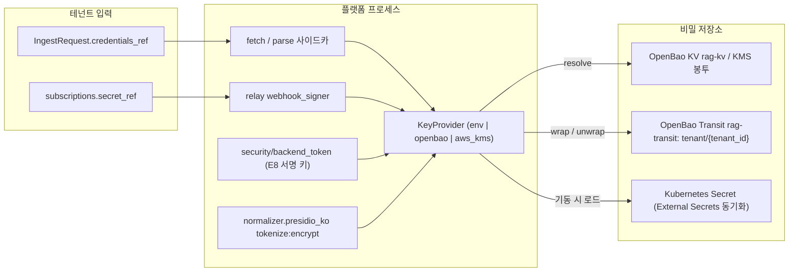
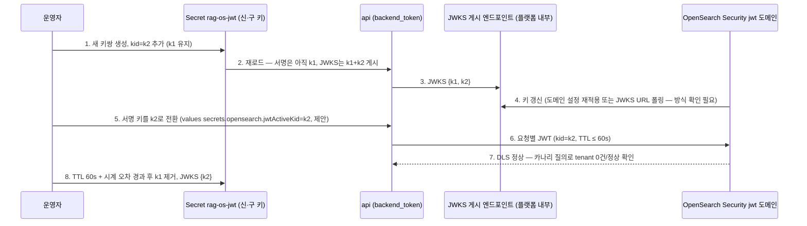
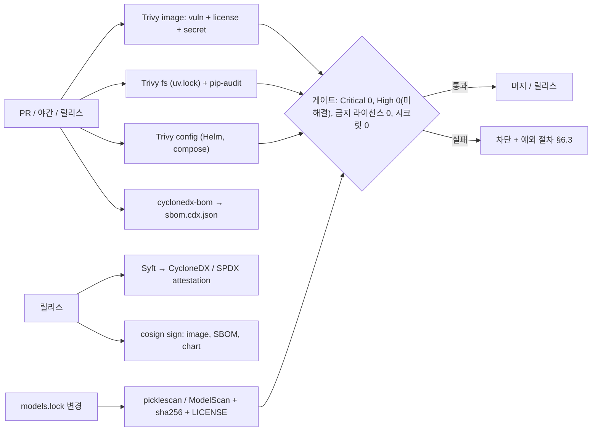
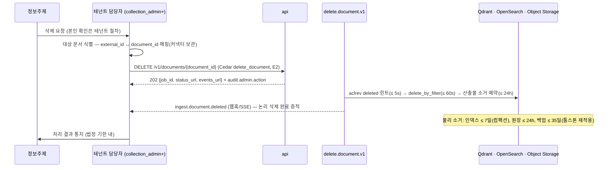
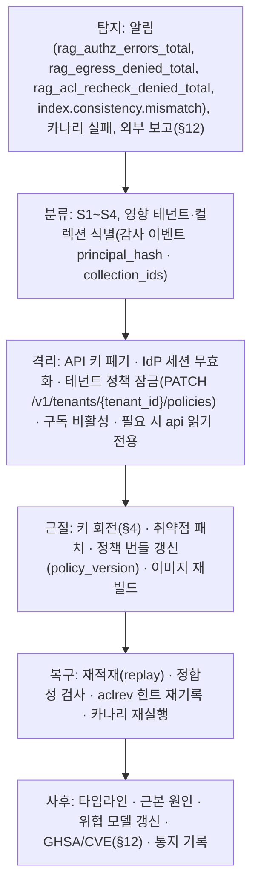

# 보안과 컴플라이언스 운영

## 목적

이 문서는 [멀티테넌시와 보안 아키텍처](../02-architecture/07-multi-tenancy-and-security-architecture.md)(이하 "보안 아키텍처")가 설계로 고정한 것을 **운영자가 매일 실행하는 절차**로 옮긴다. 설계 바이블 §10(멀티테넌시·ACL 정본), §5.3(`SecurityContext`·`EgressPolicy`), §6.6(비밀 규약), §3.1 D-02·D-09, §3.3 ADR-0001·0027·0038이 정본이며, 이 문서는 새 계약 타입·필드·열거값을 만들지 않는다. 바이블에 없는 것은 선택 필드(N) 또는 `## 미해결 이슈`의 제안으로만 남긴다.

다루는 것은 (1) 배포 시 보안 기준선 체크리스트, (2) 시크릿 관리 절차, (3) 인증 통합 설정(OIDC 제공자 예시), (4) 키 회전, (5) 네트워크 정책 운영, (6) 취약점 스캔, (7) 라이선스 컴플라이언스 절차와 모델 라이선스 레지스트리, (8) 개인정보 처리(정책 설정·삭제 요청·감사 로그 보존), (9) 침해 대응 절차, (10) 프롬프트 인젝션 모니터링, (11) ISMS-P/ISO 27001 통제 매핑, (12) 보안 릴리스 정책이다.

이 문서가 **소유하는** 결정은 다른 문서가 위임한 다음 항목이다: 보안 아키텍처 §4.1이 위임한 `pii_officer` 직무 분리 통제, 보안 아키텍처 미해결 이슈 7(`encrypted_text` 옵트인 모드)·21(`KeyProvider` 키 명명), [배포 아키텍처](../02-architecture/08-deployment-architecture.md) §3.5가 위임한 취약점 SLA와 §5.4가 위임한 서비스 메시 선택, [저장소 구조](../10-development/01-repository-structure.md) 미해결 이슈 4가 위임한 `models.lock` 필드·게이트 규칙(파일 형식은 [설정 레퍼런스](02-configuration-reference.md)와 공동), 그리고 바이블 미해결 이슈 14(OpenSearch Security `jwt` 도메인 키 회전)의 운영 절차다.

## 범위

- **포함**: 위 12개 영역의 절차·체크리스트·표. 프로파일 4종(`lite`, `standard`, `premium`, `korean-gov`)별 필수 여부. 검증 명령과 증적(evidence) 위치.
- **제외**: 강제 지점 E1~E17의 설계 근거 → 보안 아키텍처 §5, [ADR-0027](../06-adr/0027-security-context-injection-and-acl-enforcement-points.md); RLS 정책 SQL·물리 스키마 → [저장소 아키텍처](../02-architecture/04-storage-architecture.md); Helm values 키·매니페스트 전문 → [배포 가이드](01-deployment-guide.md), 배포 아키텍처; 환경 변수 전체 목록 → [설정 레퍼런스](02-configuration-reference.md); 알림 규칙·대시보드 → [관측성](03-observability.md); 장애 런북 → [런북](06-runbooks.md); 백업·복구 → [백업과 재해 복구](07-backup-and-disaster-recovery.md); CI 파이프라인 정의 → [CI/CD](../10-development/05-ci-cd.md); PII 탐지기 구현 → [정규화와 정제](../04-pipelines/09-normalization-and-cleaning.md); 법률 자문.
- **수치**: 주기·기한·한도는 실측·법무 확인 전이므로 모두 "초안 목표"다. 법령·인증기준 조문 번호는 원문 대조 전 "확인 필요(as of 2026-09)"로 표기한다. 외부 도구의 버전·라이선스는 [기술 지형 12](../07-tech-landscape/12-security-multitenancy-pii-and-licensing.md)·[선정 매트릭스](../07-tech-landscape/00-summary-and-selection-matrix.md)에 근거가 있을 때만 단정한다.
- **인용**: 바이블은 절 번호로("바이블 §10.3"), 강제 지점은 `E1`~`E17`(바이블 §10.3 번호), 이 문서의 체크리스트 항목은 `SB-nn`으로 인용한다.

## 1. 보안 기준선 체크리스트(배포 시)

### 1.1 사용법

배포 가이드 §7 smoke test가 "동작하는가"를 확인한다면 이 체크리스트는 "안전하게 동작하는가"를 확인한다. 최초 설치, 프로파일 변경(`profile_hash` 변경), 마이너 업그레이드마다 전 항목을 실행하고 결과를 릴리스 티켓에 첨부한다. 항목 열의 "필수" 값은 `M`(Must, 미충족 시 배포 중단), `S`(Should, 예외 승인 시 진행), `-`(해당 없음)이다. 검증 열의 CLI 하위 명령 중 바이블 §12 `cli/`에 없는 것(`rag security baseline`, `rag models verify`, `rag api-key`, `rag audit report`)은 **제안**이며(§미해결 이슈 1) 확정 전에는 같은 열의 API·SQL·kubectl 검사로 대체한다.

### 1.2 체크리스트

| ID | 영역 | 항목 | 검증 방법 | `lite`(운영) | `standard`/`premium` | `korean-gov` | 근거 |
|----|------|------|-----------|:---:|:---:|:---:|------|
| SB-01 | 인증 | `security.authn: oidc`, IdP `issuer`가 HTTPS, JWKS 조회 성공, `iss`·`aud`·`exp`·`nbf` 검증 켬 | 잘못된 `aud` 토큰으로 `POST /v1/query` → 401 `auth.unauthenticated` | S(API 키 허용) | M | M | E1, 보안 아키텍처 §3.1 |
| SB-02 | 인증 | 요청 본문의 `tenant_id`·`as_of` 거부 | 본문에 `tenant_id` 포함 → 422(바이블 §10.3 E1; 422용 오류 코드는 §미해결 이슈 17) | M | M | M | E1, E6 |
| SB-03 | 인증 | 부트스트랩 API 키(`service:bootstrap`) 폐기 또는 `expires_at ≤ 30d`; 모든 운영 API 키에 `expires_at` 존재 | `api_keys` 표 조회(`SECURITY DEFINER` 함수 경유), 만료 없는 행 0건 | M | M | M | 배포 가이드 §5.2, §3.5 |
| SB-04 | 인가 | Cedar 정책 번들 로딩, `SecurityContext.policy_version`이 예상 번들 버전과 일치, 정책 미로딩 시 403(fail-closed) | 정책 파일 제거 후 요청 → 403 `auth.forbidden`, `rag_authz_errors_total` 증가 | S(`static_roles`) | M | M | E2 |
| SB-05 | 인가 | `service:` 주체에 `tenant_admin`·`platform_admin`·`pii_officer` 부여 불가 | Cedar 단위 테스트 통과 기록 | M | M | M | 보안 아키텍처 §4.1 (3) |
| SB-06 | 레이트리밋 | `security.rate_limit.fail_mode: closed`(운영), Valkey 중단 시 429 `api.rate_limited` + `Retry-After` | Valkey 정지 후 요청 → 429 | M(운영 모드) | M | M | E3, 바이블 §7.2 |
| SB-07 | 격리 | OpenSearch Security `jwt` 인증 도메인 구성, 역할 `rag_reader` DLS `term tenant_id = ${attr.jwt.tenant_id}`, "서비스 계정 토큰만으로는 DLS 0건" 테스트 | 어댑터 계약 테스트 리포트 + 수동 질의 | - | M | M | E8 |
| SB-08 | 격리 | PostgreSQL 애플리케이션 역할 `NOBYPASSRLS`·비소유자, 모든 테넌트 표 RLS `FORCE`, PgBouncer 트랜잭션 모드에서 `SET LOCAL app.tenant_id` 프롤로그 | `SELECT relname FROM pg_class WHERE relrowsecurity AND NOT relforcerowsecurity` = 0행; 역할 속성 조회 | M | M | M | E8, 저장소 아키텍처 §2.4·§2.5 |
| SB-09 | 격리 | Qdrant `service.api_key` 설정, `tenant_id` payload 인덱스 `is_tenant=true`, TLS(standard) / mTLS(korean-gov) | 컬렉션 info 조회, 무인증 요청 → 401/403 | M | M | M | E5, 바이블 §13.4 |
| SB-10 | 격리 | 카나리 테넌트 침투 테스트 통과: 교차 테넌트 질의·MCP `search`·`get_document`·`hydrate`·`ChunkTextStore` 0건 | `tests/security` 카나리 잡 결과(스테이징·운영 주 1회, 초안 목표) | S | M | M | 바이블 §15 #3, 배포 가이드 §5.2 |
| SB-11 | 네트워크 | 네임스페이스 기본 거부(ingress·egress) + 배포 아키텍처 §5.2 허용 표만; `lo-sidecar` egress 0 | `kubectl get networkpolicy -A`, 카나리 egress 테스트(§5.2) | -(compose) | M | M | E16, 배포 아키텍처 §5.2 |
| SB-12 | 네트워크 | 운영 프로파일 `runtime.egress.deny_cidrs` ⊇ 기본 9개, `allowed_schemes`에 `file`·`http` 없음(테넌트 옵트인 제외) | `rag profile validate` 규칙 (12); E16 계약 테스트 6종 | M | M | M | 바이블 §7.4 (12), [ADR-0038](../06-adr/0038-outbound-egress-policy-and-webhook-signing.md) |
| SB-13 | 전송 | 인그레스 TLS 1.2 이상(권장 1.3), 내부 구간 TLS(standard) / mTLS(korean-gov), 인증서 검증 끄기 옵션 부재 | TLS 스캐너, 배포 values `externals.*` TLS 참조 | M(종단 TLS) | M | M | 보안 아키텍처 §6.2 |
| SB-14 | 시크릿 | 운영은 `RAG_SECRETS__PROVIDER ∈ {openbao, aws_kms}`(`env` 금지), Kubernetes Secrets 저장 시 암호화(etcd) 켬, 로그·트레이스 비밀 패턴 스캔 0건 | 환경 변수 확인, CI 로그 스캔 리포트 | S(`env` 허용) | M | M | 바이블 §6.6, §2 |
| SB-15 | 저장 | 오브젝트 스토리지 SSE 켬 + 평문 업로드 거부 정책, 데이터 볼륨 암호화; `korean-gov`·`index_per_tenant`는 OpenBao Transit 테넌트 DEK 생성 확인 | 버킷 정책 조회, Transit 키 목록 `tenant/{tenant_id}` | S | M | M | 보안 아키텍처 §6.3 |
| SB-16 | 웹훅 | 모든 `subscriptions.secret_ref` 해소 가능, `webhook_url` 스킴 `https`(`http` 옵트인 없음) | 구독 목록 조회 + `RAG-Signature` 왕복 테스트 | M | M | M | E12, E16 |
| SB-17 | 관측 | `RAG_OTEL__CONTENT_CAPTURE=none`, `korean-gov`는 `NO_CONTENT` 잠금, 메트릭 라벨에 `tenant_id` 없음, Collector redaction 켬 | "본문 문자열이 스팬에 없음" 테스트, `/metrics` 라벨 스캔 | M | M | M | E13, 바이블 §6.5 |
| SB-18 | 감사 | `audit_log` append-only(애플리케이션 역할에 UPDATE/DELETE 없음), 보존 정책(§8.3) 설정, `korean-gov`는 OpenSearch 감사 인덱스 ILM 2년 | 권한 조회, ILM 정책 조회 | M | M | M | 보안 아키텍처 §8.3 |
| SB-19 | PII | Presidio KR 인식기 5종 활성(계약 테스트), 프로파일 `ingest.normalize.pii.policy`가 `keep`이 아닌지, 탐지기 로딩 성공(`rag_pii_detector_errors_total` 0) | 계약 테스트 리포트, 샘플 문서 수집 후 `pii_report` 확인 | M | M | M | E4, 바이블 §7.3 |
| SB-20 | 공급망 | 모든 이미지 digest 고정, cosign 서명 검증 통과, SBOM 첨부, Trivy Critical 0·High 미해결 0(SLA 내) | `rag release verify`(제안) 또는 `cosign verify`, Trivy 리포트 | M | M | M | 배포 아키텍처 §3.5, §6 |
| SB-21 | 공급망 | `models.lock` 검증 통과(존재·sha256·`LICENSE`·등급), 운영 `HF_HUB_OFFLINE=1`, D 등급 모델이 기본 프로파일에 없음 | Helm 훅 `models-verify` 로그, 파드 환경 변수 | M | M | M | [ADR-0001](../06-adr/0001-license-grade-table-and-d02-interpretation.md), 배포 가이드 §6.1 |
| SB-22 | 라이선스 | pip-licenses·liccheck 게이트 통과, `optIn.*` 기본 `false`(승인된 항목만 `true`, 승인 티켓 링크) | CI 리포트, Helm values diff | M | M | M | D-02, §7 |
| SB-23 | 샌드박스 | 워커·사이드카 (1) 비루트 (2) 읽기 전용 루트 (3) CPU/메모리 제한 (4) 압축 해제 상한(원본 100배 또는 2GB 중 작은 값) (5) XXE 비활성; `lo-sidecar`는 `rag-optin` 네임스페이스 | Pod Security Standards `restricted` 감사 모드 위반 0건, 샌드박스 테스트 코퍼스(zip bomb·XXE) 통과 | S((1) 비루트·(3) 자원 제한만) | M | M | 보안 아키텍처 §12.4 |
| SB-24 | MCP | `/.well-known/oauth-protected-resource` 게시, `Authorization: Bearer` audience 검증, `list_collections`가 `allowed_collections`만, 커서 테넌트 불일치 거부 | MCP conformance CI 리포트 | M | M | M | E14, [ADR-0025](../06-adr/0025-mcp-cursor-pagination-and-tool-set.md) |
| SB-25 | 백업 | 백업 저장소 SSE, 보존 35일(초안), 복구 리허설에서 삭제 툼스톤 재적용 확인 | 백업 문서 §복구 리허설 기록 | S | M | M | 보안 아키텍처 §6.3·§12.1 |
| SB-26 | 시각 | 모든 노드 NTP 동기화(에어갭은 내부 NTP), 시계 오차 < 30s(초안; E8 JWT TTL 60s와 웹훅 5분 창의 전제) | `chronyc tracking` 또는 노드 메트릭 | M | M | M | 배포 가이드 §6.3 |
| SB-27 | 릴리스 | 저장소 `SECURITY.md` 게시, 보고 채널 응답 테스트(§12) | 연 1회 모의 보고 | M | M | M | §12 |

### 1.3 결정

**결정:** 위 체크리스트의 `M` 항목은 배포 게이트다. 하나라도 미충족이면 `standard` 이상 운영 배포를 진행하지 않으며, `S` 항목의 예외는 승인자(`platform_admin` 역할 보유자)와 만료일을 릴리스 티켓에 기록하고 다음 마이너 릴리스 전에 재검토한다. `korean-gov`는 `S` 예외를 허용하지 않는다. 체크리스트의 자동화(`rag security baseline --profile <id>`, 제안)는 배포 가이드 §7.2 smoke test 스크립트의 확장으로 [CI/CD](../10-development/05-ci-cd.md)에서 구현한다. ([ADR-0027](../06-adr/0027-security-context-injection-and-acl-enforcement-points.md), [ADR-0038](../06-adr/0038-outbound-egress-policy-and-webhook-signing.md))

## 2. 시크릿 관리 절차

### 2.1 비밀의 종류와 참조 방식

바이블 §6.6은 두 가지만 정한다: 비밀은 `RAG_SECRETS__PROVIDER=env|openbao|aws_kms` + `credentials_ref` 간접 참조로 다루고, 로그·트레이스에 값을 기록하지 않는다. 보안 아키텍처 §6.1의 표를 운영 관점으로 재배열한다.

| 비밀 | 소유 | 저장 위치(운영) | 참조 방식 | 해소 시점 | 회전(§4) |
|------|------|-----------------|-----------|-----------|----------|
| 문서 원천 자격 증명(S3·GCS·Azure·SMB·HTTP 토큰), 암호화 문서 비밀번호 | 테넌트 | 시크릿 매니저(OpenBao KV 또는 KMS 봉투) | `IngestRequest.credentials_ref` → `SourceDocument` → `ConvertRequest.credentials_ref` | `fetch`·`parse`(사이드카) 실행 시 `KeyProvider.resolve` | 테넌트 책임; 참조 문자열은 불변 |
| 웹훅 서명 키 | 테넌트 | 시크릿 매니저 | `subscriptions.secret_ref` | 릴레이 전송 시 | 구독별 신·구 키 동시 유효 유예(FR-SEC-11) |
| 백엔드 자격 증명(PostgreSQL DSN, Qdrant API 키, OpenSearch 계정, Valkey URL, 오브젝트 스토리지 키) | 플랫폼 운영자 | Kubernetes Secret(External Secrets 동기화) | 환경 변수 `RAG_PG__DSN`, `RAG_VALKEY__URL`, `RAG_OBJECT_STORE__URI` 등 | 프로세스 기동 | §4.1 표 |
| E8 요청별 테넌트 JWT 서명 키 | 플랫폼 운영자 | Kubernetes Secret `rag-os-jwt`(배포 가이드 §4.3) | `security/backend_token`이 `KeyProvider`에서 로드 | 기동 + 회전 시 재로드 | `kid` 병행 90일(초안) |
| 테넌트 DEK | 플랫폼(테넌트별 1개) | OpenBao Transit(래핑 키만 원장) | `KeyProvider.wrap/unwrap(tenant_id, …)` | `pii_tokenize_mode=encrypt`, `index_per_tenant` payload 봉투, 감사 본문 | Transit 키 버전 회전 연 1회(초안) |
| LLM 공급자 API 키(`answer` 레퍼런스, 외부 보강 옵트인) | 플랫폼 또는 테넌트 | 시크릿 매니저 | 환경 변수 또는 테넌트 정책 `credentials_ref`(제안) | 호출 시 | 공급자 정책 |
| 사설 레지스트리 자격 증명 | 운영자 | `rag-regcred` | `global.image.pullSecrets[]` | 파드 스케줄 | 레지스트리 정책 |

### 2.2 `KeyProvider` 운영 규약

**결정(보안 아키텍처 미해결 이슈 21 — 운영 부분 확정):** `KeyProvider` 어댑터 3종(`env`, `openbao`, `aws_kms`)의 운영 규약은 다음과 같다. (1) `env`는 개발·`lite` 개발 모드 전용이며 운영 프로파일에서는 기동 시 거부한다(SB-14). (2) `openbao` 어댑터의 OpenBao Transit 키 이름은 `tenant/{tenant_id}`(보안 아키텍처 §6.1 제안을 채택), 마운트 경로는 `rag-transit`, KV 마운트는 `rag-kv`이며 Helm values `secrets.openbao.{address, transitMount, kvMount, authRole}`(제안 키)로 주입한다. (3) `aws_kms`는 테넌트별 KMS 키 별칭 `alias/rag/tenant/{tenant_id}`(제안)를 쓴다. (4) DEK 평문은 프로세스 메모리에만 존재하고 5분(초안 목표) 캐시 후 폐기하며, 래핑된 DEK만 원장(`tenants` 표 확장 컬럼, 제안)에 저장한다. 포트 시그니처(`resolve`, `wrap`, `unwrap`)의 바이블 §12 등재는 §미해결 이슈 2다. ([ADR-0038](../06-adr/0038-outbound-egress-policy-and-webhook-signing.md), [ADR-0011](../06-adr/0011-kv-and-object-storage-valkey-rustfs-seaweedfs.md))



### 2.3 Kubernetes 시크릿과 External Secrets

배포 가이드 §4.3의 시크릿 8종(`rag-pg`, `rag-s3`, `rag-valkey`, `rag-os-jwt`, `rag-qdrant`, `rag-temporal-tls`, `rag-tls`, `rag-regcred`)이 대상이다. 운영 절차:

| 단계 | 절차 | 검증 |
|------|------|------|
| 1 생성 | 시크릿 매니저(OpenBao KV·클라우드 시크릿)에 원본을 두고 External Secrets Operator(Apache-2.0; 버전 확인 필요 as of 2026-09) `ExternalSecret`으로 네임스페이스 `rag-platform`에 동기화한다. `kubectl create secret`으로 직접 만드는 것은 개발 전용 | `ExternalSecret` 상태 `SecretSynced` |
| 2 접근 제한 | 네임스페이스 RBAC: 시크릿 `get`·`list`는 플랫폼 서비스 어카운트와 배포 도구만. 운영자 대화형 조회는 `platform_admin` 브레이크글라스 절차(§9) | RBAC 감사 |
| 3 저장 암호화 | etcd 저장 시 암호화(KMS 공급자 또는 `aescbc`) 켬 — 관리형 Kubernetes는 공급자 설정 확인 | 클러스터 설정 증적 |
| 4 마운트 | 환경 변수 주입 대신 파일 마운트를 우선(`RAG_*` 환경 변수는 파일 경로를 가리키는 `_FILE` 변형 — pydantic-settings `secrets_dir`; 지원 여부 확인 필요 as of 2026-09) | 파드 spec 검토 |
| 5 회전 | §4.1 주기에 따라 원본을 갱신하면 External Secrets가 재동기화하고, 파드는 `reloader` 주석 또는 롤링 재시작으로 반영 | 회전 후 smoke test |

### 2.4 금지 사항과 검사

- `IngestRequest`·`QueryRequest`·`ConvertRequest` 어디에도 비밀 평문을 넣지 않는다(바이블 §5.4 `credentials_ref`). 계약 스키마는 `document_password` 같은 필드를 갖지 않으며, 접수 API가 `credentials_ref` 형식이 아닌 값을 받으면 400 `contract.violation`이다.
- `Warning`·`StageError`·`ProblemDetails`·스팬·structlog에 비밀 값이 들어가지 않는다(NFR-SEC-07). CI는 로그 스냅샷과 테스트 출력을 비밀 패턴(`AKIA…`, `-----BEGIN`, `rgp_…` API 키 접두 등)으로 스캔하고 Trivy `secret` 스캐너를 이미지에 적용한다(§6.1).
- `webhook_url`에 쿼리 파라미터 비밀을 넣지 않는다(ADR-0038 대안 4 기각).
- 프로파일 YAML·Helm values에 비밀 값을 적지 않는다. `profiles` 표의 `yaml` 컬럼은 원장에 저장되므로 비밀이 들어가면 원장 전체가 비밀 저장소가 된다.

## 3. 인증 통합 설정(OIDC)

### 3.1 토큰 클레임 계약

플랫폼은 IdP를 운영하지 않는다(브리프 §6). 보안 아키텍처 §3.1이 정한 클레임 → 주체 매핑을 IdP 설정으로 만족시켜야 한다.

| 클레임 | 필수 | 매핑 | 검증 |
|--------|:----:|------|------|
| `iss` | Y | 프로파일 `security.authn: oidc`의 발급자(`RAG_AUTH__OIDC_ISSUER`, 바이블 §6.6) | 불일치 → 401 |
| `aud` | Y | 플랫폼 클라이언트 ID 포함(REST·MCP 공통; audience 값은 [설정 레퍼런스](02-configuration-reference.md) `RAG_AUTH__OIDC_AUDIENCE` 제안) | 불일치 → 401 |
| `exp`, `nbf`, `iat` | Y | 시계 오차 허용 30s(초안) | 만료 → 401 |
| `sub` | Y | `user:{sub}`; client credentials 흐름은 `service:{client_id}` | — |
| `tenant_id` | Y | `SecurityContext.tenant_id`(ULID) | 없으면 401 |
| `groups[]` | N | `group:{name}`; 없으면 디렉터리 확장(§3.3 보안 아키텍처) | 상한 1,024 → 422 `auth.too_many_principals` |
| `roles[]` | Y | `Principal.roles` — `platform_admin, tenant_admin, collection_admin, ingestor, reader, pii_officer`(보안 아키텍처 §4.1) | 미지정 조합은 Deny |
| `allowed_collections[]` | N | Cedar 속성; 없으면 테넌트 정책 기본(역할 스코프) | — |

JWKS는 Authlib 1.8.0(BSD-3, 기술 지형 12)로 검증하고 캐시 TTL은 IdP `Cache-Control`을 따르되 상한 24h(초안)다. IdP 장애 시 캐시 키로 검증을 계속하고 캐시 만료 시 401이다(보안 아키텍처 §3.1).

### 3.2 Keycloak 예시(레퍼런스 IdP)

Keycloak 26.7.4(Apache-2.0, 기술 지형 12)를 레퍼런스로 동봉한다. 테넌트 표현은 **realm 하나 + 사용자 속성 `tenant_id`**가 기본이고, 테넌트별 realm은 IdP 운영 정책이 요구할 때만 쓴다(발급자가 테넌트마다 달라져 `RAG_AUTH__OIDC_ISSUER`를 다중으로 두어야 하므로 설정 레퍼런스에서 다중 발급자 지원 여부를 확정, §미해결 이슈 3). 클라이언트 `rag-platform`의 프로토콜 매퍼 예시(realm export 조각; 매퍼 타입 ID·설정 키 이름은 Keycloak 26.x 기준으로 확인 필요 as of 2026-09):

```json
{
  "clientId": "rag-platform",
  "protocol": "openid-connect",
  "publicClient": false,
  "standardFlowEnabled": true,
  "serviceAccountsEnabled": true,
  "protocolMappers": [
    {
      "name": "tenant_id",
      "protocol": "openid-connect",
      "protocolMapper": "oidc-usermodel-attribute-mapper",
      "config": {
        "user.attribute": "tenant_id",
        "claim.name": "tenant_id",
        "jsonType.label": "String",
        "id.token.claim": "true",
        "access.token.claim": "true"
      }
    },
    {
      "name": "groups",
      "protocol": "openid-connect",
      "protocolMapper": "oidc-group-membership-mapper",
      "config": {
        "claim.name": "groups",
        "full.path": "false",
        "id.token.claim": "false",
        "access.token.claim": "true"
      }
    },
    {
      "name": "roles",
      "protocol": "openid-connect",
      "protocolMapper": "oidc-usermodel-client-role-mapper",
      "config": {
        "usermodel.clientRoleMapping.clientId": "rag-platform",
        "claim.name": "roles",
        "jsonType.label": "String",
        "multivalued": "true",
        "access.token.claim": "true"
      }
    },
    {
      "name": "audience",
      "protocol": "openid-connect",
      "protocolMapper": "oidc-audience-mapper",
      "config": {
        "included.client.audience": "rag-platform",
        "access.token.claim": "true"
      }
    }
  ]
}
```

운영 규칙: (1) 클라이언트 역할 6종을 `rag-platform` 클라이언트에 만들고 IdP 그룹 → 역할 매핑은 IdP에서만 한다. (2) `pii_officer`는 별도 그룹으로만 부여하고 `tenant_admin` 그룹과 겸직 검토를 §3.6 절차로 분기별 수행한다. (3) 서비스 계정(client credentials)은 `service:{client_id}` 주체가 되므로 `visible_set=[public]`이 적용된다(보안 아키텍처 §3.2). (4) 액세스 토큰 수명은 5~15분(초안 목표), 리프레시는 IdP 정책.

### 3.3 Dex 예시(개발·브로커)

Dex v2.45.1(Apache-2.0)은 상위 IdP 브로커링과 개발 환경용이다. Dex가 커스텀 클레임(`tenant_id`, `roles`)을 발급하는 방법은 커넥터·버전에 따라 다르므로 확인 필요(as of 2026-09)이며, 개발 compose에서는 Keycloak 개발 realm 또는 API 키(`lite`)를 우선한다. 최소 설정 예:

```yaml
issuer: https://dex.dev.local/dex
storage: {type: memory}
web: {https: 0.0.0.0:5556, tlsCert: /etc/dex/tls.crt, tlsKey: /etc/dex/tls.key}
staticClients:
  - id: rag-platform
    name: RAG Platform (dev)
    secretEnv: DEX_RAG_CLIENT_SECRET          # 값은 시크릿 매니저에서 주입
    redirectURIs: ["https://rag.dev.local/oauth/callback"]
connectors:
  - type: mockCallback
    id: mock
    name: Mock (dev only)
```

### 3.4 MCP 보호 자원 메타데이터(RFC 9728)

MCP 클라이언트는 `/.well-known/oauth-protected-resource`(바이블 §14)로 인가 서버를 발견한다(E14). `resource`는 api의 외부 기준 URL, `authorization_servers`는 §3.1의 발급자다. `scopes_supported`는 [MCP 서버](../05-api/05-mcp-server.md)가 확정하는 제안 값이다.

```json
{
  "resource": "https://rag.example.go.kr",
  "authorization_servers": ["https://idp.example.go.kr/realms/rag"],
  "bearer_methods_supported": ["header"],
  "scopes_supported": ["rag.search", "rag.read_document"],
  "resource_documentation": "https://rag.example.go.kr/docs/mcp"
}
```

### 3.5 API 키 운영

API 키는 `service:` 주체 전용이다(보안 아키텍처 §3.1 결정). 운영 규칙(초안 목표 수치):

| 항목 | 규칙 |
|------|------|
| 발급 | `tenant_admin`·`platform_admin`(`manage_api_keys`, 보안 아키텍처 §4.1)만; `platform_admin` 발급은 테넌트 부트스트랩(배포 가이드 §5.2)·사고 대응(§9)에 한정하고 `audit.admin.action`에 사유를 남긴다; 발급 키에 `pii_officer`·`tenant_admin`·`platform_admin` 역할 바인딩 불가 |
| 저장 | 해시만(argon2id 권고, 기술 지형 12 §3.2); 조회용 `prefix` 컬럼은 제안(보안 아키텍처 미해결 이슈 17) |
| 만료 | `expires_at` 필수, 최대 90일; 부트스트랩 키 30일 |
| 회전 | 동시 유효 2개(유예 7일), 신규 발급·폐기는 `audit.admin.action{action: manage_api_keys}` |
| 스코프 | `allowed_collections[]`·`roles[]`(둘 다 제안 컬럼) 최소화; 테넌트 한도의 50% 하위 레이트리밋(보안 아키텍처 §10) |
| 유출 대응 | 즉시 폐기(`revoked_at`, 제안) → §9 절차 |

전달 헤더(`Authorization: Bearer` 재사용 vs 전용 헤더)는 [관리 API](../05-api/04-management-api.md)가 확정한다(보안 아키텍처 미해결 이슈 18).

### 3.6 역할 매핑과 직무 분리

**결정(보안 아키텍처 §4.1 위임 — `pii_officer` 직무 분리):** (1) `korean-gov` Cedar 정책 번들은 `unmask_pii`를 `principal.roles`에 `tenant_admin` 또는 `platform_admin`이 **함께** 있는 주체에게 `forbid`한다(겸직 차단). `standard`·`premium` 번들은 이 규칙을 기본 포함하지 않으며 운영자가 번들 변형으로 켤 수 있다. (2) `pii_officer` 부여·회수는 IdP에서만 이뤄지므로 플랫폼은 분기별(초안 목표) **접근권한 검토**를 수행한다: `audit.admin.action{action: unmask_pii}` 집계 + IdP 그룹 멤버십 대조 리포트(`rag audit report --action unmask_pii`, 제안)를 `tenant_admin`이 아닌 검토자(보안 담당)가 승인한다. (3) `unmask_pii` 호출은 IdP 단계 인증 강화(step-up, `acr` 클레임 검사)를 권고하며 강제 여부는 `korean-gov` 필수·그 외 옵션이다(제안, §미해결 이슈 4). (4) 매트릭스 변경은 `policy_version` 증가 + `audit.admin.action` 기록이다. 근거: ISMS-P 2.5.5 특수 계정 및 권한관리·2.5.6 접근권한 검토(항목 번호 확인 필요 as of 2026-09), FR-SEC-08. ([ADR-0027](../06-adr/0027-security-context-injection-and-acl-enforcement-points.md))

## 4. 키 회전

### 4.1 회전 대상과 주기

모든 주기는 초안 목표이며, 회전 실행은 `audit.admin.action`(대상 테넌트가 있는 경우) 또는 `audit_log` 표(플랫폼 범위)에 남긴다.

| 키 | 주기(초안) | 방식 | 무중단 조건 | 영향 |
|----|-----------|------|-------------|------|
| OIDC 서명 키(IdP) | IdP 정책 | JWKS 다중 키 게시 → 플랫폼 캐시 자동 갱신 | 구 키 유예 ≥ 액세스 토큰 수명 | 없음 |
| E8 백엔드 토큰 서명 키(`rag-os-jwt`) | 90일 | §4.2 절차(`kid` 병행) | OpenSearch `jwt` 도메인이 다중 키를 수용해야 함(확인 필요 as of 2026-09) | 실패 시 렉시컬 채널 `retrieve.backend_error` |
| 웹훅 서명 키(`secret_ref`) | 테넌트 요청 시·연 1회 | 새 비밀 등록 → 신·구 키 동시 서명 유예 7일(헤더 `v1` 다중 값 표기는 [웹훅과 이벤트](../05-api/07-webhooks-and-events.md) 확정) → 구 키 폐기 | 수신자가 두 키를 검증 | 없음 |
| API 키 | ≤ 90일 | §3.5 | 동시 유효 2개 | 없음 |
| 테넌트 DEK(Transit) | 연 1회 또는 사고 시 | Transit 키 버전 증가(`rotate`) → 신규 암호화는 새 버전, 기존 암호문은 `rewrap` 배치(`maintenance` 큐, 제안 잡) | Transit `min_decryption_version` 유예 | PII 토큰·payload 봉투 재래핑 비용 |
| 오브젝트 스토리지 SSE-KMS KEK | KMS 정책(연 1회) | KMS 자동 회전; 객체 재암호화 불필요(봉투) | — | 없음 |
| PostgreSQL 역할 비밀번호 | 180일 | 신규 비밀 → External Secrets → 롤링 | 두 비밀 동시 유효 창(PostgreSQL은 단일 비밀이므로 롤링 순서: 비밀 갱신 → 파드 재시작) | 순단 없음(롤링) |
| Qdrant API 키 | 180일 | Qdrant 설정 재적용 + 파드 롤링 | Qdrant 다중 키 지원 여부 확인 필요(as of 2026-09) | 재시작 창 |
| TLS 인증서 | 90일(cert-manager 자동) | cert-manager 갱신 → 인그레스 재로드 | — | 없음 |
| `tokenize:hash` 테넌트 고정 salt | **회전 불가**(회전 = 전체 재정규화·재색인) | 사고 시에만 새 salt + `reprocess from_stage=normalize` 전체 | — | 컬렉션 blue/green 재색인 |
| `tenants.policies`·Cedar 정책 번들 | 변경 시 | `policy_version` 증가 | — | 플랜 캐시 키 변경 |

### 4.2 E8 백엔드 토큰 서명 키 회전 절차

바이블 미해결 이슈 14가 이 문서에 위임한 절차다. 검증 결과에 따라 대안(테넌트 filtered alias 전용 접속)으로 전환할 수 있다([ADR-0027](../06-adr/0027-security-context-injection-and-acl-enforcement-points.md) 재검토 조건).



검증 항목: (a) 단계 4~5 사이 렉시컬 채널 오류율(`rag_retrieve_latency_seconds{channel="lexical"}` 오류 outcome) 증가 없음, (b) "서비스 계정 토큰만으로는 DLS 0건" 테스트 재실행, (c) 카나리 침투 테스트 통과. OpenSearch Security가 JWKS URL 폴링을 지원하지 않고 정적 공개 키만 받는다면 단계 4는 보안 플러그인 설정 재적용(`securityadmin`)이 되어 순단이 생기므로, 이 경우 회전 주기를 180일로 늘리고 유지보수 창에 수행한다(확인 필요 as of 2026-09, §미해결 이슈 5).

### 4.3 테넌트 DEK 회전과 크립토 셰레딩

- 회전: Transit 키 버전을 올리면 새 암호화만 새 버전을 쓰고, 기존 암호문은 `rewrap` 배치가 재래핑한다. `min_decryption_version`을 올리는 것은 재래핑 완료 확인 후다.
- 크립토 셰레딩(테넌트 삭제): Transit 키 삭제(`deletion_allowed=true` 후 삭제)로 암호화된 PII 토큰·payload 봉투·감사 본문이 즉시 복호 불가가 된다. 평문 인덱스·산출물은 §8.2의 물리 소거 데드라인을 따른다. 감사 로그의 법정 보존 항목은 삭제하지 않는다(보안 아키텍처 §12.1; 법률 자문 필요).
- 백업: 래핑된 DEK와 Transit 키 백업은 데이터 백업과 **분리 보관**한다(같은 매체에 있으면 백업 접근자가 복호 가능).

## 5. 네트워크 정책

### 5.1 기본 거부와 허용 표

정본은 배포 아키텍처 §5.2 표다. 운영자가 매 배포에서 확인할 요지:

| 구성요소 | 허용 egress(요지) | 반드시 금지 | 확인 |
|----------|-------------------|-------------|------|
| `api`, `api-query` | `rag-data`(PG·Temporal·Qdrant·OpenSearch·Valkey·Object Storage), `rag-serving`, `otel`, 외부 443은 IdP JWKS·LLM 공급자 FQDN만 | 문서 원천·웹훅(api는 fetch·릴레이를 하지 않음), `rag-optin` | FQDN 정책 존재 |
| `worker-io` | `rag-data`, `otel`, Egress Gateway → 외부(fetch) | 클러스터 내부 CIDR 직접 접속 | `EgressPolicy.deny_cidrs`와 NetworkPolicy 양쪽 |
| `worker-cpu` | `rag-data`(PG·Temporal·Object Storage), `parser-workers`, `rag-optin/lo-sidecar`(opt-in), `otel` | 외부 전부(모델은 볼륨) | `HF_HUB_OFFLINE=1` |
| `worker-gpu-*`, `worker-llm` | `rag-data`, `rag-serving`, `otel`; `worker-llm`만 Egress Gateway → LLM 공급자(테넌트 옵트인) | 문서 원천 | — |
| `relay` | PG, Temporal, `otel`, Egress Gateway → 웹훅 443 | 클러스터 내부 CIDR, `rag-serving` | — |
| `parser-workers`, `rag-serving/*` | `otel`; 서빙은 Object Storage(모델 sync) | 외부 | JVM 외부 접속 없음 |
| `rag-optin/lo-sidecar` | **0** | 모든 내외부 egress | LibreOffice 링크 추적 차단 |
| `rag-data/*` | 복제·백업 대상 | 외부 | — |

### 5.2 egress 이중 방어 검증

E16은 애플리케이션 `EgressPolicy`가 1차, NetworkPolicy가 2차다([ADR-0038](../06-adr/0038-outbound-egress-policy-and-webhook-signing.md) 대안 3 기각 근거). 두 방어 중 하나가 빠져도 정상 트래픽은 그대로 흐르므로 **누락이 조용히 지나간다**. 따라서 다음을 배포 검증과 주기 점검(주 1회, 초안 목표)에 포함한다.

| 테스트 | 기대 결과 | 관측 |
|--------|-----------|------|
| `source_uri = https://169.254.169.254/latest/meta-data/` 수집 | `fetch.egress_denied`(재시도 0) | `rag_egress_denied_total{component="fetch"}` +1 |
| `source_uri`가 사설 IP로 해석되는 공개 DNS 이름(DNS 리바인딩 모의) | 거부 | 동일 |
| 허용 호스트가 `http://127.0.0.1:6333`으로 302 리다이렉트 | 거부(홉 재검사) | 동일 |
| 운영 프로파일에서 `file:///etc/passwd` | `fetch.scheme_unsupported` 또는 `fetch.egress_denied` | 동일 |
| `POST /v1/subscriptions` with `webhook_url = http://10.0.0.5/` | RFC 9457 거부(코드는 [웹훅과 이벤트](../05-api/07-webhooks-and-events.md) 확정) | — |
| 워커 파드에서 `EgressPolicy`를 우회해 직접 소켓으로 `169.254.169.254:80` 연결(디버그 컨테이너) | 연결 타임아웃(NetworkPolicy) | 카운터 증가 **없음** — 이것이 2차 방어 확인 |
| 정상 운영 중 `rag_egress_denied_total` 0건 지속 | 정책 누락 신호로 취급(배포 아키텍처 §5.2) | 알림 규칙([관측성](03-observability.md)) |

Egress Gateway가 없는 클러스터의 NetworkPolicy `ipBlock except` 규칙은 CNI 지원 편차가 있다(배포 아키텍처 미해결 이슈 7). 지원하지 않는 CNI에서는 Cilium `CiliumNetworkPolicy` FQDN 정책 또는 전용 egress 프록시로 대체하고 그 결정은 [배포 가이드](01-deployment-guide.md)가 소유한다.

### 5.3 서비스 메시 선택

**결정(배포 아키텍처 §5.4 위임):** 플랫폼은 메시 중립을 유지한다(코드가 메시를 알지 못함). `korean-gov`의 코어·서빙·데이터 계층 mTLS 요구(바이블 §7.1)를 메시로 충족할 때 **레퍼런스 경로는 Linkerd**(Apache-2.0, CNCF; 버전 확인 필요 as of 2026-09)이고 Istio ambient(Apache-2.0)는 조직 표준이거나 L7 정책이 필요할 때의 대안이다. 근거: 요구가 mTLS 하나이고 L7 라우팅·트래픽 관리가 없으므로 사이드카 없는 경량 데이터 플레인과 자동 mTLS가 운영 부담이 작다(기술 지형 12 §3.3은 두 메시와 SPIFFE/SPIRE를 동급 후보로만 적었고 비교 실측은 없다 — 두 메시의 실측 비교는 §미해결 이슈 6). 메시를 쓰지 않는 경로는 cert-manager 발급 인증서로 서비스별 TLS를 켠다(OpenSearch·Qdrant·PostgreSQL·Temporal 각자 설정). 메시가 있어도 E16은 NetworkPolicy + `EgressPolicy`를 유지한다(메시 egress 정책은 3중 방어일 뿐 대체가 아니다). ([ADR-0027](../06-adr/0027-security-context-injection-and-acl-enforcement-points.md), [ADR-0033](../06-adr/0033-sidecar-convert-contract-and-isolation-ladder.md))

## 6. 취약점 스캔

### 6.1 도구 체인

| 대상 | 도구(버전·라이선스는 기술 지형 12 확인일 기준) | 실행 시점 | 산출물 |
|------|------|-----------|--------|
| 컨테이너 이미지(코어·사이드카·서빙) | Trivy v0.74.0(Apache-2.0) `image` — 취약점·라이선스·시크릿 | PR(빌드 이미지)·야간(운영 digest)·릴리스 | SARIF + JSON 리포트, 릴리스 아티팩트 첨부 |
| Python 의존성(`uv.lock`) | Trivy `fs`(잠금 파일 스캔) 1차; pip-audit(PyPA; 버전·라이선스 확인 필요 as of 2026-09) 보완 — `uv export --format requirements-txt` 출력에 실행 | PR·야간 | 두 도구 결과 합집합(중복은 CVE/GHSA ID로 병합) |
| Python SBOM | cyclonedx-bom 7.4.0(Apache-2.0) → `sbom.cdx.json`(CycloneDX; uv는 가상환경 경유) | 빌드마다 | 릴리스 아티팩트 |
| 컨테이너 SBOM | Syft v1.52.0(Apache-2.0) → CycloneDX + SPDX | 릴리스 | 이미지에 attestation으로 첨부 |
| 모델 파일 | picklescan(MIT) 1차 / ModelScan(Apache-2.0) 2차 — `models.lock` 변경 시; safetensors 전용 정책이 1차 방어 | `models.lock` 변경·미러 생성 | `rag models verify` 로그 |
| 소스(라이선스 텍스트·헤더) | ScanCode Toolkit v32.5.0(Apache-2.0) | 주간 배치 | 리포트 |
| IaC(Helm·compose) | Trivy `config` | PR | SARIF |
| 서명·증명 | cosign(Sigstore, Apache-2.0; 버전 확인 필요 as of 2026-09) — 이미지·SBOM·Helm 차트 서명, keyless(OIDC) 또는 조직 키 | 릴리스 | 서명·attestation |



### 6.2 게이트와 SLA

**결정(배포 아키텍처 §3.5 위임 — 취약점 SLA 확정):** 심각도는 CVSS v3.1 기본 점수(NVD 또는 GHSA)로 정하고, 다음 기한 안에 수정 릴리스(재빌드 + 롤링)를 낸다. 기한은 **초안 목표**이며 첫 두 분기 운영 후 §미해결 이슈 7에서 재확정한다.

| 심각도 | 게이트(PR·릴리스) | 수정 기한(운영 배포) | 예외 |
|--------|-------------------|----------------------|------|
| Critical(9.0+) | 차단 | 7일 | 없음(도달 불가 증명 시 §6.3 VEX만) |
| High(7.0~8.9) | 차단 | 30일 | 만료일 있는 예외 |
| Medium(4.0~6.9) | 경고 | 90일 또는 다음 마이너 | 자동 만료 90일 |
| Low(<4.0) | 기록 | 다음 마이너 | — |
| 수정 없음(fix 미공개) | 경고 | 공개 후 위 기한 | 완화책 기록 |

게이트 규칙: (1) `--ignore-unfixed`는 PR 게이트에서만 허용하고 야간 스캔은 전체를 기록한다. (2) 베이스 이미지 digest는 월 1회(초안) 갱신 PR을 자동 생성한다. (3) 사이드카·서빙 이미지(vLLM, TEI, PaddleOCR, JVM)는 코어와 같은 게이트를 통과해야 하며 업스트림 이미지의 미해결 High는 예외 티켓으로 관리한다. (4) `rag-platform-gpl-sidecars` 저장소는 독립 파이프라인에서 동일 규칙을 적용한다([ADR-0001](../06-adr/0001-license-grade-table-and-d02-interpretation.md)). (5) 스캔 결과의 CVE는 §12 보안 릴리스 절차와 연결된다 — 플랫폼 자체 코드의 취약점은 GHSA로, 의존성 취약점은 수정 릴리스 노트의 "보안 수정" 절로 공개한다.

### 6.3 예외 처리

- 예외는 `.trivyignore.yaml`(Trivy의 만료일·사유 지원 여부 확인 필요 as of 2026-09) 또는 OpenVEX 문서(확인 필요)에 **ID·사유·만료일·승인자**를 적어 저장소에 커밋한다. 만료일 없는 예외는 린트로 거부한다.
- "도달 불가"(코드 경로 미사용) 판정은 import-linter 계층 규칙과 함수 호출 증적을 첨부한다.
- 예외 목록은 §12의 공개 대상이 아니지만 릴리스 노트 "알려진 문제"에 요약한다.

## 7. 라이선스 컴플라이언스 절차

D-02와 [ADR-0001](../06-adr/0001-license-grade-table-and-d02-interpretation.md) 등급표(A/B/C/D/X)가 정본이다. 이 절은 CI·릴리스에서 실행하는 절차를 적는다.

### 7.1 pip-licenses 리포트

pip-licenses 5.5.5(MIT)로 매 PR과 릴리스에서 두 산출물을 만든다.

| 산출물 | 명령(요지) | 용도 |
|--------|-----------|------|
| 게이트 판정 | `pip-licenses --format=json --with-urls --with-license-file --no-license-path --allow-only "<A 등급 목록>" --fail-on "<금지 목록>"` | 머지 차단 |
| 배포 고지 | `pip-licenses --format=markdown --with-authors --with-urls --output-file THIRD_PARTY_NOTICES.md` | 이미지 `/licenses/`와 릴리스 아티팩트에 동봉; 한컴 고지 원문 문자열 검사(매트릭스 CI 게이트)와 함께 |

`--allow-only` 목록은 A 등급(Apache-2.0, MIT, BSD-2/3, 0BSD, ISC, PSF, PostgreSQL, MPL-2.0)이며 SPDX 표기 변형(`Apache Software License`, `BSD License`)을 정규화한 별칭 표를 저장소 `tools/licenses/allowlist.toml`(제안 위치, [저장소 구조](../10-development/01-repository-structure.md) `tools/`)에 둔다. `--fail-on`은 AGPL·GPL·SSPL·LGPL(정적)·`UNKNOWN`이다. pip-licenses는 메타데이터 기반이므로 `UNKNOWN`은 실패로 처리하고(liccheck `cautious` 전략과 동일) 수동 판정 결과를 별칭 표에 등록한다.

### 7.2 허용 목록 CI 게이트(liccheck)

liccheck(Apache-2.0; 버전 확인 필요 as of 2026-09)는 `pyproject.toml`의 정책으로 두 번째 판정을 한다.

```toml
[tool.liccheck]
authorized_licenses = [
  "Apache Software License", "Apache-2.0", "MIT", "MIT License",
  "BSD License", "BSD-2-Clause", "BSD-3-Clause", "0BSD", "ISC",
  "Python Software Foundation License", "PostgreSQL", "MPL-2.0",
]
unauthorized_licenses = [
  "GPL", "GPLv2", "GPLv3", "AGPL", "AGPLv3", "SSPL", "LGPL",
  "Business Source License", "Elastic License",
]
level = "CAUTIOUS"
dependencies = true
optional_dependencies = ["kiwi", "docling-chunker", "gpu", "opensearch", "temporal", "eval"]

[tool.liccheck.authorized_packages]
# B 등급 동적 링크 예외는 여기서 패키지 단위로 승인하고 PR 본문에 근거를 남긴다(ADR-0001 체크리스트 1)
```

게이트 순서: `uv lock --check` → pip-licenses → liccheck → cyclonedx-bom → (릴리스) Syft·Trivy·cosign. 실패는 머지 차단이다. 플러그인 패키지(`rag-plugin-*`)는 자기 `PluginMeta.license`·`license_grade`·`territory`·`linkage`를 선언하고(바이블 §5.6), 레지스트리 `license_gate`가 로딩 시 `plugin.license_denied`로 거부한다. `rag plugin list --check-license`(바이블 §12)를 배포 검증에 포함한다(SB-22).

### 7.3 AGPL/GPL 사이드카 경계 문서화

C 등급 구성요소(`lo-sidecar`의 H2Orestart, `rag-plugin-pyhwp-sidecar`, `rag-plugin-pymupdf-sidecar`, Redis 8·Loki·Grafana 등 사용자 선택 서비스)의 경계는 기술 지형 12 §6.4와 ADR-0001 준수 표가 정본이다. 운영자·릴리스 관리자가 매 릴리스에서 확인하는 문서화 항목:

| # | 항목 | 위치 | 확인 |
|---|------|------|------|
| 1 | 본 저장소 `sidecars/`·`plugins/`·`deploy/`에 GPL/AGPL 코드·Dockerfile 부재 | 경로 린트 | CI |
| 2 | `rag-platform-gpl-sidecars` 각 이미지 README: 라이선스, 원 소스 URL, **수정 없음 선언**, 소스 제공 방법(AGPL §13) | 별도 저장소 | 릴리스 체크 |
| 3 | 별도 LICENSE·NOTICE, 코어와 다른 태그·릴리스 트랙 | 별도 저장소 | 릴리스 체크 |
| 4 | Helm·compose 기본 values `optIn.*` 전부 `false`; 문서에 opt-in 시 법적 함의 안내 | `deploy/` | CI |
| 5 | 인터페이스는 `POST /v1/convert` + `ArtifactRef`만(공유 메모리·파이썬 객체 교환 없음) | 코드 | import-linter(`fitz`·`pymupdf`·`hwp5` 임포트 금지) |
| 6 | `rag-optin` 네임스페이스 격리, egress 0 | NetworkPolicy | SB-11 |
| 7 | 릴리스 노트 "선택 구성요소" 절에 C 등급 이미지 digest와 라이선스 표기 | 릴리스 노트 | 릴리스 체크 |
| 8 | 법률 자문 대기 목록(매트릭스 미해결 이슈 7) 상태 갱신 | 이 문서 §미해결 이슈 8 | 분기 |

### 7.4 모델 라이선스 레지스트리

`models.lock`(ADR-0001 준수 표: `id, revision, sha256, license, grade, territory`; 배포 아키텍처 §3.4 제안 확장 `format, consumers`)이 기계 정본이고 아래 표는 그 사람용 뷰다. "상업 사용" 열은 라이선스 문면 기준의 공학적 판정이며 법률 판단이 아니다. 라이선스 근거는 기술 지형 12 §6.2와 선정 매트릭스(확인일 2026-09-18~22)다.

**결정([저장소 구조](../10-development/01-repository-structure.md) 미해결 이슈 4 — 필드·게이트 확정):** `models.lock` 행은 `id`(HF 저장소 또는 미러 경로), `revision`(커밋 SHA), `sha256`(파일별 또는 매니페스트), `license`(SPDX 또는 라이선스명), `grade`(enum(LicenseGrade)), `territory`(ISO 3166-1 alpha-2 배열; 빈 배열 = 제한 없음), `format`(`safetensors`, `onnx`, `paddle`, `traineddata`, `dictionary`, `wheel`), `consumers`(`plugin_id` 배열)의 8필드이며 저장소 루트 사본이 정본, 미러 사본(`models/…/models.lock`, 바이블 §13.3)은 `rag models mirror`가 복사한다. 게이트: (1) `grade=D`가 빌트인 프로파일 5종의 `consumers`에 있으면 실패, (2) `format`이 pickle 계열이면 실패, (3) `territory`가 비어 있지 않고 `license_policy.territory`를 포함하지 않으면 실패, (4) `LICENSE` 파일 미러 부재 시 실패, (5) `grade=X` 행 금지. 파일 형식(TOML 권고 — `uv.lock`·`pyproject.toml`과 동일 형식, 배열 테이블 `[[models]]`)은 [설정 레퍼런스](02-configuration-reference.md)가 확정한다.

| 모델 | 라이선스 | 등급 | 상업 사용 가능 | 비고 |
|------|----------|:----:|:---:|------|
| `BAAI/bge-m3` | MIT | A | 예 | 기본 임베딩(dense+sparse) |
| `BAAI/bge-reranker-v2-m3` | Apache-2.0(확인 필요) | A | 예 | 기본 리랭커 |
| `dragonkue/bge-reranker-v2-m3-ko` | Apache-2.0 | A | 예 | 한국어 리랭커 후보(게이트 +2pt) |
| `Alibaba-NLP/gte-multilingual-reranker-base` | Apache-2.0 | A | 예 | `lite` CPU 리랭커 |
| `nlpai-lab/KURE-v1` | MIT | A | 예 | `ko-quality` dense |
| `nlpai-lab/KURE-v2` | 확인 필요(as of 2026-09) | 미정 | 확인 필요 | `late_interaction` M2 후보; 카드 라이선스 확인 후 등재 |
| `telepix/PIXIE-Splade-v1.5` | Apache-2.0 | A | 예 | `ko-quality` sparse |
| `intfloat/multilingual-e5-large` | MIT(확인 필요) | A | 예 | `lite` 대안 |
| `Qwen/Qwen3-Embedding-*`, `Qwen/Qwen3-Reranker-*` | Apache-2.0 | A | 예 | `quality-max`·LLM 리랭커 |
| `Qwen/Qwen3-VL-8B` | Apache-2.0 | A | 예 | 그림·차트 캡션(`premium`) |
| `Qwen/Qwen3Guard-Gen-0.6B/4B` | Apache-2.0 | A | 예 | L2 인젝션 분류기 후보(한국어 골든셋 실측 후) |
| `ibm-granite/granite-guardian-3.*` | Apache-2.0 | A | 예 | L2 후보(영어 중심) |
| `urchade/gliner_multi-v2.1` / GLiNER2 | Apache-2.0 | A | 예 | 엔티티 보강 |
| `docling-project/docling-models`(heron·TableFormer) | CDLA-Permissive-2.0 | A(잠정) | 예(법무 검토) | 매트릭스 미해결 이슈 7 |
| RapidOCR PP-OCRv5 korean mobile(ONNX) | Apache-2.0 | A | 예 | 기본 OCR |
| PaddleOCR PP-OCRv5 server | Apache-2.0 | A | 예 | `ocr-gpu` |
| Tesseract `kor`·`kor_vert` traineddata | Apache-2.0 | A | 예 | 에어갭 폴백 |
| spaCy `ko_core_news_lg` | CC BY-SA 4.0 | 모델 SA | 예(저작자 표시·고지) | **미번들·런타임 다운로드**(보수적 정책, 법률 자문); 에어갭은 미러 + 고지 동봉 |
| mecab-ko-dic, kss 리소스 | Apache-2.0 / BSD-3 | A | 예 | 공백기 한국어 분석기 |
| Kiwi 모델(kiwipiepy ≥ 0.24) | Apache-2.0(PyPI 공개 확인 필요) | A | 예 | 0.23.2는 LGPL 정적 링크(B, `static_bundled` 거부) |
| ColQwen2 v1.0 | 백본 Apache-2.0 + 어댑터 MIT | A | 예 | `visual-pages` 잠정 |
| `google/gemma-4-*` | Apache-2.0 | A | 예 | 옵션 |
| Gemma 3 이하 파생(bge-reranker-v2-gemma 등) | Gemma Terms | D | 조건부(`model_license_ack`) | 기본 프로파일 금지 |
| `jinaai/jina-embeddings-v3` | CC-BY-NC-4.0 | D | **아니오** | BYO만, `model_license_ack` |
| `jinaai/jina-embeddings-v4`, jina-colbert-v2 | Qwen Research / CC-BY-NC | D | **아니오** | BYO만 |
| `naver/splade-v3` | CC-BY-NC-SA-4.0 | D | **아니오** | O-02 기본 불가 |
| Surya·Marker 가중치 | 수정 OpenRAIL-M(매출·투자 500만 달러 미만 무상) | D | 조건부 | 옵트인, `model_license_ack` |
| `meta-llama/Llama-Prompt-Guard-2-*` | Llama 4 Community License | D | 조건부(고지 의무) | 참조만 |
| Nemotron-OCR v2 | NVIDIA Open Model License | D 상당 | 법무 검토 | 골든셋 비교 후 |
| HunyuanOCR | 대한민국 사용 비허가 | X(KR) | **아니오** | `territory` 게이트가 차단 |
| MinerU 2.x | MinerU Open Source License(추가 조건) | 검토 | 법무 검토 | 사이드카 옵션 |
| `protectai/deberta-v3-base-prompt-injection-v2` | Apache-2.0(아카이브) | A | 예 | 채택 안 함(영어 전용·유지보수 종료) |

## 8. 개인정보 처리

### 8.1 PII 정책 설정

정책 확정 순서는 요청 > 컬렉션 > 테넌트다(보안 아키텍처 §7.1). 열거 철자는 바이블 §5.7 `PiiPolicy`(`mask, tokenize, exclude, keep, reject`)·`PiiTokenizeMode`(`hash, encrypt`).

| 설정 지점 | 필드 | 운영 규칙 |
|-----------|------|-----------|
| 프로파일 | `ingest.normalize.pii{plugin, policy, recognizers}`(바이블 §7.3) | `standard` 기본 `policy: mask`, `recognizers: [KR_RRN, KR_PHONE, KR_BANK_ACCOUNT, KR_CARD, KR_PASSPORT]`; `korean-gov`는 `tokenize` + `encrypt`, 주민등록번호 `reject` |
| 컬렉션 | `CollectionSpec.policies{pii_policy, pii_tokenize_mode, llm_enrichment_allowed, …}` | 컬렉션 생성 시 `collection_admin`이 선언; 변경은 `reprocess from_stage=normalize`를 유발(`normalizer_fingerprint`에 `pii_policy` 포함) |
| 테넌트 | `tenants.policies{llm_enrichment_allowed, allow_distribution_documents, classification_max, egress_policy}` | `llm_enrichment_allowed=false` 기본(외부 LLM에는 정책 적용 텍스트만, ADR-0016) |
| 요청 | `IngestRequest.pii_policy`(N), `pii_tokenize_mode` | 컬렉션 정책보다 **완화**(`keep`)하는 요청은 컬렉션 정책이 허용할 때만 |

강제 규칙(E4): 안전성 확보조치 기준 제7조 암호화 대상(주민등록번호·외국인등록번호·여권번호·운전면허번호·신용카드번호·계좌번호·생체인식정보; 조문 확인 필요 as of 2026-09)은 `keep` 불가이며 정책이 `keep`이어도 `mask`로 강등하고 `warnings`에 기록한다. 탐지기 로딩 실패는 `keep` 폴백 없이 잡 실패다(`normalize.pii_detector_unavailable` 재시도 소진 → `failed`). 운영 확인: 컬렉션 생성 직후 샘플 문서 3종(주민등록번호·전화·계좌 포함)을 수집해 `NormalizedDocument.pii_report.entity_counts`와 `IndexRecord.pii_policy_applied`를 확인한다(SB-19).

### 8.2 삭제 요청 처리 절차와 SLA

정보주체의 삭제 요청은 테넌트(개인정보처리자)가 접수하고 플랫폼은 `DELETE /v1/documents/{document_id}` 경로를 제공한다. 메커니즘 정본은 보안 아키텍처 §12.1과 [갱신·삭제·재인덱싱](../04-pipelines/19-update-delete-and-reindexing.md)이다.



| 단계 | 책임 | SLA(초안 목표) | 증적 |
|------|------|----------------|------|
| 접수·본인 확인 | 테넌트 | 접수 확인 1영업일 | 테넌트 시스템 |
| 대상 식별 | 테넌트(커넥터 `external_id` 매핑); 문서 검색 엔드포인트는 바이블 §14에 없음(제안, 보안 아키텍처 미해결 이슈 9) | 2영업일 | `GET /v1/documents/{document_id}` 응답 |
| 논리 삭제(검색 미반환) | 플랫폼 | 힌트 ≤ 5s, 인덱스 ≤ 60s | `ingest.document.deleted`, `index_commits(kind=delete)` |
| 물리 소거 | 플랫폼 | 원장 ≤ 24h, 산출물 ≤ 24h(마지막 참조), 인덱스 ≤ 7일, 백업 ≤ 35일 | `maintenance.cleanup.v1` 로그, 정합성 검사 |
| 통지 | 테넌트 | 개인정보 보호법 제36조·시행령 기한(10일 — 조문 확인 필요 as of 2026-09) 이내 | 테넌트 시스템 |
| 감사 | 플랫폼 | 즉시 | `audit.admin.action{action: delete_document, decision}` |

테넌트 전체 삭제는 §4.3 크립토 셰레딩 + 보안 아키텍처 §12.1 (1)~(5)다. 감사 로그는 법정 보존 기간까지 남긴다(삭제권보다 보존 의무가 우선하는 범위는 법률 자문 필요, 보안 아키텍처 미해결 이슈 14).

### 8.3 감사 로그 보존

감사 이벤트는 `audit.query.executed`, `audit.document.accessed`, `audit.acl.changed`, `audit.admin.action` 4종(바이블 §5.7)이고 `data`는 ID·해시만이다([잡·이벤트·상태 계약](../03-contracts/12-jobs-events-and-status.md) §6.4).

| 항목 | `lite` | `standard`/`premium` | `korean-gov` | 근거 |
|------|--------|----------------------|--------------|------|
| 저장소 | PostgreSQL `audit_log` | `audit_log` + 선택 OpenSearch 감사 인덱스 | OpenSearch 감사 인덱스(전용 클러스터 권장) + NATS 조건부 | 보안 아키텍처 §8.3 |
| 접속기록(`audit.query.executed`, `audit.document.accessed`) 보존 | 1년 | 1년 | **2년**(5만 명 이상 고유식별정보 처리 시) | 개인정보의 안전성 확보조치 기준(조문 확인 필요) |
| 권한 변경(`audit.acl.changed`, `audit.admin.action`) 보존 | 1년 | **3년** | **3년** | 동일 |
| 점검 | 분기 | **월 1회** 리포트(`rag audit report`, 제안) | 월 1회 + 이상행위 알림 | ISMS-P 2.9.5(번호 확인 필요) |
| 무결성 | append-only | + 일 단위 해시 체인 | + Object Lock 스냅샷(선택) | — |
| 질의 텍스트 | `hash_only` | `hash_only` | `hash_only` | §8.4 결정 |

**결정(보안 아키텍처 미해결 이슈 7 — `encrypted_text`):** 질의 원문의 옵트인 암호화 보존 모드는 **v1에서 채택하지 않는다**. `hash_only`(`query_hash`, `filters_effective_hash`, 반환 문서 ID)만 보존한다. 재검토 조건: 규제 조사·오남용 탐지 요구가 계약으로 확인된 테넌트가 생기고, 감사 싱크가 아웃박스 `data`를 거치지 않고 DEK 암호화 필드를 직접 기록하는 경로(E12 "본문 금지"와의 정합)가 [잡·이벤트·상태 계약](../03-contracts/12-jobs-events-and-status.md)에서 설계될 때 minor ADR로 다룬다. ([ADR-0017](../06-adr/0017-event-delivery-outbox-cloudevents-no-broker.md), [ADR-0022](../06-adr/0022-observability-genai-semconv-pin-and-license-boundary.md))

### 8.4 PII 복원(`unmask_pii`) 통제

`tokenize`+`encrypt` 토큰의 복호는 `pii_officer` 전용 액션 `unmask_pii`다(보안 아키텍처 §4.1). 운영 통제: (1) 호출마다 `audit.admin.action{action: unmask_pii, resource{type: document|collection, id}}`; (2) §3.6 직무 분리와 분기 검토; (3) 복호 결과는 API 응답에만 존재하고 로그·캐시·산출물에 저장하지 않는다; (4) 복호 API의 표면(엔드포인트·응답 형식)은 [관리 API](../05-api/04-management-api.md)가 정한다 — 바이블 §14에 없으므로 제안이다.

## 9. 침해 대응 절차

NFR-SEC-17에 따른 STRIDE 위협 모델(보안 아키텍처 §11)의 잔여 위험이 현실화됐을 때의 절차다. 심각도와 시간 목표는 초안 목표다.

| 심각도 | 정의 | 예 | 초동 대응 목표 | 통지 |
|--------|------|----|----------------|------|
| S1 | 교차 테넌트 데이터 노출 확인, 서명 키·DEK 유출, 원장 변조 | 카나리 테스트에서 타 테넌트 문서 반환 | 15분 격리 착수 | 영향 테넌트 즉시; 개인정보 유출 시 개인정보 보호법 제34조 신고(72시간 — 조문·기한 확인 필요 as of 2026-09) |
| S2 | 단일 테넌트 범위 노출, API 키 유출, SSRF 시도 성공 흔적 | `rag_egress_denied_total` 0건인데 내부망 접속 로그 존재 | 1시간 | 영향 테넌트 24시간 내 |
| S3 | 시도 탐지(차단됨), Critical CVE 공개 | `rag_authz_errors_total` 급증, Critical 취약점 | 1영업일 | 릴리스 노트 |
| S4 | 정책 위반·설정 드리프트 | `optIn.*` 무승인 활성, `fail_mode: open` 운영 | 다음 배포 | 내부 |



단계별 플랫폼 조치(런북 세부는 [런북](06-runbooks.md)):

| 단계 | 조치 | 장치 |
|------|------|------|
| 탐지 | 알림 규칙: `rag_authz_errors_total` 급증, `rag_egress_denied_total{component}` 급증 또는 장기 0, `rag_acl_recheck_denied_total` 급증, `rag_consistency_mismatch_total`, `rag_pii_detector_errors_total`; 카나리 잡 실패; §12 보고 채널 | 바이블 §6.5 정본 메트릭, [관측성](03-observability.md) |
| 증적 보전 | 감사 이벤트(`security_context_hash`, `filters_effective_hash`, `principal_hash`) 범위 추출·해시 체인 확인; 관련 `IndexCommit`·`lineage` 스냅샷; 로그 TTL 연장 | 보안 아키텍처 §8, 바이블 §13.1 |
| 격리 | 유출 API 키 폐기(`manage_api_keys`), IdP에서 세션·리프레시 토큰 무효화, `PATCH /v1/tenants/{tenant_id}/policies`로 `egress_policy.allowed_hosts=[]`·`llm_enrichment_allowed=false` 잠금, 구독 삭제, 인그레스에서 특정 테넌트 차단 | 바이블 §14 |
| 근절 | §4 키 회전(S1은 E8 서명 키·DEK·웹훅 키 전부), Trivy 재스캔·패치, Cedar 번들 수정 → `policy_version`, 이미지 재빌드·digest 갱신 | §4, §6 |
| 복구 | 원장이 정본이므로 산출물 재적재(replay)로 인덱스 재구성(K6), `consistency_check` 잡, 삭제·ACL 회수 힌트 재기록, 카나리 침투 테스트 재실행 | 바이블 §2.1 K6, [ADR-0026](../06-adr/0026-index-commit-generation-saga-and-ledger.md) |
| 사후 | 5영업일 내 보고서(타임라인·원인·재발 방지), 위협 모델 표 갱신, 플랫폼 결함이면 §12 GHSA, 체크리스트 §1 항목 추가 | NFR-SEC-17 |

브레이크글라스: `platform_admin`의 테넌트 데이터 읽기·시크릿 직접 조회는 사고 티켓 번호를 사유로 기록하고 `audit.admin.action`이 남는다(보안 아키텍처 §4.1 원칙 (1)). 만료 시각이 있는 임시 권한만 부여한다.

## 10. 프롬프트 인젝션 모니터링

방어 계층 L1~L5의 설계는 보안 아키텍처 §9가 정본이다. 운영은 "켜져 있는가"와 "무엇이 잡히는가"를 본다.

| 계층 | 운영 확인 | 신호 | 조치 |
|------|-----------|------|------|
| L1 수집 위생(켬) | `NormalizedDocument.annotations.content_risk[]`·`normalization_report.removed_control_chars` 분포를 컬렉션별로 샘플 점검 | 특정 원천에서 `content_risk` 급증 | 원천 검증 요청(커넥터 책임), `metadata.doc_type` 태깅 |
| L2 콘텐츠 스캐닝(`premium`·`korean-gov` 실측 후 켬) | `Enrichment.risk_flags[]`·`risk_score` 히스토그램, `enrich.content_policy_violation` 건수, 스캔 타임아웃(`risk_flags=["scan_timeout"]`) 비율 | `risk_score` 상위 분위 문서 | 컬렉션 정책으로 색인 제외 또는 `pack`에서 `omitted.reason=risk_flagged` |
| L3 데이터 분리(켬) | `render_hints.data_marking`이 프로파일 값(`standard` `delimit`, `korean-gov` `datamark`)인지 팩 샘플 확인; `render.mixed_blocks` 0건 | 렌더러 변경 후 회귀 | 적합성 키트 `renderer_citation_roundtrip` |
| L4 출력 필터(`answer`) | 외부 URL·이미지 제거율, `cite_id` 화이트리스트 위반 0건 | `rag_pack_citation_unresolved_total` | 렌더러 템플릿 점검 |
| L5 MCP 최소 권한 | 도구 3종 읽기 전용, `structuredContent` 슬림 팩 | conformance CI | — |

관측 규약: 팩 단위 신호는 `audit.query.executed.data.omitted.risk_flagged`로 이미 남으므로(바이블 §5.7 카탈로그·[잡·이벤트·상태 계약](../03-contracts/12-jobs-events-and-status.md) §6.4) 월간 점검 리포트에 집계한다. 스테이지 메트릭 `rag_enrich_risk_flagged_total`·`rag_enrich_scan_timeout_total`은 바이블 §6.5 정본 목록에 없는 **제안**이며(기술 지형 12 실패 모드 표) [관측성](03-observability.md)과 함께 minor ADR로 등재 여부를 결정한다(§미해결 이슈 9).

레드팀 주기(초안 목표): 마이너 릴리스마다 garak(Apache-2.0)·PyRIT(MIT)·promptfoo(MIT)로 한국어 인젝션 프로브를 생성해 `answer` 레퍼런스와 렌더러 출력에 대해 실행하고, 결과를 [골든 데이터셋 구축](../08-evaluation/03-golden-dataset-construction.md)의 한국어 인젝션 골든셋에 누적한다. `korean-gov`는 이 골든셋 게이트를 통과한 `ContentRiskScanner` 어댑터가 없으면 프로파일을 게시할 수 없다(보안 아키텍처 §9 결정; 바이블 §7.4 규칙 (13) 제안).

## 11. 컴플라이언스 매핑

ISMS-P(정보보호 및 개인정보보호 관리체계, 2023 개정 인증기준)와 ISO/IEC 27001:2022 Annex A의 통제를 플랫폼 장치에 대응시킨다. **항목 번호·명칭은 KISA·ISO 원문 대조 전 "확인 필요(as of 2026-09)"이며**(기술 지형 12 미해결 이슈 5), 표는 인증 심사 준비의 출발점이지 적합성 판정이 아니다. "증적" 열은 심사 시 제시할 플랫폼 산출물이다.

| ISMS-P(2023, 확인 필요) | ISO 27001:2022 Annex A(확인 필요) | 플랫폼 장치(정본) | 증적 | 프로파일 |
|--------------------------|-----------------------------------|-------------------|------|----------|
| 2.5.1 사용자 계정 관리, 2.5.2 사용자 식별 | 5.16 신원 관리 | OIDC 연동(E1), 주체 규약 `user:`·`service:`·`group:`·`tenant:*`, API 키 `service:` 전용 | IdP 감사, `api_keys`, `audit.admin.action{manage_api_keys}` | 전체 |
| 2.5.3 사용자 인증 | 8.5 보안 인증 | JWKS `iss`·`aud`·`exp` 검증, mTLS(`korean-gov`), MCP PRM(E14) | SB-01·SB-24 | 전체 |
| 2.5.5 특수 계정 및 권한관리 | 8.2 특권 접근 권한 | 역할 6종, `service:` 상위 역할 금지, `pii_officer` 전용 `unmask_pii`, 겸직 forbid(`korean-gov`) | Cedar 번들 `policy_version`, `audit.admin.action` | 전체 |
| 2.5.6 접근권한 검토 | 5.18 접근 권한 | 분기 검토(§3.6), API 키 만료 | 검토 리포트 | `standard`+ |
| 2.6.1 네트워크 접근 | 8.20 네트워크 보안, 8.22 네트워크 분리 | 네임스페이스 기본 거부, Egress Gateway, `EgressPolicy`(E16) | SB-11·SB-12, `rag_egress_denied_total` | `standard`+ |
| 2.6.2 정보시스템 접근, 2.6.4 데이터베이스 접근 | 8.3 정보 접근 제한 | RLS `FORCE`, DLS 요청별 JWT(E8), Qdrant API 키·`is_tenant` | SB-07~09 | 전체 |
| 2.6.3 응용프로그램 접근 | 5.15 접근 통제 | Cedar RBAC 매트릭스(E2), ACL 사전 필터(E5~E10), `pack.acl_recheck`(E9) | 카나리 침투 테스트, 골든 시나리오 | 전체 |
| 2.6.7 인터넷 접속 통제 | 8.23 웹 필터링 | `EgressPolicy.allowed_hosts`, `HF_HUB_OFFLINE=1`, `lo-sidecar` egress 0 | SB-12·SB-21·SB-23 | `standard`+ |
| 2.7.1 암호정책 적용 | 8.24 암호 기술 사용 | TLS 1.2+/mTLS, SSE, 볼륨 암호화, DEK 봉투(`korean-gov`), `tokenize:encrypt` | SB-13·SB-15 | 전체 |
| 2.7.2 암호키 관리 | 8.24 | `KeyProvider`(`openbao`·`aws_kms`), §4 회전표, 크립토 셰레딩 | 회전 기록, OpenBao 감사 | `standard`+ |
| 2.8.1 보안 요구사항 정의, 2.8.2 검토 및 시험 | 8.25 보안 개발 생명주기, 8.26 애플리케이션 보안 요구사항, 8.29 개발·인수 보안 시험 | 강제 지점 E1~E17 계약 테스트, 적합성 키트 `security_invariants`·`idempotency`, STRIDE 검토 | CI 리포트, ADR-0027 준수 표 | 전체 |
| 2.8.3 시험과 운영 환경 분리, 2.8.6 운영환경 이관 | 8.31 환경 분리, 8.32 변경 관리 | 스테이징·운영 프로파일 바이트 동일(`profile_hash`), `-dev` 프로파일 분리, Helm `--atomic` | `profile_hash` 대조 | `standard`+ |
| 2.8.5 소스 프로그램 관리 | 8.4 소스 코드 접근 | CODEOWNERS(`license-compliance` 팀 등), GPL 별도 저장소, 서명 커밋(제안) | 저장소 설정 | 전체 |
| 2.9.1 변경관리 | 8.32 변경 관리 | 바이블 §1.2 변경 절차·ADR, 프로파일 `version` → blue/green, `collection.profile.changed` | ADR 목록, `audit.admin.action` | 전체 |
| 2.9.3 백업 및 복구관리 | 8.13 정보 백업 | 스냅샷 주기(바이블 §7.2), 보존 35일, 툼스톤 재적용 | [백업과 재해 복구](07-backup-and-disaster-recovery.md) | 전체 |
| 2.9.4 로그 및 접속기록 관리 | 8.15 로깅 | `audit.*` 4종, append-only, 보존 1/2/3년, 해시 체인 | §8.3 | 전체 |
| 2.9.5 로그 및 접속기록 점검 | 8.16 모니터링 활동 | 월 1회 점검 리포트, 알림 규칙 | 점검 기록 | `standard`+ |
| 2.9.6 시간 동기화 | 8.17 시각 동기화 | NTP, JWT `exp`, 5분 재생 창, 서버 `as_of` | SB-26 | 전체 |
| 2.9.7 정보자산의 재사용 및 폐기 | 8.10 정보 삭제 | `delete.document.v1`, 물리 소거 데드라인, 크립토 셰레딩 | §8.2 | 전체 |
| 2.10.2 클라우드 보안 | 5.23 클라우드 서비스 보안 | 관리형 데이터 계층 TLS·프라이빗 엔드포인트, etcd 암호화 | 배포 가이드 §4.4 | `standard`+ |
| 2.10.5 정보전송 보안 | 5.14 정보 전송, 8.21 네트워크 서비스 보안 | TLS/mTLS, 웹훅 HMAC `RAG-Signature`, `data` 본문 금지(E12) | SB-13·SB-16 | 전체 |
| 2.10.8 패치관리 | 8.8 기술적 취약점 관리 | Trivy·pip-audit, SLA §6.2, digest 고정 롤링 | 스캔 리포트 | 전체 |
| 2.10.9 악성코드 통제 | 8.7 악성코드 보호 | 파서 샌드박스, safetensors 전용·picklescan, 압축 상한 | SB-20·SB-21·SB-23 | 전체 |
| 2.11.1 사고 예방 및 대응체계, 2.11.5 사고 대응 및 복구 | 5.24~5.27 사고 관리 | §9 절차, 알림, 통지 기록 | 사고 보고서 | 전체 |
| 2.11.2 취약점 점검 및 조치 | 8.8 | 정기 스캔, 카나리 침투, 레드팀(§10) | §6·§10 리포트 | 전체 |
| 2.11.3 이상행위 분석 및 모니터링 | 8.16 | `rag_authz_errors_total`·`rag_egress_denied_total`·`rag_acl_recheck_denied_total` 알림 | [관측성](03-observability.md) | `standard`+ |
| 2.12.1 재해·재난 대비 안전조치, 2.12.2 재해 복구 시험 | 5.29 중단 시 정보보안, 5.30 비즈니스 연속성을 위한 ICT 준비 | 리전 복제(`korean-gov`), 복구 리허설 | [백업과 재해 복구](07-backup-and-disaster-recovery.md) | `korean-gov` |
| 3.2.1 개인정보 현황관리 | 5.34 프라이버시와 PII 보호 | `CollectionSpec.policies.pii_policy`, `pii_report`, `redaction_summary` | 컬렉션 정책 목록 | 전체 |
| 3.2.5 가명정보 처리 | 8.11 데이터 마스킹 | `mask`, `tokenize:hash`(고정 salt) | `pii_policy_applied` | 전체 |
| 3.4.1 개인정보 파기 | 8.10 정보 삭제 | §8.2, 감사 로그 보존 예외 | 삭제 잡 기록 | 전체 |
| 3.5.2 정보주체 권리보장 | 5.34 | 삭제 요청 SLA(§8.2), 처리 기록 조회(제안) | 통지 기록 | 전체 |
| 안전성 확보조치 기준 제7조 암호화 | 8.24 | `keep` 금지 목록(E4), `encrypt`+DEK | 계약 테스트 | 전체 |

## 12. 보안 릴리스 정책

**결정:** 플랫폼은 조정 공개(coordinated disclosure)를 따르며 다음 규칙을 저장소 루트 `SECURITY.md`에 게시한다([릴리스 절차](../10-development/08-release-process.md)와 공동). 기한은 초안 목표다.

| 항목 | 규칙 |
|------|------|
| 보고 채널 | (1) GitHub 비공개 취약점 보고(Private Vulnerability Reporting) 1차, (2) `security@<org-domain>` 메일 + 공개 PGP 키(`SECURITY.md`에 지문) 2차. 공개 이슈 트래커에 취약점을 올리지 않도록 안내 |
| 접수 확인 | 3영업일 내 접수 회신, 7일 내 분류(심각도·영향 버전) |
| 심각도 | CVSS v3.1 기본 점수(§6.2 표와 동일 구간) |
| 수정 기한 | Critical 7일, High 30일, Medium 90일, Low 다음 마이너(§6.2) |
| 지원 버전 | 최신 마이너 + 직전 마이너(6개월, 초안) — 그 밖은 수정 없이 권고만 |
| 공개 | 수정 릴리스와 동시에 GHSA(GitHub Security Advisory) 게시; CVE는 GitHub CNA를 통해 배정 요청(절차 확인 필요 as of 2026-09); PyPI 배포물(`rag-platform`, `rag-plugin-*`)은 GHSA로 PyPI Advisory Database에 반영(자동 반영 여부 확인 필요) |
| 엠바고 | 보고 후 최대 90일; 활발한 악용이 확인되면 단축 |
| 크레딧 | 보고자 동의 시 GHSA·릴리스 노트에 표기 |
| 사이드카·플러그인 | `rag-platform-gpl-sidecars`·`rag-plugin-*`는 각자 `SECURITY.md`를 두되 같은 채널로 접수; 업스트림(LibreOffice·H2Orestart·pyhwp·PyMuPDF) 결함은 업스트림으로 전달하고 이미지 재빌드만 공개 |
| 의존성 CVE | 플랫폼 결함이 아니면 GHSA를 만들지 않고 릴리스 노트 "보안 수정" 절에 CVE ID·영향·조치를 기재 |
| 운영자 통지 | 릴리스 노트 RSS/GitHub Releases + 선택 메일링 리스트; `korean-gov` 운영자는 에어갭 반입 절차(배포 가이드 §6.3)로 수정 이미지를 적용 |
| 보고자에게 요구하지 않는 것 | 침투 범위 확대, 타 테넌트 데이터 접근, 서비스 거부 재현 |

릴리스 자체의 보안 요건: 이미지·SBOM·차트는 cosign 서명, digest 고정, SBOM 첨부(§6.1); 릴리스 노트에 "보안 수정"·"선택 구성요소(C 등급)" 절 필수; `SECURITY.md`의 채널은 연 1회 모의 보고로 검증한다(SB-27). ([ADR-0001](../06-adr/0001-license-grade-table-and-d02-interpretation.md), [ADR-0035](../06-adr/0035-python-version-and-toolchain-pins.md))

## 결정 사항 요약

- **결정:** §1 체크리스트의 `M` 항목은 배포 게이트이며 `korean-gov`는 `S` 예외를 허용하지 않는다; 자동화(`rag security baseline`, 제안)는 smoke test의 확장으로 CI/CD가 구현한다. [ADR-0027](../06-adr/0027-security-context-injection-and-acl-enforcement-points.md), [ADR-0038](../06-adr/0038-outbound-egress-policy-and-webhook-signing.md)
- **결정:** `KeyProvider` 운영 규약 — `env`는 개발 전용, OpenBao Transit 키 `tenant/{tenant_id}`(마운트 `rag-transit`·`rag-kv`), AWS KMS 별칭 `alias/rag/tenant/{tenant_id}`, DEK 평문 메모리 5분 캐시(초안). 포트 시그니처의 바이블 §12 등재는 minor ADR(§미해결 이슈 2). [ADR-0038](../06-adr/0038-outbound-egress-policy-and-webhook-signing.md), [ADR-0011](../06-adr/0011-kv-and-object-storage-valkey-rustfs-seaweedfs.md)
- **결정:** `pii_officer` 직무 분리 — `korean-gov` Cedar 번들은 `tenant_admin`·`platform_admin` 겸직 주체의 `unmask_pii`를 forbid, 분기별 접근권한 검토, step-up 인증은 `korean-gov` 필수·그 외 옵션(제안). [ADR-0027](../06-adr/0027-security-context-injection-and-acl-enforcement-points.md)
- **결정:** 키 회전 주기(초안 목표)는 §4.1 표대로; E8 서명 키는 `kid` 병행 절차(§4.2)로 회전하고 OpenSearch Security의 다중 키 수용이 확인되지 않으면 180일·유지보수 창으로 조정한다.
- **결정:** 서비스 메시는 플랫폼 중립이며 `korean-gov` mTLS의 레퍼런스 경로는 Linkerd, 대안 Istio ambient; 메시가 있어도 E16 이중 방어는 유지한다. [ADR-0033](../06-adr/0033-sidecar-convert-contract-and-isolation-ladder.md)
- **결정:** 취약점 SLA(초안 목표) — Critical 7일·High 30일·Medium 90일·Low 다음 마이너; PR 게이트는 Critical/High 차단; 예외는 만료일 필수. 도구는 Trivy(이미지·잠금 파일·IaC·시크릿) + pip-audit(보완, 확인 필요) + cyclonedx-bom + Syft + cosign + picklescan/ModelScan.
- **결정:** 라이선스 게이트 순서 `uv lock --check` → pip-licenses(`--allow-only` A 등급, `--fail-on` AGPL/GPL/SSPL/LGPL 정적/UNKNOWN) → liccheck(`CAUTIOUS`) → SBOM; `models.lock`은 8필드(`id, revision, sha256, license, grade, territory, format, consumers`)와 게이트 5규칙으로 확정하고 파일 형식은 설정 레퍼런스가 정한다(TOML 권고). [ADR-0001](../06-adr/0001-license-grade-table-and-d02-interpretation.md)
- **결정:** 질의 텍스트 보존은 `hash_only`만이며 `encrypted_text` 옵트인 모드는 v1 미채택(재검토 조건 명시). 감사 보존은 접속기록 1년(`korean-gov` 2년)·권한 변경 3년(초안, 조문 확인 필요). [ADR-0017](../06-adr/0017-event-delivery-outbox-cloudevents-no-broker.md), [ADR-0022](../06-adr/0022-observability-genai-semconv-pin-and-license-boundary.md)
- **결정:** 삭제 요청은 테넌트 접수 → `DELETE /v1/documents/{document_id}` → 논리 삭제(힌트 ≤ 5s, 인덱스 ≤ 60s) → 물리 소거(원장·산출물 ≤ 24h, 인덱스 ≤ 7일, 백업 ≤ 35일)로 처리하고 증적은 `audit.admin.action`·`ingest.document.deleted`·`index_commits(kind=delete)`다. [ADR-0005](../06-adr/0005-doc-version-content-hash-only-and-acl-payload-update.md)
- **결정:** 침해 대응은 S1~S4 심각도와 탐지→분류→격리→근절→복구→사후 절차(§9)를 따르며, S1 초동 15분·개인정보 유출 신고 기한(72시간, 확인 필요)을 목표로 한다.
- **결정:** 보안 릴리스는 조정 공개(엠바고 ≤ 90일), GitHub 비공개 보고 + `security@` 채널, GHSA/CVE 게시, 지원 버전 최신·직전 마이너(6개월)로 운영한다(`SECURITY.md`). [ADR-0035](../06-adr/0035-python-version-and-toolchain-pins.md)

## 미해결 이슈

1. **CLI 하위 명령 제안**: `rag security baseline`, `rag models verify|mirror|sync`, `rag api-key create|revoke`, `rag audit report`, `rag release verify`는 바이블 §12 `cli/`에 없다. [배포 가이드](01-deployment-guide.md) 미해결 이슈 1과 합쳐 바이블 §12 minor 개정으로 제안한다. 확정 전에는 §1.2 검증 열의 API·SQL·kubectl 대체 검사를 쓴다.
2. **`KeyProvider` 포트**: `resolve(credentials_ref)`, `wrap(tenant_id, dek)`, `unwrap(tenant_id, wrapped)` 시그니처와 `credentials_ref` 문자열 형식(예: `openbao://rag-kv/tenants/{tenant_id}/sources/{name}#token`, 제안)은 바이블 §6.6·§12에 없다. [설정 레퍼런스](02-configuration-reference.md)와 공동으로 minor ADR을 발의하고, 래핑된 DEK의 원장 저장 위치(`tenants` 확장 컬럼 vs 별도 표)는 [저장소 아키텍처](../02-architecture/04-storage-architecture.md)와 합의한다.
3. **다중 OIDC 발급자**: 테넌트별 realm(발급자 다중)을 지원할지, `RAG_AUTH__OIDC_ISSUER` 단일 값을 유지하고 realm 하나 + `tenant_id` 속성만 허용할지는 [설정 레퍼런스](02-configuration-reference.md)·[관리 API](../05-api/04-management-api.md)에서 확정. `RAG_AUTH__OIDC_AUDIENCE`(제안)의 바이블 §6.6 등재도 같은 트랙.
4. **`unmask_pii` step-up 인증**: `acr` 클레임 요구를 Cedar 컨텍스트로 넣는 방식과 IdP(Keycloak) 설정은 확인 필요(as of 2026-09). 복호 API 표면은 [관리 API](../05-api/04-management-api.md)가 정한다.
5. **OpenSearch Security `jwt` 도메인의 다중 키·JWKS URL 폴링 지원**(바이블 미해결 이슈 14): 지원되지 않으면 §4.2 회전은 순단을 동반하므로 주기 180일·유지보수 창으로 조정하고, 반복 실패 시 대안(테넌트 filtered alias 전용 접속)으로 [ADR-0027](../06-adr/0027-security-context-injection-and-acl-enforcement-points.md)을 개정한다. Qdrant 다중 API 키 지원 여부도 확인 필요.
6. **서비스 메시 실측**: Linkerd vs Istio ambient의 mTLS 오버헤드(리트리벌 p95 800ms 예산 내 영향)·운영 부담 비교는 07-tech-landscape에 없다. `korean-gov` 첫 배포 전 실측 후 §5.3 결정을 재확인하고 [배포 가이드](01-deployment-guide.md)에 설치 절차를 추가한다.
7. **취약점 SLA 재확정**: §6.2 기한은 초안 목표다. 두 분기 운영 데이터(평균 수정 소요, 업스트림 이미지 미해결 High 건수)로 재확정하고 배포 아키텍처 §3.5 문구를 갱신한다. pip-audit의 라이선스·버전·`uv export` 연동 방식, Trivy `.trivyignore.yaml` 만료일 지원, OpenVEX 채택 여부는 확인 필요(as of 2026-09).
8. **법률 자문 대기**: AGPL §13 네트워크 분리 해석, spaCy `ko_core_news_lg` CC BY-SA 번들, CDLA-Permissive-2.0(Docling 모델), NVIDIA Open Model License, MinerU 추가 조건, 감사 로그 법정 보존 vs 삭제권 우선 범위, 개인정보 보호법 제34조(유출 신고 72시간)·제36조(정정·삭제 기한)·안전성 확보조치 기준 제7조 원문 — 매트릭스 미해결 이슈 7과 통합 관리.
9. **제안 메트릭**: `rag_enrich_risk_flagged_total`, `rag_enrich_scan_timeout_total`(§10), `rag_auth_jwks_errors_total`, `rag_ratelimit_backend_unavailable_total`, `rag_audit_dropped_total`(보안 아키텍처 미해결 이슈 13)은 바이블 §6.5 정본 목록에 없다. [관측성](03-observability.md)과 함께 minor ADR로 등재 여부 결정.
10. **ISMS-P·ISO 27001 원문 대조**: §11 표의 항목 번호·명칭은 2023 개정 인증기준(101개 항목)과 ISO/IEC 27001:2022 Annex A(93개 통제)에 대한 기억 기반 표기다. KISA 인증기준 안내서·ISO 원문으로 대조 후 표를 확정하고, 관리체계(1.x) 영역은 조직 통제이므로 별도 문서(조직 정책)로 분리한다.
11. **`models.lock` 파일 형식**: TOML 권고(`[[models]]`)이나 JSON Lines(행 단위 diff·기계 검증 용이) 의견이 있다. [설정 레퍼런스](02-configuration-reference.md)가 확정하고 §7.4 8필드는 형식과 무관하게 유효하다.
12. **PluginMeta 신뢰 등급과 서명**: [플러그인 아키텍처](../02-architecture/05-plugin-architecture.md) 미해결 이슈 5의 `trust_level`(제안 열거), 플러그인 아티팩트 서명 수단(이 문서는 이미지와 동일하게 cosign을 권고), `RAG_PLUGINS__ALLOW_UNVERIFIED`(제안)는 [플러그인 개발 가이드](../10-development/06-plugin-development-guide.md)·[설정 레퍼런스](02-configuration-reference.md)와 공동 확정.
13. **Keycloak 매퍼 설정 키·Dex 커스텀 클레임**: §3.2 JSON의 매퍼 타입 ID·설정 키는 Keycloak 26.x 기준으로, §3.3 Dex의 `tenant_id`·`roles` 발급 가능성은 v2.45 기준으로 확인 필요(as of 2026-09). 레퍼런스 realm export 파일은 `deploy/compose/`(제안)에 두고 CI에서 임포트 테스트한다.
14. **삭제 요청 대상 식별**: `external_id`로 `document_id`를 찾는 조회 엔드포인트가 바이블 §14에 없다. 보안 아키텍처 미해결 이슈 9(처리 기록 조회)와 함께 [관리 API](../05-api/04-management-api.md)에 제안한다. 확정 전에는 커넥터가 매핑을 보관한다.
15. **웹훅 서명 키 회전 표기**: 신·구 키 동시 서명 시 `RAG-Signature` 헤더에 `v1` 값을 둘 적는 방식(콤마 구분)인지, 헤더를 둘 보내는지, 수신자 SDK 헬퍼의 동작은 [웹훅과 이벤트](../05-api/07-webhooks-and-events.md)·[클라이언트 SDK](../05-api/06-client-sdks.md)가 확정한다([ADR-0038](../06-adr/0038-outbound-egress-policy-and-webhook-signing.md) 재검토 조건).
16. **`tokenize:hash` salt 회전 불가**: 고정 salt 유출 시 전체 재정규화·재색인이 유일한 대응이다. salt를 테넌트 DEK로 파생(`HKDF`)해 DEK 회전과 묶는 대안은 [정규화와 정제](../04-pipelines/09-normalization-and-cleaning.md)에서 검토한다.
17. **본문 `tenant_id`·`as_of` 거부(422)의 오류 코드**: 바이블 §10.3 E1은 클라이언트가 보낸 보안 필드를 422로 거부하지만, 바이블 §5.7 카탈로그의 `contract.violation`은 400/500이어서 422에 대응하는 오류 코드가 없다. SB-02 검증 열은 상태 코드 422만 확인하며, 오류 코드(예: `contract.violation` 상태 범위 확장 또는 별도 코드)는 [오류 모델](../03-contracts/13-error-model.md)이 확정한다. 확정 시 SB-02 검증 열에 코드를 추가한다.

## 참조

- [설계 브리프](../00-vision/00-design-brief.md) — §3 원칙 9, §4 D-02·D-09·D-11·D-14, §6(IdP 비목표), §7 보안 목표, §9 문서 규약
- [설계 바이블](../02-architecture/00-design-bible.md) — §1.2 변경 절차, §2.3 컨테이너 책임, §3.1 D-02·D-09, §3.3 ADR-0001·0027·0038, §5.3(`SecurityContext`·`Acl`·`EgressPolicy`), §5.6(`CollectionSpec.policies`·`license_policy`·`PluginMeta`), §5.7(열거·이벤트·오류 코드), §6.5(메트릭), §6.6(비밀), §6.7(별도 저장소), §7.1~7.4(프로파일·검증 규칙), §10(멀티테넌시·ACL, E1~E17), §12(`security` 패키지), §13.1·§13.3·§13.4, §14(API 표면), §15 리스크, 미해결 이슈 13·14
- [멀티테넌시와 보안 아키텍처](../02-architecture/07-multi-tenancy-and-security-architecture.md) — §3 인증, §4.1 역할 매트릭스, §5 강제 지점, §6 비밀·암호화, §7 PII, §8 감사, §9 인젝션 방어, §10 레이트 리밋, §11 STRIDE, §12 컴플라이언스 훅, §13 프로파일별 요약, 미해결 이슈 7·13·21
- [배포 아키텍처](../02-architecture/08-deployment-architecture.md) — §3.4 모델 캐시·`models.lock`, §3.5 공급망·digest·취약점 SLA 초안, §5.2 NetworkPolicy, §5.4 서비스 메시, §9 에어갭
- [배포 가이드](01-deployment-guide.md) — §4.3 시크릿, §5.2 테넌트·API 키 부트스트랩, §5.3 프로파일 검증, §6 모델 준비, §7 smoke test
- [계약 개요](../03-contracts/00-contract-overview.md) — §1.5 보안 삼중항, §4.4~4.6·§4.23 공용 타입
- [잡·이벤트·상태 계약](../03-contracts/12-jobs-events-and-status.md) — §6.4 감사 이벤트 `data`
- [컬렉션·프로파일·정책 계약](../03-contracts/15-collection-profile-and-policy-contracts.md) — `LicensePolicy`, `PluginMeta` 불변식 M-3·M-5, 로딩 검증 규칙
- [저장소 구조](../10-development/01-repository-structure.md) — `models.lock` 위치, CODEOWNERS `license-compliance`, 미해결 이슈 4
- [기술 지형 12: 보안·멀티테넌시·PII·라이선스](../07-tech-landscape/12-security-multitenancy-pii-and-licensing.md) — §1.4 암호화, §3.1~3.5 인증·감사, §4 PII·법령, §5 LLM 보안·모델 공급망, §6 라이선스 도구 체인·AGPL 경계, 미해결 이슈 5
- [기술 지형 종합: 선정 매트릭스](../07-tech-landscape/00-summary-and-selection-matrix.md) — `license_scanner`·`authz_policy`·`pii_detector` 행, 어댑터·플러그인 공통 요구 1·7, CI 게이트, 미해결 이슈 7
- ADR: [0001](../06-adr/0001-license-grade-table-and-d02-interpretation.md), [0005](../06-adr/0005-doc-version-content-hash-only-and-acl-payload-update.md), [0011](../06-adr/0011-kv-and-object-storage-valkey-rustfs-seaweedfs.md), [0016](../06-adr/0016-llm-enrichment-default-off-and-budget-policy.md), [0017](../06-adr/0017-event-delivery-outbox-cloudevents-no-broker.md), [0022](../06-adr/0022-observability-genai-semconv-pin-and-license-boundary.md), [0025](../06-adr/0025-mcp-cursor-pagination-and-tool-set.md), [0026](../06-adr/0026-index-commit-generation-saga-and-ledger.md), [0027](../06-adr/0027-security-context-injection-and-acl-enforcement-points.md), [0028](../06-adr/0028-tenant-isolation-tiering-policy.md), [0033](../06-adr/0033-sidecar-convert-contract-and-isolation-ladder.md), [0035](../06-adr/0035-python-version-and-toolchain-pins.md), [0038](../06-adr/0038-outbound-egress-policy-and-webhook-signing.md)
- 관련 문서(문서 맵): [설정 레퍼런스](02-configuration-reference.md), [관측성](03-observability.md), [런북](06-runbooks.md), [백업과 재해 복구](07-backup-and-disaster-recovery.md), [업그레이드와 마이그레이션](08-upgrade-and-migration.md), [CI/CD](../10-development/05-ci-cd.md), [플러그인 개발 가이드](../10-development/06-plugin-development-guide.md), [릴리스 절차](../10-development/08-release-process.md), [관리 API](../05-api/04-management-api.md), [MCP 서버](../05-api/05-mcp-server.md), [웹훅과 이벤트](../05-api/07-webhooks-and-events.md), [정규화와 정제](../04-pipelines/09-normalization-and-cleaning.md), [갱신·삭제·재인덱싱](../04-pipelines/19-update-delete-and-reindexing.md), [골든 데이터셋 구축](../08-evaluation/03-golden-dataset-construction.md)
- 외부 규격(세부 URL은 기술 지형 12 참조 목록): RFC 9728(OAuth 2.0 Protected Resource Metadata), RFC 9457(Problem Details), CycloneDX, SPDX, CVSS v3.1, OWASP Top 10 for LLM Applications 2025, ISMS-P 인증기준(KISA, 2023 개정 — 확인 필요), ISO/IEC 27001:2022 Annex A(확인 필요), 개인정보 보호법·개인정보의 안전성 확보조치 기준(law.go.kr — 확인 필요)
