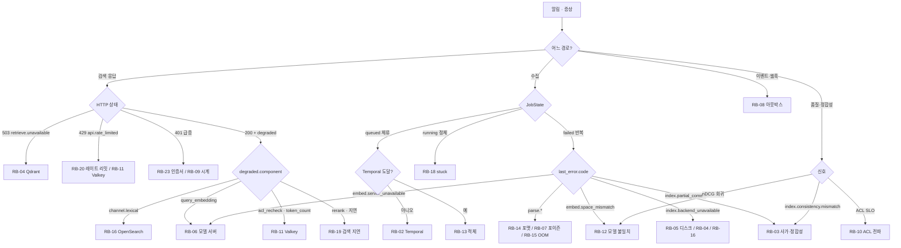

# 런북

## 목적

운영자가 알림이나 증상에서 출발해 **원인을 확인하고, 영향을 줄이고, 정상 상태로 되돌리고, 재발을 막는** 절차를 런북(runbook) 단위로 고정한다. [실패 모드와 회복력](../02-architecture/09-failure-modes-and-resilience.md)(이하 "09 문서")은 컴포넌트별 실패 모드(FMEA `F-nn`), 저하 사다리, 카오스 실험(`C-nn`), 런북 색인(`RB-01`~`RB-12`)을 확정했고, 이 문서는 그 색인이 가리키는 **런북 본문**을 소유한다. 바이블이 확정한 실패 정책(§4.2~4.4), 재시도 분류(§11.3), 세대 사가(§11.4), 잡 상태 기계(§11.5), 오류 카탈로그(§5.7), 메트릭 정본(§6.5)은 바꾸지 않고, 그 장치를 **어떤 순서로 어떤 명령으로 다루는지**만 적는다.

## 범위

- 포함: 런북 29개(09 문서 §9가 고정한 `RB-01`~`RB-12` + 이 문서가 추가한 `RB-13`~`RB-29`; `RB-25`~`RB-29`는 [관측성](03-observability.md) §8 알림 규칙이 신설을 요청한 항목), 표준 형식, 알림 이름 ↔ 런북 매핑, 공통 진단 도구, 배치 재시도·재처리 공통 절차, 심각도별 감지·복구 시간 목표(초안).
- 제외: 알림 규칙의 PromQL·임계·대시보드 정의([관측성](03-observability.md) §7~§8 소유; 이 문서는 알림 이름을 런북에 매핑만 한다), 백업·복원 절차 상세([백업과 재해 복구](07-backup-and-disaster-recovery.md)), 용량 계획([확장과 성능](04-scaling-and-performance.md)), 업그레이드 절차([업그레이드와 마이그레이션](08-upgrade-and-migration.md)), 보안 사고 대응(침해·키 유출; [보안과 컴플라이언스](05-security-and-compliance.md)).
- 정본 관계: 오류 코드·열거값·이벤트·메트릭 이름은 바이블 §5.7·§6.5의 철자만 쓴다. 이 문서는 새 코드·열거값·메트릭을 만들지 않으며, 필요한 CLI 하위 명령·메트릭은 `(제안)`으로 표시하고 `## 미해결 이슈`에 모아 둔다. 외부 도구(Temporal CLI, Qdrant·OpenSearch REST, kubectl, PromQL)의 문법은 07-tech-landscape에 버전 근거가 없으면 "확인 필요(as of 2026-09)"다. 프로파일은 `standard`를 기준으로 쓰고 `lite`·`premium`·`korean-gov` 차이는 행에 병기한다.

---

## 1. 공통 규약

### 1.1 런북 표준 형식

**결정:** 모든 런북은 아래 여섯 절(증상 → 영향 → 진단 단계 → 완화 → 복구 → 재발 방지)을 같은 순서의 표로 쓰고, 표 위 한 줄에 심각도·관련 FMEA·카오스 실험·자동 복구 여부를 적는다. 진단 단계는 **명령·쿼리 예시**를 코드 블록으로 동반한다. 완화(mitigation)는 영향을 줄이는 즉시 조치, 복구(recovery)는 정상 상태로 되돌리는 조치, 재발 방지는 설계 장치·알림·테스트다. 심각도 S1~S4는 09 문서 §2.1 정의를 그대로 쓴다.

| 절 | 담는 것 | 담지 않는 것 |
|----|---------|--------------|
| 증상 | 알림 이름 후보(바이블 §6.5 메트릭·§5.7 오류 코드·이벤트), 사용자 관측 | 추측 원인 |
| 영향 | 어느 경로(수집·검색·이벤트)가 어떻게 저하되는가, SLI(09 문서 §10.1) 관점 | — |
| 진단 단계 | 번호 순서, 각 단계의 판정 기준 | 파괴적 조치 |
| 완화 | 영향 축소(트래픽 차단·드레인·우선순위) | 인덱스 직접 쓰기 |
| 복구 | 정상화, 재시도·재처리, 검증 명령 | 게이트 우회 |
| 재발 방지 | 설계 장치(바이블·09 문서), 알림 임계, 테스트(I-nn·C-nn) | 미검증 수치 |

### 1.2 운영 원칙(모든 런북 공통)

1. **원장이 진실, 인덱스는 투영.** 복구 1순위는 산출물 재적재(replay, `reprocess.document.v1`)이고 스냅샷은 시간 단축용 2순위다(바이블 §11.4 (4), [ADR-0026](../06-adr/0026-index-commit-generation-saga-and-ledger.md)).
2. **인덱스 백엔드에 직접 쓰지 않는다.** Qdrant·OpenSearch의 `is_current`·`acl_*`·레코드를 운영자가 손으로 고치지 않는다. 모든 변경은 워크플로우(`reprocess`·`reindex`·`acl.update`·`delete`)를 거친다. 유일한 예외는 §2.3의 고아 세대 삭제이며 `commit_id` 필터로만 한다.
3. **보안 필터·`acl_recheck`는 끄지 않는다**(바이블 §10.3 E6·E7·E9). 저하 사다리(09 문서 §3.1)의 어떤 계단도 이를 내려가지 않는다.
4. **원장 직접 갱신은 이 문서에 적힌 SQL만**, `rag_platform_admin` 역할 + `app.cross_tenant = 'on'`(배포 가이드 §9)으로 실행하고 티켓 ID를 `job_events.payload` 또는 `audit.admin.action` 이벤트로 남긴다.
5. **품질 파라미터는 런북으로 바꾸지 않는다.** `gate`가 붙은 값의 변경은 프로파일 `version` 증가 → `profile_hash` 변경 → blue/green(바이블 §7.4)이며 장애 조치가 아니다.
6. **클라이언트 안내는 두 줄.** `Retry-After` 준수, 같은 `Idempotency-Key` 재사용(중복 잡 0; 09 문서 §5.3).
7. **먼저 증적.** 조치 전 `job_id`·`commit_id`·`trace_id`·`document_id`와 백엔드 스냅샷 시각을 기록한다.

### 1.3 런북 색인

**결정:** `RB-01`~`RB-12`는 09 문서 §9의 ID·제목을 그대로 절 제목으로 채택하고(09 문서 미해결 이슈 12 합의), `RB-13`~`RB-29`를 이 문서가 추가한다. ID의 정본은 이 문서다 — [관측성](03-observability.md) §8이 `(제안)`으로 쓴 `RB-13`~`RB-18`은 아래 매핑표의 이 문서 ID로 읽는다. ID는 안정적이며 폐기 시 번호를 재사용하지 않는다.

| ID | 제목 | 주 증상(알림 후보) | 심각도 | FMEA · 카오스 | 자동 복구 |
|----|------|--------------------|--------|---------------|-----------|
| RB-01 | PostgreSQL 페일오버·복구 | `POST /v1/ingest` 503(`/healthz`는 liveness 전용이라 무관, 1.3.0 §3.4) | S2 | F-31 · C-08 | 페일오버 자동, 조정 틱 |
| RB-02 | Temporal 불가 | 503 + `Retry-After`, `queued` 체류 | S2 | F-33 · C-09 | 조정 틱 |
| RB-03 | 커밋 사가 실패·정합성 불일치 | `index.consistency.mismatch`, `rag_consistency_mismatch_total` | S2 | F-16, F-14, F-15 · C-10 | 정합성 검사 재적재 |
| RB-04 | Qdrant 노드·클러스터 장애 | `degraded{channel.dense}`, 503 `retrieve.unavailable` | S2 | F-21, F-22, F-29 · C-04, C-05 | 부분 자동 |
| RB-05 | 디스크 풀 | `index.backend_unavailable` 재시도, 볼륨 90% | S2 | F-34, F-35 · C-12 | 없음 |
| RB-06 | 사이드카·모델 서버 재기동 | `embed.server_unavailable`, `rag_parser_sidecar_unavailable_total` | S2 | F-06, F-08, F-12, F-20 · C-02 | 재시도·폴백 |
| RB-07 | 포이즌 문서 격리 | 같은 `document_id` 반복 `failed`, OOMKilled | S3 | F-36, F-05, F-06 · C-11 | 시도 상한까지 |
| RB-08 | 아웃박스 재발행 | `rag_outbox_lag_seconds` > SLO, `published_at` NULL 누적 | S3 | F-19, F-37 · C-14 | 백오프 |
| RB-09 | 시계 왜곡 | 401 급증, DLS 거부, 웹훅 서명 거부 | S3 | F-39 · C-13 | 없음 |
| RB-10 | ACL 전파 지연 | `rag_acl_propagation_seconds` > SLO | S1 후보 | F-27 | 재시도 |
| RB-11 | Valkey 장애 | 429 급증, `degraded{acl_recheck}` | S2 | F-32, F-27 · C-07 | 페일오버 |
| RB-12 | 임베딩·모델 버전 불일치 | `embed.space_mismatch`, nDCG 야간 회귀 | S1→S4 | F-13, F-38 | 배치 거부 |
| RB-13 | 수집 잡 적체 | `queued` 증가, 큐 백로그, 429 체인 상한 | S3 | F-07, F-40, F-12 | KEDA |
| RB-14 | 특정 포맷 파싱 실패 급증 | `parse.*` 코드가 한 파서에 집중 | S3 | F-04, F-05, F-06 | 폴백 체인 |
| RB-15 | OCR 워커 OOM | 워커 OOMKilled, `parse.page_timeout` | S3 | F-05, F-07, F-36 | 재시도 |
| RB-16 | OpenSearch 클러스터 red | `degraded{channel.lexical}` 100%, 렉시컬 커밋 롤백 | S2 | F-23, F-15 · C-03 | 검색 저하 자동 |
| RB-17 | PostgreSQL 연결 고갈 | `too many connections`, 워커 재시도 급증 | S2 | F-31 | 없음 |
| RB-18 | Temporal 워크플로우 정지 | `running` 잡 `updated_at` 정체 | S3 | F-05, F-18, F-33 | 조정 틱 일부 |
| RB-19 | 검색 지연 p95 초과 | `rag_query_latency_seconds` p95 > 800ms | S2 | F-24, F-40, F-21 · C-06 | 저하 사다리 |
| RB-20 | 레이트 리밋 오탐 | 정상 트래픽에 429 `api.rate_limited` | S3 | F-32 | 없음 |
| RB-21 | 테넌트 데이터 삭제 검증 | 삭제 요청 후 잔존 의심 | S1 예방 | — | GC 자동 |
| RB-22 | 재색인 롤백 | 재색인 후 품질·오류 회귀 | S2 | — | 게이트 전 자동 |
| RB-23 | 인증서 만료 | TLS 핸드셰이크 실패, 401·DLS 거부 | S2 | F-30, F-23 | cert-manager |
| RB-24 | 모델 다운로드 실패(에어갭) | init 컨테이너 실패, readiness 미달 | S2 | F-13 | 없음 |
| RB-25 | egress 거부 급증 | `rag_egress_denied_total{component}` 급증 | S3(보안 검토) | F-01, F-19 | 비재시도 즉시 실패 |
| RB-26 | 인가 엔진·정책 로딩 실패 | `rag_authz_errors_total` > 0, 403 폭주 | S2 | F-30 | fail-closed |
| RB-27 | 인용 좌표 불일치 | `rag_pack_citation_unresolved_total` > 0 | S3 | 바이블 §15 리스크 7 | 없음 |
| RB-28 | LLM 비용 상한 초과 | `rag_enrich_llm_cost_usd_total` 일 예산 초과, `partial` 급증 | S3 | F-11 | 예산 소진 시 `partial` |
| RB-29 | 관측 스택 장애 | `up{job=~"rag-platform.*"} == 0`, Collector 드롭 | S3 | — | 없음 |

**알림 이름 ↔ 런북 매핑**([관측성](03-observability.md) §8의 알림 이름; 그 문서의 `(제안)` RB 번호는 이 표의 ID로 대체한다):

| 관측성 §8 알림 | 이 문서 런북 | 관측성 §8 알림 | 이 문서 런북 |
|----------------|--------------|----------------|--------------|
| `RagRetrievalP95OverBudget`, `RagTokenCountFallbackRatio` | RB-19 | `RagRetrievalErrorRate`, `RagRetrievalUnavailable` | RB-04 / RB-11 |
| `RagChannelTimeoutRatio` | RB-04(dense·sparse) / RB-16(lexical) | `RagRerankFallbackRatio`, `RagSidecarUnavailable`, `RagPiiDetectorErrors`, `RagGpuIdleWithBacklog` | RB-06 |
| `RagHydrateMissingBurst`, `RagConsistencyMismatch` | RB-03 | `RagAclPropagationSlo`, `RagAclRecheckDeniedSustained` | RB-10 |
| `RagOutboxLagSlo`, `RagWebhookExhausted`, `RagWebhookBacklog` | RB-08 | `RagIngestJobFailureRatio`, `RagPoisonDocument` | RB-07 / RB-14 |
| `RagQueueWaitHigh`, `RagDispatcherBacklog` | RB-13(적체) → RB-02(Temporal 도달 불가 시) | `RagIndexCapacity` | RB-05 |
| `RagEvalGateRegression` | RB-12 | `RagEgressDenied` | RB-25 |
| `RagAuthzEngineErrors` | RB-26 | `RagCitationUnresolved` | RB-27 |
| `RagLlmDailyCostBudget` | RB-28 | `RagCollectorDropping`, `RagMetricsAbsent` | RB-29 |

### 1.4 공통 진단 도구와 접근

| 도구 | 용도 | 접근·주의 |
|------|------|-----------|
| 원장 SQL | 잡·커밋·아웃박스·문서 상태(정본) | `rag_platform_admin`, 트랜잭션 안 `SET LOCAL app.cross_tenant = 'on'`; 없으면 RLS `FORCE`로 0행(배포 가이드 §9) |
| Prometheus | 바이블 §6.5 정본 메트릭만(`tenant_id` 라벨 없음) | 테넌트별 수치는 원장 SQL·`usage_ledger` |
| `GET /healthz` | liveness 전용, 의존성 미포함(1.3.0 §3.4·#174) — 프로세스 생존만 의미, 진단에 쓰지 않는다 | 의존성 상태는 원장 SQL·Prometheus·백엔드 REST로 직접 확인 |
| `GET /readyz` | 트래픽 수신 가능 여부(`ok \| degraded \| down`, 형식은 09 문서 제안) | 프로파일 캐시 + Qdrant만(09 문서 §3.4) |
| Temporal CLI·UI | 워크플로우 `describe`/`show`, 태스크 큐 폴러 | 네임스페이스 `rag`(배포 가이드); CLI 문법은 1.x 확인 필요(as of 2026-09) |
| Qdrant REST/gRPC | 컬렉션 상태·포인트 카운트(필터) | 물리명 `rag_vec_{hash12}`, alias `col_{collection_id}_vec`(바이블 §13.4) |
| OpenSearch REST | `_cluster/health`, `_count`, 샤드 할당 | 물리명 `rag_lex_{hash12}`, alias `col_{collection_id}_lex`, `routing=tenant_id` |
| `valkey-cli` | 키 존재·TTL(`aclrev:`·`rl:`·`idem:`) | 값에 콘텐츠 없음; `KEYS` 금지, `SCAN`만 |
| `rag` CLI | `profile validate|diff`, `plugin list --check-license`, `cache invalidate --stage`, `reprocess`, `reindex`(바이블 §12) | `rag models …`·`rag ledger migrate`는 배포 가이드 제안 명령 |

```sql
-- 공통 SQL 서두(모든 원장 조회에 선행)
BEGIN;
SET LOCAL ROLE rag_platform_admin;
SET LOCAL app.cross_tenant = 'on';
SET LOCAL statement_timeout = '30s';
-- 예: 최근 1시간 종결 상태 분포
SELECT state, kind, count(*) FROM jobs
 WHERE updated_at > now() - interval '1 hour' GROUP BY 1, 2 ORDER BY 3 DESC;
COMMIT;
```

```promql
# 검색 p95(브리프 §7: GPU 800ms / CPU 1.5s)
histogram_quantile(0.95, sum(rate(rag_query_latency_seconds_bucket[5m])) by (le))
# 스테이지별 수집 시간 p95
histogram_quantile(0.95, sum(rate(rag_ingest_stage_duration_seconds_bucket[15m])) by (le, stage))
# 아웃박스·ACL 전파·정합성
rag_outbox_lag_seconds   rag_acl_propagation_seconds   increase(rag_consistency_mismatch_total[1h])
```

### 1.5 감지·복구 시간 목표(초안)

09 문서 미해결 이슈 12에 따라 런북마다 TTD(time to detect)·TTR(time to recover) 목표를 두되, 게임데이(09 문서 §8.3) 결과가 나오기 전까지는 심각도별 공통값을 **초안 목표**로 쓴다. 전체 RTO ≤ 4h(NFR-REL-15, 09 문서 §10.1)가 상한이다.

| 심각도 | TTD(초안) | TTR(초안) | 알림 경로(초안) | 근거 |
|--------|----------:|----------:|-----------------|------|
| S1 | 5m | 30m | 페이지 + 보안 담당 | 교차 테넌트 노출·데이터 손실 |
| S2 | 5m | 1h | 페이지 | SLO 위반(09 문서 §10.2 빠른 소진 알림) |
| S3 | 15m | 4h | 티켓 | 저하 응답·일부 문서 실패 |
| S4 | 1h | 다음 영업일 | 티켓 | 사용자 비가시 |

### 1.6 증상 → 런북 분류



---

## 2. 공통 절차

### 2.1 배치 재시도(재시도 소진 잡)

여러 런북(RB-02·05·06·16·17)의 복구 마지막 단계다. 대상은 13 문서 §4.3의 포이즌 판정과 같은 조건 — `state='failed' ∧ last_error.retryable=true ∧ attempts ≥ StagePolicy.max_attempts` — 중 **원인이 해소된** 잡이다. `retryable=false`는 재시도하지 않는다(입력·정책 수정 후 새 `IngestRequest`).

```sql
-- 대상 선별: 특정 코드로 소진된 잡(원인 해소 후 실행)
SELECT job_id, tenant_id, document_id, stage, attempts, finished_at
  FROM jobs
 WHERE state = 'failed'
   AND (last_error->>'retryable')::boolean = true
   AND last_error->>'code' IN ('embed.server_unavailable', 'index.backend_unavailable')
   AND finished_at > now() - interval '6 hours'
 ORDER BY priority DESC, job_id;
```

```bash
# 재시도는 관리 API만(새 workflow_run_id, 캐시 산출물 재사용; 바이블 §11.5)
for j in $(cat retry_jobs.txt); do
  curl -sS -X POST "$RAG_URL/v1/jobs/$j/retry" -H "Authorization: Bearer $RAG_ADMIN_TOKEN" -o /dev/null -w "%{http_code} $j\n"
done
# partial 잡의 LLM 보강만 재개
curl -sS -X POST "$RAG_URL/v1/jobs/$JOB/retry?stages=enrich" -H "Authorization: Bearer $RAG_ADMIN_TOKEN"
```

재시도 속도는 `runtime.tenant_concurrent_jobs_max`(standard 32)가 유계로 잡아 주므로 호출 간 지연은 두지 않아도 된다. 500건을 넘으면 우선순위(`PATCH /v1/jobs/{job_id}` `priority`)로 서비스 문서를 먼저 처리한다.

### 2.2 재처리(산출물 재적재)

인덱스 투영이 손상·불일치·잘못된 지문으로 적재되었을 때의 복구 수단이다. `POST /v1/documents/{document_id}/reprocess`는 계보의 `stage_key` 캐시를 재사용하므로 `from_stage` 이전 스테이지는 재실행되지 않고(바이블 §11.2), 새 `index_generation`으로 적재된 뒤 세대 플립으로 교체된다. `from_stage`는 **지문이 처음 달라지는 스테이지**로 고른다(`IndexCommit.parser_fingerprint_hash`·`normalizer_fingerprint`·`chunker_config_hash`·`enricher_fingerprint`·`embedder_fingerprint` ↔ 현재 프로파일; 모두 같으면 `index`).

```json
{"from_stage": "index"}
```

```sql
-- 잘못된 임베더 지문으로 커밋된 문서 목록(RB-12·RB-03에서 사용)
SELECT DISTINCT c.document_id
  FROM index_commits c JOIN documents d ON d.current_commit_id = c.commit_id
 WHERE c.status = 'committed' AND c.embedder_fingerprint = :bad_fingerprint;
```

컬렉션 전체가 대상이면 문서 루프 대신 `POST /v1/collections/{collection_id}/reindex`(`reindex.collection.v1`, blue/green + 하네스 게이트 + alias 교체)를 쓴다. 재처리는 문서 단위 직렬화(디스패처)를 따르므로 같은 문서의 진행 중 잡 뒤에 `queued`로 붙는다.

### 2.3 고아 세대 정리(유일한 백엔드 직접 삭제)

원장에 `committed` 커밋이 없는데 백엔드에 `is_current=true` 레코드가 남는 경우(PITR 복원 뒤, 보상 실패 뒤)만 해당한다. `maintenance.consistency.v1`이 `index.consistency.mismatch`로 보고한 `commit_id`에 한해 양 백엔드 `delete_by_filter(commit_id)`를 실행한다 — `document_id`·`tenant_id` 필터 삭제는 금지(현재 세대까지 지운다). 실행 수단은 `(제안)` `rag index compensate --commit-id <ulid>`이며 채택 전에는 어댑터의 `delete_by_filter`를 관리 스크립트로 호출하고 `audit.admin.action`을 남긴다.

---

## 3. 런북

### RB-01 PostgreSQL 페일오버·복구

S2 · F-31 · C-08 · 자동 복구: 페일오버(동기 복제 1) + 조정 틱이 `queued` 재시작

| 절 | 내용 |
|----|------|
| 증상 | `POST /v1/ingest`·`GET /v1/jobs/*` 503 + `Retry-After`(채택 코드 없음 — 13 문서 §3.3 `api.dependency_unavailable` 조기 채택 대상; `/healthz`는 liveness 전용이라 PG 상태를 보이지 않는다, 1.3.0 §3.4·#174 — `pg_stat_replication` 직접 조회로 판정); 워커 로그에 트랜잭션 실패 → 재시도; 검색은 정상(ADR-0034) |
| 영향 | 수집 정지(모든 스테이지가 원장 트랜잭션), 잡 조회 실패, 아웃박스 정지(이벤트 지연), API 키 인증은 캐시 미스 시 실패(09 문서 미해결 이슈 3). 수집 접수 가용성 SLI 소진 |
| 진단 단계 | (1) 프라이머리·복제 상태와 페일오버 진행 여부 확인 (2) Temporal DB(별도 인스턴스)가 같은 장애인지 분리 확인 (3) `pg_stat_replication` 지연·`statement_timeout` 오류율 (4) 디스크 풀이면 RB-05, 연결 고갈이면 RB-17로 분기 (5) 페일오버 완료 후 RLS `FORCE`·역할이 남아 있는지 |
| 완화 | 클라이언트에 `Retry-After` 준수·같은 `Idempotency-Key` 재전송 안내; 검색 경로는 조치 없음; 워커는 그대로(재시도가 흡수) |
| 복구 | 페일오버 완료 → 조정 틱(10s)이 `queued` 잡 시작·`running` 잡 대조(06 문서 §6.3) → §2.1로 소진 잡 재시도 → PITR 복원이었다면 원장 시점이 인덱스보다 앞서므로 `maintenance.consistency.v1` 전체 회차 즉시 실행 → 고아 세대는 §2.3 |
| 재발 방지 | 동기 복제 + PITR(RPO ≤ 5min, NFR-REL-15), Temporal DB 분리(바이블 리스크 #10), api·워커 별도 풀·`statement_timeout`(API 5s / 워커 60s), C-08 월 1회, [백업과 재해 복구](07-backup-and-disaster-recovery.md) |

```sql
SELECT client_addr, state, sent_lsn, replay_lsn, replay_lag FROM pg_stat_replication;
SELECT count(*) FILTER (WHERE state='queued' AND workflow_run_id IS NULL) AS unstarted,
       count(*) FILTER (WHERE state='running') AS running FROM jobs;
SELECT relname FROM pg_class c JOIN pg_namespace n ON n.oid=c.relnamespace
 WHERE relrowsecurity AND NOT relforcerowsecurity;   -- 결과 0행이어야 함
```

### RB-02 Temporal 불가

S2 · F-33 · C-09 · 자동 복구: 조정 틱(api 프로세스 타이머, Temporal 없이 동작)

| 절 | 내용 |
|----|------|
| 증상 | `POST /v1/ingest` 503 + `Retry-After` 30s(초안; 채택 코드 없음 — `api.orchestrator_unavailable` 제안, `retrieve.unavailable` 오용 금지); `jobs.state='queued'` 체류 증가; 워커 로그 `start_workflow`·폴링 RPC 오류; 스케줄 잡(`maintenance.*`, `eval.run.v1`) 미실행 |
| 영향 | 새 잡 시작 불가, 진행 중 액티비티는 완료 보고·하트비트 실패 → 재시도; 검색 무영향. 이벤트 릴레이(`standard`는 Temporal 액티비티)도 정지 → `rag_outbox_lag_seconds` 상승 |
| 진단 단계 | (1) frontend/history/matching 파드 상태와 재시작 횟수 (2) Temporal 영속화 DB 도달성(원장 PG와 분리인지 확인) (3) `temporal operator cluster health` (4) 스키마 업그레이드 중이면 순서(서버 롤아웃 전 `temporal-sql-tool update-schema`, 배포 가이드 §4.5) 위반 여부 (5) 히스토리 샤드 오류·`numHistoryShards` 변경 시도 여부(생성 후 변경 불가) |
| 완화 | 클라이언트 재시도 안내; `lite --durable`은 단일 바이너리 재기동 |
| 복구 | 서버 복구 → 조정 틱이 `queued AND workflow_run_id IS NULL`을 승인 규칙대로 시작(06 문서 §8.2) → `running` 잡은 `describe_workflow`로 대조 → 릴레이 상주 워크플로우(`outbox-relay`, `USE_EXISTING`)가 `rag serve relay` 재기동 시 재보장 → 미시작 잔량 0 확인 |
| 재발 방지 | frontend 2 / history 2(ENV-M), 전용 DB, `Replayer` CI, C-09 월 1회, 업그레이드 순서 고정(배포 가이드 §8) |

```bash
temporal operator cluster health --address "$RAG_TEMPORAL__ADDRESS"          # 문법 확인 필요(as of 2026-09)
temporal task-queue describe --task-queue ingest-cpu --namespace rag           # 폴러 수 0이면 워커 문제(RB-18)
psql "$LEDGER_DSN" -c "SELECT count(*) FROM jobs WHERE state='queued' AND workflow_run_id IS NULL AND waiting_for IS NULL"
```

### RB-03 커밋 사가 실패·정합성 불일치

S2 · F-16, F-14, F-15 · C-10 · 자동 복구: 정합성 검사 잡이 재적재 트리거; 보상 실패는 수동

| 절 | 내용 |
|----|------|
| 증상 | 이벤트 `index.consistency.mismatch`, `increase(rag_consistency_mismatch_total[1h]) > 0`; `index_commits.status IN ('failed','rolling_back')` 체류; 잡 `last_error.code='index.partial_commit'`; `rag_hydrate_missing_total` 지속 증가; `ContextPack.diagnostics.index_generations_seen`에 두 세대가 오래 공존 |
| 영향 | 문서 단위 검색 누락·중복(플립 중 혼합 상태), 최악은 보상 실패로 `is_current` 카운트 ≠ `record_count`. 정합성 SLI(불일치 0) 위반 |
| 진단 단계 | (1) 문서의 커밋 이력을 세대 역순으로 읽고 `status`·`compensation.failed_at_status`·`restored_generation` 확인 (2) 양 백엔드에서 `document_id ∧ is_current=true` 카운트와 `index_generation` 분포를 `record_count`와 대조 (3) 물리 대상은 **커밋의 `backend_results[].physical_name`**(alias 아님; 재색인 중 거짓 불일치 방지, 06 문서 §2.7) (4) 백엔드 장애가 원인이면 RB-04·RB-16 먼저 (5) `flipping_*`에 머문 시간이 `start_to_close`(10m)를 넘으면 RB-18 |
| 완화 | 진행 중 사가는 기다린다 — `flipping_*` 중 취소는 보류(09 문서 §7); 새 잡 접수는 그대로(문서 단위 직렬화가 뒤에 세운다) |
| 복구 | (a) `rolled_back`(보상 성공): 원인 해소 후 §2.1 재시도(같은 `commit_id`·세대 재사용) (b) `failed`(보상 실패): §2.2 `reprocess {"from_stage":"index"}` → 새 세대 플립 → 이전 세대는 `maintenance.cleanup.v1`(1h) 정리 (c) 원장에 없는 세대가 백엔드에 남으면 §2.3 (d) 완료 후 정합성 검사 재실행 — 컬렉션 전체는 `POST /v1/collections/{collection_id}/consistency-check`(`JobKind.consistency_check`, AM-39), 문서 단위는 여전히 `(제안)` `rag maintenance consistency --document-id` |
| 재발 방지 | 세대 합성 `record_id`(ADR-0004), 플립 순서 렉시컬 → 벡터 + 중간 상태 기록(ADR-0026), `update_by_query conflicts=proceed` 재시도 3, 정합성 검사 시간 1회 샘플 + 일 1회 전체(바이블 §7.2), I-05~I-07·C-10 |

```sql
SELECT commit_id, status, index_generation, record_count, previous_commit_id,
       compensation->>'failed_at_status' AS failed_at, compensation->>'restored_generation' AS restored,
       backend_results
  FROM index_commits WHERE document_id = :document_id ORDER BY index_generation DESC LIMIT 5;
```

```json
{"filter": {"must": [{"key": "tenant_id", "match": {"value": "01J9ZQ4K7X2M8N3P5R6S7T8V9W"}}, {"key": "document_id", "match": {"value": "01J9ZQ6M0N1P2Q3R4S5T6V7W8X"}}, {"key": "is_current", "match": {"value": true}}]}, "exact": true}
```

위 필터를 Qdrant `POST /collections/{physical_name}/points/count`에, 같은 조건을 OpenSearch `GET /{physical_name}/_count?routing={tenant_id}`의 `bool.filter`로 보낸다(REST 경로는 1.19 / 3.8 기준 확인 필요 as of 2026-09).

### RB-04 Qdrant 노드·클러스터 장애

S2 · F-21, F-22, F-29 · C-04, C-05 · 자동 복구: 부분 장애는 채널 제외·`hydrate` 재시도; 전면은 복구 대기

| 절 | 내용 |
|----|------|
| 증상 | 부분: `degraded{channel.dense\|channel.sparse, timeout\|unavailable}` 비율 상승, `rag_retrieve_latency_seconds{channel="dense"}` p95 > 250ms; 전면: 503 `retrieve.unavailable` + `Retry-After`(NotReady 전환 전) → 인그레스 503(전환 후), `/readyz` false; 수집: `index.backend_unavailable` 재시도 → `rolled_back` |
| 영향 | `standard`도 `hydrate`가 Qdrant 1회 배치 조회라 전면 장애는 **렉시컬 단독 저하가 아니라 503**(F-22; 폴백 소스는 09 문서 미해결 이슈 2); `lite`는 유일 백엔드라 503. 검색 가용성 SLI 직접 소진 |
| 진단 단계 | (1) 클러스터 피어·raft 상태, 파드 재시작·OOM (2) 컬렉션별 샤드·복제 상태(`rag_vec_{hash12}`) (3) 디스크(RB-05)·메모리(dense RAM ≈ 벡터 수 × 1024 × 4B × 1.5, 배포 가이드 §9) (4) `hydrate.backend_error`·서킷 open 로그(`detail` 첫 토큰이 유발 코드, `circuit_open backend_id=qdrant`) (5) `rag_hydrate_missing_total` 증가면 플립 경합(RB-03)과 구분 |
| 완화 | 부분 장애는 자동(L6); 전면은 상태 페이지 공지 + `Retry-After` 5s 안내; 수집은 `ingest-io` 워커 replica를 0으로 드레인해 사가 시작을 보류(KEDA `minReplicaCount` 임시 0) — 시작된 사가는 보상으로 끝난다 |
| 복구 | 노드 재기동 → 복제(≥ 2)로 자동 회복 → `/readyz` 복귀 60s 내 확인(C-05) → 데이터 손실이면 스냅샷 `snapshots/qdrant/{physical_name}/{timestamp}` 복원(2순위) 후 `maintenance.consistency.v1` 전체 회차 → 불일치는 §2.2 재적재 → 드레인 해제 → §2.1 |
| 재발 방지 | `replication_factor ≥ 2`(NFR-AVL-05), 안티어피니티, `always_ram` 양자화·원본 `on_disk`, C-04 월 1회, `hydrate` 폴백 소스 검토(09 문서 미해결 이슈 2) |

```bash
curl -sS "$QDRANT_URL/cluster" | jq '.result.peers, .result.raft_info'
curl -sS "$QDRANT_URL/collections/$PHYS/cluster" | jq '.result.local_shards, .result.remote_shards'   # 확인 필요(as of 2026-09)
kubectl -n "$NS" get pods -l app.kubernetes.io/name=qdrant -o wide
curl -sS "$RAG_URL/readyz" -o /dev/null -w "%{http_code}\n"
```

### RB-05 디스크 풀

S2 · F-34, F-35 · C-12 · 자동 복구: 없음(용량 증설); 사가 보상으로 부분 커밋은 없음

| 절 | 내용 |
|----|------|
| 증상 | 볼륨 사용량 알림 80% / 90%(초안 목표); Qdrant WAL 쓰기 실패·OpenSearch `flood_stage` read-only 블록 → `index.backend_unavailable` 재시도 → `rolled_back`; 오브젝트 스토리지 쿼터 → 산출물 put 실패(재시도); PG 쓰기 실패 → RB-01; 워커 임시 디렉터리 풀 → `parse.conversion_failed` 폴백 |
| 영향 | 수집 정지(쓰기 경로), 검색은 읽기 가능해 계속; 세대 공존(`cleanup_delay` 1h)으로 순간 2배 점유가 정상임을 감안 |
| 진단 단계 | (1) 어느 볼륨인지 — Qdrant / OpenSearch / PG / 오브젝트 / 워커 (2) Qdrant: `points_count`·세그먼트 수, `is_current=false` 잔존 포인트 수(정리 지연 여부), 같은 볼륨의 스냅샷 파일 (3) OpenSearch: `_cat/allocation`, `index.blocks.read_only_allow_delete` 걸린 인덱스 (4) `rag_index_bytes_total{vector}`로 `late_interaction`·`page_multivector` 증가 여부 (5) 최근 대량 재색인(blue/green 물리 대상 2벌) 진행 중인지 |
| 완화 | `ingest-io` 워커 드레인(새 사가 보류); Qdrant 스냅샷을 오브젝트 스토리지 `snapshots/`로 옮기고 로컬 삭제; `maintenance.cleanup.v1` 즉시 트리거(`temporal schedule trigger`, 문법 확인 필요) — `is_current=false ∧ index_generation < current_generation`만 지운다; OpenSearch는 flood-stage 해제 전 삭제 가능 데이터(만료 감사 인덱스 아님) 정리 |
| 복구 | PVC 확장(`allowVolumeExpansion`) 또는 노드·샤드 추가(`shard_key` 승격은 E15 절차) → OpenSearch 블록 해제(`index.blocks.read_only_allow_delete: null`) → 드레인 해제 → §2.1로 `rolled_back` 잡 재시도 → `rag_consistency_mismatch_total` 0 확인 |
| 재발 방지 | 사이징(배포 아키텍처 §7.2: M 규모 Qdrant 48GB × 2사본), 알림 80/90, 스냅샷 수명주기(오브젝트 스토리지로만 보존), `cleanup_delay` 유지, 재색인 롤백 창(24h 초안) 후 blue 정리(06 문서 §2.7), C-12 분기. 오브젝트 스토리지 **버킷 전체 손실**은 전용 RB를 두지 않는다(#59 판단) — 진단 (1)·(5)의 오브젝트 분기를 준용하고 승격·재수집 절차는 [백업과 재해 복구](07-backup-and-disaster-recovery.md) §6.4가 소유한다 |

```bash
kubectl -n "$NS" exec sts/qdrant-0 -- df -h /qdrant/storage
curl -sS "$QDRANT_URL/collections/$PHYS" | jq '.result.points_count, .result.segments_count, .result.status'
curl -sS "$OS_URL/_cat/allocation?v"; curl -sS "$OS_URL/_cluster/settings?include_defaults=true" | jq '.. | .flood_stage? // empty'
curl -sS -X PUT "$OS_URL/$PHYS/_settings" -H 'Content-Type: application/json' -d '{"index.blocks.read_only_allow_delete": null}'
```

### RB-06 사이드카·모델 서버 재기동

S2(수집) / S3(검색) · F-06, F-08, F-12, F-20 · C-02 · 자동 복구: 재시도·폴백; 모델 불일치는 RB-12

| 절 | 내용 |
|----|------|
| 증상 | 임베딩: `embed.server_unavailable` 급증, `ingest-gpu-embed` 백로그, 검색 `degraded{query_embedding, unavailable}` + `channel.dense`·`channel.sparse` 2건, `explain += lexical_only_hit`; 리랭커: `rag_rerank_fallback_total` 증가, `rerank.applied=false`; 파서 사이드카: `rag_parser_sidecar_unavailable_total`, `parse.sidecar_unavailable` → 폴백 체인(`parser_chain[]`); 서빙 `/healthz` 실패, 서킷 open 로그 |
| 영향 | 검색은 캐시 히트 질의 정상, 미스 질의는 렉시컬 단독(가용성 유지, 저하율 SLI 소진); 수집은 임베딩 대기 — **현 `StagePolicy`(5회, Σ 백오프 15s)로는 수 분 재기동도 `failed`로 소진**(09 문서 미해결 이슈 16) → 대량 `retryable=true` 실패 예상; HWP 5.0은 폴백 어댑터로 `quality=degraded` 증가 |
| 진단 단계 | (1) 파드 상태·재시작 이유(CUDA OOM, 모델 로딩 실패, 이미지 CUDA ↔ 드라이버 불일치) (2) `nvidia-smi` 메모리·프로세스, MIG·타임슬라이싱 경합(F-40) (3) 서버가 서빙하는 `model_id@revision` ↔ 프로파일 `embedding_space_ids`(불일치면 RB-12) (4) KEDA 스케일 상태, `minReplicaCount` (5) 파서 사이드카: `GET /healthz`(JVM·LO 준비), NetworkPolicy가 `worker-cpu → parser-workers:8080` 차단 여부(배포 가이드 §9) |
| 완화 | 검색: 조치 없음(L6·L3 자동); 수집: 임베딩 서버 복구 전까지 `ingest-gpu-embed` 워커를 드레인해 시도 소진을 막는다(태스크는 큐에 대기, `start_to_close`는 시작 후 적용) |
| 복구 | 서버 재기동·스케일 → 어댑터 `warmup`이 모델 식별자 대조 통과(`/readyz` true) → 이미지 digest가 바뀌었다면 같은 공간 동등성 게이트(코사인 ≥ 0.9999, D-16) 결과 확인 → 드레인 해제 → §2.1(`embed.server_unavailable`) → 사이드카 복구 후 폴백으로 `degraded` 처리된 문서는 필요 시 §2.2 `from_stage=parse` |
| 재발 방지 | 서빙 replica ≥ 2 + `minReplicaCount: 1`, 검색 리랭커와 수집 임베딩 서버 분리(벌크헤드), 노드 로컬 PVC로 0→1 < 3분, tini·프로세스 그룹 KILL(LO), `StagePolicy` 인내 시간 ADR(09 문서 이슈 16), C-02·C-06 주 1회 |

```bash
kubectl -n "$NS" get pods -l app.kubernetes.io/name=embedding-server -o json \
  | jq '.items[].status.containerStatuses[] | {name, restartCount, last: .lastState.terminated.reason}'
kubectl -n "$NS" exec deploy/embedding-server -- nvidia-smi --query-gpu=memory.used,memory.total --format=csv
curl -sS "$EMBED_URL/health"; curl -sS "$PARSER_SIDECAR_URL/healthz"; curl -sS "$RERANK_URL/health"
psql "$LEDGER_DSN" -c "SELECT count(*) FROM jobs WHERE state='failed' AND last_error->>'code'='embed.server_unavailable' AND finished_at > now()-interval '1 hour'"
```

### RB-07 포이즌 문서 격리

S3 · F-36, F-05, F-06 · C-11 · 자동 복구: 시도 상한(`parse` 3)까지만; 격리는 수동

| 절 | 내용 |
|----|------|
| 증상 | 같은 `document_id`(또는 같은 `content_hash`)가 잡 2개 이상에서 연속 `failed`; 워커 파드 OOMKilled·segfault 반복(헬퍼 프로세스만 죽으면 정상 격리); `heartbeat_timeout` → 재시도 → 같은 스테이지 실패. **판정 규칙**(13 문서 §4.3): `state=failed ∧ last_error.retryable=true ∧ attempts ≥ max_attempts` |
| 영향 | 재시도마다 워커 슬롯·프로세스 손실, 같은 문서 체인의 후속 잡 `waiting_for` 대기; 다른 문서는 영향 없어야 함(NFR-REL-08) |
| 진단 단계 | (1) 반복 실패 문서 집계 (2) `last_error.plugin_id`·`detail`·`artifact_ref`(실패 시점 `SourceDocument`)로 포맷·크기·`container_flags` 확인 (3) 워커 종료 이유(OOMKilled면 RB-15) (4) 스테이징의 격리 컬렉션에서 `rag ingest <source_uri> --collection <quarantine>`(LocalRunner)으로 재현 (5) 재현 샘플을 계약 코퍼스 후보로 기록 |
| 완화 | 대기 중 중복 잡 취소(`POST /v1/jobs/{job_id}/cancel`); 클라이언트에 재접수 중단 요청; 우선순위 0으로 내려 슬롯 양보(`PATCH /v1/jobs/{job_id}`); 격리 목록 자동화는 없음(09 문서 미해결 이슈 5) |
| 복구 | 파서·어댑터 수정 릴리스(이미지 digest 변경 → `fingerprint` 변경 → `stage_key` 자연 무효) → §2.1 재시도; `retryable=false`(암호화·손상)면 클라이언트가 `credentials_ref`·원본 수정 후 새 `IngestRequest` |
| 재발 방지 | 격리 사다리(ADR-0033), 컨테이너 메모리 상한 + `fetch.max_bytes` 200MB + 블록 200,000, 페이지 타임아웃, 진행 정지 규칙 제안(09 문서 이슈 7), `quarantined_documents` 원장 표 ADR(minor), C-11 매 PR |

```sql
SELECT document_id, count(*) AS failures, max(last_error->>'code') AS code, max(last_error->>'plugin_id') AS plugin
  FROM jobs WHERE state='failed' AND (last_error->>'retryable')::boolean AND finished_at > now()-interval '24 hours'
 GROUP BY document_id HAVING count(*) >= 2 ORDER BY 2 DESC;
SELECT last_error->'artifact_ref'->>'uri' FROM jobs WHERE job_id = :job_id;   -- 재현 입력
```

### RB-08 아웃박스 재발행

S3 · F-19, F-37 · C-14 · 자동 복구: 지수 백오프(12회 초안); 소진 후 수동

| 절 | 내용 |
|----|------|
| 증상 | `rag_outbox_lag_seconds` p99 > `outbox_lag_slo`(standard 5s); `outbox.published_at IS NULL` 누적, `attempts` 포화; `outbox.relay_failed` 반복·`outbox.egress_denied`, `rag_egress_denied_total{component="relay"}`; 수신자 누락 보고; SSE 클라이언트 정체 |
| 영향 | 웹훅·SSE 지연·미전달(잡 상태는 무영향); 포이즌 이벤트는 다음 이벤트를 막지 않음(구독 단위 FIFO, 소진 행은 남기고 진행) |
| 진단 단계 | (1) 릴레이 프로세스(`rag serve relay`)와 상주 워크플로우 `outbox-relay` 생존 (2) 미발행 행을 `type`·`tenantid`별 집계, `attempts` 분포 (3) 구독 `webhook_url`이 `EgressPolicy`(https, 공인 주소, `deny_cidrs`)를 통과하는지 — 등록 후 DNS가 사설 IP로 바뀐 경우 `resolve_pin` 거부 (4) 수신자 응답(5xx·타임아웃 10s·4xx 즉시 소진·`410 Gone`) (5) 시계 왜곡이면 서명 `t` 거부(RB-09) |
| 완화 | 수신자 측 수정 요청; 영향 구독만 문제면 다른 테넌트는 정상(테넌트 스코프 전달, E12) |
| 복구 | 수신자 복구 후 소진 이벤트 재발행 — `(제안)` `rag outbox republish --tenant <id> --since <rfc3339>`; 채택 전 임시 SQL로 `attempts=0` 초기화(릴레이가 다음 배치에서 집어 감, `published_at` 단조 부여) → 소비자는 `id`(`event_id`) 멱등 → 지연 메트릭 정상 확인 |
| 재발 방지 | 수신자 SLO 합의, `410 Gone` 구독 `disabled`(05-api/07 제안), 보존 7일(초안) 안 재생, `Last-Event-ID` 재접속, C-14 월 1회 |

```sql
SELECT type, envelope->>'tenantid' AS tenant, count(*), max(attempts)
  FROM outbox WHERE published_at IS NULL GROUP BY 1, 2 ORDER BY 3 DESC LIMIT 20;
-- 임시 재발행(제안 CLI 채택 전; 티켓 ID를 audit.admin.action으로 기록)
UPDATE outbox SET attempts = 0 WHERE published_at IS NULL AND attempts >= 12 AND envelope->>'tenantid' = :tenant_id;
```

### RB-09 시계 왜곡

S3 · F-39 · C-13 · 자동 복구: 없음(시각 동기화)

| 절 | 내용 |
|----|------|
| 증상 | 401 `auth.unauthenticated` 급증(JWT `exp`/`nbf`); OpenSearch DLS 요청별 JWT(TTL ≤ 60s) 거부 → `degraded{channel.lexical, unavailable}` 전량; 웹훅 수신자의 서명 거부(`t` ±300s 창); embargo·expires 판정 오차 신고; `deadline_at` 조기 취소 |
| 영향 | 렉시컬 채널 저하, 인증 실패(가용성), 웹훅 미전달; 보안 판정은 fail-closed 방향이라 노출보다 거부가 늘어난다 |
| 진단 단계 | (1) 노드 NTP 오프셋(`chronyc tracking`) — api·워커·OpenSearch·릴레이 노드 각각 (2) 어느 노드 풀만 어긋났는지 (3) JWT 검증 여유(leeway 30s 초안) 로그 (4) 컨테이너 시각 ≠ 노드 시각이면 런타임 문제 |
| 완화 | 왜곡 노드를 cordon·drain해 파드를 정상 노드로 이동 |
| 복구 | chrony 재동기 → 거부율 정상 확인 → 서명 거부된 웹훅은 RB-08로 재발행 → embargo 문서가 잘못 노출된 창이 있었는지 `audit.query.executed`로 검토(S1 승격 판단) |
| 재발 방지 | NTP 오프셋 알림 > 1s(초안), 노드 이미지에 chrony 강제(배포 매니페스트), 예산 계산은 단조 시계(09 문서 §4.3), C-13 분기 |

```bash
for n in $(kubectl get nodes -o name); do echo "$n: $(kubectl debug "$n" -it --image=busybox -- date -u 2>/dev/null)"; done   # 간이 비교
chronyc tracking | grep -E 'System time|Leap status'
```

### RB-10 ACL 전파 지연

S1 후보(보안 창) → HA로 S3 · F-27 · 자동 복구: `acl.update.v1` 재시도

| 절 | 내용 |
|----|------|
| 증상 | `rag_acl_propagation_seconds` p99 > `acl_propagation_slo`(lite 15m / standard 5m / korean-gov 1m); `kind='acl_update'`·`delete_document` 잡 장기 `queued`/`running`; `acl.document.updated` 미발행; `rag_acl_recheck_denied_total` 급감(힌트 미작동 의심) |
| 영향 | 회수·삭제 전파 창 동안 `pack.acl_recheck`가 Valkey `aclrev:` 힌트로 차단한다(E9). **힌트 TTL = 2 × SLO** 이므로 전파가 그보다 늦으면 이미 회수된 문서가 재노출될 수 있다 — 이 시점부터 S1 |
| 진단 단계 | (1) 대상 잡 상태·`stage`·`last_error` (2) 힌트 존재·TTL(`aclrev:{tenant}:{document_id}`) (3) 백엔드 payload `acl_hash` ↔ `documents.acl_hash` 대조(Qdrant scroll 1건, OpenSearch `_search` 1건) (4) 백엔드 불가면 RB-04·RB-16, Valkey 불가면 RB-11 (5) 디스패처 대기(`waiting_for`)면 앞 잡(RB-13·RB-18) |
| 완화 | TTL 잔여 < SLO 이면 힌트 재기록 — `(제안)` `rag acl rehint --document-id`; 채택 전에는 해당 잡 `retry`(I-14: 재시도가 `aclrev` 재기록) |
| 복구 | 원인 해소 → `POST /v1/jobs/{job_id}/retry` → `acl.document.updated` 확인 → 양 백엔드 `acl_hash` 일치 확인 → 지연 동안의 노출 여부를 `audit.query.executed`·`audit.document.accessed`로 검토 |
| 재발 방지 | SLO 50% 경고 알림, Valkey HA(`korean-gov` 필수), `korean-gov` 1m 푸시, 골든 시나리오 "회수 → 전파 전 질의 → 미반환"(E9) 주기 실행 |

```bash
valkey-cli -u "$RAG_VALKEY__URL" TTL "aclrev:$TENANT:$DOC"      # -2 = 없음(위험), 양수 = 잔여 초
psql "$LEDGER_DSN" -c "SELECT job_id, state, stage, attempts, updated_at FROM jobs WHERE kind IN ('acl_update','delete_document') AND state IN ('queued','running') ORDER BY job_id LIMIT 50"
```

### RB-11 Valkey 장애

S2(레이트리밋 경로) / S4(캐시) · F-32, F-27 · C-07 · 자동 복구: 복제 페일오버

| 절 | 내용 |
|----|------|
| 증상 | 모든 질의 429 `api.rate_limited`(운영 `security.rate_limit.fail_mode=closed` — 설계상 정상); p95 +40ms(질의 임베딩 캐시 미스); `degraded{acl_recheck, unavailable}`·`degraded{token_count, approximate_count}`; MCP `cursor` 무효; `idem:` 미스로 PG 판정 부하; Valkey 상태는 커맨드 타임아웃 메트릭·`PING`으로 확인(`/healthz`는 liveness 전용, 1.3.0 §3.4·#174) |
| 영향 | 검색 가용성은 429가 성공으로 집계되지만 사용자에게는 전면 거부; `aclrev` 힌트 손실 시 ACL 전파 창 재노출 위험(RB-10) |
| 진단 단계 | (1) `PING`, 복제·센티널/클러스터 상태 (2) 메모리 상한·eviction 정책(힌트 키가 evict되면 안 됨) (3) 커맨드 타임아웃(10ms 초안) 초과율 (4) 페일오버 중 데이터 손실 여부(영속화 끔인 `lite`는 전량 손실) |
| 완화 | **`fail_mode`를 `open`으로 바꾸지 않는다**(운영·`korean-gov`); 페일오버 촉진; 인메모리 토큰 버킷 폴백은 미채택(09 문서 미해결 이슈 4) |
| 복구 | 복구 후 `rl:` 창은 자연 만료; 힌트 손실 대비 — 장애 창에 `running`이었던 `acl_update`·`delete_document` 잡을 `retry`해 `aclrev` 재기록(I-14) → `qemb:`·`tok:` 캐시는 자연 재적재 → `collspec:` 무효화는 `collection.profile.changed` 이벤트 재수신으로 |
| 재발 방지 | 복제 + 자동 페일오버(ENV-M), `korean-gov` HA 필수, `aclrev` 키 non-evict 정책, C-07 월 1회 |

```bash
valkey-cli -u "$RAG_VALKEY__URL" PING; valkey-cli -u "$RAG_VALKEY__URL" INFO replication | head -20
valkey-cli -u "$RAG_VALKEY__URL" INFO memory | grep -E 'used_memory_human|maxmemory_policy'
```

### RB-12 임베딩·모델 버전 불일치

S1(조용한 품질 회귀) → 게이트로 S4 · F-13, F-38 · 자동 복구: 배치 거부(`embed.space_mismatch`); 잘못 적재된 세대는 수동

| 절 | 내용 |
|----|------|
| 증상 | `embed.space_mismatch`(비재시도) 실패; 워커 `/readyz=false`(warmup 대조 실패); `rag_eval_metric_value{metric="ndcg@10"}` 야간 회귀(`eval.run.completed`); `degraded{channel.lexical, analyzer_mismatch}`; `feedback.query.rated` 저평가 급증; `explain`에서 `dense_only_hit`·`lexical_only_hit` 편중 |
| 영향 | 같은 공간에 다른 벡터가 섞이면 dense recall 붕괴; 분석기·사전 불일치면 렉시컬 recall 저하; 리랭커 교체 후 `calibration_ref` 미갱신이면 `confidence_tier`·`tau` 왜곡 |
| 진단 단계 | (1) 서빙 중 `model_id@revision`·`image_digest` ↔ `CollectionSpec.embedding_space_ids`·`models.lock` (2) `index_commits`의 `embedder_fingerprint`·`analyzer_id`·`dictionary_hash` 분포 — 언제부터 값이 갈렸는지 (3) `POST /v1/query` `explain: true`로 `score_breakdown`·`channels_hit`·`degraded` 확인 (4) 사전 변경(`PUT /v1/collections/{id}/dictionary`) 후 렉시컬 재색인 누락 여부 (5) 하네스 `EvalReport.comparison`으로 회귀 시점·폭 |
| 완화 | 불일치 서빙 즉시 롤백(이미지 digest) — 배치 거부라 새로 적재되진 않음; 검색은 계속(저하 표시) |
| 복구 | 잘못 적재된 세대: §2.2의 SQL로 `embedder_fingerprint` 기준 문서 목록 → `reprocess {"from_stage":"embed"}`(청크 임베딩 캐시 `H("embed", …)`는 공간 ID가 달라 미적중) 또는 컬렉션 `reindex`; 분석기·사전: 렉시컬 재색인(`reindex`); 리랭커: `calibrations` 재계산 → 하네스 게이트 통과 확인 |
| 재발 방지 | 어댑터 `warmup` 대조(F-13), 같은 공간 서빙 교체 코사인 ≥ 0.9999 게이트(D-16), `models-verify` 훅, `IndexCommit` 지문 기록(NFR-REL-14), 야간 `eval.run.v1` 게이트 알림, I-12 |

```sql
SELECT embedder_fingerprint, analyzer_id, dictionary_hash, min(committed_at), max(committed_at), count(*)
  FROM index_commits WHERE status='committed' AND committed_at > now()-interval '7 days'
 GROUP BY 1, 2, 3 ORDER BY 4;
```

### RB-13 수집 잡 적체

S3 · F-07, F-40, F-12 · 자동 복구: KEDA 스케일 아웃(큐별)

| 절 | 내용 |
|----|------|
| 증상 | `state='queued'` 증가·평균 체류 상승; Temporal 태스크 큐 백로그(`temporal task-queue describe`); `rag_ingest_stage_duration_seconds{stage}` p95 상승(특정 스테이지); 클라이언트 429 `api.rate_limited`(문서 체인 상한 8 초과, 06 문서 §8.2); `waiting_for` 체인 길이 증가; 브리프 §7 처리량(텍스트 PDF 100p < 30s) 미달 |
| 영향 | 수집 지연(누락은 아님 — 24h `execution_timeout` 초과 시 누락 SLI); 재색인이 API 잡을 밀면 `reindex_max_share` 0.75 위반 의심 |
| 진단 단계 | (1) 적체가 디스패처 앞(`queued ∧ workflow_run_id IS NULL`)인지 큐 안(워크플로우 시작됨, 액티비티 대기)인지 (2) 테넌트별 `running` 수가 `tenant_concurrent_jobs_max`(standard 32)에 붙어 있는지 — 정상 상한 (3) 큐별 폴러 수·백로그, KEDA `ScaledObject` 상태·`maxReplicaCount` 도달 (4) 병목 스테이지(`running` 잡의 `stage` 분포) → OCR이면 GPU(F-07), embed면 RB-06, index면 백엔드 (5) 재색인 자식 비율 |
| 완화 | 해당 큐 워커 수동 스케일(KEDA 상한 임시 상향); 서비스 문서 우선순위 상향(`PATCH /v1/jobs/{job_id}`); 대량 배치 테넌트에 접수 속도 조절 요청; 재색인은 자동 양보(`blocked`)를 신뢰 |
| 복구 | 배출 후 24h 초과 잡 0 확인; `deadline_at` 초과로 `cancelled`된 잡은 클라이언트에 목록 전달 |
| 재발 방지 | 용량 계획([확장과 성능](04-scaling-and-performance.md)), `minReplicaCount: 1`, 큐 6종 벌크헤드, 큐 대기 메트릭 승격 제안(06 문서 이슈 7) |

```sql
SELECT count(*) FILTER (WHERE workflow_run_id IS NULL AND waiting_for IS NULL) AS awaiting_dispatch,
       count(*) FILTER (WHERE waiting_for IS NOT NULL) AS chained, count(*) AS queued
  FROM jobs WHERE state='queued';
SELECT tenant_id, count(*) FROM jobs WHERE state='running' GROUP BY 1 ORDER BY 2 DESC LIMIT 10;
SELECT stage, count(*) FROM jobs WHERE state='running' GROUP BY 1 ORDER BY 2 DESC;
```

```bash
for q in ingest-io ingest-cpu ingest-gpu-ocr ingest-gpu-embed ingest-llm maintenance; do
  temporal task-queue describe --task-queue "$q" --namespace rag; done        # 폴러·백로그(문법 확인 필요)
kubectl -n "$NS" get scaledobject
```

### RB-14 특정 포맷 파싱 실패 급증

S3 · F-04, F-05, F-06 · 자동 복구: 폴백 체인(`parser_chain[]`), 재시도 3

| 절 | 내용 |
|----|------|
| 증상 | `ingest.document.failed`의 `last_error.code`가 `parse.*`이고 `plugin_id`가 한 파서에 집중(예 `parser.hwp5_java_sidecar`, `parser.pdf_docling_standard`); `quality=degraded` 비율 상승(폴백 적용); `rag_parser_sidecar_unavailable_total`; `parse.unsupported_variant`·`parse.corrupt_container` 증가 |
| 영향 | 해당 포맷 문서만 실패·저하; 다른 포맷 정상(격리 사다리) |
| 진단 단계 | (1) 코드·플러그인별 집계와 시작 시각 (2) 시작 시각과 릴리스(이미지 digest·`python-hwpx` 범프 등 pin-and-bump)·원천 변경(새 기관 문서군) 대조 (3) 표본 잡의 `last_error.artifact_ref` → `SourceDocument.format`·`format_confidence`·`container_flags`(`encrypted`·`distribution`이면 클라이언트 측 원인) (4) 사이드카 헬스(RB-06) (5) `parse.page_timeout`·`page_status` 비율이면 F-05(행) — 스테이징에서 표본 재현 |
| 완화 | 파서 회귀면 이전 이미지 digest로 롤백(지문 변경으로 캐시 자연 무효); 요청 단위 우회는 `IngestRequest.profile_overrides`(`parse.pdf.route` 등 허용 키만); 라우터 자체 변경은 프로파일 `version` 증가 → blue/green이므로 핫픽스 수단이 아님(미해결 이슈) |
| 복구 | 수정 후 `retryable=true` 잡은 §2.1; `retryable=false`는 클라이언트 재접수; 폴백으로 `degraded` 적재된 문서는 §2.2 `from_stage=parse`(지문이 바뀌었으므로 재실행됨) |
| 재발 방지 | 계약 코퍼스 CI(pin-and-bump), 릴리스 smoke test의 포맷별 표본 수집, `format_confidence` 저하 알림, HWP 3중 폴백 유지(ADR-0007), C-11 |

```sql
SELECT last_error->>'code' AS code, last_error->>'plugin_id' AS plugin, count(*), min(finished_at)
  FROM jobs WHERE state='failed' AND stage='parse' AND finished_at > now()-interval '6 hours'
 GROUP BY 1, 2 ORDER BY 3 DESC;
```

### RB-15 OCR 워커 OOM

S3 · F-05, F-07, F-36 · 자동 복구: 재시도(`heartbeat_timeout` 후), `Resumable` 페이지 재개

| 절 | 내용 |
|----|------|
| 증상 | `worker-cpu`(standard OCR) 또는 `ocr-gpu`(premium) 파드 `OOMKilled` 반복; 같은 문서가 `parse` 스테이지에서 `attempts` 소진; `parse.page_timeout` 증가; `ingest-gpu-ocr` 백로그; GPU 메모리 포화 |
| 영향 | 스캔 문서 처리 정지·지연(브리프 §7 스캔 100p < 5min 위협), 슬롯 손실; 문서 1건이 원인이면 RB-07 |
| 진단 단계 | (1) 종료 이유·메모리 사용 곡선(요청 대비 상한) (2) 원인 문서: `last_error.artifact_ref` → `SourceDocument.size_bytes`·`media_type`(대형 스캔 PDF, 고해상도 이미지) (3) 워커 프로세스 수 × Docling 약 2GB(배포 가이드 §9) > 상한인지 (4) `maxConcurrentActivities`가 1인지 (5) GPU: `nvidia-smi` 프로세스·MIG 프로파일, 사이드카 배치 크기 |
| 완화 | 원인 문서 잡 취소·클라이언트 통보; `processes` 축소 또는 메모리 요청 상향(12Gi 초안)로 롤아웃; GPU는 배치 크기 축소 |
| 복구 | 재기동 후 재시도 — `heartbeat_details.page`가 기록되어 있으면 실패 페이지부터 재개; 재현 불가 문서는 RB-07 격리 |
| 재발 방지 | 메모리 limit = request(과커밋 금지), `fetch.max_bytes` 200MB·블록 200,000 상한, 페이지 타임아웃 CPU 60s / GPU 20s(O-08), 부하 테스트로 처리량·메모리 곡선 확정([확장과 성능](04-scaling-and-performance.md)) |

```bash
kubectl -n "$NS" get pods -l app.kubernetes.io/name=worker-cpu -o json \
  | jq -r '.items[] | select(.status.containerStatuses[]?.lastState.terminated.reason=="OOMKilled") | .metadata.name'
kubectl -n "$NS" top pods -l app.kubernetes.io/name=worker-cpu
```

### RB-16 OpenSearch 클러스터 red

S2(수집) / S3(검색 저하) · F-23, F-15 · C-03 · 자동 복구: 검색은 dense + sparse 단독 계속

| 절 | 내용 |
|----|------|
| 증상 | 전 응답 `degraded{channel.lexical, unavailable}`, `explain += dense_only_hit`; 수집 `index.backend_unavailable`(렉시컬 bulk) 재시도 → `rolled_back`; `_cluster/health` red; DLS JWT 거부(401)면 서킷도 실패로 셈 |
| 영향 | 한국어 형태소 recall 저하(저하율 SLI), 수집 커밋 실패(부분 커밋 없음), `korean-gov` 감사 인덱스 쓰기 실패 |
| 진단 단계 | (1) `_cluster/health?level=indices`로 red 인덱스(`rag_lex_{hash12}`·감사) (2) 미할당 샤드 이유(`_cat/shards`·`_cluster/allocation/explain`) — 디스크 워터마크(RB-05)·노드 이탈·JVM 힙 (3) 노드 재시작 반복이면 힙 > 32GB·`vm.max_map_count`(배포 가이드 §9) (4) 시계 왜곡으로 JWT 거부면 RB-09 (5) 인증서면 RB-23 |
| 완화 | 검색은 자동 저하(readiness 무영향 — 09 문서 §3.4); `ingest-io` 드레인으로 사가 보류(롤백 반복 방지) |
| 복구 | 할당 복구(`_cluster/reroute?retry_failed=true`, 노드 복귀) → 프라이머리 손실이면 `repository-s3` 스냅샷 복원(2순위) → `maintenance.consistency.v1` 전체 회차 → 불일치 문서 §2.2 `from_stage=index`(대량이면 컬렉션 `reindex`) → 드레인 해제 → §2.1 |
| 재발 방지 | 복제 1 이상, 힙 ≤ 32GB, 디스크 알림 80/90, DLS JWKS 회전 절차([보안과 컴플라이언스](05-security-and-compliance.md)), C-03 주 1회 |

```bash
curl -sS "$OS_URL/_cluster/health?level=indices" | jq '{status, unassigned_shards, indices: (.indices | to_entries | map(select(.value.status=="red")) | map(.key))}'
curl -sS "$OS_URL/_cat/shards?v&h=index,shard,prirep,state,unassigned.reason" | grep -v STARTED
curl -sS -X POST "$OS_URL/_cluster/reroute?retry_failed=true"
```

### RB-17 PostgreSQL 연결 고갈

S2 · F-31 · 자동 복구: 없음

| 절 | 내용 |
|----|------|
| 증상 | `FATAL: too many connections` / `remaining connection slots are reserved`; api 503(수집 표면), 워커 스테이지 재시도 급증(미분류 예외 → 재시도), `statement_timeout` 오류; 릴레이 정지(`rag_outbox_lag_seconds`); 검색 정상(핫패스 PG 미의존) |
| 영향 | 수집·이벤트 정지; API 키 인증 캐시 미스 실패 |
| 진단 단계 | (1) 연결 분포(역할·애플리케이션·상태) — `idle in transaction` 누적이면 커밋 누락 버그·pgbouncer 트랜잭션 모드와 `SET LOCAL`(바이블 미해결 이슈 9) (2) `max_connections` 대비 Σ(replica × 풀 크기) (3) 최근 워커 스케일 아웃(KEDA)이 풀 합계를 넘겼는지 (4) 장기 잠금(`pg_locks` + `pg_stat_activity.wait_event_type='Lock'`) (5) `pg_stat_statements` 상위 |
| 완화 | `idle in transaction` > 5m 세션 종료; 워커 replica 임시 축소; 릴레이·정합성 검사(`rag_maintenance`) 일시 정지 |
| 복구 | 풀 크기·replica 상한 재조정(api·워커 별도 풀, 04-storage §2.5) → pgbouncer 도입·설정 → §2.1 |
| 재발 방지 | 연결 수 80% 알림, KEDA `maxReplicaCount` × 풀 ≤ `max_connections` − reserved 규칙을 values 검증에 추가(제안), `statement_timeout` 계층(API 5s / 워커 60s / 정합성 10m) |

```sql
SELECT usename, application_name, state, wait_event_type, count(*)
  FROM pg_stat_activity GROUP BY 1, 2, 3, 4 ORDER BY 5 DESC;
SHOW max_connections;
SELECT pg_terminate_backend(pid) FROM pg_stat_activity
 WHERE state = 'idle in transaction' AND xact_start < now() - interval '5 minutes' AND usename = 'rag_app';
```

### RB-18 Temporal 워크플로우 정지

S3 · F-05, F-18, F-33 · 자동 복구: 조정 틱이 종료된 워크플로우의 `publish` 대행·`cancel` 재전송(06 문서 §6.3)

| 절 | 내용 |
|----|------|
| 증상 | `state='running'`인데 `updated_at`이 `max(start_to_close) + 백오프 합`을 넘음; `GET /v1/jobs/{job_id}`의 `stage`·`progress` 정체; Temporal에 `WorkflowTaskFailed`(비결정성) 반복 또는 `PendingActivities.attempt` 증가; `cancelling`이 `cancelled`로 안 감; 태스크 큐 폴러 0 |
| 영향 | 문서 체인 대기(`waiting_for`), 테넌트 슬롯 점유, 수집 누락 SLI(24h) 위험 |
| 진단 단계 | (1) `describe`로 상태·대기 액티비티·마지막 실패(`lastFailure`의 `StageError` 코드) (2) 히스토리에 `WorkflowTaskFailed` + NonDeterminism이면 워커 배포 버전 불일치(06 문서 §4.2 버전 관리) (3) 큐 폴러 수(0 → 워커 미기동·큐 이름 오타) (4) 액티비티가 하트비트는 보내는데 진행이 없으면 파서 행(F-05; 래퍼 타이머 하트비트가 가림) (5) `cancelling`인데 `get_status.cancel_requested=false`면 시그널 유실 — 단, `flipping_*` 진입 후 도착한 취소는 AM-46 잠정 규칙(트리아지 §5.2)대로 `cancelling`으로 전이하지 않고 잡이 `running → succeeded`로 끝나며 취소 API가 202 + 그 시점 `JobStatus`를 돌려주는 것이 정상이다(결함 아님, CR-29) |
| 완화 | 폴러 0 → 워커 기동; 비결정성 → 이전 워커 이미지로 롤백(또는 `patched` 버전 배포); 행 → 해당 워커 파드 드레인·재기동으로 `heartbeat_timeout` 유도(`start_to_close` 기다리는 것보다 빠름) |
| 복구 | 원장은 조정 틱이 보정(`describe_workflow` → 종료 결과를 `publish`와 같은 트랜잭션으로) → 그래도 `running`이면 `POST /v1/jobs/{job_id}/cancel` 후 §2.1 `retry`(새 `workflow_run_id`, `stage_key` 캐시로 완료 스테이지 생략) → 히스토리 리셋(`temporal workflow reset`)은 스테이지 멱등성(`stage_key`·`record_id`·`event_id`) 덕에 안전하지만 재시도 API를 우선 |
| 재발 방지 | `Replayer` CI 회귀, 워크플로우 버전 규칙, 진행 정지(stall) 규칙 제안(09 문서 이슈 7), 조정 틱 10s, C-01 |

```bash
temporal workflow describe --workflow-id "$JOB_ID" --namespace rag            # 문법 확인 필요(as of 2026-09)
temporal workflow show --workflow-id "$JOB_ID" --namespace rag | grep -E 'WorkflowTaskFailed|ActivityTaskFailed' | tail
psql "$LEDGER_DSN" -c "SELECT job_id, stage, attempts, updated_at, workflow_run_id FROM jobs WHERE state IN ('running','cancelling') AND updated_at < now()-interval '90 minutes' ORDER BY updated_at LIMIT 50"
```

### RB-19 검색 지연 p95 초과

S2 · F-24, F-40, F-21 · C-06 · 자동 복구: 저하 사다리(09 문서 §3.1)가 예산 안에서 축소

| 절 | 내용 |
|----|------|
| 증상 | `rag_query_latency_seconds` p95 > 800ms(GPU) / 1.5s(CPU) 지속; 저하율 SLI ≤ 1% 초과(`degraded{rerank, latency_budget}`·`{hydrate, latency_budget}` 증가); `rag_rerank_fallback_total` 상승; 사용자 타임아웃 |
| 영향 | 검색 지연 SLO 위반; 저하로 가용성은 지켜지나 품질(리랭크 생략) 하락 |
| 진단 단계 | (1) 단계별 p95를 바이블 §8.3 예산과 대조 — `rag_plan_latency_seconds`(20) · `rag_embed_query_latency_seconds`(40) · `rag_retrieve_latency_seconds{channel}`(120) · `rag_hydrate_latency_seconds`(15) · `rag_rerank_latency_seconds`(250) · `rag_postprocess_latency_seconds`(60) · `rag_pack_latency_seconds`(40) (2) 임베딩 캐시 미스율 급증이면 Valkey(RB-11) (3) 채널 지연이면 백엔드(RB-04·RB-16)·저선택도 필터(그룹 폭증, 바이블 리스크 #3) (4) 리랭커 포화면 GPU 경합(F-40)·`top_n_in` (5) `pack`이면 `count_tokens` API·`aclrev` MGET (6) 대량 재색인·임베딩 배치와 시간 상관 |
| 완화 | 리랭커 서버 스케일 아웃(KEDA), 검색 리랭커와 수집 임베딩 서버 GPU 분리 확인(벌크헤드); 클라이언트는 `QueryRequest.budget.max_latency_ms`로 사전 저하 요청 가능; 파라미터(`top_n_in`·`timeout_ms`) 변경은 프로파일 `version` 증가 절차이므로 즉시 조치가 아님 |
| 복구 | 원인 해소 후 p95·저하율 정상 확인; 지연 원인이 데이터 성장(100만 청크 초과 테넌트)이면 `shard_key` 승격(E15, `tier.promotion.v1`) |
| 재발 방지 | 지연 예산 전파·축소 규칙(바이블 §8.3), 300ms 리랭크 폴백, 컬렉션 캘리브레이션, C-06 주 1회, 용량 계획 |

```promql
histogram_quantile(0.95, sum(rate(rag_rerank_latency_seconds_bucket[5m])) by (le))
histogram_quantile(0.95, sum(rate(rag_retrieve_latency_seconds_bucket[5m])) by (le, channel))
rate(rag_rerank_fallback_total[5m])
```

### RB-20 레이트 리밋 오탐

S3 · F-32 · 자동 복구: 없음

| 절 | 내용 |
|----|------|
| 증상 | 정상 트래픽 테넌트에 429 `api.rate_limited` + `RateLimit`·`RateLimit-Policy` 헤더 잔여 0; 전 테넌트 동시 429(Valkey 불가 fail-closed → RB-11); `POST /v1/ingest`만 429(문서 체인 상한 8 초과의 `api.rate_limited` 재사용, 06 문서 §8.2 — 레이트리밋이 아님) |
| 영향 | 요청 거부(가용성 SLI에서는 성공으로 집계되지만 사용자 영향 큼) |
| 진단 단계 | (1) Valkey 정상인지(RB-11) (2) `ProblemDetails.detail`로 원인 구분 — 한도 초과 vs 문서 체인 상한(`Retry-After` 동반은 같음) (3) 카운터 키 `rl:{tenant}:{window}` 값·TTL과 실제 요청 수 대조 — 키가 `tenant_id`가 아닌 `api_key_id` 기준이라 여러 클라이언트가 한 키를 공유하는지 (4) 창 계산 시각 왜곡(RB-09) (5) api replica 간 카운터 공유(Valkey 단일)인지 |
| 완화 | 클라이언트 `Retry-After` 준수; 서비스 계정을 클라이언트별 API 키로 분리(`rag api-key create`, 배포 가이드 제안 명령); 문서 체인 상한이면 같은 문서 재접수 중단 요청 |
| 복구 | 한도 조정은 프로파일 `security.rate_limit`(테넌트 단위 한도 조정 경로는 미확정 — 05-api/04·09-operations/05 확정 대상); 잘못 소진된 창은 만료로 자연 회복(`DEL`은 마지막 수단, 감사 기록) |
| 재발 방지 | 429 사유별 대시보드(`ProblemDetails.code`·`detail` 집계는 api 액세스 로그; 전용 메트릭은 정본 미등재 → 제안), 테넌트 온보딩 시 한도·키 분리 체크리스트, `fail_mode=closed` 유지 |

```bash
valkey-cli -u "$RAG_VALKEY__URL" --scan --pattern "rl:$TENANT:*" | head; valkey-cli -u "$RAG_VALKEY__URL" TTL "rl:$TENANT:$WINDOW"
curl -sS -D - -o /dev/null -X POST "$RAG_URL/v1/query" -H "Authorization: Bearer $TOKEN" -H 'Content-Type: application/json' -d '{"schema_version":"1.0.0","query":"ping","collection_ids":["'"$COLL"'"]}' | grep -i ratelimit
```

### RB-21 테넌트 데이터 삭제 검증

S1 예방(잔존 = 규제 위반) · 자동 복구: 삭제 사가·참조 GC 자동, 검증은 수동

| 절 | 내용 |
|----|------|
| 증상 | 트리거: `DELETE /v1/documents/{document_id}` 대량 요청, 컬렉션 삭제(`JobKind.delete_collection`→`collection.delete.v1`이 `collections.deleted_at` 논리 삭제를 찍고 문서 목록을 페이지 순회해 자식 `delete.document.v1`로 팬아웃, AM-37), 테넌트 오프보딩 요청 후 "완전 삭제 증명" 요구; 또는 삭제 후 검색에 문서가 보인다는 신고 |
| 영향 | 잔존 시 규제·계약 위반; 검색 노출은 `is_current`·`aclrev` 힌트가 막지만 저장 잔존은 별개 |
| 진단 단계 | 다섯 저장소를 순서대로 대조 — (1) 원장: `delete_document` 잡 `succeeded`, `documents.current_commit_id`가 `kind='delete'`·`committed` 커밋(`record_count=0`), `ingest.document.deleted` 발행; 컬렉션 삭제는 `collections.deleted_at IS NOT NULL` + 팬아웃 자식 `delete.document.v1` 잡 전량 `succeeded`로 완료 판정(AM-37) (2) Qdrant: `tenant_id ∧ document_id` 포인트 수 0(세대 무관; `cleanup_delay` 1h 전에는 `is_current=false` 잔존 정상) (3) OpenSearch: 같은 조건 `_count` 0 (4) 오브젝트 스토리지: `tenants/{tenant_id}/sources|artifacts|derived` 아래 해당 문서 산출물이 참조 GC(mark-and-sweep, 1h 주기 + 1h 유예 ≤ 3h 초안, 06 문서 §2.7) 뒤 0건, `artifacts`·`lineage` 행 0 (5) Valkey: `ptxt:{tenant}:{chunk_set_blake3}`(24h TTL)·`aclrev:`만 남을 수 있음 — 즉시 삭제 요구면 `UNLINK` |
| 완화 | 검색 노출 신고면 힌트 존재 확인(RB-10) → 없으면 즉시 재기록(`retry`) |
| 복구 | 잔존 발견 시: 백엔드 잔존 → 삭제 잡 `retry`(`delete_by_filter` 전진 복구, I-14); 산출물 잔존 → `maintenance.cleanup.v1` 트리거 후 재검증; 툼스톤 `documents` 행은 산출물 회수 회전에서 하드 삭제됨(감사 로그·`index_commits`·`usage_ledger`는 보존 대상, 본문 없음) |
| 재발 방지 | 삭제 사가 + 참조 GC 규칙(06 문서 §2.7), `tenants/{tenant_id}/` 접두 스코프, 정합성 검사의 툼스톤 확인(백엔드 0건·`artifacts` 부재), 검증 스크립트를 오프보딩 체크리스트에 고정 |

```sql
SELECT d.document_id, c.kind, c.status, c.record_count, j.state
  FROM documents d JOIN index_commits c ON c.commit_id = d.current_commit_id
  LEFT JOIN jobs j ON j.index_commit_id = c.commit_id
 WHERE d.tenant_id = :tenant_id AND d.document_id = :document_id;
SELECT count(*) FROM artifacts a WHERE a.tenant_id = :tenant_id AND a.artifact_ref->>'uri' LIKE '%' || :document_id || '%';
```

```bash
aws --endpoint-url "$S3_ENDPOINT" s3 ls "s3://$BUCKET/tenants/$TENANT/" --recursive | wc -l
valkey-cli -u "$RAG_VALKEY__URL" --scan --pattern "ptxt:$TENANT:*" | xargs -r valkey-cli -u "$RAG_VALKEY__URL" UNLINK
```

콘텐츠 해시 키 캐시(`qemb:`·`tok:`·`rr:`)는 테넌트 접두가 없으나 질의 임베딩·토큰 수·점수만 담고 문서 본문을 담지 않는다. 청크 임베딩 캐시 `H("embed", …)`·LLM 보강 캐시의 저장 위치와 회수 규칙은 미확정이다(미해결 이슈).

### RB-22 재색인 롤백

S2 · 자동 복구: 하네스 게이트 실패 시 alias 교체 전 자동 중단

| 절 | 내용 |
|----|------|
| 증상 | `collection.reindex.completed` 뒤 nDCG 회귀·`degraded` 증가·오류 급증; 또는 `reindex_collection` 잡이 게이트 실패로 `failed`(`EvalReport.gate_result.passed=false`) |
| 영향 | 컬렉션 전체 품질 회귀(문서 단위 아님); alias 교체 전 실패는 서비스 무영향(blue 계속 서빙) |
| 진단 단계 | (1) 재색인 잡 상태·`EvalReport`(`comparison.deltas`, `failed_gates[]`) (2) `collections.backends[].physical_name`·alias(`col_{collection_id}_vec`·`_lex`)가 blue·green 중 무엇을 가리키는지, `profile_hash` (3) `GET /v1/collections/{collection_id}/stats` 레코드·세대 (4) alias 교체 시각과 **롤백 창 24h(초안, 06 문서 §2.7)** 경과 여부 — 경과하면 blue 물리 대상은 `maintenance.cleanup.v1`이 정리했을 수 있음 |
| 완화 | 회귀 확인 즉시 신규 수집을 일시 보류(드레인)해 green에만 적재되는 문서를 줄인다 |
| 복구 | (a) 창 안: alias를 blue로 되돌린다 — `(제안)` `rag reindex rollback --collection <id>`; 순서는 교체와 같은 렉시컬 → 벡터, `collections.profile_hash`를 이전 값으로 되돌리고 `collection.profile.changed`로 `collspec:` 캐시 무효화; 교체 이후 blue에 반영되지 않은 신규·갱신 문서는 정합성 검사 `deferred` 회수 규칙으로 blue 프로파일 커밋을 재생성(§2.2) (b) 창 밖: 이전 프로파일 `version`으로 다시 `POST /v1/collections/{collection_id}/reindex`(청킹 전 산출물은 `stage_key` 캐시 적중) (c) 문서 단위 "세대 N으로 복귀" API는 없다 — 잘못된 세대는 프로파일 수정 후 §2.2로 새 세대를 만든다 |
| 재발 방지 | 게이트 값(`eval.gates`), 스테이징·운영 프로파일 바이트 동일(배포 가이드 §5.3), 롤백 창 내 blue 보존, 재색인 전 `rag profile diff`, `collection.profile.changed` 이벤트 감사 |

```sql
SELECT collection_id, profile_id, profile_hash, backends, updated_at FROM collections WHERE collection_id = :collection_id;
SELECT r.run_id, r.status, p.gate_result, p.comparison FROM eval_runs r JOIN eval_reports p ON p.run_id = r.run_id
 WHERE r.profile_hash = :new_profile_hash ORDER BY r.started_at DESC LIMIT 3;
```

### RB-23 인증서 만료

S2 · F-30, F-23 · 자동 복구: cert-manager 자동 갱신(구성 시)

| 절 | 내용 |
|----|------|
| 증상 | 클라이언트 TLS 핸드셰이크 실패(인그레스 인증서); api → IdP JWKS 조회 실패 → 401 `auth.unauthenticated` 급증(JWKS 캐시 만료 후); api → OpenSearch TLS 실패 → `degraded{channel.lexical, unavailable}`; 워커 → 사이드카·서빙 TLS 실패 → `parse.sidecar_unavailable`·`embed.server_unavailable`; Temporal mTLS 실패 → RB-02 유사; 웹훅 수신자 인증서 만료 → `outbox.relay_failed` |
| 영향 | 만료 지점에 따라 전면 거부(인그레스)부터 채널 저하까지 |
| 진단 단계 | (1) 어느 홉인지 — 인그레스 / 내부 서비스 간 / 외부(IdP·수신자) (2) 만료일 확인(`openssl s_client`) (3) cert-manager `Certificate`·`CertificateRequest` 상태, 발급자(에어갭 내부 CA) 도달성 (4) 파드가 갱신된 시크릿을 재로딩했는지(핫 리로드 미지원 컴포넌트는 재기동 필요) (5) OpenSearch DLS용 플랫폼 서명 키(JWKS) 회전 겹침 여부(E8) |
| 완화 | 외부 수신자 문제는 해당 구독만 영향(RB-08로 후속) |
| 복구 | 갱신·재발급 → 소비 파드 롤링 재기동 → 홉별 재검증 → 실패 웹훅 재발행(RB-08) → 401 창 동안 소진된 잡은 없음(접수 거부라 잡 미생성) |
| 재발 방지 | 만료 알림 30d / 14d / 7d(초안), cert-manager 자동 갱신, 에어갭은 내부 CA 발급 일정(배포 가이드 §6.3 "인증서·시각" 축), 키 회전 절차([보안과 컴플라이언스](05-security-and-compliance.md)) |

```bash
for h in "$API_HOST:443" "$OS_HOST:9200" "$IDP_HOST:443"; do
  echo "$h $(echo | openssl s_client -connect "$h" -servername "${h%%:*}" 2>/dev/null | openssl x509 -noout -enddate)"; done
kubectl -n "$NS" get certificate,certificaterequest -o wide
```

### RB-24 모델 다운로드 실패(에어갭)

S2 · F-13 · 자동 복구: 없음(미러 재적재)

| 절 | 내용 |
|----|------|
| 증상 | 파드 init 컨테이너(`rag models sync`, 배포 가이드 제안 명령) 실패·재시작; readiness 120s 초과; 로그에 `HF_HUB_OFFLINE=1` 상태의 다운로드 시도 또는 미러 경로 부재; Helm 훅 `models-verify` 실패로 설치 중단; `embed.space_mismatch`(잘못된 revision 적재) |
| 영향 | 서빙·워커 기동 불가(수집 정지, 검색은 기존 파드가 있으면 계속); 에어갭에서 `HF_HUB_OFFLINE=0`로 우회하면 egress 0 원칙 위반 |
| 진단 단계 | (1) 실패 항목: `models.lock`의 `id`·`revision`·`sha256` ↔ 미러 `models/{repo}/{revision}/…` 존재·해시·`LICENSE` (2) `HF_HOME`·`HF_HUB_OFFLINE`·`models.mirrorUri` 값 (3) 미러 스토리지 도달성·권한 (4) safetensors 전용 규칙 위반(pickle 계열 거부)·D 등급 `model_license_ack` 누락으로 제외된 항목인지 (5) 노드 로컬 PVC vs emptyDir(재스케줄 시 재적재) |
| 완화 | 기존 파드 유지(롤링 중단 — `maxUnavailable 0`이면 자동); 런타임 다운로드 허용 금지 |
| 복구 | 연결망에서 같은 `models.lock`으로 `rag models mirror` → 매체 반입 → 내부 오브젝트 스토리지 적재 → `rag models verify` 통과 → 파드 재기동(init sync) → 워커 `warmup` 모델 식별자 대조 통과(`/readyz`) |
| 재발 방지 | `models-verify` 훅을 설치·업그레이드 게이트로, `models.lock` revision 고정, 미러 무결성 주기 검증, 노드 로컬 PVC(0→1 < 3분), 에어갭 다섯 축 체크리스트(배포 가이드 §6.3) |

```bash
kubectl -n "$NS" logs deploy/embedding-server -c models-sync --tail=50
rag models verify --lock /config/models.lock --mirror "$MODELS_MIRROR_URI"      # 제안 명령
aws --endpoint-url "$S3_ENDPOINT" s3 ls "s3://$BUCKET/models/BAAI/bge-m3/" --recursive | head
```

### RB-25 egress 거부 급증

S3(보안 검토 동반) · F-01, F-19 · 자동 복구: 없음(비재시도 `fetch.egress_denied`·`outbox.egress_denied`)

| 절 | 내용 |
|----|------|
| 증상 | `RagEgressDenied`: `sum by (component) (increase(rag_egress_denied_total[1h])) > 10`; 잡 `failed` with `fetch.egress_denied`; 아웃박스 `outbox.egress_denied`(`component="relay"`) |
| 영향 | 정상 원천·웹훅이면 수집·알림 실패(가용성); 비정상이면 SSRF 시도 신호(E16) — 보안 검토 대상 |
| 진단 단계 | (1) `component`별 분리(`fetch` vs `relay`) (2) 거부된 `source_uri`·`webhook_url`의 스킴·호스트·해석 IP(로그는 값 미기록 — `document_id`·`subscription_id`로 클라이언트에 확인) (3) 정책 원인: 프로파일 `runtime.egress` AND 테넌트 `egress_policy`(`deny_cidrs` 축소 불가), `http`·`file` 스킴, 리다이렉트 재검사, `resolve_pin` DNS 리바인딩 (4) 최근 정책·NetworkPolicy 변경 (5) 한 테넌트·한 API 키에 집중이면 보안 담당 이관 |
| 완화 | 정상 원천이면 Egress Gateway 뒤 공인 주소로 이전 요청; 사설 원천은 테넌트 `egress_policy`의 `allowed_hosts`만 확장(`deny_cidrs`는 열 수 없다) |
| 복구 | 정책 반영 후 클라이언트 재접수(비재시도라 `retry` 불가); 웹훅은 구독 URL 수정 후 RB-08 재발행 |
| 재발 방지 | `EgressPolicy` 기본값(ADR-0038), 온보딩 시 원천·수신자 주소 검증, smoke test egress 카나리(배포 가이드 §7) |

```promql
sum by (component) (increase(rag_egress_denied_total[1h]))        # fetch(원천) vs relay(웹훅) 분리
```

```sql
SELECT tenant_id, count(*) AS denied, min(finished_at) AS first_seen
  FROM jobs WHERE state='failed' AND last_error->>'code'='fetch.egress_denied' AND finished_at > now()-interval '1 hour'
 GROUP BY 1 ORDER BY 2 DESC;                                        -- 한 테넌트 집중이면 보안 담당 이관
```

```bash
kubectl -n "$NS" logs deploy/rag-relay --since=1h | jq -c 'select(.code=="outbox.egress_denied") | {tenant_id_hash, subscription_id}' | sort | uniq -c   # 배포 이름은 매니페스트 기준; 주소 값은 로그에 없다
```

### RB-26 인가 엔진·정책 로딩 실패

S2 · F-30 · 자동 복구: fail-closed(403), 정책 인메모리 캐시 + `policy_version`

| 절 | 내용 |
|----|------|
| 증상 | `RagAuthzEngineErrors`: `increase(rag_authz_errors_total[5m]) > 0`; 403 `auth.forbidden`·`plan.collection_forbidden` 폭주; 신규 api 파드만 실패(정책 번들 미로딩); IdP JWKS 실패면 401 |
| 영향 | 검색·수집 전면 거부(가용성 SLI 소진); 노출은 없음(fail-closed) |
| 진단 단계 | (1) 오류가 정책 평가인지 로딩인지(로그 `code`, `policy_version`) (2) 정책 번들 소스(저장소·시크릿) 도달성과 문법 검증 실패 (3) 최근 정책 배포와 `policy_version` 변화 시각 (4) 그룹 확장 상한 1,024 초과(`auth.too_many_principals` 422)와 구분 (5) 401이면 IdP·JWKS·인증서(RB-23)·시계(RB-09) |
| 완화 | 정책 번들을 직전 `policy_version`으로 롤백; 캐시가 남은 기존 파드는 유지(롤링 중단) |
| 복구 | 정책 수정·재배포 → 카나리 테넌트로 허용·거부 시나리오 확인 → 거부 창 동안 접수 실패 잡은 없음(클라이언트 재전송) |
| 재발 방지 | 정책 단위 테스트(E2), 스테이징 선배포, `policy_version` 감사 이벤트 `audit.acl.changed`, [보안과 컴플라이언스](05-security-and-compliance.md) |

```promql
sum by (outcome) (increase(rag_authz_errors_total[5m]))           # 평가 오류 vs 정책 미로딩(관측성 §4.2 라벨 outcome)
```

```bash
kubectl -n "$NS" logs deploy/rag-api --since=10m | jq -c 'select(.code=="auth.forbidden" or .code=="plan.collection_forbidden") | {code, policy_version}' | sort | uniq -c
kubectl -n "$NS" get pods -l app.kubernetes.io/name=rag-api -o custom-columns=NAME:.metadata.name,START:.status.startTime,READY:.status.containerStatuses[0].ready   # 신규 파드만 실패하는지
```

### RB-27 인용 좌표 불일치

S3 · 바이블 §15 리스크 7 · 자동 복구: 없음

| 절 | 내용 |
|----|------|
| 증상 | `RagCitationUnresolved`: `rate(rag_pack_citation_unresolved_total[1h]) > 0`; 렌더 결과에서 `cite_id` ↔ `segments` 불일치, `provenance` 빈 배열; 평가 `span_hit_rate@k` 하락; `feedback.query.rated`(`kind=corrected`) 증가 |
| 영향 | LLM 인용 신뢰도 하락, 골든셋 `answer_spans` 판정 무효 |
| 진단 단계 | (1) `renderer`별 분포 — 한 렌더러만이면 렌더러 버그, 전부면 `pack` 앞단 (2) `explain: true`로 해당 항목의 `block_refs`·`sentence_spans`·`text_source` 확인: `compress`(토큰 단위) 적용 항목은 `block_refs` 무효화가 정상 (3) 정규화 `offset_map` 회귀(`normalizer_fingerprint` 변경 시각) (4) 표 직렬화(`table_ref.serialization`) 변경 (5) 적합성 키트 `renderer_citation_roundtrip` 재실행 |
| 완화 | 문제 렌더러 대신 `xml_documents`·`markdown` 렌더러 사용 안내(`QueryRequest.renderer`); `compress` 옵션 끔은 프로파일 변경 절차 |
| 복구 | 정규화·청킹 회귀면 수정 릴리스 후 영향 세대 §2.2 `from_stage=normalize`; 렌더러 버그면 릴리스만 |
| 재발 방지 | K1 불변식 스키마 검증, 문장 단위 압축만 기본 후보, 적합성 키트 CI(ADR-0030 근거) |

```promql
sum by (renderer) (rate(rag_pack_citation_unresolved_total[1h]))  # 한 렌더러만 0이 아니면 렌더러 버그, 전부면 pack 앞단
```

```bash
curl -sS -X POST "$RAG_URL/v1/query" -H "Authorization: Bearer $TOKEN" -H 'Content-Type: application/json' \
  -d '{"schema_version":"1.0.0","query":"'"$Q"'","collection_ids":["'"$COLL"'"],"explain":true,"renderer":"xml_documents"}' \
  | jq '.items[] | {cite_id, text_source, block_refs, sentence_spans, provenance}'
```

```sql
SELECT normalizer_fingerprint, min(committed_at) AS since, count(*)
  FROM index_commits WHERE status='committed' AND committed_at > now()-interval '7 days'
 GROUP BY 1 ORDER BY 2;                                             -- 지문이 갈린 시각 = offset_map 회귀 후보 시점
```

### RB-28 LLM 비용 상한 초과

S3 · F-11 · 자동 복구: `enrich.budget_exceeded` → 잡 `partial`(비LLM 결과는 커밋)

| 절 | 내용 |
|----|------|
| 증상 | `RagLlmDailyCostBudget`(알림 식은 관측성 §8 소유; 정본 항은 `increase(rag_enrich_llm_cost_usd_total[1d])`) > 일 예산; `partial` 잡 급증; `usage_ledger.llm_tokens` 급증; `rag_enrich_llm_tokens_total` 기울기 변화 |
| 영향 | 비용; 보강 누락(`Enrichment.status=partial`)으로 품질 소폭 저하 |
| 진단 단계 | (1) `usage_ledger`로 테넌트·일자별 `llm_tokens` 상위(메트릭은 테넌트 라벨 없음) (2) 어느 경로인지 — `enrich`(LLM 보강, 기본 끔) / `build_graph` / `evaluate`(judge) / `answer` (3) 컬렉션 `policies.llm_enrichment_allowed`·`enrichment_budget_tokens`·`corpus_multiplier_max` 값과 최근 변경 (4) 재색인이 LLM 보강 캐시 `H("llm-enrich", …)`를 우회했는지(프롬프트·모델 변경) |
| 완화 | 해당 컬렉션 `llm_enrichment_allowed=false`(`PATCH /v1/collections/{collection_id}`), `ingest-llm` 워커 드레인, 판정 LLM 샘플링 축소 |
| 복구 | 예산 재설정 후 `partial` 잡은 `POST /v1/jobs/{job_id}/retry?stages=enrich` |
| 재발 방지 | O-05 기본 끔·`enrichment_budget_tokens`·테넌트 토큰 버킷([ADR-0016](../06-adr/0016-llm-enrichment-default-off-and-budget-policy.md)), `rag-cost` 대시보드, 일 예산 알림 |

```promql
increase(rag_enrich_llm_cost_usd_total[1d])                        # 정본 항만; 제안 항은 관측성 §8 알림 식 참조
sum by (stage, outcome) (rate(rag_enrich_llm_tokens_total[1h]))   # 기울기 변화 시각
```

```sql
SELECT tenant_id, day, value AS llm_tokens
  FROM usage_ledger WHERE meter='llm_tokens' AND day >= current_date - 7
 ORDER BY value DESC LIMIT 10;                                      -- 메트릭에는 tenant_id 라벨이 없다(바이블 §6.5)
SELECT count(*) FILTER (WHERE state='partial') AS partial_jobs, count(*) AS finished
  FROM jobs WHERE finished_at > now()-interval '1 day';
```

### RB-29 관측 스택 장애

S3 · 자동 복구: 없음

| 절 | 내용 |
|----|------|
| 증상 | `RagMetricsAbsent`: `up{job=~"rag-platform.*"} == 0`; `RagCollectorDropping`(Collector 익스포트 실패·거부); 대시보드 공백, 트레이스 누락; 알림 침묵(다른 런북의 증상이 보이지 않음) |
| 영향 | 서비스 무영향이나 **다른 모든 런북의 감지가 멈춘다**; `korean-gov` 감사 스트림은 OpenSearch 감사 인덱스 별도 경로 |
| 진단 단계 | (1) 스크레이프 대상 `/metrics` 직접 호출 — 응답하면 Prometheus·서비스 디스커버리 문제 (2) Collector 파드·큐 포화·백엔드(Tempo·Loki·Prometheus) 디스크 (3) redaction·transform 프로세서 오류(콘텐츠 차단 규칙 변경 후) (4) OTLP 엔드포인트 `RAG_OTEL__EXPORTER_OTLP_ENDPOINT`·인증서(RB-23) |
| 완화 | 원장 SQL·컴포넌트별 REST 직접 점검으로 수동 감시 전환(§1.4; `GET /healthz`는 liveness 전용이라 의존성 진단에 못 쓴다, 1.3.0 §3.4); Collector 메모리 리미터·배치 크기 조정 |
| 복구 | 스택 복구 후 알림 규칙 `promtool test rules`·대시보드 확인; 누락 구간은 원장(`jobs`·`index_commits`·`outbox`)으로 사후 재구성 |
| 재발 방지 | Collector·Prometheus HA, 메타 알림(`RagMetricsAbsent`) 외부 경로, [관측성](03-observability.md) §11 검증·CI |

```bash
curl -sS -G "$PROM_URL/api/v1/query" --data-urlencode 'query=up{job=~"rag-platform.*"}' | jq -r '.data.result[] | "\(.metric.job) \(.metric.instance) \(.value[1])"'
kubectl -n "$NS" port-forward deploy/rag-api 18080:8080 >/dev/null &      # 포트는 매니페스트 기준
curl -sS localhost:18080/metrics | grep -c '^rag_'                          # 0이 아니면 Prometheus·서비스 디스커버리 문제
kubectl -n "$NS" get pods -l app.kubernetes.io/name=otel-collector -o wide
curl -sS -G "$PROM_URL/api/v1/query" --data-urlencode 'query=increase(otelcol_exporter_send_failed_spans[5m]) or increase(otelcol_processor_refused_spans[5m])' | jq '.data.result | length'
promtool check rules deploy/observability/alerts/rag-platform.rules.yaml && promtool test rules deploy/observability/alerts/tests/*.yaml   # 관측성 §8 제안 경로
```

---

## 결정 사항 요약

- **결정:** 런북 ID `RB-01`~`RB-12`는 09 문서 §9의 ID·제목을 절 제목으로 그대로 채택하고, `RB-13`~`RB-29`를 추가한다. ID 정본은 이 문서이며 [관측성](03-observability.md) §8의 `(제안)` 번호는 §1.3 매핑표로 읽는다. ID는 안정적이며 재사용하지 않는다([ADR-0026](../06-adr/0026-index-commit-generation-saga-and-ledger.md), [ADR-0034](../06-adr/0034-retrieval-hot-path-postgres-independence-and-hydrate.md)의 장애 반경 구분을 색인의 기준으로 삼는다).
- **결정:** 모든 런북은 증상 → 영향 → 진단 단계(명령·쿼리) → 완화 → 복구 → 재발 방지의 6절 표와 심각도·FMEA·카오스 실험 참조를 갖는다. 심각도·감지 등급은 09 문서 §2.1 정의를 쓴다.
- **결정:** 복구 1순위는 산출물 재적재(`reprocess.document.v1`, `from_stage`는 지문이 처음 달라지는 스테이지), 2순위는 스냅샷이다. 운영자는 인덱스 백엔드에 직접 쓰지 않으며, 유일한 예외는 정합성 검사가 보고한 고아 세대의 `commit_id` 필터 삭제다([ADR-0026](../06-adr/0026-index-commit-generation-saga-and-ledger.md), [ADR-0037](../06-adr/0037-artifact-cache-scope-and-stage-key-composition.md)).
- **결정:** 포이즌 문서의 DLQ 등가는 `jobs.state=failed` + `last_error` + `POST /v1/jobs/{job_id}/retry`이며 판정 규칙은 13 문서 §4.3(`retryable=true ∧ attempts ≥ max_attempts`)이다. 격리 목록 자동화는 ADR(minor) 전까지 수동 절차다([ADR-0017](../06-adr/0017-event-delivery-outbox-cloudevents-no-broker.md), [ADR-0018](../06-adr/0018-api-rest-sse-mcp-no-grpc-rfc9457.md)).
- **결정:** 보안 필터·`acl_recheck`·레이트리밋 `fail_mode=closed`는 어떤 런북 조치로도 완화하지 않는다. ACL 전파가 힌트 TTL(2 × SLO)에 근접하면 힌트 재기록(잡 `retry`)이 최우선 조치다([ADR-0027](../06-adr/0027-security-context-injection-and-acl-enforcement-points.md)).
- **결정:** 품질 파라미터·라우터·프로파일 변경은 런북 조치가 아니라 프로파일 `version` 증가 → blue/green 절차다([ADR-0031](../06-adr/0031-profile-schema-extends-and-quality-gates.md)). 긴급 우회는 요청 단위 `profile_overrides`·`QueryRequest.budget`만 허용한다.
- **결정:** 테넌트 데이터 삭제 검증은 원장·Qdrant·OpenSearch·오브젝트 스토리지·Valkey 다섯 저장소 대조로 고정하고 오프보딩 체크리스트에 포함한다(물리 키·산출물 키의 테넌트 스코프 규칙 [ADR-0004](../06-adr/0004-deterministic-chunk-id-scoped-record-id-and-ulid-exception.md)·[ADR-0037](../06-adr/0037-artifact-cache-scope-and-stage-key-composition.md)과 06 문서 §2.7 참조 GC를 근거로 한다).
- **결정:** TTD·TTR은 심각도별 초안 목표(§1.5)로 시작하고 게임데이 결과로 런북별 값을 갱신한다.

## 미해결 이슈

1. **[관측성](03-observability.md)과의 ID·알림 정합.** 그 문서 §8은 `RB-13`~`RB-18`을 `(제안)`으로 다른 주제에 배정했다(검색 지연·egress·인가·인용·LLM 비용·관측 스택). 이 문서가 ID 정본이므로 §1.3 매핑표대로 `RB-19`·`RB-25`~`RB-29`로 읽으며, 관측성 문서 §8 "런북" 열의 번호 교체(patch)를 요청한다. `/healthz` 의존성 상태 응답 형식(09 문서 이슈 17)은 **해소(v1.3, #174)** — `/healthz`=liveness 전용, 의존성은 원장 SQL·백엔드 REST로 직접 진단(§1.4 반영 완료).
2. **제안 메트릭 의존.** 관측성 문서 §4.2가 "제안"으로 분류한 메트릭(`rag_job_queue_wait_seconds`, `rag_dispatch_waiting_jobs_count`, `rag_stage_errors_total`, `rag_ingest_jobs_total`, `rag_retrieve_channel_runs_total`, `rag_query_degraded_total`, `rag_webhook_*`, `rag_api_problems_total`, `rag_answer_llm_cost_usd_total`)은 바이블 §6.5 정본이 아니다. 이 문서의 진단 단계는 정본 메트릭·원장 SQL·Temporal 서버 메트릭만 쓰고, 알림 매핑표에서만 그 이름을 인용한다. ADR-0036 개정(minor)으로 등재되면 진단 단계에 흡수한다.
3. **제안 CLI.** 이 문서가 새로 제안한 `rag outbox republish`, `rag index compensate --commit-id`, `rag maintenance consistency --document-id`(컬렉션 단위는 AM-39 `POST /v1/collections/{collection_id}/consistency-check`로 채택 완료, 문서 단위만 제안 잔존), `rag acl rehint --document-id`, `rag reindex rollback --collection`과 배포 가이드 제안(`rag models mirror|verify|sync`, `rag ledger migrate`, `rag tenant create`, `rag api-key create`)을 바이블 §12 `cli/` 행에 반영할지 10-development/05·08에서 확정. 채택 전 임시 SQL(RB-08)은 `rag_platform_admin` + 감사 기록으로만 실행한다.
4. **오류 코드 조기 채택(13 문서 §3.3).** `api.orchestrator_unavailable`(RB-02), `api.dependency_unavailable`(RB-01·RB-17), `parse.helper_crashed`(RB-07), `{stage}.timeout`(RB-18)이 없어 증상을 HTTP 상태 + `Retry-After`로 기술했다. 채택 후 갱신.
5. **격리 목록(quarantine) 원장 표.** 같은 `content_hash`가 2개 잡에서 연속 `failed`이면 자동 재시도·재접수를 거부하는 규칙과 해제 관리 API(09 문서 이슈 5)는 ADR(minor) 필요. 확정 전 RB-07은 수동 취소·클라이언트 협조에 의존한다.
6. **`StagePolicy` 인내 시간(09 문서 이슈 16).** 5회·Σ 백오프 15s로는 임베딩·백엔드의 수 분 재기동도 잡 `failed`로 끝나므로 RB-05·RB-06·RB-16이 "드레인 → 복구 → §2.1 배치 재시도"를 표준 경로로 둔다. `StagePolicy` 기본값 ADR 후 드레인 단계를 완화할 수 있다.
7. **TTD·TTR 초안.** §1.5 값은 게임데이(09 문서 §8.3)로 런북별로 대체한다.
8. **외부 도구 문법 확인 필요(as of 2026-09).** Temporal CLI 1.x(`workflow describe|show|reset`, `task-queue describe`, `schedule trigger`, `operator cluster health`), Qdrant 1.19 REST(`/cluster`, `/collections/{name}/cluster`, `points/count`), OpenSearch 3.8 설정 키(`index.blocks.read_only_allow_delete`, `_cluster/reroute?retry_failed`), cert-manager 리소스. 07-tech-landscape 근거가 없으므로 첫 게임데이 전 실측으로 고정한다.
9. **테넌트 단위 한도 조정 경로(RB-20).** 레이트리밋 한도는 프로파일 `security.rate_limit`에 있고 테넌트별 조정 API는 바이블 §14에 없다. 05-api/04·09-operations/05 확정 대상.
10. **파서 라우터 핫픽스와 blue/green.** `parse.router` 변경도 `profile_hash`를 바꿔 컬렉션 재색인을 요구한다(바이블 §7.4). 수집 전용 키 변경이 검색 투영을 바꾸지 않는 경우의 예외(재색인 없이 `profile_hash` 갱신) 여부는 03-contracts/15·ADR-0031 개정 검토.
11. **콘텐츠 전용 캐시의 회수(RB-21).** 청크 임베딩 캐시 `H("embed", …)`·LLM 보강 캐시 `H("llm-enrich", …)`의 저장 위치와 테넌트 오프보딩 시 회수 규칙은 03-data-flow 미해결 이슈 7·06 문서 §2.7 확정 후 RB-21 진단 단계에 추가한다.
12. **재색인 롤백 창.** 06 문서 §2.7의 24h(초안)가 지나면 blue 물리 대상이 정리되어 RB-22 (a) 경로가 사라진다. 규제 테넌트(`korean-gov`)는 창을 7d로 늘릴지 프로파일 `runtime` 키로 노출할지 03-contracts/15와 합의.
13. **`hydrate` 폴백 소스(RB-04).** Qdrant 전면 장애가 `standard`에서 503이 되는 것은 09 문서 이슈 2(OpenSearch `_source` 미러 폴백)로 열려 있다. 채택 시 RB-04 영향·완화 행을 "렉시컬만 응답"으로 교체.
14. **인증서·키 회전 자동화(RB-23).** OpenSearch DLS 서명 키(JWKS) 회전 겹침, 내부 CA 발급 일정, 핫 리로드 미지원 컴포넌트 목록은 09-operations/05 확정 대상.

## 참조

- [설계 브리프](../00-vision/00-design-brief.md) — 원칙 3·4·8·9, D-08, D-09, D-14~D-17, §7 품질 목표, §9 문서 규약
- [설계 바이블](../02-architecture/00-design-bible.md) — §2.3 컨테이너 책임, §3.3 ADR 목록, §4.2~4.4 실패 정책·`StagePolicy`, §5.6 `JobStatus`·`IndexCommit`, §5.7 열거·이벤트·오류 카탈로그, §6.5 메트릭·§6.6 환경 변수, §7.2 프로파일 파라미터, §7.4 검증 규칙, §8.3 지연 예산, §10.3 강제 지점, §11.2~11.5 워크플로우·재시도·세대 사가·잡 상태 기계, §12 CLI, §13 저장소 명명, §14 API 표면, §15 리스크
- [기술 지형 종합: 선정 매트릭스](../07-tech-landscape/00-summary-and-selection-matrix.md) — 운영·평가 공통 요구(관측 메트릭 표준), 종합 리스크 #4·#5·#8
- [실패 모드와 회복력](../02-architecture/09-failure-modes-and-resilience.md) — §2 FMEA(F-01~F-41), §3 저하 사다리·readiness 규칙, §4 타임아웃 예산, §5 서킷·벌크헤드·재시도 예산, §6 멱등성 검증(I-01~I-14), §7 사가 실패 지점, §8 카오스(C-01~C-15), §9 런북 색인, §10 SLO·에러 버짓
- [오케스트레이션과 워크플로우](../02-architecture/06-orchestration-and-workflows.md) — §2.7 유지보수 워크플로우·참조 GC, §6.3 조정(reconcile), §6.4 릴레이 실행기, §8.2 디스패처 승인 규칙, §8.4 관측 신호
- [계약 개요와 공통 규약](../03-contracts/00-contract-overview.md) — 공용 타입(`StageError`·`ProblemDetails`·`DegradedEntry`·`CloudEventEnvelope`), 명명 규약 요약
- [잡·이벤트·상태](../03-contracts/12-jobs-events-and-status.md) — §7 아웃박스·릴레이, §8 웹훅 전달(서명·재시도 12회 초안), §9 SSE 재접속
- [에러 모델](../03-contracts/13-error-model.md) — §3.3 제안 코드, §4.3 재시도 소진(poison) 판정, §4.4 질의 경로 재시도, §7 HTTP 매핑·`Retry-After`
- [배포 가이드](01-deployment-guide.md) — §3 `lite` compose, §5 초기화(역할·RLS), §6 모델 미러·에어갭, §8 업그레이드 요지, §9 흔한 문제
- [관측성](03-observability.md) — §4.2 메트릭 카탈로그(정본 25종·제안 구분), §8 알림 규칙(알림 이름·심각도·런북 열), §11 검증·CI
- 운영: [확장과 성능](04-scaling-and-performance.md), [보안과 컴플라이언스](05-security-and-compliance.md), [백업과 재해 복구](07-backup-and-disaster-recovery.md), [업그레이드와 마이그레이션](08-upgrade-and-migration.md)
- ADR: [0017](../06-adr/0017-event-delivery-outbox-cloudevents-no-broker.md), [0018](../06-adr/0018-api-rest-sse-mcp-no-grpc-rfc9457.md), [0026](../06-adr/0026-index-commit-generation-saga-and-ledger.md), [0027](../06-adr/0027-security-context-injection-and-acl-enforcement-points.md), [0031](../06-adr/0031-profile-schema-extends-and-quality-gates.md), [0033](../06-adr/0033-sidecar-convert-contract-and-isolation-ladder.md), [0034](../06-adr/0034-retrieval-hot-path-postgres-independence-and-hydrate.md), [0037](../06-adr/0037-artifact-cache-scope-and-stage-key-composition.md), [0038](../06-adr/0038-outbound-egress-policy-and-webhook-signing.md)
