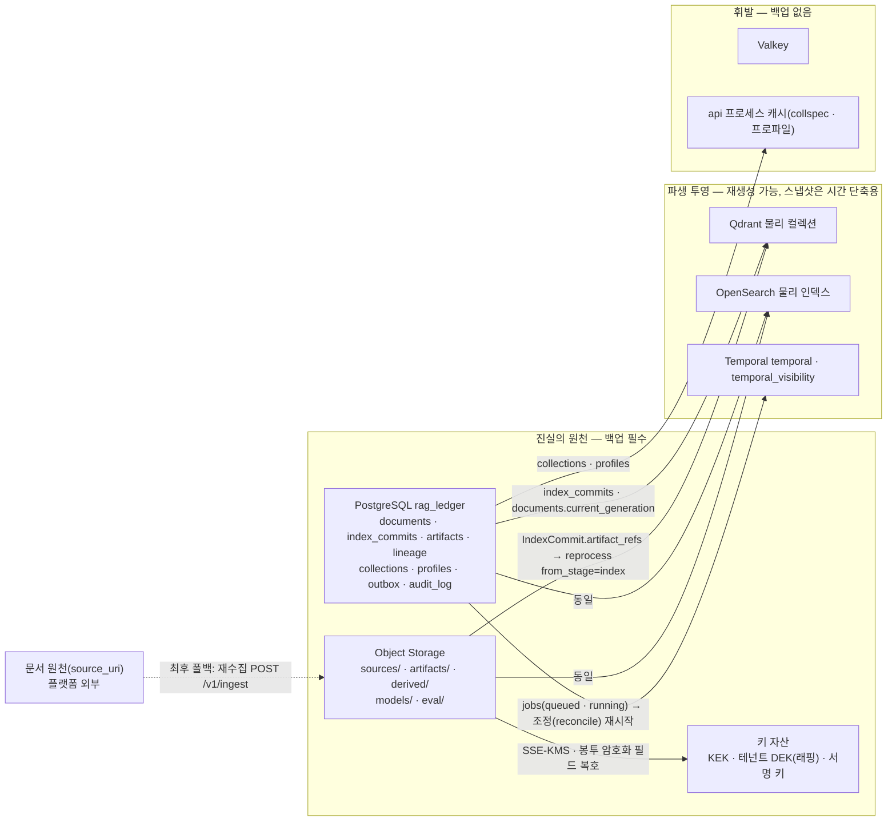
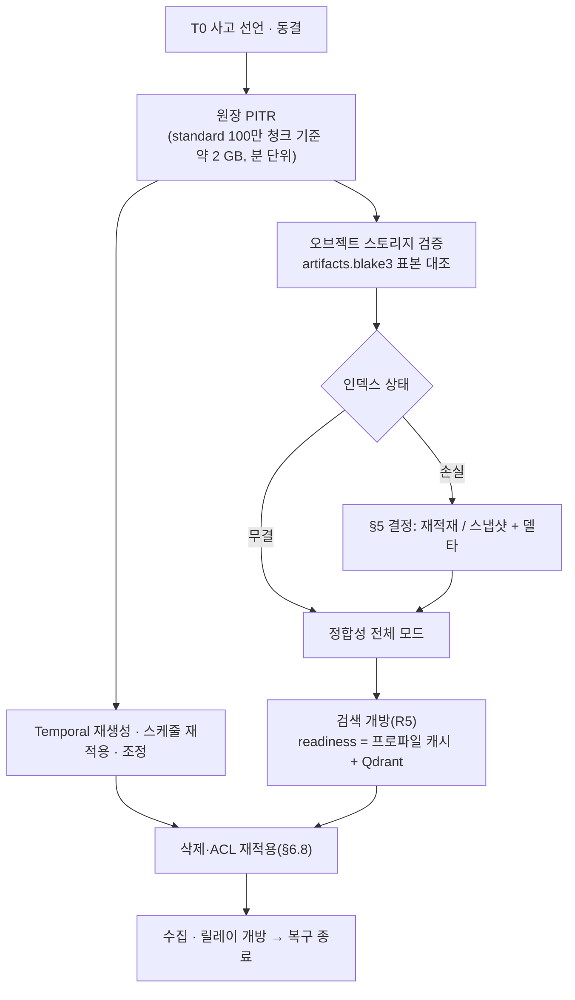
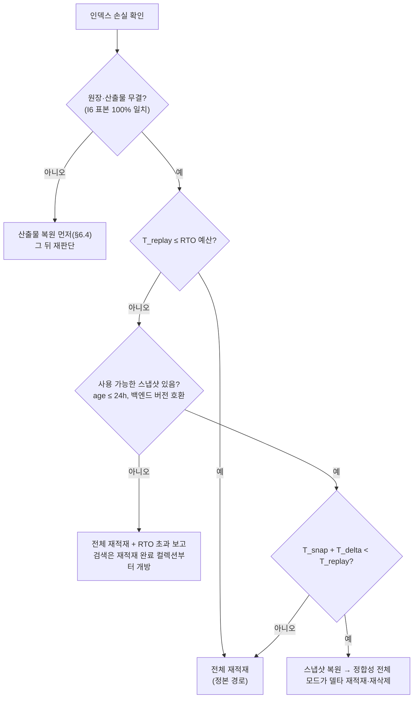

# 백업과 재해 복구

## 목적

이 문서는 RAG Platform의 백업(backup)과 재해 복구(Disaster Recovery, DR)를 운영 관점에서 확정한다. 무엇이 진실의 원천이고 무엇이 재생성 가능한 파생물인지를 먼저 고정한 뒤, 백업 대상·주기·보존, 프로파일별 복구 시점 목표(Recovery Point Objective, RPO)와 복구 시간 목표(Recovery Time Objective, RTO), 손실 시나리오별 복구 경로, 인덱스 재구성과 스냅샷 복원의 선택 기준, 단계별 복구 절차, 복구 후 정합성 검증, DR 리허설, 암호화 키 백업을 정한다.

설계 전제는 바이블 §2.1 K6("원장 중심 + 세대 사가")과 §13(저장소 정본)이다. PostgreSQL 원장과 오브젝트 스토리지의 콘텐츠 주소화 산출물만이 진실이고, Qdrant·OpenSearch 인덱스는 `IndexCommit.artifact_refs`에서 결정적으로 재구성되는 투영이다. 따라서 이 문서의 복구 1순위는 언제나 **산출물 재적재(replay)** 이고, 인덱스 스냅샷은 복구 시간을 줄이는 2순위 수단이다(바이블 §11.4 (4), [저장소 아키텍처](../02-architecture/04-storage-architecture.md) §1.1·§9).

## 범위

**포함**: 진실의 원천 정의, 백업 단위·방법·주기·보존 표, 스냅샷 키·보존 정책, 프로파일별 RPO/RTO 표, 복구 시나리오(단일 컴포넌트 손실·리전 손실·논리 손상), 재적재 vs 스냅샷 복원 결정 기준, 복구 절차 단계, 정합성 검증(카운트·해시 샘플), DR 리허설 계획, 암호화 키 백업, 백업 관측 신호.

**제외**: 백업 단위의 정의 자체와 저장소 스키마([저장소 아키텍처](../02-architecture/04-storage-architecture.md) §9가 "무엇을 어떤 단위로"를 정하고, 이 문서는 절차·목표·검증을 소유한다), 갱신·삭제·재색인 워크플로우의 정본([갱신·삭제·재인덱싱](../04-pipelines/19-update-delete-and-reindexing.md)), 장애 모드 FMEA와 카오스 실험 카탈로그([장애 모드와 복원력](../02-architecture/09-failure-modes-and-resilience.md)), 런북 본문([런북](06-runbooks.md); 이 문서는 런북 ID를 참조만 한다), 배포 토폴로지·HA 구성([배포 아키텍처](../02-architecture/08-deployment-architecture.md)), 업그레이드 절차([업그레이드와 마이그레이션](08-upgrade-and-migration.md)), 키 관리 포트의 시그니처·비밀 관리 제품 선택([보안과 컴플라이언스](05-security-and-compliance.md)).

이 문서에서 "초안 목표"로 표시한 수치는 실측 전 값이며, "제안"으로 표시한 이름(워크플로우·타입·메트릭·`action` 값)은 바이블에 없으므로 ADR 또는 바이블 minor 개정 전까지 계약이 아니다.

## 1. 진실의 원천과 복구 우선순위

### 1.1 저장소 분류



| 등급 | 저장소 | 손실 시 결과 | 복구 수단 | 근거 |
|------|--------|--------------|-----------|------|
| 진실 | PostgreSQL `rag_ledger` | 어떤 투영도 검증·재구성 불가. 테넌트·컬렉션·문서 정본(ACL·메타), 잡 상태, 멱등 판정, 산출물 카탈로그·계보, 커밋 원장, 아웃박스, 사용량, 사전, 평가·피드백, 감사(`standard`) 소실 | 물리 백업 + WAL 아카이브로 시점 복구(Point-in-Time Recovery, PITR) | 바이블 §13.1, [저장소 아키텍처](../02-architecture/04-storage-architecture.md) §1.1·§2.6·§9 |
| 진실 | Object Storage(`tenants/{tenant_id}/…`, `models/`, `eval/`) | 원본·산출물·파생물 소실 → 재적재 불가; 원본까지 잃으면 문서 원천에서 재수집해야 함 | 버킷 버저닝 + 교차 리전 복제(`korean-gov`) 또는 야간 동기화; 원본은 `documents.source_uri`로 재수집 가능(브리프 R1 Pull 모델) | 바이블 §13.3, 저장소 아키텍처 §3.3·§9 |
| 진실 | 키 자산(KEK, 래핑된 테넌트 DEK, OpenSearch 요청별 JWT 서명 키, 웹훅 `secret_ref`, 백엔드 자격 증명) | KEK 손실 = SSE-KMS 객체·봉투 암호화 필드·PII `encrypt` 토큰 영구 복호 불가(백업이 있어도 무용) | §9 | [멀티테넌시·보안 아키텍처](../02-architecture/07-multi-tenancy-and-security-architecture.md) §6 |
| 파생 | Qdrant 물리 컬렉션, OpenSearch 물리 인덱스(감사 인덱스 제외) | 검색 불가(수집·원장 무영향) | 1순위 산출물 재적재, 2순위 스냅샷 복원 + 델타 재적재(§5) | 바이블 K6·§11.4 (4), NFR-REL-12 |
| 파생(규제 예외) | OpenSearch 감사 인덱스 `rag_audit-*`(`korean-gov`) | 감사 증적 소실 — 재생성 불가, 법정 보존 대상 | 스냅샷(2년 보존) + Object Lock 옵션; 이 문서 §2.2 | 보안 아키텍처 §8.3·§12.1 (5) |
| 파생 | Temporal `temporal`·`temporal_visibility` | 진행 중 워크플로우 히스토리 소실. 잡 정본은 `jobs`이므로 조정(reconcile)이 재시작 | 스키마 재생성 + 네임스페이스 재생성 + 조정; 백업은 시간 단축·포렌식용(§6.7) | 바이블 §11.5, [오케스트레이션과 워크플로우](../02-architecture/06-orchestration-and-workflows.md) §6.3 |
| 휘발 | Valkey, api 프로세스 캐시 | 캐시 미스·레이트리밋 fail-closed·`degraded{acl_recheck}`; 정확성에 관여하는 상태는 없음 | 재기동 시 빈 상태(`korean-gov`는 AOF 옵션) | 바이블 §2.3, 저장소 아키텍처 §6 |

**결정:** 백업의 의무 대상은 진실 등급 세 가지(원장·오브젝트 스토리지·키 자산)다. 파생 등급의 백업(인덱스 스냅샷, Temporal DB)은 RTO 단축 수단이며, 그것이 없어도 RPO는 진실 등급의 백업만으로 결정된다. 인덱스의 실효 RPO는 스냅샷 주기가 아니라 **원장·산출물의 RPO**다([ADR-0026](../06-adr/0026-index-commit-generation-saga-and-ledger.md), [ADR-0034](../06-adr/0034-retrieval-hot-path-postgres-independence-and-hydrate.md)).

### 1.2 복구 원칙

| # | 원칙 | 의미 | 근거 |
|---|------|------|------|
| R1 | 원장 우선 | 원장이 복원되기 전에는 어떤 투영도 "정상"이라고 판정하지 않는다. 복원 순서는 원장 → 오브젝트 스토리지 검증 → 인덱스 → 정합성 검사 → alias 확인이다 | 저장소 아키텍처 §9 |
| R2 | 재적재가 정본 경로 | 인덱스 복구는 `reprocess.document.v1 {from_stage: index}` 재적재이며, 복원 결과의 `commit_hash`가 손실 전 커밋과 같아야 한다(`commit_hash`는 세대와 무관한 콘텐츠·프로파일 함수, 바이블 §6.2) | 바이블 §11.4 (4), NFR-REL-12 |
| R3 | 스냅샷은 시점이 어긋난다 | 두 백엔드·원장의 스냅샷 시점은 일치하지 않으므로 스냅샷 복원 뒤에는 반드시 `maintenance.consistency.v1` 전체 모드를 돌려 델타를 재적재·재삭제한다 | 저장소 아키텍처 §7.3, [기술 지형 06](../07-tech-landscape/06-vector-and-lexical-index-backends.md) 리스크 표 |
| R4 | 운영 원장은 시간을 되돌리지 않는다 | 논리 손상(잘못된 삭제·ACL·재색인)은 운영 원장을 PITR로 되감지 않고, 복구용 사이드 인스턴스에서 손상 범위를 추출한 뒤 **전진 수리**(재수집·재처리·ACL 재적용·alias 되돌림)한다. 되감기는 전체 손실에만 쓴다 | §4.3 |
| R5 | 검색 경로 먼저 개방 | 검색 경로는 PostgreSQL·Temporal에 의존하지 않으므로(readiness = 프로파일 캐시 + Qdrant) 인덱스가 검증되면 원장·오케스트레이터 복구 완료 전에도 검색을 개방할 수 있다. 수집·릴레이는 그 뒤에 연다 | 바이블 §11.1, [배포 아키텍처](../02-architecture/08-deployment-architecture.md) P6 |
| R6 | 삭제 의무는 복구를 이긴다 | 백업 보존은 35일을 넘지 않고(초안), 복원 뒤 복원 시점 이후의 삭제·ACL 변경을 재적용하기 전에는 수집·검색을 완전 개방하지 않는다. 법적 보존(legal hold) 문서는 예외 | NFR §9, 보안 아키텍처 §12.1 |
| R7 | 재현성으로 판정 | "복구 성공"은 카운트 일치가 아니라 원장 불변식 I1~I6 전부와 표본 `commit_hash` 재계산 일치로 판정한다 | 저장소 아키텍처 §7.1, §7 |

## 2. 백업 대상·방법·주기·보존

### 2.1 백업 단위 표

단위의 정의는 [저장소 아키텍처](../02-architecture/04-storage-architecture.md) §9를 따르고, 이 문서는 주기·보존·검증을 확정한다. 주기·보존 값은 모두 초안 목표다.

| 단위 | 방법 | 주기 | 보존(상한) | 저장 위치 | 복구 우선순위 | 검증 |
|------|------|------|------------|-----------|---------------|------|
| PostgreSQL `rag_ledger` | 물리 베이스 백업 + WAL 연속 아카이브(PITR) | 베이스 일 1회, WAL 연속(아카이브 지연 ≤ 5분, NFR-REL-15 전제) | **35일**(PITR 창; NFR §9 백업 상한과 동일) | 오브젝트 스토리지 별도 접두 `backups/postgres/rag_ledger/…`(제안, §2.2) — `korean-gov`는 교차 리전 복제 | 1 | 월 1회 복구용 인스턴스에 자동 복원 + 스키마·행 수 검사(§8) |
| Object Storage 버킷(`tenants/`, `eval/`, `models/`) | 버킷 버저닝(비현행 버전 만료 35일) + `standard`는 야간 오프사이트 동기화, `korean-gov`는 교차 리전 복제 | 연속(버저닝) / 일 1회(동기화) | 비현행 버전 35일; 현행 객체는 원장 참조 GC가 결정(저장소 아키텍처 §3.3) | 동일 버킷(버전) + 보조 버킷(다른 리전 또는 다른 계정) | 2 | 정합성 검사 전체 회차의 `artifacts.blake3` 표본 대조(I6); 월 1회 보조 버킷 표본 읽기 |
| Qdrant 물리 컬렉션 | 컬렉션 스냅샷 → `snapshots/qdrant/{physical_name}/{timestamp}` | `runtime.snapshot.every`: `lite` 1d / `standard`·`premium` 6h / `korean-gov` 1h | `standard` 일 3 + 주 1; `korean-gov` 시간 24 + 일 7 + 주 4 | 오브젝트 스토리지(S3 호환 스냅샷 저장소 설정 확인 필요 as of 2026-09) | 3(시간 단축용) | 주 1회 소형 컬렉션 스냅샷 복원 스모크(§8) |
| OpenSearch 물리 인덱스(`rag_lex_*`) | `repository-s3` 증분 스냅샷 → `snapshots/opensearch/{physical_name}/{timestamp}` | Qdrant와 동일 주기 | `standard` 일 7 + 주 4; `korean-gov` 시간 24 + 일 7 + 주 4 | 오브젝트 스토리지 | 3 | 동일 |
| OpenSearch 감사 인덱스 `rag_audit-*`(`korean-gov`) | `repository-s3` 스냅샷 | 1d | **2년**(규제 보존; 삭제 의무보다 보존 의무가 우선하는 항목) | 오브젝트 스토리지 Object Lock(WORM) 접두 옵션 | 규제 | 해시 체인 검증(보안 아키텍처 §8.3) |
| Temporal `temporal`·`temporal_visibility` | 물리 베이스 백업 + WAL(Temporal 권고에 따름) | 베이스 일 1회, WAL 연속 | 7일(네임스페이스 보존 기간 초안과 동일, [배포 가이드](01-deployment-guide.md) §4.5) | 원장 백업과 다른 접두 | 파생(선택) | 복구 절차는 백업 복원이 아니라 재생성 + 조정이 기본(§6.7) |
| Valkey | 없음(`korean-gov`는 AOF 옵션, 백업 대상 아님) | — | — | — | 없음 | — |
| 프로파일·사전·컬렉션 스펙 | 원장 포함(`profiles`, `user_dictionary_entries`, `collections`); 내장 프로파일 YAML·Helm values·Cedar 정책·OTel Collector 설정은 Git | 원장과 동일 / 커밋마다 | 원장과 동일 / Git 이력 | — | 1과 동일 | `rag profile validate`로 복원 후 재검증(바이블 §7.4) |
| 모델 미러 `models/` + `models.lock` | 오브젝트 스토리지 버킷에 포함(위 행) | 버저닝 | 자동 삭제 없음(저장소 아키텍처 §3.3) | 동일 | 2 | `models.lock` sha256 검증(배포 가이드 §6.1) |
| 키 자산 | §9 | §9 | §9 | 비밀 관리자(OpenBao / 클라우드 KMS) + 오프라인 보관 | 0(다른 모든 복구의 전제) | §9.2 |

**결정:** 백업 보존 상한은 감사 인덱스와 모델 미러를 제외하고 **35일**이다(초안 목표). 이 값은 NFR §9 "백업 ≤ 35일"의 삭제 의무에서 오며, 원장 PITR 창·오브젝트 비현행 버전 만료·스냅샷 최장 보존이 모두 이 상한 아래에 있어야 한다. 더 긴 보존이 필요한 증적은 백업이 아니라 원장 자체(`index_commits`·`audit_log`는 보존)에 있다([ADR-0026](../06-adr/0026-index-commit-generation-saga-and-ledger.md), [ADR-0027](../06-adr/0027-security-context-injection-and-acl-enforcement-points.md)).

### 2.2 스냅샷 키·보존 정책

스냅샷 키는 바이블 §13.3 `snapshots/{backend_id}/{physical_name}/{timestamp}`이며 `backend_id`는 `IndexCommit.backend_results[].backend_id` 값(`qdrant`, `opensearch`)과 같다. `{timestamp}`는 RFC 3339 UTC를 파일명에 쓸 수 있게 콜론을 제거한 `YYYYMMDDTHHMMSSZ` 형식으로 한다(이 문서의 규약; 바이블은 형식을 정하지 않음). 물리 이름이 `embedding_profile_hash`·`lexical_profile_hash` 접두로 갈리므로(`rag_vec_{embedding_profile_hash[:12]}`·`rag_lex_{lexical_profile_hash[:12]}`, 바이블 §13.4) blue/green 재색인 중에는 blue·green 둘 다 스냅샷 대상이다.

| 항목 | `standard`·`premium` | `korean-gov` | `lite` | 근거 |
|------|----------------------|--------------|--------|------|
| Qdrant 보존 | 일 3 + 주 1 | 시간 24 + 일 7 + 주 4 | 일 3 | 재적재가 1순위이므로 스냅샷의 가치는 나이에 따라 급감한다 — 저장소 아키텍처 §8.1의 갱신 가정(시간당 문서 1%)에서 3일 전 스냅샷의 델타는 코퍼스의 70%를 넘어 전체 재적재와 비용이 같다. 회당 약 14 GB(100만 청크)이므로 4개 보존 ≈ 56 GB(저장소 아키텍처 미해결 이슈 11 해소) |
| OpenSearch 보존 | 일 7 + 주 4 | 시간 24 + 일 7 + 주 4 | — | 증분 스냅샷이라 보존 비용이 낮다(약 1.5 × 프라이머리) |
| 월 단위 보존 | 없음 | 없음 | 없음 | "석 달 전 인덱스 내용"은 스냅샷이 아니라 원장(`index_commits` 이력)과 산출물이 답한다 |
| 리전 복제 | 야간 동기화에 포함 | `runtime.snapshot.replicate_region: true`(프로파일 스키마 선택 키) | 없음 | 바이블 §7.2 `korean-gov` "1h + 리전 복제" |
| 만료 주체 | 버킷 수명주기 규칙(시간 기반) | 동일 + Object Lock 접두는 만료 전 삭제 불가 | 동일 | 저장소 아키텍처 §3.3 |

원장·Temporal 백업의 오브젝트 키는 바이블 §13.3에 없다. 이 문서는 `backups/{system}/{database}/{kind}/{timestamp}`(`system ∈ {postgres}`, `database ∈ {rag_ledger, temporal, temporal_visibility}`, `kind ∈ {base, wal}`)를 **제안**하며(미해결 이슈 1), 확정 전에는 백업 도구의 기본 레이아웃을 그대로 두고 접두만 `backups/`로 고정한다.

### 2.3 스냅샷 실행 주체

바이블 §11.2 워크플로우 목록에는 스냅샷 잡이 없고, §7.2 `runtime.snapshot`은 프로파일 키다. 프로파일 값이 실행을 규정하려면 실행 주체가 플랫폼 안에 있어야 한다.

**결정(제안 포함):** 스냅샷은 Temporal 스케줄로 실행하는 내부 유지보수 워크플로우 `maintenance.snapshot.v1`(제안; `maintenance` 큐, `ScheduleOverlapPolicy.SKIP`)이 수행한다. 흐름은 (1) `collections.backends[]`에서 물리 대상 목록을 얻고, (2) 백엔드별 스냅샷을 생성해 §2.2 키로 저장하고, (3) 결과(`backend_id`, `physical_name`, `timestamp`, 바이트, 소요 시간)를 `job_events.payload`에 기록한다. `maintenance.cleanup.v1`처럼 `JobKind`가 없는 내부 스케줄이라 `JobStatus`를 만들지 않는다([잡·이벤트·상태](../03-contracts/12-jobs-events-and-status.md) §3.1의 `cleanup` 규칙 준용). 채택 전까지는 백엔드 자체 스케줄러 또는 클러스터 CronJob으로 같은 키 규약을 지켜 실행한다. 등재는 바이블 §11.2 minor 개정 제안이다(미해결 이슈 2).

원장 백업은 플랫폼 워크플로우가 아니라 PostgreSQL 운영 도구(오퍼레이터 또는 백업 에이전트; 제품 선택은 [보안과 컴플라이언스](05-security-and-compliance.md) 소유)가 수행한다. 플랫폼은 백업 도구의 마지막 성공 시각을 관측 신호로 소비할 뿐이다(§10).

### 2.4 설정·프로파일·코드 자산

| 자산 | 정본 위치 | 백업 방식 | 복원 검증 |
|------|-----------|-----------|-----------|
| 내장 프로파일 YAML(`base → lite → standard → premium`, `korean-gov`) | 코어 저장소(Git) | 릴리스 태그·이미지 digest | `profile_hash` 재계산 = `collections.profile_hash`(불일치는 컬렉션이 다른 버전에 바인딩된 것 → 재색인 판단, 바이블 §7.4) |
| 운영자 프로파일(`extends`) | 원장 `profiles`(`yaml`, `resolved`) + Git | 원장 백업 | `rag profile validate` |
| 컬렉션 스펙 | 원장 `collections` | 원장 백업 | `GET /v1/collections/{collection_id}`와 alias 대상(`backends[].physical_name`) 대조 |
| 사용자 사전 | 원장 `user_dictionary_entries` | 원장 백업 | `dictionary_hash` 재계산 = `collections.dictionary_hash` |
| Helm values(`values-{tier}.yaml`, `values-env-*.yaml`) | Git | Git | `helm diff`(값 동일성) |
| Cedar 정책·`policy_version` | Git(ConfigMap) | Git | 정책 단위 테스트(E2) |
| `models.lock` + 가중치·`LICENSE` | 오브젝트 스토리지 `models/` | 버킷 백업 | sha256 대조 |
| 스키마 파일 `schemas/*.schema.json` | 코어 저장소 | 릴리스 | 계약 스냅샷 테스트 |
| 비밀(DSN, API 키, 서명 키) | 비밀 관리자 | §9 | 기동 시 `/healthz` 의존성 상태 |

원칙: 원장 밖에 있는 설정은 모두 Git 또는 비밀 관리자에 있고, 원장 안에 있는 설정은 원장 백업이 덮는다. Kubernetes 클러스터 상태(ConfigMap·Secret 오브젝트) 자체는 백업하지 않는다 — 같은 차트·같은 digest·같은 values로 재생성한다([배포 아키텍처](../02-architecture/08-deployment-architecture.md) §8).

### 2.5 백업과 삭제 의무의 접점

| 접점 | 규칙 | 근거 |
|------|------|------|
| 보존 상한 | 백업(원장 PITR 창·오브젝트 비현행 버전·인덱스 스냅샷)은 35일을 넘지 않는다. 35일이 지나면 삭제된 문서는 어떤 백업에도 없다 | NFR §9, 보안 아키텍처 §12.1 |
| 복원 후 재삭제 | 복원 시점 `T_restore` 이후에 접수된 삭제(`kind=delete` 커밋)·ACL 변경·테넌트 오프보딩은 복원된 원장에 없다. §6.8의 재적용 단계를 마치기 전까지는 수집·검색을 완전 개방하지 않는다 | NFR §9 "복구 시 삭제 상태가 다시 적용된다" |
| 스냅샷 복원의 부활 | 스냅샷에 있던 문서가 원장에서는 툼스톤(`kind=delete`·`committed`)이면 정합성 검사가 "툼스톤 문서 `count > 0`"으로 잡아 삭제를 재구동한다 | [갱신·삭제·재인덱싱](../04-pipelines/19-update-delete-and-reindexing.md) §7.2 |
| 법적 보존 | legal hold 문서는 산출물 GC만 유예되므로 백업 보존 상한과 무관하게 원장·산출물에 남는다 | 갱신·삭제·재인덱싱 §4.2 |
| 크립토 셰레딩 | 테넌트 DEK를 폐기하면 백업 안의 암호화 필드·PII 토큰도 즉시 복호 불가가 된다. 이것이 의도된 삭제이므로 DEK 폐기는 되돌릴 수 없는 작업으로 취급한다(§9.3) | 보안 아키텍처 §6.3 |
| `lite` | 백업 도구가 없으면 운영자가 일 1회 덤프·파일시스템 사본을 만들고 35일 뒤 삭제한다. 이 의무는 프로파일과 무관하다 | — |

## 3. RPO/RTO 목표

### 3.1 프로파일별 목표 표

NFR-REL-15는 "메타 DB RPO ≤ 5분 / 전체 RTO ≤ 4시간(초안)"만 정하며 시나리오를 구분하지 않는다. 이 문서는 그것을 **단일 리전 안의 컴포넌트 손실** 목표로 해석하고, 리전 손실 목표는 별도 초안으로 둔다(미해결 이슈 3). 모든 값은 초안 목표다.

| 항목 | `lite` | `standard` | `premium` | `korean-gov` | 근거·비고 |
|------|--------|------------|-----------|--------------|-----------|
| 원장 RPO(컴포넌트 손실) | ≤ 24h(일 1회 덤프) | ≤ 5min(WAL 아카이브 + 동기 복제 1) | 동일 | ≤ 5min(WAL + 리전 간 스트리밍 복제) | NFR-REL-15, 저장소 아키텍처 §2.6 |
| 오브젝트 RPO(컴포넌트 손실) | ≤ 24h(파일시스템 사본) | ≈ 0(버저닝, 내구성은 S3 호환 저장소 위임) | 동일 | ≈ 0 | NFR-REL-11 |
| 인덱스 실효 RPO | = 원장·오브젝트 RPO(재적재) | 동일 | 동일 | 동일 | §1.1 결정 — 스냅샷 주기(1d/6h/6h/1h)는 RPO가 아니라 재적재 델타 크기를 정한다 |
| 검색 경로 RTO(인덱스 손실) | ≤ 8h(수동 재적재) | ≤ 4h(재적재 또는 스냅샷 + 델타) | ≤ 4h | ≤ 1h(1h 스냅샷 + 델타 재적재) | §5 결정 기준 |
| 수집 경로 RTO(원장·Temporal 손실) | ≤ 8h | ≤ 4h | ≤ 4h | ≤ 2h | 조정(reconcile)이 `queued`·`running` 잡을 재시작 |
| 전체 RTO(컴포넌트 손실) | ≤ 8h | **≤ 4h** | ≤ 4h | ≤ 2h | NFR-REL-15 |
| 리전 손실 RPO(원장 / 오브젝트) | 지원 안 함(오프사이트 사본이 있으면 24h) | ≤ 15min(WAL 아카이브 버킷 교차 리전 복제) / ≤ 24h(야간 동기화) | 동일 | ≤ 5min / ≤ 15min(비동기 교차 리전 복제) | 초안; `standard`의 오브젝트 24h는 재수집 폴백으로 보완(§4.2) |
| 리전 손실 RTO | — | ≤ 24h(콜드 복원) | ≤ 24h | ≤ 8h(웜 스탠바이 데이터 계층) | 초안 |
| 논리 손상 복구(문서 1건 잘못된 삭제) | ≤ 1h | ≤ 1h | ≤ 1h | ≤ 1h | §4.3 — 재수집·재처리 잡 1건 |
| 논리 손상 복구(컬렉션 잘못된 재색인) | 재색인 | ≤ 15min(alias 되돌림, 롤백 창 24h 안) | 동일 | 동일 | 갱신·삭제·재인덱싱 §5.2 단계 7 |

### 3.2 RTO 분해



전체 RTO 4시간의 배분(초안, `standard` 100만 청크·문서 2만 건 기준)은 선언·동결 15분, 원장 PITR 30분, 오브젝트 검증 15분, 인덱스 복구 90분(§5.2), 정합성 전체 모드 30분, 검색 개방·재적용·수집 개방 30분, 예비 30분이다. 이 배분은 M1 코퍼스에서 리허설로 실측한 뒤 갱신한다(§8).

## 4. 복구 시나리오

### 4.1 단일 컴포넌트 손실

| 컴포넌트 | 손실 양상 | 사용자 영향 | 복구 경로 | 런북 | 검증 |
|----------|-----------|-------------|-----------|------|------|
| PostgreSQL 프라이머리 | 노드 장애 | 수집 표면 503 + `Retry-After`, 검색 무영향(ADR-0034) | 동기 복제본 승격(자동) → 조정 틱이 `queued` 재시작. PITR은 복제본까지 잃었을 때만 | RB-01 | `/healthz` PG `up`, `jobs.state=running` 재개, `rag_outbox_lag_seconds` 정상화 |
| PostgreSQL 전체(프라이머리 + 복제본) | 볼륨 손상·삭제 | 수집 중단, 검색 계속(캐시된 컬렉션 스펙으로), ACL 갱신 불가 | §6.3 PITR(`T_restore` = 마지막 아카이브 WAL) → §6.8 재적용 → Temporal 조정 | RB-01 | I1~I6 전체 모드 0 불일치 또는 전부 수리 |
| Object Storage 객체 일부 | 실수 삭제·덮어쓰기 | 재처리·부모 확장(`ptxt:` 미스) 실패, 정합성 `artifact_missing` | 버저닝에서 비현행 버전 복원(35일 안); 없으면 `sources/` 원본으로 `reprocess from_stage=parse`; 원본도 없으면 `documents.source_uri` 재수집 | RB-03 | `artifacts.blake3` 대조 |
| Object Storage 버킷 전체 | 계정·버킷 삭제 | 재처리·재적재 불가(검색은 계속) | 보조 버킷(야간 동기화·교차 리전 복제) 승격 → 원장 `artifacts.blake3` 전수 대조 → 누락은 재수집 | RB-05 준용 | 누락 객체 수 0 또는 재수집 잡 전량 종결 |
| Qdrant 노드 1대 | 노드 장애(사본 2) | dense·sparse 지연 또는 `degraded{channel.dense}` | 자동 복제 회복 | RB-04 | `degraded` 비율 정상화 |
| Qdrant 물리 컬렉션 | 컬렉션 삭제·클러스터 손실 | 503 `retrieve.unavailable`(hydrate 백엔드) — `lite`·`standard` 모두 검색 전면 중단 | §5 결정: 재적재 또는 최신 스냅샷 + 델타 재적재; alias `col_{collection_id}_vec` 재바인딩 | RB-04, RB-03 | I2·I3·I4·I5, alias 대상 = `collections.backends[].physical_name` |
| OpenSearch 물리 인덱스 | 인덱스 삭제·클러스터 손실 | lexical 채널 제외 + `degraded{channel.lexical}`, 검색 계속(NFR-REL-13) | 동일(재적재 또는 `repository-s3` 스냅샷 + 델타); alias `col_{collection_id}_lex` 재바인딩 | RB-03 | 동일 + DLS 역할 매핑·JWT 인증 도메인 재등록 확인(E8) |
| OpenSearch 감사 인덱스(`korean-gov`) | 손실 | 감사 증적 조회 불가 | 스냅샷 복원(2년 보존); 손실 구간은 NATS 스트림(조건부)에서 재생 | — | 해시 체인 연속성 |
| Temporal 서버·DB | 서비스 불가·DB 손실 | 새 잡 시작 불가(503), 진행 중 액티비티 재시도, 스케줄 지연; 검색 무영향 | §6.7 재생성 + 조정; DB 백업 복원은 선택 | RB-02 | `queued`·`running` 잡 전량 재시작, 스케줄 3종(`maintenance.*`, `eval.run.v1`) 존재 |
| Valkey | 전면 손실 | 429 급증(fail-closed), p95 상승, `degraded{acl_recheck, unavailable}`; 진행 중 삭제·ACL 갱신은 재시도마다 `aclrev` 힌트를 다시 쓰므로 창이 닫힘 | 재기동(빈 상태). 완료된 삭제·ACL 갱신은 백엔드에 이미 반영되어 힌트가 필요 없다 | RB-11 | `rag_acl_recheck_denied_total` 회복, 골든 시나리오 "ACL 회수 → 미반환" |
| 모델 서빙·사이드카 | 재기동 | 수집 재시도·폴백, 검색 `degraded` | 재기동; DR 대상 아님(무상태) | RB-06 | `/healthz` digest = 프로파일 `model_ids` |
| 키 자산(KEK) | 비밀 관리자 손실 | SSE-KMS 객체·봉투 암호화 필드 복호 불가 → 사실상 데이터 손실 | §9.2 KEK 백업 복원이 유일한 경로 | — | 표본 객체 복호 성공 |

런북 열의 ID RB-01~RB-12는 [장애 모드와 복원력](../02-architecture/09-failure-modes-and-resilience.md) §9의 런북 색인을 그대로 쓰며, 절차 본문은 [런북](06-runbooks.md)이 소유한다.

### 4.2 리전 손실

`standard`·`premium`은 단일 리전 배포가 기본이며 리전 손실 대비는 오프사이트 사본(원장 백업 버킷의 교차 리전 복제, 오브젝트 야간 동기화, 스냅샷 포함)으로만 한다. `korean-gov`는 웜 스탠바이 데이터 계층(리전 간 PostgreSQL 스트리밍 복제, 버킷 교차 리전 복제, 스냅샷 복제)을 둔다. 애플리케이션 계층은 무상태이므로 같은 차트·같은 digest·같은 values로 재생성한다.

| 단계 | `standard`(콜드 복원) | `korean-gov`(웜 스탠바이) |
|------|------------------------|---------------------------|
| 1 선언 | 리전 복구 예상 시간이 RTO를 넘으면 DR 선언(운영 책임자 + 보안 책임자 2인) | 동일 |
| 2 인프라 | 보조 리전에 클러스터 생성, 운영 차트의 의존성이 아닌 외부 데이터 계층(PostgreSQL·Qdrant·OpenSearch·Valkey·Temporal; 관리형 또는 업스트림 차트, [배포 아키텍처](../02-architecture/08-deployment-architecture.md) P3)을 먼저 설치, 같은 `numHistoryShards` | 스탠바이 데이터 계층에 애플리케이션 계층만 설치 |
| 3 원장 | 복제된 베이스 + WAL로 PITR(RPO ≤ 15min 초안) | 스탠바이 복제본 승격(RPO ≤ 5min) |
| 4 오브젝트 | 보조 버킷을 정본으로 승격(`RAG_OBJECT_STORE__URI` 변경); 최근 24h 산출물은 누락 가능 → `artifact_missing` → 원본 있으면 `reprocess from_stage=parse`, 없으면 `documents.source_uri` 재수집 | 복제 버킷 승격(RPO ≤ 15min) |
| 5 키 | KEK·서명 키를 비밀 관리자 백업에서 복원(§9) — 이 단계 전에는 SSE-KMS 객체를 읽을 수 없다 | 비밀 관리자 HA가 리전을 넘으면 즉시 사용 |
| 6 인덱스 | 물리 대상 생성 후 §5 결정(대개 전체 재적재; 복제된 스냅샷이 있으면 스냅샷 + 델타) | 복제된 1h 스냅샷 복원 + 델타 재적재 |
| 7 검증·개방 | §7 → 검색 개방 → §6.8 재적용 → 수집·릴레이 개방 → DNS·인그레스 전환 | 동일 |
| 8 복귀 | 원 리전 복구 후 역방향 동기화는 하지 않는다 — 보조 리전을 정본으로 유지하고, 원 리전은 새 보조로 재구성한다(양방향 동기화의 충돌 위험 회피) | 동일 |

리전 손실에서 오브젝트 RPO 24h(`standard`)가 남기는 공백은 재수집으로 메운다: `documents.source_uri`와 `credentials_ref`가 원장에 있고 플랫폼은 Pull 모델이므로(브리프 R1) 원천이 살아 있으면 `POST /v1/ingest` 재제출로 같은 `document_id`에 새 세대가 만들어진다. 원천의 콘텐츠가 바뀌었으면 새 `doc_version`이 되며 이는 정상 갱신이다. 원천이 사라진 문서는 복구 보고서에 손실로 기록한다.

### 4.3 논리 손상

논리 손상은 저장소가 건강한데 **내용이 잘못된** 경우다. 원칙 R4에 따라 운영 원장을 되감지 않는다.

| 손상 | 감지 | 손상 범위 확인 | 전진 수리 | 시한 |
|------|------|----------------|-----------|------|
| 문서 1건 잘못된 삭제(`DELETE /v1/documents/{document_id}`) | 사용자 신고, `audit.admin.action{action: delete_document}` | `GET /v1/documents/{document_id}/commits`에서 툼스톤 확인 | 하드 삭제 전(≤ 24h): 같은 `source_uri`로 `POST /v1/ingest` → 툼스톤에서 세대 N+2로 재활성화(갱신·삭제·재인덱싱 §4.4). `sources/` 원본은 30일 유예라 `fetch`가 바이트 저장을 생략하고, 산출물 GC(≤ 3h)가 지났으면 파이프라인이 재실행된다. 하드 삭제 후: 재수집은 새 `document_id`를 받으며 클라이언트에 ID 변경을 통지 | ≤ 1h |
| 컬렉션·테넌트 대량 삭제 | `audit.admin.action{action: delete_collection}`(값 제안), 잡 목록 | 복구용 사이드 인스턴스에 원장 PITR(손상 직전 `T_side`) → `documents`·`index_commits` diff로 영향 `document_id`·`source_uri`·`acl`·`metadata` 목록 추출 | 목록을 `POST /v1/ingest/batch`(100건 단위)로 재수집. 오브젝트 버저닝 35일 안이면 삭제된 `sources/`·`artifacts/` 객체를 비현행 버전에서 먼저 복원해 `fetch`·`parse` 비용을 줄인다(캐시 적중은 `stage_key`가 원장 `artifacts` 행에 있어야 하므로, 행이 하드 삭제되었으면 재실행) | 규모 의존 |
| 잘못된 ACL 변경 | `audit.acl.changed`, 사용자 신고 | 사이드 인스턴스의 `documents.acl` 이전 값 | `PATCH /v1/documents/{document_id}/acl`로 이전 값 재적용(`acl.update.v1`, 세대 없음) | ≤ `acl_propagation_slo` |
| 잘못된 프로파일 재색인(품질 회귀) | 게이트 통과 후 온라인 회귀, 사용자 신고 | `collection.reindex.completed`, `EvalReport` | 롤백 창(24h 초안) 안: alias를 blue로 되돌림(벡터 → 렉시컬 역순) + `CollectionSpec.profile_hash` 복원(갱신·삭제·재인덱싱 §5.2 단계 7 (b)). 창 밖: 이전 프로파일로 재색인 | ≤ 15min / 재색인 |
| 잘못된 원장 마이그레이션(업그레이드 결함) | `migrate` 훅 실패, 계약 테스트 | 마이그레이션 트랜잭션 로그 | 확장(expand) 단계는 되돌릴 수 있으므로 `helm rollback`; 수축(contract) 후 결함이면 사이드 인스턴스에서 영향 행을 추출해 수리 SQL을 리뷰 후 적용. 운영 원장 PITR은 **수집 동결 + 전 테넌트 합의**가 있을 때만(다른 테넌트의 쓰기를 함께 잃기 때문) | — |
| 파서·청커 결함으로 잘못 색인된 세대 | 야간 nDCG 회귀, `quality=degraded` 급증 | `index_commits.parser_fingerprint_hash` 등 지문으로 영향 커밋 조회 | 결함 수정 릴리스 후 `reprocess from_stage=<지문이 바뀐 스테이지>`; 지문이 달라지므로 `stage_key` 미스로 재실행된다(리스크 #8의 반대 방향 보증) | 규모 의존 |
| 오염된 산출물(BLAKE3 불일치) | 읽기 시 `contract.violation`, 정합성 I6 | `artifacts.blake3` 전수 대조 | 비현행 버전 복원 → 없으면 `from_stage=parse` 재처리 → 없으면 재수집 | — |

**결정:** 복구용 사이드 인스턴스는 운영 원장과 같은 스키마 버전의 별도 PostgreSQL에 PITR로 만들고, 읽기 전용·수명 7일·운영 네트워크와 분리한다. 사이드 인스턴스의 값은 API(`/v1/ingest`, `/v1/documents/{document_id}/acl`, `/v1/collections/{collection_id}/reindex`)를 통해서만 운영에 반영하며 SQL 직접 쓰기는 마이그레이션 결함 수리에 한정한다. 이렇게 하면 모든 수리가 잡·감사 이벤트로 남는다([ADR-0017](../06-adr/0017-event-delivery-outbox-cloudevents-no-broker.md), [ADR-0005](../06-adr/0005-doc-version-content-hash-only-and-acl-payload-update.md)).

## 5. 인덱스 재구성(재적재) vs 스냅샷 복원

### 5.1 두 경로의 성질

| 항목 | 산출물 재적재(replay) | 스냅샷 복원 |
|------|------------------------|-------------|
| 정의 | 문서별 `reprocess.document.v1 {from_stage: index}` — `EmbeddedChunkSet` + `requires_lineage`(`EnrichedChunkSet`·`ChunkSet`·`SourceDocument`)를 로드해 새 세대(N+1)로 upsert → 플립 | 백엔드 자체 포맷의 스냅샷을 물리 대상에 복원 → alias 재바인딩 |
| 정확성 | 결정적. 새 커밋의 `commit_hash`가 손실 전 커밋과 같아야 한다(NFR-REL-12) | 스냅샷 시점의 상태. 그 뒤의 커밋·삭제·ACL 갱신은 없다 → 델타 재적재·재삭제 필수 |
| 원장 정합 | 새 세대·새 커밋이 원장에 기록되므로 I1~I6가 자동으로 맞는다 | 원장의 `current_generation`과 스냅샷의 `is_current` 세대가 어긋날 수 있다(`stale_current`, `missing_records`, 툼스톤 부활) |
| 필요 자원 | `ingest-io` 워커 + 양 백엔드 쓰기 처리량 + 오브젝트 읽기. **GPU·임베딩 서버 불필요**(벡터는 산출물에 있음) | 오브젝트 → 백엔드 네트워크 대역폭, 백엔드 복원 CPU, 디스크 |
| 시간 함수 | 레코드 수에 선형: `T_replay ≈ R / (p × r)`(R 레코드 수, p 병렬 문서 수, r 문서당 초당 upsert 레코드) | 스냅샷 바이트에 선형: `T_snap ≈ S / B + T_open`(S 바이트, B 대역폭, T_open 백엔드 로딩) + 델타 재적재 `T_delta` |
| 비용 | 워커 시간 + 백엔드 쓰기(색인 부하로 검색 p95 영향 가능) | 스토리지 보존 비용(상시) + 복원 시 대역폭 |
| 세대·`record_id` | 새 `index_generation`, 새 `record_id`(`H("record", …, N+1, chunk_id)`) — 손실 전 레코드와 물리 키가 다르지만 `chunk_id`·`content_hash`는 같다 | 손실 전과 같은 `record_id`·세대 |
| blue/green 재색인 중 | green도 문서별 최신 green `committed` 커밋으로 재적재 가능(포인터 미전진이라 기준 커밋이 다름, 갱신·삭제·재인덱싱 §7.2 `stale_current` 행) | blue·green 스냅샷을 각각 복원 |
| 실패 모드 | `artifact_missing`(산출물 손실) → `from_stage=parse` 또는 재수집 | 스냅샷 손상·버전 비호환(백엔드 메이저 업그레이드 후 구 스냅샷) |

### 5.2 결정 기준



| 기준 | 규칙 | 근거 |
|------|------|------|
| 기본값 | `T_replay`가 RTO 예산(§3.2 인덱스 복구 배분 90분) 안이면 **재적재만** 쓴다. 단순하고 정합성이 자동이며 `commit_hash`로 판정 가능 | 원칙 R2 |
| 스냅샷 채택 | `T_replay`가 예산을 넘고, 스냅샷 나이 ≤ 24h이고, `T_snap + T_delta < T_replay`일 때만. 델타 크기 = 스냅샷 `{timestamp}` 이후 `committed_at`인 커밋 수(원장에서 즉시 계산 가능) | 원칙 R3 |
| `korean-gov` | 1h 스냅샷 + 델타를 기본으로 하되, 스냅샷 복원 뒤 정합성 전체 모드가 끝나기 전에는 검색을 개방하지 않는다(혼합 세대 노출 불허 요구) | 바이블 §7.2 |
| 재적재 병렬도 | 재적재는 문서 단위 잡이므로 디스패처의 `runtime.tenant_concurrent_jobs_max`(`standard` 32)와 `reindex_max_share`에 걸린다. DR 재적재는 테넌트 공정성보다 RTO가 우선이므로 운영자가 한시적으로 상한을 올린다(방법은 미해결 이슈 4) | 바이블 §7.2·§11.2 |
| 검색 p95 보호 | 재적재 중 백엔드 쓰기 부하가 검색 p95를 1.5배 넘기면 병렬도를 낮춘다. 검색이 이미 중단된 상태(Qdrant 손실)에서는 제약 없음 | 바이블 §8.3 |
| 비용 상한 | 스냅샷 보존 비용이 재적재 워커 비용의 예상 절감액을 넘으면 보존 개수를 줄인다(§2.2의 보존이 그 결과) | — |

**산정 예(초안, 가정 명시).** [저장소 아키텍처](../02-architecture/04-storage-architecture.md) §8.1 가정(리프 100만 + 부모 20만 = 레코드 120만, 문서 2만, Qdrant 디스크 약 14 GB, OpenSearch 프라이머리 약 7~10 GB)에 다음 가정을 더한다 — 문서당 upsert 배치 256, 문서당 초당 레코드 r = 500(가정; 양 백엔드 순차 upsert), 병렬 문서 p = 32(`tenant_concurrent_jobs_max`), 오브젝트 → 백엔드 대역폭 B = 100 MB/s(가정).

| 항목 | 식 | 값(초안) |
|------|----|----------|
| 전체 재적재 `T_replay` | 1,200,000 / (32 × 500) | 75초 순 쓰기 + 문서당 산출물 로드·플립 오버헤드(문서당 약 2초 가정 × 20,000 / 32) ≈ **약 25분** |
| Qdrant 스냅샷 `T_snap` | 14 GB / 100 MB/s + 로딩 | 약 2.5분 + 로딩(확인 필요 as of 2026-09) |
| OpenSearch 스냅샷 `T_snap` | 10 GB / 100 MB/s + 세그먼트 복구 | 약 2분 + 복구 |
| 6h 델타 `T_delta` | 시간당 문서 1% × 6h = 1,200문서 | 약 2분 |
| 판정 | `T_replay`(25분) ≤ 예산(90분) | **`standard` 100만 청크 규모는 재적재만으로 충분**하다. 스냅샷은 1,000만 청크 이상 또는 문서당 오버헤드가 가정보다 큰 코퍼스에서 의미를 갖는다 |

이 산정의 r·p·B·문서당 오버헤드는 모두 가정이며 M1 코퍼스 리허설(§8)에서 실측값으로 교체한다. 실측 전까지 `standard`의 인덱스 복구 기본 경로는 재적재다.

### 5.3 조합 전략

스냅샷을 쓰더라도 마지막 단계는 항상 정합성 검사 전체 모드다. 전체 모드는 문서마다 원장 기준 커밋의 세대와 `record_count`·`content_hash` 집합을 대조하므로, 스냅샷 이후의 갱신(`missing_records`·`hash_mismatch` → 재적재), 스냅샷 이후의 삭제(툼스톤 문서 `count > 0` → 삭제 재구동), 플립 불일치(`stale_current` → 플립 재실행), 원장에 없는 커밋(`orphan` → `delete_by_filter(commit_id)`)을 한 회차에 수리한다([저장소 아키텍처](../02-architecture/04-storage-architecture.md) §7.3, [갱신·삭제·재인덱싱](../04-pipelines/19-update-delete-and-reindexing.md) §7.2). 즉 스냅샷 복원은 "전체 모드가 수리해야 할 문서 수를 줄이는 사전 단계"다.

## 6. 복구 절차 단계

### 6.1 공통 전제와 동결

| 항목 | 규칙 |
|------|------|
| 선언 | 사고 지휘자 1인이 DR 등급(컴포넌트 / 리전 / 논리)을 선언하고 `T_incident`를 기록한다. 리전 손실은 2인 승인(§4.2) |
| 동결(freeze) | 수집 표면을 닫는다: 워커 Deployment를 0으로, api → Temporal 접근을 차단(NetworkPolicy 또는 frontend 0). api는 바이블 §11.5 규칙대로 `POST /v1/ingest`에 503 + `Retry-After`를 내고 잡은 `queued`로 남는다. 검색은 계속. 전용 동결 플래그는 바이블 §6.6에 없어 제안으로 둔다(미해결 이슈 5) |
| 복구 대상 시점 `T_restore` | 원장은 마지막으로 아카이브된 WAL 시점(또는 논리 손상 직전). 오브젝트 스토리지는 **`T_restore` 이상**의 시점으로 복원한다 — 원장이 참조하는 객체가 없는 상황(`artifact_missing`)을 만들지 않기 위함. 반대 방향(객체가 더 오래됨)만 위험하고, 객체가 더 새로운 것은 고아 객체로 GC가 회수한다 |
| 실행자 | `rag_maintenance` 역할(교차 테넌트 정책, 저장소 아키텍처 §2.4)만 원장 전체를 읽는다. 복구 작업은 모두 `audit.admin.action`으로 남긴다(`action` 값 `dr_restore`는 제안, 미해결 이슈 6) |
| 도구 | 플랫폼 API·워크플로우·백엔드 스냅샷 API·PostgreSQL 백업 도구. 백엔드 콘솔에서 레코드를 직접 편집하지 않는다 |

### 6.2 전체 복원 순서

| 단계 | 내용 | 완료 기준 | 병행 가능 |
|------|------|-----------|-----------|
| P0 선언·동결 | §6.1 | 수집 503, 워커 0 | — |
| P1 키 자산 확인 | 비밀 관리자 가용성, KEK·서명 키 존재 확인(§9). 손실이면 키 복원을 먼저 | 표본 SSE-KMS 객체 읽기 성공 | — |
| P2 원장 PITR | §6.3 | 스키마 버전 = 배포 이미지의 마이그레이션 버전, `SELECT count(*)` 표본이 예상 범위, RLS `FORCE` 정책 존재 | P3와 병행 |
| P3 오브젝트 스토리지 복원·검증 | §6.4 | `artifacts.blake3` 표본 대조 100%, 누락 목록 확정 | P2와 병행 |
| P4 Temporal 재생성 | §6.7 | 네임스페이스 `rag` 존재, 스케줄 재적용 | P5와 병행 |
| P5 인덱스 복구 | §6.5 또는 §6.6 | 컬렉션별 alias가 물리 대상을 가리키고 `GET /v1/collections/{collection_id}/stats`의 레코드 수가 원장 합계와 일치 | 컬렉션 단위 병렬 |
| P6 정합성 전체 모드 | `maintenance.consistency.v1` 전체 모드 수동 트리거 | 불일치 0 또는 전부 수리 잡 종결; §7 판정 | — |
| P7 검색 개방 | api 파드 재기동(프로파일·컬렉션 스펙 캐시 재구성) → readiness 통과 → 인그레스 개방 | 카나리 테넌트 질의 성공, `degraded` 비율 정상 | — |
| P8 삭제·ACL 재적용 | §6.8 | `T_restore` 이후 접수된 삭제·ACL 변경 재적용 완료 또는 테넌트 통지 완료 | P7 직후 |
| P9 수집·릴레이 개방 | 워커 Deployment 복원 → 디스패처 조정이 `queued`·`running` 재시작 → 릴레이 기동(아웃박스 미발행분 전송 — `rag_outbox_lag_seconds` 일시 급등은 정상) | 누락 잡 0(NFR-REL-01), 아웃박스 지연 SLO 복귀 | — |
| P10 사후 | 복구 보고서(§7.3), 리허설 지표(§8.3), [리스크와 완화](../11-roadmap/03-risks-and-mitigations.md) 갱신 | 보고서 승인 | — |

### 6.3 원장 PITR

1. 대상 시점 `T_restore`를 정한다(전체 손실: 마지막 WAL; 논리 손상: 사이드 인스턴스용 손상 직전 시점).
2. 베이스 백업 + WAL을 새 인스턴스에 복원한다. 복구 대상 이름(`recovery_target_time`)은 RFC 3339 UTC로 기록한다.
3. 복원된 인스턴스에서 확인한다: (a) 마이그레이션 버전이 배포 이미지와 같다(다르면 `migrate` 훅을 먼저 실행 — 확장 단계만), (b) 모든 테넌트 스코프 테이블에 RLS `FORCE`와 정책이 있다(저장소 아키텍처 §2.4), (c) `documents`·`index_commits`·`artifacts` 행 수가 마지막 정합성 보고서와 RPO 범위 안에서 일치한다, (d) `index_commits`에 `status IN ('pending','vector_written','lexical_written','flipping_lexical','flipping_vector','rolling_back')`인 진행 중 커밋 목록을 추출한다 — 이들은 P6에서 재적재 또는 보상 대상이다.
4. 애플리케이션 역할(`rag_app`, `rag_maintenance` 등)의 DSN을 새 인스턴스로 바꾸고(`RAG_PG__DSN`), 동기 복제본을 다시 붙인다.
5. Temporal DB는 이 단계에서 복원하지 않는다(§6.7).

전체 손실이 아닌 논리 손상에서는 1~3만 수행하고 운영 DSN을 바꾸지 않는다(사이드 인스턴스, §4.3).

### 6.4 오브젝트 스토리지 복원

| 상황 | 절차 |
|------|------|
| 객체 일부 삭제·덮어쓰기(버킷 건강) | 비현행 버전을 현행으로 복원(35일 안). 콘텐츠 주소화라 같은 키의 모든 버전은 같은 바이트이므로 "어느 버전"을 고를 필요가 없다 — 삭제 마커만 제거하면 된다 |
| 버킷 손실 | 보조 버킷을 승격하고 `RAG_OBJECT_STORE__URI`를 바꾼다. 승격 후 버저닝·수명주기 규칙·SSE 설정·접두 단위 정책이 원본과 같은지 확인 |
| 검증 | 원장 `artifacts`(`tenant_id`, `stage_key`, `blake3`, `size_bytes`)를 기준으로 표본 대조(§7.2). 압축 저장(`Content-Encoding: zstd`) 객체는 해제 후 BLAKE3를 재계산한다(저장소 아키텍처 §3.2). `documents`가 가리키는 최신 `SourceDocument`의 원본 `sources/{blake3}`도 표본에 포함 |
| 누락 처리 | (1) 현재 커밋 `artifact_refs`의 산출물이 없는 문서 → `reprocess from_stage=parse`(원본 있음) 또는 재수집(원본 없음); (2) 부모 텍스트 번들(`derived/parent_texts/{chunk_set_blake3}.json`)이 없으면 `index` 스테이지 재실행이 다시 만든다(바이블 §13.2) → 재적재에 포함; (3) 모델 미러 누락 → `models.lock` 기준 재미러링 후 파드 init sync |
| 고아 객체 | `T_restore` 이후에 쓰인 객체는 원장에 참조가 없다. 지우지 않고 `maintenance.cleanup.v1` 참조 GC에 맡긴다(유예 1h) |

### 6.5 인덱스 재적재 절차

1. 물리 대상 존재 확인: `collections.backends[].physical_name`의 Qdrant 컬렉션·OpenSearch 인덱스가 없으면 `index_backend.*` 어댑터가 [저장소 아키텍처](../02-architecture/04-storage-architecture.md) §4.2·§5.1 정본 JSON으로 생성한다(운영자가 손으로 만들지 않는다, [배포 가이드](01-deployment-guide.md) §4.4). alias `col_{collection_id}_vec`·`col_{collection_id}_lex`를 재바인딩한다.
2. OpenSearch는 security 플러그인의 JWT 인증 도메인·`rag_reader` DLS 역할 매핑을 재등록한다(E8). 이것이 없으면 재적재는 되지만 검색이 0건이다.
3. 재적재 대상 선정: 원장에서 `documents.current_commit_id`가 `kind=upsert`·`committed`인 문서 전부(툼스톤 문서는 제외 — 레코드가 있으면 안 됨). blue/green 재색인 진행 중이던 컬렉션은 green의 문서별 최신 `committed` 커밋도 대상.
4. 실행: 문서마다 `reprocess.document.v1 {from_stage: index}`. `stage_key`가 원장 `artifacts`에 있으므로 `fetch`~`embed`는 캐시 적중(`cache_hit=true`)이고 `index`만 실행된다. 팬아웃 주체는 `maintenance.consistency.v1` 전체 모드의 수리 경로(`missing_records`)를 그대로 쓰되, DR 전용 팬아웃 워크플로우 `maintenance.replay.v1`(제안, 미해결 이슈 4)이 등재되면 그것으로 바꾼다.
5. 진행 관측: `rag_ingest_stage_duration_seconds{stage="index"}`, 컬렉션 `stats`, 재적재 잡의 `JobStatus.state` 분포. `failed`는 `last_error.code`별로 분류한다 — `index.security_fields_missing`은 산출물 손상 신호(재수집), `index.backend_unavailable`은 백엔드 과부하(병렬도 축소).
6. 검증: 각 문서의 새 커밋 `commit_hash` = 손실 전 현재 커밋 `commit_hash`(§7.1). 불일치는 산출물이 바뀐 것이므로 `artifact_refs` 대조로 원인을 찾는다.

재적재는 세대를 하나 올리므로 `cleanup_delay`(1h) 동안 손실 전 세대의 잔존 레코드(있다면)와 새 세대가 공존한다. 손실 전 레코드가 이미 없으면 공존도 없다.

### 6.6 인덱스 스냅샷 복원 절차

1. 스냅샷 선택: §2.2 키에서 `{physical_name}`이 일치하고 `{timestamp}`가 가장 최신이며 백엔드 버전이 호환되는 것. Qdrant·OpenSearch 스냅샷의 시각이 다르면 더 오래된 쪽을 `T_snapshot`으로 기록한다.
2. 복원: 백엔드별 복원 API로 물리 대상에 복원한다(Qdrant 스냅샷 복원의 S3 호환 저장소 직접 지정 가능 여부는 확인 필요 as of 2026-09 — 불가하면 스냅샷 파일을 노드 로컬로 내려 복원). alias는 복원 뒤 재바인딩.
3. 델타 목록 추출: 원장에서 `committed_at > T_snapshot`인 커밋(`upsert`·`delete` 모두)과 `T_snapshot` 이후 `acl.update.v1`이 끝난 문서(`documents.updated_at`)를 뽑는다. 이 수가 §5.2의 `T_delta` 근거다.
4. 정합성 전체 모드를 돌린다(§5.3). 델타 문서는 `missing_records`·`hash_mismatch`·`stale_current`·툼스톤 잔존·`acl_hash_mismatch`로 잡혀 각각 재적재·플립·삭제·ACL 재적용된다.
5. `korean-gov`는 4가 끝난 뒤에만 검색을 개방한다. `standard`는 4의 진행 중에도 개방할 수 있으나 `ContextPack.diagnostics.index_generations_seen`에 두 세대가 나타나는 질의 비율을 관측한다.

### 6.7 Temporal 복원

**결정:** Temporal 영속화 DB 손실의 기본 복구는 **재생성 + 조정**이다. (1) `temporal`·`temporal_visibility` 스키마를 `temporal-sql-tool`로 새로 만들고, (2) 네임스페이스 `rag`를 같은 보존 기간(7d 초안)으로 생성하며 `numHistoryShards`는 values의 값과 같아야 한다(생성 후 변경 불가, [배포 가이드](01-deployment-guide.md) §4.5), (3) Helm 훅 `schedules-apply`로 스케줄(`maintenance.consistency.v1`, `maintenance.cleanup.v1`, `eval.run.v1`, `tier.promotion.v1`, 제안 `maintenance.snapshot.v1`)을 재적용하고, (4) 디스패처 조정(reconcile)이 원장의 `queued` 잡을 시작한다. 원장에서 `running`인데 워크플로우가 없는 잡은 조정이 "미시작"으로 간주해 같은 `job_id`로 다시 시작해야 한다 — 이 규칙은 [오케스트레이션과 워크플로우](../02-architecture/06-orchestration-and-workflows.md) §6.3의 확인 항목이다(미해결 이슈 7). 재시작된 잡은 `stage_key` 캐시 적중으로 완료 스테이지를 건너뛰고, `index` 사가 중이던 커밋은 `record_id` 멱등 upsert와 §11.4 보상 규칙으로 수렴한다(바이블 K5·§4.2 `index` 행, [ADR-0003](../06-adr/0003-orchestrator-neutral-pipeline-and-non-durable-local-runner.md)).

Temporal DB 백업 복원은 (a) 진행 중 워크플로우가 수천 건 이상이라 재시작 비용이 크고, (b) 백업 시점이 `T_restore`와 수 분 안에 있을 때만 선택한다. 복원해도 원장과의 불일치는 조정이 해소하며, 액티비티 재실행은 멱등이므로 안전하다. Temporal 서버 스키마는 다운그레이드가 없으므로 서버 버전 롤백이 필요하면 이 절의 재생성 경로를 쓴다([배포 아키텍처](../02-architecture/08-deployment-architecture.md) §10.7).

### 6.8 삭제·ACL 재적용과 트래픽 개방 기준

전체 손실에서 `T_restore`~`T_incident` 사이의 삭제·ACL 변경·수집은 복원된 원장에 없다. 재적용 원천은 다음 순서다.

| 원천 | 가용 조건 | 절차 |
|------|-----------|------|
| `korean-gov` 감사 인덱스·NATS 스트림 | 원장 밖 감사 저장소가 살아 있음 | `audit.admin.action{action: delete_document}`·`audit.acl.changed`를 시간순으로 재생해 `DELETE /v1/documents/{document_id}`·`PATCH …/acl` 재제출(멱등) |
| 웹훅 구독자 | 테넌트 시스템이 `ingest.document.deleted`·`acl.document.updated`를 수신·보관 | 테넌트에 `restored_to`(= `T_restore`)를 통지하고 그 이후의 삭제·ACL·수집 요청을 재제출하도록 요청. 재제출은 `Idempotency-Key`가 새 값이면 새 잡, 같은 값이면 `idempotency_keys` 창(24h) 밖이라 새 잡이 된다 — 어느 쪽도 안전 |
| 없음 | `standard`에서 감사도 원장에 있었음 | 테넌트 통지만 가능. 복구 보고서에 "재적용 불가 창 `[T_restore, T_incident]`"를 명시하고 삭제권 담당자에게 보고 |

트래픽 개방 기준: 검색은 P6(정합성) 통과 후 즉시(R5). 단 재적용이 끝나기 전 창에서 삭제된 문서가 재노출될 수 있으므로, `korean-gov`는 재적용 완료 후 개방하고 `standard`는 개방과 동시에 테넌트 통지를 보낸다. 수집은 P8 완료 후, 릴레이는 마지막에 연다(아웃박스에 쌓인 `T_restore` 이전 미발행 이벤트가 전송되며 구독자는 `event_id` 멱등으로 중복을 흡수한다, [ADR-0017](../06-adr/0017-event-delivery-outbox-cloudevents-no-broker.md)).

## 7. 정합성 검증

### 7.1 검증 항목

복구 판정은 [저장소 아키텍처](../02-architecture/04-storage-architecture.md) §7.1 불변식 I1~I6에 복구 전용 항목을 더한 표로 한다. 실행 주체는 `maintenance.consistency.v1` 전체 모드이고, 여기 없는 항목(V7~V10)은 운영자가 복구 보고서를 위해 추가로 확인한다.

| ID | 항목 | 기준 | 대조 방법 | 불일치 시 |
|----|------|------|-----------|-----------|
| I1 | 세대 단조성 | `UNIQUE(tenant_id, document_id, index_generation)` 위반 없음 | PG 제약 | 원장 손상 — PITR 시점 재검토 |
| I2 | 현재 세대 유일성 | 백엔드별 `is_current=true` 세대가 단일 값이고 `documents.current_generation`과 같음 | 백엔드 count/agg | `stale_current` → 플립 재실행 |
| I3 | 레코드 수 | `is_current=true` 레코드 수 = 현재 커밋 `record_count`(양 백엔드) | count | `missing_records` → 재적재 |
| I4 | 콘텐츠 집합 | 백엔드 `{chunk_id: content_hash}` = `artifact_refs`에서 파생한 기대 집합 | scroll/terms | `hash_mismatch` → 재적재 |
| I5 | ACL 일치 | payload `acl_hash` = `documents.acl_hash` | 표본 payload | `acl_hash_mismatch` → `acl.update.v1` |
| I6 | 산출물 재현성 | `artifact_refs` 객체 존재·BLAKE3 일치 | 객체 읽기 + 해시 | `artifact_missing` → 재처리·재수집 |
| V7 | `commit_hash` 재현(NFR-REL-12) | 재적재로 생긴 커밋의 `commit_hash` = 손실 전 현재 커밋의 `commit_hash`; 스냅샷 복원 문서는 산출물에서 `H("commit", profile_hash, sorted(chunk_id:content_hash:embed_text_hash))`를 재계산해 원장 값과 일치 | 원장 두 행 비교 / 재계산 | 산출물 변조·프로파일 불일치 조사 |
| V8 | 툼스톤 부재 | `kind=delete`·`committed`가 현재 커밋인 문서의 백엔드 레코드 0건, `artifacts` 행 부재(GC 후) | count | 삭제 재구동 |
| V9 | alias·스펙 | `col_{collection_id}_vec`·`_lex`가 `collections.backends[].physical_name`을 가리키고 `CollectionSpec.profile_hash`가 프로파일 재계산과 일치 | 백엔드 alias API + `GET /v1/collections/{collection_id}` | alias 재바인딩 / 재색인 판단 |
| V10 | 보안 경로 | OpenSearch JWT 인증 도메인·DLS 역할 존재, 카나리 침투 테넌트로 "서비스 계정 토큰만으로는 DLS 0건" 테스트 통과(E8), Qdrant `is_tenant` payload 인덱스 존재 | 카나리 질의 | 검색 개방 금지 |

### 7.2 샘플링 규칙

| 검사 | 전체 손실 복구 | 스냅샷 복원 | 정기(참고) |
|------|----------------|-------------|------------|
| I2·I3·V8·V9 | 전 문서·전 컬렉션(전체 모드) | 전 문서 | 시간 1회 1% 표본 + 일 1회 전체(`standard`) |
| I4 | 전 문서(재적재 문서는 새 커밋이라 자동 충족; 스냅샷 문서는 전수) | 전 문서 | 일 1회 전체 |
| I5 | 전 문서 | 전 문서 | 표본 |
| I6 | 표본: 테넌트별 `min(전체, max(1,000, 1%))` 객체 + 최근 24h 커밋의 `artifact_refs` 전수(초안) | 동일 | 표본 |
| V7 | 재적재 문서 전수(원장 두 행 비교는 비용이 없음); 스냅샷 문서는 표본 1%(재계산은 산출물 읽기 비용) | 표본 1% | — |
| V10 | 카나리 테넌트 질의 10건(초안) | 동일 | 주기 침투 테스트 |

표본은 테넌트별 층화(stratified) 추출로 뽑아 작은 테넌트가 검증에서 빠지지 않게 한다. 표본에서 불일치가 1건이라도 나오면 그 테넌트는 전수 검사로 승격한다.

### 7.3 복구 판정과 보고

복구는 (a) 전체 모드 불일치 0 또는 모든 수리 잡 `succeeded`, (b) V7 표본 100% 일치, (c) V10 통과, (d) §6.8 재적용 완료 또는 통지 완료가 모두 성립할 때 종료한다. 결과는 복구 보고서로 남긴다. 보고서 타입 `DrVerificationReport`는 이 문서의 **제안**이며(계약 인벤토리에 없음, 미해결 이슈 8) 필드는 바이블 식별자 규약(§6.1·§6.3)을 따른다. 아래는 `standard` 리허설 결과의 예시다.

```json
{
  "schema_version": "0.1.0",
  "schema_type": "DrVerificationReport",
  "report_id": "01J9ZR8M4T6WQ2X5V7Y3N9P0K1",
  "scenario": "component_loss_qdrant",
  "profile_id": "standard",
  "incident_at": "2026-09-19T01:12:00.000Z",
  "restored_to": "2026-09-19T01:10:30.000Z",
  "verified_at": "2026-09-19T03:41:12.000Z",
  "recovery_path": "replay",
  "rto_seconds": 8952,
  "rto_target_seconds": 14400,
  "ledger": {
    "tenant_count": 12,
    "collection_count": 37,
    "document_count": 19842,
    "current_commit_count": 19842,
    "in_progress_commit_count_before": 3
  },
  "checks": [
    {"id": "I2", "scope": "all", "expected": 19842, "observed": 19842, "passed": true},
    {"id": "I3", "scope": "all", "expected": 1198340, "observed": 1198340, "passed": true},
    {"id": "I4", "scope": "all", "expected": 19842, "observed": 19842, "passed": true},
    {"id": "I5", "scope": "all", "expected": 19842, "observed": 19842, "passed": true},
    {"id": "I6", "scope": "sample", "sample_size": 4120, "expected": 4120, "observed": 4120, "passed": true},
    {"id": "V7", "scope": "all", "expected": 19842, "observed": 19842, "passed": true},
    {"id": "V8", "scope": "all", "expected": 0, "observed": 0, "passed": true},
    {"id": "V9", "scope": "all", "expected": 74, "observed": 74, "passed": true},
    {"id": "V10", "scope": "canary", "sample_size": 10, "expected": 10, "observed": 10, "passed": true}
  ],
  "mismatches": [
    {
      "kind": "stale_current",
      "document_id": "01J9ZQ4K7X2M8N3P5R6S7T8V9W",
      "backend_id": "opensearch",
      "commit_id": "01J9ZR7A2B3C4D5E6F7G8H9JKM",
      "repair_job_id": "01J9ZR9N1P2Q3R4S5T6V7W8X9Y",
      "repaired": true
    }
  ],
  "reapply": {
    "window_start": "2026-09-19T01:10:30.000Z",
    "window_end": "2026-09-19T01:12:00.000Z",
    "deletes_reapplied": 0,
    "acl_updates_reapplied": 0,
    "tenants_notified": 0,
    "source": "not_needed"
  },
  "artifact_sample": {
    "objects_checked": 4120,
    "blake3_mismatch": 0,
    "missing": 0
  },
  "commit_hash_sample": {
    "documents_checked": 19842,
    "matched": 19842
  },
  "passed": true
}
```

`mismatches[].kind` 값은 [저장소 아키텍처](../02-architecture/04-storage-architecture.md) §7.3의 제안 열거(`missing_records, hash_mismatch, stale_current, orphan, acl_hash_mismatch, artifact_missing`)를 그대로 쓴다. `scenario`·`recovery_path`·`reapply.source`의 값 집합은 이 문서의 제안이다(§미해결 이슈 8).

## 8. DR 리허설 계획

### 8.1 리허설 종류와 주기

NFR M4(장애 주입·복구 리허설 분기 1회 이상, 주요 릴리스 전)와 [장애 모드와 복원력](../02-architecture/09-failure-modes-and-resilience.md) §8.3 게임데이를 백업·복구 관점으로 구체화한다. 주기는 초안 목표다.

| ID | 리허설 | 환경 | 주기 | 절차 요약 | 관련 |
|----|--------|------|------|-----------|------|
| DR-01 원장 복원 자동 검증 | 최신 베이스 + WAL로 복구용 인스턴스에 PITR → 스키마 버전·행 수·RLS 정책 검사 → 폐기 | 스테이징(운영 백업 사용, 익명화 규칙은 [보안과 컴플라이언스](05-security-and-compliance.md)) | 월 1회(자동) | §6.3 1~3 | NFR-REL-11·15, RB-01 |
| DR-02 스냅샷 복원 스모크 | 소형 컬렉션 1개의 Qdrant·OpenSearch 스냅샷을 스테이징 물리 대상에 복원 → alias 바인딩 → 표본 질의 | 스테이징 | 주 1회(자동) | §6.6 1~2 | §2.1 검증 열 |
| DR-03 전체 재적재 | 스테이징 컬렉션의 물리 대상을 삭제하고 재적재 → V7 100% | 스테이징 | 월 1회 | §6.5 | NFR-REL-12, C-10 |
| DR-04 컴포넌트 손실 게임데이 | C-05(Qdrant 전면)·C-08(PG 페일오버)·C-12(디스크 풀) 중 하나를 사전 고지 없이 주입, 런북만으로 복구 | 스테이징 | 분기 1회 | §4.1·§6 | 장애 모드 §8.3 |
| DR-05 리전 손실 훈련 | 보조 리전에 콜드 복원(`standard`) / 스탠바이 승격(`korean-gov`) → §7 판정 → 폐기 | 격리 환경 | 연 1회(`standard`), 반기 1회(`korean-gov`) | §4.2 | §3.1 리전 손실 목표 |
| DR-06 논리 손상 훈련 | 문서 100건 잘못된 삭제 시뮬레이션 → 사이드 인스턴스 추출 → 재수집 → 툼스톤·재활성화 확인 | 스테이징 | 분기 1회 | §4.3 | 갱신·삭제·재인덱싱 §4.4 |
| DR-07 삭제 의무 검증 | 35일 이전에 삭제된 문서가 어떤 백업 매체에도 없음을 표본으로 확인; 복원 후 툼스톤 재적용 확인 | 스테이징 | 분기 1회 | §2.5 | NFR §9 백업 행 |
| DR-08 키 복원 | 비밀 관리자 백업에서 KEK·서명 키를 격리 환경에 복원 → 표본 SSE-KMS 객체·봉투 암호화 필드 복호 | 격리 환경 | 반기 1회 | §9.2 | 보안 아키텍처 §6.3 |
| DR-09 릴리스 전 리허설 | 메이저 코어 릴리스·PostgreSQL 메이저·백엔드 메이저 전 DR-01~03 실행 | 스테이징 | 릴리스마다 | — | 배포 아키텍처 §10 |

### 8.2 합격 기준

| 기준 | 값(초안) | 근거 |
|------|----------|------|
| RTO | §3.1 프로파일 값 이내 | NFR-REL-15 |
| RPO | 복원 시점과 사고 시점 차이가 §3.1 값 이내 | NFR-REL-15 |
| 정합성 | I1~I6 불일치 0 또는 전부 수리, V7 표본 100% | NFR-REL-12 |
| 삭제 의무 | 35일 이전 삭제 문서 부재 100%, 복원 후 툼스톤 재적용 100% | NFR §9 |
| 보안 | V10 통과, 카나리 침투 0건 | E8 |
| 런북 | 운영자가 런북(RB-01~RB-12)만으로 복구 가능; 결함 목록 0 또는 다음 리허설 전 수정 | 장애 모드 §9 |
| 관측 | 감지 시간(TTD)·복구 시간(TTR)이 기록되고 `rag_consistency_mismatch_total` 증가분이 수리 잡 수와 일치 | §10 |

### 8.3 기록과 후속

리허설마다 `DrVerificationReport`(제안)와 TTD·TTR·런북 결함 목록을 남기고, §5.2의 산정 가정(r·p·B·문서당 오버헤드)을 실측값으로 교체한다. 결과는 [리스크와 완화](../11-roadmap/03-risks-and-mitigations.md)(리스크 #5 정합성 붕괴, #10 PostgreSQL 단일 장애 반경)와 [확장성과 성능](04-scaling-and-performance.md)에 반영한다. 두 번 연속 실패한 항목은 릴리스 차단 조건이다.

## 9. 암호화 키 백업

### 9.1 키 계층과 소재

키 계층은 [멀티테넌시·보안 아키텍처](../02-architecture/07-multi-tenancy-and-security-architecture.md) §6.3의 KEK → 테넌트 DEK → 용도별 파생이다. `KeyProvider` 포트(`env|openbao|aws_kms`)의 시그니처와 Transit 키 명명 `tenant/{tenant_id}`는 그 문서의 제안이므로 이 절도 같은 지위로 인용한다.

| 키 | 소재 | 사용 | 손실 영향 | 백업 대상 |
|----|------|------|-----------|-----------|
| KEK(OpenBao Transit 키 또는 클라우드 KMS 마스터 키) | 비밀 관리자 | 테넌트 DEK 래핑, SSE-KMS 버킷 키(`korean-gov`) | 모든 하위 키 복호 불가 = 암호화 데이터 영구 손실 | **예** — 비밀 관리자 자체 백업 + 언실/복구 키 분산 보관 |
| 테넌트 DEK(래핑본) | `KeyProvider.wrap(tenant_id, dek)` 결과의 저장 위치는 제안 단계(보안 아키텍처 미해결 이슈 21). 이 문서는 원장에 두는 것을 전제로 쓴다 | PII `encrypt` 토큰, `index_per_tenant` payload 봉투 암호화, 감사 본문 | 해당 테넌트의 암호화 필드 복호 불가 | 원장 백업이 덮음(래핑본은 KEK 없이 무용) |
| SSE-S3 키 | S3 호환 저장소 내부 | 저장 암호화 기본 | 저장소 제품에 위임 | 저장소 제품 절차 |
| OpenSearch 요청별 테넌트 JWT 서명 키(`rag-os-jwt`) | 비밀 관리자 | E8 DLS | 검색 lexical 채널 전면 거부(fail-closed) | 재발급 가능 — 백업보다 회전 절차. 단 OpenSearch 측 JWKS 등록을 함께 갱신 |
| 웹훅 서명 키(`subscriptions.secret_ref`) | 비밀 관리자(참조는 원장) | `RAG-Signature` HMAC | 구독자 검증 실패 | 재발급 시 구독별 신·구 키 동시 유효 유예(보안 아키텍처 §6.1) |
| 백엔드 자격 증명(PG DSN, Qdrant API 키, OpenSearch 계정, 오브젝트 스토리지 키) | 비밀 관리자 | 기동 | 서비스 기동 불가 | 재발급 가능 — DR 절차서에 재발급 순서 포함 |
| 원천 자격 증명(`IngestRequest.credentials_ref`) | 비밀 관리자 | `fetch`·암호화 문서 | 재수집 불가(원천 접근 불가) | 비밀 관리자 백업에 포함 |
| 이미지 서명 검증 키·TLS 인증서 | cert-manager·레지스트리 | admission·인그레스 | 재발급 가능 | — |

### 9.2 백업·보관 규칙

| 규칙 | 내용 |
|------|------|
| 비밀 관리자 백업 | OpenBao는 HA 3노드([기술 지형 12](../07-tech-landscape/12-security-multitenancy-pii-and-licensing.md) 권고)와 저장 백엔드 스냅샷을 일 1회 이상 오프사이트에 둔다(스냅샷 명령·형식은 확인 필요 as of 2026-09). 클라우드 KMS는 키를 멀티 리전으로 두거나 리전별 복제 키를 만든다 |
| 분산 보관 | 언실(unseal)·복구 키 조각은 최소 3인 이상에게 분산하고 정족수(quorum) 없이 단독 복구할 수 없게 한다. 조각은 비밀 관리자 밖(오프라인 금고 또는 별도 HSM)에 둔다 |
| 분리 저장 | 키 백업은 데이터 백업(원장·오브젝트·스냅샷)과 **다른 저장소·다른 자격 증명**에 둔다. 한 자격 증명 유출로 데이터와 키가 함께 새지 않게 한다 |
| 보존 | 키 백업은 데이터 보존 상한(35일)에 묶이지 않는다 — 폐기되지 않은 키는 가장 오래된 데이터 백업보다 오래 살아야 한다. 폐기된 키의 백업은 크립토 셰레딩 의도에 따라 함께 파기한다(§9.3) |
| 복원 순서 | DR에서 키 복원은 P1(§6.2)로 모든 데이터 복원보다 앞선다. SSE-KMS 버킷을 쓰는 `korean-gov`는 KEK 없이는 원장 백업 파일도 읽지 못할 수 있다 |
| 검증 | DR-08(반기 1회): 격리 환경에서 키 복원 → 표본 객체·필드 복호. 복호 성공률 100%가 아니면 즉시 사고 |
| 기록 | 키 생성·회전·폐기·백업·복원은 모두 `audit.admin.action`으로 기록하고, 비밀 값은 어떤 로그·트레이스·`job_events`에도 남기지 않는다(NFR-SEC-07) |

### 9.3 회전·폐기와 백업의 관계

| 상황 | 규칙 |
|------|------|
| KEK 회전 | 새 버전으로 래핑을 재수행(re-wrap)하되 구 버전은 **모든 백업이 새 버전 래핑본을 포함할 때까지**(≥ 35일) 폐기하지 않는다. 즉 KEK 버전 폐기 대기 기간 ≥ 백업 보존 상한 |
| 테넌트 DEK 폐기(크립토 셰레딩) | 테넌트 오프보딩의 마지막 단계. 폐기 전 (a) 오프보딩 잡 종결, (b) legal hold 부재, (c) 2인 승인 확인. 폐기 후에는 백업 안의 암호화 필드도 복호 불가가 되므로 되돌릴 수 없다. 비밀 관리자의 삭제 허용 플래그·대기 기간 설정은 제품별 확인 필요(as of 2026-09) |
| 서명 키 회전 | `kid` 병행으로 신·구 키 동시 유효 → 백업과 무관 |
| 복원 후 회전 | DR로 새 클러스터를 만들었으면 백엔드 자격 증명·서명 키는 복원 직후 회전한다(유출 가능성을 배제할 수 없는 사고 상황 전제). KEK는 회전하지 않는다(데이터 복호에 필요) |
| `lite` | `RAG_SECRETS__PROVIDER=env`(개발 전용 파일 키)은 운영 금지. `lite` 운영은 최소 OpenBao 단일 노드 또는 클라우드 KMS를 쓰고 언실 키를 오프라인 보관 |

## 10. 관측·알림

바이블 §6.5 정본 메트릭 목록에는 백업 관련 메트릭이 없다. 이 문서는 백업 도구·백엔드 자체 메트릭을 소비하고, 플랫폼 메트릭 추가는 제안으로 둔다(미해결 이슈 9).

| 신호 | 원천 | 알림 조건(초안) | 조치 |
|------|------|-----------------|------|
| 원장 베이스 백업 나이 | 백업 도구 | > 26h | 백업 잡 확인, DR-01 즉시 실행 |
| WAL 아카이브 지연 | PostgreSQL 아카이브 상태 | > 5min(NFR-REL-15 전제 위반) | 아카이브 대상 버킷·자격 증명 확인 |
| 스냅샷 나이(백엔드별·물리 대상별) | `maintenance.snapshot.v1`(제안) `job_events` 또는 백엔드 스냅샷 API | > 2 × `runtime.snapshot.every` | 스냅샷 잡 확인, 저장소 쿼터 확인 |
| 보조 버킷 동기화 지연 | 동기화 도구 | > 26h(`standard`), 복제 지연 > 15min(`korean-gov`) | 동기화 잡·복제 규칙 확인 |
| 정합성 불일치 | `rag_consistency_mismatch_total{backend_id, outcome}` | 증가분 > 0 | RB-03; 반복되면 백엔드 쓰기 경로 조사 |
| 산출물 손상 | I6 표본 `blake3` 불일치 | > 0 | 저장소 무결성 점검, 비현행 버전 복원 |
| 비밀 관리자 상태 | OpenBao/KMS 헬스 | 실링(sealed) 또는 불가 | 언실 절차; `korean-gov`는 S1 |
| 스냅샷 저장량 | 버킷 사용량(`snapshots/` 접두) | 보존 정책 추정치의 1.5배 초과 | 수명주기 규칙 확인(만료 미작동) |
| 혼합 세대 노출(복구 중) | `ContextPack.diagnostics.index_generations_seen`, `rag_hydrate_missing_total` | 복구 중 질의의 0.1% 초과(초안) | `korean-gov`는 개방 보류 |

제안 메트릭(등재 시 바이블 §6.5 minor): `rag_backup_last_success_timestamp_seconds{unit}`(unit ∈ `ledger_base, ledger_wal, snapshot_qdrant, snapshot_opensearch, bucket_sync`), `rag_backup_bytes_total{unit}`, `rag_dr_rehearsal_rto_seconds{scenario}`. 라벨은 저카디널리티 규칙을 지키고 `tenant_id`를 쓰지 않는다.

## 결정 사항 요약

- **결정:** 백업 의무 대상은 진실 등급 세 가지 — PostgreSQL `rag_ledger`(PITR), 오브젝트 스토리지(버저닝 + 오프사이트 사본), 키 자산 — 이며 Qdrant·OpenSearch 스냅샷과 Temporal DB 백업은 RTO 단축 수단이다. 인덱스의 실효 RPO는 원장·산출물의 RPO다. 복구 1순위는 산출물 재적재, 2순위는 스냅샷 + 델타 재적재다([ADR-0026](../06-adr/0026-index-commit-generation-saga-and-ledger.md), [ADR-0034](../06-adr/0034-retrieval-hot-path-postgres-independence-and-hydrate.md), [ADR-0037](../06-adr/0037-artifact-cache-scope-and-stage-key-composition.md)).
- **결정:** 백업 보존 상한은 35일(초안 목표; 감사 인덱스 2년·모델 미러 예외)이며 원장 PITR 창·오브젝트 비현행 버전 만료·스냅샷 최장 보존이 모두 그 아래에 있다. 스냅샷 보존은 `standard` Qdrant 일 3 + 주 1, OpenSearch 일 7 + 주 4, `korean-gov` 시간 24 + 일 7 + 주 4, 월 단위 보존 없음(저장소 아키텍처 미해결 이슈 11 해소).
- **결정:** RPO/RTO는 NFR-REL-15(원장 RPO ≤ 5min, 전체 RTO ≤ 4h)를 단일 리전 컴포넌트 손실 목표로 해석하고 §3.1 표대로 프로파일별로 배분한다. 리전 손실 목표(`standard` RPO 원장 ≤ 15min·오브젝트 ≤ 24h / RTO ≤ 24h, `korean-gov` RPO 원장 ≤ 5min·오브젝트 ≤ 15min / RTO ≤ 8h; §3.1)는 초안이다.
- **결정:** 복원 순서는 키 확인 → 원장 PITR → 오브젝트 검증(`T_restore` 이상 시점) → Temporal 재생성 → 인덱스 복구 → 정합성 전체 모드 → 검색 개방 → 삭제·ACL 재적용 → 수집·릴레이 개방이다. 검색은 원장·오케스트레이터 복구 전에도 개방할 수 있다(ADR-0034).
- **결정:** 논리 손상은 운영 원장을 되감지 않고 복구용 사이드 인스턴스(읽기 전용, 7일)에서 범위를 추출해 API로 전진 수리한다(재수집·`reprocess`·ACL 재적용·alias 되돌림). 운영 원장 PITR은 전체 손실 또는 수집 동결 + 전 테넌트 합의가 있는 마이그레이션 결함에만 쓴다([ADR-0005](../06-adr/0005-doc-version-content-hash-only-and-acl-payload-update.md), [ADR-0017](../06-adr/0017-event-delivery-outbox-cloudevents-no-broker.md)).
- **결정:** 재적재 vs 스냅샷은 `T_replay ≤ RTO 예산`이면 재적재만, 아니면 나이 ≤ 24h 스냅샷이 있고 `T_snap + T_delta < T_replay`일 때만 스냅샷 + 델타다. `standard` 100만 청크 규모의 초안 산정은 재적재만으로 충분하다. `korean-gov`는 정합성 전체 모드 완료 전 검색을 개방하지 않는다.
- **결정:** Temporal 영속화 DB 손실의 기본 복구는 스키마·네임스페이스 재생성 + 스케줄 재적용 + 디스패처 조정이며, DB 백업 복원은 선택이다([ADR-0003](../06-adr/0003-orchestrator-neutral-pipeline-and-non-durable-local-runner.md)).
- **결정:** 복구 성공 판정은 I1~I6 전부 + `commit_hash` 재현(V7) + 툼스톤 부재(V8) + alias·스펙(V9) + 보안 경로 카나리(V10)이며, 리허설 DR-01~DR-09를 §8.1 주기로 수행하고 두 번 연속 실패는 릴리스 차단이다.
- **결정:** 키 백업은 데이터 백업과 분리 저장하고, KEK 버전 폐기 대기 기간은 백업 보존 상한(35일) 이상이며, 테넌트 DEK 폐기는 2인 승인·legal hold 부재 확인 뒤에만 수행하는 비가역 작업이다([ADR-0028](../06-adr/0028-tenant-isolation-tiering-policy.md), [ADR-0011](../06-adr/0011-kv-and-object-storage-valkey-rustfs-seaweedfs.md)).

## 미해결 이슈

1. 원장·Temporal 백업의 오브젝트 키 `backups/{system}/{database}/{kind}/{timestamp}`는 제안이다. 바이블 §13.3 표에 `backups/` 행 추가(minor)를 제안하며, 확정 전에는 백업 도구 기본 레이아웃 + `backups/` 접두만 고정한다.
2. `maintenance.snapshot.v1`(스냅샷 실행 워크플로우)은 바이블 §11.2에 없다. 프로파일 키 `runtime.snapshot`이 실행을 규정하려면 실행 주체가 필요하므로 §11.2 minor 개정을 제안한다. 채택 전에는 백엔드 스케줄러·CronJob이 같은 키 규약으로 실행한다.
3. 리전 손실 RPO/RTO(§3.1)는 NFR에 없다. [비기능 요구사항](../01-requirements/02-non-functional-requirements.md) NFR-REL-15에 시나리오 구분(컴포넌트 / 리전)을 추가하거나 NFR-REL-17을 신설할지 요구사항 소유자와 합의한다.
4. DR 재적재 팬아웃의 주체·상한: 현재는 `maintenance.consistency.v1` 전체 모드의 `missing_records` 수리 경로를 재사용한다. 전용 `maintenance.replay.v1`(제안)과 한시적 `tenant_concurrent_jobs_max`·`reindex_max_share` 상향 방법은 [오케스트레이션과 워크플로우](../02-architecture/06-orchestration-and-workflows.md) §8과 [운영 설정 레퍼런스](02-configuration-reference.md)에서 확정한다.
5. 수집 동결(freeze) 1급 수단이 없다. 현재는 워커 0 + api → Temporal 차단으로 바이블 §11.5의 503 경로를 이용한다. `RAG_RUNTIME__INGEST_FREEZE`(제안, 바이블 §6.6)와 `/readyz` 의존성 표시를 [배포 아키텍처](../02-architecture/08-deployment-architecture.md)·[관리 API](../05-api/04-management-api.md)와 합의한다.
6. `audit.admin.action.action` 값 `dr_restore`·`dr_rehearsal`·`key_restore`는 제안이다. [잡·이벤트·상태](../03-contracts/12-jobs-events-and-status.md) §6.2의 어휘와 맞춘다(갱신·삭제·재인덱싱 미해결 이슈 19와 동일 묶음).
7. Temporal 재생성 뒤 원장 `state=running`인데 워크플로우가 없는 잡을 조정이 같은 `job_id`로 재시작한다는 규칙(§6.7)은 [오케스트레이션과 워크플로우](../02-architecture/06-orchestration-and-workflows.md) §6.3에서 확인·명문화가 필요하다. `workflow_run_id` 갱신과 `job_events` 기록 방식도 함께.
8. `DrVerificationReport`(§7.3) 타입과 `scenario`·`recovery_path`·`reapply.source` 값 집합은 제안이다. 계약 인벤토리(바이블 §5.1)에 넣을지, 운영 산출물(스키마 없는 JSON)로 둘지 03-contracts/00 소유자와 합의한다. `mismatches[].kind`는 저장소 아키텍처 미해결 이슈 14의 열거 확정에 종속된다.
9. 백업 메트릭 `rag_backup_last_success_timestamp_seconds{unit}`·`rag_backup_bytes_total{unit}`·`rag_dr_rehearsal_rto_seconds{scenario}`는 바이블 §6.5 목록에 없다. [관측성](03-observability.md)과 함께 minor 개정을 제안한다.
10. Qdrant 스냅샷의 S3 호환 저장소 직접 지정·복원 API·백엔드 버전 간 스냅샷 호환 범위는 확인 필요(as of 2026-09). 불가하면 §6.6 2의 노드 로컬 경유 절차가 기본이 되고 `T_snap`에 추가 전송 시간이 붙는다.
11. §5.2 산정의 가정(문서당 초당 레코드 500, 병렬 32, 대역폭 100 MB/s, 문서당 오버헤드 2초)은 M1 코퍼스 DR-03 리허설로 실측한 뒤 교체한다. 1,000만 청크 이상 규모에서 스냅샷이 필요해지는 임계도 그때 정한다.
12. 재적재가 세대를 올리므로(N+1) `documents.current_generation`이 손실 전보다 커진다. 이것이 `EvalRun.index_commit_ids`처럼 커밋 ID를 참조하는 소비자에 미치는 영향(평가 재현성 — 커밋은 바뀌지만 `commit_hash`는 같음)을 [평가 전략](../08-evaluation/01-evaluation-strategy.md)과 확인한다.
13. 래핑된 테넌트 DEK의 저장 위치(원장 vs 비밀 관리자)는 보안 아키텍처 미해결 이슈 21에 종속된다. 원장이 아니면 §9.1 표의 "원장 백업이 덮음"을 수정한다.
14. 테넌트별 버킷·리전(`tenants.policies.storage_region`, 보안 아키텍처 §12.2 제안)이 도입되면 §4.2 리전 손실 절차와 §2.1 동기화 대상이 테넌트별로 갈린다. 도입 시 이 문서를 개정한다.
15. 오브젝트 스토리지 로컬 구현(RustFS vs SeaweedFS, ADR-0011 실측 후 택1)에 따라 버저닝·수명주기·교차 리전 복제·SSE-KMS 지원 범위가 다르다. 택1 후 §2.1·§2.2의 "버킷 수명주기 규칙" 실현 방법을 [배포 가이드](01-deployment-guide.md)와 함께 확정한다.
16. `lite`의 백업은 도구 없이 운영자 절차에 의존한다(§2.5). `rag backup`(제안) CLI로 덤프·파일시스템 사본·35일 만료를 자동화할지 [개발 환경](../10-development/02-development-environment.md)·[배포 가이드](01-deployment-guide.md)에서 판단한다.

## 참조

- [설계 브리프](../00-vision/00-design-brief.md) — R1 Pull 모델, §3 원칙 4, §4 D-08·D-14·D-15·D-17, §7 가용성·재현성·보안, §9 문서 규약
- [설계 바이블](../02-architecture/00-design-bible.md) — §2.1 K5·K6, §3.3 ADR 목록, §4.1·§4.2 `stage_key`·`index` 멱등, §5.4 `IndexCommit`, §5.7 `CommitStatus`·`JobKind`·이벤트 카탈로그, §6.1~6.2 식별자·해시(`commit_hash`·`record_id`), §6.5 메트릭, §6.6 환경 변수, §7.1~7.2 프로파일(`runtime.snapshot`·`consistency_check`·`cleanup_delay`), §10.3 E8·E9·E17, §11.1~11.5 오케스트레이션·세대 사가·조정, §13 저장소(§13.3 스냅샷 키), §14 API 표면, §15 리스크 #5·#8·#10
- [저장소 아키텍처](../02-architecture/04-storage-architecture.md) — §1.1 진실의 원천, §2.4 RLS, §2.6 데이터베이스 분리, §3.2 압축, §3.3 수명주기·버저닝, §7 일관성 모델(I1~I6, 불일치 종류), §8 용량 산정, §9 백업 단위, 미해결 이슈 11·14
- [갱신·삭제·재인덱싱](../04-pipelines/19-update-delete-and-reindexing.md) — §2.2 세대 사가, §4 삭제(툼스톤·재활성화·SLA 백업 행), §5.2 blue/green 롤백, §7 유지보수 잡, 미해결 이슈 6·19
- [계약 개요](../03-contracts/00-contract-overview.md) — §2 인벤토리, §7 해시 결합, §9 산출물 저장 규약
- [IndexCommit 계약](../03-contracts/08-index-commit.md) — §5 `commit_hash`, §6 `artifact_refs`·`from_stage`, §7 `CommitKind`, §9 재색인·alias
- [잡·이벤트·상태](../03-contracts/12-jobs-events-and-status.md) — §3.1 `JobKind`, `index.consistency.mismatch` `data`
- [장애 모드와 복원력](../02-architecture/09-failure-modes-and-resilience.md) — §7 사가 실패 지점, §8 카오스 실험(C-05·C-08·C-10·C-12)·게임데이, §9 런북 색인(RB-01~RB-12), §10 SLI(복구 행)
- [멀티테넌시·보안 아키텍처](../02-architecture/07-multi-tenancy-and-security-architecture.md) — §6 비밀·암호화·키 관리, §8.3 감사 저장·보존, §12.1 삭제 요청 처리·백업 행, §12.2 데이터 위치
- [배포 아키텍처](../02-architecture/08-deployment-architecture.md) — P6 검색 가용성 우선, §8 환경, §10.6~10.7 데이터 계층 업그레이드·롤백(PITR)
- [오케스트레이션과 워크플로우](../02-architecture/06-orchestration-and-workflows.md) — §2.7 유지보수 잡·참조 GC, §6.3 조정
- [배포 가이드](01-deployment-guide.md) — §2.4 외부 의존, §4.3 시크릿, §4.4 데이터 계층 체크리스트(PITR·스냅샷·`repository-s3`), §4.5 Temporal(`numHistoryShards`·보존 7d), §6 모델 미러
- [비기능 요구사항](../01-requirements/02-non-functional-requirements.md) — NFR-REL-11·12·15, §9 데이터 보존·삭제 전파 데드라인(백업 ≤ 35일), M4 복구 리허설
- [기술 지형 종합: 선정 매트릭스](../07-tech-landscape/00-summary-and-selection-matrix.md) — 리스크 #5(백업 시점 불일치)
- [기술 지형 06: 벡터·렉시컬 인덱스 백엔드](../07-tech-landscape/06-vector-and-lexical-index-backends.md) — 백업 표준(Qdrant 스냅샷·`repository-s3`), 리스크 표
- [기술 지형 12: 보안·멀티테넌시·PII·라이선스](../07-tech-landscape/12-security-multitenancy-pii-and-licensing.md) — OpenBao Transit·HA 권고, 키 관리 표
- ADR: [0003](../06-adr/0003-orchestrator-neutral-pipeline-and-non-durable-local-runner.md), [0005](../06-adr/0005-doc-version-content-hash-only-and-acl-payload-update.md), [0011](../06-adr/0011-kv-and-object-storage-valkey-rustfs-seaweedfs.md), [0017](../06-adr/0017-event-delivery-outbox-cloudevents-no-broker.md), [0026](../06-adr/0026-index-commit-generation-saga-and-ledger.md), [0027](../06-adr/0027-security-context-injection-and-acl-enforcement-points.md), [0028](../06-adr/0028-tenant-isolation-tiering-policy.md), [0034](../06-adr/0034-retrieval-hot-path-postgres-independence-and-hydrate.md), [0037](../06-adr/0037-artifact-cache-scope-and-stage-key-composition.md)
- 운영 문서: [운영 설정 레퍼런스](02-configuration-reference.md), [관측성](03-observability.md), [확장성과 성능](04-scaling-and-performance.md), [보안과 컴플라이언스](05-security-and-compliance.md), [런북](06-runbooks.md), [업그레이드와 마이그레이션](08-upgrade-and-migration.md), [리스크와 완화](../11-roadmap/03-risks-and-mitigations.md)
