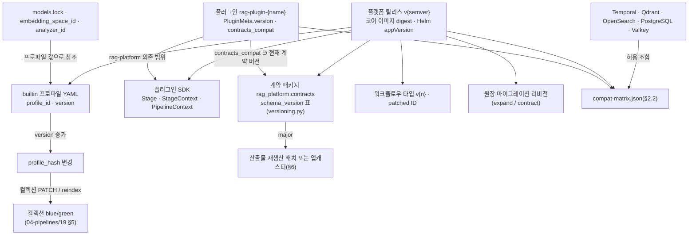
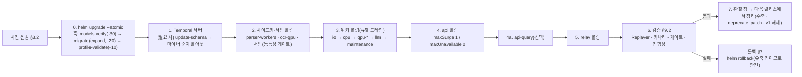
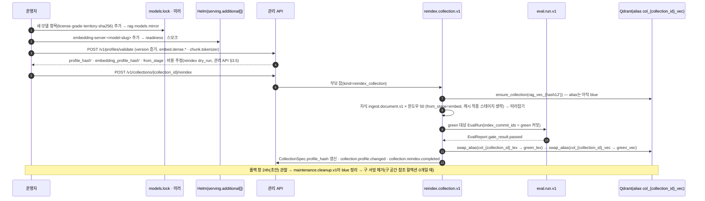
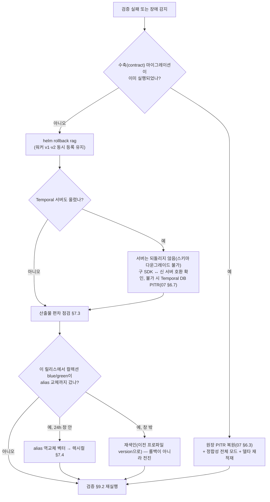

# 업그레이드와 마이그레이션

## 목적

운영 중인 플랫폼을 **검색을 멈추지 않고** 다음 버전으로 옮기는 절차를 확정한다. [배포 아키텍처](../02-architecture/08-deployment-architecture.md) §10이 업그레이드 순서·드레인·롤백의 **원칙**을, [스키마 버전 관리와 호환성](../03-contracts/14-schema-versioning-and-compatibility.md)이 계약 버전의 **규칙**을, [갱신·삭제·재색인](../04-pipelines/19-update-delete-and-reindexing.md)이 컬렉션 blue/green의 **파이프라인 절차**를 정했다. 이 문서는 그 셋을 운영자가 실제로 밟는 **명령 수준의 순서**로 묶고, 그 사이에서 정해지지 않은 것 — 버전 축 사이의 관계, 호환성 매트릭스의 유지, 모델·인덱스 백엔드·산출물 스키마의 마이그레이션, 릴리스 노트가 담아야 할 플래그, 검증 체크리스트 — 를 채운다.

독자는 (1) 릴리스를 배포하는 운영자, (2) 릴리스 노트와 호환성 매트릭스를 작성하는 릴리스 관리자, (3) 임베딩 모델·분석기·인덱스 백엔드를 바꾸려는 플랫폼 담당자다.

## 범위

- 포함: 버전 정책(플랫폼 semver·계약 `schema_version`·플러그인 API·프로파일 버전의 관계), 무중단 업그레이드 순서(원장 확장/수축, Temporal 서버·워커 드레인·`workflow.patched`, `api` 롤링, 사이드카·서빙), 호환성 매트릭스 유지, 모델 업그레이드(새 임베딩 공간 재색인·검증·alias 교체, 같은 공간 서빙 교체), 인덱스 백엔드 메이저 업그레이드(Qdrant·OpenSearch)와 데이터 계층(PostgreSQL·Valkey·Temporal), 산출물 스키마 마이그레이션(재생산 배치·업캐스팅), 롤백, 릴리스 노트 필수 항목과 기계 판독 매니페스트, 검증 체크리스트.
- 제외: 최초 설치와 smoke test([배포 가이드](01-deployment-guide.md)), 장애 복구·PITR·스냅샷 복원 절차 자체([백업과 재해 복구](07-backup-and-disaster-recovery.md)), 계약 변경 분류·호환 매트릭스·폐기 헤더의 정의(03-contracts/14), 세대 사가·blue/green의 알고리즘(04-pipelines/19, 바이블 §11.4), 릴리스 브랜치·태그·서명 파이프라인([릴리스 프로세스](../10-development/08-release-process.md) §3·§5·§7, [CI/CD](../10-development/05-ci-cd.md) §6), 런북 수준의 알림 대응([런북](06-runbooks.md)).
- 정본 관계: 필드·열거·이벤트·오류 코드·워크플로우 타입·큐·엔드포인트는 바이블 §5.7·§6·§11.2·§14의 철자를 그대로 쓴다. 바이블·ADR·상위 문서(08·14·19)가 뒷받침하는 규칙만 `**결정:**`으로 쓰고, 이 문서가 새로 도입하는 것(플랫폼 semver 증분 규칙, 매트릭스·매니페스트 파일, CLI 플래그, 지원 창 기간)은 `**제안:**`으로 표기해 "## 미해결 이슈"에 등재한다. 수치는 바이블 §7.2 값 외에는 모두 **초안 목표**다.
- 표기: 바이블 절 인용은 "바이블 §n", 이 문서 절은 "§n". 외부 제품 버전은 선정 매트릭스 확인일(2026-09-18~22) 기준이며 Helm values의 digest·`compat-matrix.json`(§2.2 제안)이 정본이다.

---

## 1. 버전 정책

### 1.1 한 배포에 공존하는 버전 축

한 클러스터에는 서로 다른 속도로 움직이는 여덟 개의 버전이 동시에 존재한다. 업그레이드는 이 축들 사이의 **허용 조합** 안에서만 진행된다.

| 축 | 식별자 | 어디에 기록되는가 | 무엇이 바뀌면 올라가는가 | 정본 |
|----|--------|-------------------|--------------------------|------|
| 플랫폼(코어) | 릴리스 태그 `v{semver}` = 코어 이미지 `rag-platform:<semver>` + digest, Helm `Chart.yaml appVersion` | `global.imageDigests.ragPlatform`, 이미지 라벨 `org.opencontainers.image.*` | §1.2 규칙 | 바이블 §6.7·§12, 08 §3.5, [저장소 구조](../10-development/01-repository-structure.md) §5(태그) |
| 계약 | `schema_version`(계약별 독립 semver), `$id = urn:rag:schema:{kebab}:{major}` | 모든 봉투 인스턴스, `ArtifactRef.schema_version`, `schemas/`, `GET /v1/schemas/{name}` | JSON Schema 구조 변경(14 §2.1 분류표) | 바이블 §1.2·§5.1·§6.4, 14 §1 |
| 플러그인 API | (a) 코어 SDK 패키지 버전(= 플랫폼 semver; `Stage[In, Out]` 5멤버·`StageContext`·`PipelineContext`), (b) `contracts_compat` 범위(`">=1.0,<2.0"`), (c) `PluginMeta.version` = `Producer.plugin_version` | `pyproject.toml [tool.rag_platform.plugin]`, `Capabilities`, `Producer` | SDK 프로토콜 변경 / 계약 major / 플러그인 **출력에 영향을 주는** 변경(minor 이상) | 바이블 §4.1·§5.3·§5.6, [플러그인 아키텍처](../02-architecture/05-plugin-architecture.md) §8 |
| 프로파일 | `Profile.schema_version` / `Profile.version` / `profile_hash` | YAML, `profiles(profile_id, version)` 테이블, `CollectionSpec.profile_hash`, `IndexCommit`·`QueryPlan`·`ContextPack` | 프로파일 스키마 구조 / 내용 / `extends` 해소·기본값 채움 결과 | 바이블 §5.6·§6.2·§7.4, 14 §8 |
| 워크플로우 | 타입 `{domain}.{entity}.v{n}`(`ingest.document.v1`), `workflow.patched("ingest-v1-<slug>")` 패치 ID | Temporal 워커 등록, 히스토리 | 비호환 로직 변경(타입 증분) / 호환 변경(패치) | 바이블 §6.7, [오케스트레이션과 워크플로우](../02-architecture/06-orchestration-and-workflows.md) §4.2 |
| 원장 스키마 | 마이그레이션 리비전(도구는 미확정, [저장소 구조](../10-development/01-repository-structure.md) 미해결 5) | `src/rag_platform/ledger/migrations/`, 리비전 테이블 | 테이블·컬럼·인덱스·RLS·파티션 | 바이블 §12·§13.1, 08 §10.5 |
| 인프라 | Temporal Server·`temporalio`, Qdrant, OpenSearch + `analysis-nori`, PostgreSQL, Valkey, 서빙·사이드카 이미지 | Helm `externals.*`·`global.imageDigests.*`, 사이드카 `IMAGE_DIGEST` | 벤더 릴리스 | 08 §3.1·§10.4·§10.6, 선정 매트릭스 |
| 모델·분석기 | `models.lock`(`id, revision, sha256`), `embedding_space_id`, `embedding_profile_hash`, `analyzer_id`, `dictionary_hash` | 오브젝트 스토리지 미러 `models/`, `CollectionSpec`, `IndexCommit` | 가중치·revision·차원·프롬프트·양자화·서빙 이미지 / 분석기 엔진·버전·사전 | D-02·D-16, 바이블 §6.1·§6.2·§13.3 |

**결정:** 여덟 축은 서로 잠기지 않는다 — 계약 `schema_version`은 계약별로 독립이고 플랫폼 릴리스 버전과도 독립이며(14 §1.2), 프로파일 `version`은 운영자가 컬렉션 단위로 올리고, 플러그인은 `contracts_compat` 범위로 수용 가능한 계약 버전을 선언한다(바이블 §1.2·§6.4·§7.4; [ADR-0036](../06-adr/0036-naming-and-identifier-conventions.md), [ADR-0031](../06-adr/0031-profile-schema-extends-and-quality-gates.md), [ADR-0032](../06-adr/0032-plugin-sdk-stage-protocol-and-conformance-kit.md)). 축 사이의 **허용 조합**을 기록하는 것이 호환성 매트릭스(§2)이고, 그 조합을 바꾸는 것이 업그레이드다.

### 1.2 플랫폼 semver 증분 규칙(제안)

**제안(미해결 이슈 1):** 브리프·바이블은 플랫폼 릴리스 버전의 증분 규칙을 정하지 않는다. 아래 표는 이 문서의 초안이며 [릴리스 프로세스](../10-development/08-release-process.md) §1.2가 그대로 채택했다(같은 문서가 부속 규칙 (4) "월간 트레인은 항상 MINOR"·(5) "PATCH는 핫픽스에서만"을 더했고, 신규 ADR 발의는 그 문서 미해결 이슈 1). 릴리스 노트 `breaking` 플래그(§8)의 판정 기준으로 쓴다.

| 플랫폼 증분 | 조건(하나라도 해당) | 동반 절차 |
|-------------|---------------------|-----------|
| **MAJOR** | `/v1`이 노출하는 요청·응답 계약(14 §4.4 목록) 중 하나라도 major → `/v2` 개방(14 §4.4 제안); `Stage`·`StageContext`·`PipelineContext` 프로토콜 비호환(플러그인 전부 재빌드); 명명 규약·해시 결합식·오프셋 의미 변경(바이블 §1.2 3행, 14 §2.5); 지원 창 안의 워크플로우 타입 병존이 불가능한 변경 | 마이그레이션 릴리스: §3 순서 + §6 산출물 재생산 배치 + 폐기 창(14 §7.1) |
| **MINOR** | 내부 계약 minor(선택 필드·열거값 추가); 새 플러그인·확장 지점 역할; builtin 프로파일 `version` 증가; 원장 expand 마이그레이션; 새 워크플로우 타입 `v{n}` 병존 도입; `deprecated` 표기 추가 | 표준 롤링(§3) |
| **PATCH** | 계약·프로파일·마이그레이션·워크플로우 히스토리에 영향 없음: 버그 수정, 이미지 재빌드(취약점), 문서, 의존성 pin-and-bump(계약 코퍼스 통과) | 롤링(§3, 축약 가능), `Replayer` 회귀 필수 |

부속 규칙: (1) 플러그인 출력에 영향을 주는 변경(알고리즘·기본값·래핑 라이브러리 버전·번들 네이티브 바이너리)은 `PluginMeta.version` **minor 이상**이어야 한다 — patch로 출력이 바뀌면 지문이 같아 `stage_key` 캐시가 낡은 산출물을 재사용한다(05 §8, 바이블 §15 리스크 #8). (2) 코어 릴리스가 builtin 프로파일의 값을 바꾸면 그것은 코드 변경이 아니라 프로파일 `version` 증가이며, 기존 컬렉션은 `profiles(profile_id, version)` 원장 행에 저장된 이전 버전(`yaml`·`resolved`)에 계속 바인딩된다 — 재바인딩은 §4의 blue/green을 명시적으로 실행할 때만 일어난다(바이블 §7.4·§13.1). (3) 플러그인 `config_schema`의 기본값 변경은 `config_hash`를 바꿔 다음 재처리부터 `stage_key`가 갈리지만 계약 버전을 건드리지 않는다(14 §8 규칙 2).

### 1.3 축 사이의 의존 관계



### 1.4 릴리스 종류

| 종류 | 무엇이 바뀌는가 | 이 문서의 절차 |
|------|-----------------|----------------|
| 기능 릴리스(MINOR) | 코드·내부 계약 minor·expand 마이그레이션·새 워크플로우 타입 병존 | §3 표준 롤링 |
| 핫픽스(PATCH) | 코드·이미지 재빌드 | §3(마이그레이션·Temporal 서버 단계 생략 가능) |
| 마이그레이션 릴리스(MAJOR) | 계약 major, `/v2`, SDK 비호환 | §3 + §6 + 폐기 창 |
| 정리 릴리스 | 수축(contract) 마이그레이션, `workflow.deprecate_patch`, 구 워크플로우 타입 등록 해제, 이전 계약 major 지원 종료 | §3.3 7단계; 실행 조건은 §9.3 |
| 프로파일 릴리스 | builtin 또는 운영자 프로파일 `version` 증가 | 업그레이드가 아니라 컬렉션 blue/green(§4, 19 §5) |
| 모델 릴리스 | `models.lock` 변경(새 가중치·revision·서빙 이미지) | §4 |
| 인프라 릴리스 | 데이터 계층·서빙·사이드카 이미지 | §3.7, §5 |

---

## 2. 호환성 매트릭스 유지

### 2.1 매트릭스 축과 지원 창

| 축(A ↔ B) | 허용 조합 규칙 | 지원 창(초안 목표) | 검증 수단 | 위반 시 동작 |
|-----------|----------------|--------------------|-----------|--------------|
| 코어 ↔ 계약 | 코어가 링크한 계약 패키지 버전 표(`versioning.py`)가 정본. 같은 major 안에서만 롤링, 소비자 minor ≥ 생산자 minor(14 §4.2 행 6·7) | 롤링 편차는 한 릴리스 동안(08 §10.1) | 14 §10 골든 회귀·열거 대조·`SchemaDiffReport` | `contract.violation`(비재시도) → 배포 수정 후 `POST /v1/jobs/{job_id}/retry` |
| 코어 ↔ 플러그인 | `contracts_compat` ∋ 현재 계약 버전 **그리고** 플러그인의 `rag-platform` 의존 범위 ∋ 코어 버전 | 코어 현재 minor + 직전 minor 1개(제안) | 로더 검증 순서 (3)(05 §6), 적합성 키트 | `plugin.capability_unsupported`(422) → 프로파일 로딩 거부 |
| 코어 ↔ Temporal Server / `temporalio` | 매트릭스 확인일 기준 `temporalio` 1.33 ↔ Server 1.32; 호환 창은 매 업그레이드마다 릴리스 노트로 확인(08 §10.4) | 서버 마이너 N-1 ~ N, 건너뛰기 금지 | `Replayer` CI + 스테이징 통합 테스트 | 워커 기동 실패(수집 표면 503, 검색 무영향) |
| 코어 ↔ Qdrant | 클라이언트 ↔ 서버 1.19.x(선정 매트릭스 `vector_index`) | 서버 마이너 N-1 ~ N | 어댑터 계약 코퍼스 + `IndexBackendCapabilities` 재대조(바이블 §7.4 (2)) | `index.backend_unavailable` 재시도 / `plugin.capability_unsupported` |
| 코어 ↔ OpenSearch + `analysis-nori` | 서버 3.8(Lucene 10.5); 플러그인은 서버와 **정확히 같은 버전** | 서버 major N; 마이너 롤링 | 어댑터 계약 코퍼스 + 토큰화 동등성 코퍼스(제안, §5.3) | 렉시컬 채널 제외 + `degraded{channel.lexical, unavailable}` |
| 코어 ↔ PostgreSQL | 마이그레이션 리비전 ↔ 서버 major | 서버 major N-1 ~ N(확인 필요 as of 2026-09) | 마이그레이션 CI(빈 autogenerate) | 마이그레이션 훅 실패 → 설치 중단 |
| Helm 차트 ↔ 코어 | 차트 `{MAJOR}.{MINOR}` = 코어 `{MAJOR}.{MINOR}`, `PATCH`는 차트 독립, `appVersion` = 코어 semver(이 문서 제안을 릴리스 프로세스 §1.1이 채택) | — | `helm lint` + 렌더 스냅샷 | 렌더 실패 |
| 클라이언트 SDK ↔ 서버 | SDK major = 요청·응답 계약 major = API 경로 major; minor 독립(14 §9) | 서버가 클라이언트보다 먼저 배포 | SDK 기능 게이트(`GET /v1/schemas/{name}`) | 400 `contract.violation`(요청 계약) |
| 사이드카 ↔ 코어 | `ConvertRequest`/`ConvertResponse` 계약 major 동일; 이미지 digest는 지문 입력이지 호환 조건이 아님 | — | 사이드카 `/healthz`·계약 코퍼스 | `parse.sidecar_unavailable` → 폴백 체인 |

### 2.2 매트릭스 산출물(제안)

**제안(미해결 이슈 2):** 릴리스마다 `deploy/compat-matrix.json`을 태그와 함께 게시하고, `rag release verify`(08 §9 제안 CLI)가 배포 대상 클러스터의 컴포넌트 버전을 이 파일과 대조한다. 파일 생성은 [CI/CD](../10-development/05-ci-cd.md) §6.1의 `integration-matrix`·`compat-matrix` 잡과 [릴리스 프로세스](../10-development/08-release-process.md) §5.2 게이트 5·13(`rolling_from` ⊇ N-1, `contracts` = `versioning.py`, `supported` ⊇ `tested`)이 맡고, 릴리스 첨부물로 cosign blob 서명된다(릴리스 프로세스 §6.1). `supported`는 §4.3 `contracts_compat`와 같은 비교절 문법을 쓴다. 아래는 발췌 예시(값은 초안이며 확정은 CI 통합 매트릭스 결과다).

```json
{
  "schema_version": "1.0.0",
  "platform_version": "1.4.0",
  "generated_at": "2026-09-22T09:00:00.000Z",
  "rolling_from": [">=1.3.0,<1.4.0"],
  "contracts": {
    "common-types": "1.0.0",
    "parsed-document": "1.1.0",
    "chunk-set": "1.0.0",
    "index-commit": "1.0.0",
    "query-request": "1.0.0",
    "context-pack": "1.0.0",
    "profile": "1.0.0",
    "plugin-meta": "1.0.0"
  },
  "plugin_sdk": {
    "contracts_compat_required": ">=1.0,<2.0",
    "core_dependency": ">=1.3,<2.0"
  },
  "components": [
    {"name": "temporal-server", "supported": ">=1.31,<1.33", "tested": ["1.32"], "notes": "마이너 순차 업그레이드, 건너뛰기 금지"},
    {"name": "temporalio", "supported": "==1.33", "tested": ["1.33"], "notes": "코어 이미지에 고정"},
    {"name": "qdrant", "supported": ">=1.18,<1.21", "tested": ["1.19"], "notes": "named vectors·modifier idf·multivector 능력 재대조"},
    {"name": "opensearch", "supported": ">=3.6,<4.0", "tested": ["3.8"], "notes": "analysis-nori는 서버와 동일 버전"},
    {"name": "postgresql", "supported": ">=16,<18", "tested": ["17"], "notes": "확인 필요(as of 2026-09)"},
    {"name": "valkey", "supported": ">=8,<10", "tested": ["9"], "notes": "캐시 전용, 정본 없음"},
    {"name": "helm-chart", "supported": ">=1.4.0,<1.5.0", "tested": ["1.4.0"], "notes": "차트 minor = 코어 minor 잠금(제안)"},
    {"name": "client-sdk-python", "supported": ">=1.0,<2.0", "tested": ["1.4.0"], "notes": "SDK major = API 경로 major"}
  ],
  "upcasters": []
}
```

`rolling_from`은 이 릴리스로 **직접 롤링**할 수 있는 이전 플랫폼 버전 범위다. 범위 밖(예: 두 minor 건너뛰기)이면 중간 버전을 거치거나 정지 창을 잡는다. `upcasters`는 14 §6.2 lazy 업캐스팅이 채택된 경우 지원 창 안의 `(schema_type, from_major)` 목록이다(채택 전에는 빈 배열).

### 2.3 갱신 절차

1. CI가 릴리스 후보마다 통합 테스트 매트릭스(Temporal × Qdrant × OpenSearch × PostgreSQL 버전 조합, 스테이징 형상)를 실행하고 통과 조합을 `tested`에, 벤더 호환 선언과 결합한 범위를 `supported`에 기록한다. 실패 조합은 `supported`에서 제외한다.
2. 인프라 버전을 올리려면 먼저 매트릭스에 행을 추가하고(테스트 통과), 스테이징에서 §5 절차를 리허설한 뒤 릴리스 노트(§8)에 적는다. 매트릭스에 없는 조합은 운영에 배포하지 않는다.
3. 플러그인 릴리스는 코어 매트릭스에 들어가지 않는다 — 플러그인 자신의 `contracts_compat`·의존 범위가 선언이고 로더가 검증한다(05 §6). 코어 릴리스 노트는 "이 릴리스가 깨뜨리는 `contracts_compat` 상한"만 적는다.
4. 계약 major가 오르면 `contracts` 표의 해당 항목과 `upcasters`(채택 시)를 함께 갱신하고 14 §7.1 폐기 일정을 `deprecations`(§8.2)에 적는다.

---

## 3. 무중단 업그레이드 순서

### 3.1 원칙

**결정:** 업그레이드는 "원장 확장 → Temporal 서버 → 사이드카·서빙 → 워커 → `api` → `relay` → 검증 → 정리 릴리스" 순서로 진행하고, 구·신 버전이 **한 릴리스 동안 공존**할 수 있어야 한다. 계약 `schema_version` major가 같은 범위 안에서만 롤링이 허용되며 major 변경은 바이블 §1.2 절차를 거친 별도 마이그레이션 릴리스다. 수축(contract) 마이그레이션 전에는 `helm rollback`이 항상 안전하다(08 §10.1·§10.5; [ADR-0003](../06-adr/0003-orchestrator-neutral-pipeline-and-non-durable-local-runner.md), [ADR-0026](../06-adr/0026-index-commit-generation-saga-and-ledger.md)). 사이드카·서빙을 워커 앞에 두는 것은 이 문서의 정밀화다 — 워커가 첫 호출 전 `/healthz`에서 읽는 `image_digest`가 롤링 도중 바뀌지 않게 하고(08 §3.5), 신 워커가 요구하는 서빙 엔드포인트가 먼저 준비되도록 한다.

검색 가용성이 우선한다(08 P6): 이 절의 모든 단계에서 `api`의 readiness는 프로파일 캐시와 `hydrate` 백엔드(Qdrant)만 요구하고, 원장·Temporal·OpenSearch·Valkey의 순단은 수집 표면의 503(`Retry-After`) 또는 `degraded`로만 나타나야 한다.

### 3.2 사전 점검(pre-flight)

| # | 점검 | 방법 | 실패 시 |
|---|------|------|---------|
| 1 | 릴리스 노트 플래그 | `breaking`, `reindex_required[]`, `profile_hash_changes[]`, `contract_changes[]`, `migrations.contract[]`(§8) 확인. `breaking=true`면 이 절 대신 마이그레이션 릴리스 계획 | 배포 보류 |
| 2 | 호환성 매트릭스 | `rag release verify`(제안): 클러스터 컴포넌트 버전 ∈ `supported`, 현재 플랫폼 버전 ∈ `rolling_from` | 중간 버전 경유 또는 인프라 선행 업그레이드 |
| 3 | 백업 기준점 | 원장 PITR 기준 시각 기록, Qdrant·OpenSearch 스냅샷 1회(07 §2), Temporal 두 DB 백업 | 백업 완료 전 배포 금지 |
| 4 | 산출물 인벤토리 | 계약 minor가 오르는 릴리스면 §6.2 조회로 현재 `schema_version` 분포를 기록(롤백 시 거부 대상 파악, 14 §2.4) | — |
| 5 | 스테이징 리허설 | 같은 차트·같은 digest·`values-env-staging.yaml`로 동일 절차 실행, `Replayer`(스테이징 채집 히스토리)·카나리 테넌트·소형 골든셋 게이트 통과(08 §8) | 배포 보류 |
| 6 | 프로파일 | 스테이징·운영 프로파일 YAML 바이트 동일, `rag profile validate` 통과(01 §5.3) | 배포 보류 |
| 7 | 진행 중 잡 | `GET /v1/jobs?state=running`으로 `reindex_collection` 부모 잡 유무 확인. alias 교체(19 §5.2 단계 6) 진행 중이면 완료 대기 — 부모는 `continue_as_new` 경계에서 신 워커로 자연 이관되므로 백필 중 롤링은 허용 | 대기 |
| 8 | 백로그 | KEDA 큐 깊이·`rag_outbox_lag_seconds`가 SLO 안일 때 시작(피크 회피 창) | 창 재조정 |
| 9 | 변경 불가 파라미터 | Temporal `numHistoryShards`, Qdrant 컬렉션 생성 파라미터(HNSW `m`, `on_disk`)처럼 생성 후 변경 불가한 값이 릴리스에 있는지 — 있으면 재생성 절차(§5)가 필요 | 별도 계획 |
| 10 | 모델 미러 | `models.lock` 변경이 있으면 `rag models mirror`로 미러 선행 적재(에어갭은 매체 반입) — `models-verify` 훅이 존재·sha256·`LICENSE`·등급을 검증한다(08 §4.4) | 훅 실패로 설치 중단 |

### 3.3 단계별 절차(`standard`·`premium`)



| 단계 | 대상 | 동작 | 완료 판정 | 실패 시 |
|------|------|------|-----------|---------|
| 0 | Helm 릴리스 | `helm upgrade rag oci://…/rag-platform --version <new> -f values-standard.yaml -f values-env-prod.yaml --atomic --timeout 30m`. `pre-upgrade` 훅이 `hook-weight` 순으로 `models-verify` → `migrate`(expand만) → `profile-validate`를 실행(08 §4.4) | 세 Job `Succeeded` | `--atomic`이 자동 롤백; expand는 구버전과 호환이므로 스키마 되돌림 불필요 |
| 1 | Temporal 서버(릴리스가 요구할 때만) | `temporal-sql-tool update-schema`를 기본·가시성 DB에 각각 실행 → frontend/history/matching을 **마이너 버전 순차**로 롤아웃(건너뛰기 금지; 08 §10.4) → 워커 long-poll 재연결 확인 | 워커 폴러가 모든 큐에 재등록 | 서버 스키마는 다운그레이드 불가 → PITR 복원(07 §6.7) |
| 2 | 사이드카·서빙 | `parser-workers`(HPA, `minReplicas` 2) 롤링 → `ocr-gpu`(premium) 롤링 → 서빙은 §3.7 규칙(같은 공간은 동등성 게이트 후 `serving.additional[]` → URL 전환) | `/healthz`가 새 `image_digest` 응답 | 폴백 체인이 흡수(`parse.sidecar_unavailable` → 다음 어댑터); 서빙은 구 인스턴스 유지 |
| 3 | 워커 | 큐별 Deployment 순서 `worker-io` → `worker-cpu` → `worker-gpu-embed`(→ `worker-gpu-ocr`, `worker-llm`) → `worker-maintenance`. 드레인 규칙은 §3.5. 신 워커는 진행 중 타입(v1)·패치 분기·새 타입(v2)을 **모두** 등록 | 신 파드가 큐 폴링 시작, 구 파드 종료, KEDA `minReplicaCount` 유지 | 파드 크래시루프면 해당 큐만 롤백; 진행 중 액티비티는 하트비트 타임아웃 후 재시도·재개 |
| 4 | `api` | `RollingUpdate{maxSurge: 1, maxUnavailable: 0}`, PDB `minAvailable` 1(premium 2); readiness = 프로파일·컬렉션 스펙 캐시 + Qdrant 도달(08 §10.2) | 전 파드 Ready, `GET /v1/schemas/common-types` ETag가 신 스키마 | 롤백은 Deployment 단위 |
| 4a | `api-query`(`api.querySplit.enabled`) | `api` 완료 후 같은 방식. 검색 전용이므로 마지막에 교체해 검색 가용성을 최대화 | 동일 | 동일 |
| 5 | `relay` | 롤링. 상주 워크플로우 `outbox-relay`의 액티비티가 신 워커로 재스케줄; 릴레이는 at-least-once이므로 재전송은 소비자 `event_id` 멱등이 흡수 | `rag_outbox_lag_seconds` SLO 복귀 | 구 릴레이 유지 |
| 6 | 검증 | §9.2 체크리스트 | 전 항목 통과 | §7 롤백 |
| 7 | 정리(다음 릴리스) | `migrate`(contract) → `workflow.deprecate_patch` → v1 타입 등록 해제 → 이전 계약 major 산출물 지원 종료 | §9.3 실행 조건 충족 확인 후에만 | 수축 후 롤백은 PITR(§7.2) |

### 3.4 원장 마이그레이션: expand / contract

**결정:** 마이그레이션은 확장(expand)과 수축(contract)으로 나누고 수축은 **다음 릴리스**의 정리 단계에서만 실행한다. 확장만 적용된 상태에서 구·신 코드가 모두 동작하므로 `helm rollback`이 항상 가능하다. 새 테넌트 스코프 테이블은 마이그레이션 안에서 `ENABLE ROW LEVEL SECURITY` + `FORCE`와 정책을 함께 적용하며 정책 누락은 마이그레이션 실패다(08 §10.5, 01 §5.1; 배포 결정의 ADR 등재는 08 미해결 이슈 1).

| 단계 | 시점·주체 | 허용되는 변경 | 금지되는 변경 | 규칙 |
|------|-----------|---------------|---------------|------|
| expand | 릴리스 N `pre-upgrade` 훅 `migrate`(`rag ledger migrate --expand-only`, 플래그는 제안), 소유자 역할 `rag_owner` | 테이블·컬럼(NULL 허용 또는 `DEFAULT`) 추가, `CREATE INDEX CONCURRENTLY`, 새 RLS 정책(`ENABLE`+`FORCE` 동시), 이중 쓰기 트리거, 파티션 선생성(`job_events`·`audit_log` 월, `outbox` 일), 뷰 추가 | 컬럼 제거·개명, 타입 축소, `NOT NULL` 승격, 제약 강화, 대형 테이블 잠금 DDL(`ALTER … TYPE` 재작성) | 리비전은 멱등·재실행 안전; `lock_timeout`·`statement_timeout` 명시; `CONCURRENTLY`는 트랜잭션 밖 |
| backfill | 릴리스 N 배포 뒤, `maintenance` 큐 배치 잡 또는 CLI(제안) | 새 컬럼 채움, 파생 값 계산 | 단일 트랜잭션 전체 갱신 | 배치 1,000~10,000행(초안), 진행 위치 기록, 재시작 가능, RLS 아래 테넌트 단위 순회(`SET LOCAL app.tenant_id`) |
| contract | 릴리스 N+1 정리 단계 `migrate`(`--contract`, 제안) | 구 컬럼·인덱스·트리거 제거, `NOT NULL` 승격(백필 100% 확인 후), 뷰 교체 | 릴리스 N과 같은 릴리스에서 실행 | 실행 조건은 §9.3; 실행 후 롤백은 PITR |

Temporal 영속화 DB는 이 절의 대상이 아니다 — `temporal-sql-tool update-schema`(§3.3 1단계)가 별도로 관리하며 다운그레이드가 없다. `outbox`·`job_events`의 파티션 전환·보존 정리는 마이그레이션이 아니라 `maintenance.cleanup.v1`의 몫이다(19 §7.1 (5)).

### 3.5 워커 드레인과 워크플로우 코드 버전

**결정:** 드레인은 "짧은 액티비티는 완료, 긴 액티비티는 재개 가능 지점까지"다 — SIGTERM을 받은 워커는 폴링을 중단하고 진행 중 액티비티만 마무리하며, 유예 안에 끝나지 않는 액티비티(OCR 최대 60m, 임베딩 20m)는 끝내지 않고 하트비트 타임아웃(60s) 후 다른 워커가 `heartbeat_details`로 재개한다(`Resumable`, 바이블 §4.4·§11.3, 08 §10.3; [ADR-0003](../06-adr/0003-orchestrator-neutral-pipeline-and-non-durable-local-runner.md)). 진행 중 실행과 호환되는 워크플로우 변경은 `workflow.patched`, 비호환 변경은 타입 증분(`ingest.document.v2`)이다(06 §4.2).

| 항목 | 규약 |
|------|------|
| 유예(`terminationGracePeriodSeconds`, 초안) | `ingest-io` 60s, `ingest-cpu` 120s, `ingest-gpu-*`·`ingest-llm` 120s, `maintenance` 300s(08 §10.3) |
| 순서 | `worker-io` → `worker-cpu` → `worker-gpu-*` → `worker-llm` → `worker-maintenance`; 재색인 부모는 `continue_as_new` 경계에서 이관 |
| 사가 | `stage.index` 도중 종료는 `index_commits.status`가 재시도 지점을 결정한다 — 플립 전은 `record_id` 멱등 upsert 재시도, `flipping_*`는 상태 재개(바이블 §11.4) |
| KEDA | 스케일인은 인플라이트를 세지 않으므로 `cooldownPeriod` 300s + 위 유예·재개 규칙으로 안전성 확보; `minReplicaCount: 1` 유지 |
| 호환 변경 | 릴리스 N: `if workflow.patched("ingest-v1-<slug>"):` 새 분기 → 확인: 가시성 조회로 패치 전 코드로 시작된 `Running` 실행 0건 → 릴리스 N+1: `workflow.deprecate_patch("ingest-v1-<slug>")` → 릴리스 N+2: 분기 제거 |
| 비호환 변경 | API·디스패처는 새 잡을 `ingest.document.v2`로 시작, 워커는 v1·v2 동시 등록, `POST /v1/jobs/{job_id}/retry`는 **원 잡의 타입**으로 새 run 시작, v1 `Running` 0건 확인 후 정리 릴리스에서 v1 등록 해제 |
| 결정론 | 업그레이드 전 스테이징 채집 히스토리로 `Replayer` 회귀(CI 게이트, 바이블 §11.6); 운영 히스토리 표본 재생은 §9.2 |
| Worker Versioning(Build ID) | 도입 보류(06 §4.2, 14 미해결 14) — 확인 필요(as of 2026-09); 확인 후 `patched` 절차의 대체 수단으로 ADR |
| 계약 편차 | 롤링 중 구 워커가 신 minor 산출물을 읽으면 `contract.violation`(14 §4.2 행 7, 비재시도)으로 드러난다. 배포가 끝난 뒤 `POST /v1/jobs/{job_id}/retry`로 복구한다. 두 릴리스 규칙(소비자 선배포, 14 §2.4)이 채택되면 이 편차는 발생하지 않는다(미해결 이슈 5) |

### 3.6 `api` 롤링

| 항목 | 규약 |
|------|------|
| 전략 | `RollingUpdate{maxSurge: 1, maxUnavailable: 0}`, PDB `minAvailable: 1`(premium 2), `terminationGracePeriodSeconds` 30s, `preStop` 5s 대기 후 uvicorn graceful shutdown(08 §10.2) |
| readiness | `GET /readyz` = 프로파일·컬렉션 스펙 캐시 적재 + Qdrant 도달만. OpenSearch·PG·Temporal·Valkey는 넣지 않는다(P6) |
| SSE | 서버가 연결을 닫으면 클라이언트가 `Last-Event-ID`로 `/v1/jobs/{job_id}/events`·`/v1/events`에 재접속; 릴레이가 PG `NOTIFY outbox_published`로 팬아웃하므로 인스턴스 교체와 무관 |
| MCP | 세션이 없고(D-13) 커서는 Valkey `cursor:{tenant}:{ulid}` 핸들이므로 인스턴스 교체에 영향 없음 |
| 멱등성 | `Idempotency-Key` 판정 정본은 PG `idempotency_keys(tenant_id, key)`라 인스턴스 무관(D-08) |
| 요청 계약 minor | 구 `api`는 새 선택 필드를 400 `contract.violation`으로 거부한다(14 §2.2 부류 B). 롤링 창 동안 클라이언트는 새 필드를 쓰지 않는다 — SDK는 `GET /v1/schemas/{name}`의 `properties`로 기능 게이트(14 §9) |
| 스키마 게시 | `GET /v1/schemas/{name}`은 배포된 빌드의 파일 그대로이므로 롤링 중 인스턴스마다 다른 ETag가 나올 수 있다. 신 스키마 게시 시점 = `api` 롤링 완료(§3.3 4단계 완료 판정) |
| 디스패처 | `api` 프로세스 안에서 PG advisory lock으로 직렬화되므로 다중 버전 동시 실행이 무해하다(바이블 §11.2) |
| 관리 표면 | `PATCH /v1/collections/{collection_id}`처럼 blue/green을 유발하는 호출은 롤링 중에 하지 않는다(운영 규칙) |

### 3.7 사이드카·서빙 롤링

| 대상 | 방식 | 지문·캐시 영향 | 주의 |
|------|------|----------------|------|
| `parser-workers` | HPA 롤링(`minReplicas` 2). Helm이 `global.imageDigests.parserWorkers`를 `IMAGE_DIGEST`로 주입, `/healthz`가 응답 | 새 digest → `parser_fingerprint_hash` → 새 문서·재처리부터 새 `stage_key`. 기존 산출물은 유효(14 §6.3 파서 minor·patch 행: 스케줄 없음). 파생물 캐시 `H("derived", content_hash, sidecar_image_digest)`는 미스 → 재변환 비용만 | 파서 **major**(블록 경계·`element_path` 변경 가능)는 릴리스 노트 `reindex_required{from_stage: parse}` + 운영자 스케줄(§6.3) |
| `ocr-gpu`(premium) | 롤링; 페이지 단위 `Resumable`이라 중단 페이지는 재개 | 동일(`model_ids`·`image_digest`) | 모델 교체는 CER/WER 게이트([ADR-0008](../06-adr/0008-ocr-default-rapidocr-ppocrv5-korean.md)) |
| `lo-sidecar`·AGPL 사이드카(opt-in) | 별도 저장소 `rag-platform-gpl-sidecars`의 독립 태그·digest; `optIn.*.digest` 갱신, `acknowledgeLicense: true` 유지 | 동일 | 네임스페이스 `rag-optin` egress 0 유지 |
| `embedding-server`(같은 공간) | 스테이징 동등성 게이트(`ingest.embed.equivalence_gate` — 코사인 ≥ 0.9999, 표본 1,000) 통과 → `serving.additional[]`로 신 인스턴스 → 소비자(`worker-gpu-embed`·`api`)의 `RAG_SIDECAR__EMBEDDING_SERVER_URL`(제안 필드) 전환 → 구 인스턴스 제거 | `embedder_fingerprint`(`image_digest`)만 변경; `embedding_space_id` 불변이라 청크 캐시 `H("embed", …)`·질의 캐시 `qemb:{space}:{hash}` 전부 적중 → 재임베딩 비용 0(08 §6.3) | 게이트 실패는 "다른 공간"이다 → §4.2 |
| `embedding-server`(다른 공간) | §4.2 절차 | `embedding_space_id`·`embedding_profile_hash` 변경 → 컬렉션 blue/green | 구 인스턴스는 구 공간을 쓰는 컬렉션이 0개일 때만 제거 |
| `reranker-server` | 이미지만 교체: 롤링, 무영향. 모델 교체: 프로파일 `query.rerank.model_id` → `profile_hash` 변경 → 재색인 0건 blue/green(바인딩 교체, 14 §6.4) + 게이트(`dragonkue` +2pt) | 지문 무영향(질의 측) | 구·신 인스턴스 병존 후 전환; `rr:{model}:{hash}` 캐시는 모델 키라 자연 분리 |
| `sparse-encoder-server`(ko-quality) | 임베딩 서버와 같은 규칙 | `embedding_space_ids.sparse_learned` | 엔진 미확정(08 미해결 17) |
| `otel-collector` | 게이트웨이 2 replica 롤링 | 없음 | 파이프라인 설정 변경 시 redaction 회귀(콘텐츠 캡처 `none`) 확인 |

### 3.8 `lite`

`lite`는 compose 단일 노드라 롤링이 없다. `rag up --profile lite --durable`을 새 digest로 재실행하면 (1) `migrate`(expand) → (2) `temporal` 단일 바이너리 교체(스키마 도구 선행; 이 창에는 수집만 중단되고 검색은 계속) → (3) `app` 재기동(단일 컨테이너이므로 수 초~수십 초 검색 중단, 초안) 순서로 진행된다(08 §10.4·01 §8). 개발 모드(`LocalRunner`)는 비내구이므로 재기동 시 진행 중 잡은 `failed`가 되고 클라이언트가 재시도한다(바이블 §11.1).

---

## 4. 모델 업그레이드 절차

### 4.1 모델 변경 분류

**결정:** 모델·분석기 변경은 업그레이드가 아니라 **프로파일 `version` 증가 → `profile_hash` 변경 → 컬렉션 blue/green**이며, 물리 재색인 범위는 바뀐 지문이 정한다(바이블 §7.4·§11.4 (5), 14 §6.3·§6.4, 19 §5.1; [ADR-0031](../06-adr/0031-profile-schema-extends-and-quality-gates.md), [ADR-0009](../06-adr/0009-embedding-serving-vllm-pooling-tei-inprocess.md), [ADR-0014](../06-adr/0014-sparse-representation-bge-m3-lexical-leg-kept.md), [ADR-0019](../06-adr/0019-chunk-size-tokenizer-defaults-and-recount-stage.md)). 예외는 같은 공간 안의 서빙 교체 하나뿐이다(동등성 게이트, D-16).

| 변경 | 바뀌는 식별자 | 최소 `from_stage` | 물리 전환 | 게이트 |
|------|---------------|-------------------|-----------|--------|
| 같은 공간의 서빙 스택 교체(이미지·엔진) | `embedder_fingerprint`(`image_digest`) | 없음(다음 세대부터 지문만) | 없음 — `serving.additional[]` → URL 전환(§3.7) | 코사인 ≥ 0.9999, 표본 1,000(`ingest.embed.equivalence_gate`) |
| dense 모델·revision·차원·정규화·프롬프트·양자화 | `embedding_space_id` → `embedding_profile_hash` | `embed`(+ `recount`: 새 임베더 `tokenizer_id`가 `token_counts`에 없을 때) | 벡터 blue/green `rag_vec_{hash12'}` + alias `col_{collection_id}_vec` | 프로파일 `eval.gates`(nDCG@10 ≥ 0.80, Recall@20 ≥ 0.92, `standard`); `ko-quality` 교체는 nDCG@10 +2p(D-16) |
| 토크나이저가 다른 dense 모델(예: XLM-R 계열 → Qwen3 계열) | 위 + `ingest.chunk.tokenizer`(바이블 §7.4 (4) 일치 규칙) → `primary_tokenizer_id` → `chunker_config_hash` → 모든 `chunk_id` | `chunk` | 벡터 blue/green; 렉시컬은 물리 이름 불변(§4.3) | 동일 + 청크 그리드 재검증(O-09) |
| sparse 모델(`vocab_id`) | `embedding_space_ids.sparse_learned` | `embed`(dense 캐시는 적중, sparse만 미스) | 벡터 blue/green | ADR-0014; `vocab_id` 불일치는 `embed.space_mismatch` |
| `late_interaction` 슬롯 켬 | `embedding_space_ids.late_interaction` 추가 | `embed` | 벡터 blue/green; `supports_multivector=false` 백엔드는 자동 비활성 + `degraded` | O-04 M2 비교([ADR-0010](../06-adr/0010-bge-m3-rationale-and-late-interaction-slot.md)) |
| 리랭커 모델 | 프로파일 `query.rerank.model_id`·`backend` → `profile_hash` | 없음 | 바인딩 교체(재색인 0건) + 서빙 병존 | `dragonkue` +2pt; Qwen3-Reranker 기본 승격은 +3pt & p95 800ms |
| OCR 엔진·모델 | `parser_fingerprint_hash`(`model_ids`·`image_digest`) | `parse`(스캔·혼합 문서만, `SourceKind` ∈ {scanned, mixed, pre_ocr}) | 문서 세대 플립(물리 이름 불변) | CER/WER([ADR-0008](../06-adr/0008-ocr-default-rapidocr-ppocrv5-korean.md)) |
| 분석기·사전(mecab-ko → Kiwi 승격, 사전 항목 갱신) | `analyzer_id`·`dictionary_hash` → `normalizer_fingerprint`·`lexical_profile_hash`(`lite`는 `sparse_bm25` 공간도) | `normalize`(벡터는 임베딩 캐시 적중) | 렉시컬 blue/green `rag_lex_{hash12'}` + alias `col_{collection_id}_lex`; `standard`의 Qdrant는 물리 이름 불변(§4.3) | 골든셋 게이트([ADR-0021](../06-adr/0021-korean-analyzer-kiwi-promotion-and-interim-mecab-kss.md)) |
| LLM 보강 모델·프롬프트(옵트인 컬렉션) | `enricher_fingerprint`(`model_id`·`prompt_hash`) | `enrich` | 세대 플립 | nDCG@10 +0.03 & 문서당 비용 상한(O-05) |
| 렌더 지시문 템플릿 `rag-answer-ko@{n}` | 스키마·지문 무관 | 없음 | 90일 병존(14 §7.1 제안) | `EvalRun` 재실행(LLM-judge) |

### 4.2 새 임베딩 공간으로의 전환



| 단계 | 동작 | 검증 |
|------|------|------|
| 1 모델 등록 | `models.lock`에 `id, revision, sha256, license, grade, territory, format, consumers` 추가(D 등급은 프로파일 `model_license_ack: true` 필수); `rag models mirror`로 미러 적재; 에어갭은 매체 반입 | `models-verify` 훅 통과; `LICENSE` 존재 |
| 2 서빙 준비 | `serving.additional[]`에 모델당 Deployment 1개(08 §6.3). 엔진 규칙: BGE-M3 3-in-1은 vLLM pooling, dense 전용은 TEI | 임베딩 스모크(차원·정규화·프롬프트), VRAM 여유 |
| 3 프로파일 개정 | 새 `version`; `ingest.embed.dense.{model_id, revision, dim, normalized}`, 필요 시 `ingest.embed.sparse`, `ingest.chunk.tokenizer`(임베딩 모델 토크나이저와 일치, 바이블 §7.4 (4)); `pack.tokenizer`는 대상 LLM이라 무관 | `POST /v1/profiles/validate`([관리 API](../05-api/04-management-api.md) §4.2): 바이블 §7.4 (2) `capabilities()` 대조, (4) 토크나이저 일치, (8) `embedding_space_ids` 재계산 |
| 4 영향 판정 | 응답의 해시 비교: `embedding_profile_hash'` ≠ 현재 → 벡터 blue/green; `lexical_profile_hash` 불변 → §4.3 주의; `from_stage`는 19 §3.2 표 | `POST /v1/collections/{collection_id}/reindex {dry_run: true}`(관리 API §3.5; 응답 `ReindexEstimate`는 제안) 비용·벽시계 추정(19 §5.6) — GPU 초·저장량 2배 기간 확인 |
| 5 재색인 시작 | `POST /v1/collections/{collection_id}/reindex`(요청 본문 `profile_id`·`profile_version`·`from_stage`·`dry_run`·`reindex_max_share`는 관리 API §3.5가 19 미해결 10 제안을 채택) 또는 `PATCH /v1/collections/{collection_id}`로 프로파일 변경 | `JobStatus{kind=reindex_collection, progress{unit: document}}` |
| 6 백필·따라잡기 | 자식 `ingest.document.v1`이 `stage_key` 캐시 적중 스테이지를 생략하고 `embed`부터 실행, green에 `committed`(포인터 미전진); 재색인 중 수집은 blue에만 쓰고 델타 패스가 흡수(19 §5.4) | 정합성 사전 검사: green 커밋 수 = 활성 문서 수 |
| 7 게이트 | `eval.run.v1`이 green을 대상으로 실행 → `EvalReport.gate_result{passed, failed_gates[]}`; 골든셋이 없으면 샘플 질의 비교(보조, 운영자 승인) | `passed=true`만 교체; 실패 시 green 폐기 예약, `collection.reindex.completed{gate_passed=false}` |
| 8 alias 교체 | 렉시컬 → 벡터 순서 고정(바이블 §11.4 (5)); Qdrant `update_collection_aliases` 1요청 | `ContextPack.diagnostics.index_generations_seen` 혼합 관측 |
| 9 캐시 | `collection.profile.changed` → `collspec:{collection_id}` 무효화; `plan:{tenant}:{profile_hash}:{hash}`는 키에 해시가 있어 자연 분리; `qemb:{space}:{hash}`는 새 공간 키 | `rag_query_latency_seconds` p95(캐시 콜드 구간) |
| 10 관찰·정리 | 롤백 창 24h(초안) 뒤 `maintenance.cleanup.v1`이 blue 정리(공유 물리 컬렉션은 이 컬렉션 레코드만 `delete_by_filter`); 구 서빙 인스턴스는 구 `embedding_space_id`를 쓰는 컬렉션이 0개일 때 제거 | `GET /v1/collections/{collection_id}/stats` |

### 4.3 물리 이름이 바뀌지 않는 백엔드

**미정(19 미해결 이슈 1, O-xx 미배정):** 물리 이름은 `rag_vec_{embedding_profile_hash[:12]}`·`rag_lex_{lexical_profile_hash[:12]}`에서만 파생되므로(바이블 §13.4) 임베더만 바꾸면 OpenSearch가, 분석기·사전만 바꾸면 `standard`의 Qdrant가 green 이름을 갖지 못한다. 19 §5.2 단계 3은 그런 백엔드에서 서빙 중 문서 단위 플립을 채택하지 않으며, 확정 전에는 `ledger.begin_reindex`가 부모 잡을 `failed`로 종료한다. 운영자의 잠정 선택지는 19 §5.5와 같다: (가) 변경을 두 해시가 모두 바뀌는 변경에 묶어 배포(예: 임베더 교체 + 사용자 사전 항목 추가), (나) 새 컬렉션을 만들어 같은 원천을 재수집하고 클라이언트 `collection_id`를 전환(바이블 규약만으로 가능한 유일한 경로), (다) ADR 확정 후 물리 이름에 `profile_hash[:12]`를 합성하는 해소안 (a). 이 문서는 19의 (a) 권고에 동의한다(미해결 이슈 4). 모델 업그레이드 계획은 이 판정을 §4.2 4단계에서 먼저 내린다.

### 4.4 여러 컬렉션·여러 테넌트의 모델 전환

- 임베딩 공간은 컬렉션 간 공유 물리 컬렉션(`rag_vec_{hash12}`)을 만든다. 같은 프로파일을 쓰는 컬렉션은 **컬렉션마다** `reindex.collection.v1`을 실행해야 하며(`CollectionSpec`은 컬렉션 단위 바인딩), 첫 컬렉션이 green 물리 컬렉션을 만들고 나머지는 `ensure_collection` 파라미터 대조 후 재사용한다(19 §5.2 단계 1).
- 병렬 재색인 수는 `runtime.tenant_concurrent_jobs_max`(`standard` 32)와 `reindex_max_share`(제안)에 걸린다. 검색 p95 악화 ≤ 10%(초안)를 넘으면 동시 컬렉션 수를 줄인다(19 §5.6).
- 구 공간의 서빙 인스턴스는 마지막 컬렉션의 롤백 창이 끝난 뒤 제거한다. 그 전에 제거하면 롤백(§7.4)이 불가능하다.

---

## 5. 인덱스 백엔드 메이저 업그레이드

### 5.1 공통 원칙

**결정:** 원장(`documents`·`index_commits`·`artifacts`)이 진실이고 인덱스는 재구성 가능한 투영이다. 백엔드 메이저 업그레이드의 기본 경로는 **병렬 클러스터 + 산출물 재적재(replay) + 엔드포인트 전환**이며, 제자리(in-place) 업그레이드는 벤더가 스토리지 포맷 호환을 보장하는 마이너·패치에만 쓴다. 스냅샷 복원은 시간 단축용 2순위다(바이블 §2.1 K6·§11.4 (4), 07 §5; [ADR-0026](../06-adr/0026-index-commit-generation-saga-and-ledger.md), [ADR-0034](../06-adr/0034-retrieval-hot-path-postgres-independence-and-hydrate.md)).

| 전략 | 언제 | 방법 | 검색 영향 |
|------|------|------|-----------|
| A. 제자리 롤링 | 마이너·패치, 사본 ≥2 | 노드 순차 재시작(08 §10.6) | 없음(사본 유지) |
| B. 제자리 메이저 + 스냅샷 | 벤더가 N-1 → N 데이터 호환을 문서로 보장할 때 | 스냅샷 → 롤링 업그레이드 → 정합성 전체 모드 | 노드 재시작 창의 사본 감소 |
| C. 병렬 클러스터 + 재적재(기본) | 메이저, 포맷 호환 미보장, `numHistoryShards`류 변경 불가 파라미터 변경 | 새 클러스터 → 전 컬렉션 `reprocess.document.v1 {from_stage: index}` 팬아웃(GPU 불필요, 07 §5.1) → 정합성 전체 → `externals.qdrant.url`/`externals.opensearch.url` 전환(`api`·워커 재기동) → 구 클러스터 롤백 창 보존 → 삭제 | 재적재 중 없음(구 클러스터 서빙); 전환 순간 `api` 롤링 1회 |

사전 조건(전략 무관): (1) 새 서버 버전으로 어댑터 계약 코퍼스와 `capabilities()` 재대조 — named vectors·`modifier: idf`·`MultiVectorConfig`·payload 인덱스·`is_tenant`(Qdrant), `analysis-nori` 옵션·DLS·filtered alias·`routing`(OpenSearch)이 유지되는지; (2) 매트릭스 행 추가(§2.3); (3) 스냅샷 1회(07 §2) — 구 major 스냅샷은 신 major에서 복원되지 않을 수 있으므로(07 §5.1 실패 모드) 재적재 준비가 필수; (4) 스테이징 리허설에서 `T_replay` 실측(07 §5.2 산정: `standard` 100만 청크 약 25분, 초안).

### 5.2 Qdrant

| 항목 | 마이너(1.19.x → 1.19.y, 1.20) | 메이저(전략 C) |
|------|-------------------------------|----------------|
| 방식 | `replication_factor: 2`, `write_consistency_factor: 1`에서 노드 순차 재시작(08 §10.6) | 새 클러스터 기동 → 컬렉션·alias는 재적재가 `ensure_collection`·alias 생성으로 재구성 → 전 컬렉션 재적재 → 정합성 전체 모드 → `externals.qdrant.url` 전환 |
| 데이터 호환 | 벤더 릴리스 노트 확인(확인 필요 as of 2026-09) | 가정하지 않음 |
| alias | `col_{collection_id}_vec` 영향 없음 | 새 클러스터에서 재생성; 전환 전까지 구 클러스터가 서빙 |
| 키 | — | `point_id = uuid5(NAMESPACE_RAG_CHUNK, record_id)`가 결정적이라 재적재는 멱등이며 손실 전과 같은 `record_id`·세대를 재현할 수 있다(단, `reprocess from_stage=index`는 새 세대 N+1을 만든다 — 07 §5.1) |
| 재확인 능력 | — | `supports_multivector`, `supports_alias_swap`, `supports_payload_only_points`, 테넌트별 IDF(`modifier: idf`), `is_tenant` payload 인덱스, ACORN |
| 검색 영향 | 없음 | 재적재 중 없음; 전환은 `api` 롤링 1회(readiness가 Qdrant 도달을 요구하므로 새 URL 도달 확인 후) |
| `lite` | 단일 노드 → 다운타임 수 분(검색 중단), 스냅샷 선행 | 동일; 규모가 작아 재적재로 충분 |

### 5.3 OpenSearch

| 항목 | 마이너·패치(3.8.x → 3.8.y, 3.9) | 메이저(3.x → 4.x, 가정) |
|------|---------------------------------|--------------------------|
| 방식 | 롤링 재시작: `cluster.routing.allocation.enable: primaries` → 노드 재시작(`analysis-nori`를 서버와 **같은 버전**으로 동시 설치) → 복구 대기 → 다음 노드(08 §10.6) | Lucene 인덱스 호환은 일반적으로 직전 major까지(확인 필요 as of 2026-09) → 전략 B가 가능해도 아래 `analyzer_id` 판정을 먼저 한다 |
| `analyzer_id` | `nori:{version}:{dictionary}`(바이블 §6.1)의 `version`이 바뀌므로 명명 규약상 `analyzer_id`가 바뀐다 → `lexical_profile_hash` 변경 → 렉시컬 blue/green `rag_lex_{hash12'}`(14 §6.3, 19 §5.1) | 동일 |
| 판정(제안) | 토큰화 동등성 코퍼스(제안, 미해결 이슈 3): 골든셋 표본 텍스트를 구·신 `_analyze`로 토큰화해 토큰 열이 동일하면 **동작 버전 불변**으로 보고 `analyzer_id`를 유지(의미 재정의 필요), 다르면 새 `analyzer_id`로 `reindex.collection.v1 {from_stage: normalize}` | 동일; Lucene 메이저는 Nori 사전·분해 규칙이 바뀔 가능성이 높아 재색인을 기본 가정 |
| 이름 불변 백엔드 | 렉시컬만 바뀌면 `standard`의 Qdrant는 물리 이름 불변 → §4.3 잠정 규칙 적용 | 동일 |
| 보안 설정 | Security 플러그인 DLS·요청별 테넌트 JWT 서명 키(E8), filtered alias `col_{collection_id}_lex`·`t_{tenant_id}_lex`, `routing = tenant_id` 재확인 | 재적재 시 재생성 |
| 스냅샷 | `repository-s3` 스냅샷 선행(07 §2) | 구 major 스냅샷은 신 major에서 복원 불가 가능 → 재적재 준비 |
| 검색 영향 | 렉시컬 채널 순단은 `degraded{channel.lexical, unavailable}`로 흡수(P6) | 재적재 중 없음 |

### 5.4 PostgreSQL · Valkey · Temporal 데이터 계층

| 구성 요소 | 방식 | 이 플랫폼에서의 주의 |
|-----------|------|----------------------|
| PostgreSQL(원장) | 마이너: 복제본 승격 페일오버. 메이저: 논리 복제 전환 또는 `pg_upgrade` 정지 창(08 §10.6); PITR 기준점 선행 | 정지 창 동안 수집·관리 표면은 503 + `Retry-After`(D-08), 검색은 계속(P6 — 핫패스는 PG를 읽지 않음). 디스패처 조정 스케줄이 미시작 워크플로우를 재시작한다(바이블 §11.5). `FORCE ROW LEVEL SECURITY`·역할(`rag_owner`·`rag_app`·`rag_maintenance`) 재검증(01 §5.1) |
| PostgreSQL(Temporal) | 별도 인스턴스; Temporal 서버 절차(§3.3 1단계)와 함께 | 원장과 독립(08 §10.6) |
| Valkey | 복제본 순차 교체 또는 페일오버 | 캐시 전용이라 정본 손실은 없으나: `idem:`은 PG 판정으로 폴백, `plan:`·`qemb:`·`tok:`·`rr:`·`ptxt:`는 재계산, `cursor:`는 MCP 클라이언트가 재질의, **`aclrev:` 힌트 소실은 E9 관측 차단의 공백** — ACL 갱신·삭제 잡이 없는 창에서 교체하거나 `rag_acl_propagation_seconds`가 SLO 안임을 확인한 뒤 교체(미해결 이슈 10). `security.rate_limit.fail_mode: closed`(운영)에서는 Valkey 불가 순간 API가 거부하므로 페일오버는 무중단 복제본 승격이어야 한다 |
| Temporal 서버 | §3.3 1단계 | `numHistoryShards`는 변경 불가 → 변경은 새 클러스터 + 실행 중 워크플로우 종료 대기(미해결 이슈 7) |
| 오브젝트 스토리지 | 제품 고유(RustFS 또는 SeaweedFS, [ADR-0011](../06-adr/0011-kv-and-object-storage-valkey-rustfs-seaweedfs.md)) | 키 레이아웃(바이블 §13.3)·`Content-Encoding: zstd` 메타데이터 불변; `ArtifactRef.blake3` 대조로 무결성 검증 |

---

## 6. 데이터 마이그레이션: 산출물 스키마와 원장 데이터

### 6.1 원칙

**결정:** 저장 산출물은 `stage_key`(콘텐츠 주소 + 잡 스코프)·`blake3`로 주소화되어 **제자리에서 재작성할 수 없다**. 계약 major 뒤 이전 major 산출물을 다루는 방식은 (1) 재생산 — `POST /v1/documents/{document_id}/reprocess {from_stage}`로 그 계약의 **생산 스테이지**(바이블 §5.1 생산 열)부터 다시 만들어 새 세대로 적재, (2) lazy 업캐스팅(14 §6.2 **제안**, 채택 전에는 §4.2 행 4 `reject` + 재처리 제안) 둘뿐이다(바이블 §4.1·§13.3, 14 §6.1; [ADR-0037](../06-adr/0037-artifact-cache-scope-and-stage-key-composition.md), [ADR-0026](../06-adr/0026-index-commit-generation-saga-and-ledger.md)). 재처리 트리거는 스키마 버전이 아니라 지문 변경이므로(14 §6.3), 계약 minor는 어떤 배치도 요구하지 않는다.

### 6.2 인벤토리 조회

원장 `artifacts(tenant_id, stage_key)` 행의 `schema_type`과 `artifact_ref.schema_version`이 인벤토리 키다(14 §13). 테넌트 스코프 테이블이므로 `SET LOCAL app.tenant_id` 아래 테넌트 단위로, 또는 `rag_platform_admin` 횡단 모드로 조회한다.

```sql
-- 현재 커밋이 참조하는 산출물만(superseded 커밋의 산출물은 참조 GC 대상이라 제외)
SELECT a.schema_type,
       a.artifact_ref ->> 'schema_version' AS schema_version,
       count(*)                            AS artifact_count,
       count(DISTINCT d.document_id)       AS document_count
FROM documents d
JOIN index_commits c ON c.commit_id = d.current_commit_id
JOIN LATERAL jsonb_each(c.artifact_refs) r(slot, ref) ON true
JOIN artifacts a ON a.tenant_id = d.tenant_id AND a.blake3 = r.ref ->> 'blake3'
WHERE d.tenant_id = current_setting('app.tenant_id')::text
GROUP BY 1, 2
ORDER BY 1, 2;
```

`rag schema check-artifacts --older-than-major {n}`(14 제안 CLI)은 이 조회를 전 테넌트에 돌려 지원 창 종료 전 남은 문서 목록을 낸다.

### 6.3 재생산 배치 계획

| 항목 | 규칙 |
|------|------|
| 대상 | 현재 커밋(`documents.current_commit_id`)의 `artifact_refs` 중 하나라도 이전 major를 가리키는 문서. superseded 커밋·툼스톤 문서는 제외(GC가 회수) |
| `from_stage` | 이전 major인 계약의 생산 스테이지(바이블 §5.1): `ParsedDocument` → `parse`, `NormalizedDocument` → `normalize`, `ChunkSet` → `chunk`, `EnrichedChunkSet` → `enrich`, `EmbeddedChunkSet` → `embed`, `IndexCommit` → `index`. 여러 계약이면 가장 상류 |
| 실행 단위 | 컬렉션 단위 `reindex.collection.v1`(`from_stage` 인자는 관리 API §3.5) 또는 문서 단위 `reprocess.document.v1`. 둘 다 문서 세대 플립이므로 검색 무중단, 세대 공존은 `cleanup_delay` 1h |
| 우선순위 | 활성 컬렉션·질의 빈도(`audit.query.executed`) 높은 컬렉션 먼저; `korean-gov`는 야간 재색인 스케줄(바이블 §7.1) |
| 병렬도 | `runtime.tenant_concurrent_jobs_max` × `reindex_max_share`(제안), 검색 p95 악화 ≤ 10%(초안)면 축소 |
| 비용 | 19 §5.6 산식 — 재실행 스테이지 집합 `S`, 캐시 적중률(콘텐츠 전용 캐시 `H("embed")`·`H("derived")`는 스코프 없이 적중), GPU 초, 저장량 |
| 검증 | 의미 변경 없는 major(필드 개명·필수화)는 새 커밋의 `commit_hash`가 이전과 같아야 한다(`commit_hash`는 계약 버전에 의존하지 않음, 14 §4.3); 의미 변경(오프셋·해시식)은 골든 예시 비교 + `EvalRun` |
| 종료 | 지원 창(180일 또는 2 minor 릴리스 중 긴 것, 14 §7.1 제안) 종료 전 `check-artifacts` 0건; 남은 문서는 정리 릴리스 전 강제 스케줄 |
| 진행 | `JobStatus.progress{unit: document}`, `GET /v1/collections/{collection_id}/stats`, `rag_ingest_stage_duration_seconds{stage}` |

### 6.4 lazy 업캐스팅을 채택했을 때(제안)

14 §6.2가 채택되면 신 소비자가 이전 major 산출물을 메모리에서 `upcast_{type}_{N}_to_{N+1}` 체인으로 변환해 읽으므로 즉시 배치가 필요하지 않다. 그래도 (1) 체인 길이 ≤ 2(지원 major 수 − 1), (2) 결정적으로 계산할 수 없는 새 필수 필드는 `contract.violation(detail: "upcast requires reprocess")`로 §6.3 재생산에 넘겨지며, (3) 지원 창 종료 전에는 §6.3 배치를 완료해야 한다. 업캐스트 결과는 저장하지 않고 `lineage_refs`·`IndexCommit.artifact_refs`는 원 산출물을 계속 가리킨다(14 §13).

### 6.5 원장 데이터 백필

스키마가 아닌 **값**의 마이그레이션(새 컬럼 채움, 파생 값 재계산, 열거값 개명에 따른 행 갱신)은 §3.4 backfill 행의 규칙을 따른다: 배치 단위, 멱등, 진행 위치 기록, RLS 아래 테넌트 순회, `lock_timeout` 명시. 열거값 개명은 계약 major이므로(14 §2.1) 산출물 재생산(§6.3)과 원장 백필이 같은 마이그레이션 릴리스에 묶인다 — 원장 열거 컬럼(`jobs.state`·`index_commits.status` 등)은 백필로, 산출물 안의 값은 재생산으로.

### 6.6 외부 소비자 마이그레이션

- 이벤트: `CloudEventEnvelope.dataschema`가 있는 이벤트만 계약 major를 따른다(14 §5.4). 웹훅 구독자에게는 릴리스 노트 `deprecations[]`와 `Deprecation`·`Sunset` 헤더(§8)로 알린다.
- 클라이언트 SDK: SDK major = API 경로 major(14 §9). `/v2` 개방(14 §4.4 제안을 [API 설계 가이드라인](../05-api/01-api-design-guidelines.md) §4.2가 채택) 시 `/v1`은 180일(초안 목표, 05-api/01 §16) 폐기 창 뒤 410 Gone이며 `Deprecation`·`Sunset`·`Link` 헤더는 라우트 데코레이터가 자동 부착한다(05-api/01 §16).
- MCP 호스트: 도구 입력 스키마 변경은 `QueryRequest` 규칙을 따른다([ADR-0025](../06-adr/0025-mcp-cursor-pagination-and-tool-set.md)); `structuredContent` 소비자는 부류 C(unknown 허용, fail-closed).

---

## 7. 롤백 절차

### 7.1 결정 트리



### 7.2 계층별 롤백

**결정:** 컬렉션 alias 되돌림은 교체의 역순(벡터 → 렉시컬)이고, 문서 세대의 "롤백"은 이전 세대를 되살리는 것이 아니라 superseded 커밋의 `artifact_refs.embedded`를 새 세대 N+2로 재적재하는 것이다(19 §3.3·§5.2 단계 7; [ADR-0026](../06-adr/0026-index-commit-generation-saga-and-ledger.md)). 사가 보상(`rolling_back → rolled_back`) 외의 경로로 `is_current`를 되돌리지 않는다(19 U-2).

| 계층 | 롤백 방법 | 조건·제약 | 검증 |
|------|-----------|-----------|------|
| Helm 릴리스(코드·이미지·values) | `helm rollback rag <rev>` | 수축 전이면 항상 안전(08 §10.7). 신 워커가 시작한 `ingest.document.v2` 실행은 구 워커에 타입이 없어 멈추므로 v2 도입 릴리스는 롤백 창 동안 v1·v2 동시 등록 워커 이미지를 유지 | 워커 큐 폴러, `/readyz` |
| 원장 스키마 | expand만이면 되돌리지 않음(무해). 수축 후면 PITR(07 §6.3) | PITR은 복구 시점 이후 커밋·삭제·ACL을 정합성 전체 모드로 재적용(07 §6.8) | `rag ledger migrate --check`(제안) |
| Temporal 서버 | 되돌리지 않음(스키마 다운그레이드 미지원). 필요 시 Temporal DB PITR | 구 SDK ↔ 신 서버 조합이 매트릭스 안이면 서버는 그대로 둔다 | 워커 재연결 |
| 워크플로우 코드 | `helm rollback`으로 구 코드. 패치 분기는 `deprecate_patch` 전이면 안전; v2 타입은 위 행 | `Replayer`로 롤백 후 코드가 진행 중 히스토리를 재생할 수 있는지 사전 확인 | 진행 중 실행 비결정성 오류 0 |
| 계약(minor) | 코드 롤백 뒤 그 사이 생산된 상위 minor 산출물이 구 소비자에서 `contract.violation`(14 §2.4) | §7.3 | `check-artifacts` |
| 계약(major) | 롤백 불가 — 마이그레이션 릴리스는 `/v1`·이전 major 산출물 지원 창 안에서 **전진 수정** | 14 §7.1 폐기 창이 전진 수정의 시간 | — |
| 프로파일·컬렉션 blue/green | alias 역교체 벡터 → 렉시컬 → `CollectionSpec.profile_hash` 이전 값 복원 → 포인터를 blue 최신 `committed` 커밋으로 재전진 → `collection.profile.changed` | 재색인 롤백 창 24h(초안) 안에서만 blue가 보존됨; 복원 액션은 v1 관리 API에 없어 런북 경로로 실행(관리 API 미해결 이슈 7, 19 미해결 6, 미해결 이슈 12). 창 밖은 재색인 | `GET /v1/collections/{collection_id}/stats`, 샘플 질의 |
| 문서 세대 | `reprocess`로 superseded 커밋의 `artifact_refs.embedded` 재적재(세대 N+2) | 산출물 롤백 창 7일(초안, GC 뿌리) 안; `commit_id` 지정 인자는 제안 | `commit_hash` 동일 |
| 서빙 | 소비자 URL을 구 인스턴스로 되돌림(`serving.additional[]`에 구 인스턴스가 남아 있어야 함) | 같은 공간이면 캐시 무영향; 다른 공간이면 컬렉션 롤백과 함께 | 임베딩 스모크 |
| Qdrant·OpenSearch 메이저(전략 C) | `externals.*.url`을 구 클러스터로 되돌림 + `api` 롤링 | 구 클러스터가 롤백 창 동안 보존되고 전환 뒤의 커밋을 재적재해야 함(정합성 전체 모드) | `maintenance.consistency.v1` mismatch 0 |
| `models.lock` | 이전 항목으로 되돌림 → init 컨테이너 sync | 새 모델을 쓴 컬렉션은 프로파일 롤백과 함께 | `models-verify` |
| Valkey | 없음(캐시) | — | — |

### 7.3 롤백 시 산출물 편차 처리

코드 롤백으로 계약 패키지가 이전 minor로 돌아가면 신 코드가 만든 상위 minor 산출물은 구 소비자가 거부한다(14 §4.2 행 7). 절차: (1) §6.2 조회로 롤백 대상 릴리스가 생산한 `schema_version`의 문서를 파악(사전 점검 4에서 기록한 분포와 비교), (2) 그 문서 중 진행 중 잡은 `contract.violation`으로 실패하므로 롤백 안정화 뒤 `POST /v1/jobs/{job_id}/retry`, (3) 이미 `committed`된 문서는 인덱스가 정상이므로 그대로 두되 다음 재처리 때 상류 산출물 로드가 거부되면 `from_stage`를 그 산출물의 생산 스테이지로 물린다(19 §3.1 후퇴 규칙). 두 릴리스 규칙(14 §2.4)이 채택되면 (2)·(3)은 발생하지 않는다.

### 7.4 컬렉션 alias 되돌림

1. 롤백 창(24h, 초안) 안임을 `collection.reindex.completed` 시각으로 확인한다. 창 밖이면 blue가 정리되었으므로 이전 프로파일 `version`으로 재색인한다(전진).
2. 벡터 alias를 blue로 되돌린다 → 렉시컬 alias를 blue로 되돌린다(교체의 역순 = `flip_order` 역순). 되돌리는 동안 먼저 되돌린 채널이 더 오래된 프로파일을 보는 혼합 상태를 수 초 허용한다(19 §5.2 단계 7 (b)).
3. `CollectionSpec.profile_hash`를 이전 값으로 복원하고 `documents.current_*`를 blue의 최신 `committed` 커밋으로 재전진한다([관리 API](../05-api/04-management-api.md)는 이 액션을 v1 표면에 두지 않고 런북 경로로 남겼다 — 그 문서 미해결 이슈 7의 `POST /v1/collections/{collection_id}/rollback` 제안).
4. `collection.profile.changed`(`change_kind`는 12 문서 열거; `previous_profile_hash` = green 해시)를 발행해 `collspec:{collection_id}` 캐시를 무효화한다.
5. §9.4 검증 뒤 green은 롤백 창 경과 후 `maintenance.cleanup.v1`이 정리한다.

---

## 8. 릴리스 노트 요구 항목

### 8.1 필수 절

**결정:** 코어 릴리스 노트는 (1) builtin 프로파일 기본값을 바꾼 경우 `profile_hash` 변경과 재색인이 필요한 컬렉션을 명시하고(08 §10.5), (2) 폐기는 `Deprecation`(RFC 9745)·`Sunset`(RFC 8594) 헤더와 같은 시각으로 적으며(바이블 §6.7, 14 §7.2; [ADR-0018](../06-adr/0018-api-rest-sse-mcp-no-grpc-rfc9457.md)), (3) `ContextItem` 선택 필드 추가처럼 `ContextPack.content_hash`를 바꾸는 minor는 "프롬프트 캐시 재구성"을 표기한다(14 §11). 그 밖의 절은 이 문서의 **제안**이다.

| 절 | 내용 | 근거 |
|----|------|------|
| 버전·호환 | 플랫폼 semver, 이미지 digest 전부, `rolling_from`, `compat-matrix.json` 링크, 깨지는 `contracts_compat` 상한 | §1.2·§2 |
| `breaking` | §1.2 MAJOR 조건 해당 여부와 사유; `/v2` 개방 여부 | 14 §4.4 |
| 계약 변경 | 계약별 `from → to`, `declared_level`, `SchemaDiffReport` 링크; 열거값 추가·`deprecated` 표기 목록 | 14 §3.3 ADR "계약 영향" 절 |
| **재색인 필요 플래그** | `reindex_required[]{scope: profile \| collection \| all, profile_id?, from_stage, reason, automatic: false}` — 바뀐 지문(파서·정규화기·청커·보강기·임베더)과 최소 `from_stage`; 자동 실행되지 않음을 명시 | 14 §6.3, 19 §5.1 |
| 프로파일 | builtin `profile_id`별 `version`·`profile_hash` 변경, 새 게이트 값, `default`가 붙은 새 프로파일 키(모든 컬렉션 해시 변경 여부, 14 §8 규칙 1) | 08 §10.5 |
| 원장 마이그레이션 | expand 리비전 목록, backfill 잡, 이 릴리스가 실행하는 contract 리비전(이전 릴리스의 정리), 예상 소요·잠금 | §3.4 |
| 워크플로우 | 새 패치 ID, `deprecate_patch` 대상, 새 타입 `v{n}`, 등록 해제 타입 | §3.5 |
| 폐기 | 대상·`Deprecation` 시각·`Sunset` 시각·후속(`successor`) | 14 §7 |
| 모델 | `models.lock` 변경(추가·revision·삭제), 라이선스 등급, 미러 선행 필요 | 08 §3.4 |
| 인프라 | 요구 최소 버전 상향(Temporal·Qdrant·OpenSearch·PostgreSQL), 변경 불가 파라미터 | §2·§5 |
| 캐시 | 프롬프트 캐시 접두어 무효화, `plan:`·`qemb:` 키 변경, `stage_key` 캐시 미스 예상 범위 | 14 §11, 바이블 §13.4 |
| 롤백 | `safe_to` 버전, PITR 필요 여부, v1·v2 동시 등록 유지 기간 | §7 |
| 검증 | 이 릴리스 고유의 추가 체크(예: 새 게이트, 새 카나리) | §9 |

### 8.2 기계 판독 매니페스트(제안)

**제안(미해결 이슈 2):** 릴리스 노트의 플래그를 `release-manifest.json`으로 함께 게시해 `rag release verify`·CI·운영 대시보드가 읽는다. 문자열 값(`from_stage`·`change`·`level`)은 바이블 §14 `reprocess.from_stage` 열거·06 §4.2 변경 종류·14 `CompatLevel`의 철자를 그대로 쓴다. [릴리스 프로세스](../10-development/08-release-process.md) §9.2가 이 형식을 `1.0.0`으로 확정하고 `release_kind`·`git`·`images[].tag`·`artifacts[]`·`security_fixes[]`·`support` 필드를 더했으며, 생성·스키마 검증은 [CI/CD](../10-development/05-ci-cd.md) §6.1 `manifest` 잡이 맡는다. 아래 예시는 이 문서가 정의한 필드만 담은 발췌다.

```json
{
  "schema_version": "1.0.0",
  "platform_version": "1.4.0",
  "released_at": "2026-09-22T09:00:00.000Z",
  "breaking": false,
  "images": [
    {"name": "rag-platform", "digest": "sha256:0f1e2d3c4b5a69788796a5b4c3d2e1f00f1e2d3c4b5a69788796a5b4c3d2e1f0"},
    {"name": "parser-workers", "digest": "sha256:a3f1c2e4d5b6978012345678abcdef90fedcba98765432100f1e2d3c4b5a6978"}
  ],
  "contract_changes": [
    {"contract": "parsed-document", "from": "1.0.0", "to": "1.1.0", "level": "minor", "diff_report": "artifacts/schema-diff/parsed-document.json"}
  ],
  "reindex_required": [
    {"scope": "profile", "profile_id": "standard", "from_stage": "enrich", "reason": "enricher.korean_keywords 품사 필터 변경으로 enricher_fingerprint 변경", "automatic": false}
  ],
  "profile_hash_changes": [
    {"profile_id": "standard", "version_from": "1.0.0", "version_to": "1.1.0", "profile_hash_from": "9f3a7c1e5d2b4a6f8e0c1d3b5a7f9e2c4d6b8a0f1e3d5c7b9a2f4e6d8c0b1a3f", "profile_hash_to": "5d7e2a4c6f8b0d1e3a5c7f9b2d4e6a8c0f1b3d5e7a9c2f4b6d8e0a1c3f5b7d9e"}
  ],
  "migrations": {
    "expand": ["0042_documents_last_verified_at"],
    "backfill": [],
    "contract": []
  },
  "workflow_changes": [
    {"workflow_type": "ingest.document.v1", "change": "patched", "patch_id": "ingest-v1-recount-before-enrich"}
  ],
  "deprecations": [
    {"target": "render_hints.instructions_template_id=rag-answer-ko@1", "deprecation_at": "2026-10-01T00:00:00.000Z", "sunset_at": "2026-12-30T00:00:00.000Z", "successor": "rag-answer-ko@2"}
  ],
  "cache_invalidation": ["prompt_cache_prefix"],
  "models_lock_changes": [],
  "compat_matrix": "deploy/compat-matrix.json",
  "rollback": {"safe_to": "1.3.2", "requires_pitr": false, "notes": "이 릴리스에 수축 마이그레이션 없음"}
}
```

플래그 의미: `breaking`은 §1.2 MAJOR 조건; `reindex_required[].automatic`은 항상 `false`(재색인은 운영자가 §4 절차로 실행한다 — 코어 업그레이드가 컬렉션 바인딩을 바꾸지 않기 때문이다, §1.2 부속 규칙 (2)); `migrations.contract`가 비어 있지 않으면 `rollback.requires_pitr`는 `true`여야 한다; `deprecations[].sunset_at ≥ deprecation_at + 최소 유지 기간`(14 §7.1).

---

## 9. 검증 체크리스트

### 9.1 업그레이드 전

§3.2 사전 점검 10항목 전부. 추가로: 릴리스 매니페스트 `rollback.safe_to`가 현재 버전 이상인지, `reindex_required[]`의 컬렉션 목록과 소요 추정(19 §5.6)이 운영 창에 들어가는지, 관측 대시보드에 비교 기준선(업그레이드 직전 24h의 `rag_query_latency_seconds` p95·`rag_rerank_fallback_total`·`rag_hydrate_missing_total`·`rag_outbox_lag_seconds`)이 캡처되어 있는지.

### 9.2 업그레이드 직후(smoke)

| # | 항목 | 방법 | 합격 기준(초안 목표) |
|---|------|------|----------------------|
| 1 | 상태 | 전 `api` 파드 `GET /healthz`·`GET /readyz` 200; `GET /v1/schemas/common-types` ETag가 신 스키마 | 100% Ready |
| 2 | 워커 | 큐 6종(`ingest-io`·`ingest-cpu`·`ingest-gpu-ocr`·`ingest-gpu-embed`·`ingest-llm`·`maintenance`)과 릴레이 큐(`relay`, 06 §3.6 제안)에 신 이미지 digest 폴러 등록(Temporal `task-queue describe`) | 구 digest 폴러 0 |
| 3 | 사이드카 | `parser-workers`·`ocr-gpu` `/healthz`의 `image_digest` = values | 일치 |
| 4 | 카나리 수집 | 카나리 테넌트에 HWPX·스캔 PDF 표본 `POST /v1/ingest` → `succeeded`; `IndexCommit.commit_hash`가 스테이징 리허설의 같은 문서·같은 프로파일 커밋과 동일(브리프 §7 재현성) | 동일 |
| 5 | 카나리 질의 | 소형 골든셋 `eval.run.v1`(또는 `POST /v1/query --explain`) → nDCG@10 회귀 없음(`max_regression` 0.01, Holm), `degraded` 0 | `gate_result.passed` |
| 6 | 교차 테넌트 | 카나리 침투 테넌트로 E8 테스트(다른 테넌트 컬렉션 질의 → `plan.collection_forbidden`, 결과 0) | 위반 0 |
| 7 | egress | `169.254.169.254`·`localhost`·사설 IP·리다이렉트 우회 카나리 → `fetch.egress_denied`, `rag_egress_denied_total{component}` 증가 | 전부 거부 |
| 8 | 결정론 | 운영 히스토리 표본(타입별 정상·재시도·취소·`partial`·`continue_as_new`)을 신 코드 `Replayer`로 재생 | 비결정성 오류 0 |
| 9 | 정합성 | `maintenance.consistency.v1` 1회 수동 트리거(샘플 모드) | `index.consistency.mismatch` 0, `rag_consistency_mismatch_total` 증가 0 |
| 10 | 이벤트 | 웹훅 수신자 `RAG-Signature` 검증 통과, SSE `Last-Event-ID` 재접속 후 누락 0, `rag_outbox_lag_seconds` SLO(`standard` 5s) 복귀 | 통과 |
| 11 | 지연 | `rag_query_latency_seconds` p95 ≤ 기준선 × 1.1(캐시 콜드 구간 제외), `rag_rerank_fallback_total` 급증 없음, `rag_hydrate_missing_total` 비율 ≤ 0.1% | 통과 |
| 12 | MCP | `search`·`get_document`·`list_collections` 스모크 + conformance 스모크(`--spec-version 2026-07-28`) | 통과 |
| 13 | 렌더 | `POST /v1/render`로 `anthropic_search_result`·`xml_documents` 인용 라운드트립(적합성 키트 `renderer_citation_roundtrip`) | 통과 |
| 14 | 라이선스 | `rag plugin list --check-license` — C/D 등급이 `optIn` 없이 로드되지 않음 | 위반 0 |

### 9.3 정리 릴리스 실행 조건

| 조건 | 확인 방법 |
|------|-----------|
| 패치 전 코드로 시작된 워크플로우 실행 0건 | 가시성 조회 `WorkflowType = 'ingest.document.v1' AND StartTime < <배포 시각> AND ExecutionStatus = 'Running'` |
| 구 타입(`v{n-1}`) 실행 0건 | 같은 조회, 타입별 |
| backfill 100% | 백필 잡 완료 상태, 대상 컬럼 NULL 0건 |
| 이전 계약 major 산출물 0건 또는 지원 창 종료 | `rag schema check-artifacts --older-than-major {n}` |
| 재색인 롤백 창 경과 | 이 릴리스 기간에 alias 교체된 컬렉션의 `collection.reindex.completed` + 24h |
| 롤백 관찰 창 경과 | 릴리스 노트 `rollback` 절의 관찰 기간(초안 7일) |
| PITR 기준점 | 수축 직전 원장 스냅샷·기준 시각 기록 |

### 9.4 모델·재색인 뒤

`EvalReport.gate_result.passed`, alias 대상 물리 이름 = green, `CollectionSpec.profile_hash`·`backends[].physical_name` 갱신, `collection.profile.changed` 발행·`collspec:` 무효화, 정합성 검사(`pending_swap` 해소, 문서별 `is_current=true` 세대 단일), 구 물리 대상 참조(`backends[].physical_name`·alias) 0개 확인 뒤 정리, 구 서빙 인스턴스 참조 컬렉션 0개 확인 뒤 제거, 롤백 창 동안 `degraded`·피드백(`feedback.query.rated`) 추이 관찰.

---

## 결정 사항 요약

- **결정:** 버전 축(플랫폼·계약·플러그인 API·프로파일·워크플로우·원장·인프라·모델)은 서로 잠기지 않고 호환성 매트릭스가 허용 조합을 기록한다. 계약 `schema_version`은 계약별 독립, 플러그인은 `contracts_compat`·SDK 의존 범위·`PluginMeta.version` 세 축, 프로파일은 `version` → `profile_hash` → 컬렉션 바인딩이다([ADR-0036](../06-adr/0036-naming-and-identifier-conventions.md), [ADR-0031](../06-adr/0031-profile-schema-extends-and-quality-gates.md), [ADR-0032](../06-adr/0032-plugin-sdk-stage-protocol-and-conformance-kit.md)).
- **결정:** 업그레이드 순서는 원장 확장 → Temporal 서버 → 사이드카·서빙 → 워커(큐별 드레인: 짧은 액티비티 완료, 긴 액티비티는 `Resumable` 재개) → `api`(→ `api-query`) → `relay` → 검증 → 정리 릴리스(수축·`deprecate_patch`·구 타입 해제)이며, 구·신은 한 릴리스 동안 공존하고 계약 major가 같은 범위에서만 롤링한다. 수축 전 `helm rollback`은 항상 안전하다([ADR-0003](../06-adr/0003-orchestrator-neutral-pipeline-and-non-durable-local-runner.md), [ADR-0026](../06-adr/0026-index-commit-generation-saga-and-ledger.md); 08 §10).
- **결정:** 원장 마이그레이션은 expand(릴리스 N 훅) / backfill(배치) / contract(릴리스 N+1 정리)로 나누고, RLS `ENABLE`+`FORCE`는 마이그레이션 안에서 함께 적용한다(08 §10.5, 01 §5.1).
- **결정:** 모델·분석기 변경은 프로파일 `version` 증가 → `profile_hash` 변경 → 컬렉션 blue/green이며 물리 재색인 범위는 지문이 정한다(임베더 교체는 `embed`(+`recount`), 토크나이저가 다른 모델은 `chunk`, 분석기·사전은 `normalize`, 리랭커는 재색인 0건). 같은 공간의 서빙 교체만 동등성 게이트(코사인 ≥ 0.9999)로 재색인 없이 전환한다([ADR-0009](../06-adr/0009-embedding-serving-vllm-pooling-tei-inprocess.md), [ADR-0014](../06-adr/0014-sparse-representation-bge-m3-lexical-leg-kept.md), [ADR-0019](../06-adr/0019-chunk-size-tokenizer-defaults-and-recount-stage.md), [ADR-0021](../06-adr/0021-korean-analyzer-kiwi-promotion-and-interim-mecab-kss.md), [ADR-0023](../06-adr/0023-evaluation-qrels-answer-spans-and-linear-ndcg.md)).
- **결정:** 인덱스 백엔드 메이저 업그레이드의 기본 경로는 병렬 클러스터 + 산출물 재적재 + 엔드포인트 전환이고 스냅샷은 2순위다. OpenSearch 버전 변경은 `analyzer_id`(`nori:{version}:{dictionary}`)를 바꾸므로 명명 규약상 렉시컬 blue/green을 함의한다([ADR-0026](../06-adr/0026-index-commit-generation-saga-and-ledger.md), [ADR-0034](../06-adr/0034-retrieval-hot-path-postgres-independence-and-hydrate.md)).
- **결정:** 산출물은 재작성하지 않는다. 계약 major 뒤 이전 major 산출물은 생산 스테이지부터 재생산(`reprocess`·`reindex.collection.v1`)하며, lazy 업캐스팅은 14 §6.2 제안이 채택될 때만 배치를 늦춘다. 계약 minor는 배치를 요구하지 않는다([ADR-0037](../06-adr/0037-artifact-cache-scope-and-stage-key-composition.md)).
- **결정:** 롤백은 계층별이다 — Helm은 수축 전 안전, Temporal 서버는 되돌리지 않음, 컬렉션은 24h 창 안 alias 역교체(벡터 → 렉시컬), 문서 세대는 superseded 커밋 재적재(N+2), 계약 major는 전진 수정([ADR-0026](../06-adr/0026-index-commit-generation-saga-and-ledger.md)).
- **결정:** 릴리스 노트는 builtin 프로파일 `profile_hash` 변경·재색인 필요 컬렉션, `Deprecation`·`Sunset` 시각, 프롬프트 캐시 재구성을 명시한다([ADR-0018](../06-adr/0018-api-rest-sse-mcp-no-grpc-rfc9457.md); 08 §10.5, 14 §7·§11).
- **제안(미해결 이슈 1·2·3·9·14):** 플랫폼 semver 증분 규칙(§1.2), `compat-matrix.json`·`release-manifest.json`·`rag release verify`(§2.2·§8.2), `rag ledger migrate --expand-only|--contract`, 토큰화 동등성 코퍼스, 정리 릴리스 조건 자동화, 지원 창 기간(직전 minor 1개·180일·24h·7일)은 모두 초안이다.

## 미해결 이슈

1. **플랫폼 semver 증분 규칙(§1.2)과 릴리스 종류(§1.4)는 제안이다.** 브리프·바이블에 정의가 없고 바이블 §3.3에 ADR 슬롯이 없다. [릴리스 프로세스](../10-development/08-release-process.md) §1.2·§2.2가 두 표를 그대로 채택했고, 신규 ADR 발의(`0039-platform-release-versioning-and-support-policy` slug 제안)는 그 문서 미해결 이슈 1이다. 그 ADR이 등재되면 이 문서의 `**제안:**` 표기를 결정으로 승격한다.
2. **`deploy/compat-matrix.json`·`release-manifest.json` 형식과 `rag release verify`의 판정 규칙(§2.2·§8.2)** — 매니페스트 형식은 [릴리스 프로세스](../10-development/08-release-process.md) §9.2가 `1.0.0`으로 확정(필드 추가 포함)했고 생성은 [CI/CD](../10-development/05-ci-cd.md) §6.1 `compat-matrix`·`manifest` 잡이다. 남은 것은 (a) `rag release verify`의 판정 규칙과 CLI 등재 — 08 미해결 이슈 5·CI/CD 미해결 이슈 8·릴리스 프로세스 미해결 이슈 12와 함께 바이블 §12 `cli/` 행 patch를 요청, (b) 두 파일의 JSON Schema(`schemas/release-manifest.schema.json`·`schemas/compat-matrix.schema.json`)를 14 §5.1 도구 스키마 지위로 게시할지(릴리스 프로세스 미해결 이슈 4).
3. **`analyzer_id`의 `version` 컴포넌트 의미(§5.3).** 바이블 §6.1은 `{engine}:{version}:{dictionary}`이며 예시가 서버 버전(`nori:3.8:…`)이다. 이대로면 OpenSearch 패치 업그레이드마다 `lexical_profile_hash`가 바뀌어 렉시컬 재색인이 함의된다. 토큰화 동등성 코퍼스로 "동작 버전"을 판정해 `analyzer_id`를 유지하는 규칙은 [ADR-0021](../06-adr/0021-korean-analyzer-kiwi-promotion-and-interim-mecab-kss.md)·[ADR-0036](../06-adr/0036-naming-and-identifier-conventions.md) 개정 대상이다.
4. **물리 이름이 바뀌지 않는 백엔드의 전환(§4.3, 19 §5.5)** 확정 전에는 임베더만 바꾸는 재색인과 OpenSearch 메이저 업그레이드 뒤의 렉시컬 재색인이 자동 실행되지 않는다. 이 문서는 19의 해소안 (a)(물리 이름에 `profile_hash[:12]` 합성, 바이블 §13.4 개정) 권고에 동의하며 ADR-0026 개정 또는 신규 ADR·바이블 §3.2 후보 O-11 등재를 지지한다.
5. **두 릴리스 규칙(소비자 선배포, 14 §2.4) 채택 여부.** 채택 전에는 워커 롤링 중 구 워커가 신 minor 산출물을 `contract.violation`으로 거부하고 `retry`로 복구하는 것이 유일한 장치다(§3.5·§7.3).
6. **Temporal Worker Versioning(Build ID) 도입**(06 §4.2 보류, 14 미해결 14) — 확인 필요(as of 2026-09). 확인되면 `patched`·타입 증분 절차의 대체 수단으로 ADR.
7. **`numHistoryShards` 변경 절차.** 생성 후 변경 불가이므로 새 Temporal 클러스터 + 진행 중 워크플로우 종료 대기(또는 디스패처가 새 잡을 새 클러스터로 라우팅)가 필요하다. 초기값(standard 512, lite 4)은 부하 테스트 후 확정(08 §10.4).
8. **임베더 교체 시 `ingest.chunk.tokenizer` 일치 규칙(바이블 §7.4 (4))과 `recount`(재청킹 아님, [ADR-0019](../06-adr/0019-chunk-size-tokenizer-defaults-and-recount-stage.md))의 경계.** 토크나이저가 같은 모델(bge-m3 → KURE-v1)은 `embed`(+`recount`)로 충분하지만, 토크나이저가 다른 모델(Qwen3-Embedding)은 `primary_tokenizer_id`가 청크 지문에 들어가 `chunk`부터다(§4.1 표). ADR-0019에 "토크나이저 동일 조건"을 명시하는 정밀화를 제안한다.
9. **원장 마이그레이션 도구 미확정**([저장소 구조](../10-development/01-repository-structure.md) 미해결 5)과 `rag ledger migrate --expand-only|--contract|--check` 플래그(§3.4·§7.2 제안). [저장소 아키텍처](../02-architecture/04-storage-architecture.md)·10-development/02에서 확정.
10. **Valkey 교체 시 `aclrev:` 힌트 소실(§5.4).** E9 관측 차단이 힌트에 의존하므로 소실 창의 정책(ACL·삭제 잡 드레인 후 교체 vs 힌트를 PG에도 기록)은 [ADR-0027](../06-adr/0027-security-context-injection-and-acl-enforcement-points.md) 개정 여부와 함께 [보안과 컴플라이언스](05-security-and-compliance.md)에서 확정. `security.rate_limit.fail_mode: closed`와 Valkey 페일오버 창의 관계도 같은 항목.
11. **Qdrant·OpenSearch 메이저 스토리지 포맷·스냅샷 호환**은 확인 필요(as of 2026-09). 확인 결과에 따라 §5.1 전략 B의 허용 범위를 갱신한다.
12. **컬렉션 alias 되돌림·`CollectionSpec.profile_hash` 복원·포인터 재전진 API(§7.4)** — 19 미해결 6과 동일. [관리 API](../05-api/04-management-api.md)는 이를 v1 표면에 두지 않고 런북 경로로 남겼다(그 문서 미해결 이슈 7: 운영 요구 확인 시 `POST /v1/collections/{collection_id}/rollback` 제안 + ADR-0026 개정). 확정 전 §7.4 3단계는 [런북](06-runbooks.md)의 수동 절차다.
13. **폐기 기간(180일·90일·1 minor)·롤백 관찰 창(7일)·재색인 롤백 창(24h)·산출물 롤백 창(7일)**은 초안이다. 첫 major 변경 ADR과 M1 리허설에서 재확정한다(14 미해결 16, 19 미해결 15).
14. **정리 릴리스 실행 조건(§9.3)의 자동화** — `rag release check-cleanup`(제안)이 가시성 조회·`check-artifacts`·백필 상태·롤백 창을 한 번에 판정하도록 [CI/CD](../10-development/05-ci-cd.md) 미해결 이슈 12(`maintenance.yaml`, 읽기 전용 서비스 계정)·[릴리스 프로세스](../10-development/08-release-process.md) 미해결 이슈 14에서 확정.
15. **`/v2` 개방 시 `/v1` 응답의 `Deprecation`·`Sunset` 헤더 부착 규칙** — [API 설계 가이드라인](../05-api/01-api-design-guidelines.md) §4.2(`/v2` 개방 규칙 채택)·§16(폐기 정책: 경로 major 180일, `Deprecation`·`Sunset`·`Link` 세 헤더를 OpenAPI `deprecated`·`x-rag-sunset`에서 자동 부착)이 확정했다. 이 문서 §6.6·§8.1은 그 절을 인용한다. 폐기 기간 값의 재확정은 미해결 이슈 13과 같다.
16. **`api-query`를 마지막에 교체하는 순서(§3.3 4a)와 디스패처 조정 틱 비활성 설정**(08 미해결 3)은 [설정 레퍼런스](02-configuration-reference.md)에서 확정.
17. **절 번호 없는 인용의 재검사.** 2026-09-23 확인 시점에 이 문서가 링크한 문서는 모두 존재하며, [CI/CD](../10-development/05-ci-cd.md)·[릴리스 프로세스](../10-development/08-release-process.md)·[관리 API](../05-api/04-management-api.md)·[API 설계 가이드라인](../05-api/01-api-design-guidelines.md)의 인용에는 절 번호를 채웠다(§1.2·§2.2·§4.2·§6.3·§6.6·§7.2·§7.4·§8.2, 미해결 이슈 1·2·12·14·15). `09-operations/02`(설정 레퍼런스)·`03`(관측성)·`05`(보안과 컴플라이언스)·`06`(런북)은 여전히 절 번호 없이 인용했으므로(미해결 이슈 10·12·16, 범위 절) 해당 문서가 active로 바뀌면 절 번호를 채운다. 인용한 세 개발·API 문서 중 릴리스 프로세스·CI/CD·관리 API는 review 상태이므로, 그 문서들이 개정되면 인용 절 번호를 다시 확인한다.

## 참조

- [설계 브리프](../00-vision/00-design-brief.md) — 원칙 1(Contracts First)·4(멱등·콘텐츠 주소화), D-02(`models.lock`), D-08, D-13, D-16(동등성 게이트), D-17, §7 재현성·가용성, §8 문서 맵, §9 문서 규약
- [설계 바이블](../02-architecture/00-design-bible.md) — §1.2 변경 절차, §2.1 K5·K6, §3.3 ADR 목록, §4.1 지문·`stage_key`, §4.2 `recount`·`index`, §4.4 `StagePolicy`, §5.1 인벤토리(생산 열), §5.3 `Capabilities`·`ArtifactRef`, §5.6 `Profile`·`CollectionSpec`·`PluginMeta`, §5.7 열거·이벤트·오류 카탈로그, §6.1·§6.2 명명·해시, §6.4 `schema_version`, §6.7 헤더·타입 이름, §7 프로파일(`profile_hash`·blue/green·§7.4 검증 규칙), §11.1~11.5 오케스트레이션·세대 사가, §12 패키지 맵(`migrations/`·`versioning.py`), §13 저장소, §14 API 표면, §15 리스크 #8
- [기술 지형 종합: 선정 매트릭스](../07-tech-landscape/00-summary-and-selection-matrix.md) — `orchestrator`·`vector_index`·`lexical_index`·`embedding_server`·`api_framework` 행, 어댑터·플러그인 공통 요구 2(버전 고정·미러링)·3(pin-and-bump)·6(한국어 처리 일관성)
- [벡터·렉시컬 인덱스 백엔드](../07-tech-landscape/06-vector-and-lexical-index-backends.md) — alias swap 표, 백업 표준, 버전 확인
- [오케스트레이션·메시징·API 프레임워크](../07-tech-landscape/08-orchestration-messaging-and-api-frameworks.md) — Temporal 한계·함정(`workflow.patched`)
- [계약 개요](../03-contracts/00-contract-overview.md) — §2 인벤토리·소유, §8.2 확장 필드, §9 산출물 저장, §10 검증 지점
- [스키마 버전 관리와 호환성](../03-contracts/14-schema-versioning-and-compatibility.md) — §1 식별자, §2 분류·배포 순서(제안), §4 매트릭스·`contracts_compat`, §6 마이그레이션·재처리 트리거, §7 폐기, §8 프로파일, §9 SDK, §11 LLM 영향, §13 저장 규약
- [잡·이벤트·상태](../03-contracts/12-jobs-events-and-status.md) — `collection.profile.changed`·`collection.reindex.completed` `data`
- [컬렉션·프로파일·정책 계약](../03-contracts/15-collection-profile-and-policy-contracts.md) — §2.3 해시 바인딩·blue/green, §3.8 `profile_hash`, §3.9 로딩 검증
- [배포 아키텍처](../02-architecture/08-deployment-architecture.md) — §3.4·§3.5 모델 미러·digest, §4.4 훅 순서, §6.3 서빙 인스턴스, §8 환경별 차이, §10 업그레이드 전략
- [오케스트레이션과 워크플로우](../02-architecture/06-orchestration-and-workflows.md) — §4.2 버전 관리, §6.4 릴레이
- [플러그인 아키텍처](../02-architecture/05-plugin-architecture.md) — §6 로더 검증 순서, §8 플러그인 API 버전
- [갱신·삭제·재색인](../04-pipelines/19-update-delete-and-reindexing.md) — §3 부분 재처리, §5 컬렉션 재색인(blue/green·게이트·롤백·이름 불변 백엔드), §7 유지보수
- [배포 가이드](01-deployment-guide.md) — §5.1 원장 마이그레이션, §5.3 프로파일 검증, §7 smoke test, §8 업그레이드 요지
- [백업과 재해 복구](07-backup-and-disaster-recovery.md) — §5 재적재 vs 스냅샷, §6 복원 절차
- [릴리스 프로세스](../10-development/08-release-process.md) — §1.1 동기·독립 결정(Helm 차트 minor 잠금 채택), §1.2 플랫폼 semver 증분 규칙(이 문서 §1.2 채택), §2.2 릴리스 종류, §5.2 게이트 5·13·14, §6.1 아티팩트, §8.3 호환 지원, §9.2 `release-manifest.json` 형식 1.0.0
- [CI/CD](../10-development/05-ci-cd.md) — §6.1 릴리스 파이프라인(`integration-matrix`·`compat-matrix`·`manifest` 잡), §6.3 blob 서명, §10.4 롤백(GitOps에서의 `helm rollback` 대체)
- [관리 API](../05-api/04-management-api.md) — §3.3 컬렉션 `PATCH`, §3.5 재색인 요청 본문·`dry_run`·`ReindexEstimate`, §4.2 `POST /v1/profiles/validate`, 미해결 이슈 7 롤백 액션
- [API 설계 가이드라인](../05-api/01-api-design-guidelines.md) — §4.2 `/v2` 개방 규칙, §16 폐기 정책(`Deprecation`·`Sunset`·`Link` 자동 부착)
- 운영·개발 문서(절 번호 미확정): [설정 레퍼런스](02-configuration-reference.md), [관측성](03-observability.md), [확장과 성능](04-scaling-and-performance.md), [보안과 컴플라이언스](05-security-and-compliance.md), [런북](06-runbooks.md), [저장소 구조](../10-development/01-repository-structure.md)
- ADR: [0003](../06-adr/0003-orchestrator-neutral-pipeline-and-non-durable-local-runner.md), [0008](../06-adr/0008-ocr-default-rapidocr-ppocrv5-korean.md), [0009](../06-adr/0009-embedding-serving-vllm-pooling-tei-inprocess.md), [0010](../06-adr/0010-bge-m3-rationale-and-late-interaction-slot.md), [0011](../06-adr/0011-kv-and-object-storage-valkey-rustfs-seaweedfs.md), [0014](../06-adr/0014-sparse-representation-bge-m3-lexical-leg-kept.md), [0018](../06-adr/0018-api-rest-sse-mcp-no-grpc-rfc9457.md), [0019](../06-adr/0019-chunk-size-tokenizer-defaults-and-recount-stage.md), [0021](../06-adr/0021-korean-analyzer-kiwi-promotion-and-interim-mecab-kss.md), [0023](../06-adr/0023-evaluation-qrels-answer-spans-and-linear-ndcg.md), [0025](../06-adr/0025-mcp-cursor-pagination-and-tool-set.md), [0026](../06-adr/0026-index-commit-generation-saga-and-ledger.md), [0027](../06-adr/0027-security-context-injection-and-acl-enforcement-points.md), [0031](../06-adr/0031-profile-schema-extends-and-quality-gates.md), [0032](../06-adr/0032-plugin-sdk-stage-protocol-and-conformance-kit.md), [0034](../06-adr/0034-retrieval-hot-path-postgres-independence-and-hydrate.md), [0036](../06-adr/0036-naming-and-identifier-conventions.md), [0037](../06-adr/0037-artifact-cache-scope-and-stage-key-composition.md)
