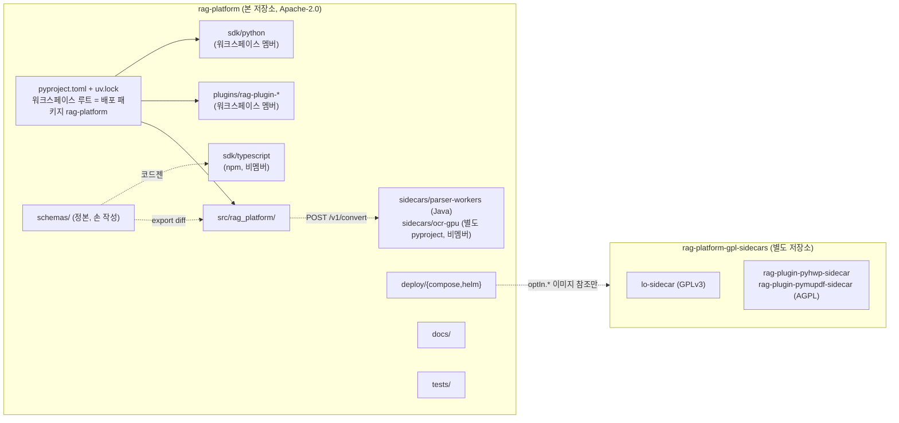
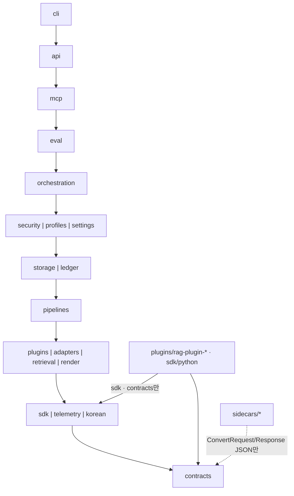
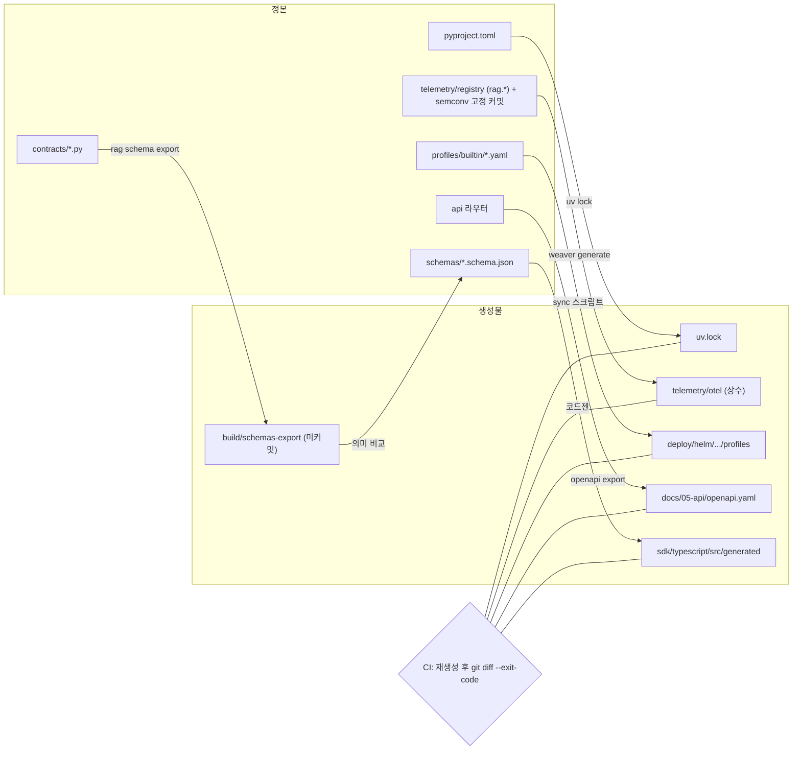

# 저장소 구조

## 목적

이 문서는 RAG Platform 코드 저장소(monorepo)의 **디렉터리 레이아웃, uv 워크스페이스(workspace) 구성, 패키지 의존 방향, 배포 패키지·이미지·저장소 명명, 생성 파일의 위치와 생성 명령, 코드 소유(CODEOWNERS) 초안**을 확정한다. 구현자가 새 파일을 어디에 두어야 하는지, 어떤 모듈이 어떤 모듈을 임포트할 수 있는지, 무엇이 손으로 쓰는 정본이고 무엇이 생성물인지를 이 문서 하나로 판단할 수 있어야 한다.

정본은 설계 바이블(Design Bible) §12(모듈/패키지 맵)와 §6.7(패키지·모듈·엔드포인트)이다. 이 문서는 그 트리를 **확장하되 바꾸지 않는다**. 바이블 §12에 없는 디렉터리·파일은 본문에 "(제안)"으로 표기하고 `## 미해결 이슈`에 모아 바이블 반영 여부를 남긴다. 모듈 내부의 책임·시그니처는 [컴포넌트 아키텍처](../02-architecture/02-component-architecture.md) §1·§3이, 플러그인 패키징 규약은 [플러그인 아키텍처](../02-architecture/05-plugin-architecture.md) §6이 소유하며 이 문서는 요약만 한다.

## 범위

- 포함: 저장소 경계(본 저장소와 위성 저장소), 최상위 트리 전문, 디렉터리별 책임·소유 문서 표, `src/rag_platform/` 모듈 요약, uv 워크스페이스 멤버·비멤버와 루트 `pyproject.toml`, 패키지 의존 규칙(방향·금지·워크스페이스 수준 규칙), 명명 규약(배포 패키지·import·이미지·저장소·차트·entry point), 생성 파일의 위치·생성 명령·커밋 여부·CI 검사, 테스트 디렉터리 배치, CODEOWNERS 초안, 파일 배치 위생 규칙.
- 제외: 개발 환경 설치 절차([개발 환경](./02-development-environment.md)), 코딩 표준·린트 설정 세부([코딩 표준](./03-coding-standards.md)), 테스트 종류별 실행 전략([테스트 전략](./04-testing-strategy.md)), CI 잡 정의([CI/CD](./05-ci-cd.md)), 플러그인 개발 절차·템플릿([플러그인 개발 가이드](./06-plugin-development-guide.md)), 릴리스·태깅 절차([릴리스 프로세스](./08-release-process.md)), Helm values 세부([배포 아키텍처](../02-architecture/08-deployment-architecture.md) §4).
- 정본 규칙: 모듈명·패키지명·extras·이미지명·entry point 그룹명은 바이블 §6.7·§12의 철자를 그대로 쓴다. 이 문서의 수치(파일 수 등)는 2026-09-23 저장소 상태 기준이다.
- 이 저장소는 현재 설계 문서(`docs/`)와 스키마(`schemas/`)만 담고 있다. 아래 트리는 구현이 시작될 때의 **목표 레이아웃**이며, 이미 존재하는 경로(`docs/`, `schemas/`, `tools/`)는 그대로 흡수된다.

## 1. 저장소 경계

**결정:** 코어는 **단일 저장소 `rag-platform`**(uv 워크스페이스, 배포 패키지 `rag-platform`, import `rag_platform`)이고, GPL/AGPL(C 등급) 이미지·플러그인은 **별도 저장소 `rag-platform-gpl-sidecars`**에서 독립 빌드·태깅·릴리스한다. 본 저장소에는 그 이미지의 참조 링크와 Helm `optIn.*` 값만 둔다(바이블 §6.7·§12; [ADR-0001](../06-adr/0001-license-grade-table-and-d02-interpretation.md), [ADR-0007](../06-adr/0007-hwp5-java-sidecar-first-pyhwp-demoted.md), [ADR-0035](../06-adr/0035-python-version-and-toolchain-pins.md)).

| 저장소 | 내용 | 라이선스 | 빌드·릴리스 | 본 저장소와의 관계 |
|--------|------|----------|-------------|-------------------|
| `rag-platform`(본 저장소) | 코어 패키지, A/B 등급 플러그인(`plugins/`), A 등급 사이드카(`sidecars/parser-workers`, `sidecars/ocr-gpu`), 클라이언트 SDK, 배포 매니페스트, 스키마, 문서, 테스트 | Apache-2.0(`LICENSE`), 제3자 고지 `NOTICE` | 단일 `uv.lock`, 단일 코어 이미지 digest, 코어 릴리스 태그 1종(`v{semver}`); 플러그인·스키마 태그는 §5 | — |
| `rag-platform-gpl-sidecars` | `lo-sidecar`(LibreOffice + H2Orestart, GPLv3), `rag-plugin-pyhwp-sidecar`·`rag-plugin-pymupdf-sidecar`(AGPL-3.0) | 이미지별 LICENSE/NOTICE, 소스 제공 고지 | 독립 태깅, 코어 이미지에 미포함 | 본 저장소는 `deploy/helm/rag-platform/templates/sidecars/optin-*.yaml`의 이미지 참조와 `optIn.*` 값(기본 `false`)만 보유. 코어 어댑터 `parser.office_lo_sidecar`는 HTTP 클라이언트(A 등급)로 본 저장소에 있다 |
| 외부 플러그인 저장소(임의) | 제3자 `rag-plugin-{name}` | 각자 | 각자 CI에서 적합성 키트 실행, `conformance.json` 동봉 | `rag-platform>=1.0,<2.0`에 의존, `rag_platform.sdk`·`rag_platform.contracts`만 임포트 |

CI는 본 저장소 `sidecars/`·`plugins/`에 GPL/AGPL 코드·Dockerfile이 없음을 경로 린트로 확인하고, Helm·compose 기본 values의 `optIn.*`가 전부 `false`인지 검사한다(ADR-0001 준수 표).



## 2. 최상위 레이아웃

### 2.1 트리 전문

바이블 §12 트리를 최상위·2단계까지 펼친 것이다. 각 행의 주석은 "이 경로가 소유하는 것"이며, `(제안)` 표기는 바이블 §12 미등재 항목이다. `src/rag_platform/` 내부의 3단계 이하 파일 목록은 바이블 §12 트리가 정본이므로 여기서는 모듈 단위까지만 적는다.

```text
rag-platform/
├── pyproject.toml                  # 배포 패키지 rag-platform + [tool.uv.workspace] 루트 (§3.2)
├── uv.lock                         # 단일 잠금(3.12·3.13 공통 해소), CI `uv lock --check`
├── .python-version                 # 개발 기본 인터프리터(값은 10-development/02 확정)
├── justfile                        # 태스크 러너(바이블 §12 1.3.0, AM-22). 레시피 목록은 10-development/02 §CLI
├── .pre-commit-config.yaml         # pre-commit 훅(바이블 §12 1.3.0, AM-22). 훅 목록은 10-development/02·03
├── Dockerfile                      # 코어 단일 이미지(uv 멀티스테이지; 02-architecture/08 §3.3)
├── LICENSE                         # Apache-2.0
├── NOTICE                          # 제3자 고지(한컴 고지 문자열 CI 검사 포함; 바이블 §7.1 korean-gov 행)
├── README.md
├── models.lock                     # (제안) 모델 잠금(id, revision, sha256, license, grade, territory; ADR-0001) — 위치는 미해결 이슈 4
├── .github/
│   ├── CODEOWNERS                  # §8 초안
│   └── workflows/                  # CI 잡(10-development/05 소유)
├── src/rag_platform/               # 코어 패키지(import rag_platform). 모듈 목록은 §2.3
│   ├── contracts/  sdk/  plugins/  adapters/  pipelines/  retrieval/  render/
│   ├── orchestration/  ledger/  storage/  security/  profiles/  korean/  eval/
│   ├── telemetry/  api/  mcp/  testing/  cli/
│   └── settings/                   # pydantic-settings 배포 설정(RAG_*, §6.6); security·profiles와 같은 층(바이블 §12 1.3.0, AM-22). 내부 모듈 구성은 02 §5.2
├── schemas/                        # JSON Schema 2020-12 정본(손 작성). 35개 파일, 03-contracts 문서가 1:1 소유
├── docs/                           # 설계 문서(브리프 §8 문서 맵). 05-api/openapi.yaml은 생성물(§6 표 openapi.yaml 행)
├── plugins/                        # 별도 배포 플러그인(A/B 등급만), 각각 워크스페이스 멤버
│   ├── rag-plugin-lightrag/        # retriever.lightrag_graph + enricher.lightrag_graph_builder (O-03)
│   ├── rag-plugin-hipporag/
│   ├── rag-plugin-colqwen-visual/
│   ├── rag-plugin-kure-late-interaction/
│   └── rag-plugin-smb-fetcher/     # (05 §13.2 제안) fetcher.smbprotocol
├── sidecars/                       # 별도 이미지, 코어 Python 의존 없음. 변환 사이드카(parser-workers·ocr-gpu)는 POST /v1/convert · GET /healthz
│   ├── parser-workers/             # Java 21(Maven): hwplib + hwp2hwpx + hwpxlib + Tika HwpV5Parser
│   ├── ocr-gpu/                    # PaddleOCR PP-OCRv5 server; 자체 pyproject.toml·uv.lock(워크스페이스 비멤버, §3.1)
│   └── sparse-encoder/             # (02-architecture/08 §3.1 제안) 서빙 이미지 sparse-encoder-server — /v1/convert 계약 미적용(08 미해결 이슈 17); 위치·이름은 미해결 이슈 2
├── sdk/                            # 클라이언트 SDK(rag_platform.sdk 플러그인 커널과 다름, §2.5)
│   ├── python/                     # 워크스페이스 멤버; 계약 모델 재사용(03-contracts/14 §9)
│   └── typescript/                 # npm 패키지; schemas/에서 코드젠
├── deploy/
│   ├── compose/                    # compose.lite.yaml, compose.lite-durable.yaml, compose.observability.yaml, .env.example
│   └── helm/                       # rag-platform(운영 차트), rag-platform-data(개발·스테이징 umbrella)
├── tests/                          # §7(바이블 5종 + 제안 4종)
│   ├── contracts/  adapters/  security/  replay/  eval/      # 바이블 §12
│   ├── golden/                                               # (04-pipelines/01 §12.2 제안) {stage}/cases.json
│   └── unit/  integration/  e2e/                             # (제안)
├── samples/                        # 개발 모드 샘플 문서(바이블 §11.6 `rag ingest ./samples/*.hwpx`); 재배포 가능 라이선스만
├── examples/                       # (제안) 클라이언트 SDK·MCP 호스트 설정 예제
└── tools/                          # (제안) 저장소 도구. 현재 docs 검증기(validate-contracts.mjs 등)가 이미 존재
    ├── docs/                       # 문서·스키마 기계 검증(열거 대조, 링크 검사, 골든 예시 추출)
    └── ci/                         # 잠금 범위 검사(ADR-0035), 경로 린트(ADR-0001), Helm 프로파일 사본 동기화
```

### 2.2 최상위 디렉터리 책임 표

| 경로 | 책임(소유하는 것) | 소유하지 않는 것 | 정본·소유 문서 | 지위 |
|------|------------------|------------------|----------------|------|
| `pyproject.toml`, `uv.lock` | 배포 패키지 `rag-platform` 메타데이터, extras 6종, 워크스페이스 멤버 목록, 정적 검사 설정(ruff·mypy·import-linter) | 플러그인 자체 메타(`plugins/*/pyproject.toml`) | 바이블 §6.7·§12, ADR-0035 | 바이블 |
| `justfile`, `.pre-commit-config.yaml` | 태스크 러너 레시피, pre-commit 훅 정의 | CI 잡 정의(`.github/workflows/`) | 바이블 §12 1.3.0(AM-22), 10-development/02 §CLI | 바이블 |
| `src/rag_platform/` | 코어 패키지 전부(계약·커널·어댑터·핫패스·셸·원장·API·CLI) | 별도 배포 플러그인, 사이드카 코드 | 바이블 §12, 02 §1·§3 | 바이블 |
| `schemas/` | JSON Schema 2020-12 정본 파일. `common-types.schema.json`은 03-contracts/00만, 나머지는 각 계약 문서가 소유 | Pydantic 모델(`contracts/`), 스키마 파생 코드 | 바이블 §5.1, [계약 개요](../03-contracts/00-contract-overview.md) §2 | 바이블 |
| `docs/` | 설계 문서 세트(브리프 §8 문서 맵), ADR, 생성물 `05-api/openapi.yaml` | 코드 주석·docstring | 브리프 §8·§9 | 브리프 |
| `plugins/` | A/B 등급 별도 배포 플러그인(`rag-plugin-{name}`), 각각 독립 `pyproject.toml`·`PluginMeta` | C 등급 플러그인(위성 저장소), 코어 어댑터 | 바이블 §12, 05 §6·§13.2 | 바이블 |
| `sidecars/` | A 등급 사이드카 이미지 소스(Java·Python), 각자 Dockerfile·`GET /healthz`; 변환 사이드카는 `POST /v1/convert`(`sparse-encoder`는 서빙 이미지로 예외, §3.1) | 코어 Python 패키지 의존, C 등급 이미지 | 바이블 §6.7·§12, 08 §3.1·§3.3, [ADR-0033](../06-adr/0033-sidecar-convert-contract-and-isolation-ladder.md) | 바이블 |
| `sdk/python`, `sdk/typescript` | 클라이언트 SDK(REST·SSE·MCP 소비자용) | 플러그인 SDK(`rag_platform.sdk`) | 바이블 §12, 03-contracts/14 §9, [클라이언트 SDK](../05-api/06-client-sdks.md) | 바이블 |
| `deploy/compose`, `deploy/helm` | 개발 compose, 운영 Helm 차트 `rag-platform`, 데이터 계층 umbrella `rag-platform-data`, 프로파일별 values | 프로파일 정본(패키지 내 `profiles/builtin/`), GPL 이미지 빌드 | 바이블 §12, 08 §4 | 바이블 |
| `tests/` | 계약 스냅샷·불변식·해시 벡터, 어댑터 계약 코퍼스, 보안 카나리, Temporal 재생, 소형 골든셋, 골든 회귀, 단위·통합·e2e | 적합성 키트 코드(`src/rag_platform/testing/`) | 바이블 §12, [테스트 전략](./04-testing-strategy.md) | 바이블 + 제안(§7) |
| `samples/` | 5분 기동 데모용 문서(HWPX·PDF·HTML), 재배포 가능 라이선스(공공누리 제1유형 등)만 | 계약 테스트 코퍼스(`tests/adapters/`) | 바이블 §11.6 | 바이블(경로 암시) |
| `examples/` | SDK 호출 예제, MCP 호스트 설정, 렌더러 출력 샘플 | 실행 가능한 서비스 코드 | 이 문서 | 제안 |
| `tools/` | 저장소 도구(문서·스키마 검증기, CI 보조 스크립트). 런타임 코드 금지 | `rag` CLI(`src/rag_platform/cli/`) | 이 문서 | 제안(디렉터리는 이미 존재) |
| `Dockerfile` | 코어 단일 이미지(역할은 `rag serve api`·`rag serve worker`·`rag serve relay`·`rag mcp serve`·`rag eval` CLI 플래그) | 사이드카 이미지(`sidecars/*/Dockerfile`) | 08 §3.3, 02 §7 | 바이블 §2.2·08 |
| `LICENSE`, `NOTICE` | Apache-2.0 본문, 제3자 고지(모델·사전·한컴 고지) | 위성 저장소 고지 | D-02, ADR-0001 | 브리프 |
| `.github/` | CODEOWNERS(§8), 워크플로우, PR 템플릿 | — | 이 문서 §8, [CI/CD](./05-ci-cd.md) | 제안(호스팅 관례) |

### 2.3 `src/rag_platform/` 모듈 요약

바이블 §12 트리의 모듈을 계층 순서로 요약한다. "소유" 열은 02 §1.1 표의 한 줄 정의를 그대로 옮긴 것이며, 세부(파일명·프로토콜)는 02 §3 모듈 카탈로그가 정본이다.

| 모듈 | 계층(02 §1.2) | 소유 | 대표 파일(바이블 §12; `sdk`·`plugins` 행은 02 §2.2~§2.4·05 §6.3, `settings` 행은 02 §5.2) |
|------|---------------|------|----------------------|
| `contracts` | L0 | Pydantic v2 계약 모델 전부(바이블 §5.1), `enums.py`(§5.7 단일 소스), `versioning.py`, `schemas/`로의 export | `common.py`, `parsed_document.py`, `context_pack.py`, `policies.py` |
| `sdk` | L1 | `Stage`·`StageContext`·`PipelineContext` 프로토콜, `SidecarStage`, `TokenCounter`, `DerivedArtifacts`(파생물 쓰기 포트), 포트 프로토콜, `hash_of`(`H()`) | `stage.py`, `pipeline.py`, `ports.py`, `index_backend.py`(바이블 §12 1.3.0, AM-27) |
| `telemetry` | L1 | OTel 트레이서·미터, Weaver 생성 상수(`gen_ai.*`·`retrieval.*`·`rag.*`), 메트릭 이름 상수, redaction | `otel/`(생성물, §6 표 Weaver 행), `metrics.py`, `redaction.py` |
| `korean` | L1 | `UserDictEntry[]` → Kiwi·Nori·synonym 사전 생성기, 팽창률 계수 | — |
| `plugins` | L2 | entry point 레지스트리, `PluginMeta` 검증, `license_gate`, `capabilities_check` | `registry.py` |
| `adapters` | L2 | 벤더 어댑터 10종(`fetch`, `parse`, `normalize`, `chunk`, `enrich`, `embed`, `index`, `query`, `retrieve`, `rerank`) + `llm` | `parse/router.py`(`ParseRouterStage`: 라우터·폴백 체인), `parse/hwpx_hwpxlib_sidecar.py`(암호화 HWPX), `parse/hwpx_python_hwpx.py`, `index/qdrant/`, `rerank/tei_cross_encoder.py`(바이블 §12 1.3.0, AM-22) |
| `retrieval` | L2 | 검색 핫패스(PostgreSQL 미의존): planner, filters, channels, fusion, hydrate, rerank(호출), `postprocess/*`, `pack/*` | `pack/citation_align.py` |
| `render` | L2 | `Renderer` 9종 렌더러, `citation_map` | `anthropic_search_result.py` |
| `pipelines` | L3 | `ingest.run`, `reindex.run`, `query.run`(`PipelineContext`만 의존) | `ingest.py`, `reindex.py`, `query.py` |
| `storage` | L4 | `artifact_store`(S3 호환·`file://`), `keys`, `valkey` | — |
| `ledger` | L4 | PostgreSQL 원장 모델·리포지토리·`migrations/`·`reconcile`·`consistency_check`·`usage` | `migrations/` |
| `security` | L5 | `principal_resolver`, `authz_cedar`, `security_context`, `rate_limit`, `acl_recheck`, `egress_policy`, `backend_token`, `key_provider`, `audit` | — |
| `profiles` | L5 | `loader`(extends 해소), `schema`, `validate`, `profile_hash`, `builtin/{base,lite,standard,premium,korean-gov}.yaml` | `builtin/` |
| `settings` | L5 | 배포 설정 `Settings`(pydantic-settings, `RAG_*`) | `settings/`(바이블 §12 1.3.0, AM-22; 내부 모듈 구성은 02 §5.2) |
| `orchestration` | L6 | 셸 `context.py`, `temporal/*`, `local/runner.py`, `dispatcher.py`, `outbox/*` | — |
| `eval` | L7 | 하네스 runner, TREC 입출력, `metrics_ranx`, `judge_ragas`, `span_hit`, `gates`, `datasets/` | — |
| `mcp` | L8 | `McpToolAdapter`, 도구 3종, `cursor_store` | — |
| `api` | L9 | FastAPI 라우터(바이블 §14: `ingest`·`query`·`render`·`answer`·`jobs`·`documents`·`collections`·`profiles`·`tenants`·`api_keys`·`plugins`·`schemas`·`version`·`audit_events`·`eval`·`feedback`·`subscriptions`), `problems`, `idempotency`, `events`(SSE) — `api_keys`·`plugins`·`schemas`·`version`·`audit_events`는 API 전용 뷰 DTO의 단일 출처(§5.1, AM-02·AM-39) | — |
| `cli` | L10 | `rag up/ingest/query/reprocess/reindex/eval/profile/plugin/cache/serve/mcp` | — |
| `testing` | (배포 포함, 계층 외) | 적합성 키트 6모듈, `golden`(04-pipelines/01 제안), 가짜 `StageContext`·`RuntimeServices` | `contract_roundtrip.py` |

`testing`은 플러그인 저자가 CI에서 임포트해야 하므로 배포 패키지에 포함되며, 프로덕션 진입점(`api`·`orchestration`)이 임포트하지 않는다는 조건으로 계층 규칙 밖에 둔다(02 §1.1 `testing` 행 "소유하지 않는 것: 프로덕션 경로"; 배포·상속은 05 §10).

### 2.4 작업 지시 이름 ↔ 정본 매핑

문서 작성 지시서는 `packages/contracts`, `packages/core`, `packages/stages-*` 같은 **다중 패키지 레이아웃**의 이름을 열거했다. 이 문서는 바이블 §12의 **단일 배포 패키지** 레이아웃을 따르므로(바이블 §12 첫 문장; 단일 잠금은 ADR-0035 대안 7; §5 금지 항목 `rag-platform-core`) 지시 이름은 디렉터리가 아니라 `src/rag_platform/` 아래 모듈에 대응한다. 08 §3.2가 이미지 이름에 대해 한 것과 같은 장치다.

| 지시 이름 | 정본 대응 | 설명 |
|-----------|-----------|------|
| `packages/contracts` | `src/rag_platform/contracts/` + `schemas/` | 별도 배포 패키지가 아니다(경량 분리는 미해결 이슈 3) |
| `packages/core` | `src/rag_platform/{sdk,plugins,pipelines,orchestration}/` | 커널·레지스트리·파이프라인 정의·실행 셸 |
| `packages/stages-parse`, `-chunk`, `-embed`, `-index`, `-retrieve` | `src/rag_platform/adapters/{parse,chunk,embed,index,retrieve}/` + `retrieval/` | 스테이지별 패키지를 만들지 않는다. 확장 지점 디렉터리가 entry point 단위 |
| `packages/workflows` | `src/rag_platform/orchestration/temporal/` | 워크플로우는 셸의 일부(ADR-0003) |
| `packages/api`, `packages/mcp`, `packages/eval` | `src/rag_platform/{api,mcp,eval}/` | 같은 이미지 `rag-platform`, 역할은 CLI 플래그(08 §3.2) |
| `packages/sdk-python`, `packages/sdk-ts` | `sdk/python/`, `sdk/typescript/` | 클라이언트 SDK만 별도 패키지(§3.1) |
| `tests/contract` | `tests/contracts/` | 바이블 §12 철자(복수형) |

### 2.5 이름이 겹치는 경로에 대한 주의

| 경로 A | 경로 B | 구분 |
|--------|--------|------|
| 루트 `sdk/`(클라이언트 SDK) | `src/rag_platform/sdk/`(플러그인·스테이지 커널 SDK) | 전자는 API 소비자, 후자는 플러그인 저자용. 문서에서는 각각 "클라이언트 SDK"·"`rag_platform.sdk`"로 부른다 |
| 루트 `plugins/`(별도 배포 패키지 디렉터리) | `src/rag_platform/plugins/`(레지스트리 모듈) | 전자는 워크스페이스 멤버 묶음, 후자는 발견·검증 코드 |
| `src/rag_platform/eval/`(하네스) | `tests/eval/`(소형 골든셋 게이트 테스트) | 전자는 배포 코드(`[eval]` extra), 후자는 CI 테스트 |
| `src/rag_platform/testing/`(적합성 키트, 배포 포함) | `tests/`(저장소 테스트, 미배포) | 키트는 플러그인 저장소가 임포트한다 |
| `src/rag_platform/profiles/builtin/*.yaml`(정본) | `deploy/helm/rag-platform/profiles/`(ConfigMap 소스 사본) | 사본은 생성물(§6 표), CI가 diff로 동기화를 강제 |

## 3. uv 워크스페이스

**결정:** 저장소 루트 `pyproject.toml`이 배포 패키지 `rag-platform`이자 uv 워크스페이스 루트다. 멤버는 `sdk/python`과 `plugins/*`이며, 사이드카(`sidecars/*`)와 TypeScript SDK는 멤버가 아니다. 잠금은 워크스페이스 전체에 하나(`uv.lock`)이고 `requires-python = ">=3.12,<3.14"`를 모든 멤버가 공유한다([ADR-0035](../06-adr/0035-python-version-and-toolchain-pins.md) 대안 7; 바이블 §11.6·§12).

### 3.1 멤버와 비멤버

| 경로 | 워크스페이스 | 이유 |
|------|:---:|------|
| `/`(루트) | 멤버(루트 패키지 `rag-platform`) | 코어 배포 패키지. `uv tool install rag-platform`의 대상(바이블 §11.6) |
| `plugins/rag-plugin-*` | 멤버 | 코어와 같은 잠금으로 `rag-platform` 의존을 해소해야 적합성 키트·계약 버전이 일치한다. `[tool.uv.sources] rag-platform = { workspace = true }` |
| `sdk/python` | 멤버 | 계약 모델을 재사용하므로(03-contracts/14 §9) 같은 잠금에 있어야 `contracts_compat` 판정이 단순하다 |
| `sdk/typescript` | 비멤버 | npm 프로젝트. `schemas/`에서 코드젠(§6 표 TS 코드젠 행) |
| `sidecars/parser-workers` | 비멤버 | Java 21, Maven(08 §3.3 빌드 이미지 `maven:3-eclipse-temurin-21` → `eclipse-temurin:21-jre`). 계약은 JSON만 공유. 의존 잠금·라이선스 스캔 방식은 미해결 이슈 6 |
| `sidecars/ocr-gpu`, `sidecars/sparse-encoder`(제안, 08 §3.1) | 비멤버(자체 `pyproject.toml`·`uv.lock`) | CUDA·Paddle·sentence-transformers 런타임 의존이 코어 잠금에 섞이면 `[gpu]` extra 비움 원칙(02 §7.2)과 Python 상한 근거(ADR-0035 표)가 깨진다. `[tool.uv.workspace] exclude`로 명시 제외. `sparse-encoder`는 `/v1/convert`가 아닌 모델 서빙 이미지(`sparse-encoder-server`)이므로 `sidecars/` 불변식의 예외다(미해결 이슈 2) |
| `tools/`, `docs/`, `deploy/` | 비멤버 | Python 패키지가 아니다. 목표 상태에서 `tools/ci/*.py`·`tools/docs/*.py`는 루트 dev 의존만으로 실행한다. 현재 존재하는 `tools/validate-contracts.mjs`·`usage-report.mjs`·`phase3/*.js`는 Node.js 스크립트라 이 규칙을 만족하지 않는다 — 유지 여부(Python 이식 또는 Node 툴체인 등재)는 10-development/02에서 확정(미해결 이슈 11) |

### 3.2 루트 `pyproject.toml`

아래는 ADR-0035 발췌를 워크스페이스 관점으로 보완한 예시다. 정확한 고정 버전은 `uv.lock`이 정본이다. import-linter 계약은 **5개**다: 02 §1.2 INI의 4계약(`layers` 11계층 정밀화, `no-orchestrator-in-stages`, `adapters-no-storage`, `contracts-pure`)을 `[[tool.importlinter.contracts]]`로 그대로 옮기고, ADR-0035 준수 표 (4)의 C 등급 임포트 차단 계약(`fitz`·`pymupdf`·`hwp5`)을 더한다. 두 앵커의 계약 집합이 서로 다른 문제는 미해결 이슈 13이다.

```toml
[project]
name = "rag-platform"
description = "Open-source RAG platform: parse, chunk, embed, hybrid-index, and retrieve LLM-ready Context Packs"
readme = "README.md"
license = "Apache-2.0"
requires-python = ">=3.12,<3.14"           # D-01, ADR-0035
dynamic = ["version"]                       # 태그에서 유도(hatch-vcs, 아래 [tool.hatch.version]; 태깅 절차는 10-development/08)
dependencies = [
  "pydantic>=2,<3",
  "fastapi",                                # 범위 미기재는 ADR-0035 발췌 그대로(확인 버전 0.141, 07-tech-landscape/00 `api_framework` 행); 고정은 uv.lock
  "semchunk>=3.0.0,<4.0.0",
  "tiktoken>=0.9.0,<0.13.0",
  "python-hwpx>=6.4,<7",
  "mcp>=2,<3",
  "cloudevents>=2.2,<3",
]

[project.optional-dependencies]              # 바이블 §6.7 extras 6종(철자 고정)
kiwi = ["kiwipiepy>=0.24.0"]
docling-chunker = ["docling-core[chunking]>=2.97,<3"]
gpu = []                                     # CUDA·Paddle 런타임은 sidecars/ocr-gpu 이미지로 분리
opensearch = ["opensearch-py"]
temporal = ["temporalio>=1.33,<2"]
eval = ["ranx", "ir_measures", "ragas", "deepeval"]

[project.scripts]
rag = "rag_platform.cli:main"

[project.entry-points."rag_platform.parser"]  # 코어 어댑터도 같은 그룹에 등록(05 §6.1)
format_detector = "rag_platform.adapters.parse.format_detector:FormatDetectorStage"
hwpx_python_hwpx = "rag_platform.adapters.parse.hwpx_python_hwpx:HwpxPythonHwpxParser"

[dependency-groups]                          # 개발 전용(배포 미포함)
dev = ["pytest", "pytest-asyncio", "ruff", "mypy", "import-linter", "pip-licenses", "liccheck", "cyclonedx-bom"]

[tool.uv.workspace]
members = ["sdk/python", "plugins/*"]
exclude = ["sidecars/*"]

[tool.uv.sources]
rag-platform = { workspace = true }

[build-system]
requires = ["hatchling", "hatch-vcs"]        # 빌드 백엔드 선정은 미해결 이슈 5(확인 필요 as of 2026-09)
build-backend = "hatchling.build"

[tool.hatch.version]
source = "vcs"                               # dynamic = ["version"]에 필수. 없으면 빌드 실패(Missing tool.hatch.version configuration)

[tool.hatch.build.targets.wheel]
packages = ["src/rag_platform"]

[tool.ruff]
target-version = "py312"
src = ["src", "tests", "plugins", "sdk/python"]

[tool.mypy]
strict = true
plugins = ["pydantic.mypy"]
mypy_path = "src"

[tool.importlinter]
root_package = "rag_platform"
include_external_packages = true
# 계약 (1)~(4): 02-architecture/02 §1.2 INI의 layers · no-orchestrator-in-stages · adapters-no-storage · contracts-pure를
# [[tool.importlinter.contracts]]로 그대로 옮긴다(여기서는 생략). 계약 (5)만 02 §1.2에 없어 아래에 적는다.

[[tool.importlinter.contracts]]
name = "no C-grade imports (D-02, ADR-0001; ADR-0035 준수 표 (4))"
type = "forbidden"
source_modules = ["rag_platform"]
forbidden_modules = ["fitz", "pymupdf", "hwp5"]
```

플러그인 멤버(`plugins/*`)는 루트 계약의 `source_modules`에 포함되지 않으므로 같은 C 등급 차단 계약을 플러그인 `pyproject.toml`에도 두며(템플릿은 10-development/06), 라이선스 게이트(pip-licenses + liccheck)가 pip 메타데이터 기준으로 이를 보완한다(§4.2 4행).

entry point 그룹은 확장 지점 14종마다 `rag_platform.{extension_point}`이며 코어 어댑터 전부가 여기 등록된다(위 예시는 `parser` 그룹 두 항목만 보인 것). 프로파일은 `plugin_id`만 참조하고 버전은 `uv.lock`이 고정한다(05 §6.3).

### 3.3 워크스페이스 멤버 `pyproject.toml`

```toml
# plugins/rag-plugin-lightrag/pyproject.toml
[project]
name = "rag-plugin-lightrag"
version = "0.1.0"
requires-python = ">=3.12,<3.14"
dependencies = ["rag-platform>=1.0,<2.0"]

[project.entry-points."rag_platform.retriever"]
lightrag_graph = "rag_plugin_lightrag.retriever:LightRagGraphRetriever"

[tool.rag_platform.plugin]                   # PluginMeta 1개(바이블 §5.6; 복수 선언은 05 미해결 이슈 13)
# 플러그인 메타에는 봉투(schema_version)가 없다 — plugin-meta.schema.json additionalProperties:false. 05 §6.1·§6.2 예시의 schema_version 행은 결함(미해결 이슈 14)
plugin_id = "retriever.lightrag_graph"
extension_point = "retriever"
version = "0.1.0"
license = "MIT"
license_grade = "A"
territory = []
linkage = "pure_python"
isolation_supported = ["in_process", "sidecar"]
contracts_compat = ">=1.0,<2.0"
capabilities = { isolation_modes = ["in_process", "sidecar"], supports_resumable = false, contracts_compat = ">=1.0,<2.0" }

[tool.uv.sources]
rag-platform = { workspace = true }          # 워크스페이스 안에서는 로컬 코어를 해소, 배포 시에는 PyPI 범위
```

```toml
# sdk/python/pyproject.toml (패키지명은 제안, 05-api/06에서 확정)
[project]
name = "rag-platform-client"
version = "0.1.0"                            # PEP 621: version 또는 dynamic 중 하나 필수. 코어와 같은 hatch-vcs 유도로 바꿀지는 10-development/08
requires-python = ">=3.12,<3.14"
dependencies = ["rag-platform>=1.0,<2.0", "httpx", "httpx-sse"]

[tool.uv.sources]
rag-platform = { workspace = true }
```

멤버 디렉터리 안의 레이아웃은 `src/{import_name}/`, `tests/`, `pyproject.toml`, `README.md`, `LICENSE`(코어와 다른 라이선스일 때만)이다. 플러그인 `tests/test_conformance.py`는 `rag_platform.testing`의 확장 지점별 기반 클래스를 상속한다(05 §10).

### 3.4 잠금·인터프리터·명령

| 작업 | 명령 | 비고 |
|------|------|------|
| 전체 동기화(개발) | `uv sync --all-packages --all-extras --group dev` | 멤버 전부 + extras 전부. `[kiwi]`의 `kiwipiepy>=0.24.0`은 Apache-2.0 wheel의 PyPI 공개가 확인 필요(as of 2026-09; ADR-0035 표, 07-tech-landscape/04·06)이며 단일 `uv.lock`은 모든 extras를 함께 해소하므로 미공개 상태면 `uv lock` 자체가 실패한다 — 그동안은 `--extra temporal --extra opensearch --extra eval --extra docling-chunker`로 대체(미해결 이슈 15). 상세는 [개발 환경](./02-development-environment.md) |
| 잠금 갱신 | `uv lock` | 핀 범프 PR은 계약 코퍼스 통과가 머지 조건(pin-and-bump) |
| 잠금 검사(CI) | `uv lock --check` | 실패 = 빌드 실패(바이블 §11.6) |
| 특정 멤버만 | `uv sync --package rag-plugin-lightrag` | 플러그인 CI |
| 인터프리터 매트릭스 | `uv run --python 3.12 pytest`, `uv run --python 3.13 pytest` | 두 버전 모두 통과 필수(ADR-0035) |
| CLI 설치(사용자) | `uv tool install rag-platform` | 바이블 §11.6 1단계 |

## 4. 패키지 의존 규칙

### 4.1 방향

**결정:** 코어 모듈의 의존 방향은 바이블 §12 1.3.0 규칙 `contracts ← sdk ← plugins | adapters | pipelines | retrieval | render ← orchestration | ledger | storage | security | profiles | settings | eval ← api | mcp | cli`을 따르고, 같은 계층 안의 실제 의존은 02 §1.2의 11계층 정밀화로 표현한다. 역방향은 어디에서도 허용되지 않으며 import-linter가 CI에서 강제한다(바이블 §12; [ADR-0003](../06-adr/0003-orchestrator-neutral-pipeline-and-non-durable-local-runner.md), [ADR-0035](../06-adr/0035-python-version-and-toolchain-pins.md)).



화살표는 "임포트할 수 있다"이고 상위 계층은 자기보다 아래의 모든 계층을 임포트할 수 있다. `|`로 묶인 모듈은 같은 계층이며 서로 임포트하지 않는다.

### 4.2 금지 규칙

| 규칙 | 출처 | 강제 수단 | 위반 예 |
|------|------|-----------|---------|
| `pipelines`·`retrieval`·`render`(및 `adapters`·`sdk`·`contracts`)는 `temporalio`·`fastapi`·`starlette`·`rag_platform.ledger`·`rag_platform.orchestration`을 임포트하지 않는다 | 바이블 §12, D-17, [ADR-0034](../06-adr/0034-retrieval-hot-path-postgres-independence-and-hydrate.md) | import-linter `forbidden` | `retrieval/pack/chunk_text_store.py`가 `ledger.repo` 임포트 |
| `adapters`는 `storage`·`security`를 임포트하지 않는다(산출물 저장은 셸, 포트는 `sdk`) | 바이블 §12, 02 §1.2 | import-linter `forbidden` | 파서가 `storage.artifact_store` 직접 생성 |
| `contracts`는 pydantic·표준 라이브러리만 임포트한다 | 02 §1.2 | import-linter `forbidden` | 계약 validator가 Valkey 조회 |
| 저장소 전체에서 C 등급 모듈(`fitz`, `pymupdf`, `hwp5`) 임포트 금지 | D-02, [ADR-0001](../06-adr/0001-license-grade-table-and-d02-interpretation.md), ADR-0035 준수 표 (4) | 라이선스 게이트(pip-licenses + liccheck; D-02) + import-linter `forbidden`(§3.2 계약 (5) — 02 §1.2 INI에는 없는 추가 계약, INI 개정 제안은 미해결 이슈 13) | 어댑터가 `import fitz` |
| `security` 구현은 `api`·`retrieval`(`pack.acl_recheck`)·`adapters/index`에서만 사용(바이블 §12 정본). `mcp`·`adapters/retrieve`(E8 백엔드 토큰)·조립 지점(`orchestration.context`·`orchestration.outbox`)을 더하는 것은 02 미해결 이슈 1의 제안(바이블 §12 patch 대기, 미해결 이슈 16) | 바이블 §12; 02 §1.2 표 3행·미해결 이슈 1 | 코드 리뷰 + 계층 규칙(`retrieval`·`adapters`는 계층상 `security`를 임포트할 수 없어 `sdk` 포트로 받는다) | `adapters/retrieve`가 `security.backend_token` 직접 임포트(포트로 받아야 함) |
| `testing`은 프로덕션 진입점(`api`·`orchestration`·`cli serve`)에서 임포트하지 않는다 | 02 §1.1(`testing` 행), 05 §10 | import-linter `forbidden`(제안) | 워커가 `testing.golden` 임포트 |
| 스팬 속성 문자열 리터럴 금지 — `telemetry.otel` 생성 상수만 사용 | 05 §9, [ADR-0022](../06-adr/0022-observability-genai-semconv-pin-and-license-boundary.md) 준수 표 2 | `tools/ci/check_span_literals.py`(제안; AST 순회로 `set_attribute`·`attributes=` 인자의 `gen_ai.`·`retrieval.`·`reranker.`·`rag.` 접두 문자열 리터럴 검출) 또는 semgrep 규칙. ruff는 사용자 정의 규칙을 지원하지 않는 것으로 알려져 있다(확인 필요 as of 2026-09). 확정은 10-development/03 | `span.set_attribute("gen_ai.request.model", …)` |

### 4.3 워크스페이스 수준 규칙

| 대상 | 임포트 허용 | 임포트 금지 | 근거 |
|------|-------------|-------------|------|
| `plugins/rag-plugin-*` | `rag_platform.sdk`, `rag_platform.contracts`, `rag_platform.testing`(테스트만) | `rag_platform.adapters.*`(상속 금지), `rag_platform.orchestration`, `rag_platform.api`, 다른 플러그인 | 플러그인 SDK 안정 표면([ADR-0032](../06-adr/0032-plugin-sdk-stage-protocol-and-conformance-kit.md)); 코어 어댑터 상속은 코어 내부 변경에 플러그인이 깨지게 한다 |
| `sdk/python` | `rag_platform.contracts`(관용 모드 재생성, 03-contracts/14 §9) | `rag_platform.sdk`(플러그인 커널), 서버 모듈 전부 | 클라이언트는 서버 구현을 몰라야 한다. 전체 `rag-platform` 의존이 남는 문제는 미해결 이슈 3 |
| `sidecars/*` | 없음(코어 Python 의존 0) | `rag_platform.*` 전부 | 변환 사이드카는 `ConvertRequest`/`ConvertResponse` JSON만 공유(바이블 §12, ADR-0033); `sparse-encoder`(제안)는 03-contracts/07 `SparseVector` JSON만 공유(08 §3.1) |
| `tools/` | 루트 dev 그룹 의존, `rag_platform.contracts`(스키마 검증 보조) | 런타임 모듈 실행 경로에 진입 | 도구는 CI·문서 빌드 전용 |
| `tests/` | 전부 | — | 단, `tests/security`·`tests/contracts`는 `rag_platform.testing` 키트를 재사용한다 |

플러그인 CI는 `lint-imports`를 플러그인 루트에서 `root_package = rag_plugin_{name}`으로 실행해 위 금지 목록을 검사한다. 템플릿은 [플러그인 개발 가이드](./06-plugin-development-guide.md)가 제공한다.

## 5. 명명 규약

**결정:** 명명은 바이블 §6.7과 [ADR-0036](../06-adr/0036-naming-and-identifier-conventions.md)을 따른다. 배포 패키지·저장소·차트 이름은 kebab-case, import 이름은 snake_case, 이미지 이름은 kebab-case다. `rag-platform` 접두는 **코어와 코어 동반 산출물**(위성 저장소, Helm 차트, 클라이언트 SDK)에만 쓰고, 확장 지점 구현은 `rag-plugin-{name}`이다.

| 대상 | 규약 | 예 | 지위 |
|------|------|----|------|
| 코어 배포 패키지 / import | `rag-platform` / `rag_platform` | `uv tool install rag-platform`, `import rag_platform` | 바이블 §6.7 |
| extras | `[kiwi]`, `[docling-chunker]`, `[gpu]`, `[opensearch]`, `[temporal]`, `[eval]` — 6종 고정, kebab-case | `rag-platform[temporal,opensearch]` | 바이블 §6.7 |
| 플러그인 배포 패키지 / import | `rag-plugin-{name}` / `rag_plugin_{name}` | `rag-plugin-lightrag` / `rag_plugin_lightrag` | 바이블 §6.7 |
| entry point 그룹 / 이름 | `rag_platform.{extension_point}` / `{implementation}`(snake_case) → `plugin_id = "{extension_point}.{implementation}"` | `rag_platform.retriever` + `lightrag_graph` → `retriever.lightrag_graph` | 바이블 §6.1·§6.7 |
| 외부 플러그인 구현 이름 | 외부 패키지의 `implementation`은 패키지 벤더 접두(`lightrag_`, `hipporag_`)를 붙여 코어와 충돌을 피한다. 코어 구현 이름은 패키지 접두 없이 백엔드·기법 이름만 쓴다 | 외부 `lightrag_graph`, `hipporag_graph`; 코어 `qdrant_dense`, `structure_aware` | 05 §6.3(중복 행) |
| 코어 이미지 | `rag-platform`(단일, 역할은 CLI 플래그) | `rag-platform:1.0.0@sha256:…` | 바이블 §2.2, 08 §3.3 |
| 사이드카 이미지 | kebab-case, 디렉터리명 = 이미지명 | `parser-workers`, `ocr-gpu`, `lo-sidecar`(위성). 08 §3.1의 `sparse-encoder-server` ↔ `sidecars/sparse-encoder`(제안)는 이 규약과 어긋나므로 디렉터리 또는 이미지명 중 하나를 맞춘다(미해결 이슈 2) | 바이블 §6.7 |
| 위성 저장소 | `rag-platform-{purpose}` | `rag-platform-gpl-sidecars` | 바이블 §6.7 |
| Helm 차트 | `rag-platform`(운영), `rag-platform-data`(개발·스테이징 umbrella) | `deploy/helm/rag-platform/Chart.yaml` | 08 §4.1 |
| 클라이언트 SDK(Python) | `rag-platform-client` / `rag_platform_client` | `pip install rag-platform-client` | 제안(05-api/06 확정) |
| 클라이언트 SDK(TypeScript) | `@rag-platform/client` | `npm i @rag-platform/client` | 제안(05-api/06 확정) |
| 스키마 파일 / `$id` | `schemas/{kebab-name}.schema.json` / `urn:rag:schema:{kebab-name}:{major}` | `schemas/chunk-set.schema.json`, `urn:rag:schema:chunk-set:1` | 바이블 §6.4 |
| Python 모듈·패키지 | snake_case, 바이블 §12 트리의 이름 그대로 | `adapters/parse/hwp5_java_sidecar.py` | 바이블 §12 |
| 테스트 파일 | `tests/{group}/test_{subject}.py`; 골든 케이스 `tests/golden/{stage}/cases.json` | `tests/contracts/test_hash_vectors.py` | 제안(§7) |
| 문서 | `docs/{NN-area}/{NN-kebab-case}.md`; ADR `docs/06-adr/{NNNN}-{slug}.md` | `docs/06-adr/0035-python-version-and-toolchain-pins.md` | 브리프 §8, 바이블 §3.3 |
| 환경 변수 | `RAG_` 접두, 중첩 `__` | `RAG_PG__DSN` | 바이블 §6.6 |
| Temporal 워크플로우 / 큐 | `{domain}.{entity}.v{n}` / kebab-case | `ingest.document.v1` / `ingest-io` | 바이블 §6.7 |
| 브랜치·태그 | 태그 `v{semver}`(코어), 플러그인 `rag-plugin-{name}/v{semver}`, 스키마 `schemas/{kebab}@{semver}`(03-contracts/14 제안) | `v1.0.0`, `schemas/chunk-set@1.0.0` | 제안([릴리스 프로세스](./08-release-process.md) 확정) |

금지: 코어 배포 패키지를 `rag-platform-core`처럼 세분 명명하는 것(바이블 §12 단일 패키지), 플러그인에 `rag-platform-` 접두를 쓰는 것(코어 동반물과 혼동), 이미지 이름에 프로파일을 넣는 것(프로파일은 values·환경 변수로 주입, 08 §3.3).

## 6. 생성 파일과 생성 명령

**결정:** 생성물은 "정본 → 생성물" 방향을 한 곳에만 두고, 커밋되는 생성물은 CI가 재생성 후 `git diff --exit-code`로 동기화를 강제한다. `schemas/*.schema.json`은 생성물이 아니라 **손으로 쓰는 정본**이며 Pydantic 모델에서 유도한 export는 비교 대상으로만 쓴다(03-contracts/14 §5 "정본 관계", 바이블 §12 "CI export diff"; [ADR-0030](../06-adr/0030-single-coordinate-system-and-score-ledger.md), [ADR-0036](../06-adr/0036-naming-and-identifier-conventions.md)).

| 생성물 | 정본(입력) | 생성 명령 | 커밋 | CI 검사 | 지위 |
|--------|-----------|-----------|:---:|---------|------|
| `uv.lock` | `pyproject.toml`(루트 + 멤버) | `uv lock` | 예 | `uv lock --check`; ADR-0035 범위 검사 `tools/ci/check_lock_ranges.py`(제안) | 바이블 §11.6 |
| Pydantic → JSON Schema export(`build/schemas-export/*.schema.json`) | `src/rag_platform/contracts/*.py` | `uv run rag schema export --out build/schemas-export`(제안; 대체 `uv run python -m rag_platform.contracts.export`) | 아니오 | `schemas/`와 의미 비교(필수 집합·열거·nullable; 03-contracts/00 §10.3 "Pydantic 동치") | 03-contracts/14 제안 |
| `docs/05-api/openapi.yaml` | FastAPI 앱(`rag_platform.api`) | `uv run python -m rag_platform.api.openapi --out docs/05-api/openapi.yaml`(제안) | 예 | 재생성 diff; 모든 오류 응답이 `problem-details` 스키마 참조([ADR-0018](../06-adr/0018-api-rest-sse-mcp-no-grpc-rfc9457.md)) | 브리프 §8(경로), 명령은 제안 |
| `src/rag_platform/telemetry/otel/`(Weaver 생성 상수 모듈) | 고정 커밋의 OTel semconv 레지스트리 + 자체 `rag.*` 레지스트리 YAML(`src/rag_platform/telemetry/registry/`, 제안) | `weaver registry generate …`(플래그는 확인 필요 as of 2026-09) | 예 | `weaver registry diff`(고정 커밋 ↔ 체크아웃) + 재생성 diff | ADR-0022 준수 표 1 |
| `sdk/typescript/src/generated/` | `schemas/*.schema.json` | `npm run generate`(도구는 05-api/06·10-development/06 확정) | 예 | 재생성 diff | 바이블 §12(코드젠), 도구 미정 |
| `deploy/helm/rag-platform/profiles/*.yaml` | `src/rag_platform/profiles/builtin/*.yaml` | `tools/ci/sync_helm_profiles.py`(제안; 단순 복사) | 예 | 정본과 바이트 동일 diff | 08 §4.1(사본 규정) |
| SBOM(`build/sbom.cdx.json`) | `uv.lock`, 이미지 | `cyclonedx-py environment` 또는 Syft(08 §3.5) | 아니오(릴리스 첨부) | 라이선스 게이트 pip-licenses + liccheck | ADR-0001, 08 §3.5 |
| `models.lock` | 운영자 승인 모델 목록 | 손 작성(`rag models mirror --lock models.lock …`는 08 §9 제안 명령) | 예 | D 등급이 기본 프로파일에 있으면 실패; safetensors·picklescan | ADR-0001 준수 표 |
| `src/rag_platform/ledger/migrations/versions/*` | 원장 모델 | 마이그레이션 도구 autogenerate(도구 선정은 미해결 이슈 5) | 예 | 빈 autogenerate 확인(모델·마이그레이션 동기) | 바이블 §12(`migrations/`) |
| `tests/contracts/golden/{kebab}/{schema_version}/*.json` | 03-contracts 문서 `## 예시` | 문서 빌드가 추출·복사(`tools/docs/extract_examples.py`, 제안) | 예 | 현재 스키마 검증(G1·G2; 03-contracts/14 §10) | 03-contracts/14 제안 |
| `docs/06-adr/README.md`(ADR 인덱스) | `docs/06-adr/*.md` frontmatter | `tools/docs/adr_index.py`(제안) | 예 | 재생성 diff | 브리프 §8(README 존재) |



세부 규칙:

1. **정본은 한 방향만.** `schemas/`를 Pydantic에서 덮어쓰는 명령을 제공하지 않는다. 스키마 변경은 03-contracts 문서 → `schemas/` → `contracts/*.py` 순서로 손으로 반영하고 CI 동치 검사로 맞춘다(03-contracts/00 §10.3).
2. **미커밋 생성물은 `build/`에.** `build/`는 `.gitignore` 대상이며 CI 아티팩트로만 보존한다.
3. **생성물 편집 금지.** 커밋된 생성물(`openapi.yaml`, Weaver 상수, Helm 프로파일 사본, TS 타입)을 직접 고친 PR은 재생성 diff에서 실패한다. 파일 첫 줄에 `# generated by … — do not edit` 주석을 남긴다.
4. **`rag schema` 서브커맨드는 제안이다.** 바이블 §12 `cli/` 목록에 `schema`가 없으므로 확정 전에는 `python -m rag_platform.contracts.export`를 CI 명령으로 쓴다(03-contracts/14 미해결 이슈 13; 이 문서 미해결 이슈 1).

## 7. 테스트 디렉터리

바이블 §12의 다섯 디렉터리(`contracts`, `adapters`, `security`, `replay`, `eval`)가 정본이고, 04-pipelines/01 §12.2의 `golden/`과 이 문서의 `unit/`·`integration/`·`e2e/`는 제안이다. 실행 전략·마커·CI 잡 매핑은 [테스트 전략](./04-testing-strategy.md)과 [CI/CD](./05-ci-cd.md)가 확정한다.

| 디렉터리 | 내용 | 외부 의존 | 지위 |
|----------|------|-----------|------|
| `tests/contracts/` | 계약 스냅샷, `## 불변식` 위반 단위 테스트, 해시 벡터(`H()`, `canonical_json`, `block_id`, `chunk_id`, `record_id`, `point_id`; [ADR-0004](../06-adr/0004-deterministic-chunk-id-scoped-record-id-and-ulid-exception.md)), 열거 대조, 내장 프로파일 해소 스냅샷([ADR-0031](../06-adr/0031-profile-schema-extends-and-quality-gates.md)); `golden/{kebab}/{schema_version}/`(03-contracts/14 제안) | 없음 | 바이블 |
| `tests/adapters/` | 확장 지점별 계약 코퍼스 `tests/adapters/{extension_point}/{format 또는 implementation}/`(`parse/hwpx`, `parse/pdf`, `parse/docx`, `parse/doc`, `chunk/structure_aware`, …), 적합성 키트 상속 테스트, 사이드카 응답 카세트. 04-pipelines/06 §4의 `tests/adapters/docx/`·`tests/adapters/doc/`(확장 지점 접두 없음)는 이 규약으로 정정을 요청한다(미해결 이슈 10) | 카세트 재생(기본), 실서버(야간) | 바이블(디렉터리), 하위 경로 규약은 제안 |
| `tests/security/` | 카나리 테넌트 침투(E1~E17), egress 판정([ADR-0038](../06-adr/0038-outbound-egress-policy-and-webhook-signing.md)), 렌더러 페이로드 누출 검사 | compose `lite` | 바이블 |
| `tests/replay/` | Temporal 워크플로우 히스토리 회귀(`Replayer`), `WorkflowEnvironment.start_time_skipping()` | `[temporal]` extra | 바이블 |
| `tests/eval/` | 소형 골든셋 게이트(`lite`), `metrics_ranx` 자체 검증, 임베딩 회귀 쌍 | `[eval]` extra | 바이블 |
| `tests/golden/` | `{stage}/cases.json` + `fixtures/`(`file://` 계약 인스턴스), `golden_hash` 비교 | 없음(`FakeStageContext`) | 04-pipelines/01 제안 |
| `tests/unit/` | `src/rag_platform/` 트리를 미러하는 순수 단위 테스트(`tests/unit/retrieval/test_fusion.py`) | 없음 | 제안 |
| `tests/integration/` | PostgreSQL·Qdrant·Valkey가 필요한 어댑터·원장·API 테스트 | `deploy/compose/compose.lite.yaml` | 제안 |
| `tests/e2e/` | 바이블 §11.6 5분 기동 시나리오(`rag up` → `ingest` → `query` → `mcp`) | compose `lite` | 제안 |

배치 규칙: 픽스처 문서는 재배포 가능 라이선스만(공공누리 제1유형 등), 개인정보 포함 문서는 합성한다(04-pipelines/06 §4). 대용량 픽스처(1MB 초과)는 저장소에 직접 넣지 않고 오브젝트 스토리지 미러 + 해시 매니페스트로 참조한다(방법은 10-development/04 확정).

## 8. 코드 소유(CODEOWNERS) 초안

**결정:** `.github/CODEOWNERS`로 경로별 필수 리뷰어를 선언한다. 팀 이름은 GitHub 조직 생성 전이므로 `@rag-platform/{team}` 플레이스홀더다(미해결 이슈 7). 규칙은 **마지막 일치 우선**이므로 넓은 경로를 위에, 좁은 경로를 아래에 둔다 — 한 파일이 두 패턴에 일치하면 뒤의 행만 적용되므로, 디렉터리 패턴(`/plugins/`, `/docs/06-adr/`) 뒤에 와야 하는 파일 패턴(`/plugins/*/pyproject.toml`, `/docs/06-adr/0027-*.md`)은 파일 끝의 "좁은 패턴" 절에 모은다. 이 순서는 `tools/ci/check_codeowners_order.py`(제안)가 검증한다. 정본 문서(브리프·바이블·`common-types.schema.json`)와 라이선스 경계 파일은 `architecture` 팀 승인 없이 변경할 수 없다(바이블 §1.2 변경 절차).

```text
# .github/CODEOWNERS — 초안 v0.1.0 (마지막 일치 우선). 팀 이름은 플레이스홀더.
# 넓은 패턴 → 좁은 패턴 순서는 tools/ci/check_codeowners_order.py(제안)가 검증한다.

# 기본 소유자
*                                                   @rag-platform/architecture

# 저장소 도구·CI·의존성(한 줄에 패턴 하나; 문자 범위 [ ]·부정 !은 CODEOWNERS 미지원)
/pyproject.toml                                     @rag-platform/devex @rag-platform/architecture
/uv.lock                                            @rag-platform/devex @rag-platform/architecture
/.python-version                                    @rag-platform/devex
/.github/                                           @rag-platform/devex
/tools/                                             @rag-platform/devex
/Dockerfile                                         @rag-platform/platform-ops @rag-platform/devex

# 라이선스 경계(D-02) — 플러그인 pyproject.toml은 파일 끝 "좁은 패턴" 절
/LICENSE                                            @rag-platform/architecture @rag-platform/license-compliance
/NOTICE                                             @rag-platform/architecture @rag-platform/license-compliance
/models.lock                                        @rag-platform/architecture @rag-platform/license-compliance

# 계약(Contracts First)
/schemas/                                           @rag-platform/contracts
/schemas/common-types.schema.json                   @rag-platform/contracts @rag-platform/architecture
/src/rag_platform/contracts/                        @rag-platform/contracts
/docs/03-contracts/                                 @rag-platform/contracts

# 커널·플러그인 시스템·셸·프로파일
/src/rag_platform/sdk/                              @rag-platform/kernel
/src/rag_platform/plugins/                          @rag-platform/kernel
/src/rag_platform/pipelines/                        @rag-platform/kernel
/src/rag_platform/orchestration/                    @rag-platform/kernel
/src/rag_platform/profiles/                         @rag-platform/kernel @rag-platform/retrieval
/src/rag_platform/testing/                          @rag-platform/kernel @rag-platform/devex

# 수집 측 어댑터·사이드카·한국어
/src/rag_platform/adapters/fetch/                   @rag-platform/ingest
/src/rag_platform/adapters/parse/                   @rag-platform/ingest
/src/rag_platform/adapters/normalize/               @rag-platform/ingest @rag-platform/korean-nlp
/src/rag_platform/adapters/chunk/                   @rag-platform/ingest
/src/rag_platform/adapters/enrich/                  @rag-platform/ingest @rag-platform/retrieval
/src/rag_platform/korean/                           @rag-platform/korean-nlp
/sidecars/                                          @rag-platform/ingest @rag-platform/platform-ops
/docs/04-pipelines/                                 @rag-platform/ingest @rag-platform/retrieval

# 검색 측 어댑터·핫패스·렌더러
/src/rag_platform/adapters/embed/                   @rag-platform/retrieval
/src/rag_platform/adapters/index/                   @rag-platform/retrieval @rag-platform/platform-ops
/src/rag_platform/adapters/query/                   @rag-platform/retrieval
/src/rag_platform/adapters/retrieve/                @rag-platform/retrieval
/src/rag_platform/adapters/rerank/                  @rag-platform/retrieval
/src/rag_platform/adapters/llm/                     @rag-platform/retrieval
/src/rag_platform/retrieval/                        @rag-platform/retrieval
/src/rag_platform/render/                           @rag-platform/retrieval @rag-platform/api

# 플랫폼 서비스·저장소·관측
/src/rag_platform/ledger/                           @rag-platform/platform-ops
/src/rag_platform/storage/                          @rag-platform/platform-ops
/src/rag_platform/telemetry/                        @rag-platform/platform-ops
/deploy/                                            @rag-platform/platform-ops
/docs/09-operations/                                @rag-platform/platform-ops

# 보안(모든 변경에 보안 팀 필수) — 보안 ADR은 파일 끝 "좁은 패턴" 절
/src/rag_platform/security/                         @rag-platform/security
/tests/security/                                    @rag-platform/security
/docs/02-architecture/07-multi-tenancy-and-security-architecture.md   @rag-platform/security @rag-platform/architecture

# API·MCP·CLI·클라이언트 SDK
/src/rag_platform/api/                              @rag-platform/api
/src/rag_platform/mcp/                              @rag-platform/api
/src/rag_platform/cli/                              @rag-platform/api @rag-platform/devex
/sdk/                                               @rag-platform/api
/docs/05-api/                                       @rag-platform/api

# 평가
/src/rag_platform/eval/                             @rag-platform/evaluation
/tests/eval/                                        @rag-platform/evaluation
/docs/08-evaluation/                                @rag-platform/evaluation

# 별도 배포 플러그인(패키지별 소유자는 각 디렉터리 CODEOWNERS 행으로 추가)
/plugins/                                           @rag-platform/kernel

# 정본 문서(변경 절차 바이블 §1.2)
/docs/00-vision/00-design-brief.md                  @rag-platform/architecture
/docs/02-architecture/00-design-bible.md            @rag-platform/architecture
/docs/06-adr/                                       @rag-platform/architecture
/docs/10-development/                               @rag-platform/devex @rag-platform/architecture

# 좁은 패턴(위 디렉터리 패턴을 덮어쓰므로 반드시 마지막)
/plugins/*/pyproject.toml                           @rag-platform/kernel @rag-platform/license-compliance
/docs/06-adr/0027-*.md                              @rag-platform/security @rag-platform/architecture
/docs/06-adr/0038-*.md                              @rag-platform/security @rag-platform/architecture
```

| 팀(플레이스홀더) | 책임 범위 | 브랜치 보호에서의 역할 |
|------------------|-----------|------------------------|
| `architecture` | 브리프·바이블·ADR, 기본 소유자, 라이선스 경계 | 정본 변경의 필수 승인자 |
| `contracts` | `schemas/`, `contracts/`, 03-contracts 문서 | 계약 minor/major 변경 승인(바이블 §1.2) |
| `kernel` | `sdk`, `plugins`, `pipelines`, `orchestration`, `profiles`, `testing`, `plugins/` | 플러그인 SDK 표면 안정성 |
| `ingest` | 수집 측 어댑터, 사이드카, 파서 문서 | 계약 코퍼스 유지 |
| `korean-nlp` | `korean/`, 형태소 분석기·사전, 문장 분리 | 한국어 품질 게이트 |
| `retrieval` | 검색 측 어댑터·핫패스·렌더러·임베딩 | 골든셋 게이트 |
| `platform-ops` | 원장·저장소·관측·배포·이미지 | 운영 안정성 |
| `security` | `security/`, 보안 테스트, 관련 ADR | 모든 보안 경로 변경의 필수 승인자 |
| `api` | REST·MCP·CLI·클라이언트 SDK | API 호환성 |
| `evaluation` | 하네스·골든셋·평가 문서 | 품질 기본값 변경 근거 |
| `devex` | 툴체인·CI·저장소 도구·개발 문서 | 빌드 게이트 |
| `license-compliance` | LICENSE·NOTICE·`models.lock`·플러그인 라이선스 필드 | D-02 게이트 |

## 9. 파일 배치 위생 규칙

| 규칙 | 이유 |
|------|------|
| 새 어댑터는 `src/rag_platform/adapters/{extension_point}/{implementation}.py`(또는 패키지) + 루트 `pyproject.toml` entry point 한 줄. 파일명 = `implementation` | `plugin_id` 조립값과 파일 경로가 일치해 발견·리뷰가 쉽다(05 §6.1) |
| 바이블 §12 트리에 없는 최상위 모듈을 추가하려면 이 문서 미해결 이슈에 먼저 제안하고 import-linter `layers`를 갱신한다 | 계층 규칙은 기계 강제이므로 설정 없는 모듈은 CI에서 즉시 실패한다 |
| 벤더 모델·가중치·사전 파일을 저장소에 커밋하지 않는다(`models.lock` + 오브젝트 스토리지 미러) | 재현성·라이선스 게이트(ADR-0001); 이미지에도 굽지 않는다(08 §3.4) |
| 비밀·`.env`·개인 설정 파일 커밋 금지. `deploy/compose/.env.example`만 허용 | 바이블 §6.6(`credentials_ref` 간접 참조) |
| GPL/AGPL 코드·Dockerfile은 본 저장소 어디에도 두지 않는다 | ADR-0001 경로 린트 |
| 문서 예시 JSON은 `## 예시` 절이 정본이며 별도 `examples/*.json`으로 복제하지 않는다 | 골든 예시 회귀는 문서 빌드가 추출한다(03-contracts/00 §10.3) |
| `tools/`에는 런타임 코드를 두지 않고, `rag` CLI로 승격할 도구는 `src/rag_platform/cli/`로 옮긴 뒤 바이블 §12 CLI 목록 개정을 제안한다 | CLI 표면은 바이블 정본 |
| 생성물 디렉터리(`build/`, `.rag/`, `node_modules/`, `*.egg-info`)는 `.gitignore` | §6 규칙 2 |

## 결정 사항 요약

- **결정:** 코어는 단일 저장소 `rag-platform`(uv 워크스페이스, 배포 패키지 `rag-platform`, import `rag_platform`)이고, C 등급 이미지·플러그인은 별도 저장소 `rag-platform-gpl-sidecars`에서 독립 릴리스한다. 본 저장소는 `optIn.*` 값과 이미지 참조만 둔다(바이블 §6.7·§12; [ADR-0001](../06-adr/0001-license-grade-table-and-d02-interpretation.md), [ADR-0007](../06-adr/0007-hwp5-java-sidecar-first-pyhwp-demoted.md)).
- **결정:** 최상위 레이아웃은 바이블 §12 트리(`pyproject.toml`, `justfile`, `.pre-commit-config.yaml`, `schemas/`, `src/rag_platform/`(`settings/` 포함), `sidecars/`, `plugins/`, `sdk/{python,typescript}`, `deploy/{helm,compose}`, `tests/`)에 브리프 §8의 `docs/`와 바이블 §11.6의 `samples/`를 더한 것이다. `tools/`, `examples/`, `tests/{golden,unit,integration,e2e}`, `models.lock`, `.github/`는 제안이다. 작업 지시의 다중 패키지 이름은 §2.4 표로 정본 모듈에 대응시킨다.
- **결정:** 워크스페이스 멤버는 루트·`sdk/python`·`plugins/*`이고 사이드카·TypeScript SDK는 비멤버다. 잠금은 `uv.lock` 하나, `requires-python = ">=3.12,<3.14"`, extras 6종 철자 고정([ADR-0035](../06-adr/0035-python-version-and-toolchain-pins.md)).
- **결정:** 의존 방향은 바이블 §12 규칙과 02 §1.2 11계층 정밀화를 따르고 import-linter 5계약(02 §1.2의 `layers` + `forbidden` 3 + ADR-0035 준수 표 (4)의 C 등급 차단 `forbidden`)으로 CI에서 강제한다. 플러그인은 `rag_platform.sdk`·`rag_platform.contracts`만, 클라이언트 SDK는 `contracts`만, 사이드카는 JSON 계약만 공유한다([ADR-0003](../06-adr/0003-orchestrator-neutral-pipeline-and-non-durable-local-runner.md), [ADR-0032](../06-adr/0032-plugin-sdk-stage-protocol-and-conformance-kit.md), [ADR-0033](../06-adr/0033-sidecar-convert-contract-and-isolation-ladder.md)).
- **결정:** 명명은 바이블 §6.7·[ADR-0036](../06-adr/0036-naming-and-identifier-conventions.md)을 따른다. `rag-platform` 접두는 코어와 코어 동반물(위성 저장소·Helm 차트·클라이언트 SDK)에, 확장 지점 구현은 `rag-plugin-{name}`에 쓴다. 클라이언트 SDK 패키지명(`rag-platform-client`, `@rag-platform/client`)은 제안이다.
- **결정:** `schemas/*.schema.json`은 손으로 쓰는 정본이고 Pydantic export는 비교 대상이다. 커밋되는 생성물(`uv.lock`, `docs/05-api/openapi.yaml`, Weaver 상수, Helm 프로파일 사본, TS 타입, 마이그레이션)은 CI가 재생성 후 diff로 동기화를 강제하며, 미커밋 생성물은 `build/`에 둔다([ADR-0030](../06-adr/0030-single-coordinate-system-and-score-ledger.md), [ADR-0022](../06-adr/0022-observability-genai-semconv-pin-and-license-boundary.md)).
- **결정:** `.github/CODEOWNERS`로 경로별 필수 리뷰어를 선언하고 정본 문서·라이선스 경계·보안 경로는 해당 팀 승인 없이 변경할 수 없다. 마지막 일치 우선 규칙 때문에 디렉터리 패턴을 덮어쓰는 파일 패턴은 파일 끝에 모으고 순서는 CI 스크립트(제안)로 검증한다. 팀 이름은 조직 생성 전 플레이스홀더다.

## 미해결 이슈

1. **`rag schema` 서브커맨드와 export 모듈 이름.** 03-contracts/14가 제안한 `rag schema export|diff|check-artifacts`는 바이블 §12 `cli/` 목록에 없다. 확정 전 CI 명령은 `python -m rag_platform.contracts.export`(모듈명도 이 문서 제안)를 쓴다. `rag openapi export`류 CLI 추가 여부와 함께 바이블 §12 CLI 목록 개정(minor)을 architecture 소유자에게 제안한다.
2. **바이블 §12 미등재 디렉터리·모듈의 등재.** `tools/`, `examples/`, `tests/{golden,unit,integration,e2e}`, `sidecars/sparse-encoder`(08 §3.1), `.github/`, `samples/`(§11.6에 경로만 암시)를 바이블 §12 트리에 patch로 등재할지 확정한다. `src/rag_platform/settings/`는 바이블 §12 1.3.0에 패키지로 등재되어 해소(v1.3, AM-22); 내부 하위 모듈 구성은 02 §5.2가 확정한다. `sparse-encoder`는 두 가지가 더 걸린다: (a) 바이블 §12·§6.7의 `sidecars/` 불변식("모두 `POST /v1/convert`")을 따르지 않는 모델 서빙 이미지이므로 `sidecars/` 밖(예: `serving/sparse-encoder-server/`, 이 문서 제안)에 두는 것이 불변식을 지키는 방향이고, (b) 08 §3.1 이미지명 `sparse-encoder-server` ≠ 디렉터리명 `sparse-encoder`가 §5 "디렉터리명 = 이미지명" 규약과 어긋나므로 08에 디렉터리명을 `sidecars/sparse-encoder-server/`로(또는 이미지명을 `sparse-encoder`로) 통일하는 개정을 요청한다. 08 미해결 이슈 17(엔드포인트 이름)과 함께 확정한다.
3. **클라이언트 SDK의 의존 범위.** `sdk/python`이 계약 모델 재사용을 위해 `rag-platform` 전체에 의존하면 클라이언트 설치가 FastAPI·서버 의존을 끌어온다. 대안은 (a) `contracts`를 경량 배포 패키지 `rag-platform-contracts`로 분리(바이블 §12 단일 패키지 원칙과 충돌, major 논의) 또는 (b) 03-contracts/14 §9의 "관용 모드 재생성"을 코드젠으로 해석해 `sdk/python`을 `schemas/` 기반 생성물로 두는 것이다. 05-api/06과 합의해 확정한다.
4. **`models.lock`의 위치.** ADR-0001·08은 저장소 내 파일로 다루고 바이블 §13.3은 오브젝트 스토리지 `models/…/models.lock`을 적는다. 저장소 루트 사본을 정본으로 하고 미러 사본은 `rag models mirror`(08 제안)가 복사하는 관계로 두되, 파일 형식(TOML 또는 JSON Lines)은 09-operations/02·05에서 확정한다.
5. **빌드 백엔드·마이그레이션 도구·S3 클라이언트 선정.** hatchling(+ hatch-vcs 버전 유도), Alembic(SQLAlchemy 2.x async + asyncpg), obstore 대 boto3/aiobotocore는 07-tech-landscape에 비교 조사가 없어 이 문서가 단정하지 않는다(확인 필요 as of 2026-09). 02 §3.3 `ledger`·`storage` 행과 02 미해결 이슈 9는 이 선정을 "04-storage-architecture·10-development/01"에 위임했으나, 이 문서는 조사 근거 없이 선정할 수 없어 **위임을 반려**한다 — 02 미해결 이슈 9의 담당 문서를 04-storage-architecture(드라이버·ORM·마이그레이션·S3 클라이언트) 및 10-development/02(빌드 백엔드)로 갱신해 달라고 02 소유자에게 요청하며, 확정 뒤 §3.2 예시를 갱신한다.
6. **`sidecars/parser-workers`의 JVM 의존 잠금·라이선스 스캔.** 빌드 도구는 08 §3.3이 Maven(`maven:3-eclipse-temurin-21` → `eclipse-temurin:21-jre`)으로 확정했으므로 재론하지 않는다. 남은 것은 JVM 의존 잠금 방식(Maven enforcer `requireReleaseDeps`·버전 고정 또는 lockfile 플러그인; 확인 필요 as of 2026-09), 라이선스 스캔(CycloneDX Maven 플러그인 → 라이선스 게이트 입력) 및 소스 레이아웃(`src/main/java`, `src/test/java`, 계약 JSON 픽스처 공유 위치)이며 04-pipelines/04·09-operations/01과 함께 확정한다.
7. **CODEOWNERS 팀 실명과 최소 승인 수.** `@rag-platform/{team}` 12개는 플레이스홀더다. GitHub 조직 생성 시 실명으로 치환하고, 브랜치 보호 규칙(필수 승인 수, `security`·`architecture` 경로의 2인 승인 여부)은 [기여 가이드](./07-contributing.md)에서 확정한다.
8. **`plugins/*`의 배열 `PluginMeta`.** 한 패키지가 복수 확장 지점을 제공하는 카탈로그 행(`rag-plugin-lightrag` 등)은 `[[tool.rag_platform.plugin]]` 배열 테이블 제안(05 미해결 이슈 13)에 의존한다. 확정 전에는 확장 지점별 패키지로 분할하며 `plugins/` 디렉터리 수가 늘어날 수 있다.
9. **`testing` 모듈의 배포 포함과 계층 위치.** 적합성 키트는 플러그인 저장소가 임포트하므로 배포 패키지에 포함되지만 pytest 의존이 런타임 의존에 섞인다. `rag-platform[testing]` extra로 분리할지(바이블 §6.7 extras 6종 개정, minor) 또는 pytest 없는 순수 헬퍼만 배포할지 10-development/04·06에서 확정한다.
10. **대용량 테스트 픽스처 보관과 코퍼스 경로 규약.** 1MB 초과 계약 코퍼스(스캔 PDF, 대형 HWPX)의 보관 방식(오브젝트 스토리지 미러 + 해시 매니페스트, Git LFS 미사용 여부)과 라이선스 표기 형식은 10-development/04에서 확정한다. 코퍼스 하위 경로는 이 문서가 `tests/adapters/{extension_point}/{format 또는 implementation}/`(§7)로 제안했으며, 04-pipelines/06 §4의 `tests/adapters/docx/`·`tests/adapters/doc/`를 `tests/adapters/parse/docx/`·`tests/adapters/parse/doc/`로 정정하도록 04-pipelines/06 소유자에게 요청한다.
11. **기존 `tools/` 파일 정리와 Node.js 의존.** 현재 저장소 루트 `tools/`에는 문서 검증기(`validate-contracts.mjs`, `usage-report.mjs`)와 워크플로우 스크립트(`phase3/*.js`)가 있으며 모두 Node.js 스크립트라 §3.1 "루트 dev 의존만으로 실행" 규칙을 만족하지 않는다. 구현 착수 시 (a) `tools/docs/`로 이동하며 Python으로 이식하거나 (b) Node 툴체인을 개발 환경에 등재(`sdk/typescript` 코드젠이 이미 npm을 요구하므로 현실적)할지 10-development/02에서 확정한다. 워크플로우 스크립트는 `docs/12-appendix/` 또는 별도 보관으로 옮긴다(이 문서는 파일을 이동하지 않는다).
12. **루트에 남아 있는 작업 임시 파일.** 저장소 루트의 `json_*.json`, `mermaid_*.mmd`, `yaml_*.yaml`, `PAYMENT.MD`는 문서 작성 워크플로우의 검증 임시 파일로 보이며 목표 레이아웃에 속하지 않는다. 소유자 확인 후 삭제 또는 `.gitignore` 처리한다.
13. **import-linter 계약 집합의 앵커 불일치.** 02 §1.2 INI의 4계약(`layers`, `no-orchestrator-in-stages`, `adapters-no-storage`, `contracts-pure`)에는 C 등급 임포트 차단이 없고, ADR-0035 준수 표의 4계약((1) layers (2) pipelines·retrieval·render 금지 (3) adapters→storage (4) 저장소 전체→`fitz`·`pymupdf`·`hwp5`)에는 `contracts-pure`가 없다. 이 문서는 합집합 5계약(§3.2)을 CI 계약으로 삼는다. 02 §1.2 INI에 C 등급 차단 계약을 추가하고 ADR-0035 준수 표에 `contracts-pure`를 추가하는 patch를 각 소유자에게 요청한다. 또한 02 §1.2의 `adapters-no-storage`는 `security`도 금지하고 ADR-0035 (3)은 `storage`만 금지한다 — 02 쪽(엄격)을 채택한다.
14. **`PluginMeta` 예시의 `schema_version` 결함.** 정본 `schemas/plugin-meta.schema.json`은 `additionalProperties: false`이고 `schema_version` 속성이 없으며(description "봉투 없음"), 바이블 §5.6 `PluginMeta` 필드 표에도 없다. 그런데 05 §6.1 TOML 예시와 §6.2 JSON 예시는 `schema_version = "1.0.0"`을 포함해 레지스트리 검증 순서 (1)에서 거부된다. 이 문서 §3.3 예시는 해당 행을 제거했다. 05 §6.1·§6.2 예시 정정(patch)을 05 소유자에게, 필요 시 03-contracts/15에 "PluginMeta에 봉투를 두지 않는다"는 불변식 명문화를 요청한다.
15. **`[kiwi]` extra와 단일 잠금.** `kiwipiepy>=0.24.0`(Apache-2.0 wheel)의 PyPI 공개는 확인 필요(as of 2026-09; ADR-0035 표, 07-tech-landscape/04·06)다. 단일 `uv.lock`은 모든 extras를 함께 해소하므로 미공개 상태에서는 `uv lock`이 실패해 §3 결정(단일 잠금)이 성립하지 않는다. 확정 전 전략은 (a) `[kiwi]` extra를 `pyproject.toml`에서 임시 제거하고 바이블 §6.7 extras 6종 철자는 문서에만 유지, (b) 환경 마커로 조건부 처리(uv가 extra 단위 실패를 허용하는지 확인 필요), (c) 공개 즉시 pin-and-bump 중 10-development/02가 택한다. 그동안 §3.4 개발 동기화 명령은 `--all-extras` 대신 개별 `--extra`를 쓴다.
16. **`security` 사용 범위 문장의 바이블 §12 개정 의존.** §4.2 5행은 바이블 §12 정본(`api`·`retrieval`·`adapters/index`)을 규칙으로 쓰고, 02 미해결 이슈 1이 제안한 확장(`mcp`, `adapters/retrieve` E8, 조립 지점)은 제안으로만 표기했다. 바이블 §12 patch가 반영되면 §4.2 5행을 확정 문장으로 바꾼다. 그때까지 `adapters/retrieve`의 백엔드 토큰은 `sdk` 포트(`BackendTokenIssuer`, 02 §1.3)로만 받는다.

## 참조

- [설계 브리프](../00-vision/00-design-brief.md) §3 원칙 1·2·3, §4 D-01·D-02·D-10·D-17, §6 시스템 경계, §8 산출물 맵, §9 문서 규약
- [설계 바이블](../02-architecture/00-design-bible.md) §1.2 변경 절차, §2.2~§2.3 컨테이너, §3.3 ADR 목록, §5.1 계약 인벤토리, §5.7 열거 정본, §6.1 `plugin_id`, §6.4 스키마 파일·`$id`, §6.6 환경 변수, §6.7 패키지·이미지·저장소, §11.6 개발 모드·CI, §12 모듈/패키지 맵, §13.3 모델 미러
- [기술 지형 종합: 선정 매트릭스](../07-tech-landscape/00-summary-and-selection-matrix.md) §어댑터·플러그인 공통 요구 1·3, §운영·평가 공통 요구 CI 게이트
- [컴포넌트 아키텍처](../02-architecture/02-component-architecture.md) §1.1 패키지 트리, §1.2 import-linter 계약, §3 모듈 카탈로그, §7 배포 단위와 패키지 매핑, 미해결 이슈 1·9
- [플러그인 아키텍처](../02-architecture/05-plugin-architecture.md) §6 등록·발견, §10 적합성 키트, §13 플러그인 카탈로그, 미해결 이슈 13
- [배포 아키텍처](../02-architecture/08-deployment-architecture.md) §3.1 이미지 목록, §3.2 작업 지시 이름 매핑, §3.3 멀티스테이지 빌드, §3.5 공급망·SBOM, §4.1 Helm 차트 구조, §9 에어갭, 미해결 이슈 17
- [계약 개요](../03-contracts/00-contract-overview.md) §2 인벤토리와 소유 문서, §10.3 계약 테스트와 CI 게이트, §스키마
- [스키마 버전 관리와 호환성](../03-contracts/14-schema-versioning-and-compatibility.md) §5 정본 관계, §9 클라이언트 SDK, §10 자동 호환성 테스트, 미해결 이슈 13
- [파이프라인 프레임워크](../04-pipelines/01-pipeline-framework.md) §12 테스트 유틸리티
- [DOC·DOCX 파서](../04-pipelines/06-parser-doc-and-docx.md) §4 테스트 코퍼스(경로 규약 정정 요청, 미해결 이슈 10)
- `schemas/plugin-meta.schema.json`(`additionalProperties: false`, 봉투 없음 — 미해결 이슈 14)
- ADR: [0001 라이선스 등급표](../06-adr/0001-license-grade-table-and-d02-interpretation.md), [0003 오케스트레이터 중립 파이프라인](../06-adr/0003-orchestrator-neutral-pipeline-and-non-durable-local-runner.md), [0004 결정적 chunk_id](../06-adr/0004-deterministic-chunk-id-scoped-record-id-and-ulid-exception.md), [0007 HWP 5.0 경로](../06-adr/0007-hwp5-java-sidecar-first-pyhwp-demoted.md), [0018 API 규약](../06-adr/0018-api-rest-sse-mcp-no-grpc-rfc9457.md), [0022 관측성 규약 고정](../06-adr/0022-observability-genai-semconv-pin-and-license-boundary.md), [0030 단일 좌표계](../06-adr/0030-single-coordinate-system-and-score-ledger.md), [0031 프로파일 스키마](../06-adr/0031-profile-schema-extends-and-quality-gates.md), [0032 플러그인 SDK](../06-adr/0032-plugin-sdk-stage-protocol-and-conformance-kit.md), [0033 사이드카 convert 계약](../06-adr/0033-sidecar-convert-contract-and-isolation-ladder.md), [0034 검색 핫패스](../06-adr/0034-retrieval-hot-path-postgres-independence-and-hydrate.md), [0035 Python 버전·툴체인](../06-adr/0035-python-version-and-toolchain-pins.md), [0036 명명 규약](../06-adr/0036-naming-and-identifier-conventions.md), [0038 egress 정책](../06-adr/0038-outbound-egress-policy-and-webhook-signing.md)
- 개발 문서(문서 맵 경로): [개발 환경](./02-development-environment.md), [코딩 표준](./03-coding-standards.md), [테스트 전략](./04-testing-strategy.md), [CI/CD](./05-ci-cd.md), [플러그인 개발 가이드](./06-plugin-development-guide.md), [기여 가이드](./07-contributing.md), [릴리스 프로세스](./08-release-process.md), [클라이언트 SDK](../05-api/06-client-sdks.md)
