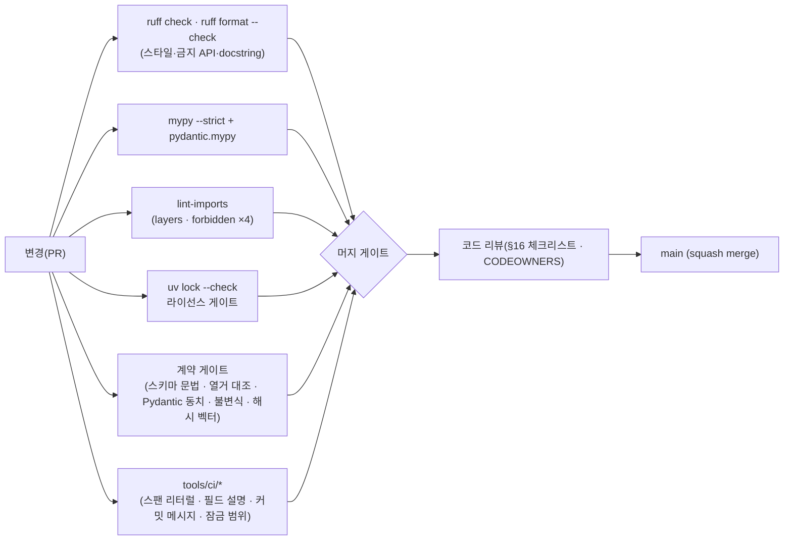
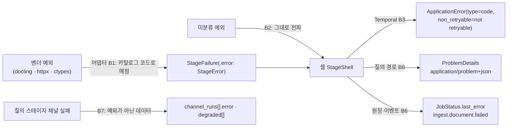

# 코딩 표준

## 목적

이 문서는 RAG Platform 코어 저장소(`rag-platform`)와 코어가 배포하는 플러그인·클라이언트 SDK의 **Python 코드가 지켜야 할 규칙**을 확정한다. 스타일(ruff), 타입(mypy strict), 계약 모델(Pydantic v2), 비동기, 오류 처리, 로깅·관측성, 설정 접근, 시간·ID 유틸리티, 의존성, 문서 문자열(docstring), 테스트 명명, 커밋 메시지, 브랜치 전략, 리뷰 체크리스트, 금지 패턴을 한 곳에 모아 구현자와 리뷰어가 같은 기준으로 판단할 수 있게 한다.

정본은 브리프 D-01·D-02·D-03, 설계 바이블(Design Bible) §4.1(스테이지 공통 규약·순수성), §5.3(`StageError`), §5.7(열거·오류 카탈로그), §6(명명 규약), §12(모듈 맵·의존 방향), [ADR-0035](../06-adr/0035-python-version-and-toolchain-pins.md), [ADR-0036](../06-adr/0036-naming-and-identifier-conventions.md)이다. 이 문서는 그 결정을 **코드 수준 규칙과 기계 강제 수단**으로 옮기되 바꾸지 않는다. 바이블·ADR에 없는 선택(ruff 규칙 세트, 줄 길이, docstring 스타일, 커밋 스코프, 브랜치 이름, pytest 마커)은 "초안" 또는 "제안"으로 표기하고 `## 미해결 이슈`에 모은다.

## 범위

- 포함: `src/rag_platform/`, `plugins/rag-plugin-*`, `sdk/python/`, `tests/`, `tools/`의 Python 코드. TOML 설정(`pyproject.toml`의 `[tool.ruff]`·`[tool.mypy]`·`[tool.importlinter]`), 커밋·브랜치 규약.
- 제외: 저장소 레이아웃·워크스페이스·의존 방향의 **정의**([저장소 구조](./01-repository-structure.md) §3·§4 — 이 문서는 준수 방법만 다룬다), 개발 환경 설치([개발 환경](./02-development-environment.md)), 테스트 종류·실행 전략([테스트 전략](./04-testing-strategy.md)), CI 잡 정의([CI/CD](./05-ci-cd.md)), 플러그인 템플릿([플러그인 개발 가이드](./06-plugin-development-guide.md)), PR 절차·승인 수([기여 가이드](./07-contributing.md)), 태깅·릴리스([릴리스 프로세스](./08-release-process.md)), Java 사이드카(`sidecars/parser-workers`)와 TypeScript SDK의 언어별 표준(각 디렉터리 README, 미해결 이슈 9).
- 정본 규칙: 타입명·필드명·열거값·오류 코드·이벤트명·메트릭명·환경 변수명은 바이블 §5·§5.7·§6의 철자를 그대로 쓴다. 이 문서의 예시 코드에 등장하는 필드는 해당 계약 문서(03-contracts)가 정본이며, 예시는 규칙을 보이기 위한 스케치다.

## 1. 규칙과 강제 수단의 대응

**결정:** 코딩 표준의 모든 규칙은 (a) 기계 게이트, (b) 적합성 키트(conformance kit), (c) 코드 리뷰 중 하나 이상에 대응해야 하며, 게이트가 없는 규칙은 §16 리뷰 체크리스트에 반드시 등장한다. 도구는 D-01의 ruff·mypy(strict)·import-linter·uv 넷이고 그 밖의 검사는 `tools/ci/*.py`(제안, 10-development/01 §2.1)로 둔다([ADR-0035](../06-adr/0035-python-version-and-toolchain-pins.md) 준수 확인 표 "정적 검사").

| 영역 | 규칙 요약 | 강제 수단 | 게이트 |
|------|-----------|-----------|--------|
| 스타일·포맷 | §2 ruff 규칙 세트, `ruff format` | `ruff check`, `ruff format --check` | 위반 0 |
| 타입 | §3 mypy strict + `pydantic.mypy` | `mypy --strict src/ plugins/ sdk/python/` | 오류 0 |
| 계층·금지 임포트 | 바이블 §12 방향, C 등급 차단, 순수성 금지 API | import-linter 5계약(10-development/01 §3.2), ruff `TID251`(banned-api) | 계약 전부 KEPT |
| 계약 모델 | §4 `ContractModel` 패턴, `Field(description=…)` 필수, alias 금지 | Pydantic 동치 게이트(00 §10.3), 스키마 린트(ADR-0036 준수 2), `tools/ci/check_field_descriptions.py`(제안) | 빌드 실패 |
| 오류 처리 | §6 `StageFailure`만, 카탈로그 코드만, 삼키기 금지 | ruff `E722`·`BLE001`·`S110`·`TRY`, 적합성 키트, 카탈로그 대조 | 빌드 실패 / 등록 거부 |
| 로깅·관측 | §7·§8 structlog 필드, 속성 상수만, `tenant_id` 평문 금지 | ruff `T201`·`G`, `tools/ci/check_span_literals.py`(제안, 10-development/01 §4.2), 적합성 `security_invariants` | 빌드 실패 / 등록 거부 |
| 시간·ID | §10 `ctx.now()`, 발급형 ULID는 셸·API만 | ruff `DTZ`·`TID251`, 적합성 `idempotency` | 빌드 실패 / 등록 거부 |
| 의존성 | §11 A 등급만, pin-and-bump, `requires-python` 3.12·3.13 | `uv lock --check`, pip-licenses + liccheck, `tools/ci/check_lock_ranges.py`(제안) | 머지 차단 |
| 문서 문자열 | §12 영어, Google 스타일, 공개 API 필수 | ruff `D`(pydocstyle) | 위반 0(`src/rag_platform/sdk`·`contracts`·`testing`), 경고(그 외) |
| 테스트 명명 | §13 | ruff `PT`, 파일 패턴 검사(pytest `python_files`) | 수집 실패 |
| 커밋·브랜치 | §14·§15 Conventional Commits, trunk 기반 | `tools/ci/check_commit_message.py`(제안), 브랜치 보호 | 머지 차단 |



## 2. Python 스타일

### 2.1 도구와 기준 버전

**결정:** 린트와 포맷은 **ruff 하나**로 통일한다(D-01; `target-version = "py312"`, [ADR-0035](../06-adr/0035-python-version-and-toolchain-pins.md) 표 "정적 검사"). black·isort·flake8·pylint를 별도로 설치하지 않는다. 규칙 코드는 잠금된 ruff 버전 기준이며(정확한 버전은 `uv.lock`이 정본), 규칙 그룹 이름은 ruff 릴리스에 따라 별칭이 바뀔 수 있다(예: 타입 검사 임포트 그룹 `TCH` → `TC`; 확인 필요 as of 2026-09).

### 2.2 규칙 세트(초안)

아래는 이 문서가 제안하는 `pyproject.toml` 발췌다. `select`는 그룹 단위로 넓게 켜고, 포맷터와 충돌하는 규칙(`COM812`, `ISC001`)과 이 프로젝트 규약과 맞지 않는 규칙만 `ignore`한다. 줄 길이 120은 초안 목표다(한국어 주석·긴 필드 설명을 고려; 미해결 이슈 1).

```toml
[tool.ruff]
target-version = "py312"
line-length = 120
src = ["src", "tests", "plugins", "sdk/python", "tools"]
extend-exclude = [
  "src/rag_platform/telemetry/otel",   # Weaver 생성물(10-development/01 §6) — 편집·린트 대상 아님
  "src/rag_platform/ledger/migrations/versions",
  "build",
]

[tool.ruff.lint]
select = [
  "E", "W", "F",          # pycodestyle · pyflakes
  "I",                    # isort
  "N",                    # pep8-naming
  "UP",                   # pyupgrade (py312: PEP 604 `X | None`, PEP 695 제네릭 문법 허용)
  "B",                    # bugbear (B006 가변 기본값, B904 `raise … from`)
  "A", "C4", "PIE", "SIM", "RET", "RSE", "PERF", "FURB", "RUF",
  "ANN",                  # 주석(annotations) 누락 — mypy strict와 짝
  "D",                    # pydocstyle (§12)
  "DTZ",                  # naive datetime 금지 (§10)
  "T10", "T20",           # debugger · print (§7)
  "G", "LOG",             # 로깅 포맷 (§7)
  "EM", "TRY", "BLE",     # 예외 메시지 · tryceratops · blind except (§6)
  "S",                    # bandit (S110 try-except-pass, S311 random, S603/S607 subprocess)
  "ASYNC",                # flake8-async: async 함수 안 블로킹 호출 (§5)
  "ARG", "FBT",           # 미사용 인자 · 불리언 트랩
  "PTH",                  # pathlib
  "ERA",                  # 주석 처리된 코드 금지
  "TID",                  # tidy-imports: TID251 banned-api, TID252 상대 임포트
  "TC",                   # 타입 전용 임포트는 TYPE_CHECKING 블록으로
  "PT",                   # pytest 스타일 (§13)
  "PL",                   # pylint 부분집합
  "TD", "FIX",            # TODO 형식 (§12.4)
  "INP",                  # __init__.py 누락
]
ignore = [
  "COM812", "ISC001",     # ruff format과 충돌
  "D203", "D213",         # Google 스타일과 충돌(D211·D212 사용)
  "ANN401",               # `Any`는 어댑터 경계에서 필요(사유 주석 필수, §3.4)
  "PLR0913",              # 인자 수는 Pydantic 모델·키워드 전용 인자로 관리
  "TRY003",               # 카탈로그 detail 문구는 호출 지점에서 조립(§6.4)
  "FIX002",               # TODO 자체는 허용, 형식은 TD 규칙으로 강제
]

[tool.ruff.lint.per-file-ignores]
"tests/**" = ["S101", "D", "ANN", "PLR2004", "ARG", "FBT", "INP001", "TID251"]
"tools/**" = ["T201", "TID251", "INP001", "D"]
# 셸·진입점·인프라 계층(L4~L10)에서만 시계·난수·환경 변수 직접 접근 허용(§5·§9·§10)
"src/rag_platform/orchestration/**" = ["TID251"]
"src/rag_platform/api/**" = ["TID251"]
"src/rag_platform/cli/**" = ["TID251"]
"src/rag_platform/eval/**" = ["TID251"]
"src/rag_platform/ledger/**" = ["TID251"]
"src/rag_platform/storage/**" = ["TID251"]
"src/rag_platform/security/**" = ["TID251"]
"src/rag_platform/settings.py" = ["TID251"]
"src/rag_platform/sdk/hashing.py" = ["TID251"]   # blake3 유일 임포트 지점(§10.2; 파일명은 제안)
"src/rag_platform/contracts/**" = ["TID251"]     # 해시·시각 검증기(00 §7 참조 구현)

[tool.ruff.lint.flake8-tidy-imports]
ban-relative-imports = "all"                      # 절대 임포트만(§2.4)

[tool.ruff.lint.flake8-tidy-imports.banned-api]
# 바이블 §4.1 순수성: 스테이지·핫패스(L0~L3)는 시간·난수·환경·비밀을 직접 읽지 않고 blake3를 직접 임포트하지 않는다(04-pipelines/01 §2.5; 해시는 sdk.hash_of/blake3_hex 경유, §10.2)
"datetime.datetime.now".msg = "Use ctx.now() in stages; datetime.now(UTC) only in shell/api (§10.1)"
"datetime.datetime.utcnow".msg = "Deprecated and naive; use ctx.now() or datetime.now(UTC) (§10.1)"
"time.time".msg = "Use ctx.now(); monotonic timers belong to the shell (§10.1)"
"random".msg = "Stages are deterministic; issued IDs come from the shell (§10.2)"
"secrets".msg = "Only the shell/api issue entropy (§10.2)"
"uuid.uuid4".msg = "Issued IDs are ULIDs from the shell; content keys use hash_of() (§10.2)"
"os.environ".msg = "Configuration is injected via Settings/RuntimeServices (§9)"
"os.getenv".msg = "Configuration is injected via Settings/RuntimeServices (§9)"
"blake3".msg = "Use rag_platform.sdk.hash_of / blake3_hex (§10.2)"
"fitz".msg = "C-grade (AGPL) import forbidden (D-02, ADR-0001)"
"pymupdf".msg = "C-grade (AGPL) import forbidden (D-02, ADR-0001)"
"hwp5".msg = "C-grade (AGPL) import forbidden (D-02, ADR-0001)"
"opentelemetry.trace.get_tracer".msg = "Plugins do not create spans; use @instrumented_call (§8)"
"logging.getLogger".msg = "Use structlog.get_logger() (§7)"

[tool.ruff.lint.isort]
known-first-party = ["rag_platform"]
required-imports = ["from __future__ import annotations"]
combine-as-imports = true
split-on-trailing-comma = true

[tool.ruff.lint.pydocstyle]
convention = "google"

[tool.ruff.lint.pep8-naming]
classmethod-decorators = ["pydantic.field_validator", "pydantic.model_validator"]

[tool.ruff.format]
quote-style = "double"
indent-style = "space"
docstring-code-format = true
```

`banned-api`는 고정된 API 이름을 막는 내장 규칙이므로 "ruff 사용자 정의 규칙"이 아니다. 문자열 리터럴 내용(스팬 속성 이름)처럼 API 이름이 아닌 것은 ruff로 막을 수 없어 `tools/ci/check_span_literals.py`(제안; AST 순회)가 담당한다(10-development/01 §4.2 마지막 행, §8.2). 플러그인 저장소(`rag_plugin_*`)는 같은 `[tool.ruff]` 절을 템플릿으로 받는다([플러그인 개발 가이드](./06-plugin-development-guide.md)).

### 2.3 포맷

- `ruff format`이 유일한 포맷터다. 수동 정렬·주석 박스·ASCII 아트 금지. 포맷 결과에 대한 이견은 설정 변경 PR로만 해결하며, 파일 단위 `# fmt: off`는 생성 데이터 표(테스트 벡터·열거 사본)에만 허용하고 사유 주석을 단다.
- 문자열은 큰따옴표. f-string은 로그 이벤트·오류 코드·해시 입력에 쓰지 않는다(§6·§7·§10). 긴 문자열은 괄호 안 암시적 결합 대신 명시적 `+` 또는 텍스트 상수로 분리한다(`ISC001`은 포맷터 충돌로 끄지만 리뷰 항목).
- 한 파일에 공개 심볼이 여러 개면 `__all__`을 선언한다(`sdk`·`contracts`·`testing`은 필수).

### 2.4 임포트

- **절대 임포트만**(`ban-relative-imports = "all"`). 임포트 순서는 ruff isort(표준 → 서드파티 → `rag_platform` → 로컬 없음)이며 `from __future__ import annotations`를 모든 모듈 첫 줄에 둔다(Pydantic v2는 지연 주석을 `model_rebuild` 없이 해석하며, 순환 참조 타입은 `TYPE_CHECKING` 블록으로 옮긴다 — 00 Pydantic 절·02 §2.2 스케치와 동일).
- 모듈 간 의존은 import-linter 5계약이 정본이다(10-development/01 §3.2·§4). 계층 밖 능력이 필요하면 `sdk` 포트 프로토콜로 받는다(02 §1.3). "임포트 한 줄이면 되는데"는 계층 위반의 신호다.
- 선택 extra(`[kiwi]`, `[docling-chunker]`, `[opensearch]`, `[temporal]`, `[eval]`)의 패키지는 **해당 어댑터 모듈 최상위**에서만 임포트하고, 코어 공용 모듈(`sdk`·`contracts`·`plugins`)은 임포트하지 않는다. 미설치 시 `ImportError`는 삼키지 않고 레지스트리 `build()`가 `profile.invalid`(detail에 필요한 extra 이름)로 변환한다(§6.2, §11.4).
- 벤더 타입(`DoclingDocument`, `qdrant_client.models.*`)은 어댑터 모듈 밖으로 새지 않는다(원칙 2 Adapters over Forks). 어댑터의 공개 함수 시그니처에 벤더 타입이 나타나면 리뷰 거부.

### 2.5 명명(코드)

PEP 8 + ruff `N` 규칙에 바이블 §6을 겹친다.

| 대상 | 규칙 | 예 |
|------|------|----|
| 모듈·패키지 | snake_case, 바이블 §12 트리의 이름 그대로; 어댑터 파일명 = `implementation`(10-development/01 §9) | `adapters/parse/hwpx_python_hwpx.py` |
| 클래스 | PascalCase; 계약 모델은 바이블 §5.1 타입명과 **동일**; 어댑터 클래스는 `{Implementation}{ExtensionPoint}` | `ParsedDocument`, `HwpxPythonHwpxParser`, `RrfFuser` |
| 열거 | `contracts/enums.py`의 `StrEnum`(`ChunkLevel`만 `IntEnum`); 멤버 이름 UPPER_SNAKE, 값은 바이블 §5.7 철자 그대로 | `Channel.LATE_INTERACTION = "late_interaction"`, `ProfileTier.KOREAN_GOV = "korean-gov"` |
| 함수·메서드·변수 | snake_case; 불리언은 `is_`/`has_`/`supports_` 또는 형용사(바이블 §6.4) | `is_current`, `supports_multivector` |
| 상수 | UPPER_SNAKE + `Final`; 메트릭·스팬·이벤트 이름은 `telemetry`의 상수만 사용 | `MAX_INLINE_BYTES: Final = 4096` |
| 타입 변수 | `In`/`Out`처럼 의미 있는 이름(단일 문자 `T`는 순수 컨테이너 유틸에서만) | `Stage[In, Out]` |
| 비공개 | 선행 밑줄 하나; 이중 밑줄 이름 맹글링 금지 | `_utc`, `_reject_null_on_optional` |
| 예약어 충돌 | 후행 밑줄(`and_`, `not_`) — `FilterNode`처럼 JSON 키가 예약어인 경우만(§4.5) | `and_: list[FilterNode] = Field(alias="and")` |

## 3. 타입

### 3.1 mypy 설정

**결정:** `mypy --strict`를 `src/`, `plugins/*/src`, `sdk/python/src`에 적용하고 `pydantic.mypy` 플러그인을 켠다(D-01, [ADR-0035](../06-adr/0035-python-version-and-toolchain-pins.md)). 벤더 라이브러리의 스텁 부재는 **모듈 단위 `ignore_missing_imports`만** 허용하고, 함수·행 단위 `type: ignore`는 오류 코드와 사유 주석이 필수다(ADR-0035 준수 확인 표 "정적 검사"). 루트 `pyproject.toml`의 `[tool.mypy]`가 **유일한 설정**이다 — 워크스페이스 멤버(`plugins/*`, `sdk/python`)의 `pyproject.toml`(10-development/01 §3.3)은 자체 `[tool.mypy]`를 두지 않고, CI가 루트 설정을 `--config-file pyproject.toml`로 공유해 멤버 소스 디렉터리를 경로 인자로 검사한다(`packages`는 인자 없이 실행할 때의 기본 대상인 코어만 가리킨다).

```toml
[tool.mypy]
python_version = "3.12"
strict = true
plugins = ["pydantic.mypy"]
mypy_path = "src"
# 인자 없는 `mypy` 실행의 기본 대상(코어). 워크스페이스 멤버 plugins/*/src·sdk/python/src는 CI가
# `mypy --config-file pyproject.toml plugins/*/src sdk/python/src`로 같은 설정을 공유해 검사한다(10-development/01 §3.3 멤버 pyproject.toml에 별도 [tool.mypy] 없음).
packages = ["rag_platform"]
warn_unreachable = true
enable_error_code = ["ignore-without-code", "redundant-expr", "truthy-bool", "possibly-undefined"]
show_error_codes = true

[tool.pydantic-mypy]
init_forbid_extra = true          # 생성자에 미지 키 → 타입 오류(extra="forbid"와 짝)
init_typed = true                 # 생성자 인자 타입을 필드 타입으로 검사
warn_required_dynamic_aliases = true

# 벤더 스텁 부재는 모듈 단위로만. 목록은 잠금 시점의 실제 import 이름으로 유지한다(확인 필요 as of 2026-09).
[[tool.mypy.overrides]]
module = ["docling.*", "docling_core.*", "pypdfium2.*", "pdftext.*", "rapidocr.*", "kiwipiepy.*", "mecab.*", "kss.*", "gliner2.*"]
ignore_missing_imports = true
```

`tests/`는 `--strict` 대신 `check_untyped_defs = true`로 검사한다(픽스처 반환 타입 생략 허용; 미해결 이슈 2).

### 3.2 Protocol 우선

**결정:** 확장 지점과 포트는 `typing.Protocol`(구조적 타이핑)로 선언하고 추상 기반 클래스(ABC) 상속을 요구하지 않는다. 플러그인은 `rag_platform.sdk`의 어떤 클래스도 **상속하지 않고** 프로토콜을 만족하면 된다(바이블 §4.1 `Stage[In, Out]` 5멤버; [ADR-0032](../06-adr/0032-plugin-sdk-stage-protocol-and-conformance-kit.md)). 선택 기반 클래스(`SidecarStage`, 제안 `StageBase`; 01-pipeline-framework §2.6·미해결 이슈 15)는 편의 제공이며 상속이 적합성의 조건이 아니다.

규칙:

- `Protocol` 멤버는 시그니처만 갖고 구현을 갖지 않는다(기본 구현이 필요하면 별도 헬퍼 함수). `@runtime_checkable`은 셸이 `isinstance`로 선택 프로토콜(`StageLifecycle`, `Resumable`) 구현 여부를 판별하는 프로토콜에만 붙인다.
- 구현 클래스는 프로토콜을 **명시적으로 상속하지 않는다**(구조적 일치만). 정적 확인이 필요하면 테스트 모듈에서 `stage: Stage[ChunkSet, EnrichedChunkSet] = DerivedMetaEnricher(config, plugin_version="0.1.0")` 할당 한 줄로 mypy가 검사하게 한다(`type: ignore`·`cast`로 억지 일치시키는 것은 금지). 런타임 검증은 적합성 키트 `contract_roundtrip`이 한다 — 정적 단언은 **선택**, 적합성 키트는 **필수**다.
- 포트(`TokenCounter`, `KoreanAnalyzer`, `DerivedArtifacts`, `AclRevocationHints`, `BackendTokenIssuer`, `EgressGuard`; 02 §1.3)는 `sdk`에 프로토콜로, 구현은 상위 계층에, 연결은 조립 지점(`api.create_app`, 워커 `main`, 릴레이 실행기, `cli`)에서만 한다.
- **`StageContext` 사용 규칙(바이블 §4.1 1.3.0, AM-27):** 스테이지가 읽고 쓸 수 있는 멤버는 `ctx.token_counter`, `ctx.analyzer`, `ctx.now()`, `ctx.lineage[...]`, `ctx.heartbeat(...)`, `ctx.remaining_ms()`, 그리고 1.3.0에서 추가된 선택 멤버 `ctx.plan: QueryPlan | None`(질의 측 스테이지만 채워짐, 수집 측은 `None`)과 `ctx.artifacts: DerivedArtifacts`(파생물 쓰기 포트)뿐이다. `ctx.artifacts`는 파생물(변환본·페이지 이미지 등)을 셸에 넘기는 포트일 뿐 스테이지가 직접 파일·오브젝트 스토리지에 쓰는 것을 허용하지 않는다 — 실제 저장·계보 기록은 여전히 셸이 수행하며 "스테이지는 I/O를 직접 하지 않는다"는 원칙(§5.1)은 그대로다. `ctx.plan`을 채우지 않는 수집 측 스테이지가 이를 읽으면 `None` 분기를 처리해야 한다.

### 3.3 제네릭 `Stage[In, Out]`

`In`은 반공변(contravariant), `Out`은 공변(covariant)이며 둘 다 `BaseModel` 상한을 갖는다(02 §2.2). 구현은 구체 계약 타입으로 특수화하고 `run`의 인자·반환 주석을 생략하지 않는다(`ANN`·mypy가 강제). PEP 695 문법(`class X[In, Out]`)은 `target-version = "py312"`에서 허용하지만, `Protocol` 변성(variance) 선언이 필요한 `sdk`의 정의는 `TypeVar(..., contravariant=True)` 명시형을 유지한다(자동 추론 변성은 프로토콜 정의에서 의도를 감춘다).

```python
# src/rag_platform/adapters/enrich/derived_meta.py — 스케치. 계약 필드는 03-contracts/05·06이 정본.
from __future__ import annotations

from typing import TYPE_CHECKING

import structlog
from pydantic import BaseModel, ConfigDict, Field

from rag_platform.contracts.capabilities import Capabilities
from rag_platform.contracts.chunk_set import ChunkSet
from rag_platform.contracts.enriched_chunk_set import EnrichedChunkSet
from rag_platform.contracts.enums import IsolationMode
from rag_platform.sdk import StageFailure, hash_of, stage_error

if TYPE_CHECKING:
    from rag_platform.sdk import StageContext

log = structlog.get_logger()


class DerivedMetaConfig(BaseModel):
    """Configuration of ``enricher.derived_meta`` (profile key ``ingest.enrich.derived_meta``)."""

    model_config = ConfigDict(extra="forbid", frozen=True)

    extract_dates: bool = Field(default=True, description="Derive ``enrichment.dates[]`` from Korean date expressions.")
    extract_articles: bool = Field(default=True, description="Derive statute article references (e.g. 제12조).")


class DerivedMetaEnricher:
    """Deterministic metadata enricher.

    Structurally implements ``Stage[ChunkSet, EnrichedChunkSet]`` (Design Bible §4.1).
    Pure: no I/O, clock, or randomness outside ``ctx``.
    """

    plugin_id = "enricher.derived_meta"
    config_schema = DerivedMetaConfig

    def __init__(self, config: DerivedMetaConfig, *, plugin_version: str) -> None:
        self._config = config
        self._plugin_version = plugin_version
        self._config_hash = hash_of("config", config.model_dump_json(exclude_none=True))

    def capabilities(self) -> Capabilities:
        return Capabilities(isolation_modes=[IsolationMode.IN_PROCESS], supports_resumable=False, contracts_compat=">=1.0,<2.0")

    def fingerprint(self) -> str:
        return hash_of("producer", self.plugin_id, self._plugin_version, self._config_hash, "", "")

    async def run(self, inp: ChunkSet, ctx: StageContext) -> EnrichedChunkSet:
        if not inp.chunks:
            raise StageFailure(stage_error("contract.violation", stage="enrich", plugin_id=self.plugin_id, detail="ChunkSet.chunks is empty"))
        for offset, chunk in enumerate(inp.chunks):
            if offset % 500 == 0:
                ctx.heartbeat({"unit": "chunk_offset", "chunk_offset": offset})
            self._derive(chunk)  # 순수 계산; 결과 조립은 생략(03-contracts/06 필드 표)
        log.info("enrich.derived_meta.finished", chunks=len(inp.chunks))
        return self._assemble(inp, created_at=ctx.now())
```

`config_hash`의 정확한 입력은 `H("config", canonical_json(config))`(바이블 §6.2 1.3.0 — JCS 수치 직렬화·선택 필드 제거 후 해시, AM-12; §10.2)이며 위 `model_dump_json`은 스케치다 — 실제 구현은 `sdk`가 제공하는 `config_hash(config)` 헬퍼(제안)를 쓴다(§10.2).

### 3.4 `Any`·`cast`·`type: ignore`

| 허용 지점 | 조건 |
|-----------|------|
| `Any` | 어댑터 경계에서 벤더 반환값을 받는 **지역 변수**까지만. 공개 시그니처·계약 필드에 `Any` 금지(`FilterNode.value`처럼 계약이 `any`로 정한 필드는 `JsonValue` 별칭 사용; 00 U-9). `# noqa: ANN401 -- <사유>` 필수 |
| `typing.cast` | 벤더 라이브러리 반환 타입을 좁힐 때만. `cast` 직후 `assert isinstance` 또는 Pydantic 검증이 따라야 한다. 계약 인스턴스를 만들기 위한 `cast`는 금지(`model_validate`를 쓴다) |
| `# type: ignore[code]` | 오류 코드 필수(`ignore-without-code`), 같은 줄 끝에 `-- <사유, 업스트림 이슈 링크>`. 파일 상단 `# mypy: ignore-errors` 금지 |
| `object` | 임의 값을 받아 판별하는 함수의 매개변수 타입(`isinstance` 분기)에는 `Any` 대신 `object` |

### 3.5 타입 별칭과 원시 형식

계약의 원시 형식(`Ulid`, `Hex64`, `Hex32`, `Semver`, `PrincipalString`, `PluginId`, `ErrorCode`, `FilterableField`)은 `rag_platform.contracts.common`의 `Annotated[str, Field(pattern=…)]` 별칭 하나만 존재하며 다른 모듈이 정규식을 복제하지 않는다(00 Pydantic 절; 정규식은 스키마 `$defs`의 `pattern`을 그대로 복사). 새 원시 형식이 필요하면 스키마 `$defs`에 먼저 등재한다(03-contracts/00 소유).

## 4. Pydantic v2 규약

### 4.1 계약 모델(`rag_platform.contracts`)

**결정:** 모든 계약 모델은 `ContractModel`(00 Pydantic 절)을 상속한다 — `ConfigDict(extra="forbid", frozen=True, populate_by_name=True)`, N 필드의 명시적 `null` 거부 검증기, `_null_allowed_optional` 예외 집합. 필드명은 JSON 필드명과 **동일**하며 alias·`alias_generator`·`serialization_alias`·`validation_alias`는 금지한다(D-03; [ADR-0036](../06-adr/0036-naming-and-identifier-conventions.md) 대안 C 기각·준수 확인 2). 유일한 예외는 §4.5의 예약어 필드다.

| 규칙 | 내용 | 강제 |
|------|------|------|
| `Field(description=…)` 필수 | 모든 필드(계약·config·Settings)에 영문 설명. 설명 첫 문장은 계약 문서 필드 표의 "설명" 열과 의미가 같아야 하며 바이블 절 번호를 괄호로 인용한다 | `tools/ci/check_field_descriptions.py`(제안): `model_fields`의 `description is None`이면 실패 |
| 필수 `Y` | `field: T`(기본값 없음) | Pydantic 동치 게이트(필수 집합) |
| `Y(nullable)` | `field: T \| None`(기본값 없음) — 키 필수, 값 null 허용 | 동치 게이트(nullable) |
| 선택 `N` | `field: T \| None = None`; 명시적 `null`은 `ContractModel` 검증기가 거부 | 불변식 테스트 |
| `N` + `\| null` 표기 | `field: T \| None = None` + `_null_allowed_optional`에 필드명 등재 | 동치 게이트 |
| 조건 필수 | `@model_validator(mode="after")`; 메시지는 `"contract.violation: <규칙>"` | 불변식 테스트 1:1(00 §10.3) |
| 컬렉션 | `list[T]`(가변 기본값 금지 — 빈 배열도 `Field(default_factory=list)`가 아니라 **필수 필드**로 두고 호출자가 `[]`를 넘긴다; `warnings: []`는 값이다, 00 §8.1) | `B006`·`RUF012` |
| 열거 | `enum(TypeName)` 필드는 `contracts.enums`의 열거 타입, `Literal[...]`은 스키마 `const`·부분집합에만 | 열거 대조 게이트 |
| 시각 | `datetime`(tz-aware UTC). 검증기 `_utc`가 naive·비UTC를 거부 | `DTZ`, 불변식 |
| 검증기 | 순수 함수. I/O·시계·레지스트리 조회 금지(`contracts-pure` 계약) | import-linter |
| 불변식 메서드 | 스키마가 표현하지 못하는 규칙은 `_invariants`(`model_validator`) 하나에 모으고 문서 `## 불변식` ID를 주석으로 단다 | 불변식 테스트 |
| `model_config` 재정의 금지 | 하위 모델이 `extra`·`frozen`·`populate_by_name`을 완화할 수 없다 | 리뷰 + 동치 게이트 |

계약 모델에는 계약 외 메서드를 두지 않는다. 허용되는 것은 (a) 불변식 검증기, (b) 결정적 파생(`BlockRef.to_provenance()`처럼 문서가 정의한 사상), (c) 소유 문서가 명시한 팩토리(`contracts.errors.stage_error`)다. 비즈니스 로직(점수 계산·필터 빌드)은 `retrieval`·`adapters`에 둔다.

### 4.2 플러그인 설정 모델(`config_schema`)

- `BaseModel` + `ConfigDict(extra="forbid", frozen=True)`. 모든 필드에 `description`과 **기본값**(프로파일이 생략할 수 있어야 하므로; 필수 키는 `Profile` 스키마가 로딩 시 검증). 기본값이 없는 필드는 프로파일 로딩 실패 `profile.invalid`의 원인이 된다.
- 값은 JSON 직렬화 가능한 원시·열거·중첩 모델만(`config_hash = H("config", canonical_json(config))`, 바이블 §6.2 1.3.0 — JCS 수치 직렬화·선택 필드 제거, §10.2). `Path`·`datetime`·콜러블 금지.
- 모델 서빙 주소·비밀·파일 경로는 config가 아니라 `Settings`(§9) 또는 `credentials_ref`다. config에 들어가면 `profile_hash`가 배포 환경에 따라 달라져 재현성(브리프 §7)이 깨진다.

### 4.3 `Settings`(pydantic-settings)

`rag_platform.settings.Settings`(02 §5.2, 제안 모듈)만 `BaseSettings`를 상속한다. `SettingsConfigDict(env_prefix="RAG_", env_nested_delimiter="__", extra="forbid")`(바이블 §6.6), 절 모델은 `extra="forbid"`, 비밀은 `SecretStr`. 다른 어떤 모듈도 `BaseSettings`를 상속하거나 `pydantic_settings`를 임포트하지 않는다(`contracts-pure` 계약이 `pydantic_settings`를 금지 목록에 둔다; 02 §1.2). 접근 규칙은 §9.

### 4.4 직렬화

- 계약 인스턴스의 JSON 출력은 **하나의 헬퍼**를 거친다(제안 `rag_platform.contracts.serialize.to_wire(model) -> dict[str, JsonValue]`; 미해결 이슈 3): `model_dump(mode="json", by_alias=True, exclude_unset=False, exclude_none=False)` 후 N 필드 중 `None`만 제거(00 §8.1). `Y(nullable)` 필드를 `exclude_none`으로 떨어뜨리는 직접 호출은 금지.
- 해시 입력은 `canonical_json(to_wire(model))`(00 §7; 수치는 JCS 직렬화, 선택 필드는 제거 후 해시 — 바이블 §6.2 1.3.0, AM-12, §10.2). `json.dumps` 직접 호출은 `canonical_json` 구현 한 곳에만 있다.
- 파일·오브젝트 저장 바이트는 셸이 만든다(`ArtifactStore.put`). 스테이지가 `model_dump_json()`으로 바이트를 만들어 저장하면 리뷰 거부(바이블 §4.1 경계 페이로드).
- 입력 파싱은 `Model.model_validate(dict)` / `model_validate_json(bytes)`만. `Model(**dict)`는 alias 해소와 N-null 검증기를 우회할 수 있어 계약 인스턴스 생성에 쓰지 않는다(테스트 픽스처 조립은 허용).

### 4.5 금지와 예외

| 금지 | 이유 | 예외 |
|------|------|------|
| `alias`, `alias_generator`, `serialization_alias`, `validation_alias` | 필드명이 계약(D-03; ADR-0036 준수 2) | `FilterNode`의 `and`/`or`/`not`처럼 JSON 키가 **Python 예약어**인 경우만 `Field(alias="and")` + Python 이름 `and_`. 이때 `populate_by_name=True`(기반 클래스 제공)와 `by_alias=True` 직렬화(§4.4 헬퍼)가 짝이다 |
| `Optional[T]`, `Union[A, B]` | `T \| None`, `A \| B`(py312, `UP007`) | — |
| `Y(nullable)` 필드에 `= None` 기본값 | 키 생략을 허용해 `contract.violation` 검출 불가 | — |
| `dict[str, Any]` 필드 | 열린 객체는 00 §8.2 표의 6곳만 | 표의 열린 객체는 값 스키마를 갖는 `dict[str, str \| int \| float \| bool]` 등으로 좁힌다 |
| `model_config = ConfigDict(extra="allow" \| "ignore")` | 미지 키는 `contract.violation` | 없음 |
| `@validator`, `class Config`, `.dict()`, `.json()`, `parse_obj` | Pydantic v1 API | 없음 |
| `default_factory=datetime.now` 등 시계 기본값 | 봉투 `created_at`은 셸이 `ctx.now()`로 채운다 | 없음 |
| 계약 모델 안의 `@property`로 파생 값 노출 | 스키마와 어긋나는 "유령 필드" | `to_provenance()`처럼 문서가 정의한 메서드 |

## 5. 비동기 규약

### 5.1 async 우선

**결정:** I/O 바운드 코드는 `asyncio` 단일 이벤트 루프에서 `async def`로 작성하고, CPU 바운드 작업은 **프로세스 경계**(큐별 워커 프로세스 다중화 + 슬롯 1, `helper_process`, 사이드카)에서 실행한다. `Stage.run`은 CPU 바운드 어댑터라도 **항상 `async def`** 이며 어디서 실행되는지 모른다 — 전용 스레드·헬퍼 프로세스·사이드카의 선택은 셸이 큐와 `StagePolicy.isolation`으로 한다(02 §4.2 결정·세부 규칙 1; [ADR-0003](../06-adr/0003-orchestrator-neutral-pipeline-and-non-durable-local-runner.md), [ADR-0033](../06-adr/0033-sidecar-convert-contract-and-isolation-ladder.md)).

| 상황 | 규칙 | 근거 |
|------|------|------|
| API 핸들러·MCP 도구·릴레이·셸 | `async def`. 동기 라이브러리 호출은 `await asyncio.to_thread(fn, *args)`로 감싼다 | 02 §4.2 |
| `Stage.run` 안의 CPU 연산 | 그대로 실행한다(`await` 없이도 됨). 자체 스레드·프로세스 풀·`to_thread` 생성 금지 — 셸이 이미 전용 스레드 또는 헬퍼 프로세스에 배치했다 | 02 §4.2 규칙 1, 04-pipelines/01 §2.5 |
| `Stage.run` 안의 외부 호출(모델 서버·사이드카·LLM) | `RuntimeServices.http`(egress 가드 적용)·`SidecarStage` 경유, `ctx.remaining_ms()` 존중. `httpx.AsyncClient` 직접 생성 금지 | 04-pipelines/01 §2.5 |
| 플랫폼 코드의 CPU 팬아웃(평가 하네스, CLI 배치, `helper_process` 실행기) | `concurrent.futures.ProcessPoolExecutor(mp_context=multiprocessing.get_context("spawn"))`만. `fork` 컨텍스트 금지(JVM·CUDA·스레드 상태 상속 위험). 풀은 조립 지점에서 만들고 인자로 전달 | 02 §4.2 표 `eval harness`·`ingest-cpu` 행 |
| 토큰 카운트·MinHash 같은 동기 연산이 `api` 루프에 있을 때 | 항목 수 임계(초안 20)를 넘으면 `to_thread` | 02 §4.2 표 `api` 행 |
| 동기 진입점 | `asyncio.run()`은 `cli`와 테스트에만. 라이브러리 코드에서 `asyncio.get_event_loop()`·`run_until_complete`·중첩 `asyncio.run` 금지 | `ASYNC` 규칙, 리뷰 |
| 블로킹 호출 | `async def` 안의 `time.sleep`·동기 `open`·동기 HTTP는 `ASYNC` 규칙 위반. 파일 I/O는 셸(`storage`)만 | `ASYNC101`·`ASYNC230`(코드 확인 필요 as of 2026-09) |

### 5.2 타임아웃·재시도·취소

- **타임아웃은 셸의 것이다.** 스테이지 코드에 `asyncio.timeout`·`wait_for`·재시도 루프·백오프가 있으면 리뷰 거부(04-pipelines/01 §10.3 마지막 문장; ADR-0003 준수 확인 9). 스테이지는 `ctx.remaining_ms()`로 남은 예산을 읽고 축소 규칙(리랭크 `top_n_in` 축소 → 생략 → `parent_expand` 생략 → 근사 카운트; 바이블 §8.3)을 데이터로 적용한다.
- 셸·API 코드의 타임아웃은 `async with asyncio.timeout(seconds):`(3.11+) 컨텍스트 매니저를 우선하고, 기존 스케치의 `asyncio.wait_for`는 동치로 허용한다. 타임아웃 값은 `StagePolicy`·`QueryPlan.latency_budget_ms`에서 오며 코드 상수로 박지 않는다.
- 취소(`asyncio.CancelledError`)는 **절대 삼키지 않는다**. `except Exception`은 `CancelledError`를 잡지 않지만(`BaseException` 계열), `except BaseException`·bare `except:`는 잡으므로 금지(`E722`·`BLE001`). 정리가 필요하면 `try/finally`.
- 스테이지는 취소를 감지할 의무가 없다(02 §4.2 규칙 3). 긴 루프는 진행 지점을 `ctx.heartbeat(details)`로 알리기만 한다(§3.3 예시).

### 5.3 동시 실행 패턴

- 채널 × 컬렉션 × 변형 팬아웃(`retrieve`)은 **각 태스크가 자기 실패를 데이터로 변환**한 뒤(`channel_runs[].status/error`, 02 §6.1 B7) `asyncio.gather(*tasks)`로 모은다. `return_exceptions=True`에 의존하지 않는다 — gather 밖으로 예외가 나오면 버그다. `asyncio.TaskGroup`은 첫 실패가 형제를 취소하므로 "최소 1채널 성공이면 계속" 의미론과 맞지 않아 채널 팬아웃에 쓰지 않는다(전부 성공해야 하는 배치 저장 등에는 허용).
- 채널별 타임아웃은 태스크 안에서 `asyncio.timeout(timeout_ms / 1000)`으로 걸고 `TimeoutError`를 `ChannelRunStatus.TIMEOUT`으로 기록한다(02 §4.2 표 `api` 행).
- 공유 가변 상태는 요청 범위(`StageContext`) 또는 프로세스 범위(`RuntimeServices`, 생성자에서 고정)만 존재한다. 모듈 전역 가변 캐시·싱글턴 금지(04-pipelines/01 §2.5). 백엔드 클라이언트는 프로세스당 1개(02 §4.2 규칙 5)이며 요청별로 바뀌는 것은 헤더와 필터만이다.
- `contextvars`(structlog 문맥, OTel 컨텍스트)는 `to_thread`·`gather`로 자동 전파된다. 스레드 풀을 직접 만들어 전파를 끊지 않는다.

## 6. 오류 처리

### 6.1 세 표현과 한 예외

**결정:** 오류 모델은 계약 `StageError` 하나이고(바이블 §4.1·§5.3), 플러그인·스테이지 코드가 던질 수 있는 예외는 SDK 예외 **`StageFailure`(속성 `.error: StageError`) 하나**다. 계약 모델은 예외가 아니다. 품질 손실은 예외가 아니라 데이터(`Warning`·`DegradedEntry`·`page_status[]`·`quality=degraded`·`status=partial`)로 반환한다(01-pipeline-framework §10.1; [오류 모델](../03-contracts/13-error-model.md) §1; [ADR-0018](../06-adr/0018-api-rest-sse-mcp-no-grpc-rfc9457.md), [ADR-0032](../06-adr/0032-plugin-sdk-stage-protocol-and-conformance-kit.md)).



"계층"은 상속 트리가 아니라 **경계별 표현**이다(02 §6.1 B1~B11). 코드마다 예외 클래스를 만들지 않는다 — `class DocumentEncryptedError(StageFailure)`는 금지이며 코드는 `StageError.code` 데이터다. 유일하게 허용되는 하위 클래스는 SDK가 정의한 것(현재 없음)이고, 새 하위 클래스는 ADR-0032 minor 절차다.

| 지점 | 던지는 것 | 잡는 것 | 변환 |
|------|-----------|---------|------|
| 어댑터 내부(B1) | `StageFailure(stage_error(code, stage=…, plugin_id=…, detail=…))` — 항상 `raise … from exc` | 벤더 예외 **구체 타입만**(`except VendorEncryptedError as exc`). `except Exception`은 벤더 라이브러리가 예외 계층을 공개하지 않을 때만, 사유 주석 + 즉시 매핑 또는 재전파 | 카탈로그 코드 |
| 폴백 체인(라우터) | 마지막 실패를 `cause`로 감싼 `parse.conversion_failed` | `except StageFailure as f` → `f.error`를 `parser_chain[]`에 기록 후 다음 어댑터 | 13 G4 |
| 셸(B2·B3) | — | `StageFailure` → `StageError`; **미분류 예외는 `StageError`로 만들지 않고** 재시도 가능으로 취급, 소진 시 `last_error`에 예외 타입만 | 04-pipelines/01 §10.2; `contract.violation`은 계약 검증 실패에만 |
| 질의 스테이지(B7) | 예외 대신 데이터. 전 채널 실패만 `retrieve.unavailable` | 각 채널 태스크 안에서 자기 예외 | `channel_runs[]`, `degraded[]` |
| `api`(B8·B9) | — | `StageFailure`, 검증·인증 예외 | `api.problems.to_problem` → `ProblemDetails` |
| 사이드카 클라이언트(B5) | `parse.sidecar_unavailable`(연결 실패·5xx·타임아웃) / `ConvertResponse.error` 그대로 | `httpx` 예외 | `SidecarStage` |

### 6.2 절대 삼키지 않는다

| 금지 | ruff | 대체 |
|------|------|------|
| `except:` (bare) | `E722` | 구체 타입 |
| `except Exception: pass` / `except Exception: log.warning(...)` 후 계속 | `S110`, `BLE001` | 매핑해 `raise StageFailure(...) from exc` 또는 재전파. "로그 후 계속"이 정당한 경우는 **데이터로 기록**(`warnings[]`)할 때만이며 그때도 원인 코드가 `Warning.code`에 남아야 한다 |
| `except Exception as exc: return None` | `BLE001`, `RET` | 호출자가 실패를 모르게 되면 캐시·계보가 오염된다 |
| `raise X` (원인 없이) 예외 변환 | `B904` | `raise … from exc`; 원인을 숨기고 싶어도 `from None`은 카탈로그 매핑 지점에서만 사유 주석과 함께 |
| `ImportError` 삼키고 기능 비활성 | `S110` | 레지스트리 `build()`가 `profile.invalid`(detail: 필요한 extra)로 변환(§2.4) |
| `contextlib.suppress(Exception)` | `SIM105` 권고와 무관하게 금지 | 구체 타입 `suppress(FileNotFoundError)`만, 셸·`storage`에 한정 |
| `except CancelledError` / `except BaseException` | `BLE001` | `try/finally` |
| 검증 실패를 기본값으로 대체(`model_validate` 실패 시 빈 모델) | 리뷰 | `contract.violation` 전파 |

`try` 블록은 실패할 수 있는 호출 **한 줄**만 감싼다(`TRY300`·`TRY301`). 정상 경로 코드를 `try` 안에 넣지 않는다.

### 6.3 카탈로그만 사용

- 코드 문자열은 `rag_platform.contracts.errors.ERROR_CATALOG`(13 Pydantic 절)에 등재된 것만 유효하며 `stage_error()` 팩토리가 카탈로그를 조회해 `type`·`retryable`을 채운다. 플러그인이 `retryable`을 임의로 바꾸면 검증이 거부한다(04-pipelines/01 §10.1).
- 코드 리터럴은 호출 지점에 그대로 쓴다(`"parse.document_encrypted"`; 상수화하지 않는다 — 상수 이름이 카탈로그와 어긋나는 제2의 이름 공간을 만든다). CI가 소스의 코드 리터럴 집합을 카탈로그와 대조한다(제안 `tools/ci/check_error_codes.py`; ADR-0036 준수 4의 런타임 레지스트리 스냅샷과 병행).
- 재시도 열 `—`(경고·폴백) 코드는 `StageFailure`로 던질 수 없다 — `Warning.code`·`DegradedEntry.detail`로만 기록한다(13 §1 G5). 13 §3.3의 **제안 코드는 채택 전 사용 금지**이며 "채택 전 대안" 열의 코드를 쓴다.
- 새 코드가 필요하면 13 §3.3에 제안을 남기고 바이블 §5.7 갱신(ADR minor)을 기다린다. 코드 없이 `contract.violation`을 남용하지 않는다 — `contract.violation`은 스키마·불변식 위반에만(00 §10.2).

### 6.4 `detail`·`message` 규칙

- `detail`은 영문·기계 지향, ≤ 1,024자. **콘텐츠·PII·비밀·`source_uri`·주체 문자열 금지**(13 §9). 허용: ID·해시·크기·한계값·열거값·필드 포인터·개수·HTTP 상태. 위반은 13 검증기(`validate_stage_error`)와 적합성 `security_invariants`가 잡는다.
- `message`는 카탈로그 `title_en` 고정 문구이며 호출자가 쓰지 않는다(팩토리가 채운다). 지역화는 `ProblemDetails.title`만(13 §9). (`message`·`location`·`cause`·`ErrorLocation`은 13 §2.2가 `N(U-12)`로 표기한 선택 필드로 바이블 §5.3 `StageError` 7필드에 미반영이며 없을 수 있다 — 소비자는 이 필드의 존재를 가정하지 않고 `code`로 카탈로그를 조회한다.)
- 예외 메시지 문자열에 f-string으로 변수를 넣는 대신 구조화된 `detail`·`location`(`ErrorLocation{pointer, page, block_id, chunk_id, channel, collection_id, document_id}`; U-12 선택 필드)을 쓴다(`EM101`·`EM102`).

```python
# 어댑터 경계(B1) — 벤더 예외를 카탈로그 코드로 매핑하는 유일한 형태
try:
    doc = self._backend.load(payload)
except VendorEncryptedError as exc:
    raise StageFailure(
        stage_error(
            "parse.document_encrypted",
            stage="parse",
            plugin_id=self.plugin_id,
            detail="FileHeader encrypted flag set; credentials_ref absent",
        )
    ) from exc
```

### 6.5 부분 실패는 데이터

페이지·블록·청크 단위 실패는 문서 전체 실패로 확대하지 않는다(바이블 §4.1 부분 성공). 스테이지는 `quality=degraded` + `warnings[]`(코드는 카탈로그 `—`/`partial` 코드) + `page_status[]`를 채워 **정상 반환**하고, 질의 측은 `degraded[]`·`explain[]`·`rerank.applied=false`로 표현한다. `partial` 코드(`enrich.budget_exceeded`, `parse.page_timeout`, `enrich.extractor_timeout`)만 `warnings[].code`와 `JobStatus.last_error`에 함께 기록되며 이는 셸의 일이다(13 §1).

## 7. 로깅

**결정:** 로그는 structlog JSON이며 정본 필드는 `event, level, tenant_id_hash, job_id, trace_id, stage, code`다(바이블 §6.5; [ADR-0022](../06-adr/0022-observability-genai-semconv-pin-and-license-boundary.md)). 문맥 필드(`tenant_id_hash`·`job_id`·`trace_id`·`stage`)는 셸이 `run` 호출 전에 `structlog.contextvars.bind_contextvars(...)`로 바인딩하고, 플러그인은 `structlog.get_logger()`만 쓰며 문맥 필드를 직접 넣지 않는다(05 §9 규칙 4, 04-pipelines/01 §9.3).

| 규칙 | 내용 |
|------|------|
| 로거 획득 | 모듈 최상위 `log = structlog.get_logger()`(지연 프록시). `logging.getLogger`·`print`·`sys.stderr.write` 금지(`TID251`·`T201`). 표준 `logging` 사용 라이브러리의 출력은 `telemetry`의 structlog 통합이 흡수한다 |
| 이벤트 이름 | 첫 위치 인자, 저카디널리티 snake_case 점 구분(`stage.started`, `stage.finished`, `stage.failed`, `http.request`, `relay.published`, `enrich.derived_meta.finished`). 자유 문장·f-string·포맷 문자열 금지(`G004`·`G001`); 09-operations/03 §6.1 |
| 필드 | 키워드 인자만(`log.info("index.batch", batch_size=256, outcome="ok")`). 값은 ID·해시·개수·열거값·지연(ms). **본문·질의문·주체·`tenant_id` 평문·비밀·`source_uri`·헤더 값 금지** — 적합성 `security_invariants`가 로그 스냅샷에서 본문 문자열을 검색한다 |
| 레벨 | `debug`(개발 진단, `detail` 허용), `info`(상태 전이·완료), `warning`(저하·폴백·재시도), `error`(`StageFailure`·5xx), `critical`(기동 실패). 레벨 상수는 문자열 소문자 |
| 예외 기록 | `log.exception(...)`은 **경계**(셸 `record_failure`, `api.problems`, 릴레이)에서만 1회. 어댑터가 잡아서 로그하고 다시 던지면 같은 오류가 두 번 기록된다 |
| 오류 필드 | `code`는 카탈로그 값 그대로; 제안 필드 `retryable`·`attempt`·`plugin_id`·`outcome`·`duration_ms`는 셸이 넣는다(13 §8, 09-operations/03 §6.1) |
| 요청 로그 | `api`는 요청당 1행 `event="http.request"` + `route`(템플릿)·`method`·`status`·`duration_ms`; 실제 경로 값·쿼리 문자열·`Authorization`·`Idempotency-Key` 값 미기록(05-api/01 §21) |
| 테스트 | 로그 내용을 단언하려면 `structlog.testing.capture_logs()`; 표준 출력 캡처에 의존하지 않는다 |

셸이 기록하는 실패 이벤트의 예시(필드 정의는 09-operations/03 §6.1; 값은 예시):

```json
{
  "event": "stage.failed",
  "level": "error",
  "tenant_id_hash": "3f9c2a7d1e0b4c6a8f1d2e3c4b5a69788796a5b4c3d2e1f0a9b8c7d6e5f4a3b2",
  "job_id": "01J9ZQ4K7X2M8N3P5R6S7T8V9W",
  "trace_id": "4bf92f3577b34da6a3ce929d0e0e4736",
  "stage": "parse",
  "code": "parse.document_encrypted",
  "plugin_id": "parser.hwp5_java_sidecar",
  "attempt": 1,
  "retryable": false,
  "outcome": "error",
  "duration_ms": 412
}
```

## 8. 관측성 데코레이터와 계측 규칙

**결정:** 플러그인·스테이지는 스팬·메트릭을 직접 만들지 않는다. 셸이 모든 `run` 호출을 `rag.{stage}` 스팬과 정본 메트릭으로 계측하고, 플러그인 내부의 외부 호출(모델 서버·사이드카·LLM·OCR)만 SDK 데코레이터 `@instrumented_call(kind=…)`로 자식 스팬 `rag.{stage}.call`을 붙인다(05 §9, 04-pipelines/01 §9, 09-operations/03 §4; D-11, [ADR-0022](../06-adr/0022-observability-genai-semconv-pin-and-license-boundary.md)). 데코레이터 이름·자식 스팬 이름은 **제안**이며 바이블 §6.5·Weaver 레지스트리 등재 전까지 필수가 아니다(05 미해결 이슈 15).

### 8.1 사용 규칙

| 대상 | 규칙 |
|------|------|
| `@instrumented_call(kind=…)` | `kind ∈ {embedding, rerank, llm, sidecar, ocr}`(05 §9; 09-operations/03은 `source`를 더해 제안). 외부 서버를 호출하는 **비동기 메서드**에만 붙인다. `run()`·순수 계산 함수·내부 헬퍼에 붙이면 리뷰 거부(스팬 중복) |
| 속성 | `gen_ai.*`(요청 모델·토큰 수)·`server.address`는 데코레이터가 채운다. 추가 속성이 필요하면 데코레이터 인자로 넘기고 값은 ID·개수·열거값만. **콘텐츠 캡처 기본 끔**(`RAG_OTEL__CONTENT_CAPTURE=none`) — 질의문·청크 본문·프롬프트를 속성에 넣는 코드는 금지 |
| 속성 이름 | 문자열 리터럴 금지. `rag_platform.telemetry.otel`의 Weaver 생성 상수만(`GEN_AI_REQUEST_MODEL` 등; 실제 상수명은 생성물 기준). `tools/ci/check_span_literals.py`(제안)가 `set_attribute(...)`·`attributes={...}` 인자의 `gen_ai.`·`retrieval.`·`reranker.`·`rag.` 접두 리터럴을 검출 |
| 메트릭 | 이름은 바이블 §6.5 정본 목록의 상수(`rag_platform.telemetry.metrics`)만. 새 메트릭은 §6.5 minor 개정 뒤에 상수를 추가한다. 라벨은 `stage, channel, backend_id, profile_id, outcome, renderer, queue` 7종만; **`tenant_id` 라벨 금지**(해시도 금지), `document_id`·`plugin_id`·`detail` 라벨 금지(13 §8) |
| 스팬 상태 | `StageFailure`에서 `ERROR`, 폴백·저하는 `UNSET` + `rag.degraded_count`(09-operations/03 §4). 셸이 설정하며 플러그인은 건드리지 않는다 |
| 점수 분해 | 스팬 이벤트가 아니라 `RankedSet.score_breakdown`에 기록(바이블 §6.5) |
| `opentelemetry` 직접 임포트 | `telemetry`·셸(`orchestration`)·`api`만. 어댑터·핫패스·파이프라인은 `rag_platform.telemetry`의 헬퍼만 임포트(`TID251` 제안 항목) |

```python
# 예: 리랭커 어댑터의 서버 호출 — 데코레이터가 rag.rerank.call 자식 스팬과 gen_ai.* 속성을 붙인다
from rag_platform.telemetry import instrumented_call


class TeiCrossEncoderReranker:
    plugin_id = "reranker.tei_cross_encoder"

    @instrumented_call(kind="rerank")
    async def _score(self, query: str, passages: list[str], *, deadline_ms: int) -> list[float]:
        response = await self._http.post(self._url, json={"query": query, "texts": passages}, timeout=deadline_ms / 1000)
        return self._parse(response)
```

## 9. 설정 접근

**결정:** 설정은 두 층이다 — 배포 설정 `Settings`(환경 변수 `RAG_*`, pydantic-settings)와 품질 설정 `Profile`(YAML, `profile_hash`) — 이며 서로 침범하지 않는다(02 §5.1; [ADR-0031](../06-adr/0031-profile-schema-extends-and-quality-gates.md)). `Settings()`는 **조립 지점에서 프로세스당 1회** 생성되고, 그 값은 `RuntimeServices`(프로세스 수명)와 `StageContext`(요청·잡 수명)로 아래 계층에 주입된다(02 §1.3).

| 계층 | 허용 | 금지 |
|------|------|------|
| L0~L3(`contracts`, `sdk`, `telemetry`, `korean`, `plugins`, `adapters`, `retrieval`, `render`, `pipelines`) | 생성자 인자(config 모델, 포트), `ctx.*` | `rag_platform.settings` 임포트(import-linter layers), `os.environ`·`os.getenv`(`TID251`), `.env` 읽기, 파일 경로 상수 |
| L4~L5(`storage`, `ledger`, `security`, `profiles`) | 생성자로 받은 `Settings` 절 모델(`PgSettings` 등) **절 단위** | `Settings` 전체를 받아 필요한 값을 꺼내는 것(의존 표면 확대) |
| 조립 지점(`api.create_app`, 워커 `main`, 릴레이 실행기, `cli`) | `Settings()` 생성, `check_unknown_env()` 호출(02 §5.2), `RuntimeServices` 조립 | 요청 처리 중 `Settings()` 재생성 |
| 테스트 | `Settings.model_validate({...})` 또는 `monkeypatch.setenv` + `Settings()`; 픽스처 `settings` | 실제 `.env` 의존 |

세부:

- 비밀은 `SecretStr`이며 `get_secret_value()`는 클라이언트 생성 지점 한 곳에서만 호출한다. 로그·스팬·`detail`·예외 메시지에 비밀 값이 들어가면 CI 비밀 패턴 스캔(09-operations/05 §6.1)이 실패한다. 외부 비밀은 `credentials_ref` 간접 참조(바이블 §6.6).
- 프로파일 값은 `Profile` → `config_schema` 모델로 검증돼 플러그인 생성자에 들어온다. 플러그인이 프로파일 YAML을 직접 읽거나 `RAG_*`로 프로파일 값을 덮어쓰는 경로는 없다(`profile_hash`가 동작을 대표해야 한다; 02 §5.1).
- 기능 플래그(feature flag)는 프로파일 키다. 환경 변수 기반 플래그(`RAG_FEATURE_*`)는 만들지 않는다.
- 새 환경 변수는 바이블 §6.6 형식(`RAG_{SECTION}__{FIELD}`)으로 `Settings` 절 모델에 필드를 추가하면 [설정 레퍼런스](../09-operations/02-configuration-reference.md)가 모델에서 생성된다(ADR-0036 준수 8). 문서만 고치는 PR은 생성 diff에서 실패한다.

## 10. 시간·ID 유틸리티

### 10.1 시간

**결정:** 스테이지·핫패스는 시계를 직접 읽지 않고 `ctx.now()`를 쓴다(바이블 §4.1). 시각 값은 항상 tz-aware UTC `datetime`이며 직렬화는 RFC 3339 `Z` 접미 밀리초(`2026-09-22T09:00:00.000Z`; 바이블 §6.3)다([ADR-0036](../06-adr/0036-naming-and-identifier-conventions.md) 준수 확인 6).

| 상황 | 규칙 | 강제 |
|------|------|------|
| 스테이지·`retrieval`·`render`·`pipelines` | `ctx.now()`만. `datetime.now()`·`time.time()`·`utcnow()` 금지 | `TID251`, `DTZ`, 적합성 `idempotency`(고정 시계 주입 2회 실행 → 바이트 동일) |
| 셸·API·릴레이·원장 | `datetime.now(UTC)`(`datetime.UTC`, py311+). naive `datetime` 생성 금지 | `DTZ001`·`DTZ005` |
| 경과 시간 측정 | `time.perf_counter()`(셸·API·텔레메트리만). 지연 계산에 `datetime` 차이 금지 | 리뷰 |
| 워크플로우 코드 | `workflow.now()`(Temporal 재생 결정적; 06 §TemporalContext). `datetime.now`는 재생 비결정성이므로 금지 | Temporal 샌드박스 + `Replayer` 회귀 |
| 직렬화·파싱 | `contracts`의 `_utc` 검증기와 `$defs/DateTime` 패턴; 문자열 포맷은 `sdk`의 `format_rfc3339(dt) -> str`(제안 이름) 한 곳. `isoformat()` 직접 호출은 `+00:00` 접미를 내므로 금지 | 불변식 테스트 |
| 기간 | 계약 인스턴스는 `$defs/Duration`(ISO 8601·축약 표기 둘 다 허용, 00 U-1). 코드 상수는 `timedelta` | — |
| 날짜만 | `*_date` 필드는 `datetime.date`; `datetime`을 잘라 쓰지 않는다 | — |

### 10.2 식별자와 해시

**결정:** 발급형 ID(`*_id`)는 ULID 26자 Crockford base32 **대문자**이며 **셸·워크플로우·API만 발급**한다. 콘텐츠 파생 키(`block_id`, `chunk_id`, `record_id`, `stage_key`, `*_hash`, `doc_version`)는 `H(label, *parts)` 결합식(바이블 §6.2)의 BLAKE3 소문자 hex이며 `rag_platform.sdk.hash_of`로만 계산한다(라벨 없는 문서·청크 `content_hash`만 `rag_platform.sdk.blake3_hex`; D-06; [ADR-0004](../06-adr/0004-deterministic-chunk-id-scoped-record-id-and-ulid-exception.md), [ADR-0037](../06-adr/0037-artifact-cache-scope-and-stage-key-composition.md)).

| 유틸리티 | 모듈(바이블 §12 / 제안) | 허용 계층 | 규칙 |
|----------|--------------------------|-----------|------|
| `hash_of(label, *parts) -> Hex64` (= `H()`) | `rag_platform.sdk`(바이블 §12 `hash_of(H)`) | 전 계층 | `parts`는 문자열만(정수 `str(n)`, `None` → `""`, 리스트는 표의 구분자로 결합); U+001F 포함 시 `contract.violation`(00 §7.1). 라벨 없는 해시는 문서·청크 `content_hash` 둘만 |
| `blake3_hex(data: bytes) -> Hex64` | `rag_platform.sdk`(03-contracts/05 임포트 예) | 전 계층(`blake3` 패키지 직접 임포트만 `sdk` 해시 모듈·`contracts` 참조 구현으로 한정, `TID251`) | `blake3` 패키지 임포트는 `sdk`의 해시 모듈(제안 `sdk/hashing.py`)과 `contracts` 참조 구현만(`TID251`). 스테이지는 `stage_key`와 문서(원본 바이트) `content_hash`를 계산하지 않는다(04-pipelines/01 §2.5 — 금지 대상은 `blake3` 직접 임포트와 `stage_key` 계산이며 `sdk.blake3_hex` 호출은 아니다); 청크 `Chunk.content_hash = blake3_hex(utf8(text))`(바이블 §5.4·§6.2, 03-contracts/05)는 청커가 `rag_platform.sdk.blake3_hex`로 채운다 |
| `canonical_json(obj) -> str` | `rag_platform.contracts`(00 §7.1 참조 구현) | 전 계층 | `sort_keys`, 공백 없음, `ensure_ascii=False`, `allow_nan=False`, 수치는 **RFC 8785(JCS) 직렬화**(정수값 실수 `1.0` → `1`; 바이블 §6.2 1.3.0, AM-12). 값 없는 선택 필드(키 부재·`null`)는 직렬화 전에 제거한다(`acl_hash`·`metadata_hash` 등). 해시 입력의 유일한 직렬화 |
| `config_hash(config: BaseModel) -> Hex64` | `rag_platform.sdk`(제안) | 플러그인·레지스트리 | `H("config", canonical_json(to_wire(config)))`; 플러그인이 식을 직접 쓰지 않도록 헬퍼로 고정 |
| `ulid_from(now: datetime, entropy: int) -> Ulid` | `rag_platform.orchestration.ids`(06 §TemporalContext 스케치) | `orchestration`·`api`·`ledger` | 워크플로우는 `workflow.now()` + `workflow.random().getrandbits(80)`으로 재생 결정적 발급(`commit_id`·`event_id`는 스테이지 호출당 1회). API는 `datetime.now(UTC)` + `secrets.randbits(80)`. 결과는 대문자 26자; 소문자 변환 금지 |
| `point_id(record_id) -> UUID` | `rag_platform.adapters.index.qdrant.point_id`(바이블 §12) | `adapters/index` | `uuid5(NAMESPACE_RAG_CHUNK, record_id)`, `NAMESPACE_RAG_CHUNK = uuid5(NAMESPACE_URL, "urn:rag:chunk")`. 다른 UUID 생성(`uuid4`) 금지 |
| ULID 라이브러리 | `python-ulid` 등 후보(확인 필요 as of 2026-09; 07-tech-landscape에 비교 없음) | `orchestration.ids` 내부만 | 라이브러리 객체를 계약 밖으로 노출하지 않고 `str`로 변환. 교체 시 `ulid_from` 한 곳만 바뀐다(미해결 이슈 4) |

규칙:

- 이름으로 성질이 드러나야 한다 — `*_id`(ULID)·`*_hash`/`block_id`/`chunk_id`/`record_id`/`stage_key`(hex)·`*_ref(s)`(`ArtifactRef`)·`*_at`(시각). 변수명도 같은 접미를 따른다(`commit_id: Ulid`, `parent_ref: ArtifactRef`).
- `run_id`는 `EvalRun` 코드에서만 등장한다. 채널 런은 `channel_run_id`, Temporal은 `workflow_run_id`(바이블 §6.4).
- 테스트 벡터(`tests/contracts/test_hash_vectors.py`)는 `H()`·`canonical_json`·`block_id`·`chunk_id`·`record_id`·`point_id`의 고정 입력 → 고정 출력을 검증하며(00 §10.3), 결합식 변경은 바이블 major다.

## 11. 의존성 정책

**결정:** 코어 인프로세스 의존성은 **A 등급**(Apache/MIT/BSD/MPL-2.0)만, B 등급(LGPL)은 동적 링크·선택 extra만, C 등급(GPL/AGPL/SSPL 등)은 별도 저장소의 사이드카·네트워크 API만이다(D-02; [ADR-0001](../06-adr/0001-license-grade-table-and-d02-interpretation.md)). 버전은 `uv.lock` 정확 고정 + **pin-and-bump**(업스트림 릴리스마다 계약 코퍼스 통과 후 범프)이며 `requires-python = ">=3.12,<3.14"`를 모든 멤버가 공유한다(D-01; [ADR-0035](../06-adr/0035-python-version-and-toolchain-pins.md), [ADR-0020](../06-adr/0020-default-chunker-structure-aware-and-dependency-locks.md)).

### 11.1 새 의존성 추가 절차

1. 07-tech-landscape 근거 확인 — 비교 조사가 없는 패키지는 PR 본문에 라이선스·릴리스 주기·유지보수 상태·대안을 적고 "확인 필요(as of …)"를 남긴다.
2. 등급 판정 — `pip-licenses`가 읽는 메타데이터 라이선스와 저장소 LICENSE 파일을 대조한다(메타데이터 오류 사례: H2Orestart MIT 표기). D·X 등급 모델 의존은 `models.lock`·`model_license_ack` 절차(ADR-0001).
3. 인터프리터 범위 — `requires-python`이 3.12·3.13을 모두 포함해야 한다. 3.13 미지원 패키지는 거부(ADR-0035 코드 리뷰 항목 1).
4. 배치 — 기본 의존(`dependencies`) / extra(`[kiwi]`·`[docling-chunker]`·`[gpu]`·`[opensearch]`·`[temporal]`·`[eval]` 6종, 바이블 §6.7 철자 고정) / dev 그룹(`[dependency-groups] dev`) / 사이드카 이미지(코어 잠금 비멤버, 10-development/01 §3.1) 중 하나. GPU·CUDA 런타임은 코어 잠금에 들어오지 않는다(`gpu = []`).
5. 범위 선언 — 하한은 실제 사용 API 기준, **상한은 근거가 있을 때만**(파괴적 변경 이력·업스트림 상한). 상한을 두면 재검토 조건을 `pyproject.toml` 주석에 적는다(예: `semchunk>=3.0.0,<4.0.0  # docling-core 상한, ADR-0020`).
6. `uv lock` → `uv lock --check` → 라이선스 게이트(pip-licenses + liccheck `cautious`) → 계약 코퍼스·적합성 키트 → SBOM.

### 11.2 금지·제한 목록

| 대상 | 규칙 | 근거 |
|------|------|------|
| `fitz`, `pymupdf`(AGPL), `hwp5`(pyhwp, AGPL) | 저장소 전체 임포트 금지(import-linter 계약 (5) + `TID251`) | D-02, ADR-0001, 12 §6.4 |
| sunset 공지 패키지(`langchain-experimental`, `langchain_classic` 2026-12 EOL) | 금지 | 매트릭스 공통 요구 3 |
| 외부 RAG 앱 SDK(RAGFlow 등) | 인프로세스 의존 금지, HTTP 어댑터만 | ADR-0035 부정 결과 5 |
| Infinity·jina 계열 모델(임베딩 서빙 대안·기각, ADR-0009), PyMuPDF·pyhwp(AGPL, 대안·기각, ADR-0001·ADR-0007), MinIO·Redis 8(대안·기각, ADR-0011; Redis는 호환 클라이언트로 Valkey만 허용) | 채택 제외 또는 C/D 등급 격리 — 대체는 브리프 D-14·D-16·D-18 | 매트릭스 리스크 2 |
| `redis` 클라이언트 | Valkey 호환 클라이언트만(패키지 선정은 04-storage-architecture; 02 §1.2 `contracts-pure`는 모듈명 `valkey`를 전제) | D-14 |
| 런타임 `pip install`·플러그인 동적 설치 | 금지. 플러그인은 잠금 파일로만 | 05 §공급망 |
| `requirements*.txt` 병행 | 금지. `uv.lock`이 유일한 잠금 | ADR-0035 대안 3 |
| 벤더 코드 복사(vendoring) | 금지(Adapters over Forks). 부득이하면 `NOTICE` 고지 + 원 라이선스 유지 + ADR | 원칙 2, D-02 |

### 11.3 핀 범프 PR

- 제목 `build(deps): bump {package} {old} → {new}`; 본문에 업스트림 변경 요지, 계약 코퍼스 결과 링크, 상한 조정 여부. 범프는 본 문서·ADR 개정 없이 처리한다(ADR-0035 중립 1).
- 파괴적 변경이 어댑터 계약에 닿으면(`semchunk` 4.x `chunkerify` 키워드 전용화 등) `refactor(adapters/chunk)!`가 아니라 **범프를 보류**하고 어댑터 개정 PR을 먼저 낸다 — 계약 산출물(`ChunkSet`)이 바뀌면 `chunker_config_hash`·재색인이 걸리므로 04-pipelines/10과 합의.
- `tools/ci/check_lock_ranges.py`(제안, 10-development/01 §6)가 ADR-0035 표의 범위(python-hwpx·semchunk·tiktoken·temporalio·docling·rapidocr·mcp)를 검사한다.

### 11.4 선택 extra 사용 코드

```python
# src/rag_platform/adapters/normalize/korean/kiwi.py — [kiwi] extra 전용 모듈. 모듈 최상위에서 임포트하고 실패를 삼키지 않는다.
from __future__ import annotations

from kiwipiepy import Kiwi  # [kiwi] extra; 미설치 시 ImportError는 레지스트리 build()가 profile.invalid로 변환
```

레지스트리(`plugins.registry`)는 entry point 로드 시 `ImportError`를 잡아 `StageFailure(stage_error("profile.invalid", stage="loader", detail="extra [kiwi] required for normalizer.kiwi"))`로 변환한다. `try: import x except ImportError: x = None` 패턴은 코어 어디에도 없다.

## 12. 문서 문자열과 주석

### 12.1 언어 정책

**결정:** 설계 문서(`docs/`)는 한국어, **코드 docstring과 코드 주석은 영어**다(D-03 "기술 용어·식별자는 영문"; 오픈소스 기여자 범위). 한국어가 코드에 나타나는 곳은 (a) 테스트 픽스처·골든 데이터의 문서 본문, (b) `ProblemDetails.title` 한국어 사전(`ERROR_CATALOG.title_ko`), (c) CLI 사용자 메시지 지역화 리소스만이다. 로그 이벤트·오류 `detail`·예외 메시지는 영어(13 §9).

### 12.2 스타일

- Google 스타일(ruff `pydocstyle convention = "google"`): 한 줄 요약(명령형, 마침표) → 빈 줄 → 설명 → `Args:`/`Returns:`/`Raises:`/`Yields:`. 타입은 주석(annotation)에 있으므로 docstring에 반복하지 않는다.
- 필수 대상: 모든 공개 모듈·클래스·함수·메서드 중 `rag_platform.sdk`, `rag_platform.contracts`, `rag_platform.testing`, 플러그인 공개 클래스(`D1xx` 오류). 그 외 모듈은 공개 심볼만 권고(`per-file-ignores`로 `D1` 완화 가능, 미해결 이슈 5). 비공개(`_x`)·테스트·`__init__`은 면제.
- 계약 모델 docstring은 계약 문서를 인용한다: `"""Envelope-bearing chunk set (Design Bible §5.4; docs/03-contracts/05-chunk-set.md)."""`. 필드 설명은 docstring이 아니라 `Field(description=…)`(§4.1).
- 스테이지 docstring은 입력·출력 타입, 순수성 예외(외부 호출 여부), 부분 성공 표현(어떤 `Warning.code`를 낼 수 있는지), `Raises: StageFailure: ...`(코드 목록)을 적는다 — "각 스테이지가 무엇을 받고 무엇을 내는지, 실패하면 어떻게 되는지"(브리프 §11).
- `Raises:`에는 `StageFailure`와 카탈로그 코드만 나열한다. 벤더 예외가 새어 나갈 수 있으면 그 자체가 결함이다(§6.1).

```python
async def run(self, inp: ParsedDocument, ctx: StageContext) -> NormalizedDocument:
    """Normalize a parsed document into display (NFC) and lexical (NFKC) views.

    Pure transformation (Design Bible §4.1): uses ``ctx.analyzer`` for morphological
    analysis and ``ctx.now()`` for the envelope timestamp. Emits ``normalize.segmenter_fallback``
    as a warning when the primary sentence splitter is unavailable.

    Args:
        inp: Parsed document with block-level provenance.
        ctx: Stage context injected by the shell.

    Returns:
        Normalized document with ``offset_map`` and ``sentence_spans``.

    Raises:
        StageFailure: ``normalize.nfd_residual`` when NFC normalization leaves decomposed jamo;
            ``normalize.pii_policy_violation`` when the PII policy rejects the document.
    """
```

### 12.3 주석

- 주석은 **왜**를 적는다(무엇은 코드가 말한다). 바이블·문서 인용은 절 번호로: `# Design Bible §6.2: parts are strings; ints via str()`.
- 주석 처리된 코드 금지(`ERA001`). 임시 비활성화는 삭제 후 git 이력으로.
- 파일 머리: REUSE 규격 SPDX 헤더 `# SPDX-License-Identifier: Apache-2.0`(12 §6.3, ADR-0001 준수 5) 다음 줄에 `from __future__ import annotations`. 저작권 행은 `# SPDX-FileCopyrightText: 2026 RAG Platform contributors`(문구는 [기여 가이드](./07-contributing.md) 확정).
- 생성물 파일 첫 줄은 `# generated by … — do not edit`(10-development/01 §6 규칙 3).

### 12.4 TODO 형식

`# TODO(issue-key): 설명` — 이슈 참조 필수(`TD003`), 작성자 이름 대신 이슈 키. `FIXME`·`XXX`·`HACK` 금지(`FIX001`·`FIX003`·`FIX004`); 임시 우회는 `TODO` + 사유 + 제거 조건. ADR·문서 미해결 이슈를 참조할 때는 `# TODO(docs/04-pipelines/01 미해결 이슈 3): ...`처럼 문서 경로와 번호를 적는다.

## 13. 테스트 명명

**결정:** 테스트 파일은 `tests/{group}/test_{subject}.py`(10-development/01 §5), 함수는 `test_{대상}_{조건}_{기대}`, 클래스는 `Test{Subject}`이며 적합성 키트 상속 테스트는 `Test{Implementation}Conformance`다. 불변식은 문서 ID를 이름에 넣어 1:1 대응을 기계 검사한다(00 §10.3 "불변식 테스트"). 실행 전략·마커 정의는 [테스트 전략](./04-testing-strategy.md)이 확정하며 아래 마커 이름은 제안이다.

| 대상 | 규칙 | 예 |
|------|------|----|
| 파일 | `tests/{group}/test_{subject}.py`; `{group} ∈ {contracts, adapters, security, replay, eval, golden, unit, integration, e2e}`(10-development/01 §7). `unit/`은 `src/rag_platform/` 트리를 미러 | `tests/unit/retrieval/test_fusion.py` |
| 함수 | `test_{대상}_{조건}_{기대}` snake_case; 조건·기대는 동사구가 아닌 명사구 | `test_rrf_contribution_sums_to_fused_score`, `test_stage_error_type_mismatch_rejected` |
| 불변식 | `test_invariant_{문서}_{ID}_{요지}`; 계약 문서 `## 불변식` 항목마다 1개 이상 | `test_invariant_00_i3_blake3_size_mismatch_violation` |
| 해시 벡터 | `test_hash_vector_{키}` | `test_hash_vector_chunk_id` |
| 적합성 상속 | `class Test{Impl}Conformance({ExtensionPoint}Conformance)` — 확장 지점별 기반 클래스는 `rag_platform.testing` | `class TestHwpxPythonHwpxConformance(ParserConformance)` |
| 골든 케이스 | `tests/golden/{stage}/cases.json`의 `id`는 `{stage}-{format 또는 implementation}-{slug}` | `parse-hwpx-footnotes-merged` |
| 보안 카나리 | `test_e{n}_{강제지점요지}`(바이블 §10.3 E1~E17) | `test_e6_security_filter_present_in_all_channels` |
| 파라미터화 | `@pytest.mark.parametrize(..., ids=[...])` — ID는 snake_case 값 서술; 자동 ID(`[0]`)로 남기지 않는다(`PT006`·`PT007`) | `ids=["nfc_only", "nfkc_lexical"]` |
| 픽스처 | 반환 타입을 이름에: `fake_ctx: StageContext`, `sample_chunk_set: ChunkSet`, `settings: Settings`. 접두 `fake_`(테스트 더블), `sample_`(계약 인스턴스), `golden_`(골든 데이터) | `def sample_parsed_document() -> ParsedDocument` |
| 마커 | 마커 이름·정의·등재는 [테스트 전략](./04-testing-strategy.md) §21이 정본이다(완전성 #187); 이 문서는 명명 규칙만 따른다 | `@pytest.mark.integration` |
| 단언 | `assert` 원문(`S101` 테스트 면제); 예외는 `pytest.raises(StageFailure) as info` 후 `info.value.error.code == "..."`; `match=`에 코드 문자열 사용 금지(`detail`은 인스턴스마다 다름) | — |
| 비동기 | `pytest-asyncio` `asyncio_mode = "auto"`; 테스트 함수도 `async def` | — |

테스트 코드에도 §2~§10 규칙이 적용되되 `per-file-ignores`로 `S101`·`D`·`ANN`·`PLR2004`·`ARG`·`FBT`·`TID251`을 완화한다. 시계·난수는 `fake_ctx`가 고정 값을 주입한다(적합성 `idempotency`가 요구하는 결정성).

## 14. 커밋 메시지

**결정:** 커밋·PR 제목 형식(Conventional Commits 1.0.0, `type`·`scope`·`subject` 규칙, `BREAKING CHANGE:`·`Refs:`·`ADR:`·`Signed-off-by` 등 푸터, 금지 패턴)은 [기여 가이드](./07-contributing.md) §7이 **정본**이다(완전성 #194). 이 문서는 중복 서술하지 않으며, 코드 쪽에서 추가하는 것은 `scope` 값이 바이블 §12 모듈명(§2.5 명명 표와 동일 철자)이어야 한다는 것뿐이다.

예(형식은 07-contributing §7.1 예시와 동일): `feat(adapters/parse)!: emit form_field blocks for HWPX form controls`.

## 15. 브랜치 전략

**결정:** 브랜치 모델(trunk 기반)·이름 규약·PR 요건·브랜치 보호·승인 규칙·머지 방식·리뷰 SLA는 [기여 가이드](./07-contributing.md) §5가 **정본**이다(완전성 #194). 이 문서가 더하는 것은 하나다 — **정본 변경 순서**: 계약 major·명명 변경·D-xx 개정은 (1) ADR PR 머지 → (2) 바이블·브리프 갱신 PR → (3) 영향 문서·스키마·코드 PR 순서를 지킨다(바이블 §1.2). 코드 PR이 ADR을 앞서면 리뷰 거부.

## 16. 리뷰 체크리스트

리뷰어는 아래 항목을 PR 템플릿의 체크박스로 확인한다. "게이트" 열이 비어 있는 항목은 사람만 잡을 수 있다.

| # | 항목 | 게이트 | 출처 |
|---|------|--------|------|
| 1 | 새 모듈이 바이블 §12 계층에 있고 import-linter 계약이 갱신되었는가; 계층 밖 능력은 `sdk` 포트로 받았는가 | lint-imports | ADR-0035 (5), 02 §1.3 |
| 2 | 새 의존성이 A 등급이고 3.12·3.13을 모두 지원하는가; 상한에 사유·재검토 조건이 있는가; sunset·외부 앱 SDK가 아닌가 | 라이선스 게이트 | ADR-0035 (1)~(4), §11 |
| 3 | `type: ignore`·`cast`·`Any`에 오류 코드와 사유가 있는가; 모듈 단위 `ignore_missing_imports`만 늘었는가 | mypy | ADR-0035 (6), §3.4 |
| 4 | 계약 모델이 `ContractModel`을 상속하고 `Field(description=…)`이 있으며 alias·`alias_generator`가 없는가(예약어 예외 제외); `Y(nullable)`/`N` 타이핑이 맞는가 | 동치 게이트, 필드 설명 검사 | §4.1, ADR-0036 (2) |
| 5 | 새 필드·열거·식별자가 바이블 §5.7·§6에 먼저 등재되었는가(없으면 `## 미해결 이슈` 제안만); `run_id` 오용이 없는가 | 열거 대조 | ADR-0036 체크리스트 (a)~(c) |
| 6 | 스테이지가 `ctx` 밖의 시간·난수·환경·파일·HTTP를 쓰지 않는가; 자체 타임아웃·재시도·스레드/프로세스 풀이 없는가 | `TID251`, 적합성 `idempotency` | 바이블 §4.1, 04-pipelines/01 §2.5·§5 |
| 7 | 예외는 `StageFailure`만 던지고 카탈로그 코드만 쓰는가; `raise … from exc`인가; bare/blind except·삼키기가 없는가; `—` 코드를 예외로 던지지 않는가 | ruff `E722`·`BLE001`·`S110`·`B904` | §6 |
| 8 | 부분 실패가 예외 대신 `warnings[]`·`page_status[]`·`degraded[]`로 표현되는가 | 적합성 키트 | §6.5 |
| 9 | `detail`·로그·스팬·메트릭 라벨에 본문·PII·비밀·`source_uri`·주체·`tenant_id` 평문이 없는가; 라벨은 7종 안인가 | `security_invariants`, 비밀 스캔 | §6.4, §7, §8 |
| 10 | 스팬 속성·메트릭 이름이 `telemetry` 상수인가; `@instrumented_call`이 외부 호출에만 붙었는가 | 스팬 리터럴 검사(제안) | §8 |
| 11 | `Settings`·`os.environ`을 조립 지점 밖에서 읽지 않는가; 새 환경 변수가 `RAG_{SECTION}__{FIELD}`이고 설정 레퍼런스가 재생성되는가 | 문서 생성 diff | §9, ADR-0036 (8) |
| 12 | 발급형 ID는 셸·워크플로우·API가, 콘텐츠 키는 `hash_of`가 만드는가; 워크플로우 코드가 `workflow.now()`·`workflow.random()`만 쓰는가 | `Replayer` 회귀 | §10 |
| 13 | `async def` 안에 블로킹 호출이 없는가; 채널 팬아웃이 실패를 데이터로 바꾸는가; `CancelledError`를 삼키지 않는가 | ruff `ASYNC` | §5 |
| 14 | 벤더 타입·예외가 어댑터 모듈 밖으로 새지 않는가 | — | 원칙 2, §2.4 |
| 15 | docstring이 영어·Google 스타일이고 `Raises:`에 카탈로그 코드가 있는가; 주석 처리된 코드·형식 없는 TODO가 없는가 | ruff `D`·`ERA`·`TD` | §12 |
| 16 | 테스트 이름이 §13 규약이고 불변식·해시 벡터·적합성 상속이 갖춰졌는가; 픽스처가 고정 시계를 쓰는가 | pytest 수집 | §13 |
| 17 | 계약·스키마 변경 순서가 문서 → `schemas/` → `contracts/*.py`이고 `schema_version`(minor/major)이 맞는가; major면 ADR이 먼저 머지되었는가 | 동치 게이트 | 10-development/01 §6 규칙 1, 바이블 §1.2 |
| 18 | 커밋·PR 제목이 Conventional Commits이고 `!`가 바이블 §1.2 major 절차와 일치하는가; 푸터 `Refs:`가 있는가 | 커밋 메시지 검사(제안) | §14 |
| 19 | 생성물(`openapi.yaml`, Weaver 상수, Helm 프로파일 사본, TS 타입)을 손으로 고치지 않았는가 | 재생성 diff | 10-development/01 §6 |
| 20 | 문서 변경 시 브리프 §9 규약(frontmatter·구조·`**결정:**`·ADR 링크·문서 맵 경로만 링크)을 지키는가 | 문서 링크 검사 | 브리프 §9 |

## 17. 금지 패턴 표

| 패턴 | 이유 | 대체 | 강제 |
|------|------|------|------|
| `except:` / `except Exception: pass` / `except BaseException` | 오류·취소 삼킴 | 구체 타입 + `raise StageFailure(...) from exc` | `E722`, `BLE001`, `S110` |
| `class XxxError(StageFailure)` 코드별 예외 클래스 | 코드는 데이터, 카탈로그와 이중 이름 공간 | `stage_error("stage.reason", ...)` | 리뷰, ADR-0032 |
| 카탈로그 밖 코드 문자열, 13 §3.3 제안 코드 사용 | CI 대조 실패, `retryable` 판정 불가 | 카탈로그 코드; 제안은 문서에 | 코드 대조(제안) |
| `datetime.now()` / `utcnow()` / `time.time()` in L0~L3 | 결정성·재현성 위반 | `ctx.now()`; 셸은 `datetime.now(UTC)` | `TID251`, `DTZ` |
| `random`, `uuid4`, `secrets` in L0~L3 | 결정성 위반; ID 발급 주체 위반 | `hash_of`, 셸 발급 ULID | `TID251` |
| `os.environ` / `os.getenv` / `Settings()` in L0~L3 | 설정 주입 경로 우회, `profile_hash` 불일치 | 생성자 인자·`ctx` | `TID251`, layers |
| `open()` / 파일 시스템 탐색 in 스테이지 | I/O는 셸 | `In`·`ctx.lineage`·`ctx.artifacts` | 리뷰, `ASYNC230` |
| `httpx.AsyncClient()` 직접 생성 in 스테이지 | egress 가드(E16) 우회 | `RuntimeServices.http`, `SidecarStage` | 리뷰, 적합성 |
| 스테이지 안 `asyncio.timeout`·`wait_for`·재시도 루프·백오프 | 셸 정책과 이중화, 재시도 폭증 | `StagePolicy`, `ctx.remaining_ms()` | 리뷰(ADR-0003 준수 9) |
| 스테이지 안 `ThreadPoolExecutor`·`ProcessPoolExecutor`·`to_thread` | 셸이 배치; GIL·하트비트 간섭 | 셸 격리 모드 | 리뷰 |
| `multiprocessing.get_context("fork")` | JVM·CUDA·스레드 상태 상속 | `"spawn"` | 리뷰 |
| `asyncio.run()` / `get_event_loop()` in 라이브러리 코드 | 중첩 루프·루프 소유권 | `cli`만 `asyncio.run` | `ASYNC`, 리뷰 |
| `asyncio.gather(..., return_exceptions=True)`로 채널 실패 처리 | 예외가 데이터로 변환되지 않고 새어 나감 | 태스크 내부 변환(B7) | 리뷰 |
| `alias=` / `alias_generator=` / camelCase 출력 | 필드명이 계약(D-03) | 필드명 그대로; 예약어만 `Field(alias=)` | 스키마 린트, AST 린트 |
| `Optional[T] = None`으로 `Y(nullable)` 선언 | 키 생략 미검출 | `T \| None`(기본값 없음) | 동치 게이트 |
| `dict[str, Any]` 계약 필드, `extra="allow"` | 미지 키 허용 | 00 §8.2 열린 객체만, 값 스키마 | 동치 게이트 |
| `model.model_dump_json()`으로 산출물 바이트 생성 in 스테이지 | 경계 페이로드·해시는 셸 | `Out` 반환 | 리뷰 |
| `json.dumps` 해시 입력 | 정규형 불일치 | `canonical_json` | 해시 벡터 |
| `from blake3 import blake3` in 스테이지 | `stage_key`·문서 `content_hash`는 셸; 청크 `content_hash`는 `sdk.blake3_hex`로 계산(§10.2) | `hash_of`/`blake3_hex` | `TID251` |
| `logging.getLogger`, `print`, f-string 로그 메시지 | structlog 필드 규약 위반, 콘텐츠 유출 | `structlog.get_logger()` + kwargs | `TID251`, `T201`, `G004` |
| `log.info(f"processed {chunk.text[:50]}")` 등 본문 로그 | E13 콘텍스트 캡처 금지 | ID·개수·해시 | `security_invariants` |
| `span.set_attribute("gen_ai.request.model", ...)` 리터럴 | Weaver 상수 규약(ADR-0022) | `telemetry.otel` 상수 | 스팬 리터럴 검사(제안) |
| `tenant_id` 메트릭 라벨(해시 포함) | 카디널리티·E13 | 라벨 7종 | 이름 대조(ADR-0036 준수 4) |
| `import fitz` / `pymupdf` / `hwp5` | AGPL 인프로세스 링크(D-02) | 사이드카 HTTP 어댑터 | import-linter (5), `TID251` |
| `pipelines`·`retrieval`·`render`·`adapters`가 `temporalio`·`fastapi`·`ledger`·`storage`·`security` 임포트 | 오케스트레이터 중립·핫패스 PG 미의존(D-17, ADR-0034) | `sdk` 포트 | import-linter (2)·(3) |
| 플러그인이 `rag_platform.adapters.*` 상속 | SDK 안정 표면 밖 | 프로토콜 구조적 구현 | 플러그인 lint-imports |
| Pydantic v1 API(`@validator`, `.dict()`, `class Config`) | v2 계약 | v2 API | ruff `UP`, 리뷰 |
| `try: import x except ImportError: x = None` | 기능 조용히 비활성 | 모듈 최상위 임포트 + `profile.invalid` | `S110`, 리뷰 |
| 주석 처리된 코드, `FIXME`/`XXX`/`HACK`, 이슈 없는 `TODO` | 이력·추적 불가 | 삭제; `TODO(issue)` | `ERA001`, `TD`, `FIX` |
| 한국어 docstring·주석 | 언어 정책(§12.1) | 영어 | 리뷰 |
| 생성물 직접 편집 | 재생성 diff 실패 | 정본 수정 | CI diff |
| `main` 직접 푸시, 머지 커밋 동기화, 이슈 없는 `!` | 브랜치·정본 절차 위반 | §15 | 브랜치 보호 |

## 결정 사항 요약

- **결정:** 린트·포맷은 ruff 하나, 타입은 mypy strict + `pydantic.mypy`, 계층은 import-linter 5계약, 잠금은 `uv lock --check`이며 이 문서의 모든 규칙은 기계 게이트·적합성 키트·리뷰 체크리스트 중 하나에 대응한다. 규칙 세트·줄 길이 120·docstring 스타일(Google)은 초안이다([ADR-0035](../06-adr/0035-python-version-and-toolchain-pins.md)).
- **결정:** 확장 지점·포트는 `Protocol`(구조적 타이핑)이며 `Stage[In, Out]`(`In` 반공변·`Out` 공변)을 구체 계약 타입으로 특수화한다. 상속은 적합성의 조건이 아니고 적합성 키트가 필수다([ADR-0032](../06-adr/0032-plugin-sdk-stage-protocol-and-conformance-kit.md)).
- **결정:** 계약 모델은 `ContractModel`(`extra="forbid"`, `frozen=True`, N-null 거부)을 상속하고 `Field(description=…)`이 필수이며 alias·`alias_generator`는 금지한다 — 필드명이 계약이다. 예외는 `FilterNode`의 Python 예약어 키만이다(D-03; [ADR-0036](../06-adr/0036-naming-and-identifier-conventions.md)).
- **결정:** I/O는 `asyncio`, CPU 바운드는 프로세스 경계다. `Stage.run`은 항상 `async def`이고 스테이지는 자체 타임아웃·재시도·풀을 만들지 않으며 배치는 셸이 한다. 프로세스 풀은 `spawn` 컨텍스트만([ADR-0003](../06-adr/0003-orchestrator-neutral-pipeline-and-non-durable-local-runner.md)).
- **결정:** 오류는 계약 `StageError` 하나, 예외는 SDK `StageFailure` 하나, 코드는 카탈로그만이다. 벤더 예외는 어댑터 경계에서 `raise … from exc`로 매핑하고 어디서도 삼키지 않는다. 미분류 예외는 `contract.violation`으로 감싸지 않고 셸이 재시도 가능으로 취급한다. 부분 실패는 데이터다([ADR-0018](../06-adr/0018-api-rest-sse-mcp-no-grpc-rfc9457.md)).
- **결정:** 로그는 structlog JSON 정본 7필드, 문맥은 셸이 바인딩, 플러그인은 `structlog.get_logger()`만. 스팬·메트릭은 셸 자동 계측 + 외부 호출 `@instrumented_call`(제안), 속성·메트릭 이름은 `telemetry` 상수만, `tenant_id` 평문·본문·비밀은 어디에도 없다([ADR-0022](../06-adr/0022-observability-genai-semconv-pin-and-license-boundary.md)).
- **결정:** `Settings`는 조립 지점에서 1회 생성해 주입하고 L0~L3은 환경 변수를 읽지 않는다. 시간은 `ctx.now()`/`datetime.now(UTC)`/`workflow.now()`, 발급형 ID는 셸·워크플로우·API의 ULID, 콘텐츠 키는 `sdk`의 `hash_of`(라벨 없는 `content_hash`는 `blake3_hex`)만이다([ADR-0004](../06-adr/0004-deterministic-chunk-id-scoped-record-id-and-ulid-exception.md), [ADR-0037](../06-adr/0037-artifact-cache-scope-and-stage-key-composition.md), [ADR-0031](../06-adr/0031-profile-schema-extends-and-quality-gates.md)).
- **결정:** 의존성은 A 등급 인프로세스만, pin-and-bump, 3.12·3.13 동시 지원, C 등급·sunset·외부 앱 SDK 인프로세스 금지([ADR-0001](../06-adr/0001-license-grade-table-and-d02-interpretation.md), [ADR-0020](../06-adr/0020-default-chunker-structure-aware-and-dependency-locks.md)).
- **결정:** docstring·주석은 영어(Google 스타일), 테스트는 `test_{대상}_{조건}_{기대}`·불변식 ID 1:1이다. 커밋 메시지·브랜치 전략의 정본은 [기여 가이드](./07-contributing.md) §7·§5이며(완전성 #194), 이 문서는 스코프 철자(바이블 §12)와 정본 변경 순서(ADR → 바이블·브리프 → 코드)만 더한다. pytest 마커 정본은 [테스트 전략](./04-testing-strategy.md) §21이다(완전성 #187). 릴리스 브랜치 생성·수명은 [릴리스 프로세스](./08-release-process.md)가 확정한다.

## 미해결 이슈

1. **ruff 규칙 세트·줄 길이.** §2.2의 `select`/`ignore`와 `line-length = 120`은 초안이다. 잠금된 ruff 버전에서 규칙 코드 별칭(`TC`/`TCH`, `TRY200`, `ASYNC1xx/2xx`)을 확인하고 [개발 환경](./02-development-environment.md)·[CI/CD](./05-ci-cd.md)와 함께 확정한다. 스텁 저장소에 §2.2·§3.1 TOML을 적용해 `ruff check`·`mypy`가 설정 오류 없이 실행되는지 CI 첫 잡으로 검증한다.
2. **테스트 코드의 mypy 엄격도.** `tests/`를 `--strict` 대상에서 빼고 `check_untyped_defs`만 적용하는 제안은 [테스트 전략](./04-testing-strategy.md)에서 확정한다. 적합성 키트(`rag_platform.testing`, 배포 포함)는 `--strict`다.
3. **직렬화 헬퍼 `to_wire`.** 00 §8.1의 "레퍼런스 직렬화(`model_dump(mode="json", exclude_none=False)` 후 N 필드 `None` 제거)"를 구현하는 단일 헬퍼의 이름·모듈(`rag_platform.contracts.serialize`, 제안)은 바이블 §12 `contracts/` 목록에 없다. 03-contracts/00 소유자에게 등재(patch)를 제안하며, 확정 전 코드는 같은 규칙을 인라인으로 지킨다.
4. **ULID 라이브러리와 `orchestration.ids`.** 07-tech-landscape에 ULID 라이브러리 비교가 없어 이 문서는 패키지를 단정하지 않는다(`python-ulid` 등 확인 필요 as of 2026-09). `ulid_from(now, entropy)`(06 §TemporalContext)를 `api`도 재사용하려면 모듈이 `orchestration`에 있어 `api → orchestration` 의존이 생기는데 계층상 허용되나(L9 → L6) 개념상 어색하다. `rag_platform.sdk.ids`로 옮길지(스테이지는 `TID251`로 사용 차단) 02·06 소유자와 확정한다.
5. **docstring 필수 범위.** `D1xx`를 `sdk`·`contracts`·`testing`·플러그인 공개 클래스에만 오류로, 그 외는 경고로 두는 §12.2 방식은 ruff가 경고 수준을 구분하지 않으므로 `per-file-ignores`(`D1` 완화) 또는 두 번 실행(`--select D1 --exit-zero`)으로 구현한다. 방식은 CI/CD 문서에서 확정.
6. **필드 설명 검사·오류 코드 대조·스팬 리터럴 검사·커밋 메시지 검사 스크립트.** `tools/ci/check_field_descriptions.py`, `check_error_codes.py`, `check_span_literals.py`(10-development/01 §4.2 제안 재인용), `check_commit_message.py`는 모두 제안이다. 10-development/01 미해결 이슈 11(`tools/`의 Node 의존)과 함께 Python 구현으로 확정하고 [CI/CD](./05-ci-cd.md) 잡에 등재한다. Pydantic 동치 게이트(00 §10.3)가 `description` 존재까지 검사하도록 확장하면 첫 스크립트는 불필요하다 — 03-contracts/00 소유자에게 제안.
7. **`@instrumented_call`과 `telemetry` 공개 표면.** 데코레이터 이름·`kind` 값 집합(`embedding, rerank, llm, sidecar, ocr` + 09-operations/03의 `source`)·자식 스팬 `rag.{stage}.call`은 05 §9·04-pipelines/01 §9·09-operations/03의 제안이며 바이블 §6.5·Weaver 레지스트리 미등재(05 미해결 이슈 15, 04-pipelines/01 미해결 이슈 9). 확정 전까지 §8은 "제안"으로 읽고 플러그인은 데코레이터 없이도 적합성을 통과한다. 어댑터의 `opentelemetry` 직접 임포트 금지(`TID251`)는 데코레이터 확정과 함께 켠다.
8. **`SecretStr`·비밀 스캔의 패턴 목록.** 09-operations/05 §6.1의 비밀 패턴(`AKIA…`, `-----BEGIN`, `rgp_…`)을 로그 스냅샷 스캔에 어떻게 적용할지(structlog 프로세서 vs CI 스캐너)는 09-operations/03·05와 합의한다.
9. **Java 사이드카·TypeScript SDK 표준.** `sidecars/parser-workers`(Java 21, Maven)와 `sdk/typescript`(npm)는 이 문서 범위 밖이다. 각 디렉터리 README에 최소 규약(포맷터, 린터, 테스트 명명, 커밋 스코프 `sidecars`·`sdk-ts`)을 두고, 필요 시 10-development에 부록 문서를 추가할지 10-development/01 미해결 이슈 6·11과 함께 결정한다.
10. **pytest 마커·커밋 스코프·브랜치 이름의 소유 — 해소(v1.3, 완전성 #187·#194).** §13 마커는 [테스트 전략](./04-testing-strategy.md) §21 인용으로, §14·§15는 [기여 가이드](./07-contributing.md) §7·§5 인용으로 바꿨다. 남은 것은 `release/x.y` 생성·수명(릴리스 프로세스가 확정) 하나뿐이다.
11. **`Settings` `frozen` 여부와 테스트 재생성.** §4.3은 `Settings`를 프로세스당 1회 생성하도록 요구하나 `frozen=True`를 강제하지 않았다(02 §5.2 스케치에 없음). 테스트가 `model_copy(update=...)`로 변형하는 편의와 불변성 사이의 선택은 02 소유자와 합의한다.
12. **예약어 alias의 범위.** `FilterNode`의 `and`/`or`/`not` 외에 Python 예약어·내장 이름과 충돌하는 JSON 키(`type`, `id`, `format` 등 내장 이름은 필드로 허용 — `A003` 규칙은 클래스 속성에 적용되지 않으므로 문제 없음)가 더 있는지 03-contracts 전수 확인 후 §4.5 예외 목록을 닫는다.

## 참조

- [설계 브리프](../00-vision/00-design-brief.md) §3 원칙 1·2·3·4·8·9, §4 D-01·D-02·D-03·D-06·D-11·D-17, §7 재현성·보안, §9 문서 규약, §11
- [설계 바이블](../02-architecture/00-design-bible.md) §1.2 변경 절차, §3.1 D-01·D-02·D-03·D-06, §3.3 ADR 목록, §4.1 공통 규약(스테이지 시그니처·오류 모델·부분 성공), §5.1 인벤토리, §5.3 `StageError`·`ProblemDetails`, §5.7 열거·이벤트·오류 카탈로그, §6.1~§6.7 명명·해시·시간·환경 변수·패키지, §8.3 지연 예산, §11.1·§11.3 실행기·재시도 분류, §12 모듈 맵·의존 방향
- [기술 지형 종합: 선정 매트릭스](../07-tech-landscape/00-summary-and-selection-matrix.md) §어댑터·플러그인 공통 요구 1·2·3·7, §운영·평가 공통 요구 CI 게이트, §종합 리스크 2·7
- [보안·멀티테넌시·PII·라이선스](../07-tech-landscape/12-security-multitenancy-pii-and-licensing.md) §6.3 도구 체인과 CI 게이트, §6.4 AGPL 코드 경계
- [저장소 구조](./01-repository-structure.md) §3.2 루트 `pyproject.toml`, §4 패키지 의존 규칙, §5 명명 규약, §6 생성 파일, §7 테스트 디렉터리, §8 CODEOWNERS, §9 파일 배치 위생, 미해결 이슈 11·13
- [계약 개요](../03-contracts/00-contract-overview.md) §4.10 `StageError`, §6 명명 규약 요약, §7 `H()`·`canonical_json`, §8 null·확장·직렬화, §10 검증 지점과 CI 게이트, Pydantic v2 모델 절(`ContractModel`), 미해결 이슈 U-1·U-9·U-12
- [오류 모델](../03-contracts/13-error-model.md) §1 모델 개요, §3 카탈로그·제안 코드, §4 재시도 분류, §8 로그·메트릭·스팬 라벨, §9 메시지 지역화, Pydantic v2 모델 절(`ERROR_CATALOG`)
- [컴포넌트 아키텍처](../02-architecture/02-component-architecture.md) §1.2 import-linter 계약, §1.3 포트와 주입, §2.2 `Stage`·`StageContext`·`PipelineContext`, §4.2 동시성 모델, §4.3 격리 모드, §5 설정 모델, §6 오류 전파 경계
- [플러그인 아키텍처](../02-architecture/05-plugin-architecture.md) §9 관측성 자동 계측(`@instrumented_call`), §10 적합성 키트, 미해결 이슈 15
- [오케스트레이션과 워크플로우](../02-architecture/06-orchestration-and-workflows.md) `TemporalContext`·`ulid_from` 스케치
- [파이프라인 프레임워크](../04-pipelines/01-pipeline-framework.md) §2.5 순수성 규칙, §2.6 선택 프로토콜, §9 관측성, §10 `StageError`와 `StageFailure`·네 분류·`StagePolicy`, 미해결 이슈 3·9·15
- [관측성](../09-operations/03-observability.md) §4 스팬, §6.1 구조화 JSON 필드 표준; [설정 레퍼런스](../09-operations/02-configuration-reference.md); [보안·컴플라이언스](../09-operations/05-security-and-compliance.md) §6.1 비밀 스캔
- ADR: [0001 라이선스 등급표](../06-adr/0001-license-grade-table-and-d02-interpretation.md), [0003 오케스트레이터 중립 파이프라인](../06-adr/0003-orchestrator-neutral-pipeline-and-non-durable-local-runner.md), [0004 결정적 chunk_id·ULID 예외](../06-adr/0004-deterministic-chunk-id-scoped-record-id-and-ulid-exception.md), [0018 API 규약](../06-adr/0018-api-rest-sse-mcp-no-grpc-rfc9457.md), [0020 기본 청커·의존성 잠금](../06-adr/0020-default-chunker-structure-aware-and-dependency-locks.md), [0022 관측성 규약 고정](../06-adr/0022-observability-genai-semconv-pin-and-license-boundary.md), [0031 프로파일 스키마](../06-adr/0031-profile-schema-extends-and-quality-gates.md), [0032 플러그인 SDK·적합성 키트](../06-adr/0032-plugin-sdk-stage-protocol-and-conformance-kit.md), [0033 사이드카 convert 계약](../06-adr/0033-sidecar-convert-contract-and-isolation-ladder.md), [0034 검색 핫패스](../06-adr/0034-retrieval-hot-path-postgres-independence-and-hydrate.md), [0035 Python 버전·툴체인](../06-adr/0035-python-version-and-toolchain-pins.md), [0036 명명 규약](../06-adr/0036-naming-and-identifier-conventions.md), [0037 산출물 캐시 스코프](../06-adr/0037-artifact-cache-scope-and-stage-key-composition.md)
- 개발 문서(문서 맵 경로): [개발 환경](./02-development-environment.md), [테스트 전략](./04-testing-strategy.md), [CI/CD](./05-ci-cd.md), [플러그인 개발 가이드](./06-plugin-development-guide.md), [기여 가이드](./07-contributing.md), [릴리스 프로세스](./08-release-process.md), [API 설계 지침](../05-api/01-api-design-guidelines.md)
- 외부 규격: PEP 8, PEP 484/544(Protocol)/695, Conventional Commits 1.0.0, REUSE 3.x(SPDX), RFC 3339, ULID 명세, BLAKE3
