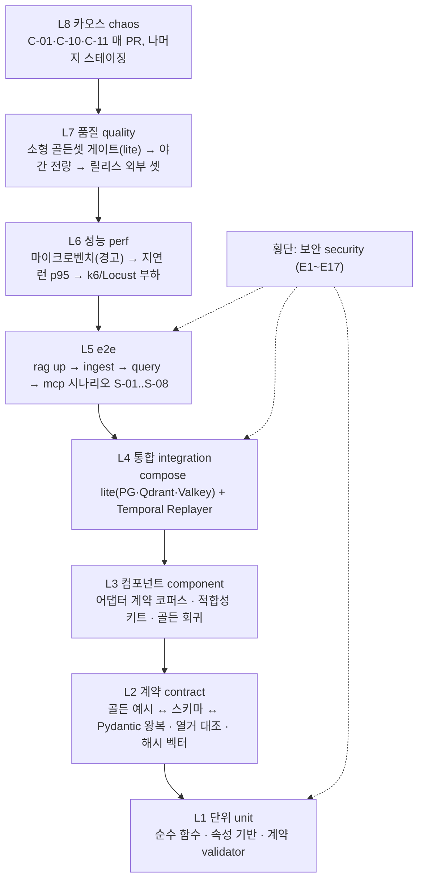
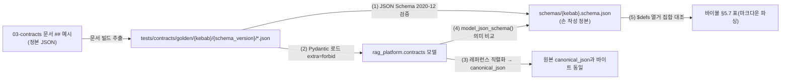

# 테스트 전략

## 목적

이 문서는 RAG Platform 코드 저장소에서 **무엇을, 어느 층에서, 어떤 도구로, 언제 검증하는가**를 확정한다. 브리프의 세 원칙 — Contracts First(원칙 1), Pure Stages(원칙 3), Idempotent & Content-Addressed(원칙 4) — 은 코드 리뷰가 아니라 테스트로 증명되어야 하며(브리프 §7 재현성, [ADR-0032](../06-adr/0032-plugin-sdk-stage-protocol-and-conformance-kit.md) 결정 동인 DR-7), 다른 문서가 각자 정한 게이트 — 계약 CI 게이트([계약 개요](../03-contracts/00-contract-overview.md) §10.3, [스키마 버전 관리](../03-contracts/14-schema-versioning-and-compatibility.md) §10), 평가 게이트([평가 전략](../08-evaluation/01-evaluation-strategy.md) §7, [검색 메트릭과 하네스](../08-evaluation/02-retrieval-metrics-and-harness.md) §12), 카오스 실험([장애 모드와 복원력](../02-architecture/09-failure-modes-and-resilience.md) §8), 적합성 키트([플러그인 아키텍처](../02-architecture/05-plugin-architecture.md) §10) — 를 **하나의 테스트 피라미드(test pyramid) 안에 배치**하고, PR·야간·릴리스 세 단계의 실행 매트릭스로 시점과 판정을 확정한다. CI 워크플로우 정의(YAML)는 [CI/CD](./05-ci-cd.md)가, 플러그인 저자용 템플릿은 [플러그인 개발 가이드](./06-plugin-development-guide.md)가 소유한다.

## 범위

- 포함: 테스트 원칙, 8층 피라미드(단위·계약·컴포넌트·통합·e2e·성능·품질·카오스)와 횡단 보안 테스트, 각 층의 대상·위치·의존·마커·판정, 계약 왕복 규칙, 파서 코퍼스 회귀의 `ParsedDocument` 비교 규칙과 허용 오차, 테스트 코퍼스 관리(라이선스·익명화·크기·매니페스트), 스냅샷 정책, 플러그인 준수 테스트 킷 운용, 모델 의존 테스트 등급, 플래키(flaky) 정책, 커버리지 목표, 합성 테스트 데이터 생성기, CI 단계별 실행 매트릭스, 도구 선정과 근거 상태, 테스트 작성 규약.
- 제외: CI 잡 YAML과 러너·시크릿([CI/CD](./05-ci-cd.md)), 린트·타입 설정 세부([코딩 표준](./03-coding-standards.md) §2.2 ruff 설정·§13 테스트 명명; 마커 정의는 03 §13이 이 문서에 위임했으므로 §21이 정본), 벤치마크 실험 설계와 베이스라인 수치([벤치마크 계획](../08-evaluation/05-benchmark-plan-and-baselines.md)), 카오스 실험 카탈로그 본문(02-architecture/09 §8.2), 골든셋 라벨링 절차([골든 데이터셋 구축](../08-evaluation/03-golden-dataset-construction.md)), 런북([런북](../09-operations/06-runbooks.md)), 플러그인 템플릿·`conformance.json` 스키마([플러그인 개발 가이드](./06-plugin-development-guide.md)).
- 정본 관계: 브리프 > 바이블 > ADR > 이 문서. 테스트 디렉터리 5종(`tests/contracts`, `adapters`, `security`, `replay`, `eval`)과 CI 항목(`WorkflowEnvironment.start_time_skipping()` 단위 테스트, `Replayer` 히스토리 회귀, 계약 스냅샷, 적합성 키트, 소형 골든셋 게이트, `uv lock --check`, 라이선스 게이트, 열거 대조)은 바이블 §11.6·§12 정본이며 이 문서는 그것을 **확장하되 바꾸지 않는다**. 계약 필드·열거 철자는 바이블 §5·§5.7을 그대로 쓴다. 테스트 전용 산출물(코퍼스 매니페스트, 골든 케이스, 합성 문서 스펙)은 바이블 §5.1 인벤토리의 계약이 아니며 `schemas/`에 계약 스키마를 추가하지 않는다.
- 표기: 앵커(브리프·바이블·ADR·위임을 명시한 상위 문서)가 뒷받침하는 규칙만 `**결정:**`, 이 문서가 새로 도입하는 것은 `**제안:**`으로 쓰고 "## 미해결 이슈"에 필요한 바이블·ADR 개정을 남긴다. 수치는 실측 전 모두 "초안 목표"다.

## 1. 원칙

| # | 원칙 | 출처 | 테스트에 대한 함의 |
|---|------|------|--------------------|
| P1 | **셸이 계약을 강제한다** | 바이블 §4.1, 00 §10.1 | 테스트는 자체 검증기를 만들지 않고 셸과 같은 검증 함수(`validate_out`, 04-pipelines/01 §12.2)를 호출한다. 스테이지 코드 안의 검증 호출은 리뷰 거부 |
| P2 | **결정성 우선** | 브리프 §7, 바이블 §2.1 K5 | 시각·난수·발급 ID는 고정 픽스처(§3.3)로 주입한다. 같은 입력의 두 실행은 정규화 해시 `golden_hash`가 같아야 하고, 고정 시계를 주입했을 때만 바이트(`blake3`) 동일을 요구한다(04-pipelines/01 §11.3) |
| P3 | **정본 하나, 사본 없음** | 바이블 §1.2, 01 §6 | 골든 예시의 정본은 각 03-contracts 문서의 `## 예시`, 스키마 정본은 손으로 쓴 `schemas/`, 열거 정본은 바이블 §5.7이다. 테스트는 정본을 읽거나 문서 빌드가 추출한 사본(§4.3)만 쓴다 |
| P4 | **두 셸 동등성** | D-17, [ADR-0003](../06-adr/0003-orchestrator-neutral-pipeline-and-non-durable-local-runner.md) 준수 확인 5 | 같은 골든 입력을 `LocalRunner`와 Temporal(`start_time_skipping`)로 실행해 `IndexCommit.commit_hash`·`golden_hash`가 같음을 CI가 단정한다(§10.4) |
| P5 | **PR CI는 재생만, 실물은 야간부터** | 매트릭스 §어댑터·플러그인 공통 요구 2·3, 바이블 §15 리스크 #9 | 모델·사이드카·외부 LLM 응답은 카세트(cassette)와 캐시 픽스처로 재생한다. PR CI에서 모델 다운로드·네트워크 egress는 금지(§9) |
| P6 | **보안 불변식은 모든 층에서** | 바이블 §10.3 E1~E17, 매트릭스 공통 요구 7 | 각 강제 지점은 단위·계약·통합·e2e 중 최소 한 층의 테스트를 갖고(§15), `tests/security/`가 색인이다 |
| P7 | **게이트 없는 기본값 변경 금지** | 바이블 §7.4 | 프로파일 품질 값·모델·청커 변경 PR은 `EvalReport.gate_result.passed=true`인 `run_id`를 첨부해야 한다(§13) |
| P8 | **실패는 코드로 말한다** | 바이블 §5.7, 00 §10.2 | 오류 기대는 예외 타입이 아니라 `StageError.code`·`ProblemDetails.code`의 카탈로그 철자로 단정한다. 새 코드를 테스트가 만들지 않는다 |

측정 방법 코드와의 대응: [비기능 요구사항](../01-requirements/02-non-functional-requirements.md) §1.3은 CI 자동 검사를 M3(T-UNIT, T-CONTRACT, T-INT, T-E2E, T-FIXTURE), 하네스를 M2(T-GOLD), 부하·장애 주입을 M1·M4(T-LOAD), 보안 검토를 M5(T-SEC)로 두었고 "테스트 전략이 두 코드 모두의 실행 방법을 정의한다"고 위임했다. §2 표의 "FR 코드" 열이 그 대응이다.

## 2. 테스트 피라미드



**결정:** 테스트는 아래 8층과 횡단 보안층으로 나눈다. 디렉터리 5종은 바이블 §12 정본이고, `tests/golden/`·`unit/`·`integration/`·`e2e/`는 [저장소 구조](./01-repository-structure.md) §7이 "테스트 전략이 확정한다"고 위임한 제안을 이 문서가 채택한다(바이블 §12 등재는 01 미해결 이슈 2). `tests/perf/`·`tests/chaos/`는 이 문서의 **제안**이다(미해결 이슈 1).

| 층 | 마커 | 검증 대상 | 위치 | 외부 의존 | FR 코드 | PR에서 실행하는 범위 |
|----|------|-----------|------|-----------|---------|----------------------|
| L1 단위 | `unit` | 순수 함수(`H()`, `canonical_json`, RRF, `litm_alternating`, 필터 빌더, `budget_cut`), 계약 모델 validator, 셸 `run_stage` 분기 | `tests/unit/`(`src/rag_platform/` 트리 미러) | 없음 | T-UNIT | 전량, Python 3.12·3.13 |
| L2 계약 | `contract` | 스키마 문법·래퍼·열거 대조·골든 예시 왕복·Pydantic 동치·불변식·해시 벡터·프로파일 해소 스냅샷·스키마 diff | `tests/contracts/` | 없음 | T-CONTRACT | 전량 |
| L3 컴포넌트 | `component` | 어댑터 단위 계약 코퍼스 회귀(입력 → `ParsedDocument` 등), 적합성 키트, 골든 회귀(`tests/golden/{stage}/cases.json`) | `tests/adapters/{extension_point}/{format 또는 implementation}/`, `tests/golden/` | 카세트·모델 캐시(기본), 실서버(야간) | T-FIXTURE | 저장소 내(≤ 1MB) 코퍼스만 |
| L4 통합 | `integration` | 원장·아웃박스·RLS, 인덱스 백엔드 어댑터, API 라우터, Temporal 셸(`Replayer`·`start_time_skipping`) | `tests/integration/`, `tests/replay/` | `deploy/compose/compose.lite.yaml`(PG·Qdrant·Valkey); OpenSearch·Temporal·사이드카는 야간 | T-INT | lite 3종 컨테이너 |
| L5 e2e | `e2e` | 바이블 §11.6 5분 기동 시나리오와 변형 S-01~S-08 | `tests/e2e/` | compose lite 전체 + `rag` CLI | T-E2E | S-01 스모크만 |
| L6 성능 | `perf` | 마이크로벤치, 단일 스트림 지연 런, 부하, 수집 처리량 | `tests/perf/`(제안) + 08/05 실험 | 참조 환경(NFR §1.4) | T-LOAD | 없음(마이크로벤치 경고만) |
| L7 품질 | `quality` | 하네스 자체 검증, 소형 골든셋 절대·회귀 게이트 | `tests/eval/` | `[eval]` extra, compose lite | T-GOLD | `ko-public-v1-small`, `lite` |
| L8 카오스 | `chaos` | 02-architecture/09 §8.2의 C-01~C-15 중 CI 가능 항목 | `tests/chaos/`(제안) | compose lite | T-LOAD | C-01·C-10·C-11 |
| 횡단 보안 | `security` | E1~E17 강제 지점, 카나리 테넌트 침투, egress 판정, 렌더러 누출 | `tests/security/` | 층별 | T-SEC | 단위·계약·통합 수준 |

층의 배치 규칙: (1) 아래층에서 잡을 수 있는 결함을 위층 테스트로 잡지 않는다 — 계약 위반은 L2, 어댑터 결함은 L3에서 재현 샘플을 등록한다(04-pipelines/08 §실패 모드 "계약 코퍼스에 재현 샘플 등록"). (2) 위층 테스트는 아래층이 이미 단정한 것을 다시 단정하지 않고 **경계 통과**만 본다. (3) 마커는 디렉터리와 1:1이며 `--strict-markers`로 미등록 마커를 거부한다(§21).

## 3. 단위 테스트

### 3.1 대상과 배치

`tests/unit/{module}/test_{subject}.py`가 `src/rag_platform/{module}/{subject}.py`를 미러한다(01 §5 테스트 파일 규약). 대상은 외부 I/O가 없는 코드 전부이며, 대표 항목은 다음과 같다.

| 모듈 | 단위 테스트 대상 | 정본 |
|------|------------------|------|
| `sdk` | `hash_of`(`H()` 결합식·라벨·`0x1F` 구분자), `canonical_json`(키 정렬·공백 없음·`ensure_ascii=false`·부동소수 최단 표현), `TokenCounter` 인터페이스 | 바이블 §6.2 |
| `contracts` | 모델 validator(불변식 위반 → `contract.violation`), `versioning.judge_compat`(14 §4.2 8행 진리표), `SchemaVersion.parse`(사전 릴리스 거부) | 00 §불변식, 14 §4.2 |
| `retrieval/fusion` | RRF `contribution = w/(k+rank)`, `Σ contribution = fused_score`, 타이브레이크 `record_id` 오름차순, 다중 컬렉션 런 투입 규칙 | 바이블 §3.2 O-01 |
| `retrieval/filters` | 보안·전략·사용자·self-query 필터 AND 결합, `FilterableField` 화이트리스트, 금지 필드 → `plan.filter_field_forbidden`, 깊이 ≤ 3·절 ≤ 32, `page` 가상 필드 변환 | 바이블 §5.7 `FilterableField`, §10.2 |
| `retrieval/pack` | `acl_recheck → budget_cut → reorder → citation_align` 순서, `litm_alternating` K=1..5 벡터, `cite_id = d{rank}` 연속, `overflow_policy` 순서 | 바이블 §8.2, §9.1, §9.2 |
| `retrieval/postprocess` | 고정 순서 `relevance_gate → dedup → mmr → parent_expand → dedup → sentence_window → compress`, 각 step의 `explain` 코드 | 바이블 §5.7 `PostprocessStep`·`ExplainCode` |
| `orchestration/context` | `run_stage` 분기(캐시 적중·입력 검증 실패·격리 모드 불일치), `StagePolicy` 적용, `non_retryable_error_codes` 판정 | 바이블 §4.1, §11.3 |
| `security` | `EgressPolicy` 판정(CIDR·스킴·리다이렉트·DNS 고정), 주체 문자열 정규화·상한 1,024, `visible_set` 도출 | 바이블 §5.3 `EgressPolicy`·`SecurityContext` |
| `render` | 렌더러 9종의 `citation_map` 역매핑, `render.*` 사전 검증 코드 | 바이블 §9.3, §5.7 `Renderer` |
| `eval` | 접기(collapse)·`span_hits`·Holm·게이트 진리표(08/02 §12의 `test_collapse`·`test_span_hit`·`test_gate_rules`는 `tests/eval/`에 두되 단위 성격) | 08/02 §2·§7 |

### 3.2 속성 기반 테스트(property-based testing)

**제안:** 결합식·순서·예산처럼 "모든 입력에 대해 성립해야 하는" 규칙은 예시 기반 테스트에 더해 속성 기반 테스트를 둔다. 도구 후보는 hypothesis이며 07-tech-landscape에 조사가 없어 라이선스·버전은 확인 필요(as of 2026-09; §20). 도구가 확정되기 전에는 시드 고정 난수 루프로 같은 속성을 검사한다.

| 속성 | 진술 |
|------|------|
| `H()` 규격 준수 | 임의의 라벨·parts에 대해 `H(label, *parts) == blake3_hex(utf8(label) + 0x1F + 0x1F.join(parts))`; 64자 소문자 hex; `block_id`는 `[:32]` |
| `canonical_json` 멱등·정렬 | `canonical_json(loads(canonical_json(x))) == canonical_json(x)`; 키가 정렬됨; 공백 없음 |
| `litm_alternating` 전단사 | 임의 K ≥ 1에서 `position`이 `0..K-1`의 순열이고 `r1`은 마지막, `r2`는 처음(K ≥ 2) |
| RRF 점수 원장 | 임의 채널 런에 대해 `Σ contribution == fused_score`(부동소수 허용 오차 1e-9), 순위는 `fused_score` 내림차순 후 `record_id` 오름차순 |
| `BlockRef` 좌표 | `block_refs` 합집합이 `Chunk.text`를 재구성하고 `0 ≤ char_start ≤ char_end ≤ len(text)`(코드포인트) |
| `budget_cut` | 임의 항목 집합에서 결과 토큰 합 ≤ `max_context_tokens − reserved_answer_tokens`, 제외 항목은 `omitted[].reason=budget_exceeded` |
| `FilterNode` 한계 | 깊이 > 3 또는 절 > 32인 임의 트리는 `contract.violation`; 금지 필드가 어느 깊이에 있어도 `plan.filter_field_forbidden` |
| `judge_compat` | 임의 (P, C) 버전 쌍에서 14 §4.2 표의 판정과 일치 |

### 3.3 고정 픽스처

**결정:** 단위·컴포넌트·골든 테스트의 결정적 값은 `rag_platform.testing.fixtures`(제안 모듈명, 바이블 §12 `testing/` 하위) 한 곳에서 제공한다. 04-pipelines/01 §12.2의 `FakeStageContext`·`FIXED_NOW`·`T1`·`C1`·`D1`을 그대로 쓰고 아래 값을 고정한다.

| 픽스처 | 값 | 근거 |
|--------|----|------|
| `FIXED_NOW` | `2026-09-22T09:00:00.000Z` | 바이블 §6.3 시각 표기 예 |
| `T1`, `T2`(테넌트), `C1`, `C2`(컬렉션), `D1`(문서) | 고정 ULID 상수(Crockford base32 대문자 26자) | 바이블 §6.1; E17 두 테넌트·두 컬렉션 시나리오 |
| `SEED` | 42 | 08/02 §11 시드 초안, 바이블 §7.2 minhash `seed: 42` |
| `FIXED_ANALYZER` | `analyzer_id = mecab-ko:1.3.7:ko-dic-2.1.1`(공백기 기본) | 바이블 §6.1 |
| `FIXED_COUNTER` | `TokenCounter{tokenizer_id = hf:BAAI/bge-m3}`; 토크나이저 파일은 `models.lock` revision으로 캐시 | 바이블 §3.2 O-09 |
| ULID 발급기 | 시드 기반 결정적 발급(테스트 안에서만); 프로덕션 발급기와 형식 동일 | 바이블 §6.1 |

규칙: 단위 테스트는 네트워크·파일 시스템(`tmp_path` 제외)·`sleep`을 쓰지 않고, 개별 테스트는 100ms 이내(초안 목표)다. 비동기 코드는 pytest-asyncio(`asyncio_mode = "auto"`)로 실행한다(01 §3.2 dev 그룹).

## 4. 계약 테스트

### 4.1 삼각 왕복



**결정:** 계약 테스트는 00 §10.3의 게이트 표와 14 §10의 규칙(G1~G4·diff 분류·열거 대조)을 실행하는 층이며 규칙을 새로 만들지 않는다. 왕복의 정확한 정의는 14 §10.1 G3다 — 골든 예시를 Pydantic 모델로 로드한 뒤 00 §8.1 레퍼런스 직렬화(`model_dump(mode="json", exclude_unset=False, exclude_none=False)` 후 `N` 필드 중 `None`만 제거, `Y(nullable)`의 `null`은 유지)를 거친 `canonical_json`이 원본의 `canonical_json`과 바이트 동일해야 한다. 이 왕복은 적합성 키트 `contract_roundtrip`의 계약 인스턴스 부분과 같은 함수를 쓴다(바이블 §12).

| 게이트(00 §10.3·14 §10) | 이 문서가 배정하는 위치·명령 | 실행 시점 |
|--------------------------|------------------------------|-----------|
| 스키마 문법·`$ref` 해소·`additionalProperties` 명시 | `tests/contracts/test_schema_syntax.py`; 검증기는 JSON Schema 2020-12 구현(파이썬 라이브러리 선정은 [개발 환경](./02-development-environment.md), 확인 필요 as of 2026-09) | PR |
| 래퍼 게이트(`stage-error`·`problem-details`·`capabilities`·`stage-policy`·`tiering-policy`·`egress-policy`; `cloud-event-envelope` 정제 래퍼 예외) | `tests/contracts/test_wrapper_schemas.py` | PR |
| 열거 대조(바이블 §1.2) — `$defs/{EnumTypeName}` = 바이블 §5.7, 인라인 열거 `{Type}.{path}`, `EventType`·`ErrorCodeCatalog`·메트릭 이름 = §5.7·§6.5 | `tools/docs/`(01 §2.1) 파서가 바이블 표를 읽고 `tests/contracts/test_enum_parity.py`가 집합 비교. 불일치 = 빌드 실패 | PR |
| 골든 예시 회귀(현재 minor) + G1(이전 minor 전부 유효) + G2(이전 major 업캐스팅, 14 §6.2 채택 시) + G4(한국어 공문서 시나리오 예시 존재) | `tests/contracts/test_golden_examples.py`; 입력은 §4.3 디렉터리 | PR |
| Pydantic 동치(필수 집합·열거·nullable) | `python -m rag_platform.contracts.export --out build/schemas-export` 후 의미 비교(01 §6 표; `rag schema export`는 제안) | PR |
| 불변식 테스트 | `tests/contracts/test_invariants_{kebab}.py` — 각 계약 문서 `## 불변식` 항목마다 위반 인스턴스 1개 이상이 `contract.violation`을 내고 `StageError.detail`에 위반 경로가 있다 | PR |
| 해시 벡터 | `tests/contracts/vectors/hash_vectors.json`(제안): `H()`·`canonical_json`·`block_id`·`chunk_id`·`record_id`·`point_id`·`NAMESPACE_RAG_CHUNK`·`stage_key`의 고정 입력 → 고정 출력. 파일은 한 번 생성·리뷰 후 커밋하며 조용한 재생성을 금지한다([ADR-0004](../06-adr/0004-deterministic-chunk-id-scoped-record-id-and-ulid-exception.md)) | PR |
| 내장 프로파일 해소 스냅샷 | `profiles/builtin/{base,lite,standard,premium,korean-gov}.yaml`의 `extends` 해소 결과와 `profile_hash`를 스냅샷(§7)으로 고정([ADR-0031](../06-adr/0031-profile-schema-extends-and-quality-gates.md)); `rag profile validate` 12개 규칙(바이블 §7.4)의 위반 YAML 각 1개가 `profile.invalid` | PR |
| 스키마 diff(`SchemaDiffReport`, 14 §10.2 제안) | `schemas/**` 변경 PR에서 `declared_level ≥ computed_level` 검사 | PR(경로 필터) |
| 그 밖의 게이트(14 §10.4) | 내장 플러그인 `contracts_compat` ⊇ 현재 계약 버전, 스키마 파일 크기, `## 버전 이력` = `versioning.py` | PR |

### 4.2 API·SDK 계약

| 대상 | 테스트 | 시점 |
|------|--------|------|
| OpenAPI 3.1 문서 | `docs/05-api/openapi.yaml` 재생성 `git diff --exit-code`(01 §6); 모든 오류 응답이 `problem-details` 스키마를 참조([ADR-0018](../06-adr/0018-api-rest-sse-mcp-no-grpc-rfc9457.md)) | PR |
| OpenAPI 퍼징 | schemathesis로 생성 문서 기준 무작위·상태 기반 요청을 보내 5xx·스키마 불일치·RFC 9457 위반을 찾는다. 도구는 확인 필요(as of 2026-09, §20); 인증은 테스트 API 키, 대상은 compose lite 위의 `api` 프로세스 | 야간(도구 확정 후), 릴리스 필수 |
| Python 클라이언트 SDK | 골든 예시를 SDK 모델로 왕복(14 §9 관용 모드); `Deprecation`·`Sunset` 헤더 경고 로그 | PR |
| TypeScript SDK | `sdk/typescript/src/generated/` 재생성 diff; 골든 예시 파싱 테스트(코드젠 도구는 05-api/06 확정) | PR |
| MCP 도구 | `search`·`get_document`·`list_collections` 입력·출력 스키마, `cursor`/`next_cursor` 테넌트 바인딩(E14), `structuredContent` 20k 토큰 상한 | PR(단위) / 야간(conformance) |

### 4.3 골든 예시 보존 디렉터리

**결정:** 14 §5.1은 "이전 minor의 예시는 문서에서 사라지므로 `tests/contracts/golden/{kebab}/{schema_version}/*.json`에 파일로 보존"하는 것을 제안하고 확정을 이 문서에 위임했다. 다음 규약으로 확정한다.

| 항목 | 규약 |
|------|------|
| 경로 | `tests/contracts/golden/{kebab}/{schema_version}/{NN}-{slug}.json` — `{NN}`은 문서 `## 예시` 절의 순번, `{slug}`는 예시 제목의 kebab-case |
| 생성 | 문서 빌드 도구(`tools/docs/extract_examples.py`, 01 §6 제안)가 현재 `schema_version` 디렉터리를 **덮어쓴다**. 이전 버전 디렉터리는 손대지 않는다(동결) |
| 동결 시점 | 계약 minor·major 증가 PR에서 이전 버전 디렉터리가 존재해야 한다(없으면 빌드 실패) |
| 사용 | 현재 버전은 §4.1 왕복, 이전 minor는 G1, 이전 major는 G2(업캐스터 채택 시) |
| 금지 | 문서 밖 `examples/*.json` 사본(01 §9), 골든 예시 손 편집(정본은 문서) |

## 5. 컴포넌트 테스트: 파서 코퍼스 회귀

### 5.1 결정성 등급과 비교 모드

**결정:** 어댑터 코퍼스 회귀의 비교 모드는 04-pipelines/01 §11.3의 결정성 등급 `pure / model_pinned / generative`(제안 등급)에서 도출한다. `pure` 어댑터는 정규화 해시 `golden_hash`(발급·시각·버전 필드 `created_at`·`producer`·`lineage_refs` 제외, 04-pipelines/01 §12.2) **완전 일치**, `model_pinned`는 구조화 비교 + 허용 오차, `generative`는 카세트 재생 위에서 완전 일치다.

| 파서 어댑터(바이블 §12) | 격리 | 등급 | 비교 모드 | PR 실행 |
|--------------------------|------|------|-----------|---------|
| `parser.hwpx_python_hwpx` | in_process | pure | exact | 예 |
| `parser.hwp5_java_sidecar`(`parser-workers`) | sidecar | pure(변환은 결정적) | exact — `ConvertResponse`·파생 HWPX 바이트를 카세트로 재생 | 예(카세트) / 실서버 야간 |
| `parser.hwp5_unhwp`, `parser.hwp5_hwp_hwpx_parser` | helper_process / in_process | pure | exact | 예 |
| `parser.pdf_fast_pdftext` | in_process | pure | exact | 예 |
| `parser.pdf_docling_standard`(레이아웃·TableFormer) | in_process | model_pinned | tolerant | 소형 1~2건(모델 캐시) / 전량 야간 |
| OCR(RapidOCR PP-OCRv5 korean mobile; `ocr-gpu`) | in_process / sidecar | model_pinned | tolerant(CER) | 소형 1건 / 전량 야간 |
| `parser.docx_docling_docx2python` | in_process | pure | exact | 예 |
| `parser.office_lo_sidecar`(`lo-sidecar`, C 등급 opt-in) | sidecar | pure | exact(카세트) | 카세트만; 실서버는 위성 저장소 CI |
| `parser.html_trafilatura_docling`, `parser.text_charset_markdown_it` | in_process | pure | exact | 예 |

### 5.2 `ParsedDocument` 비교 규칙과 허용 오차

**제안:** tolerant 모드는 정답 `ParsedDocument`와 실행 결과를 아래 차원으로 비교하고, 차원별 결과를 `ParsedDocumentDiff` 보고서(테스트 산출물, 계약 아님)로 남긴다. 허용 오차는 모두 초안 목표이며 [ADR-0008](../06-adr/0008-ocr-default-rapidocr-ppocrv5-korean.md) 재검토(CER/WER 재측정)와 함께 갱신한다.

| # | 차원 | exact 모드 | tolerant 모드(초안 목표) | 보고 키 |
|---|------|-----------|--------------------------|---------|
| 1 | 좌표 불변식 | `element_path` 문서 내 유일, `0 ≤ char_start ≤ char_end ≤ len(Block.text)`(코드포인트), 흐름 포맷은 `page = bbox = null` | **항상 exact**(불변식은 완화 대상이 아니다, D-04) | `offset_invariant` |
| 2 | 블록 트리 | `BlockType`별 개수·부모-자식 관계·순서 완전 일치 | 타입별 개수 상대 오차 ≤ 2%, `heading` 레벨 히스토그램 일치, 트리 깊이 동일 | `block_count_delta` |
| 3 | 텍스트 | NFC `Block.text` 완전 일치 | 정렬된 블록 쌍의 문자 오류율(CER) — 레이아웃 모델 경로 ≤ 0.005(텍스트 층 존재), OCR 경로 ≤ 0.08(공문서 인쇄체)·≤ 0.15(스캔 저품질); 문서 전체 가중 평균으로 판정 | `text_cer` |
| 4 | `element_path` | 집합 완전 일치 | 비교하지 않음(모델 유래 `self_ref`는 변동 가능) — 대신 3의 정렬 결과로 대응 | — |
| 5 | 페이지·bbox | `page` 완전 일치, `bbox` 완전 일치 | `page` 완전 일치; `bbox` 각 좌표 절대 오차 ≤ 2.0pt(1/72 in, 좌상단 원점) | `bbox_delta_pt` |
| 6 | 읽기 순서 | 순서 완전 일치 | 정렬된 블록 순서의 Kendall τ ≥ 0.98 | `order_tau` |
| 7 | 표 | 격자 크기·`row_span`/`col_span`·`is_header`·셀 텍스트 완전 일치 | 격자 크기·병합 셀 위치 완전 일치, 셀 텍스트 CER ≤ 3의 값, `TableData.role` 일치 | `table_grid` |
| 8 | 품질 삼중항 | `quality`, `warnings[].code` 집합, `page_status[]` 완전 일치 | `quality` 일치, `warnings[].code` 집합 일치(개수는 비교하지 않음), `page_status[].status` 일치 | `warnings_delta` |
| 9 | 메타데이터·출처 | `metadata`, `source_kind`, `parser_chain[]` 완전 일치 | 동일 | `metadata_delta` |
| 10 | 파생물 | `derived` 산출물 `blake3` 완전 일치 | 페이지 이미지 등 비결정적 파생물은 존재·개수·`media_type`만 | `derived_delta` |

정렬 알고리즘(tolerant): 정답·결과 블록을 각각 읽기 순서로 펼치고 NFKC 정규화 텍스트의 최장 공통 부분열(LCS) 기반 정렬로 블록 쌍을 만든다. 미대응 블록은 차원 2의 개수 오차에 계산되며, 미대응 비율이 5%를 넘으면 정렬 실패로 판정한다(초안 목표). 정렬은 `rag_platform.testing.golden`(04-pipelines/01 제안)에 두어 코어와 플러그인이 같은 판정을 받는다.

### 5.3 케이스 정의

골든 케이스는 04-pipelines/01 §12.2의 `GoldenCase`(`tests/golden/{stage}/cases.json`)를 쓴다. tolerant 모드의 허용 오차를 케이스별로 선언하기 위해 선택 필드 `compare`를 **제안**한다(`GoldenCase`는 `extra="forbid"`이므로 04-pipelines/01 소유자의 채택이 필요하다, 미해결 이슈 3). 아래는 스캔 PDF 고시 케이스의 예다(해시·크기는 형식 예시).

```json
{
  "stage": "parse",
  "cases": [
    {
      "case_id": "pdf-scanned-notice-014",
      "stage": "parse",
      "plugin_id": "parser.pdf_docling_standard",
      "config": {"ocr": {"plugin": "rapidocr", "lang": "korean", "version": "3.9", "model": "PP-OCRv5-mobile"}},
      "input_ref": {
        "uri": "file:///workspace/tests/golden/parse/fixtures/source-document/pdf-scanned-notice-014.json",
        "blake3": "6b1f4e0c9d2a7b3e5f8c1d4a6e9b2c5f8a1d4e7b0c3f6a9d2e5b8c1f4a7d0e3b",
        "media_type": "application/vnd.rag.source-document+json",
        "schema_type": "SourceDocument",
        "schema_version": "1.0.0",
        "size_bytes": 4096
      },
      "lineage": {},
      "expected_golden_hash": "c2d3e4f5a6b7c8d9e0f1a2b3c4d5e6f708192a3b4c5d6e7f8091a2b3c4d5e6f7",
      "expected_quality": "degraded",
      "expected_warning_codes": ["parse.page_timeout"],
      "cassette": "tests/fixtures/cassettes/parse/pdf-scanned-notice-014.jsonl",
      "compare": {
        "mode": "tolerant",
        "cer_max": 0.08,
        "bbox_tol_pt": 2.0,
        "order_tau_min": 0.98,
        "block_count_tol_ratio": 0.02,
        "unaligned_max_ratio": 0.05,
        "ignore_paths": ["/metadata/parse_duration_ms"]
      }
    }
  ]
}
```

### 5.4 갱신 절차와 건수 목표

- **골든 갱신은 명시적이다.** `expected_golden_hash` 또는 tolerant 정답 변경 PR은 라벨 `golden-update`, `ParsedDocumentDiff` 요약 아티팩트, `ingest` 팀 리뷰(01 §8 CODEOWNERS)를 요구한다. 플러그인 버전 범프(pin-and-bump)는 콘텐츠가 같으면 골든이 유지되므로 라벨 없이 통과한다(04-pipelines/01 §12.2).
- **범프 조건**: python-hwpx·Docling·pypdfium2·pdftext·docx2python·Trafilatura 등 빠른 릴리스 의존성의 범프 PR은 해당 포맷 코퍼스 전량(야간 범위)을 PR에서 실행한다(경로 필터; 매트릭스 공통 요구 3).
- **건수 목표**: NFR-MNT-07 "포맷당 ≥ 20, 회귀 미검출 0"이 하한이다. 상세 표는 각 파서 문서가 소유한다 — HWPX/HWP 14유형(04-pipelines/04 §8), DOCX/DOC 13범주(04-pipelines/06 §4), PDF 5종 × 50페이지 이상(04-pipelines/05 §계약 코퍼스), HTML 계약 코퍼스(04-pipelines/07). 저장소 내 코퍼스(≤ 1MB, §6.3)는 포맷당 대표 5건 이상을 두어 PR CI가 최소 회귀를 잡는다(초안 목표).

## 6. 파서 테스트 코퍼스 관리

### 6.1 라이선스

**결정:** 코퍼스 문서는 재배포 가능 라이선스만 저장소에 포함한다(01 §7 배치 규칙, 04-pipelines/06 §4, 04-pipelines/04 §8 "공공누리 제1유형"). 아래 판정표는 이 문서의 **제안**이며 법무 검토 대기 목록(매트릭스 미해결 이슈 7)에 등재한다.

| 원천 라이선스 | 저장소 포함 | 미러 포함 | 조건 |
|---------------|:---:|:---:|------|
| 공공누리 제1유형(출처 표시) | 예 | 예 | 출처 표시를 매니페스트 `attribution`에 기록 |
| 공공누리 제2~4유형(상업 금지·변경 금지) | 아니오 | 검토 후 | 변경 금지 유형은 익명화(§6.2) 불가 → 원문에 개인정보가 없을 때만 |
| CC0, CC BY | 예 | 예 | 귀속 표기 |
| CC BY-SA | 검토 후 | 예 | 데이터 파일이므로 코드 라이선스와 충돌하지 않지만 파생 골든 파일의 SA 의무 범위 확인 필요 |
| CC BY-NC, CC BY-ND, 저작권 유보 | 아니오 | 아니오 | — |
| 합성 문서(§18) | 예 | 예 | 저장소 Apache-2.0으로 배포; 생성 스펙과 시드를 함께 커밋 |
| 사내·고객·테넌트 문서 | 아니오 | 아니오 | 절대 금지. 재현 샘플이 필요하면 §18 생성기로 동형 합성 |

코퍼스 출처·귀속 목록은 `tests/adapters/NOTICE.corpus.md`(제안)에 모으고 CI가 매니페스트와 대조한다. 한컴 고지 문자열 검사(바이블 §7.1 `korean-gov` 행, 01 §2.1 `NOTICE`)는 코퍼스가 아니라 루트 `NOTICE`의 게이트다.

### 6.2 익명화

| 규칙 | 내용 |
|------|------|
| 실제 개인정보 금지 | 이름·전화·이메일·주민등록번호·계좌·주소가 포함된 문서는 저장소·미러 모두에 넣지 않는다. 공공문서의 담당자 연락처도 해당된다 |
| 대체 방식 | (a) §18 생성기로 **동형 합성**(같은 구조·다른 내용)을 1순위로 한다. (b) 원본 유지가 필요하면 **길이 보존 대체**(같은 코드포인트 수의 가짜 값)로 오프셋·레이아웃을 보존한다. 주민등록번호 형식 값은 검증 규칙을 통과하지 않는 값만 쓴다 |
| 검사 | 신규 픽스처는 커밋 전 `tools/ci/scan_fixture_pii.py`(제안)가 Presidio + KR 인식기 5종(바이블 §7.1 `lite` 행)으로 스캔하고, 매니페스트 `pii_status`가 `none` 또는 `synthetic`이 아니면 실패한다 |
| 표기 | 매니페스트 `pii_status ∈ {none, synthetic, redacted}`, `redacted`면 `redaction_method`·검토자 기록 |
| 스캔 이미지 | 스캔 PDF는 SynthDoG-ko(MIT; 04-pipelines/05 §계약 코퍼스)로 합성 생성해 실제 서명·도장·필기 개인정보를 배제한다 |

### 6.3 크기와 보관

**결정:** 1MB 초과 픽스처는 저장소에 직접 넣지 않고 오브젝트 스토리지 미러 + 해시 매니페스트로 참조한다(01 §7 배치 규칙; 방법 확정은 01 미해결 이슈 10이 이 문서에 위임). Git LFS는 쓰지 않는다 — 포크·외부 플러그인 CI의 대역폭 비용과 콘텐츠 주소화 규약(바이블 §13.3)과의 이중 관리를 피한다.

| 항목 | 규약(초안 목표) |
|------|-----------------|
| 저장소 내 파일 | 파일당 ≤ 1MB, `tests/` 전체 픽스처 합계 ≤ 50MB |
| 미러 키 | `test-corpora/{corpus_id}/v{n}/{blake3}` — 오브젝트 키 규약(바이블 §13.3)과 같은 콘텐츠 주소화; 버킷·자격 증명은 09-operations/01 |
| 로컬 캐시 | `~/.cache/rag-platform/test-corpora/{blake3}` — 08/02 §5.3 데이터셋 캐시 규약과 동일 형태; 다운로드 후 `blake3` 검증 |
| 다운로드 도구 | `tools/ci/fetch_corpus.py --manifest {path}`(제안); PR CI는 `storage=inline` 항목만, 야간은 전체 |
| 3판 규약 | HWP 문서는 HWPX 원본·HWP 5.0 저장본·배포용 저장본의 3판(04-pipelines/04 §8); 매니페스트 `editions[]`로 표현 |
| 보존 | 코퍼스 버전은 삭제하지 않는다(이전 골든 재현). 문서 제거는 새 버전에서만 |

### 6.4 매니페스트

**제안:** 코퍼스 디렉터리마다 `corpus.manifest.json`을 둔다. 이 파일은 테스트 도구 입력이며 바이블 §5.1 인벤토리 계약이 아니다(스키마 파일 등재는 미해결 이슈 4).

```json
{
  "corpus_id": "hwpx-public-v1",
  "version": 1,
  "extension_point": "parser",
  "format": "hwpx",
  "license": "KOGL-1",
  "attribution": "행정안전부 정보공개 관련 고시·공문(공공누리 제1유형, 출처 표시)",
  "redistributable": true,
  "owner_team": "ingest",
  "documents": [
    {
      "doc_ref": "notice-2026-012",
      "category": "law_article",
      "source_uri": "https://www.example.go.kr/notice/2026-012.hwpx",
      "blake3": "e078c857ebd01652ff4bf9a6b873f10213fb07d7a9e19de5129e302be1f54deb",
      "size_bytes": 348160,
      "media_type": "application/hwp+zip",
      "storage": "inline",
      "path": "notice-2026-012/original.hwpx",
      "pii_status": "redacted",
      "redaction_method": "length_preserving",
      "reviewed_by": "ingest",
      "editions": [
        {"kind": "hwpx", "path": "notice-2026-012/original.hwpx", "blake3": "e078c857ebd01652ff4bf9a6b873f10213fb07d7a9e19de5129e302be1f54deb"},
        {"kind": "hwp5", "path": "notice-2026-012/saved.hwp", "blake3": "1a2b3c4d5e6f708192a3b4c5d6e7f8091a2b3c4d5e6f708192a3b4c5d6e7f809"},
        {"kind": "hwp5_distribution", "storage": "mirror", "blake3": "9f3a0b1c2d3e4f5a6b7c8d9e0f1a2b3c4d5e6f708192a3b4c5d6e7f8091a2b3c", "size_bytes": 2211840}
      ],
      "golden_cases": ["hwpx-public-notice-012"]
    }
  ]
}
```

필드 규약: `license`는 SPDX 식별자 또는 공공누리 표기(`KOGL-1`~`KOGL-4`; SPDX 등재 여부 확인 필요 as of 2026-09), `format`은 바이블 §5.7 `SourceFormat` 값, `category`는 §5.7 `Genre` 값 또는 파서 문서의 유형 이름, `storage ∈ {inline, mirror}`(`mirror`면 `path` 대신 `blake3`로 §6.3 키를 만든다), `pii_status ∈ {none, synthetic, redacted}`. 매니페스트의 `blake3`와 실제 파일 해시 불일치는 빌드 실패다.

### 6.5 명명과 버전

코퍼스 ID는 `{format}-{source}-v{n}`(예 `hwpx-public-v1`, 05 §10 예시)이고 문서 추가는 `n`을 올린다. 골든 케이스 `case_id`는 코퍼스 버전에 걸쳐 안정적으로 유지하며, 적합성 키트의 `corpus` 인자(05 §10)는 이 ID를 받는다. 디렉터리는 `tests/adapters/{extension_point}/{format 또는 implementation}/{corpus_id}/`(01 §7; 04-pipelines/06의 `tests/adapters/docx/`는 01 미해결 이슈 10대로 정정 대상).

## 7. 스냅샷 테스트 정책

**결정:** 스냅샷(snapshot)은 "정본에서 결정적으로 유도되는 산출물"에만 쓴다. 시각·발급 ID·환경 값이 들어가는 산출물은 정규화 후에만 스냅샷한다(P2).

| 스냅샷 종류 | 정본 | 정규화 | 위치 | 갱신 절차 |
|-------------|------|--------|------|-----------|
| 계약 export(`build/schemas-export`) | `contracts/*.py` | `$ref` URN 매핑 후 의미 비교(설명·예시 제외) | 미커밋, CI 비교만 | 스키마 변경 PR(14 §3 절차) |
| 내장 프로파일 해소 결과·`profile_hash` | `profiles/builtin/*.yaml` | `canonical_json` | `tests/contracts/snapshots/profiles/{profile_id}.json` | 프로파일 `version` 증가 PR + 게이트 `run_id`(P7) |
| 골든 회귀 `golden_hash` | 코퍼스 + 어댑터 | `created_at`·`producer`·`lineage_refs` 제외 | `tests/golden/{stage}/cases.json` | 라벨 `golden-update`(§5.4) |
| Temporal 히스토리 | 스테이징 채집 | 없음(재생 입력) | `tests/replay/histories/{workflow_type}/{scenario}.json` | 야간 채집 잡이 갱신 PR 생성(§10.4) |
| OpenAPI·TS 타입·Weaver 상수·Helm 프로파일 사본 | 각 정본(01 §6) | 재생성 | 커밋된 생성물 | 재생성 후 `git diff --exit-code` |
| 렌더러 출력(9종) | 골든 `ContextPack` | `trace_id`·`created_at` 제외 | `tests/golden/render/` | 라벨 `golden-update` |
| `ParsedDocumentDiff` 보고서 | 코퍼스 실행 | — | CI 아티팩트(미커밋) | — |

규칙: (1) 스냅샷 파일에 ULID·타임스탬프·절대 경로가 있으면 린트 실패(고정 픽스처 값은 예외 목록). (2) 갱신은 `--update-snapshots` 플래그로만 하고, CI는 갱신 diff 요약을 PR 코멘트로 남긴다. (3) 한 PR에서 스냅샷 갱신과 동작 변경이 함께 있으면 PR 설명에 "왜 스냅샷이 바뀌었는가"를 적어야 한다(템플릿 항목, [기여 가이드](./07-contributing.md)). (4) 스냅샷 비교 구현은 `rag_platform.testing.snapshot`(제안)의 `canonical_json` 바이트 비교이며, 외부 스냅샷 플러그인 채택은 확인 필요(as of 2026-09, §20).

## 8. 플러그인 준수 테스트 킷

### 8.1 모듈과 적용 매트릭스

**결정:** 적합성 키트(conformance kit) `rag_platform.testing`의 6모듈(`contract_roundtrip`, `idempotency`, `security_invariants`, `renderer_citation_roundtrip`, `litm_order`, `fuser_equivalence`)은 바이블 §12 정본이며, 검사 내용은 05 §10 표와 [ADR-0032](../06-adr/0032-plugin-sdk-stage-protocol-and-conformance-kit.md) 준수 확인 9를 따른다. 코어 어댑터와 외부 플러그인은 같은 키트를 실행하고, 키트 미통과 플러그인은 카탈로그(05 §13)에 등재되지 않는다.

| 확장 지점(`ExtensionPoint`) | 필수 모듈 | 추가 항목 |
|-----------------------------|-----------|-----------|
| `fetcher` | `contract_roundtrip`, `security_invariants`(E16 egress) | `EgressPolicy` 거부 목록 6경로(바이블 §10.3 E16) |
| `parser` | `contract_roundtrip`, `idempotency` | 코퍼스 회귀(§5); `isolation=sidecar`면 사이드카 계약 6경로([ADR-0033](../06-adr/0033-sidecar-convert-contract-and-isolation-ladder.md) 준수 표) + `derived` 캐시 히트(같은 `content_hash`·`image_digest` → 호출 0회) |
| `normalizer`(roles `korean_analyzer`·`sentence_splitter`·`pii_detector`) | `contract_roundtrip`, `idempotency` | 지문에 `analyzer_id`·`dictionary_hash`·`pii_policy` 포함; NFC/NFKC 이중 뷰 불변식 |
| `chunker`(role `token_counter`) | `contract_roundtrip`, `idempotency` | `chunker_config_hash`·`primary_tokenizer_id` 지문; K1 좌표 불변식; `recount`는 `token_counts` 키만 추가 |
| `enricher` | `contract_roundtrip`, `idempotency`, `security_invariants`(E13 로그) | `enrich → strip` 대칭(`strip_offsets`, K2); LLM 보강은 카세트 |
| `embedder` | `contract_roundtrip`, `idempotency` | `embedding_space_id` 재계산 일치; `vocab_id` 불일치 → `embed.space_mismatch`; 서빙 교체 동등성 코사인 ≥ 0.9999([ADR-0009](../06-adr/0009-embedding-serving-vllm-pooling-tei-inprocess.md)) |
| `index_backend` | `contract_roundtrip`, `idempotency`(E17), `security_invariants`(E5·E7) | `capabilities()`의 `IndexBackendCapabilities` 필수 필드; 세대 사가 보상 두 경로(바이블 §11.4) |
| `query_transformer` | `contract_roundtrip`, `security_invariants`(E6) | `filters.security`·`filters.strategy` 불변; 금지 필드 거부 |
| `retriever` | `contract_roundtrip`, `security_invariants`(E7) | 백엔드 요청에 `tenant_id` 필터 존재; `ctx.security=None` → `retrieve.security_context_missing` |
| `fuser` | `contract_roundtrip`, `fuser_equivalence` | ranx 일치, `Σ contribution = fused_score`, 타이브레이크 |
| `reranker` | `contract_roundtrip`, `idempotency` | `response_schema`(`tei`·`cohere`) 양 파서; 타임아웃 폴백 `rerank.applied=false` |
| `postprocessor` | `contract_roundtrip`, `renderer_citation_roundtrip`(`mutates_text=true`인 step) | 고정 순서 위치 선언 |
| `packer`(roles `renderer`·`token_counter`) | `contract_roundtrip`, `renderer_citation_roundtrip`, `litm_order`, `security_invariants`(페이로드 누출) | `cite_id` 연속 `d1..dK`; 렌더러 페이로드에 `tenant_id`·주체·`acl_*`·`record_id` 없음 |
| `evaluator` | `contract_roundtrip` | `metrics ⊇ metrics_requested`(08/02 §4.5 V8) |

### 8.2 실행 방식

- 기반 클래스는 확장 지점별 `{ExtensionPointPascal}Conformance`(예 `ParserConformance`, `IndexBackendConformance`)이며 플러그인 테스트는 `plugin_ref`·`corpus`·`config`만 지정한다(05 §10 예시). 코어 어댑터는 `tests/adapters/{extension_point}/{implementation}/test_conformance.py`에서 같은 클래스를 상속한다.
- 키트는 결정적 `FakeStageContext`·`FakeRuntimeServices`(인메모리 `ArtifactStore`, 기록형 HTTP 클라이언트), 두 테넌트 시나리오 생성기(`same_bytes_three_scopes`, [ADR-0037](../06-adr/0037-artifact-cache-scope-and-stage-key-composition.md)), `InMemoryLedger`(04-pipelines/01 제안)를 제공한다.
- 외부 플러그인은 자기 CI에서 키트를 실행하고 `conformance.json`(키트 버전·통과 모듈 목록; 스키마는 [플러그인 개발 가이드](./06-plugin-development-guide.md) 소유)을 패키지 메타에 동봉한다. `rag plugin verify`는 제안이며 확정 전에는 `rag plugin list --check-license`가 리포트 유무를 출력한다(05 §10).
- **제안 — 키트 확장 3항목**: `resumable_equivalence`(단위 k 중단 → 재개 → `golden_hash` 동일; 04-pipelines/01 §11.3), `shell_equivalence`(같은 골든 입력의 `LocalRunner`·Temporal 실행 `commit_hash`·`golden_hash` 동일; ADR-0003 준수 확인 5), `golden`(§5 회귀 헬퍼). 바이블 §12 `testing/` 6모듈 목록에 없으므로 ADR-0032 minor 개정 전까지는 `idempotency`의 하위 케이스와 `tests/replay/`에서 실행한다(미해결 이슈 5).
- **배포 형태**: 키트는 플러그인 저장소가 임포트하므로 배포 패키지에 포함된다(01 §2.3). pytest 의존을 런타임에 섞지 않기 위해 `rag-platform[testing]` extra 분리를 **제안**한다(바이블 §6.7 extras 6종 개정 minor; 01 미해결 이슈 9). 확정 전에는 순수 헬퍼(`fixtures`·`golden`·`snapshot`)만 무조건 임포트 가능하고 pytest 기반 클래스는 `rag_platform.testing.pytest` 하위에 두어 pytest 부재 시 임포트를 지연한다.

## 9. 모델 의존 테스트

### 9.1 등급

**결정:** 모델(임베더·리랭커·OCR·레이아웃·LLM)에 의존하는 테스트는 아래 4등급으로 나누고, PR CI는 MD-0·MD-1만 실행한다(P5). 재생 키는 바이블 §6.2·§4.3의 프로덕션 캐시 키와 **같은 식**을 써서 캐시 적중 규칙 자체를 함께 검증한다.

| 등급 | 내용 | 재생 키 | 위치 | 시점 |
|------|------|---------|------|------|
| MD-0 가짜 모델 | `FakeEmbedder`(텍스트 → 시드 기반 결정적 벡터; 의미 없음), `FakeReranker`(사전 정의 점수표), `FakeOcr`(텍스트 층 그대로) — 인덱스·융합·패킹·셸 로직 검증용 | 없음 | `rag_platform.testing.fakes`(제안) | PR |
| MD-1 캐시 재생 | 실제 모델이 낸 값을 픽스처로 재생. 임베딩 `H("embed", embedding_space_id, "document", embed_text)` / 질의 `qemb:{embedding_space_id}:{H(normalized_query)}` / 리랭크 `rr:{model_id}:{H(query, chunk_id)}` / LLM 보강 `H("llm-enrich", model_id, prompt_hash, embed_text)`; 사이드카·서빙 HTTP는 카세트 | 바이블 §6.2, §4.3 | `tests/fixtures/model_cache/{kind}/{space_or_model_slug}.jsonl`, `tests/fixtures/cassettes/{component}/*.jsonl` | PR |
| MD-2 소형 실물 | `lite` 프로파일의 인프로세스 모델(bge-m3 dense ONNX int8, RapidOCR PP-OCRv5 korean mobile, gte-multilingual-reranker-base CPU; 바이블 §7.1) — `models.lock` revision 고정, `HF_HUB_OFFLINE=1`, 사전 미러에서 로드 | 실행 후 MD-1 픽스처 재기록(`record`) | `tests/adapters/{embed,rerank,parse}/` `model` 마커 | 야간 |
| MD-3 서빙 실물 | vLLM pooling·TEI·`ocr-gpu`·외부 LLM(judge·보강) — GPU 러너 | 카세트 갱신 | `gpu` 마커 | 릴리스, 모델 교체 ADR |

**제안:** 캐시 미스 정책은 설정 `RAG_TESTING__MODEL_CACHE_POLICY ∈ {fail_on_miss, record, passthrough}`(바이블 §6.6 접두 규약)로 제어한다. PR CI는 `fail_on_miss`(모델 로딩·네트워크 시도 자체를 실패로 처리), 야간 MD-2는 `record`, 릴리스 MD-3은 `passthrough`다. 더 작은 다국어 테스트 전용 모델은 07-tech-landscape 조사가 없어 채택하지 않는다(확인 필요 as of 2026-09).

### 9.2 결정성과 허용 오차

| 항목 | 규칙 | 근거 |
|------|------|------|
| 시드 | 42(`SEED`), `PYTHONHASHSEED=0`, 속성 기반 테스트는 CI에서 derandomize | 08/02 §11 |
| 스레드 | MD-2 인프로세스 추론은 intra-op 스레드 1로 고정(부동소수 합 순서 고정; 런타임별 옵션은 확인 필요 as of 2026-09) | P2 |
| 임베딩 동등성 | 같은 `embedding_space_id`에서 MD-1 픽스처 vs MD-2 실행 코사인 ≥ 0.9999 | [ADR-0009](../06-adr/0009-embedding-serving-vllm-pooling-tei-inprocess.md) 동등성 게이트 |
| 리랭크 점수 | 절대 오차 ≤ 1e-4(초안 목표); 순위는 완전 일치 | 이 문서 |
| IR 메트릭 재현 | `ndcg@10`·`recall@20` ±0.001 | 08/02 §11 |
| OCR·레이아웃 | §5.2 tolerant 오차 | §5.2 |
| 벡터 저장 | MD-1 픽스처는 float32 리틀엔디언 base64 또는 소수 6자리 JSON 배열(파일 크기 고려, 픽스처 ≤ 1MB 규칙 §6.3) | — |

모델 가중치·사전 파일은 저장소에 커밋하지 않는다(01 §9). MD-2·MD-3 러너는 `models.lock`의 `(model_id, revision, sha256)`으로 미러에서 받고, D 등급 모델이 기본 프로파일 테스트에 있으면 실패한다([ADR-0001](../06-adr/0001-license-grade-table-and-d02-interpretation.md)). LLM-judge 테스트(RAGAS collections·DeepEval, 매트릭스 `eval_framework` 행)는 야간·릴리스에서 표본만 실행하며 판정은 `warn`이다(08/01 §7.1).

## 10. 통합 테스트

### 10.1 스택

**결정:** 통합 테스트의 스택 정본은 `deploy/compose/compose.lite.yaml`(PostgreSQL·Qdrant·Valkey; 바이블 §7.1 `lite`, 01 §2.1)이다. 개발자·CI가 같은 컴포즈 파일을 쓰므로 환경 차이가 생기지 않는다. testcontainers로 컨테이너 수명을 테스트 세션에 묶는 방식은 포트 충돌 회피·병렬 실행에 유리하지만 07-tech-landscape 근거가 없어 **제안**으로 두고(확인 필요 as of 2026-09, §20), 확정 전에는 세션 스코프 픽스처가 `docker compose -f deploy/compose/compose.lite.yaml up --wait`를 호출한다.

| 구성 요소 | PR | 야간 | 용도 |
|-----------|:--:|:--:|------|
| PostgreSQL(마이그레이션 적용, RLS `FORCE`) | 예 | 예 | 원장·아웃박스·멱등 키·`documents` 세대 할당 |
| Qdrant | 예 | 예 | `index_backend.qdrant` 어댑터, `hydrate`, `sparse_bm25`(lite) |
| Valkey | 예 | 예 | 캐시·레이트리밋·`aclrev` 회수 힌트·MCP 커서 |
| 오브젝트 스토리지 `file://` | 예 | 예 | 산출물·콘텐츠 주소화 |
| OpenSearch(analysis-nori, DLS) | 아니오 | 예 | `standard` 렉시컬 채널, E8 DLS 0건 테스트 |
| Temporal(`temporal server start-dev`, 셸 통합 전용; ADR-0003 중립) | 아니오 | 예 | Temporal 셸 통합, 시그널·취소·`continue_as_new` |
| `parser-workers` 사이드카 | 아니오 | 예 | HWP 5.0 실변환, 사이드카 계약 6경로 실서버 |
| RustFS 또는 SeaweedFS(S3 호환) | 아니오 | 예 | `s3://` 경로·`etag` 조건부 GET |

### 10.2 대상

| 영역 | 테스트 | 강제 지점 |
|------|--------|-----------|
| 원장 | `jobs`·`idempotency_keys (tenant_id, key)` 유일, 아웃박스가 상태 갱신과 같은 트랜잭션, `artifacts`·`lineage` PK에 `tenant_id`, RLS로 타 테넌트 행 0건 | E17, 바이블 §13.1 |
| 디스패처 | 같은 `document_id` 활성 잡 직렬화(`waiting_for`), `tenant_concurrent_jobs_max` 강제 | 바이블 §11.2 |
| 인덱스 백엔드 | `record_id`·`point_id` 합성, 세대 사가 9단 상태 전이, 플립 전·후 보상, `is_current` 플립 후 이전 세대 미검색, `maintenance.cleanup.v1` 삭제 범위 | E5, E17, 바이블 §11.4 |
| API | FastAPI 앱을 ASGI 인프로세스 클라이언트로 호출(실 PG·Qdrant·Valkey): `Idempotency-Key` 200/409/422, `202 {job_id, status_url, events_url}`, RFC 9457 본문, `RateLimit` 헤더, SSE 재접속 | E1~E3, D-08 |
| 검색 핫패스 | `pipelines.query.run`이 PostgreSQL 없이 완료(PG 컨테이너 정지 상태에서 실행; ADR-0034), `degraded` 기록 | 바이블 §11.1 `query` 모드 |
| 아웃박스 릴레이 | 웹훅 `RAG-Signature` HMAC, 5분 재생 창, `outbox.egress_denied`, SSE 테넌트 스코프 | E12, E16 |
| 한국어 분석 | `UserDictEntry` → 사전 생성 → `dictionary_hash` 변경 → 렉시컬 재색인 제안 응답 | 바이블 §14 |

### 10.3 격리와 정리

테스트마다 새 테넌트 ULID를 발급해 데이터를 격리하고, 세션 종료 시 컬렉션·물리 인덱스를 삭제한다. 마이그레이션은 세션마다 빈 DB에 처음부터 적용하며 `autogenerate`가 빈 diff임을 함께 단정한다(01 §6 마이그레이션 행). 병렬 실행 시 워커별 DB 스키마 또는 데이터베이스를 분리한다.

### 10.4 Temporal 셸

**결정:** `tests/replay/`는 (1) `WorkflowEnvironment.start_time_skipping()` 위의 워크플로우 단위 테스트, (2) `ActivityEnvironment(on_heartbeat=…)` 위의 액티비티 래퍼 테스트, (3) 스테이징에서 채집한 워크플로우 타입별 히스토리(정상·재시도·취소·`partial`·`continue_as_new`)의 `Replayer.replay_workflows` 회귀(02-architecture/06 §CI, 바이블 §11.6), (4) 두 셸 동등성 `test_shell_equivalence.py`(같은 골든 입력 → `LocalRunner`와 `start_time_skipping` Temporal → `IndexCommit.commit_hash`·`golden_hash` 동일; ADR-0003 준수 확인 5의 위임 이행)를 담는다. 히스토리 파일은 야간 채집 잡이 갱신 PR을 만들며, `workflow.patched` 분기가 제거될 때 대응 히스토리도 제거한다(02-architecture/06 §호환 변경 절차).

## 11. e2e 시나리오

**결정:** e2e는 바이블 §11.6 5분 기동 순서를 정본으로 하고, 아래 시나리오를 `tests/e2e/`에 둔다. PR CI는 S-01만, 야간은 전량이다. 시나리오는 `rag` CLI와 REST를 실제로 호출하며 내부 함수를 직접 부르지 않는다.

| ID | 시나리오 | 단정 | 근거 |
|----|----------|------|------|
| S-01 | `rag up --profile lite` → `rag ingest ./samples/*.hwpx --collection demo --wait` → `rag query "정보공개 청구 절차" --collection demo --render markdown --explain` → `rag mcp serve` `search` 1회 | 잡 `succeeded`, `ContextPack.items[]` ≥ 1, `cite_id` `d1..dK` 연속, `explain`에 `ScoreBreakdown`, MCP `structuredContent` 존재; 총 시간 ≤ 5분(초안 목표) | 바이블 §11.6 |
| S-02 | 같은 `IngestRequest` + 같은 `Idempotency-Key` 재전송 / 다른 본문 재전송 | 200(같은 `job_id`) / 422 `api.idempotency_payload_mismatch`; `IndexCommit.commit_hash` 동일(재현성) | D-08, 브리프 §7 |
| S-03 | `POST /v1/documents/{document_id}/reprocess {from_stage: embed}` | 새 `index_generation`, 이전 세대는 플립 전까지 검색됨, 플립 후 `is_current` 교체, `index.commit.published` 이벤트 | 바이블 §11.4, E17 |
| S-04 | `PATCH /v1/documents/{document_id}/acl`로 주체 회수 → 백엔드 전파 전 질의 | 해당 문서 항목 `omitted[].reason=acl_denied`, `acl.document.updated` 이벤트, `rag_acl_propagation_seconds` 기록 | E9, E11 |
| S-05 | `DELETE /v1/documents/{document_id}` → 질의 | 결과 없음, `ingest.document.deleted`, `GET /v1/documents/{document_id}` 상태 반영 | 바이블 §11.2 |
| S-06 | `GET /v1/jobs/{job_id}/events` SSE 구독 중 수집 | `job.state.changed` 순서 `queued → running → succeeded`, CloudEvents 봉투 `tenantid` 존재, `data`에 본문 없음 | E12 |
| S-07 | 두 테넌트가 같은 바이트 문서를 수집 후 각자 질의 | 각자 레코드·산출물, 교차 노출 0, `stage_key` 상이 | E17, [ADR-0037](../06-adr/0037-artifact-cache-scope-and-stage-key-composition.md) |
| S-08 | MCP `search` `cursor` → `next_cursor` 반복, 다른 테넌트 토큰으로 커서 재사용 | 페이지 연속성, 타 테넌트 커서 403/`isError` | E14, D-13 |

## 12. 성능 테스트

**결정:** 성능은 네 종류로 나누어 소유와 시점을 분리한다. 게이트 값은 브리프 §7·바이블 §7.2의 초안 목표이며 실측 후 갱신한다. PR CI에는 성능 게이트를 두지 않는다(러너 편차로 플래키가 되기 때문, §16).

| 종류 | 내용 | 시점 | 판정 | 소유 |
|------|------|------|------|------|
| 마이크로벤치 | `H()`·`canonical_json`·RRF·`budget_cut`·필터 빌더의 단건 시간 | PR(경고), 야간(추세) | 7일 중앙값 대비 +30% 초과 시 경고(초안 목표); 실패 없음 | 이 문서(`tests/perf/`, 제안) |
| 단일 스트림 지연 런 | `rag eval run --concurrency 1`로 `latency_p95_ms`·`{pipeline_stage}_latency_p95_ms` 산출(08/02 §5.2) | 야간(`bench-ko-100k` 컬렉션, 08/05 §4.4) | `standard` GPU p95 < 800ms, CPU < 1.5s(브리프 §7); 야간은 `warned_gates`(08/02 §7.5), 릴리스는 실패 | 08/02·08/05 |
| 부하(용량) | k6/Locust 스크립트, 동시 QPS 20(NFR LP-M), 참조 환경 ENV-M | 주 1회 + 릴리스 후보(NFR M1) | NFR-PERF 목표; 러너 세부는 [확장과 성능](../09-operations/04-scaling-and-performance.md) | 09/04 |
| 수집 처리량 | 텍스트 PDF 100p < 30s, 스캔 PDF 100p < 5min(GPU OCR) | 야간 리포트(게이트 아님, 회귀 알림) | 08/05 §6.2 | 08/05 |

부하 시험과 지연 런을 혼동하지 않는다 — 전자는 용량, 후자는 알고리즘 지연이다(08/05 §6.1). 지연 런은 `concurrency = 1`에서만 유효하며(08/02 §4.5 V8), 결과 지연 메트릭은 `rag_query_latency_seconds` 등 바이블 §6.5 정본 이름으로 대시보드에 올린다.

## 13. 품질 테스트(평가 하네스 회귀 게이트)

**결정:** 품질 층은 08/01 §7.1의 3층(PR CI → 야간 → 릴리스)과 08/02 §12의 명령·테스트 표를 그대로 실행하며 이 문서는 위치·마커·픽스처 규약만 배정한다.

| 항목 | 규약 |
|------|------|
| 위치·마커 | `tests/eval/`, `quality`; `[eval]` extra 필요 |
| PR CI 명령 | `rag eval run --dataset ko-public-v1-small --profile lite --baseline $(cat tests/eval/baseline_run_id) --concurrency 4 --gate`; 종료 코드 2 = 머지 차단; `comparison.md`를 PR 코멘트로(08/02 §12) |
| 픽스처 | 원장 스냅숏 `tests/eval/fixtures/ledger/`(고정 `tenant_id`·`collection_id`·`document_id`·`dataset_id`) → `file://` 재수집 → `IndexCommit.commit_hash` 고정 파일 일치(08/02 §4.4 CI 전제) |
| 베이스라인 | `tests/eval/baseline_run_id` 고정 파일 + `tests/eval/baselines/{run_id}/`(`EvalRun`·`EvalReport`·`per_query.jsonl`); `main`의 최신 `completed` 런으로 갱신 PR을 야간 잡이 생성 |
| 게이트 값 | 절대 게이트 `lite`(`ndcg@10 ≥ 0.70`, `recall@20 ≥ 0.85`; 바이블 §7.2) + 회귀 게이트(`max_regression: 0.01, p: 0.05, correction: holm`; `lite` 값 확정 전 `standard` 상속, 08/01 미해결 이슈 16) |
| 하네스 자체 검증 | PR 층: `test_metrics_selfcheck`, `test_span_hit`, `test_collapse`, `test_gate_rules`, `test_reproducibility`, `test_import_boundaries`. `slow` 마커(야간부터): `test_holm_reference`, `test_public_baseline`(08/02 §12 표). 08/02가 `test_holm_reference`에 붙인 "dev 마커"는 이 문서 마커 체계(§21)에 없으므로 `slow`로 대응한다 — PyTerrier 참조 구현이 JVM 의존 dev 의존성 그룹이고(08/02 §10), `test_public_baseline`은 외부 셋 MIRACL-ko dev 다운로드와 Pyserini(dev 의존성)가 필요해 PR CI egress 금지(P5)에 걸린다 |
| 시간 | PR 층 총 5분 이내(재수집 포함, 초안 목표; 08/02 §12) |
| 품질 값 변경 PR | `gate_result.passed=true`인 `run_id` 첨부 + `rag profile validate` 통과(P7, 바이블 §7.4) |

## 14. 카오스 테스트

**결정:** 카오스 실험 카탈로그는 02-architecture/09 §8.2(C-01~C-15)가 정본이다. 이 문서는 CI에서 실행 가능한 항목과 구현 방식만 배정한다. 도구(Chaos Mesh·LitmusChaos·toxiproxy 등)는 확정하지 않으며(확인 필요 as of 2026-09; 02-architecture/09 미해결 이슈 11), CI 단계는 `SIGKILL`·컴포즈 네트워크 분리·프록시 지연으로 충분하다.

| 실험 | CI 구현(`tests/chaos/`, 제안) | 정상 상태 가설 | 시점 |
|------|-------------------------------|----------------|------|
| C-01 워커 SIGKILL | `LocalRunner` 워커 프로세스를 스테이지 트랜잭션 커밋 직후 훅에서 `SIGKILL`(스테이지별 1회) → 재시작 → 재개 | 누락 잡 0, 원장 행 수 불변, `commit_hash` 일치, `outbox` 같은 `event_id` 2행 없음 | 매 PR |
| C-10 사가 플립 후 실패 | `FaultInjectingIndexBackend`(제안: 실제 어댑터를 감싸 `flipping_lexical` 뒤 Qdrant 쓰기에 오류 주입) | `rolled_back` + `compensation.restored_generation`, 혼합 노출 ≤ 5s, 정합성 불일치 0 | 매 PR |
| C-11 파서 포이즌 샘플 | 계약 코퍼스의 무한 루프·segfault 스텁을 `helper_process`로 실행 | 워커 생존(헬퍼만 사망), `start_to_close` 내 실패, 다른 문서 성공률 100% | 매 PR |
| C-03·C-06·C-07(축소판) | 컴포즈에서 OpenSearch·리랭커·Valkey 컨테이너 정지 후 질의 | `degraded{channel.lexical}` / `rerank.applied=false` / `degraded{acl_recheck, unavailable}`, 성공률 유지 | 야간 |
| 나머지 C-02·C-04·C-05·C-08·C-09·C-12~C-15 | 스테이징·프로덕션 카나리(02-architecture/09 §8.1) | 각 행 | 주·월·분기·릴리스 |

카오스 테스트는 `chaos` 마커이며 다른 층과 병렬 실행하지 않는다(공유 컨테이너 파괴).

## 15. 보안 테스트

**결정:** `tests/security/`는 바이블 §10.3 강제 지점 17개의 검증 열을 테스트 파일로 옮긴 색인이다. 각 지점은 아래 층에서 최소 1개 테스트를 갖고, 카나리 테넌트 침투 테스트는 E8 침투와 같은 테넌트를 쓴다.

| 강제 지점 | 층 | 테스트 요지 |
|-----------|----|-------------|
| E1·E2·E3 | 통합(API) | 본문 `tenant_id` → 422, Cedar fail-closed 403, 운영 fail-closed 429 + `RateLimit` |
| E4 | 계약·컴포넌트 | 주체 상한 1,024 → `auth.too_many_principals`; PII 검출기 불가 시 `keep` 폴백 금지(잡 실패); ACL 문서 단위 전파 |
| E5·E7 | 컴포넌트(`security_invariants`)·통합 | 보안 필드 누락 배치 전체 거부 `index.security_fields_missing`; 백엔드 요청에 `tenant_id` 필터 존재 |
| E6 | 계약·단위 | `filters.relaxable_keys`에 보안·전략 키 → `profile.invalid`; `SecurityContext` 본문 입력 무시 |
| E8 | 통합(야간) | 서비스 계정 토큰만으로 OpenSearch DLS 0건; 요청별 단명 JWT TTL ≤ 60s |
| E9·E10 | e2e S-04·단위 | 회수 → 전파 전 질의 → 미반환; 부모 확장·`get_document` 동일 필터 |
| E12 | 통합 | `tenantid` 필수, `data` 본문 금지, `RAG-Signature` 검증 |
| E13 | 컴포넌트(모든 Stage) | 본문 문자열이 스팬·로그·`StageError.detail`·`Warning.message`에 없음 |
| E14 | 단위·야간 conformance | MCP PRM·audience·`allowed_collections`·커서 테넌트 바인딩 |
| E16 | 단위·통합 | `169.254.169.254`, RFC1918, `localhost`, 리다이렉트 우회, DNS 리바인딩, `file://` 운영 거부 → `fetch.egress_denied`·`outbox.egress_denied` |
| E17 | 컴포넌트(`idempotency`)·e2e S-07 | 두 테넌트·두 컬렉션 동일 바이트 비덮어쓰기; 동일 `chunk_id` 재색인 세대 공존 |
| 렌더러 누출 | 컴포넌트 | 9종 렌더러 페이로드에 `tenant_id`·주체·`acl_*`·`record_id` 없음 |

SAST·SCA·의존성 취약점 스캔(NFR M5)의 도구는 [보안과 컴플라이언스](../09-operations/05-security-and-compliance.md)가 확정하며, 라이선스 게이트(pip-licenses + liccheck + SBOM + `models.lock`; D-02)는 PR 필수다.

## 16. 플래키 정책

**결정:** 플래키(flaky) 테스트는 "같은 코드·같은 입력에서 결과가 달라지는 테스트"다. 재시도로 숨기지 않는다.

| 규칙 | 내용 |
|------|------|
| 재시도 금지 | L1~L3에서 테스트 단위 자동 재시도는 금지. L4~L5는 **인프라 전이 실패**(컨테이너 기동 대기, 포트 할당)만 픽스처 수준에서 재시도하고 테스트 본문은 재시도하지 않는다 |
| 탐지 | 야간에 전체 스위트를 무작위 순서로 3회 실행(순서 무작위화 플러그인은 확인 필요 as of 2026-09; 없으면 시드 셔플 스크립트)하고 결과가 갈린 테스트를 자동 이슈로 등록한다 |
| 격리 | 마커 `@pytest.mark.quarantine(issue="…", expires="YYYY-MM-DD")`. 격리 테스트는 실행되지만 게이트에 들지 않고, `expires`(등록 후 ≤ 14일, 초안 목표)가 지나면 `tools/ci/check_quarantine.py`(제안)가 빌드를 실패시킨다. 만료 연장은 1회 |
| 상한 | 격리 테스트 ≤ 전체의 2%(초안 목표) 초과 시 새 격리 금지(먼저 고친다) |
| 원인 분류 | (a) 시각·난수 미고정(P2 위반) (b) 테스트 간 상태 공유(테넌트 격리 위반) (c) 네트워크·모델 실물 의존(P5 위반) (d) ANN 근사 탐색·부동소수(허용 오차 §9.2로 흡수) (e) 러너 자원 편차(성능 단정을 L6로 이동). 이슈에 분류를 기록한다 |
| 소유 | CODEOWNERS 경로 팀(01 §8)이 14일 안에 수정 또는 삭제한다 |
| 성능 단정 금지 | L1~L5에서 벽시계 시간을 단정하지 않는다(타임아웃은 예외) |

## 17. 커버리지 목표

**결정:** NFR-MNT-03 — 코어 패키지 라인 커버리지 ≥ 80%, JSON 왕복 테스트가 있는 계약 모델 비율 100%(P0). 이를 모듈별로 세분한 값은 초안 목표이며, 측정 도구(coverage.py + pytest 플러그인)는 07-tech-landscape 근거가 없어 확인 필요(as of 2026-09)다.

| 모듈(바이블 §12) | 라인(초안 목표) | 분기 | 비고 |
|------------------|:---:|:---:|------|
| `contracts` | ≥ 95% | ≥ 90% | 계약 모델 왕복 100%(NFR-MNT-03) |
| `sdk`, `retrieval`, `render` | ≥ 90% | ≥ 85% | 핫패스·순수 함수 |
| `security` | ≥ 95% | ≥ 90% | 모든 강제 지점 분기 |
| `orchestration`, `ledger`, `storage` | ≥ 80% | ≥ 70% | 통합 테스트 포함 측정 |
| `adapters` | ≥ 75% | — | 벤더 분기 다수; 코퍼스 회귀가 보완 |
| `api`, `mcp`, `cli` | ≥ 85% | ≥ 75% | 통합 테스트 포함 |
| `eval` | ≥ 85% | — | 하네스 자체 검증 |
| `testing` | 측정 제외 | — | 테스트 코드 |
| 전체 코어 | **≥ 80%** | — | NFR-MNT-03 |

규칙: (1) PR은 변경 라인의 diff 커버리지 ≥ 90%(초안 목표)를 요구하고 전체 값은 하락을 허용하지 않는다. (2) 커버리지는 단위+계약+컴포넌트(PR 범위)로 측정하고 통합 포함 값은 야간에 별도 보고한다. (3) `# pragma: no cover`는 방어적 `assert_never`·플랫폼 분기에만 허용하고 리뷰에서 사유를 확인한다. (4) 커버리지는 품질의 대리 지표일 뿐 게이트 우선순위는 계약·보안·품질 게이트가 앞선다.

## 18. 테스트 데이터 생성기(합성 HWPX·PDF)

**제안:** `rag_platform.testing.synth`(바이블 §12 `testing/` 하위, 신설)는 스펙 `SynthDocSpec`(JSON, 계약 아님)에서 결정적으로 문서 바이트와 **정답 구조(oracle)**를 함께 생성한다. 정답이 스펙에서 나오므로 골든 없이도 구조 개수·텍스트·오프셋을 정확히 단정할 수 있고(§5.2 exact 차원), 실제 개인정보 없는 코퍼스를 무한히 만들 수 있다(§6.2).

| 포맷 | 생성 방식 | 근거·상태 |
|------|-----------|-----------|
| HWPX | OWPML 템플릿(섹션·문단·표·글상자·각주·머리말·필드) + ZIP 패키징을 자체 구현(우리가 OWPML 어댑터를 소유하므로 최소 문서를 만들 수 있다). python-hwpx 쓰기 API 활용 여부는 확인 필요(as of 2026-09) | 04-pipelines/04 §8 유형 14종을 스펙 프리셋으로 |
| PDF(디지털) | 텍스트·표·2단·각주가 있는 PDF 생성 라이브러리 — 07-tech-landscape 조사 없음, 라이선스 등급 포함 확인 필요(as of 2026-09) | 04-pipelines/05 §계약 코퍼스 5종 프리셋 |
| PDF(스캔) | 디지털 PDF 렌더 → SynthDoG-ko(MIT)로 노이즈·기울기·저해상도 합성 | 04-pipelines/05 |
| DOCX | 자체 OOXML 템플릿(스타일·numbering·표·각주·글상자) | 04-pipelines/06 §4 범주 프리셋 |
| HTML·TXT·MD | 템플릿 문자열 | 04-pipelines/07·08 |

```json
{
  "spec_version": "0.1.0",
  "seed": 42,
  "format": "hwpx",
  "language": "ko",
  "preset": "law_article",
  "structure": {
    "heading_depth": 3,
    "articles": 12,
    "paragraphs_per_article": [1, 4],
    "tables": [
      {"rows": 6, "cols": 4, "header_rows": 1, "merged_cells": 2, "role": "data"}
    ],
    "footnotes": 3,
    "text_boxes": 1,
    "lists": {"markers": ["①", "1.", "가."], "depth": 3}
  },
  "pii": {"mode": "synthetic", "kinds": ["person_name", "phone", "email"]},
  "oracle": {
    "block_counts": {"heading": 15, "paragraph": 31, "table": 1, "footnote": 3},
    "text_source": "text_layer",
    "genre": "law_article"
  }
}
```

규칙: (1) 같은 `seed`·스펙은 같은 바이트를 낸다(생성기 자체가 `idempotency` 대상). (2) 합성 개인정보는 실제 값과 충돌하지 않는 형식(검증 규칙 미통과 주민등록번호, 예약 전화 대역, `example.go.kr` 도메인)만 쓴다. (3) 속성 기반 테스트는 스펙을 무작위 생성해 "파서가 예외 없이 끝나고, `element_path`가 유일하며, 오프셋 불변식이 성립하고, oracle 개수가 일치한다"를 단정한다(§3.2 확장). (4) 생성 문서는 `pii_status = synthetic`으로 매니페스트에 등록하고 스펙 파일을 함께 커밋한다.

## 19. CI 단계별 실행 매트릭스

**결정:** 세 단계는 PR(모든 PR, 머지 차단), 야간(`main` 스케줄, 알림·자동 PR), 릴리스(태그 후보·프로파일 `version` 증가·모델 교체 ADR)다. 인터프리터 매트릭스는 Python 3.12·3.13 모두 통과 필수([ADR-0035](../06-adr/0035-python-version-and-toolchain-pins.md)). 잡 이름·러너·시크릿은 [CI/CD](./05-ci-cd.md)가 정한다.

| 검사 | PR | 야간 | 릴리스 | 근거 |
|------|:--:|:--:|:--:|------|
| 정적 검사: ruff, mypy strict, import-linter 5계약, C 등급 임포트 금지, 스팬 문자열 리터럴 검사 | 필수 | 필수 | 필수 | D-01, 01 §3.2·§4.2 |
| `uv lock --check` + ADR-0035 범위 검사 | 필수 | — | 필수 | 바이블 §11.6 |
| 라이선스 게이트(pip-licenses + liccheck + `models.lock`) / SBOM 첨부 | 필수 / — | 필수 / 생성 | 필수 / 첨부 | D-02, ADR-0001 |
| L2 계약(§4.1 표 전부, 스키마 diff는 경로 필터) | 필수 | 필수 | 필수 | 00 §10.3, 14 §10 |
| L1 단위(3.12·3.13) + 속성 기반(derandomize) | 필수 | 필수(3회 무작위 순서) | 필수 | §3 |
| L3 적합성 키트(코어 어댑터) | 소형 코퍼스 | 전량 + MD-2 실물 | 전량 | 바이블 §11.6 |
| L3 파서 코퍼스 회귀 | inline 코퍼스, 카세트 | 미러 코퍼스 + 사이드카 실서버 | 전량 | §5, NFR-MNT-07 |
| L3 골든 회귀(`tests/golden`) | 필수 | 필수 | 필수 | 04-pipelines/01 §12.2 |
| L4 통합(compose lite) / + OpenSearch·Temporal·사이드카·S3 | 필수 / — | 필수 / 필수 | 필수 / 필수 | §10 |
| L4 Temporal `Replayer` + `start_time_skipping` + 두 셸 동등성 | 필수(저장소 히스토리) | 필수(스테이징 히스토리 채집·갱신 PR) | 필수 | 바이블 §11.6, ADR-0003 |
| 횡단 보안(E1~E17 단위·계약·통합) / E8 침투·DLS 0건 | 필수 / — | 필수 / 필수 | 필수 / 필수 | 바이블 §10.3 |
| L5 e2e | S-01 | S-01~S-08 | S-01~S-08 | §11 |
| L7 품질 | `ko-public-v1-small` `lite` 절대+회귀 게이트 | `eval.datasets[]` 전량 + judge 표본(`warn`) | + 외부 셋(MIRACL-ko·MLDR-ko) + `grid` | 08/01 §7.1, 08/02 §12 |
| L6 성능 | 마이크로벤치 경고 | 지연 런 `--concurrency 1`(`warned_gates`), 수집 처리량 리포트 | 지연 게이트 실패 판정 + k6/Locust 부하(NFR M1) | §12 |
| L8 카오스 | C-01·C-10·C-11 | + C-03·C-06·C-07 축소판 | C-15(롤링 업데이트) | 02-architecture/09 §8 |
| 모델 의존 | MD-0·MD-1(`fail_on_miss`) | MD-2(`record`) | MD-3(GPU, 카세트 갱신) | §9 |
| OpenAPI 재생성 diff / schemathesis 퍼징 | 필수 / — | — / 도구 확정 후 | 필수 / 필수 | §4.2 |
| SDK 계약(Python 왕복, TS 코드젠 diff) | 필수 | 필수 | 필수 | 14 §9 |
| 커버리지(코어 ≥ 80%, diff ≥ 90%) | 필수 | 통합 포함 보고 | 필수 | §17 |
| 문서 게이트(링크 검사, 열거 대조 파싱, 예시 추출·검증, `## 버전 이력` = `versioning.py`) | 필수 | — | 필수 | 14 §10.4, 01 §6 |
| 플래키 탐지·격리 만료 검사 | 만료 검사 | 3회 실행 탐지 | 격리 0건 요구(초안) | §16 |
| 생성물 동기화(`openapi.yaml`, Weaver 상수, Helm 프로파일 사본, TS 타입, 마이그레이션 빈 autogenerate) | 필수 | — | 필수 | 01 §6 |

시간 예산(초안 목표): PR 전체 ≤ 20분(병렬 잡 기준; 품질 층 5분 포함), 야간 ≤ 4시간, 릴리스 ≤ 12시간(GPU 잡 포함). 경로 필터: `schemas/**`·`contracts/**` 변경은 계약 층 전량, `adapters/parse/**` 변경은 해당 포맷 코퍼스 전량, 의존성 범프는 §5.4 규칙.

## 20. 도구

| 도구 | 용도 | 근거 상태(as of 2026-09) |
|------|------|--------------------------|
| pytest, pytest-asyncio | 테스트 러너, 비동기(`asyncio_mode = "auto"`) | 01 §3.2 dev 그룹; 매트릭스 `eval_framework` 행(DeepEval pytest) |
| ruff, mypy(strict), import-linter | 정적 검사, 계층 규칙 | D-01, ADR-0035 |
| uv | 잠금·매트릭스 실행(`uv run --python 3.12 pytest`) | D-01, 01 §3.4 |
| JSON Schema 2020-12 검증기(파이썬) | 스키마 문법·골든 예시 검증 | 라이브러리 선정 확인 필요; [개발 환경](./02-development-environment.md) |
| temporalio 테스트 유틸(`WorkflowEnvironment`, `ActivityEnvironment`, `Replayer`) | Temporal 셸 단위·재생 | 바이블 §11.6, `[temporal]` extra |
| ranx, ir_measures, RAGAS 0.4 collections, DeepEval | 품질 층 계산기·judge | 매트릭스 `eval_framework` 행, 08/02 §10 |
| k6 또는 Locust | 부하 시험 | NFR §1.3 M1; 러너는 09/04 |
| SynthDoG-ko(MIT) | 스캔 PDF 합성 | 04-pipelines/05 |
| Presidio + KR 인식기 | 픽스처 PII 스캔 | 바이블 §7.1 |
| hypothesis | 속성 기반 테스트 | **확인 필요**(07-tech-landscape 미조사; 라이선스·버전) — 채택 전 시드 루프 대체 |
| schemathesis | OpenAPI 3.1 퍼징·상태 기반 API 테스트 | **확인 필요** — 채택 전 야간 미실행 |
| testcontainers-python | 컨테이너 수명 관리 | **확인 필요** — 채택 전 `docker compose --wait` 픽스처 |
| coverage.py(+ pytest 플러그인), diff 커버리지 도구 | 커버리지 측정·게이트 | **확인 필요** |
| 순서 무작위화·병렬 실행 pytest 플러그인 | 플래키 탐지·PR 시간 예산 | **확인 필요** |
| 스냅샷 플러그인 | §7 비교 | **확인 필요** — 기본은 자체 `canonical_json` 비교 |
| 카오스 도구(Chaos Mesh·LitmusChaos·toxiproxy 등) | 스테이징 실험 | **확인 필요**(02-architecture/09 미해결 이슈 11) |

"확인 필요" 도구는 [개발 환경](./02-development-environment.md) 또는 07-tech-landscape 후속 조사에서 라이선스 등급(D-02; dev 의존성도 A/B 등급만)·버전·유지보수 상태를 확인한 뒤 채택하며, 확인 전에는 위 표의 대체 수단으로 같은 검사를 수행한다.

## 21. 테스트 작성 규약

- **마커 등록**: 마커 정본은 이 문서다([코딩 표준](./03-coding-standards.md) §13이 "실행 전략·마커 정의는 테스트 전략이 확정한다"고 위임, 03 미해결 이슈 10). `pyproject.toml` `[tool.pytest.ini_options]`에 층 마커 9종 `unit, contract, component, integration, e2e, perf, quality, chaos, security`(§2 표)과 속성 마커 5종 `model, gpu, sidecar, slow, quarantine`을 등록하고 `addopts = "--strict-markers"`, `testpaths = ["tests"]`로 미등록 마커·경로를 거부한다. 층 마커는 디렉터리 `conftest.py`가 자동 부착하고 속성 마커는 테스트가 직접 붙인다 — `model`·`gpu`는 §9.1 MD-2·MD-3, `sidecar`는 실서버 사이드카 필요(§10.1 야간 열), `slow`는 PR 필수 층에서 `-m "not slow"`로 제외하고 야간부터 실행(§13 `test_holm_reference`·`test_public_baseline`), `quarantine`은 §16. 03 §13 "마커(제안)" 이름과의 대응: `adapter`·`golden` → `component`, `replay` → `integration`, `eval` → `quality`; 08/02 §12의 `dev` → `slow`. 대응표에 없는 이름(`dev`·`adapter` 등)은 등록하지 않으며 `--strict-markers`가 거부한다.
- **이름**: `tests/{group}/test_{subject}.py`(01 §5); 테스트 함수는 `test_{행위}_{조건}_{기대}`; 불변식은 `test_inv_{doc}_{n}`; 시나리오는 `test_s{NN}_{slug}`.
- **단정**: 오류는 카탈로그 코드로(P8), 산출물은 `golden_hash`·`canonical_json`으로, 순위는 `record_id` 목록으로 단정한다. `str(exc)` 문자열 매칭 금지.
- **데이터**: 한국어 공문서 시나리오(HWPX 공문·스캔 고시·법령 조문)를 기본 예시로 쓴다(14 §10.1 G4). 문서 본문 문자열을 로그·스팬·오류 메시지에서 발견하면 실패(E13).
- **격리**: 테스트마다 새 테넌트 ULID; 전역 상태·모듈 레벨 캐시 금지; `sleep` 대신 조건 대기(타임아웃 명시).
- **스킵**: 외부 의존 부재로 스킵할 때는 사유 문자열에 의존 이름을 적고, PR 필수 층에서는 스킵을 실패로 취급한다(`--strict` 옵션은 [CI/CD](./05-ci-cd.md)).
- **금지 API**: 테스트 코드도 스테이지 코드와 같이 `datetime.now`·`random`·직접 네트워크를 쓰지 않고 §3.3 픽스처를 쓴다. [코딩 표준](./03-coding-standards.md) §2.2의 `per-file-ignores`는 `tests/**`에서 `TID251`(banned-api)을 완화하므로(픽스처·카세트 기록기 구현에 실제 시계·난수가 필요) 이 규칙은 기계 강제가 아니라 리뷰 항목이며, 03 §13 "시계·난수는 `fake_ctx`가 고정 값을 주입한다"와 같은 뜻이다. 테스트 파일에 별도 ruff 규칙을 추가할지는 03 소유자가 정한다.

## 결정 사항 요약

- **결정:** 테스트는 8층 피라미드(단위·계약·컴포넌트·통합·e2e·성능·품질·카오스)와 횡단 보안층으로 나누고, 바이블 §12의 5디렉터리에 01 §7 제안(`golden/`·`unit/`·`integration/`·`e2e/`)을 채택한다. 마커 정본은 이 문서 §21이며(03 §13 위임; 층 마커 9종 + 속성 마커 5종), 층 마커는 디렉터리와 1:1이고 FR 검증 코드(T-UNIT~T-SEC)와 NFR 측정 방법(M1~M5)에 대응한다([ADR-0032](../06-adr/0032-plugin-sdk-stage-protocol-and-conformance-kit.md), [ADR-0003](../06-adr/0003-orchestrator-neutral-pipeline-and-non-durable-local-runner.md)).
- **결정:** 계약 층은 00 §10.3·14 §10의 게이트를 실행하는 층이며 규칙을 새로 만들지 않는다. 골든 예시 왕복은 14 §10.1 G3(레퍼런스 직렬화 → `canonical_json` 바이트 동일)이고, 이전 버전 예시는 `tests/contracts/golden/{kebab}/{schema_version}/{NN}-{slug}.json`에 동결 보존한다(14 §5.1 위임 확정; [ADR-0004](../06-adr/0004-deterministic-chunk-id-scoped-record-id-and-ulid-exception.md) 해시 벡터 포함).
- **결정:** 파서 코퍼스 회귀는 결정성 등급에 따라 `pure`는 `golden_hash` 완전 일치, `model_pinned`는 구조화 비교 + 허용 오차(좌표 불변식은 항상 exact), `generative`는 카세트 위 완전 일치로 판정한다. 골든 갱신은 `golden-update` 라벨과 `ParsedDocumentDiff` 아티팩트를 요구한다([ADR-0008](../06-adr/0008-ocr-default-rapidocr-ppocrv5-korean.md) 재검토와 함께 오차 갱신).
- **결정:** 코퍼스는 재배포 가능 라이선스만, 실제 개인정보 0건(동형 합성 1순위, 길이 보존 대체 2순위), 파일당 ≤ 1MB 저장소 포함·초과분은 콘텐츠 주소화 미러 + 매니페스트로 참조하며 Git LFS는 쓰지 않는다(01 §7 위임 확정; [ADR-0001](../06-adr/0001-license-grade-table-and-d02-interpretation.md)).
- **결정:** 적합성 키트 6모듈과 확장 지점별 필수 매트릭스를 코어 어댑터·외부 플러그인에 동일 적용하고, 두 셸 동등성 테스트를 `tests/replay/`에 둔다(ADR-0003 준수 확인 5 위임 이행). 키트 확장(`resumable_equivalence`·`shell_equivalence`·`golden`)과 `[testing]` extra는 제안이다.
- **결정:** 모델 의존 테스트는 MD-0(가짜)·MD-1(캐시 재생, 프로덕션 캐시 키 동일 식)·MD-2(`lite` 인프로세스 실물, 야간)·MD-3(GPU 서빙, 릴리스)로 나누고 PR CI는 MD-0·MD-1만 실행한다. 동등성 허용 오차는 코사인 ≥ 0.9999([ADR-0009](../06-adr/0009-embedding-serving-vllm-pooling-tei-inprocess.md))·IR ±0.001(08/02 §11)이다.
- **결정:** 통합 스택 정본은 `deploy/compose/compose.lite.yaml`, e2e 정본은 바이블 §11.6 5분 기동(S-01), 품질 층은 08/01 §7.1·08/02 §12 그대로, 카오스는 02-architecture/09 §8.2의 C-01·C-10·C-11을 매 PR 실행한다. 성능 게이트는 PR에 두지 않는다.
- **결정:** 플래키는 재시도로 숨기지 않고 `quarantine(issue, expires ≤ 14일)` 마커로 격리·만료 강제하며 상한 2%(초안)다. 커버리지는 NFR-MNT-03(코어 ≥ 80%, 계약 왕복 100%) + diff ≥ 90%(초안)다.
- **결정:** 릴리스 매트릭스는 PR(머지 차단)·야간(알림·자동 PR)·릴리스(태그·프로파일 `version`·모델 ADR)이며 Python 3.12·3.13 모두 필수다([ADR-0035](../06-adr/0035-python-version-and-toolchain-pins.md)). hypothesis·schemathesis·testcontainers·coverage 도구는 확인 필요 상태로 대체 수단과 함께 운용한다.

## 미해결 이슈

1. **`tests/perf/`·`tests/chaos/` 디렉터리와 `rag_platform.testing` 하위 모듈(`fixtures`, `fakes`, `synth`, `snapshot`, `pytest`) 등재.** 바이블 §12 트리와 01 §7 표에 없다. 01 미해결 이슈 2(미등재 디렉터리 일괄 등재)에 합쳐 바이블 §12 patch를 architecture 소유자에게 제안한다.
2. **컴포넌트 층의 FR 코드.** T-FIXTURE는 "포맷별 픽스처 문서 회귀"로 정의되어 적합성 키트·골든 회귀 전체를 덮지 못한다. FR 문서 §검증 방법에 T-CONFORM(적합성 키트)을 추가하거나 T-FIXTURE 정의를 넓히는 patch를 01-requirements 소유자에게 요청한다(NFR ISS-NFR-15 두 체계 통일과 함께).
3. **`GoldenCase.compare` 선택 필드.** §5.3의 tolerant 오차 선언은 04-pipelines/01 §12.2 `GoldenCase`(`extra="forbid"`)에 필드 추가가 필요하다. 04-pipelines/01 소유자에게 `compare`(`mode`, `cer_max`, `bbox_tol_pt`, `order_tau_min`, `block_count_tol_ratio`, `unaligned_max_ratio`, `ignore_paths`) 채택을 요청한다. 채택 전에는 tolerant 케이스를 별도 파일 `cases.tolerant.json`으로 분리해 실행한다.
4. **코퍼스 매니페스트 스키마의 위치.** `corpus.manifest.json`(§6.4)과 `SynthDocSpec`(§18)의 JSON Schema를 14 §5.1 도구 스키마 규약(`schemas/` 내 인벤토리 밖, `GET /v1/schemas` 미노출)으로 둘지, `tests/` 아래에 둘지 확정한다. 공공누리 표기(`KOGL-1`~`KOGL-4`)의 SPDX 등재 여부도 확인 필요.
5. **적합성 키트 확장 3항목.** `resumable_equivalence`(04-pipelines/01 미해결 이슈 10), `shell_equivalence`(ADR-0003 준수 확인 5), `golden` 헬퍼는 바이블 §12 6모듈에 없다. ADR-0032 minor 개정으로 일괄 제안하며 확정 전 실행 위치는 §8.2·§10.4다.
6. **`[testing]` extra.** 키트의 pytest 의존을 런타임에서 분리하려면 바이블 §6.7 extras 6종에 `[testing]`을 더하는 minor 개정이 필요하다(01 미해결 이슈 9와 동일 트랙).
7. **파서 허용 오차 실측.** §5.2의 CER(0.005/0.08/0.15)·bbox 2.0pt·τ 0.98·개수 2%는 초안 목표다. ADR-0008 CER/WER 재측정과 04-pipelines/05 코퍼스 실행 결과로 갱신하고, 값이 확정되면 §5.2 표의 "초안 목표" 표기를 제거한다.
8. **모델 캐시 미스 정책 설정 키.** `RAG_TESTING__MODEL_CACHE_POLICY`는 바이블 §6.6 접두 규약을 따르는 제안이며 `Settings`(02 §5.2, 01 `settings.py` 제안)에 `testing` 하위 절을 두는 것은 [배포 가이드](../09-operations/01-deployment-guide.md)·[설정 레퍼런스](../09-operations/02-configuration-reference.md)와 합의가 필요하다. 프로덕션 설정에서 이 키가 존재하면 기동 거부(`profile.invalid` 유사)로 할지도 확정한다.
9. **도구 확인 목록.** hypothesis, schemathesis, testcontainers-python, coverage.py·diff 커버리지, 순서 무작위화·병렬 실행·스냅샷 pytest 플러그인, PDF 생성 라이브러리, ONNX Runtime 스레드 고정 옵션의 라이선스 등급·버전·유지보수 상태를 [개발 환경](./02-development-environment.md) 또는 07-tech-landscape 후속 조사에서 확인한다. 확인 전 대체 수단은 §20 표.
10. **라이선스 판정표 법무 검토.** §6.1의 공공누리 유형별·CC 계열 판정과 파생 골든 파일의 SA 의무 범위는 매트릭스 미해결 이슈 7의 법무 검토 대기 목록에 추가한다.
11. **카오스 C-01 구현 지점.** "스테이지 트랜잭션 커밋 직후 SIGKILL"을 `LocalRunner`에 재현하려면 셸 `run_stage`에 테스트 전용 훅이 필요하다. 훅을 프로덕션 코드에 두지 않는 방식(프로세스 외부에서 원장 행 감시 후 kill)과 비교해 04-pipelines/01·02-architecture/09 소유자와 확정한다.
12. **성능 마이크로벤치 경고 임계.** 7일 중앙값 +30%는 근거 없는 초안이며 러너 편차 실측 후 조정한다. 벤치 결과 저장 위치(아티팩트 vs 시계열 DB)는 [CI/CD](./05-ci-cd.md)·[관측성](../09-operations/03-observability.md)이 정한다.
13. **PR 시간 예산과 병렬화.** PR ≤ 20분은 초안이며, 컴포넌트·통합 층의 병렬 실행 없이는 달성이 불확실하다. 병렬 플러그인 확인(이슈 9)과 잡 분할은 [CI/CD](./05-ci-cd.md)에서 확정한다.
14. **`tests/adapters/docx/` 경로 정정.** 04-pipelines/06 §4의 경로는 01 §7 규약(`tests/adapters/parse/docx/`)으로 정정을 요청한 상태(01 미해결 이슈 10)다. 이 문서는 01 규약을 따른다.
15. **마커 이름 통일 patch.** 이 문서 §21이 마커 정본이므로 [코딩 표준](./03-coding-standards.md) §13 "마커(제안)" 행(`adapter`·`replay`·`eval`·`golden`을 포함한 12종)을 §21 목록 인용으로 교체하는 patch(03 미해결 이슈 10)와, 08/02 §12 `test_holm_reference`의 "dev 마커" 표기를 `slow`로 바꾸는 patch를 각 소유자에게 요청한다. 반영 전까지는 §13·§21의 대응표가 우선한다.

## 참조

- [설계 브리프](../00-vision/00-design-brief.md) §3 원칙 1·3·4·7·9, §4 D-01·D-02·D-05·D-08·D-10·D-12·D-17, §7 품질 목표·재현성, §9 문서 규약
- [설계 바이블](../02-architecture/00-design-bible.md) §1.2 CI 게이트, §2.1 K1~K5, §3.1 D-10·D-17, §3.2 O-01·O-09, §3.3 ADR 목록, §4.1~§4.4 스테이지 규약·정책, §5.1 계약 인벤토리, §5.3 공용 타입, §5.6 `PluginMeta`·`EvalRun`·`Profile`, §5.7 열거·이벤트·오류 카탈로그, §6.1~§6.7 명명, §7.1~§7.4 프로파일·게이트, §8.2 후처리·pack 순서, §9.2 `litm_alternating` 테스트 벡터, §10.3 강제 지점 17개, §11.1~§11.6 오케스트레이션·개발 모드·CI, §12 패키지 맵·`testing/`, §13.3 오브젝트 키, §14 API 표면, §15 리스크 #7~#9
- [기술 지형 종합: 선정 매트릭스](../07-tech-landscape/00-summary-and-selection-matrix.md) `eval_framework` 행, §어댑터·플러그인 공통 요구 1~7, §운영·평가 공통 요구 CI 게이트, 리스크 #1·#7, 미해결 이슈 7
- [계약 개요](../03-contracts/00-contract-overview.md) §8.1 직렬화, §10 검증 지점·`contract.violation`·계약 테스트와 CI 게이트
- [스키마 버전 관리와 호환성](../03-contracts/14-schema-versioning-and-compatibility.md) §2 호환성 규칙, §4.2 판정 매트릭스, §5.1 골든 예시 보존(위임), §9 클라이언트 SDK, §10 자동 호환성 테스트(G1~G4·diff 분류·열거 대조)
- [평가 전략](../08-evaluation/01-evaluation-strategy.md) §7.1 게이트 계층, 미해결 이슈 16
- [검색 메트릭과 평가 하네스](../08-evaluation/02-retrieval-metrics-and-harness.md) §4.4 CI 소형 골든셋 전제, §4.5 V8, §5.2 병렬과 지연, §5.3 캐시, §7.5 게이트 판정, §11 재현성, §12 CI 통합
- [벤치마크 계획과 베이스라인](../08-evaluation/05-benchmark-plan-and-baselines.md) §4.4 벤치마크 컬렉션, §6 지연·비용 측정
- [비기능 요구사항](../01-requirements/02-non-functional-requirements.md) §1.3 측정 방법 코드 M1~M8, NFR-MNT-02·03·04·06·07·08; [기능 요구사항](../01-requirements/01-functional-requirements.md) 검증 방법 코드 T-UNIT~T-SEC
- [플러그인 아키텍처](../02-architecture/05-plugin-architecture.md) §10 적합성 테스트 킷, §13 카탈로그
- [오케스트레이션과 워크플로우](../02-architecture/06-orchestration-and-workflows.md) §호환 변경 절차·CI(`Replayer`, `start_time_skipping`, `ActivityEnvironment`)
- [장애 모드와 복원력](../02-architecture/09-failure-modes-and-resilience.md) §8 카오스 테스트 계획(C-01~C-15), 미해결 이슈 11
- [파이프라인 프레임워크](../04-pipelines/01-pipeline-framework.md) §11.3 재현성·결정성 등급, §12 테스트 유틸리티(`GoldenCase`, `FakeStageContext`, `golden_hash`)
- [HWPX·HWP 파서](../04-pipelines/04-parser-hwpx-and-hwp.md) §8 테스트 코퍼스; [DOC·DOCX 파서](../04-pipelines/06-parser-doc-and-docx.md) §4 테스트 코퍼스; [PDF 파서](../04-pipelines/05-parser-pdf.md) 계약 코퍼스·SynthDoG-ko; [HTML 파서](../04-pipelines/07-parser-html.md) 계약 코퍼스
- [저장소 구조](./01-repository-structure.md) §2.1 트리, §3.2 `pyproject.toml`, §4 의존 규칙, §5 명명, §6 생성 파일, §7 테스트 디렉터리(위임), §8 CODEOWNERS, 미해결 이슈 2·9·10
- [코딩 표준](./03-coding-standards.md) §2.2 ruff 설정(`TID251` banned-api, `tests/**` `per-file-ignores`), §13 테스트 명명·마커(제안; 마커 확정은 이 문서에 위임), 미해결 이슈 10
- ADR(바이블 §3.3 번호·slug): [0001 라이선스 등급표](../06-adr/0001-license-grade-table-and-d02-interpretation.md), [0003 오케스트레이터 중립 파이프라인](../06-adr/0003-orchestrator-neutral-pipeline-and-non-durable-local-runner.md), [0004 결정적 chunk_id](../06-adr/0004-deterministic-chunk-id-scoped-record-id-and-ulid-exception.md), [0008 OCR 기본값](../06-adr/0008-ocr-default-rapidocr-ppocrv5-korean.md), [0009 임베딩 서빙](../06-adr/0009-embedding-serving-vllm-pooling-tei-inprocess.md), [0018 API 규약](../06-adr/0018-api-rest-sse-mcp-no-grpc-rfc9457.md), [0031 프로파일 스키마](../06-adr/0031-profile-schema-extends-and-quality-gates.md), [0032 플러그인 SDK와 적합성 키트](../06-adr/0032-plugin-sdk-stage-protocol-and-conformance-kit.md), [0033 사이드카 convert 계약](../06-adr/0033-sidecar-convert-contract-and-isolation-ladder.md), [0035 Python 버전·툴체인](../06-adr/0035-python-version-and-toolchain-pins.md), [0037 산출물 캐시 스코프](../06-adr/0037-artifact-cache-scope-and-stage-key-composition.md)
- 개발 문서(문서 맵 경로): [개발 환경](./02-development-environment.md), [코딩 표준](./03-coding-standards.md), [CI/CD](./05-ci-cd.md), [플러그인 개발 가이드](./06-plugin-development-guide.md), [기여 가이드](./07-contributing.md); 운영 문서: [확장과 성능](../09-operations/04-scaling-and-performance.md), [보안과 컴플라이언스](../09-operations/05-security-and-compliance.md), [설정 레퍼런스](../09-operations/02-configuration-reference.md)
