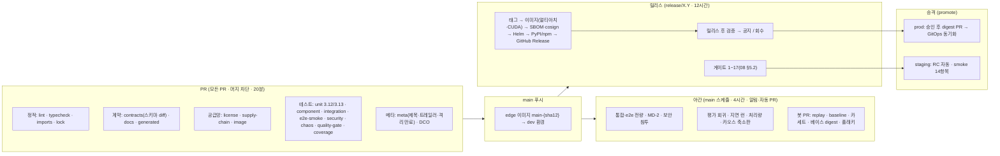
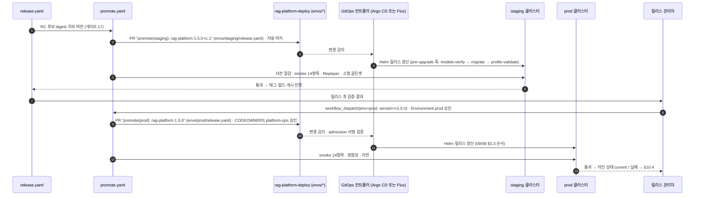

# CI/CD

## 목적

이 문서는 RAG Platform 저장소의 **지속적 통합·배포(CI/CD, Continuous Integration / Continuous Delivery) 파이프라인의 실행 정의**를 확정한다. 무엇을 검증하는지는 다른 문서가 이미 정했다 — 테스트 층·마커·실행 매트릭스는 [테스트 전략](./04-testing-strategy.md) §19, 릴리스 게이트 17항목·아티팩트·게시 순서는 [릴리스 프로세스](./08-release-process.md) §5~§7, 취약점·라이선스 스캐너와 시크릿 취급은 [보안과 컴플라이언스](../09-operations/05-security-and-compliance.md) §2·§6·§7, 계약 게이트는 [계약 개요](../03-contracts/00-contract-overview.md) §10.3과 [스키마 버전 관리](../03-contracts/14-schema-versioning-and-compatibility.md) §10이다. 이 문서는 그 검사들을 **GitHub Actions 워크플로우·잡·러너·캐시·시크릿·환경**으로 배치하고, 세 문서가 "CI/CD가 확정한다"고 위임한 항목 — 잡 이름과 필수 상태 검사 목록([기여 가이드](./07-contributing.md) §5.4), PR 시간 예산과 병렬화(04 미해결 이슈 13), 마이크로벤치 결과 저장 위치(04 미해결 이슈 12), 체인지로그 생성기·커밋 린터·트레일러 린트(08 미해결 이슈 2·3), 정리 릴리스 자동 판정(08 미해결 이슈 14), DCO 검사 앱(07 미해결 이슈 2) — 를 결정 또는 제안으로 닫는다.

독자는 (1) `.github/workflows/`를 고치는 `devex` 팀, (2) 자기 PR이 왜 어느 잡에서 막혔는지 알아야 하는 기여자, (3) 스테이징·운영 승격과 롤백을 수행하는 `platform-ops`·릴리스 관리자다.

## 범위

- 포함: 파이프라인 원칙, 워크플로우 파일과 잡 명명, 필수 상태 검사 표, PR 파이프라인(정적 검사·계약·스키마 diff 호환성·라이선스 게이트·문서 링크 검사·테스트 층·생성물 동기화·커버리지·PR 메타 검사), 야간 파이프라인(통합·e2e·평가 회귀·성능·자동 PR), 릴리스 파이프라인(이미지 빌드 멀티아치·CUDA, SBOM, cosign 서명, Helm 패키징, PyPI/npm 배포, 릴리스 후 검증), 캐시 전략(uv·모델·이미지 레이어), 러너와 GPU 러너 옵션, 시크릿 관리, 환경 승격(dev → staging → prod), 배포 자동화(Argo CD / Flux 옵션), 롤백, 워크플로우 YAML 스케치 2개.
- 제외: 검사 규칙 자체의 정의(위 정본 문서들), 배포 절차·드레인·데이터 계층 롤백 세부([업그레이드와 마이그레이션](../09-operations/08-upgrade-and-migration.md) §3·§7), Helm 차트 구조([배포 아키텍처](../02-architecture/08-deployment-architecture.md) §4), 로컬 개발 명령과 pre-commit([개발 환경](./02-development-environment.md)), 플러그인 저자용 CI 템플릿([플러그인 개발 가이드](./06-plugin-development-guide.md)).
- 정본 관계: 브리프 > 바이블 > ADR > 이 문서. 패키지·이미지·extras·엔드포인트·환경 변수 이름은 바이블 §6.6·§6.7·§12의 철자를 그대로 쓴다. 이 문서가 만드는 이름(워크플로우 파일, 잡·상태 검사 이름, 러너 라벨, 캐시 키, GitHub Environment 이름, `tools/ci/*` 스크립트 이름)은 **도구 어휘**이며 계약·열거·이벤트·메트릭이 아니다. 새 계약 스키마는 추가하지 않는다.
- 표기: 앵커(브리프·바이블·ADR·위임을 명시한 상위 문서)가 뒷받침하는 규칙만 `**결정:**`, 이 문서가 새로 도입하는 것은 `**제안:**`으로 쓰고 "## 미해결 이슈"에 남긴다. GitHub Actions 액션(`actions/checkout` 등)·GitOps 도구·정책 엔진의 버전과 세부 동작은 07-tech-landscape 조사가 없어 **확인 필요(as of 2026-09)** 이며, 스케치의 액션 참조는 모두 `@<sha>` 플레이스홀더다. 시간 예산·건수는 모두 **초안 목표**다.

## 1. 원칙

| # | 원칙 | 출처 | 파이프라인에 대한 함의 |
|---|------|------|------------------------|
| C1 | **워크플로우는 규칙을 정의하지 않는다** | 03 §1, 04 P3 | 모든 step은 `uv run …`, `rag …`, `tools/ci/*`, `tools/docs/*`, `docker compose …` 한 줄로 환원되고 `just check`(02 §1.1)로 로컬 재현된다. YAML 안에 임계값·목록을 적지 않는다(정본 파일을 읽는다) |
| C2 | **PR CI는 재생만, 실물은 야간부터** | 04 P5 | PR 러너는 모델 다운로드·외부 LLM·사이드카 실서버 접근이 없다(`HF_HUB_OFFLINE=1`, `RAG_TESTING__MODEL_CACHE_POLICY=fail_on_miss`). GPU 러너는 릴리스에서만 |
| C3 | **상태 검사 이름은 API다** | 07 §5.4, 08 §3.3 | 브랜치 보호가 참조하는 잡 이름은 §3.2 표대로 고정하고, 이름 변경은 이 문서 minor 개정 + 보호 규칙 동시 갱신 |
| C4 | **두 인터프리터, 한 잠금** | D-01, [ADR-0035](../06-adr/0035-python-version-and-toolchain-pins.md) | 단위 테스트(`unit`)만 Python 3.12·3.13 매트릭스(04 §19 "L1 단위(3.12·3.13)"), 그 외 잡은 저장소 기본 인터프리터(`.python-version`) 단일 실행; 의존은 `uv.lock` 하나(`uv sync --frozen`) |
| C5 | **최소 권한·짧은 수명 자격 증명** | 09/05 §2, 08 §7 | 기본 `permissions: contents: read`; 게시 잡만 `id-token: write`·`packages: write`; 장기 시크릿 대신 OIDC 연합(cosign keyless·PyPI Trusted Publishing·클라우드 역할). PR(포크 포함)은 어떤 시크릿도 받지 않는다 |
| C6 | **같은 차트·같은 digest, 값만 다르다** | 08-deployment §8, 08 §1.3 | 승격은 이미지·차트를 다시 빌드하지 않고 환경 values의 `image.digest`만 바꾼다. 이동 태그(`edge`)는 `dev`에서만 쓰고, `latest` 태그는 어디에도 만들지 않는다(08 §1.3; npm dist-tag `latest`만 §6.5 예외) |
| C7 | **게시물은 불변, 실패는 회수·전진** | 08 §6.2·§8.4 | 태그·이미지·패키지는 삭제·재빌드하지 않는다. 실패는 `yanked` 표시 + PATCH |
| C8 | **재현 가능한 빌드 입력** | 08 §7 | 액션·베이스 이미지·도구 바이너리는 SHA/digest로 고정하고 월 1회 갱신 PR(09/05 §6.2 (2)) |

## 2. 파이프라인 개요



**결정:** 파이프라인은 PR·야간·릴리스의 세 단계(04 §19)와 승격(CD) 한 단계로 구성하며, 각 단계의 검사 집합은 04 §19 표와 08 §5.2 표를 그대로 실행한다. 이 문서는 시점·잡·러너·시크릿만 더한다. ([ADR-0035](../06-adr/0035-python-version-and-toolchain-pins.md), [ADR-0003](../06-adr/0003-orchestrator-neutral-pipeline-and-non-durable-local-runner.md))

## 3. 워크플로우 파일과 잡 명명

### 3.1 파일 목록

**제안:** `.github/workflows/`([저장소 구조](./01-repository-structure.md) §2.1, 이 문서 소유)에 아래 파일을 둔다. 파일 이름은 kebab-case, 확장자 `.yaml`(저장소의 Helm·compose·프로파일 YAML과 통일).

| 파일 | 트리거 | 역할 | 시간 예산(초안) |
|------|--------|------|-----------------|
| `pr.yaml` | `pull_request`, `merge_group`, `workflow_call` | §4 PR 게이트 전부. `release.yaml`이 게이트 1~4로 재사용 | ≤ 20분(병렬) |
| `main.yaml` | `push: main` | `edge` 개발 이미지 빌드(`main-{sha12}` + 이동 태그 `edge`, 08 §1.3), Trivy 스캔, `dev` 환경 배포(§10) | ≤ 30분 |
| `nightly.yaml` | `schedule`(UTC 17:00 = KST 02:00), `workflow_dispatch` | §5 야간 전량·성능·평가·봇 PR | ≤ 4시간 |
| `release.yaml` | `push: release/**`, `workflow_dispatch(version, kind)` | §6 게이트 → 태그 → 빌드 → 서명 → 게시 → 검증 | ≤ 12시간 |
| `promote.yaml` | `workflow_call`, `workflow_dispatch(env, version)` | §10 환경 values 갱신 PR(staging 자동·prod 승인) + smoke | ≤ 60분 |
| `plugin-release.yaml` | `push: tags: rag-plugin-*/v*` | §6.7 플러그인 wheel 게시(적합성 키트·라이선스 게이트·Trusted Publishing) | ≤ 40분 |
| `sdk-release.yaml` | `push: tags: sdk-python/v*, sdk-typescript/v*` | §6.7 클라이언트 SDK 게시 | ≤ 30분 |
| `maintenance.yaml` | `schedule`(월 1회), `workflow_dispatch` | 베이스 이미지 digest·액션 SHA 갱신 PR, 예외 만료 린트(`.trivyignore.yaml`), 정리 릴리스 조건 판정(08 §9.3) | ≤ 30분 |

복합 로직은 워크플로우가 아니라 `tools/ci/*.py`(표준 라이브러리 + dev 그룹만, 01 §3.1)에 두어 로컬 실행을 보장한다. 이 문서가 새로 제안하는 스크립트: `changed_paths.py`(경로 필터 출력), `check_release_trailers.py`(08 §4.3 트레일러 ↔ diff 대조), `check_license_paths.py`(GPL/AGPL 코드·Dockerfile 부재, `optIn.*` 기본 `false`; 09/05 §7.3 항목 1·4), `check_forward_port.py`(08 §10.2 7단계 `release/X.Y ⊆ main`), `write_manifest.py`(`release-manifest.json` 생성·digest 채움), `bench_report.py`(마이크로벤치 7일 중앙값 비교), `tag_schemas.py`(`schemas/{kebab}@{semver}` 태그), `publish_charts.py`(Helm 패키징·push·차트 digest 서명), `verify_release.py`(릴리스 후 검증, §6.6). 다른 문서가 이미 제안한 스크립트(`check_lock_ranges.py`, `check_release_versions.py`, `sync_helm_profiles.py`, `check_quarantine.py`, `check_span_literals.py`, `check_field_descriptions.py`, `check_commit_message.py`, `tools/docs/extract_examples.py`, `tools/docs/adr_index.py`)는 이름을 그대로 쓴다.

### 3.2 잡 이름 규약과 필수 상태 검사 표

**결정([기여 가이드](./07-contributing.md) 미해결 이슈 2 — 잡 이름 확정):** 상태 검사 이름은 `{workflow} / {job}` 형식으로 GitHub가 보고하는 값이며, `job`은 kebab-case, 매트릭스 축은 괄호로 붙는다(`pr / unit (3.12)`). 아래 표의 "차단" 열이 `main`·`release/*` 브랜치 보호의 **필수 상태 검사** 목록이다. 경로 필터로 실행이 불필요한 잡은 `if:`로 건너뛰며, 건너뛴 잡은 필수 검사에서 통과로 취급된다(GitHub 동작 확인 필요 as of 2026-09; 다르면 §4.7의 "성공 단축" 패턴으로 대체). 07 §5.4의 역할 열은 이 표의 "역할" 열로 대응한다. ([ADR-0035](../06-adr/0035-python-version-and-toolchain-pins.md), [ADR-0001](../06-adr/0001-license-grade-table-and-d02-interpretation.md))

| 상태 검사 | 역할(07 §5.4) | 실행 조건 | 차단 | 러너 | 예산(초안) | 근거 |
|-----------|---------------|-----------|:----:|------|:---:|------|
| `pr / lint` | 린트·포맷 | 항상 | 예 | hosted x64 | 5분 | D-01, 03 §2 |
| `pr / typecheck` | mypy | 항상 | 예 | hosted | 10분 | 03 §3 |
| `pr / imports` | import-linter | 항상 | 예 | hosted | 5분 | 01 §3.2 5계약 |
| `pr / lock` | 잠금 검사 | 항상 | 예 | hosted | 3분 | 바이블 §11.6, ADR-0035 |
| `pr / license` | 라이선스 게이트 | `pyproject.toml`·`uv.lock`·`models.lock`·`plugins/**/pyproject.toml`·`deploy/**`·`sidecars/**`·`LICENSE`·`NOTICE` 변경 | 예 | hosted | 8분 | D-02, ADR-0001, 09/05 §7 |
| `pr / contracts` | 스키마 검증 | 항상(`schemas/**`·`src/rag_platform/contracts/**`·`docs/03-contracts/**` 변경 시 스키마 diff 포함) | 예 | hosted | 10분 | 00 §10.3, 14 §10 |
| `pr / docs` | 문서 검증 | 항상 | 예 | hosted | 5분 | 브리프 §9.6, 매트릭스 CI 게이트 |
| `pr / generated` | 생성물 diff | 항상 | 예 | hosted | 10분 | 01 §6 |
| `pr / unit (3.12)`, `pr / unit (3.13)` | 테스트 3.12·3.13 | 항상 | 예 | hosted | 10분 | 04 §3·§19 |
| `pr / component` | 테스트(컴포넌트) | 항상(`adapters/parse/**` 변경 시 해당 포맷 코퍼스 전량) | 예 | hosted | 12분 | 04 §5·§8 |
| `pr / integration` | 테스트(통합·재생) | 항상 | 예 | hosted(compose lite) | 15분 | 04 §10, ADR-0003 |
| `pr / e2e-smoke` | 테스트(e2e S-01) | 항상 | 예 | hosted(compose lite) | 10분 | 바이블 §11.6 |
| `pr / security` | 테스트(보안 E1~E17) | 항상 | 예 | hosted(compose lite) | 12분 | 바이블 §10.3 |
| `pr / chaos` | 테스트(C-01·C-10·C-11) | 항상 | 예 | hosted(compose lite) | 10분 | 02-architecture/09 §8 |
| `pr / quality-gate` | 품질 게이트 | 항상 | 예 | hosted(compose lite, `[eval]`) | 5분 | 08/02 §12, 04 §13 |
| `pr / coverage` | 커버리지 | 항상(`unit`·`component`·`integration` 뒤) | 예 | hosted | 3분 | NFR-MNT-03, 04 §17 |
| `pr / supply-chain` | 취약점(잠금·IaC·시크릿) | 항상 | 예 | hosted | 5분 | 09/05 §6.1 |
| `pr / image` | 취약점(이미지) | `Dockerfile`·`sidecars/**`·`uv.lock`·`pyproject.toml`·`deploy/**` 변경 | 예 | hosted | 15분 | 09/05 §6.2 |
| `pr / meta` | PR 제목 린트·트레일러·격리 만료 | 항상 | 예 | hosted | 2분 | 03 §14, 08 §4.3, 04 §16 |
| `DCO` | DCO | 항상(외부 앱) | 예 | 앱 | — | 07 §6 |
| `pr / perf-micro` | 마이크로벤치 | 항상 | **아니오**(경고) | hosted | 5분 | 04 §12 |

`security`·`architecture` 등급 경로는 `enforce_admins`로 관리자도 우회할 수 없다(07 §5.4). 필수 검사 목록에 없는 잡(`perf-micro`, 야간·릴리스 잡)은 머지를 막지 않는다.

### 3.3 트리거·동시성·경로 필터

- **동시성**: `pr.yaml`은 PR 번호 단위 `concurrency` + `cancel-in-progress: true`(새 푸시가 이전 실행을 취소). `release.yaml`은 저장소 단위 그룹 `release`에 `cancel-in-progress: false`(직렬). `nightly.yaml`은 겹치면 건너뛴다.
- **경로 필터**: `on.paths`가 아니라 잡 `changes`가 `tools/ci/changed_paths.py`로 변경 집합을 분류해 출력(`deps`, `schemas`, `image`, `parse_formats[]`, `docs_only`)하고 하위 잡이 `if:`로 참조한다. 이렇게 하면 상태 검사 컨텍스트가 항상 생성된다(C3). 04 §19 경로 규칙: `schemas/**`·`contracts/**` → 계약 층 전량 + 스키마 diff, `adapters/parse/**` → 해당 포맷 코퍼스 전량, 의존성 범프 → 04 §5.4 규칙.
- **포크 PR**: `pull_request`(비신뢰) 이벤트만 쓰고 `pull_request_target`은 쓰지 않는다. 포크 PR은 시크릿·OIDC 토큰 없이 실행되며, 시크릿이 필요한 검사는 PR에 없다(C2·C5). `quality-gate`의 PR 코멘트는 포크에서 쓰기 권한이 없으면 아티팩트 `comparison.md`로 대체한다.
- **머지 큐**: `merge_group` 이벤트를 `pr.yaml`에 등록해 두되, 머지 큐 도입 여부는 확인 필요(as of 2026-09; 07 §5.5 스쿼시 정책과 호환성).

## 4. PR 파이프라인

### 4.1 정적 검사

| 잡 | 명령(정본) | 판정 |
|----|-----------|------|
| `lint` | `uv run ruff check . && uv run ruff format --check .`(03 §2; `TID251` 금지 API·`D` docstring 포함) | 위반 0 |
| `typecheck` | `uv run mypy --strict src/ plugins/ sdk/python/`(03 §3.1, `pydantic.mypy`) | 오류 0 |
| `imports` | `uv run lint-imports`(01 §3.2 5계약: `layers`·`no-orchestrator-in-stages`·`adapters-no-storage`·`contracts-pure`·C 등급 임포트 차단) + `tools/ci/check_span_literals.py` | 계약 전부 KEPT |
| `lock` | `uv lock --check` → `tools/ci/check_lock_ranges.py`(ADR-0035 범위: python-hwpx·semchunk·tiktoken·temporalio·docling·rapidocr·mcp) | 실패 = 빌드 실패 |

공통 준비 step은 `actions/checkout` → `uv` 설치(버전은 `.github/uv-version` 파일에 고정, 제안) → `uv python install 3.12 3.13` → `uv sync --frozen --all-packages --all-extras --group dev`(01 §3.4; `[kiwi]` wheel 미공개 상태면 01 미해결 이슈 15의 extras 열거로 대체)이다. `--frozen`은 `uv.lock`을 갱신하지 않으므로 `lock` 잡의 `uv lock --check`와 역할이 겹치지 않는다.

### 4.2 계약 게이트와 스키마 diff 호환성 검사

**결정:** `pr / contracts`는 00 §10.3 게이트 8종과 14 §10 게이트를 아래 순서로 실행한다. 규칙을 새로 만들지 않는다. ([ADR-0030](../06-adr/0030-single-coordinate-system-and-score-ledger.md), [ADR-0036](../06-adr/0036-naming-and-identifier-conventions.md))

| 순서 | 검사 | 명령(정본·제안) |
|------|------|-----------------|
| 1 | 스키마 문법(2020-12 메타스키마, `$ref` 해소, `additionalProperties` 명시) + 래퍼 게이트 + 열거 대조(바이블 §5.7 1.3.0 정본 — 이벤트 25종·오류·경고 코드 84종·메트릭 36종, AM-36·39·41) + 인벤토리 커버리지(35종, AM-01) | `node tools/validate-contracts.mjs --root .`(현존 Node 스크립트; 02 §1.1 결정으로 CI는 항상 실행) |
| 2 | 골든 예시 회귀(문서 `## 예시` 추출 → 스키마 검증; G1·G4) | `uv run python tools/docs/extract_examples.py --out build/golden && uv run pytest tests/contracts -m contract -k golden` |
| 3 | Pydantic 동치(export ↔ `schemas/` 의미 비교) | `uv run python -m rag_platform.contracts.export --out build/schemas-export`(01 §6; `rag schema export`는 제안) → 비교 테스트 |
| 4 | 불변식·해시 벡터·프로파일 해소 스냅샷 | `uv run pytest tests/contracts -m contract` |
| 5 | **스키마 diff 호환성**(`changes.schemas == true`일 때): 머지 기준(`merge-base`)의 `schemas/`와 PR 헤드를 `SchemaDiffReport`로 비교. `declared_level`은 파일의 `schema_version` 증분에서 계산, `computed_level`은 14 §10.2 분류의 최댓값, `passed = declared_level ≥ computed_level` | `uv run rag schema diff --base "$MERGE_BASE" --head . --out build/schema-diff/`(14 §10.2 제안 명령; 확정 전 `python -m rag_platform.contracts.diff`) → `build/schema-diff/{kebab}.json`을 아티팩트로 첨부 |
| 6 | 트레일러 정합: `schemas/*.schema.json` 변경 커밋에 `Contract-Change: {kebab} {from} -> {to} ({level})`가 있고 `{level}` = 보고서 `computed_level` 이상 | `tools/ci/check_release_trailers.py --require contract-change`(08 §4.3 린트) |
| 7 | 03-contracts 문서 `## 버전 이력` 최신 항목 = `versioning.py` 표(14 §10.4) | `uv run pytest tests/contracts -k versioning` |

`SchemaDiffReport`는 1.3.0에서 바이블 §5.1 계약 인벤토리(35종)에 편입된 스키마다(`schemas/schema-diff-report.schema.json`, `$id urn:rag:schema:schema-diff-report:1`, 14 소유, AM-01). `CompatLevel`·`SchemaChangeKind` 값은 §5.7 열거 대조 대상이다(00 §10.3). `passed=false`면 잡 실패, 보고서의 `changes[]`를 PR 코멘트 요약으로 게시한다(포크는 아티팩트만). 과대 선언(minor를 major로)은 통과시킨다(14 §10.2).

### 4.3 라이선스 게이트

**결정:** `pr / license`는 09/05 §7.2의 순서를 그대로 실행한다 — `uv lock --check`(`lock` 잡 결과 재사용) → `pip-licenses --format=json --with-urls --with-license-file --no-license-path --allow-only "<A 등급>" --fail-on "<금지 목록>"`(별칭 표 `tools/licenses/allowlist.toml`) → `uv run liccheck`(`[tool.liccheck]` `CAUTIOUS`, extras 6종 포함) → `cyclonedx-py environment -o build/sbom.cdx.json`(PR에서는 생성만, 첨부는 릴리스) → `rag models verify --lock models.lock --offline`(09/05 §7.4 게이트 5규칙: D 등급 기본 프로파일 금지·pickle 계열 금지·`territory`·`LICENSE` 존재·X 금지; 미러 접근이 없는 PR은 형식·등급 검사만) → `tools/ci/check_license_paths.py`(GPL/AGPL 코드·Dockerfile 부재, `deploy/**` 기본 `optIn.*` 전부 `false`, `import fitz|pymupdf|hwp5` 문자열 부재, 한컴 고지 원문 문자열 `NOTICE` 존재). 어느 단계든 실패 = 머지 차단. ([ADR-0001](../06-adr/0001-license-grade-table-and-d02-interpretation.md))

플러그인 워크스페이스 멤버는 `uv sync --package rag-plugin-{name}` 뒤 같은 명령을 반복하고 `PluginMeta.license_grade ≤ A/B`·`linkage`(B는 `static_bundled` 거부, 바이블 §7.4)를 레지스트리 `license_gate`로 검사한다.

### 4.4 문서 게이트

**결정:** `pr / docs`는 04 §19 "문서 게이트" 행과 08 §5.2 게이트 11을 실행한다. ([ADR-0036](../06-adr/0036-naming-and-identifier-conventions.md))

| 검사 | 명령(제안) | 판정 |
|------|-----------|------|
| 링크 검사 — 상대 링크 대상이 브리프 §8 문서 맵 안에 있고 파일이 존재 | `uv run python tools/docs/check_links.py docs/` | 문서 맵 밖 경로 = 실패, 문서 맵 안이지만 미작성 = 경고(매트릭스 CI 게이트) |
| frontmatter — `title, status, owner, version, last_updated, depends_on` 필수, 계약 문서는 `schema_version`; `depends_on` 대상 존재 | 같은 스크립트 `--frontmatter` | 실패 |
| 구조 — `## 목적 → ## 범위 → … → ## 결정 사항 요약 → ## 미해결 이슈 → ## 참조`; `**결정:**`에 ADR 링크; 이모지·ASCII 아트 없음; 길이 250~900행(ADR 60~200) | `--structure` | 실패(길이는 경고) |
| 열거 대조 파싱 — 바이블 §5.7 표가 기계 파싱 가능(§4.2 순서 1이 소비) | `node tools/validate-contracts.mjs` 공유 | 실패 |
| 예시 JSON 문법 — 모든 ```json 블록이 완전한 JSON | `--json-blocks` | 실패 |
| ADR 인덱스 재생성 diff; 문서 사이트 빌드는 도구 확정 후(08 미해결 이슈 8) | `tools/docs/adr_index.py --check` | 실패 |

### 4.5 테스트 잡

**결정:** 잡은 04 §2 층과 1:1이며 마커로 선택한다(`--strict-markers`, 미등록 마커 거부). PR 필수 층에서 스킵은 실패로 취급한다(04 §21; `-p rag_platform.testing.pytest --strict-skips`는 제안 — 확정 전 `-rs` 출력을 `tools/ci`가 파싱). 시드·시각은 04 §9.2(`SEED=42`, `PYTHONHASHSEED=0`, derandomize)로 고정한다. ([ADR-0032](../06-adr/0032-plugin-sdk-stage-protocol-and-conformance-kit.md), [ADR-0003](../06-adr/0003-orchestrator-neutral-pipeline-and-non-durable-local-runner.md))

| 잡 | 명령(요지) | 외부 의존 | 비고 |
|----|-----------|-----------|------|
| `unit (3.12)`, `unit (3.13)` | `uv run --python {v} pytest tests/unit -m unit --cov=rag_platform --cov-report=xml:build/cov-unit-{v}.xml` | 없음 | 속성 기반 테스트는 CI 프로파일(derandomize) |
| `component` | `uv run pytest tests/adapters tests/golden -m "component and not model and not sidecar"`; `changes.parse_formats`가 있으면 `-k {format}` 전량 | 카세트·MD-1 픽스처(저장소 내 ≤ 1MB) | `fail_on_miss` |
| `integration` | `docker compose -f deploy/compose/compose.lite.yaml up --wait` → `uv run pytest tests/integration tests/replay -m "integration"`(저장소 히스토리 `Replayer`, `start_time_skipping`, 두 셸 동등성) → `down -v` | PostgreSQL·Qdrant·Valkey, `file://` | `[temporal]` extra는 SDK 테스트 유틸만(서버 없음) |
| `e2e-smoke` | compose lite → `uv run pytest tests/e2e -k s01`(`rag up → ingest → query → mcp`) | compose lite + `rag` CLI | 총 시간 ≤ 5분 단정은 경고 |
| `security` | compose lite → `uv run pytest tests/security -m security -m "not nightly"` | compose lite | E8 침투·DLS 0건은 야간 |
| `chaos` | compose lite → `uv run pytest tests/chaos -m chaos -k "c01 or c10 or c11"` | compose lite | 다른 잡과 컨테이너 공유 없음(러너 분리로 자연 보장) |
| `quality-gate` | compose lite → `uv run rag eval run --dataset ko-public-v1-small --profile lite --baseline "$(cat tests/eval/baseline_run_id)" --concurrency 4 --gate` | compose lite, `[eval]`, 원장 스냅숏 픽스처 | 종료 코드 2 = 차단; `comparison.md` PR 코멘트(포크는 아티팩트) |
| `perf-micro` | `uv run pytest tests/perf -m perf --benchmark-json build/bench.json`(벤치 플러그인은 확인 필요; 대체 `time.perf_counter` 자체 하네스) → `tools/ci/bench_report.py --history` | 없음 | 경고만(§5.2 저장 위치) |

compose 기동은 `--wait`로 헬스 체크를 기다리고, 실패 시 픽스처 수준 1회 재시도만 허용한다(04 §16 인프라 전이 실패). 테스트 본문 재시도는 금지다.

### 4.6 생성물 동기화·커버리지·PR 메타

| 잡 | 검사 | 명령(01 §6 표) |
|----|------|----------------|
| `generated` | `docs/05-api/openapi.yaml` 재생성 diff(오류 응답이 `problem-details` 참조) | `uv run python -m rag_platform.api.openapi --out docs/05-api/openapi.yaml` |
| | Weaver 상수 재생성 + `weaver registry diff`(고정 커밋) | `weaver registry generate …`(플래그 확인 필요) |
| | Helm 프로파일 사본 바이트 동일 | `tools/ci/sync_helm_profiles.py --check` |
| | TS 생성층 diff | `npm --prefix sdk/typescript run generate` |
| | 원장 마이그레이션 빈 autogenerate | 도구 미확정(01 미해결 이슈 5) — compose PG 필요 시 `integration` 잡으로 이동 |
| | `CHANGELOG.md`·ADR 인덱스 재생성 diff | 생성기(§4.6 아래) |
| | 마지막에 `git diff --exit-code` | 실패 = "생성물을 손으로 고쳤거나 재생성을 빠뜨렸다" |
| `coverage` | `unit (3.12)`·`component`·`integration`의 `build/cov-*.xml` 병합 → 코어 라인 ≥ 80%, 모듈별 04 §17 표, diff 커버리지 ≥ 90%(초안) | 도구 확인 필요(04 미해결 이슈 9); 확정 전 coverage.py `combine` + 자체 diff 스크립트 |
| `meta` | PR 제목 = Conventional Commit 헤더(03 §14 정규식·스코프 어휘 08 §4.2), `!`가 있으면 본문에 `ADR:` 필수 | `tools/ci/check_commit_message.py --pr-title` |
| | 트레일러 ↔ diff 대조(08 §4.3 린트: `schemas/` ↔ `Contract-Change`, `profiles/builtin/` ↔ `Profile-Version`, `ledger/migrations/` ↔ `Migration`; 선언만 있고 diff가 없으면 경고) | `tools/ci/check_release_trailers.py` |
| | 격리 만료(`quarantine(expires)` ≤ 오늘) 및 격리 비율 ≤ 2% | `tools/ci/check_quarantine.py` |
| | 대용량 파일(> 1MB) 추가 금지, 모델·사전 파일 확장자 금지(01 §9) | 같은 스크립트 |

**제안(08 미해결 이슈 2 — 체인지로그 생성기·커밋 린터):** 커밋 린터는 외부 도구 대신 `tools/ci/check_commit_message.py`(03 §14 제안)가 PR 제목과 커밋을 검사한다. 체인지로그 생성기는 요구 조건(트레일러 파싱·모노레포 경로 필터·Keep a Changelog 절 매핑)이 표준 도구의 기본 기능을 벗어나므로 `tools/ci/changelog.py`(제안)로 자체 구현하고, git-cliff·release-please 채택은 후속 조사(확인 필요 as of 2026-09)로 남긴다. DCO 검사는 GitHub Marketplace의 DCO 앱(확인 필요)을 1차로 쓰고, 앱을 쓸 수 없는 환경은 `meta` 잡이 `Signed-off-by` 트레일러를 검사하는 폴백을 갖는다.

### 4.7 시간 예산과 병렬화

**결정(04 미해결 이슈 13):** PR 전체 실제 경과 시간 ≤ 20분(초안 목표)은 **잡 분할**로 달성한다 — §3.2의 잡은 서로 `needs` 없이 병렬이며(`coverage`만 세 잡 뒤), 가장 긴 잡(`integration` 15분, `image` 15분)이 상한을 정한다. 잡 안에서의 테스트 병렬 실행 플러그인은 확인 필요(04 미해결 이슈 9)이며 채택 전에는 잡 분할만 쓴다. 예산 초과가 5영업일 연속이면 `devex`가 (1) `component`를 포맷별 매트릭스로 분할, (2) `integration`에서 `tests/replay`를 분리, (3) 캐시 적중률 점검 순으로 대응한다. ([ADR-0035](../06-adr/0035-python-version-and-toolchain-pins.md))

"성공 단축" 패턴(§3.2 대체안): 경로 필터로 불필요한 잡은 `if:`로 건너뛰는 대신 첫 step에서 `changes` 출력을 읽고 `exit 0`한다. GitHub가 건너뛴 잡을 필수 검사 통과로 취급하는지 확인된 뒤 하나로 통일한다.

## 5. 야간 파이프라인

### 5.1 잡 표

**결정:** 야간은 04 §19 "야간" 열을 실행하며 머지를 막지 않고 **알림 + 자동 PR**로 결과를 전달한다. 실패는 `#ci-nightly` 채널(플레이스홀더)과 GitHub 이슈(라벨 `nightly-failure`, 잡 이름·실행 링크 자동 기입)로 알린다. ([ADR-0003](../06-adr/0003-orchestrator-neutral-pipeline-and-non-durable-local-runner.md), [ADR-0009](../06-adr/0009-embedding-serving-vllm-pooling-tei-inprocess.md))

| 잡 | 내용 | 외부 의존 | 결과 처리 |
|----|------|-----------|-----------|
| `unit-shuffle` | 단위·계약·컴포넌트 스위트를 무작위 순서로 3회(순서 무작위화 플러그인 확인 필요; 대체 시드 셔플) | 없음 | 결과가 갈린 테스트 → 이슈(`flaky`, 04 §16 분류 필드) |
| `component-full` | 어댑터 계약 코퍼스 전량(미러 코퍼스 `rag corpus sync`, 제안) + MD-2 실물(`lite` 인프로세스 모델, `RAG_TESTING__MODEL_CACHE_POLICY=record`) + 사이드카 `parser-workers` 실서버 | 코퍼스 미러(OIDC 읽기), 모델 미러 | 갱신된 MD-1 픽셔 → 봇 PR `test(fixtures): re-record MD-1 …` |
| `integration-full` | compose lite + OpenSearch(`analysis-nori`) + Temporal(`temporal server start-dev`) + `parser-workers` + RustFS 또는 SeaweedFS(`s3://`) | `deploy/compose/compose.lite-durable.yaml` + 오버레이(제안 `compose.ci-full.yaml`) | 실패 알림 |
| `security-full` | E8 침투(서비스 계정 토큰만으로 DLS 0건), 카나리 테넌트 E1~E17 전량, 렌더러 누출 | 위 스택 | 실패 = Sev2 이슈(`security` 팀 배정) |
| `e2e-full` | S-01~S-08 | 위 스택 | 실패 알림 |
| `quality-full` | `rag eval run` — 프로파일 `eval.datasets[]` 전량, LLM-judge 표본(`warn`), 회귀 게이트 `warned_gates` | `[eval]`, judge LLM 키(§9) | `EvalReport` 아티팩트; 절대 게이트 위반은 알림 |
| `perf-latency` | `rag eval run --concurrency 1`(`bench-ko-100k`, 08/05 §4.4) → `latency_p95_ms` | 참조 환경(NFR ENV-M) 또는 스테이징 | `warned_gates`; 대시보드 push(§5.2) |
| `perf-ingest` | 텍스트 PDF 100p·스캔 PDF 100p 처리량 리포트 | 스테이징 워커 | 리포트(게이트 아님) |
| `chaos-extended` | C-03·C-06·C-07 축소판(컨테이너 정지 후 질의 → `degraded` 확인) | compose 전체 | 실패 알림 |
| `image-scan` | 운영 digest(`envs/prod`) Trivy `image` 전체(`--ignore-unfixed` 없이) + `fs`(`uv.lock`) + pip-audit | 레지스트리 읽기 | SARIF 업로드; Critical/High 신규 → 이슈(09/05 SLA 시계 시작) |
| `replay-refresh` | 스테이징에서 워크플로우 타입별 히스토리 채집(정상·재시도·취소·`partial`·`continue_as_new`) → `tests/replay/histories/` | 스테이징 Temporal 읽기(§9) | 봇 PR `test(replay): refresh histories …`; `Replayer`가 PR CI에서 검증 |
| `baseline-refresh` | `main` 최신 `completed` 런 → `tests/eval/baseline_run_id` + `tests/eval/baselines/{run_id}/` | 평가 결과 저장소 | 봇 PR `test(eval): bump baseline …`(04 §13) |
| `forward-port-check` | 활성 `release/X.Y`마다 `cherry-pick -x` 표기로 `release/X.Y ⊆ main` 검사(08 §10.2 7단계); 격리 만료 임박 7일 알림 병행 | — | 누락 커밋 목록 이슈 |

봇 PR은 `github-actions[bot]`(또는 조직 앱) 이름으로 열고 라벨 `bot`을 붙이며, 보통의 PR 게이트를 그대로 통과해야 머지된다. `test(fixtures)`·`test(replay)`·`test(eval)` 스코프에 한해 게이트 통과만으로 자동 머지되는 예외를 07 §5.4가 인정한다(사람 승인 대체 아님; 07-contributing과 합의, #94).

### 5.2 벤치 결과 저장 위치

**결정(04 미해결 이슈 12):** 마이크로벤치·지연 런 결과는 (1) 실행 아티팩트(`build/bench.json`, 90일)와 (2) `main` 전용 시계열로 이중 저장한다. 시계열은 관측 스택의 Prometheus에 `rag_eval_metric_value{metric="latency_p95_ms", profile_id}`(바이블 §6.5 정본 게이지; 라벨은 §6.5 허용 목록 안의 `metric`·`profile_id`만 — [관측성](../09-operations/03-observability.md) 메트릭 표·08/01 라벨 규칙과 동일, `dataset`·`tenant_id` 라벨 없음) Pushgateway 또는 OTLP로 올리고(관측성 대시보드), 마이크로벤치는 정본 메트릭 이름이 없으므로 `tools/ci/bench_report.py`가 저장소 외 `gh-pages` 분기 또는 CI 아티팩트 히스토리에서 7일 중앙값을 계산해 +30%(초안) 초과를 **PR 코멘트 경고**로만 낸다. 마이크로벤치용 신규 메트릭 이름은 만들지 않는다(바이블 §6.5 정본 목록 밖). 지연 런은 야간 `perf-latency` 한 데이터셋(`bench-ko-100k`)만 시계열에 올리므로 라벨 없이도 데이터셋이 구분되며, 데이터셋별 추세가 더 필요하면 메트릭 라벨이 아니라 `EvalRun` 원장(PostgreSQL 데이터소스)으로 분해한다(미해결 이슈 16). ([ADR-0022](../06-adr/0022-observability-genai-semconv-pin-and-license-boundary.md))

## 6. 릴리스 파이프라인

### 6.1 트리거와 순서

**결정:** `release.yaml`은 08 §5.1 다이어그램의 순서를 잡 `needs` 그래프로 구현한다. 태그는 사람이 만들지 않고 게이트 통과 뒤 `tag` 잡이 만든다(08 §3.3). 트리거는 (a) `release/X.Y` 브랜치 푸시(RC·후보 게이트 실행) 또는 (b) 릴리스 관리자의 `workflow_dispatch(version, kind)`이며, `kind`(`minor|patch|prerelease|major`)는 매니페스트 `release_kind`에 그대로 들어간다. PATCH는 08 §5.3 축약 규칙을 `kind == 'patch'` 조건으로 적용한다. ([ADR-0035](../06-adr/0035-python-version-and-toolchain-pins.md), [ADR-0001](../06-adr/0001-license-grade-table-and-d02-interpretation.md), [ADR-0003](../06-adr/0003-orchestrator-neutral-pipeline-and-non-durable-local-runner.md), [ADR-0031](../06-adr/0031-profile-schema-extends-and-quality-gates.md))

| 잡 | 08 §5.2 게이트 | 내용 | 러너 |
|----|:---:|------|------|
| `gates` | 1·2·3·4·8·10·11 | `pr.yaml`을 `workflow_call`로 재사용(3.12·3.13 매트릭스 포함) | hosted |
| `integration-matrix` | 5 | Temporal × Qdrant × OpenSearch × PostgreSQL 조합 매트릭스(`deploy/compat-matrix.json`의 `tested` 후보를 입력으로) → 통과 조합 기록 | hosted(compose) |
| `eval-release` | 6 | 소형 골든셋 `gate_result.passed` + 외부 셋(MIRACL-ko·MLDR-ko) + `grid`; builtin 프로파일 값 변경 시 `eval.gates` 전체 | hosted + **GPU 러너**(MD-3: vLLM pooling·TEI 실물, 코사인 ≥ 0.9999 동등성) |
| `reproducibility` | 7 | 카나리 문서 `IndexCommit.commit_hash` = 이전 RC(지문 변경 선언 없을 때) | hosted(compose) |
| `supply-chain` | 8·9 | Trivy `image`(코어·사이드카 후보 빌드)·`fs`·`config`·secret, Critical 0·High 미해결 0(예외는 `.trivyignore.yaml` 만료일·승인자) | hosted |
| `migrations` | 12 | 빈 autogenerate, expand 리비전만, RLS `ENABLE`+`FORCE`, `lock_timeout` | hosted(compose PG) |
| `compat-matrix` | 13 | `deploy/compat-matrix.json` 재생성(`rolling_from` ⊇ N-1, `contracts` = `versioning.py`, `supported` ⊇ `tested`) | hosted |
| `manifest` | 14 | 트레일러 ↔ diff 대조, `release-manifest.json` 생성·스키마 검증, 의미 규칙(`migrations.contract ≠ []` → `rollback.requires_pitr`) | hosted |
| `versions` | 15 | 태그 = `pyproject` 유도 = `Chart.yaml appVersion` = 매니페스트 = 이미지 라벨; SDK·플러그인 정적 `version` = 태그 | hosted |
| `helm-lint` | 16 | `helm lint`, 프로파일별 values 렌더 스냅샷 diff, `optIn.*` 기본 `false`, `image.digest` 필수(렌더 시 미지정 → 실패) | hosted |
| `staging-rehearsal` | 17 | `promote.yaml`(env `staging`) 호출 → 09/08 §3.2 사전 점검·§9.2 smoke 14항목(PATCH는 축약 7항목) | hosted → 스테이징 클러스터(GitOps 경유, §10) |
| `tag` | — | 위 전부 성공 + GitHub Environment `release`(필수 리뷰어 = 릴리스 관리자) 승인 → annotated tag `v{semver}` 생성·푸시(`schemas/{kebab}@{semver}` 태그 동시) | hosted |
| `build-images` → `sbom-sign` → `helm` → `pypi` → `sdk` → `github-release` → `post-verify` → `announce` | 게시(08 §6.2 순서) | §6.2~§6.6 | hosted(+ arm64는 옵션) |

### 6.2 이미지 빌드(멀티아치·CUDA)

**결정:** 코어 태그 하나는 이미지 3종(`rag-platform`, `parser-workers`, `ocr-gpu`)을 정확히 한 번 빌드한다(08 §3.2 규칙 3). 빌드는 `docker buildx`로 하고 베이스 이미지는 digest로 고정하며(08-deployment §3.5), 빌드 인자 `EXTRAS`·태그·커밋을 OCI 라벨(`org.opencontainers.image.version`·`revision`·`source`, `io.rag.extras`)에 기록한다. 같은 태그의 재빌드는 금지다(digest가 바뀌면 새 PATCH, 08 §7). ([ADR-0035](../06-adr/0035-python-version-and-toolchain-pins.md), [ADR-0008](../06-adr/0008-ocr-default-rapidocr-ppocrv5-korean.md))

| 이미지 | 컨텍스트 | 플랫폼 | 빌드 인자·변형 | 비고 |
|--------|----------|--------|----------------|------|
| `rag-platform` | `/`(`Dockerfile`, uv 3단계) | `linux/amd64` 필수; `linux/arm64`는 `vars.BUILD_ARM64 == 'true'`일 때 매트릭스 추가(08 미해결 이슈 9 — ONNX Runtime·mecab-ko wheel의 arm64 가용성 확인 필요) | 기본 `EXTRAS=temporal,opensearch,eval`(08-deployment §3.3); 명시 변형 `rag-platform:{semver}-kiwi`(`EXTRAS=…,kiwi`, `[kiwi]` wheel 공개 후) | `[gpu]` extra는 포함하지 않는다 |
| `parser-workers` | `sidecars/parser-workers` | `linux/amd64` 필수, `arm64` 옵션(JRE는 가용) | Maven fat jar → `eclipse-temurin:21-jre` | JVM 의존 SBOM은 CycloneDX Maven 플러그인 출력(01 미해결 이슈 6) |
| `ocr-gpu` | `sidecars/ocr-gpu` | **`linux/amd64`만**(CUDA 베이스) | CUDA 마이너는 `values`의 노드 드라이버 매트릭스에 맞춰 베이스 digest 선택; 에어갭 변형 `ocr-gpu:{semver}-bundled`(모델 미러에서 `models.lock` 항목을 빌드 시 적재 — 미러 읽기 OIDC 필요) | GPU 없는 러너에서 빌드 가능(실행 검증은 GPU 러너 `eval-release`) |
| `sparse-encoder-server`(선택) | `sidecars/sparse-encoder`(제안) | `linux/amd64` | CPU 기본, CUDA 변형 선택 | 01 미해결 이슈 2 확정 후 매트릭스에 추가 |

멀티아치는 `--platform linux/amd64,linux/arm64`로 매니페스트 리스트 하나를 만들고, `Producer.image_digest`·`parser_fingerprint_hash`에는 **매니페스트 리스트 digest가 아니라 실행 노드 아키텍처의 플랫폼 digest**가 기록된다(사이드카 `/healthz`가 응답하는 `image_digest`, 08-deployment §3.5). 따라서 amd64·arm64 워커가 섞인 클러스터는 같은 문서에 다른 지문을 낼 수 있으므로 arm64 게시 결정 전에 04-pipelines 소유자와 지문 규칙을 확정한다(미해결 이슈 5). 크기 상한(`rag-platform` ≤ 1.5GB, `parser-workers` ≤ 400MB, 초안)은 경고다.

### 6.3 SBOM·서명·증명

**결정:** 09/05 §6.1과 08 §7을 그대로 잡으로 옮긴다. cosign은 keyless(GitHub OIDC 신원)로 서명하고 서명 신원(`certificate-oidc-issuer = https://token.actions.githubusercontent.com`, `certificate-identity = https://github.com/<org>/rag-platform/.github/workflows/release.yaml@refs/tags/v*`)을 `SECURITY.md`와 배포 가이드에 게시한다. 조직 키(KMS)는 에어갭 재서명 시 병행한다. ([ADR-0001](../06-adr/0001-license-grade-table-and-d02-interpretation.md))

| 대상 | 명령(요지; 도구 버전 확인 필요 as of 2026-09) | 산출물 |
|------|-----------------------------------------------|--------|
| Python 의존성 SBOM | `uv run cyclonedx-py environment -o sbom-rag-platform-{semver}.cdx.json` | GitHub Release 첨부 |
| 이미지 SBOM | `syft {image}@{digest} -o cyclonedx-json > sbom-{image}-{semver}.cdx.json` + `-o spdx-json` | `cosign attest --type cyclonedx --predicate … {image}@{digest}` |
| 이미지 서명 | `cosign sign --yes {image}@{digest}`(3종 × 플랫폼 digest + 매니페스트 리스트) | 레지스트리 서명 |
| Helm 차트 | `cosign sign --yes {chart-oci}@{digest}`; `helm pull --verify`(provenance 파일) 병행 여부는 08 미해결 이슈 5 | 레지스트리 서명 |
| blob(스키마 번들·OpenAPI·매니페스트·`compat-matrix.json`·`models.lock` 사본·SBOM) | `cosign sign-blob --yes --bundle {file}.sigstore.json {file}` | Release 첨부 |
| PyPI | Trusted Publishing(OIDC) + PEP 740 게시 증명(확인 필요); cosign 중복 적용 없음(08 §7) | PyPI |
| npm | `npm publish --provenance --access public`(확인 필요) | npm |
| 검증 | `post-verify` 잡이 `cosign verify --certificate-identity … --certificate-oidc-issuer …`로 서명·attestation 전부 확인 | 로그 |

### 6.4 Helm 패키징

`helm` 잡: `tools/ci/sync_helm_profiles.py --check`(프로파일 사본 바이트 동일) → `helm lint deploy/helm/rag-platform deploy/helm/rag-platform-data` → 프로파일 values 4종(`values-{lite,standard,premium,korean-gov}.yaml`은 배포 가이드 §1 표기)별 `helm template` 렌더 스냅샷 diff → `helm package --version {chart_version} --app-version {semver}` → `helm push … oci://ghcr.io/<org>/charts` → 차트 digest cosign 서명. `Chart.yaml version`은 `{MAJOR}.{MINOR}`를 플랫폼과 잠그고 PATCH는 차트 전용(08 §1.1); 차트만 바뀐 PATCH는 태그 `helm/{chart}/v{semver}`로 별도 게시한다. values 렌더에 `image.digest`가 비어 있으면 실패(08 §5.2 게이트 16).

### 6.5 PyPI/npm 배포

| 패키지 | 잡 | 절차 | 조건 |
|--------|----|------|------|
| `rag-platform`(sdist + wheel) | `pypi` | `uv build` → 파일명 = 태그 검사 → GitHub Environment `pypi`(필수 리뷰어 없음, OIDC 신뢰 게시자 등록) → Trusted Publishing | 코어 태그마다 |
| `rag-platform-client` | `sdk`(python) | `uv build --package rag-platform-client` → Trusted Publishing | `sdk/python` 변경이 있는 트레인 또는 `sdk-python/v*` 태그 |
| `@rag-platform/client` | `sdk`(typescript) | `npm ci && npm run generate && npm run build && npm test` → `npm publish --provenance`(dist-tag: 정식 `latest`는 **npm 배포에 한해 허용** — npm은 dist-tag가 없으면 설치 불가; RC는 `next`) | 위와 동일 |
| `rag-plugin-{name}` | `plugin-release.yaml` | §6.7 | 플러그인 태그 |

`main` 개발 빌드는 PyPI·npm에 게시하지 않는다(08 §1.3). 게시 잡은 `environment:`로 감싸 OIDC 신뢰 관계를 워크플로우·환경 단위로 제한한다.

### 6.6 릴리스 후 검증과 회수

`post-verify` 잡은 게시된 아티팩트만으로 08 §5.5 표를 수행한다: `cosign verify`(이미지 3종·차트 2종·SBOM attestation·blob 서명) → 임시 kind 클러스터에 게시 차트·digest로 `lite` 형상 설치(`rag-platform-data` 포함) → 바이블 §11.6 5분 기동(`rag up`은 compose 전용이므로 kind에서는 `rag ingest`·`rag query`·MCP `search` 호출) → `GET /v1/schemas/common-types` ETag = 파일 BLAKE3 앞 16자 → `uv tool install rag-platform=={x}`·`rag --version` → `release-manifest.json.images[].digest` = 레지스트리 digest. 실패하면 `announce`를 건너뛰고 릴리스 관리자에게 알리며, 회수는 매니페스트 `support.status = "yanked"` + PyPI yank + npm `deprecate`(08 §8.4)이고 게시물 삭제는 하지 않는다(C7).

### 6.7 플러그인·SDK 릴리스 워크플로우

- `plugin-release.yaml`(태그 `rag-plugin-{name}/v{semver}`): 태그에서 `{name}` 파싱 → `uv sync --package rag-plugin-{name}` → 정적 검사(플러그인 `pyproject.toml`의 C 등급 차단 계약 포함) → 적합성 키트 `tests/test_conformance.py`(ADR-0032 6모듈 + 확장 지점 필수 매트릭스) → 라이선스 게이트(§4.3, `PluginMeta.license_grade`·`linkage`·`territory`) → `uv build --package` → `conformance.json` 동봉 → Trusted Publishing → cosign blob 서명(플러그인 아티팩트 서명은 09/05 미해결 이슈 12 확정 전 권고). `PluginMeta.version` = `[project] version` = 태그를 검사한다(08 §1.4). ([ADR-0032](../06-adr/0032-plugin-sdk-stage-protocol-and-conformance-kit.md))
- `sdk-release.yaml`(태그 `sdk-python/v*`, `sdk-typescript/v*`): §6.5 `sdk` 잡과 동일 절차를 단독 실행. SDK major = API 경로 major 검사(14 §9).

## 7. 캐시 전략

**결정:** 캐시는 결과를 바꾸지 않는 **입력 재사용**에만 쓰고, 캐시 키는 정본 파일의 해시로만 만든다. 캐시 미스가 결과를 바꾸는 항목(모델·카세트)은 PR에서 캐시가 아니라 **저장소 픽스처**를 쓴다(C2). ([ADR-0035](../06-adr/0035-python-version-and-toolchain-pins.md), [ADR-0001](../06-adr/0001-license-grade-table-and-d02-interpretation.md))

| 대상 | 저장소 | 키 | 범위 | 비고 |
|------|--------|-----|------|------|
| uv 패키지 캐시(`uv cache dir`) | GitHub Actions cache | `uv-{runner.os}-{python}-{hashFiles('uv.lock')}`; 복원 키 접두 `uv-{runner.os}-{python}-` | 모든 잡 | `uv sync --frozen`은 잠금과 다르면 실패하므로 오래된 캐시가 결과를 바꾸지 않음. `.python-version`·`.github/uv-version` 변경은 키에 포함 |
| 관리형 인터프리터(`uv python install`) | Actions cache | `uv-python-{runner.os}-{3.12|3.13 patch}` | 매트릭스 잡 | 패치 버전은 `uv python list`로 고정 |
| 모델(MD-2·MD-3) | **오브젝트 스토리지 미러**(`models/{repo}/{revision}/…`, 바이블 §13.3) → `rag models sync --lock models.lock --dest $RUNNER_TEMP/models` | `models.lock` 항목 sha256(도구가 대조) | 야간·릴리스만 | Actions cache는 `lite` 부분집합(≤ 2GB, 초안)만 보조 키 `models-{hashFiles('models.lock')}-lite`. PR은 `HF_HUB_OFFLINE=1` + `fail_on_miss`로 접근 자체가 실패 |
| MD-1 픽스처·카세트 | 저장소(`tests/fixtures/model_cache/`, `tests/fixtures/cassettes/`, 파일당 ≤ 1MB) | git | PR | 캐시가 아니라 정본 |
| 테스트 코퍼스(> 1MB) | 콘텐츠 주소화 미러(04 §6.3) | 매니페스트 blake3 | 야간·릴리스 | PR은 저장소 내 코퍼스만 |
| Docker 레이어 | buildx 레지스트리 캐시 `ghcr.io/<org>/{image}:buildcache`(`type=registry,mode=max`) | 이미지별 | `image`(PR, 읽기만)·`main`·릴리스(쓰기) | PR은 포크에서 쓰기 권한이 없으므로 `cache-from`만. `type=gha` 캐시는 10GB 저장소 상한(확인 필요) 때문에 보조 |
| compose 데이터 계층 이미지(PostgreSQL·Qdrant·Valkey·OpenSearch·Temporal) | 레지스트리 pull(digest 고정, `deploy/compose/*.yaml`) | digest | 통합 잡 | 러너 로컬 캐시 없음; 프리풀 미러(조직 레지스트리 프록시)는 확인 필요 |
| Maven(`parser-workers`) | Actions cache | `maven-{hashFiles('sidecars/parser-workers/pom.xml')}` | 이미지 잡 | buildx 캐시 마운트 병행 |
| npm(`sdk/typescript`) | Actions cache | `npm-{hashFiles('sdk/typescript/package-lock.json')}` | `generated`·`sdk` | `npm ci` |

캐시는 **정확성에 관여하지 않는다**는 원칙의 검증으로, `nightly / unit-shuffle` 1회는 캐시 없이(`actions/cache` 비활성) 실행한다.

## 8. 러너

### 8.1 러너 종류

| 라벨(제안) | 종류 | 용도 | 조건 |
|------------|------|------|------|
| `ubuntu-24.04`(GitHub 호스티드 x64; 라벨은 이미지 갱신 시 확인) | 호스티드 | PR 전부, 야간 대부분, 릴리스 게이트·빌드·게시 | `ubuntu-latest` 이동 라벨은 쓰지 않는다(재현성) |
| `ubuntu-24.04-arm`(호스티드 arm64; 가용성 확인 필요) | 호스티드 | `linux/arm64` 이미지 네이티브 빌드(QEMU 에뮬레이션 대체) | `BUILD_ARM64` 켠 뒤 |
| `[self-hosted, linux, x64, rag-gpu]` | 셀프호스티드 GPU | MD-3(vLLM pooling·TEI·`ocr-gpu` 실물), `eval-release`, 모델 교체 ADR 검증 | 릴리스·`workflow_dispatch`만; **PR 이벤트에서 절대 스케줄하지 않음** |
| `[self-hosted, linux, x64, rag-staging]` | 셀프호스티드(스테이징 네트워크) | `perf-latency`·`perf-ingest`(참조 환경), `replay-refresh`(스테이징 Temporal 읽기) | `main`·야간·릴리스만 |

### 8.2 GPU 러너 옵션

**제안:** GPU 러너는 아래 세 옵션 중 하나를 채택하며, 어느 경우든 (1) **임시(ephemeral) 러너**(잡 1회 실행 후 폐기), (2) `pull_request` 이벤트 차단(러너 그룹을 `main`·태그·`workflow_dispatch`에만 허용), (3) 모델 미러 읽기 전용 OIDC 역할, (4) `nvidia-smi`로 드라이버·CUDA 버전을 잡 시작 시 기록(배포 가이드 §2.2 매트릭스와 대조)을 만족해야 한다.

| 옵션 | 구성 | 장점 | 단점·확인 필요 |
|------|------|------|----------------|
| A. 스테이징 클러스터 GPU 노드풀 + Actions Runner Controller(ARC) | 스테이징 Kubernetes(08-deployment §6.1 `gpu-serving` 노드풀 time-slicing)에 러너 파드를 온디맨드로 띄움 | 인프라 추가 없음, 릴리스 게이트 17(스테이징 리허설)과 같은 형상, 모델 미러 접근이 이미 있음 | 스테이징 서빙과 GPU 경합(time-slicing) → 지연 측정은 전용 GPU 예약 필요; ARC 버전·GPU 디바이스 플러그인 조합 확인 필요(as of 2026-09) |
| B. 전용 GPU VM(고정 1대) | 조직 클라우드/온프레미스 VM, 러너 서비스 상주 | 단순, 지연 측정 안정 | 유휴 비용, 임시 러너 보장을 위해 잡마다 컨테이너 격리 필요, 디스크 정리 정책 |
| C. 클라우드 온디맨드 GPU(릴리스 시 생성·삭제) | `release.yaml`이 IaC로 인스턴스 생성 → 러너 등록 → 잡 → 파기 | 비용은 사용 시간만 | 기동 10~15분(초안), 스팟 중단 대응, 자격 증명 범위 |

기본 권고는 **A**(릴리스 월 1회 + 모델 ADR 검증 빈도에서 비용·형상 일치가 우세), 지연 측정용 전용 GPU가 필요해지면 B를 추가한다. GPU 잡은 `timeout-minutes: 240`, 실패 시 릴리스 차단(게이트 6은 축약 불가, 08 §5.3). GPU 러너가 없을 때 릴리스를 진행할 수 있는 "GPU 게이트 면제"는 두지 않는다 — MD-3 동등성(코사인 ≥ 0.9999, [ADR-0009](../06-adr/0009-embedding-serving-vllm-pooling-tei-inprocess.md))은 서빙 이미지 digest 갱신 PATCH에서도 필요하다.

## 9. 시크릿 관리

**결정:** CI의 비밀은 09/05 §2와 바이블 §6.6 규약을 따르며, 다음 세 원칙으로 좁힌다. ([ADR-0038](../06-adr/0038-outbound-egress-policy-and-webhook-signing.md), [ADR-0001](../06-adr/0001-license-grade-table-and-d02-interpretation.md))

1. **장기 시크릿 대신 OIDC**: 레지스트리 푸시는 `GITHUB_TOKEN`(`packages: write`), cosign은 keyless, PyPI는 Trusted Publishing, 클라우드(모델 미러·코퍼스 미러·스테이징 읽기)는 OIDC 역할 연합, 스테이징·운영 배포는 **푸시가 아니라 GitOps 풀**(§10.3)이므로 CI에 kubeconfig가 없다.
2. **PR은 시크릿 0**: `pr.yaml`은 `secrets:`를 참조하지 않고 `id-token`을 요구하지 않는다. 포크 PR도 같은 결과를 낸다.
3. **환경 단위 격리**: GitHub Environments `release`(태그 승인), `pypi`, `npm`, `staging`, `prod`에 시크릿·OIDC 신뢰를 나누고, `prod`·`release`는 필수 리뷰어(릴리스 관리자 + `platform-ops`)와 브랜치 제한(`release/**`·태그)을 건다.

| 비밀 | 종류 | 저장 | 소비 잡 | 회전 |
|------|------|------|---------|------|
| 레지스트리 푸시 | `GITHUB_TOKEN` | 자동 | `main`·`build-images`·`helm` | 잡마다 |
| cosign 서명 | OIDC 토큰 | 자동 | `sbom-sign`·`github-release` | 잡마다 |
| PyPI 게시 | Trusted Publisher(OIDC) | PyPI 측 신뢰 등록(워크플로우·환경 고정) | `pypi`·`sdk`·`plugin-release` | 없음 |
| npm 게시 | 세분화 토큰(provenance 지원 OIDC는 확인 필요) | Environment `npm` 시크릿 `NPM_TOKEN` | `sdk` | 90일(초안) |
| 모델·코퍼스 미러 읽기 | 클라우드 OIDC 역할(읽기 전용, 접두 `models/`·`corpus/`) | 클라우드 IAM | 야간·릴리스·GPU | 없음 |
| LLM-judge·보강 API 키(야간 `quality-full`) | 공급자 API 키 | Environment `nightly` 시크릿 | `quality-full` | 공급자 정책; 사용량 상한 설정 |
| 스테이징 Temporal 읽기(히스토리 채집) | mTLS 클라이언트 인증서 또는 API 키 | Environment `staging` | `replay-refresh` | 09/05 §4.1 |
| 배포 설정 저장소 PR 봇·알림 웹훅 | GitHub App 설치 토큰(짧은 수명) / 웹훅 URL | App 비밀키 → Environment `staging`/`prod` / 저장소 시크릿 | `promote` / `nightly` | 연 1회 |

금지·검사(09/05 §2.4): 워크플로우 로그에 비밀이 나오지 않도록 `::add-mask::`와 `RAG_OTEL__CONTENT_CAPTURE=none`을 유지하고, `pr / supply-chain`이 diff와 테스트 출력을 비밀 패턴(`AKIA…`, `-----BEGIN`, `rgp_…`, `ghp_…`)으로 스캔하며 Trivy `secret` 스캐너를 이미지에 적용한다. `RAG_SECRETS__PROVIDER=env`는 CI·`lite` 개발 모드에서만 쓰고 스테이징·운영 values에는 나타나지 않는다(09/05 §2.2 (1)). 프로파일 YAML·Helm values·워크플로우 파일에 비밀 값을 적은 PR은 `meta` 잡이 거부한다.

## 10. 환경 승격(dev → staging → prod)

### 10.1 환경 정의

**결정:** 세 환경은 08-deployment §8 표를 따르며 **같은 차트·같은 이미지 digest, 다른 values**(`values-{tier}.yaml` + `values-env-{dev,staging,prod}.yaml`)로만 구분된다. 스테이징과 운영의 프로파일 YAML은 바이트 동일해야 하며(같은 `profile_hash`가 게이트 결과를 운영에 유효하게 만든다), `promote.yaml`은 두 환경의 `profiles/` 디렉터리를 diff해 다르면 실패한다. ([ADR-0031](../06-adr/0031-profile-schema-extends-and-quality-gates.md))

| 항목 | `dev` | `staging` | `prod` |
|------|-------|-----------|--------|
| GitHub Environment | `dev`(리뷰어 없음) | `staging`(리뷰어 없음, 브랜치 `main`·`release/**`) | `prod`(필수 리뷰어 2: 릴리스 관리자 + `platform-ops`; 태그만) |
| 이미지 참조 | 이동 태그 `edge`(`main-{sha12}` 병기) | digest 고정 | digest 고정 + **admission 서명 검증** |
| 배포 시점 | `main` 푸시마다(`main.yaml`) | RC·후보마다 자동(게이트 17), 야간 `edge`는 배포하지 않음 | 정식 태그 + 릴리스 후 검증 통과 + 승인 |
| 형상 | kind/k3d 또는 공유 개발 클러스터, `standard` 축소(replica 1, GPU 없음) | Kubernetes, `standard` 축소, GPU time-slicing, 카나리 침투 테넌트 | 관리형/HA, GPU 전용·MIG |
| 검증 | smoke 축약(상태·수집·질의) | 09/08 §3.2 사전 점검 + §9.2 smoke 14항목 + `Replayer` + 소형 골든셋 | smoke 14항목 + 09/08 §9.2·§9.4 |
| 롤백 | 재생성 | GitOps 되돌림(자동) | §10.4 결정 트리(수동) |

### 10.2 승격 흐름



**제안:** 배포 설정은 애플리케이션 저장소가 아니라 별도 저장소 `rag-platform-deploy`(이름 제안)에 둔다 — `envs/{dev,staging,prod}/release.yaml`(차트 버전·`image.digest`·`global.imageDigests.*`·`optIn.*`), `envs/{env}/values-env-{env}.yaml`, `profiles/`(스테이징·운영 공용 프로파일 YAML). 이유: (1) 운영 클러스터 자격 증명이 애플리케이션 CI에 존재하지 않게 하고(C5), (2) 승격이 코드 변경 없는 **digest 값 변경 PR**로 감사 가능하며, (3) 롤백이 git revert가 된다. `promote.yaml`은 GitHub App 토큰으로 이 저장소에 PR을 열고, `staging`은 자동 머지(브랜치 보호에서 봇 허용), `prod`는 `platform-ops` CODEOWNERS 승인 + GitHub Environment `prod` 승인의 이중 승인이다.

### 10.3 배포 자동화: Argo CD / Flux 옵션

**제안:** 배포 자동화는 **풀 기반 GitOps**로 하고 도구는 아래 두 옵션 중 하나를 채택자가 고른다. 07-tech-landscape에 비교 조사가 없어 이 문서는 확정하지 않으며(확인 필요 as of 2026-09), 어느 쪽이든 아래 5개 요건을 만족해야 한다.

| 요건 | 이유 | Argo CD | Flux(helm-controller) |
|------|------|---------|-----------------------|
| R1 OCI 차트(`oci://ghcr.io/<org>/charts/rag-platform`)와 digest values 소비 | 08 §6.1 게시 형식 | `Application.spec.source.chart` + `repoURL` OCI(지원 확인 필요) | `HelmRepository(type: oci)` + `HelmRelease` |
| R2 Helm 훅 순서 유지(`pre-install/upgrade` `hook-weight` -30 → -20 → -10, 실패 시 중단; 08-deployment §4.4) | `models-verify → migrate → profile-validate`가 설치 전제 | Helm 훅을 Argo 동기화 훅(PreSync 등)·`sync-wave`로 변환 — 변환 규칙과 `hook-delete-policy` 대응 확인 필요 | Helm SDK가 훅을 네이티브 실행 |
| R3 `--atomic` 동등(실패 시 이전 리비전 자동 복귀) | 배포 가이드 §4.8 | 자동 롤백 기능 없음(수동 `argocd app rollback` 또는 git revert) — 확인 필요 | `spec.upgrade.remediation.remediateLastFailure: true`·`retries`(확인 필요) |
| R4 admission 서명 검증(운영) | 08-deployment §8 "digest 고정 + 서명 검증" | 클러스터 정책 엔진(Sigstore policy-controller 또는 Kyverno `verifyImages`; 확인 필요)과 조합 | 동일 |
| R5 동기화 상태를 CI가 읽어 smoke를 시작할 수 있음 | `promote.yaml` 검증 단계 | `argocd app wait` / API | `flux reconcile … --with-source` + `kubectl wait` |

공통 규칙: (1) 자동 동기화(auto-sync)는 `dev`·`staging`만, `prod`는 PR 머지 = 동기화 트리거이되 동기화 창(09/08 §3.2 8행 피크 회피)을 컨트롤러의 동기화 창 기능으로 제한한다. (2) 컨트롤러는 `envs/{env}` 경로만 감시하고 프로파일 YAML은 `profile.inline`/`existingConfigMap` values로 전달된다(배포 가이드 §4.8). (3) 데이터 계층 umbrella `rag-platform-data`는 `dev`·`staging`에만 GitOps로 배포하고 운영은 운영자 제공(배포 가이드 §1). (4) 컨트롤러가 되돌린 드리프트(사람이 `kubectl edit`한 값)는 알림 대상이다. (5) `lite`(compose)는 GitOps 대상이 아니며 `rag up --profile lite --durable` 운영자는 `release-manifest.json`을 읽고 수동 갱신한다.

### 10.4 롤백

**결정:** 롤백의 판정 트리와 계층별 절차는 09/08 §7이 정본이다. 이 문서는 파이프라인이 관여하는 부분만 정한다. ([ADR-0026](../06-adr/0026-index-commit-generation-saga-and-ledger.md))

| 상황 | 자동/수동 | 절차 | 제약 |
|------|-----------|------|------|
| 스테이징 배포 smoke 실패(게이트 17) | 자동 | `promote.yaml`이 `envs/staging` 승격 PR을 revert PR로 되돌리고 릴리스를 차단(`tag` 미실행) | 없음(스테이징 데이터는 익명화 사본) |
| 운영 Helm 훅 실패(`models-verify`·`migrate`·`profile-validate`) | 자동(컨트롤러 R3) | 릴리스 갱신 불발 → 이전 리비전 유지; `promote(prod)` PR은 사람이 revert | expand 마이그레이션은 구버전과 호환이므로 스키마 되돌림 불필요 |
| 운영 롤링 중·후 장애, 수축 마이그레이션 미실행 | 수동(릴리스 관리자 + `platform-ops`) | **git revert**로 `envs/prod/release.yaml`을 이전 digest·차트 버전으로 되돌린다(GitOps에서 `helm rollback`을 직접 치면 컨트롤러가 다시 전진시키므로, 직접 치려면 먼저 동기화를 일시 중단). 워커 v1·v2 동시 등록 이미지 유지(09/08 §7.2) | `Replayer`로 롤백 코드가 진행 중 히스토리를 재생 가능함을 사전 확인 |
| 수축 마이그레이션 실행 후 | 수동 | 원장 PITR(09/07) + 정합성 전체 모드 — 파이프라인 밖 절차 | `release-manifest.json.rollback.requires_pitr = true`가 사전 경고 |
| 컬렉션 blue/green alias 교체 후 | 수동 | 09/08 §7.4(벡터 → 렉시컬 역순, 24h 창) | 창 밖은 재색인(전진) |
| 잘못된 릴리스(게시 후) | 수동 | 회수: 매니페스트 `yanked` + PyPI yank + npm deprecate + 다음 PATCH(08 §8.4); 태그·이미지는 그대로 | C7 |

롤백 PR도 보통의 `promote(prod)` PR과 같은 승인 규칙을 거치되, Sev1(교차 테넌트 노출·검색 불가)에서는 GitHub Environment `prod` 승인자 1인으로 축약할 수 있다(제안; 사후 24시간 내 두 번째 승인자 확인 기록).

## 11. 워크플로우 YAML 스케치

두 스케치는 구조를 보이기 위한 것이며 액션 참조(`@<sha>`)·러너 라벨·도구 버전은 채택 시 고정한다. 모든 `run:` 단계는 로컬에서 같은 명령으로 재현된다(C1).

### 11.1 `pr.yaml`

```yaml
# .github/workflows/pr.yaml — PR 게이트 (스케치). 규칙의 정본은 각 설계 문서이며, 이 파일은 명령을 배치만 한다.
name: pr
on:
  pull_request:
    types: [opened, synchronize, reopened, ready_for_review]
  merge_group:            # 머지 큐 채택 여부는 확인 필요(as of 2026-09)
  workflow_call:          # release.yaml 이 게이트 1~4로 재사용

permissions:
  contents: read
  pull-requests: write    # quality-gate 의 comparison.md 코멘트만 사용(포크는 자동으로 read)

concurrency:
  group: pr-${{ github.event.pull_request.number || github.ref }}
  cancel-in-progress: true

env:
  HF_HUB_OFFLINE: "1"                          # C2: PR 은 모델 다운로드 금지
  RAG_TESTING__MODEL_CACHE_POLICY: fail_on_miss # 04 §9.1 제안 키
  PYTHONHASHSEED: "0"
  SEED: "42"

defaults:
  run:
    shell: bash

jobs:
  changes:                                 # §3.3 경로 필터 — on.paths 대신 잡으로 두어 상태 검사 컨텍스트가 항상 생성되게 한다(C3)
    runs-on: ubuntu-24.04
    timeout-minutes: 2
    outputs: { deps: "${{ steps.classify.outputs.deps }}", schemas: "${{ steps.classify.outputs.schemas }}", image: "${{ steps.classify.outputs.image }}", parse_formats: "${{ steps.classify.outputs.parse_formats }}", docs_only: "${{ steps.classify.outputs.docs_only }}" }
    steps:
      - uses: actions/checkout@<sha>
        with: { fetch-depth: 0 }
      - id: classify
        run: python3 tools/ci/changed_paths.py --base "${{ github.event.pull_request.base.sha || github.event.merge_group.base_sha }}" --head "${{ github.sha }}" >> "$GITHUB_OUTPUT"

  lint:
    runs-on: ubuntu-24.04
    timeout-minutes: 5
    steps:
      - uses: actions/checkout@<sha>
      - uses: astral-sh/setup-uv@<sha>
        with: { version-file: ".github/uv-version", enable-cache: true, cache-dependency-glob: "uv.lock" }
      - run: uv sync --frozen --all-packages --all-extras --group dev
      - run: uv run ruff check . && uv run ruff format --check .

  # typecheck(`uv run mypy --strict src/ plugins/ sdk/python/`) · imports(`uv run lint-imports` + check_span_literals.py) 는 lint 와 같은 골격

  lock:
    runs-on: ubuntu-24.04
    timeout-minutes: 3
    steps:
      - uses: actions/checkout@<sha>
      - uses: astral-sh/setup-uv@<sha>
        with: { version-file: ".github/uv-version" }
      - run: uv lock --check
      - run: uv run --no-sync python tools/ci/check_lock_ranges.py   # ADR-0035 범위

  license:
    needs: changes
    if: needs.changes.outputs.deps == 'true'
    runs-on: ubuntu-24.04
    timeout-minutes: 8
    steps:
      - uses: actions/checkout@<sha>
      - uses: astral-sh/setup-uv@<sha>
        with: { version-file: ".github/uv-version", enable-cache: true, cache-dependency-glob: "uv.lock" }
      - run: uv sync --frozen --all-packages --all-extras --group dev
      - run: uv run pip-licenses --format=json --with-urls --with-license-file --no-license-path
               --allow-only "$(python3 tools/licenses/allowlist.py --allow)" --fail-on "$(python3 tools/licenses/allowlist.py --deny)"
      - run: uv run liccheck                            # [tool.liccheck] CAUTIOUS(09/05 §7.2)
      - run: uv run cyclonedx-py environment -o build/sbom.cdx.json
      - run: uv run rag models verify --lock models.lock --offline   # 형식·등급·territory·pickle 금지(09/05 §7.4)
      - run: python3 tools/ci/check_license_paths.py    # GPL/AGPL 경로·optIn 기본 false·한컴 고지

  contracts:
    needs: changes
    runs-on: ubuntu-24.04
    timeout-minutes: 10
    steps:
      - uses: actions/checkout@<sha>
        with: { fetch-depth: 0 }
      - uses: actions/setup-node@<sha>
        with: { node-version: "22" }
      - uses: astral-sh/setup-uv@<sha>
        with: { version-file: ".github/uv-version", enable-cache: true, cache-dependency-glob: "uv.lock" }
      - run: uv sync --frozen --all-packages --all-extras --group dev
      - run: node tools/validate-contracts.mjs --root .   # 문법·래퍼·열거 대조·인벤토리 커버리지
      - run: uv run python tools/docs/extract_examples.py --out build/golden
      - run: uv run python -m rag_platform.contracts.export --out build/schemas-export
      - run: uv run pytest tests/contracts -m contract
      - name: schema diff (SchemaDiffReport)
        if: needs.changes.outputs.schemas == 'true'
        run: |
          MERGE_BASE="$(git merge-base "${{ github.event.pull_request.base.sha }}" HEAD)"
          uv run rag schema diff --base "$MERGE_BASE" --head . --out build/schema-diff/   # 14 §10.2 제안 명령
          python3 tools/ci/check_release_trailers.py --require contract-change --report-dir build/schema-diff/
      - uses: actions/upload-artifact@<sha>
        if: always()
        with: { name: schema-diff, path: build/schema-diff/, if-no-files-found: ignore }

  unit:
    strategy:
      fail-fast: false
      matrix:
        python: ["3.12", "3.13"]
    name: unit (${{ matrix.python }})
    runs-on: ubuntu-24.04
    timeout-minutes: 10
    steps:
      - uses: actions/checkout@<sha>
      - uses: astral-sh/setup-uv@<sha>
        with: { version-file: ".github/uv-version", enable-cache: true, cache-dependency-glob: "uv.lock" }
      - run: uv python install ${{ matrix.python }}
      - run: uv sync --frozen --all-packages --all-extras --group dev --python ${{ matrix.python }}
      - run: uv run --python ${{ matrix.python }} pytest tests/unit -m unit --cov=rag_platform --cov-report=xml:build/cov-unit-${{ matrix.python }}.xml
      - uses: actions/upload-artifact@<sha>
        with: { name: "cov-unit-${{ matrix.python }}", path: "build/cov-unit-${{ matrix.python }}.xml" }

  integration:
    runs-on: ubuntu-24.04
    timeout-minutes: 15
    steps:
      - uses: actions/checkout@<sha>
      - uses: astral-sh/setup-uv@<sha>
        with: { version-file: ".github/uv-version", enable-cache: true, cache-dependency-glob: "uv.lock" }
      - run: uv sync --frozen --all-packages --all-extras --group dev
      - run: docker compose -f deploy/compose/compose.lite.yaml up --wait     # PG · Qdrant · Valkey (04 §10.1)
      - run: uv run pytest tests/integration tests/replay -m integration --cov=rag_platform --cov-report=xml:build/cov-integration.xml
      - if: always()
        run: docker compose -f deploy/compose/compose.lite.yaml down -v
      - uses: actions/upload-artifact@<sha>
        with: { name: cov-integration, path: build/cov-integration.xml }

  quality-gate:
    runs-on: ubuntu-24.04
    timeout-minutes: 5                     # §3.2 표·04 §19 "품질 층 5분"
    steps:
      - uses: actions/checkout@<sha>
      - uses: astral-sh/setup-uv@<sha>
        with: { version-file: ".github/uv-version", enable-cache: true, cache-dependency-glob: "uv.lock" }
      - run: uv sync --frozen --all-packages --extra eval --group dev
      - run: docker compose -f deploy/compose/compose.lite.yaml up --wait
      - run: uv run rag eval run --dataset ko-public-v1-small --profile lite --baseline "$(cat tests/eval/baseline_run_id)" --concurrency 4 --gate
        # 종료 코드 2 = 게이트 실패 = 머지 차단(08/02 §12)
      - if: always() && github.event.pull_request.head.repo.full_name == github.repository
        run: gh pr comment "${{ github.event.pull_request.number }}" --body-file build/eval/comparison.md
        env: { GH_TOKEN: "${{ github.token }}" }
      - if: always()
        run: docker compose -f deploy/compose/compose.lite.yaml down -v

  # docs · component · e2e-smoke · security · chaos · generated · coverage · supply-chain · image · meta · perf-micro 는
  # 위와 같은 골격(checkout → uv → 정본 명령 한 줄)이며 §3.2 표의 조건·예산을 따른다. 지면상 생략.
```

### 11.2 `release.yaml`

```yaml
# .github/workflows/release.yaml — 릴리스 파이프라인 (스케치). 순서는 08 §5.1, 게이트는 08 §5.2, 게시 순서는 08 §6.2.
name: release
on:
  push:
    branches: ["release/**"]
  workflow_dispatch:
    inputs:
      version: { description: "vX.Y.Z 또는 vX.Y.Z-rc.N", required: true }
      kind: { type: choice, options: [minor, patch, prerelease, major], required: true }

permissions: { contents: read }
concurrency: { group: release, cancel-in-progress: false }

env:
  REGISTRY: ghcr.io/<org>
  VERSION: ${{ inputs.version || '' }}     # push(release/**) 에서는 비어 있음 — RC·후보 게이트만 실행되고 tag 이하 게시 잡은 dispatch 전용(§6.1)

jobs:
  gates:                                   # 08 §5.2 게이트 1·2·3·4·8·10·11
    uses: ./.github/workflows/pr.yaml
    secrets: inherit

  integration-matrix:                      # 게이트 5
    needs: gates
    runs-on: ubuntu-24.04
    timeout-minutes: 90
    strategy:
      fail-fast: false
      matrix:                              # 입력은 deploy/compat-matrix.json 의 후보 조합(tools/ci/write_manifest.py --matrix)
        include:
          - { temporal: "1.32", qdrant: "1.19", opensearch: "3.8", postgresql: "17" }
    steps:
      - uses: actions/checkout@<sha>
      - uses: astral-sh/setup-uv@<sha>
        with: { version-file: ".github/uv-version", enable-cache: true, cache-dependency-glob: "uv.lock" }
      - run: uv sync --frozen --all-packages --all-extras --group dev
      - run: TEMPORAL_TAG=${{ matrix.temporal }} QDRANT_TAG=${{ matrix.qdrant }} OPENSEARCH_TAG=${{ matrix.opensearch }} PG_TAG=${{ matrix.postgresql }}
             docker compose -f deploy/compose/compose.lite-durable.yaml -f deploy/compose/compose.ci-full.yaml up --wait
      - run: uv run pytest tests/integration tests/replay tests/e2e tests/security -m "integration or e2e or security"
      # 통과 조합은 아티팩트로 남겨 compat-matrix.json 의 tested 에 기록(tools/ci/write_manifest.py --matrix)

  eval-release:                            # 게이트 6 (MD-3, GPU)
    needs: gates
    runs-on: [self-hosted, linux, x64, rag-gpu]
    timeout-minutes: 240
    permissions: { contents: read, id-token: write }   # 모델 미러 읽기(OIDC)
    steps:
      - uses: actions/checkout@<sha>
      - run: nvidia-smi --query-gpu=name,driver_version --format=csv
      - uses: astral-sh/setup-uv@<sha>
        with: { version-file: ".github/uv-version" }
      - run: uv sync --frozen --all-packages --extra eval --extra temporal --extra opensearch --group dev
      - run: uv run rag models sync --lock models.lock --dest "$RUNNER_TEMP/models"     # 미러 → 러너(sha256 대조)
      - run: docker compose -f deploy/compose/compose.lite-durable.yaml -f deploy/compose/compose.ci-full.yaml -f deploy/compose/compose.ci-gpu.yaml up --wait
      - run: RAG_TESTING__MODEL_CACHE_POLICY=passthrough uv run pytest tests/adapters -m "gpu or model"     # 동등성 코사인 ≥ 0.9999
      - run: uv run rag eval run --profile standard --dataset ko-public-v1 --baseline "$(cat tests/eval/baseline_run_id)" --gate --grid
      - uses: actions/upload-artifact@<sha>
        with: { name: eval-report, path: build/eval/ }

  supply-chain:                            # 게이트 8·9 — 후보 이미지 스캔(게시 digest 재스캔은 sbom-sign)
    needs: gates
    runs-on: ubuntu-24.04
    timeout-minutes: 45
    steps:
      - uses: actions/checkout@<sha>
      - uses: docker/setup-buildx-action@<sha>
      - run: docker buildx build . --load --tag candidate/rag-platform && docker buildx build sidecars/parser-workers --load --tag candidate/parser-workers && docker buildx build sidecars/ocr-gpu --load --tag candidate/ocr-gpu
      - run: for i in rag-platform parser-workers ocr-gpu; do trivy image --severity CRITICAL,HIGH --ignore-unfixed --ignorefile .trivyignore.yaml --exit-code 1 "candidate/$i"; done   # 09/05 §6.2
      - run: trivy fs --scanners vuln,secret,misconfig --severity CRITICAL,HIGH --ignorefile .trivyignore.yaml --exit-code 1 .   # uv.lock · deploy/** · 시크릿(09/05 §6.1); .trivyignore.yaml 항목은 만료일·승인자 필수

  manifest-and-versions:                   # 게이트 12·13·14·15·16
    needs: [gates]
    runs-on: ubuntu-24.04
    timeout-minutes: 20
    steps:
      - uses: actions/checkout@<sha>
        with: { fetch-depth: 0 }
      - uses: astral-sh/setup-uv@<sha>
        with: { version-file: ".github/uv-version", enable-cache: true, cache-dependency-glob: "uv.lock" }
      - run: uv sync --frozen --all-packages --all-extras --group dev
      - run: python3 tools/ci/check_release_trailers.py --range "$(git describe --tags --abbrev=0)..HEAD" --strict
      - if: github.event_name == 'workflow_dispatch'   # 버전이 있는 dispatch 에서만(push 후보는 게이트 12·13·16 만)
        run: python3 tools/ci/write_manifest.py --version "$VERSION" --kind "${{ inputs.kind }}" --out build/release-manifest.json --compat deploy/compat-matrix.json
      - if: github.event_name == 'workflow_dispatch'
        run: python3 tools/ci/check_release_versions.py --tag "$VERSION"
      - run: helm lint deploy/helm/rag-platform deploy/helm/rag-platform-data && python3 tools/ci/sync_helm_profiles.py --check   # + 프로파일별 렌더 스냅샷 diff
      - uses: actions/upload-artifact@<sha>
        with: { name: manifest, path: build/release-manifest.json, if-no-files-found: ignore }

  staging-rehearsal:                       # 게이트 17
    needs: [integration-matrix, eval-release, supply-chain, manifest-and-versions]
    uses: ./.github/workflows/promote.yaml
    with: { env: staging, version: "${{ inputs.version || github.sha }}", candidate: true }   # push 후보는 sha 로 식별
    secrets: inherit

  tag:
    if: github.event_name == 'workflow_dispatch'   # §6.1: 푸시는 RC·후보 게이트만, 태그·게시는 dispatch(version, kind) 에서만. 이하 게시 잡은 needs 로 함께 건너뛴다
    needs: staging-rehearsal
    runs-on: ubuntu-24.04
    environment: release                   # 필수 리뷰어 = 릴리스 관리자(08 §11)
    permissions: { contents: write }
    steps:
      - uses: actions/checkout@<sha>
        with: { fetch-depth: 0 }
      - run: test -n "$VERSION" || { echo "inputs.version 이 비어 있음"; exit 1; }
      - run: git config user.name "rag-release-bot" && git config user.email "release-bot@<org-domain>"
      - run: git tag -a "$VERSION" -m "release $VERSION" && git push origin "$VERSION" && python3 tools/ci/tag_schemas.py --version "$VERSION" --push   # + schemas/{kebab}@{semver}

  build-images:
    needs: tag
    runs-on: ubuntu-24.04
    timeout-minutes: 60
    permissions: { contents: read, packages: write, id-token: write }
    strategy:
      fail-fast: true
      matrix:
        include:
          - { name: rag-platform,   context: ".",                       platforms: "linux/amd64",  extras: "temporal,opensearch,eval" }
          - { name: parser-workers, context: "sidecars/parser-workers", platforms: "linux/amd64",  extras: "" }
          - { name: ocr-gpu,        context: "sidecars/ocr-gpu",        platforms: "linux/amd64",  extras: "" }   # CUDA 베이스: amd64 만
    outputs:
      digests: ${{ steps.push.outputs.digest }}
    steps:
      - uses: actions/checkout@<sha>
      - uses: docker/setup-qemu-action@<sha>            # arm64 추가 시(vars.BUILD_ARM64)
      - uses: docker/setup-buildx-action@<sha>
      - run: echo "${{ github.token }}" | docker login "$REGISTRY" -u "${{ github.actor }}" --password-stdin
      - id: push
        run: |
          SEMVER="${VERSION#v}"
          docker buildx build "${{ matrix.context }}" \
            --platform "${{ matrix.platforms }}${{ vars.BUILD_ARM64 == 'true' && matrix.name != 'ocr-gpu' && ',linux/arm64' || '' }}" \
            --build-arg EXTRAS="${{ matrix.extras }}" \
            --label org.opencontainers.image.version="$SEMVER" \
            --label org.opencontainers.image.revision="${{ github.sha }}" \
            --label org.opencontainers.image.source="https://github.com/${{ github.repository }}" \
            --label io.rag.extras="${{ matrix.extras }}" \
            --provenance=mode=max \
            --cache-from type=registry,ref="$REGISTRY/${{ matrix.name }}:buildcache" \
            --cache-to   type=registry,ref="$REGISTRY/${{ matrix.name }}:buildcache,mode=max" \
            --tag "$REGISTRY/${{ matrix.name }}:$SEMVER" --push \
            --metadata-file build/meta-${{ matrix.name }}.json
          echo "digest=$(python3 -c 'import json,sys;print(json.load(open(sys.argv[1]))["containerimage.digest"])' build/meta-${{ matrix.name }}.json)" >> "$GITHUB_OUTPUT"
      - uses: actions/upload-artifact@<sha>
        with: { name: "image-meta-${{ matrix.name }}", path: "build/meta-${{ matrix.name }}.json" }

  sbom-sign:
    needs: build-images
    runs-on: ubuntu-24.04
    permissions: { contents: read, packages: write, id-token: write }
    steps:
      - uses: actions/download-artifact@<sha>
        with: { pattern: image-meta-*, path: build/, merge-multiple: true }
      - uses: sigstore/cosign-installer@<sha>
      - run: |
          for m in build/meta-*.json; do
            REF="$(python3 -c 'import json,sys;d=json.load(open(sys.argv[1]));print(d["image.name"].split(",")[0]+"@"+d["containerimage.digest"])' "$m")"
            syft "$REF" -o cyclonedx-json > "build/sbom-$(basename "$m" .json).cdx.json"
            syft "$REF" -o spdx-json      > "build/sbom-$(basename "$m" .json).spdx.json"
            trivy image --severity CRITICAL,HIGH --exit-code 1 "$REF"           # 게시 digest 재스캔(예외 없음)
            cosign sign --yes "$REF"
            cosign attest --yes --type cyclonedx --predicate "build/sbom-$(basename "$m" .json).cdx.json" "$REF"
          done
      - uses: actions/upload-artifact@<sha>
        with: { name: sboms, path: build/sbom-*.json }

  helm:
    needs: sbom-sign
    runs-on: ubuntu-24.04
    permissions: { contents: read, packages: write, id-token: write }
    steps:
      - uses: actions/checkout@<sha>
      - uses: sigstore/cosign-installer@<sha>
      - run: echo "${{ github.token }}" | helm registry login "$REGISTRY" -u "${{ github.actor }}" --password-stdin
      - run: python3 tools/ci/publish_charts.py --tag "$VERSION" --registry "oci://$REGISTRY/charts"   # helm package → helm push → 차트 digest cosign sign(2종)

  # pypi(needs: helm, environment: pypi, permissions id-token: write): checkout(fetch-depth 0, hatch-vcs) → uv build → 파일명 = 태그 검사 → Trusted Publishing(OIDC).
  # sdk(python·typescript, 변경 시): §6.5 표. 골격 생략.

  github-release:
    needs: [helm, manifest-and-versions]
    runs-on: ubuntu-24.04
    permissions: { contents: write, id-token: write }
    steps:
      - uses: actions/checkout@<sha>
      - uses: actions/download-artifact@<sha>
        with: { path: build/, merge-multiple: true }
      - uses: sigstore/cosign-installer@<sha>
      - run: |
          SEMVER="${VERSION#v}"
          tar czf "build/schemas-$SEMVER.tar.gz" schemas/ src/rag_platform/contracts/versioning.py
          cp docs/05-api/openapi.yaml "build/openapi-$SEMVER.yaml"; cp models.lock deploy/compat-matrix.json build/
          python3 tools/ci/write_manifest.py --fill-digests build/meta-*.json --in build/release-manifest.json --out build/release-manifest.json
          for f in build/schemas-*.tar.gz build/openapi-*.yaml build/release-manifest.json build/compat-matrix.json build/models.lock build/sbom-*.json; do cosign sign-blob --yes --bundle "$f.sigstore.json" "$f"; done
          gh release create "$VERSION" build/schemas-*.tar.gz build/openapi-*.yaml build/release-manifest.json build/compat-matrix.json build/models.lock build/sbom-*.json build/*.sigstore.json \
            --title "$VERSION" --notes-file build/release-notes.md ${{ inputs.kind == 'prerelease' && '--prerelease' || '' }}
        env: { GH_TOKEN: "${{ github.token }}" }

  post-verify:                             # 08 §5.5 — 게시물만으로 검증
    needs: github-release
    runs-on: ubuntu-24.04
    timeout-minutes: 40
    steps:
      - uses: actions/checkout@<sha>
      - uses: sigstore/cosign-installer@<sha>
      - run: python3 tools/ci/verify_release.py --version "$VERSION" --registry "$REGISTRY" --certificate-oidc-issuer https://token.actions.githubusercontent.com
             --certificate-identity-regexp "^https://github.com/${{ github.repository }}/.github/workflows/release.yaml@refs/tags/v"   # cosign verify · digest 대조 · ETag · pip install
      - run: kind create cluster --name rag-verify && helm install rag "oci://$REGISTRY/charts/rag-platform" --version "$(python3 tools/ci/check_release_versions.py --chart-version --tag "$VERSION")" -f deploy/helm/rag-platform/values-lite-kind.yaml --atomic --timeout 20m
      - run: uv tool install "rag-platform==${VERSION#v}" && rag --version | grep -q "${VERSION#v}" && uv run --no-sync pytest tests/e2e -k s01 --base-url http://localhost:8080
      - if: failure()
        run: >
          gh issue create --title "release ${VERSION}: post-verify failed" --label release,sev2
          --body "run ${{ github.run_id }}; 회수 절차 08 §8.4"
        env: { GH_TOKEN: "${{ github.token }}" }
```

## 결정 사항 요약

- **결정:** 파이프라인은 PR(머지 차단, ≤ 20분)·`main`(edge 이미지·dev)·야간(≤ 4시간, 알림·봇 PR)·릴리스(≤ 12시간)·승격의 워크플로우로 구성하고, 각 단계의 검사 집합은 [테스트 전략](./04-testing-strategy.md) §19와 [릴리스 프로세스](./08-release-process.md) §5.2를 그대로 실행한다. 워크플로우는 규칙을 정의하지 않고 정본 명령을 배치만 한다([ADR-0035](../06-adr/0035-python-version-and-toolchain-pins.md), [ADR-0003](../06-adr/0003-orchestrator-neutral-pipeline-and-non-durable-local-runner.md)).
- **결정:** 필수 상태 검사는 §3.2 표의 21개 이름(`pr / lint` … `pr / meta`, `DCO`)으로 확정하며 07 §5.4 역할 열과 1:1 대응한다. 이름 변경은 이 문서 minor 개정과 브랜치 보호 규칙 동시 갱신이다([ADR-0035](../06-adr/0035-python-version-and-toolchain-pins.md)).
- **결정:** PR CI는 모델·사이드카·외부 LLM 실물에 접근하지 않고(`HF_HUB_OFFLINE=1`, `fail_on_miss`), 시크릿과 OIDC 토큰을 받지 않으며, GPU 러너는 릴리스와 `workflow_dispatch`에서만 스케줄된다([ADR-0009](../06-adr/0009-embedding-serving-vllm-pooling-tei-inprocess.md), [ADR-0032](../06-adr/0032-plugin-sdk-stage-protocol-and-conformance-kit.md)).
- **결정:** 계약 게이트는 00 §10.3·14 §10을 `pr / contracts` 한 잡에서 순서대로 실행하고, `schemas/**` 변경 시 `SchemaDiffReport`(`declared_level ≥ computed_level`)와 `Contract-Change:` 트레일러 정합을 머지 조건으로 한다([ADR-0030](../06-adr/0030-single-coordinate-system-and-score-ledger.md), [ADR-0036](../06-adr/0036-naming-and-identifier-conventions.md)).
- **결정:** 라이선스 게이트는 09/05 §7.2 순서(`uv lock --check` → pip-licenses → liccheck → cyclonedx-bom → `models.lock` 검증 → 경로 린트)를 `pr / license`로, 취약점 게이트는 Trivy `image`·`fs`·`config`·secret(Critical 0·High 미해결 0)을 `pr / supply-chain`·`pr / image`·릴리스 `sbom-sign` 재스캔으로 실행한다([ADR-0001](../06-adr/0001-license-grade-table-and-d02-interpretation.md)).
- **결정:** 릴리스는 게이트 통과 뒤 파이프라인이 태그를 만들고 이미지 3종(`linux/amd64` 필수, `ocr-gpu`는 CUDA amd64만, arm64는 옵션)을 한 번 빌드하며, cosign keyless 서명·CycloneDX/SPDX SBOM attestation·Helm OCI 차트 서명·PyPI Trusted Publishing·npm provenance(확인 필요)·blob 서명을 08 §6.2 순서로 게시하고 게시물만으로 재검증한다. 같은 태그의 재빌드·`latest`(npm dist-tag 제외)는 금지다([ADR-0001](../06-adr/0001-license-grade-table-and-d02-interpretation.md), [ADR-0035](../06-adr/0035-python-version-and-toolchain-pins.md)).
- **결정:** 캐시는 정본 파일 해시 키의 입력 재사용(uv·인터프리터·Docker 레이어·Maven·npm)에만 쓰고, 모델은 오브젝트 스토리지 미러에서 `rag models sync`로 받으며(야간·릴리스), MD-1 픽스처·카세트는 캐시가 아니라 저장소 정본이다([ADR-0001](../06-adr/0001-license-grade-table-and-d02-interpretation.md)).
- **결정:** 시크릿은 OIDC 연합 우선·PR 시크릿 0·GitHub Environments(`release`·`pypi`·`npm`·`staging`·`prod`) 격리로 관리하고, 배포는 CI 푸시가 아니라 GitOps 풀이므로 CI에 클러스터 자격 증명이 없다([ADR-0038](../06-adr/0038-outbound-egress-policy-and-webhook-signing.md)).
- **결정:** 환경 승격은 같은 차트·같은 digest에서 `values-env-*.yaml`과 digest 값만 바꾸는 PR로 하며(staging 자동, prod 이중 승인), 스테이징·운영 프로파일 YAML 바이트 동일을 검사한다. 롤백은 09/08 §7 결정 트리를 따르고 GitOps에서는 git revert가 1차 수단이다([ADR-0026](../06-adr/0026-index-commit-generation-saga-and-ledger.md), [ADR-0031](../06-adr/0031-profile-schema-extends-and-quality-gates.md)).
- **결정(04 미해결 이슈 12·13):** PR 예산은 잡 분할로 달성하고 병렬 플러그인은 확인 후 채택한다; 벤치 결과는 아티팩트 + `main` 시계열(정본 메트릭 `rag_eval_metric_value{metric, profile_id}`, 바이블 §6.5 허용 라벨만; 마이크로벤치는 경고만, 새 메트릭 이름·라벨 없음)로 저장한다([ADR-0022](../06-adr/0022-observability-genai-semconv-pin-and-license-boundary.md)).
- **제안:** 워크플로우 파일 8종과 `tools/ci/*` 스크립트 9종, 배포 설정 저장소 `rag-platform-deploy`, GPU 러너 옵션 A(ARC on 스테이징 GPU 노드풀) 기본 권고, 자체 체인지로그 생성기·커밋 린터, Argo CD / Flux 요건 R1~R5는 초안이다(미해결 이슈).

## 미해결 이슈

1. **GitHub Actions 동작 확인.** 경로 필터로 `if:` 건너뛴 잡이 필수 상태 검사에서 통과로 취급되는지, `merge_group` 이벤트와 스쿼시 정책의 호환, `actions/cache` 저장소 상한(10GB)과 arm64 호스티드 러너 라벨 가용성은 확인 필요(as of 2026-09)다. 다르면 §4.7 "성공 단축" 패턴으로 통일한다.
2. **GitOps 도구 선정(§10.3).** Argo CD의 Helm 훅 → 동기화 훅 변환 규칙(`hook-weight` ↔ `sync-wave`, `hook-delete-policy`)과 자동 롤백 부재, Flux `remediation` 의미, OCI 차트 지원 버전, admission 서명 검증 엔진(Sigstore policy-controller vs Kyverno)은 07-tech-landscape 후속 조사 후 결정한다. 확정 전 스테이징은 `promote.yaml`이 `helm upgrade --atomic`을 직접 실행하는 푸시 모드를 임시 허용한다(스테이징 kubeconfig는 Environment `staging` 시크릿; 운영은 허용하지 않음).
3. **GPU 러너 옵션(§8.2).** ARC 버전·GPU 디바이스 플러그인·time-slicing 조합, 임시 러너 보장 방식, 지연 측정용 전용 GPU 필요성은 첫 릴리스 리허설에서 실측 후 확정한다.
4. **PyPI PEP 740 증명·npm provenance(08 미해결 이슈 13).** 두 생태계 증명이 cosign을 대체하는지 확인되지 않으면 wheel·tarball에 `cosign sign-blob`을 추가한다.
5. **멀티아치 이미지와 지문(§6.2).** arm64 게시 시 `Producer.image_digest`·`parser_fingerprint_hash`가 플랫폼 digest를 기록하면 아키텍처 혼합 클러스터에서 같은 문서의 지문이 갈린다. 04-pipelines/01·03-contracts 소유자와 "매니페스트 리스트 digest 기록" 또는 "아키텍처 단일 노드풀 강제" 중 하나를 ADR로 확정하기 전에는 `BUILD_ARM64`를 켜지 않는다.
6. **체인지로그 생성기·커밋 린터(08 미해결 이슈 2·3).** 자체 `tools/ci/changelog.py`·`check_commit_message.py`·`check_release_trailers.py`는 제안이다. `Breaking-Kind` 4값·`Cache-Invalidation` 4값의 린트 어휘는 이 문서가 채택하고 [기여 가이드](./07-contributing.md) PR 템플릿(§5.3)에 두 트레일러 줄로 반영했다(해소, #94). git-cliff·release-please·commitlint 비교는 후속 조사로 남는다.
7. **DCO 검사 앱(07 미해결 이슈 2).** Marketplace DCO 앱의 선정·조직 설치 가능 여부는 확인 필요다. 불가하면 `pr / meta`의 `Signed-off-by` 검사가 필수 검사가 된다(이름은 `DCO` 대신 `pr / meta`).
8. **CLI 하위 명령 의존.** 이 문서가 인용한 `rag schema diff|export`, `rag models verify|sync|mirror`, `rag release verify|bundle`, `rag corpus sync`(제안), `rag security baseline`은 바이블 §12 `cli/` 목록에 없다(01·08·09/05 미해결 이슈와 동일 트랙). 확정 전 대체 명령(`python -m rag_platform.contracts.export`, `tools/ci/verify_release.py`)을 쓴다. 바이블 §12 patch 요청은 01 소유자가 묶는다.
9. **`compose.ci-full.yaml`·`compose.ci-gpu.yaml`·`values-lite-kind.yaml`.** 야간·릴리스 전체 스택(OpenSearch·Temporal·사이드카·S3)과 kind 검증용 values는 `deploy/`에 없다(01 §2.1). 배포 아키텍처·배포 가이드 소유자에게 추가를 요청하며, `lite` 형상을 Helm으로 배포하지 않는다는 08-deployment §8 규칙과의 관계(검증 전용 예외)를 명시한다.
10. **테스트 병렬 플러그인·커버리지·벤치 도구(04 미해결 이슈 9).** 순서 무작위화·병렬 실행·벤치 플러그인·diff 커버리지 도구의 라이선스 등급·버전 확인 전에는 §4.5·§4.6의 대체 수단으로 운용한다.
11. **자동 머지 범위(해소, #94).** 봇 PR(`test(fixtures)`·`test(replay)`·`test(eval)`)에 한해 "게이트 통과 + 스코프 제한(라벨 `bot`, 작성자 `github-actions[bot]`)"을 07 §5.4 승인 대체 예외로 확정했다. `staging` 승격 PR은 이 예외에 포함되지 않고 통상 승인 규칙(팀 1인)을 따른다.
12. **정리 릴리스 조건 자동 판정(08 미해결 이슈 14).** `maintenance.yaml`의 `rag release check-cleanup`(제안)은 스테이징·운영 원장 읽기 권한이 필요하다. 읽기 전용 서비스 계정과 09/08 §9.3 조건의 SQL·API 매핑을 `platform-ops`와 확정한다.
13. **Sev1 롤백 승인 축약(§10.4).** 운영 롤백 PR을 승인자 1인으로 축약하는 규칙은 제안이며 09/06 런북·07 거버넌스와 합의가 필요하다.
14. **`ocr-gpu:{semver}-bundled` 빌드.** 빌드 시 모델 미러 접근(OIDC)과 이미지 크기, 에어갭 반입 절차(배포 가이드 §6.3)와의 연결은 첫 `korean-gov` 배포 전 확정한다.
15. **문서 사이트 빌드(08 미해결 이슈 8).** `pr / docs`의 사이트 빌드 단계는 도구·호스팅 확정 후 추가한다.
16. 종결: R-07 — `rag_eval_metric_value`에 `dataset` 라벨을 추가하지 않고(바이블 §6.5 저카디널리티 규약 유지) `EvalRun` 원장(PostgreSQL 데이터소스) 분해로 대체한다(트리아지 §6.1 #124).

## 참조

- [설계 브리프](../00-vision/00-design-brief.md) §3 원칙 1·4·7·9, §4 D-01·D-02·D-11·D-12·D-17, §7 재현성·보안, §8 산출물 맵, §9 문서 규약
- [설계 바이블](../02-architecture/00-design-bible.md) §1.2 변경 절차·CI 게이트, §3.1 D-01·D-02, §3.3 ADR 목록, §5.1 계약 인벤토리, §5.7 열거·이벤트·오류 카탈로그, §6.5 메트릭, §6.6 환경 변수·비밀, §6.7 패키지·이미지·별도 저장소, §7.4 프로파일 검증·게이트, §11.6 개발 모드·CI 항목, §12 모듈 맵·`testing/`·`tools/`, §13.3 오브젝트 키(모델 미러)
- [기술 지형 종합: 선정 매트릭스](../07-tech-landscape/00-summary-and-selection-matrix.md) §어댑터·플러그인 공통 요구 2·3·7, §운영·평가 공통 요구 "CI 게이트", 리스크 #2·#7·#8
- [계약 개요](../03-contracts/00-contract-overview.md) §2 인벤토리·소유, §10.3 계약 테스트와 CI 게이트
- [스키마 버전 관리와 호환성](../03-contracts/14-schema-versioning-and-compatibility.md) §5.1 스키마 레지스트리, §9 SDK, §10 자동 호환성 테스트(G1~G4·diff 분류·열거 대조·그 밖의 게이트)
- [테스트 전략](./04-testing-strategy.md) §2 피라미드, §9 모델 의존 등급, §10 통합 스택, §11 e2e, §12 성능, §13 품질, §14 카오스, §15 보안, §16 플래키, §17 커버리지, §19 CI 매트릭스, §20 도구, §21 규약, 미해결 이슈 8·9·12·13
- [릴리스 프로세스](./08-release-process.md) §1 버전, §3 브랜치·태그, §4 커밋·트레일러, §5 파이프라인·게이트 17항목·PATCH 축약·릴리스 후 검증, §6 아티팩트·게시 순서, §7 서명·SBOM, §8.4 회수, §9.2 매니페스트, §10 핫픽스, 미해결 이슈 2·3·5·8·9·13·14
- [보안과 컴플라이언스](../09-operations/05-security-and-compliance.md) §2 시크릿, §6 취약점 스캔·SLA·예외, §7 라이선스 컴플라이언스·`models.lock`, §12 보안 릴리스 정책
- [저장소 구조](./01-repository-structure.md) §2.1 트리(`.github/`·`tools/`), §3 uv 워크스페이스·명령, §6 생성물, §7 테스트 디렉터리, §8 CODEOWNERS; [개발 환경](./02-development-environment.md) §1 도구·`just`·Node, §2.2, §7.3 pre-commit; [코딩 표준](./03-coding-standards.md) §1, §11 의존성 정책, §14 커밋, §15 브랜치; [기여 가이드](./07-contributing.md) §5.4 브랜치 보호·필수 상태 검사, §5.5 머지, §6 DCO
- [배포 가이드](../09-operations/01-deployment-guide.md) §1 배포 경로, §4.8 Helm 설치·훅, §6 `models.lock`·미러, §7 smoke test; [업그레이드와 마이그레이션](../09-operations/08-upgrade-and-migration.md) §2 호환성 매트릭스, §3.2 사전 점검, §7 롤백, §9 검증; [배포 아키텍처](../02-architecture/08-deployment-architecture.md) §3 이미지·멀티스테이지·공급망, §4.4 훅 순서, §8 환경별 차이, §9 에어갭
- ADR: [0001](../06-adr/0001-license-grade-table-and-d02-interpretation.md), [0003](../06-adr/0003-orchestrator-neutral-pipeline-and-non-durable-local-runner.md), [0009](../06-adr/0009-embedding-serving-vllm-pooling-tei-inprocess.md), [0026](../06-adr/0026-index-commit-generation-saga-and-ledger.md), [0030](../06-adr/0030-single-coordinate-system-and-score-ledger.md), [0031](../06-adr/0031-profile-schema-extends-and-quality-gates.md), [0032](../06-adr/0032-plugin-sdk-stage-protocol-and-conformance-kit.md), [0035](../06-adr/0035-python-version-and-toolchain-pins.md), [0036](../06-adr/0036-naming-and-identifier-conventions.md), [0038](../06-adr/0038-outbound-egress-policy-and-webhook-signing.md)
