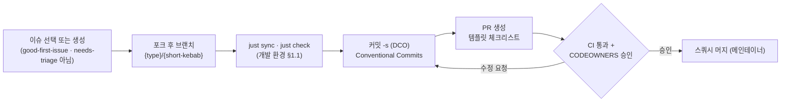
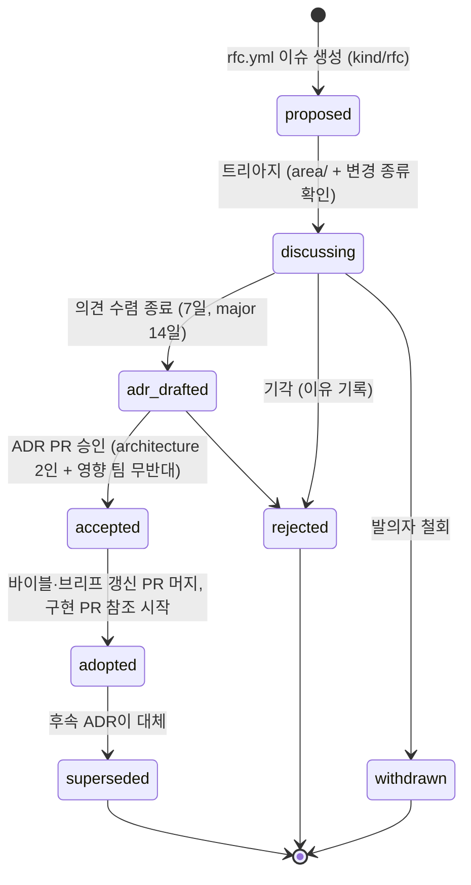
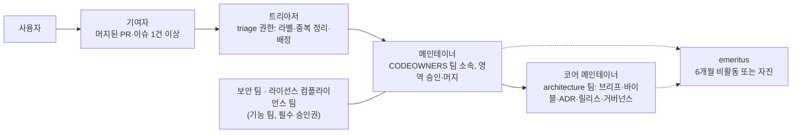

# 기여 가이드

## 목적

이 문서는 RAG Platform에 코드·문서·스키마·플러그인·평가 데이터를 기여하려는 사람(과 에이전트)이 **무엇을 어떤 순서로 해야 하는지**를 한 곳에 정한다. 행동 강령(Code of Conduct), 이슈 유형과 템플릿, 설계 변경을 ADR(Architecture Decision Record)로 승격하는 RFC(Request for Comments) 절차, 브랜치·PR(Pull Request)·리뷰 SLA(Service Level Agreement), DCO(Developer Certificate of Origin) 정책, 커밋 규약, 문서 기여와 영어 번역 로드맵, 첫 기여자 라벨, 거버넌스 초안, 커뮤니티 채널, 보안 취약점 보고 경로를 다룬다.

정본 관계는 다음과 같다. 변경 절차와 우선순위는 설계 바이블(Design Bible) §1(브리프 > 바이블 > ADR > 개별 문서)이 정본이고, 저장소 경계·CODEOWNERS는 [저장소 구조](./01-repository-structure.md) §1·§8이, 로컬 검사 명령은 [개발 환경](./02-development-environment.md) §1.1·§7.3이, 라이선스 판정은 [ADR-0001](../06-adr/0001-license-grade-table-and-d02-interpretation.md)이, 보안 릴리스 정책은 [보안·컴플라이언스](../09-operations/05-security-and-compliance.md) §12가 소유한다. 이 문서는 그 규칙들을 **기여자 관점의 절차로 엮되 바꾸지 않는다**. 여러 ADR의 "준수 확인 방법" 표가 "코드 리뷰 체크리스트 → 10-development/07"로 이 문서를 가리키므로, §12에 그 체크리스트를 통합해 둔다.

## 범위

- 포함: 행동 강령 요약과 집행 사다리, 이슈 유형 5종과 GitHub 이슈 폼 필드, 파서 오류 이슈의 문서 첨부·개인정보 규칙, RFC → ADR 절차(바이블 §1.2 변경 종류 매핑, ADR 번호·slug·상태), 브랜치 모델·PR 요건·브랜치 보호·머지 방식·리뷰 SLA, DCO 정책과 라이선스 헤더·제3자 코드 규칙, 커밋 메시지 규약, 문서 기여 규약과 status 전이·번역 로드맵, 라벨 체계와 `good-first-issue` 기준, 거버넌스 초안(역할·임명·결정 방식·운영위원회 전환 조건), 커뮤니티 채널, 취약점 보고 요약, ADR별 리뷰 체크리스트 통합.
- 제외: 린트·타입·포맷 규칙 세부([코딩 표준](./03-coding-standards.md)), 테스트 종류·마커([테스트 전략](./04-testing-strategy.md)), CI 잡 정의와 시크릿([CI/CD](./05-ci-cd.md)), 플러그인 템플릿·적합성 키트 사용법([플러그인 개발 가이드](./06-plugin-development-guide.md)), 릴리스 주기·태깅·체인지로그 생성([릴리스 프로세스](./08-release-process.md)), 보안 릴리스 정책 본문([보안·컴플라이언스](../09-operations/05-security-and-compliance.md) §12).
- 수치 표기: 이 문서의 기한·정족수·크기 한도는 모두 **초안 목표**다. 비전 문서 KPI-17(이슈 첫 응답 ≤ 72h, Y1)과 KPI-20(외부 기여자·메인테이너 조직 수)에 정합하도록 잡았고, 운영 6개월 뒤 실측으로 재조정한다.
- 저장소 루트 파일 `CONTRIBUTING.md`·`CODE_OF_CONDUCT.md`·`GOVERNANCE.md`·`MAINTAINERS.md`·`ADOPTERS.md`는 이 문서의 **요약·게시본**이며 이 문서와 어긋나면 이 문서를 고친 뒤 게시본을 재생성한다(§8.4). `SECURITY.md`는 보안·컴플라이언스 §12가 소유한다.

## 1. 행동 강령 요약

**결정:** 행동 강령은 Contributor Covenant 2.1을 수정 없이 채택하고(원문 영어 + 한국어 번역 병기, 버전은 채택 시점에 재확인) 저장소 루트 `CODE_OF_CONDUCT.md`에 게시한다. 위성 저장소(`rag-platform-gpl-sidecars`, 코어 조직 아래 `rag-plugin-*`)도 같은 파일을 쓴다. 관련 ADR 없음(거버넌스 규약; 바이블 §1.2 "오탈자·설명 보강" 범위).

기여자가 알아야 할 요지만 적는다. 전문은 게시본이 정본이다.

| 항목 | 요지 |
|------|------|
| 적용 범위 | 저장소(이슈·PR·Discussions·리뷰 코멘트), 커뮤니티 콜, 프로젝트 이름으로 하는 대외 발언 |
| 기대 행동 | 상대의 관점을 존중하는 언어, 건설적 피드백의 수용, 실수의 인정과 사과, 개인이 아닌 공동체 전체에 최선인 방향 |
| 금지 행동 | 성적 언어·이미지, 트롤링·인신공격·정치적 공격, 공개·사적 괴롭힘, 동의 없는 개인정보 공개(§3.4의 문서 첨부 PII 포함), 전문적 환경에서 부적절한 행위 |
| 보고 채널 | `conduct@<org-domain>`(조직 도메인 확정 전 플레이스홀더) — 보고자 신원은 보호되며 접수 후 7일 내 1차 회신(초안 목표) |
| 집행 사다리 | 1 교정(비공개 경고) → 2 경고(일정 기간 상호작용 금지) → 3 일시 차단 → 4 영구 차단. 단계는 심각도에 따라 건너뛸 수 있다 |
| 집행 주체 | 행동 강령 위원회(§9.1; 초기에는 코어 메인테이너 2인, 이해충돌 시 기피) |
| 리뷰 예절 | 코드가 아니라 사람을 평가하지 않는다. "왜"를 적는다. 승인 보류(`Request changes`)는 차단 사유를 재현 가능하게 적는다. 24시간 이상 답이 없어도 재촉 대신 `needs-info` 라벨을 쓴다 |

## 2. 기여 유형과 첫 기여

### 2.1 기여 유형

| 유형 | 대상 경로(저장소 구조 §2) | 사전 요건 | 소유 팀(CODEOWNERS §8) |
|------|-----------------------------|-----------|--------------------------|
| 코드(코어) | `src/rag_platform/`, `tests/` | §5 PR 요건, `just check` 통과 | 모듈별 팀 |
| 계약·스키마 | `docs/03-contracts/`, `schemas/`, `src/rag_platform/contracts/` | 바이블 §1.2 변경 종류 판정 → minor 이상은 §4 RFC | `contracts`(+ `architecture`) |
| 코어 어댑터 | `src/rag_platform/adapters/{extension_point}/` | A 등급 의존만(ADR-0001), 계약 코퍼스 테스트 | `ingest` / `retrieval` |
| 별도 배포 플러그인 | `plugins/rag-plugin-{name}/`(A/B 등급) 또는 외부 저장소 | 적합성 키트 통과(`conformance.json`), `PluginMeta` 4필드 | `kernel`(+ `license-compliance`) |
| C 등급 사이드카·플러그인 | 위성 저장소 `rag-platform-gpl-sidecars` | 본 저장소에는 `optIn.*` 값·이미지 참조만(ADR-0001 체크리스트 3) | `platform-ops`, `license-compliance` |
| 문서 | `docs/` | 브리프 §9 문서 규약, §8 | 디렉터리별 팀 |
| ADR | `docs/06-adr/` | §4 RFC 절차 | `architecture` |
| 평가 데이터·골든셋 | `tests/eval/`, [골든셋 구축](../08-evaluation/03-golden-dataset-construction.md) 절차 | 재배포 가능 라이선스, PII 없음 | `evaluation` |
| 파서 오류 코퍼스 | `tests/adapters/parse/{format}/` | §3.4 첨부 규칙(재배포 가능 + PII 없음) | `ingest` |
| 번역 | `docs/en/`(제안, §8.3) | 한국어 원본 `version` 고정 | `docs-translation` 라벨, 이중 언어 리뷰어 |
| 이슈 트리아지 | Issues·Discussions | `triage` 권한(§9.1) | — |

### 2.2 첫 기여 절차



1. 이슈를 먼저 만든다. 오탈자·한 줄 수정은 예외다. `needs-rfc` 라벨이 붙은 이슈는 §4 절차를 끝내기 전에는 구현 PR을 받지 않는다.
2. 저장소를 포크하고 `{type}/{short-kebab}` 브랜치를 만든다(§5.1). 메인테이너도 개인 브랜치를 본 저장소가 아니라 포크에 둔다.
3. [개발 환경](./02-development-environment.md) §2에 따라 `just sync`(= `uv sync --all-packages --all-extras --group dev`)와 `just check`를 통과시킨다. `just`가 없으면 각 레시피가 환원되는 `uv` 명령을 직접 실행한다(개발 환경 §1.1 표).
4. 모든 커밋에 `Signed-off-by` 트레일러를 붙인다(`git commit -s`, §6).
5. PR 템플릿(§5.3) 체크리스트를 채우고 이슈를 `Closes: #N`으로 연결한다.
6. 리뷰 SLA(§5.5) 안에 첫 응답이 온다. 수정은 새 커밋으로 올리고(리뷰 추적), 머지 시 스쿼시된다.

### 2.3 라벨 체계와 `good-first-issue`

**결정:** 라벨은 `{group}/{value}` 형식의 6그룹과 상태·기여자 라벨을 쓴다. `kind/*`는 이슈 폼이 자동 부여하고 `needs-triage`는 모든 새 이슈에 자동 부여된다. 라벨 정의 파일은 `.github/labels.yml`(제안; 동기화 도구는 확인 필요 as of 2026-09).

| 그룹 | 값 | 부여 주체 |
|------|----|-----------|
| `kind/` | `bug`, `feature`, `rfc`, `parser-error`, `docs`, `security`(공개 가능한 사후 추적만) | 이슈 폼 |
| `area/` | CODEOWNERS 팀명과 일치: `contracts`, `kernel`, `ingest`, `korean-nlp`, `retrieval`, `platform-ops`, `security`, `api`, `evaluation`, `devex`, `license-compliance`, `docs` | 트리아저 |
| `format/` | `SourceFormat` 열거값 그대로(바이블 §5.7, 13종): `hwpx`, `hwp5`, `hwp3`, `pdf`, `docx`, `doc`, `rtf`, `odt`, `html`, `txt`, `md`, `json`, `unknown` | 이슈 폼(파서 오류) |
| `stage/` | 바이블 §5.7 오류 코드 접두 그대로(22종): `fetch`, `parse`, `normalize`, `chunk`, `enrich`, `embed`, `index`, `publish`, `plan`, `retrieve`, `fuse`, `hydrate`, `rerank`, `postprocess`, `pack`, `render`, `auth`, `api`, `profile`, `plugin`, `contract`, `outbox` | 트리아저 |
| `priority/` | `p0`(데이터 손상·보안·테넌트 격리 위반), `p1`(기본 프로파일 기능 장애), `p2`, `p3` | 메인테이너 |
| `impact/` | `breaking`, `schema-change`, `license-review`, `pii-risk`, `gate-required`(품질 기본값 변경) | 메인테이너 |
| 상태 | `needs-triage`, `needs-info`, `needs-rfc`, `needs-gate-evidence`, `accepted`, `blocked`, `stale`, `duplicate`, `wontfix` | 트리아저·메인테이너 |
| 기여자 | `good-first-issue`, `help-wanted`, `mentor-available`, `docs-translation` | 메인테이너 |

`good-first-issue` 부여 기준(모두 충족):

| 기준 | 설명 |
|------|------|
| 범위 | 모듈 하나(바이블 §12 트리의 디렉터리 하나) 안에서 끝나고 계약·열거·기본값을 바꾸지 않는다(`needs-rfc`·`impact/*`와 양립 불가) |
| 명세 | 수용 기준(acceptance criteria), 시작 파일 경로, 관련 테스트 파일이 이슈 본문에 있다 |
| 크기 | 변경 ≤ 200행, 예상 작업 ≤ 1일(초안 목표) |
| 안전 | `security/`·`tests/security/`·라이선스 경계 파일을 건드리지 않는다 |
| 멘토 | `mentor-available` 라벨과 함께 멘토 1인이 배정되어 있다(첫 응답 ≤ 48h, 초안 목표) |
| 예 | 해시 테스트 벡터 추가(`tests/contracts/test_hash_vectors.py`), 렌더러 출력 샘플 추가, `Warning.message` 문구 정비, CLI 도움말, 샘플 문서(`samples/`, 공공누리 제1유형) 추가, 문서 링크·용어 정정 |

## 3. 이슈 유형과 템플릿

**결정:** 이슈는 GitHub 이슈 폼(YAML) 5종으로만 받고 빈 이슈는 비활성화한다(`.github/ISSUE_TEMPLATE/config.yml`의 `blank_issues_enabled: false`). 질문·사용법·아이디어 초안은 Discussions로 보낸다(§10). 취약점은 이슈로 받지 않는다(§11).

### 3.1 유형 표

| 파일 | `kind/` | 용도 | 필수 필드 | 트리아지 결과 |
|------|---------|------|-----------|---------------|
| `bug_report.yml` | `bug` | 재현 가능한 결함 | 버전(`rag-platform` 패키지·이미지 digest), 프로파일(`lite`/`standard`/`premium`/`korean-gov`), 배포 형태(compose/Helm/`LocalRunner`), 재현 절차, 기대·실제, `job_id`·`trace_id`, `StageError` 또는 `ProblemDetails` JSON(콘텐츠 제거), PII 없음 확인 | `accepted` + `area/` + `priority/`, 또는 `needs-info` |
| `feature_request.yml` | `feature` | 새 기능·개선 | 문제, 제안, 대안, 영향 계약·확장 지점, 기본값 변경 여부 | 계약·열거·기본값 변경이면 `needs-rfc`로 전환 |
| `rfc.yml` | `rfc` | 설계 변경 제안 | §4.2 RFC 본문 항목 전부 | §4 절차 |
| `parser_error.yml` | `parser-error` | 특정 문서의 파싱 실패·구조 손실 | §3.3 표 | `format/` + `stage/parse` + 코퍼스 등재 여부 |
| `docs.yml` | `docs` | 문서 오류·누락·번역 | 문서 경로, 문제, 제안, 번역 여부 | `area/docs`(+ `docs-translation`) |

### 3.2 공통 규칙

- 언어: 한국어 또는 영어. 메인테이너는 이슈의 언어로 답한다(§10).
- 로그·JSON은 **콘텐츠를 제거**한 뒤 붙인다. 플랫폼 로그는 이미 `tenant_id_hash`만 기록하고 콘텐츠 캡처가 기본 끔이지만(바이블 §6.5), 사용자가 직접 덤프한 `ParsedDocument`·`ContextPack`에는 원문이 들어 있다. 붙일 수 있는 것은 봉투 필드(`schema_version`, `quality`, `warnings[]`), `StageError`, `parser_chain[]`, `page_status[]`, `producer`다.
- 식별자는 그대로 붙인다: `job_id`·`document_id`(ULID), `content_hash`·`chunk_id`(BLAKE3 hex)는 개인정보가 아니며 재현에 필요하다. `tenant_id`는 운영 배포의 것이면 해시로 바꾼다.
- 하나의 이슈에는 하나의 결함·하나의 문서 종류만 담는다. 같은 원인이 의심되면 본문에 링크로 묶는다.

### 3.3 파서 오류 이슈 폼

HWPX·HWP·PDF 등 특정 문서에서만 재현되는 결함은 문서 없이는 고칠 수 없고, 그 문서에는 개인정보가 들어 있기 쉽다. 폼은 먼저 첨부 가능 여부를 판정시키고, 첨부 불가면 해시·메타데이터·합성 재현으로 대신하게 한다.

| 필드 | 형식 | 필수 | 값·설명 |
|------|------|------|---------|
| `source_format` | dropdown | Y | `SourceFormat` 열거값(바이블 §5.7). `unknown`이면 매직 바이트 앞 16바이트 hex |
| 생성 프로그램·버전 | input | Y | 예: 한컴오피스 2024, LibreOffice 24.8, MS Word 365, 스캐너 모델(스캔 PDF) |
| `source_kind` | dropdown | N | `SourceKind` 열거값: `born_digital`, `scanned`, `mixed`, `pre_ocr`, `flow` |
| 증상 | checkboxes | Y | 파싱 실패(`StageError`), 구조 손실(제목 계층·표·각주·목록), 텍스트 손상(인코딩·자모 분리), 페이지·좌표 오류, 시간 초과(`parse.page_timeout`), 품질 저하(`quality=degraded`) |
| `parser_chain[]` | textarea | Y | `ParsedDocument.parser_chain[]`(실제 시도 순서, 바이블 §3.2 O-07) 또는 `StageError.plugin_id` |
| `StageError` / `warnings[]` | textarea(JSON) | Y | 아래 예시 형식. 카탈로그 밖 코드는 `contract.violation`이므로 그대로 붙이면 된다 |
| 문서 크기·페이지 수 | input | Y | `size_bytes`, 페이지 수(흐름 포맷은 단락 수) |
| `content_hash` | input | Y | `blake3_hex(원본 바이트)`(바이블 §6.2). 첨부하지 않아도 동일 문서 중복 보고를 묶는 키 |
| 첨부 가능 판정 | checkboxes | Y | (a) 재배포 가능 라이선스(공공누리 제1유형, CC BY, 자작 문서 등) **그리고** (b) 개인정보·기밀 없음. 둘 다 체크한 경우에만 첨부 필드가 열린다 |
| 샘플 첨부 | file | 조건 | (a)(b) 충족 시 ≤ 1MB(저장소 픽스처 상한과 동일, 개발 환경 §7.3). 초과하면 §3.4 (3) |
| 합성 재현 | textarea | 조건 | 첨부 불가 시: 같은 프로그램으로 만든 더미 문서, 또는 구조만 남기고 텍스트를 치환한 문서 |
| 기대 결과 | textarea | N | 올바른 구조(예: "표 3의 병합 셀이 `row_span=2`로 나와야 함") |

`StageError` 붙이기 예시(계약 개요 §4.10; `artifact_ref.uri`·`blake3`는 콘텐츠가 아니다):

```json
{
  "code": "parse.document_encrypted",
  "type": "urn:rag:error:parse.document_encrypted",
  "retryable": false,
  "stage": "parse",
  "plugin_id": "parser.hwp5_java_sidecar",
  "detail": "HWP 5.0 FileHeader encrypted flag set and credentials_ref is absent",
  "message": "Document is encrypted",
  "occurred_at": "2026-09-22T09:00:05.120Z",
  "attempt": 1,
  "artifact_ref": {
    "uri": "file:///var/lib/rag/artifacts/tenants/01J9ZQ4K7X2M8N3P5R6S7T8V9W/sources/3e/3e5f7092b4d6e8f0a1c2e3b4d5f6071829a4b5c6d7e8f9a0b1c2d3e4f5a6b7c8",
    "blake3": "3e5f7092b4d6e8f0a1c2e3b4d5f6071829a4b5c6d7e8f9a0b1c2d3e4f5a6b7c8",
    "media_type": "application/x-hwp",
    "size_bytes": 4718592
  }
}
```

### 3.4 문서 첨부와 개인정보(PII) 규칙

**결정:** 공개 이슈에 첨부되는 문서는 "재배포 가능 라이선스 + PII·기밀 없음"을 보고자가 확인한 것만 허용하고, 그 외 문서는 첨부 대신 `content_hash`·메타데이터·합성 재현으로 보고한다. 개인정보가 첨부된 것이 발견되면 §11의 보안 채널과 같은 경로로 처리한다. 관련 결정: 브리프 원칙 9(PII 처리 훅), [보안·컴플라이언스](../09-operations/05-security-and-compliance.md) §8.

1. **PII 정의**: 이름·연락처·주소·이메일 외에, 플랫폼의 PII 탐지기가 다루는 한국 식별자 — 주민등록번호, 외국인등록번호, 여권번호, 사업자등록번호, 운전면허번호([기술 지형 12](../07-tech-landscape/12-security-multitenancy-pii-and-licensing.md) Presidio KR 인식기 목록) — 와 계좌·카드번호, 건강·범죄 정보를 포함한다. 공문서의 담당자 이름·전화번호도 PII다.
2. **공공 문서의 착시**: 공개된 보도자료·고시라도 담당자 연락처가 있으면 (b)를 충족하지 않는다. 해당 단락을 치환(같은 길이의 더미 문자열)한 뒤 첨부한다. 치환한 사실을 본문에 적는다.
3. **첨부 불가·대용량 문서의 비공개 재현**: 이슈에는 `content_hash`·크기·`parser_chain[]`·`StageError`만 적고, 담당 메인테이너(`area/ingest`)가 이슈에 지정한 비공개 업로드 경로(만료 링크; 도구는 확인 필요 as of 2026-09)로 보낸다. 메인테이너는 결함 재현·수정 후 사본을 삭제하고 이슈에 삭제 시각을 남긴다. 비공개 사본은 저장소·CI·코퍼스에 넣지 않는다.
4. **코퍼스 등재**: (a)(b)를 충족하는 문서만 `tests/adapters/parse/{format}/`에 들어가며, 1MB 초과는 오브젝트 스토리지 미러 + 해시 매니페스트로 참조한다(저장소 구조 §7). 등재 시 라이선스 표기와 출처 URL을 매니페스트에 기록한다.
5. **발견 시 처리**: 첨부에 PII가 있음을 누구든 발견하면 이슈에 내용을 인용하지 않고 `impact/pii-risk` 라벨을 붙인 뒤 §11 채널로 알린다. 메인테이너는 첨부를 삭제하고(GitHub 첨부 영구 삭제는 지원 요청이 필요할 수 있음, 확인 필요 as of 2026-09), 보고자에게 통지하고, 이슈 본문을 편집 이력까지 정리한다. 처리 기록은 보안 채널에만 남긴다.
6. **평가 데이터도 같다**: 골든셋·`answer_spans`에 인용되는 문서는 위 규칙을 그대로 적용한다([골든셋 구축](../08-evaluation/03-golden-dataset-construction.md)).

## 4. RFC 절차(설계 변경 → ADR)

### 4.1 언제 RFC가 필요한가

**결정:** 바이블 §1.2 변경 절차 표의 "ADR 발의"가 필요한 모든 변경은 RFC 이슈로 시작한다. RFC는 ADR의 **초안 토론 단계**이고 ADR은 채택된 결정의 **기록**이다. RFC 없이 ADR PR을 바로 올릴 수 있는 것은 architecture 소유자가 발의하는 P0 정정(바이블 §1.1 "충돌이 발견되면 바이블이 오류") 한 가지다. 관련 ADR: 절차 자체는 바이블 §1.2가 정본이며 개별 RFC는 각자의 ADR을 만든다.

| 변경 종류(바이블 §1.2) | RFC | ADR | 바이블 | 계약 `schema_version` | 추가 요건 |
|------------------------|:---:|:---:|--------|------------------------|-----------|
| 오탈자·설명 보강·예시 추가 | 불필요 | 불필요 | 소유자 직접 patch | 불변 | PR만 |
| 필드 추가(선택), 열거값 추가, 기본 파라미터 값 변경 | 필요 | 필요 | minor | minor(가산만) | 품질 기본값이면 게이트 근거(바이블 §7.4, `EvalReport.gate_result.passed`) 첨부 → `impact/gate-required` |
| 필드 제거·의미 변경·필수화, 열거값 제거·개명, 타입명·스테이지 경계 변경, 명명 규약 변경 | 필요(의견 수렴 14일) | 필요 | major | major | 영향 문서 목록·마이그레이션 계획 첨부 → `impact/breaking`; 1.0 GA 이후에는 2.0 백로그로 격리([마일스톤](../11-roadmap/01-milestones.md) §9.4) |
| 브리프 확정 결정(D-xx) 개정 | 필요 | 필요 | §3 `amended` + 브리프 §4 행 v1.x | 해당 규칙 | 브리프 문구 개정안을 RFC에 포함 |
| 새 외부 의존·모델·이미지의 기본 채택 | 필요(등급 C·D면 필수) | 등급표 적용은 ADR-0001, 기본값 변경은 개별 ADR | — | — | `license`·`license_grade`·`territory`·`linkage`, `models.lock` 행 → `impact/license-review` |
| 거버넌스·프로세스(이 문서) 변경 | Discussions 제안 → PR | 불필요 | — | — | §9.3 결정 방식 |

새 확장 지점을 추가하는 요청은 D-10(14종 고정, 바이블 §3.1)에 따라 `PluginMeta.role`로 표현할 수 있는지부터 검토하며, 확장 지점 수 증가는 D-xx 개정 절차다.

### 4.2 RFC 이슈 본문(`rfc.yml`)

| 항목 | 내용 |
|------|------|
| 요약 | 한 문단. 무엇을 왜 바꾸는가 |
| 동기·문제 | 재현 사례, 골든셋 수치, 운영 사고, 계약 불일치 등 근거. "더 우아함"만으로는 부족하다 |
| 변경 종류 | §4.1 표의 행 하나를 고른다(patch/minor/major/D-xx 개정) |
| 영향 범위 | 바이블 절 번호(§5.x 타입 표, §5.7 열거, §6 명명, §7 프로파일, §14 API), 영향 계약 파일(`schemas/*.schema.json`), 영향 문서 경로, 영향 확장 지점 |
| 설계 | 필드 표(`필드 | 타입 | 필수 | 설명 | 예시`), 열거값, 알고리즘, 실패 시 동작. 브리프 §9.5 표기 |
| 호환성·마이그레이션 | `schema_version` 증가 폭, `Deprecation`·`Sunset` 헤더 계획([스키마 버전 관리](../03-contracts/14-schema-versioning-and-compatibility.md)), 재색인 필요 여부(`profile_hash` 변경 → blue/green) |
| 게이트 근거 계획 | 품질 기본값이면 어떤 데이터셋·메트릭·`min_delta`로 증명할지(바이블 §7.4) |
| 대안 | 최소 2개, 기각 이유 포함 |
| 라이선스·보안 | 새 의존의 등급(ADR-0001), 강제 지점 E1~E17 영향(ADR-0027) |
| 미해결 질문 | 토론에서 결정할 항목 |

### 4.3 수명 주기



| 단계 | 산출물·조건 | 기한(초안 목표) |
|------|-------------|-----------------|
| `proposed` | `rfc.yml` 전 항목 작성 | 트리아지 ≤ 5영업일 |
| `discussing` | 이슈 스레드에서 토론. 설계 변경은 이슈 본문을 편집해 반영하고 편집 이력을 남긴다 | 최소 7일(major·D-xx 개정 14일). 마지막 실질 코멘트 뒤 72시간 무반대면 종료 |
| `adr_drafted` | `docs/06-adr/NNNN-slug.md` PR. 번호는 바이블 §3.3 표의 다음 번호(현재 0040; ADR-0039는 바이블 1.3.0 가산 개정 묶음으로 사용됨)이며 architecture 소유자가 채택 시 부여하고 같은 PR에서 §3.3 표에 행을 추가한다. slug는 kebab-case ≤ 80자 | PR 리뷰 SLA(§5.5) |
| `accepted` | architecture 팀 2인 승인 + 영향 CODEOWNERS 팀에서 해소되지 않은 반대 없음. 품질 기본값이면 `evaluation` 팀 승인과 `EvalReport` 링크 | — |
| `adopted` | 바이블 표 갱신(+ 브리프 §4 행) PR 머지. 구현 PR은 `ADR: ADR-NNNN` 푸터(§7)로 참조 | 채택 후 30일 내 바이블 갱신(넘기면 `blocked`) |
| `superseded` | 새 ADR의 `related`에 이전 번호, 이전 ADR frontmatter `status: superseded` | — |

### 4.4 ADR 문서 규약

ADR은 MADR 형식이며 60~200행(브리프 §9.11)이다. 정본 예는 [ADR-0001](../06-adr/0001-license-grade-table-and-d02-interpretation.md)이고 인덱스는 [ADR 인덱스](../06-adr/README.md)다(생성물, 저장소 구조 §6).

| 요소 | 규칙 |
|------|------|
| 파일명 | `docs/06-adr/{NNNN}-{slug}.md`, 바이블 §3.3 표와 글자 단위로 일치 |
| frontmatter | `title: "ADR-NNNN: 제목"`, `status`(`proposed`, `accepted`, `rejected`, `superseded`, `deprecated`), `date`, `deciders`, `owner`, `version`, `last_updated`, `priority`(P0~P3), `related`(D-xx·O-xx·K·E 식별자), `depends_on` |
| 절 | 맥락과 문제 → 결정 동인 → 고려한 대안(각 대안에 설명·장점·단점, 기각 이유) → 결정(`**결정:**`으로 시작, 바이블 인용은 절 번호) → 결과(긍정·부정·중립) → 준수 확인 방법(강제 지점·장치·실패 시·정본 표, 코드 리뷰 체크리스트 → 이 문서 §12) → 재검토 조건 → 참조 |
| 금지 | 바이블 표를 ADR 본문이 바꾸는 것(ADR은 근거·대안 기록이다, 바이블 §1.1), 브리프 D-xx 문구·열거 철자 변형, 근거 없는 수치 |
| 검증 | 문서 검증기(링크·frontmatter·행 수), `## 결정`의 ADR 번호가 §3.3과 일치 |

## 5. 브랜치·PR 절차·리뷰 SLA

### 5.1 브랜치 모델

**결정:** 트렁크 기반(trunk-based)이다. 보호 브랜치는 `main` 하나이고 릴리스 브랜치 `release/{major}.{minor}`는 패치 릴리스 백포트 전용이다(생성·수명은 [릴리스 프로세스](./08-release-process.md)가 확정). 장수 `develop` 브랜치는 두지 않는다. 작업 브랜치는 포크에 `{type}/{short-kebab}`(예: `feat/hwpx-footnote-merge`, `fix/rrf-tiebreak-record-id`, `docs/contributing-ko`)로 만들고 `type`은 §7.1 커밋 타입과 같다. 관련 ADR: 릴리스 태깅은 저장소 구조 §5(`v{semver}`, `rag-plugin-{name}/v{semver}`, `schemas/{kebab}@{semver}` 제안).

- `main`은 항상 릴리스 가능해야 한다: 모든 필수 상태 검사 통과, 선형 이력(linear history) 강제, 직접 푸시 금지(관리자 포함).
- 백포트는 `main`에 먼저 머지된 커밋을 `release/*`로 체리픽하는 PR로만 하며 제목 접두 `[backport {major}.{minor}]`를 붙인다.
- 보안 수정은 §11.4의 비공개 흐름을 따른다.

### 5.2 PR 요건

| 요건 | 내용 | 검사 |
|------|------|------|
| 이슈 연결 | `Closes: #N` 또는 `Refs: #N`. 설계 변경은 `ADR: ADR-NNNN` | PR 본문 린트(제안) |
| 제목 | §7 커밋 규약 형식(스쿼시 머지 시 커밋 제목이 된다) | PR 제목 린트 |
| DCO | 모든 커밋 `Signed-off-by` | DCO 검사 앱(확인 필요 as of 2026-09) |
| 크기 | 생성물·픽스처 제외 변경 ≤ 400행(초안 목표). 넘으면 분할하거나 `needs-info`가 아닌 "분할 불가 사유"를 본문에 적는다 | 리뷰어 판단 |
| 로컬 검사 | `just check` 동치: ruff check·format, import-linter 5계약, mypy strict, pytest(`tests/unit tests/contracts tests/golden`), `uv lock --check`, `node tools/validate-contracts.mjs`(문서·스키마 변경 시) | CI 필수 검사 |
| 인터프리터 매트릭스 | 3.12·3.13 모두 통과(ADR-0035) | CI |
| 라이선스 게이트 | 의존 변경 시 pip-licenses + liccheck + SBOM, `models.lock` 규칙(ADR-0001) | CI |
| 생성물 동기화 | `openapi.yaml`, Weaver 상수, Helm 프로파일 사본, TS 타입 재생성 diff 0(저장소 구조 §6) | CI |
| 문서 | frontmatter·구조·링크·이모지 없음·JSON 예시 문법(§8.2) | 문서 검증기 |
| 초안 PR | `Draft`는 SLA 대상이 아니며 CI만 돈다. 리뷰 요청 시 `Ready for review`로 전환 | — |
| 머지 충돌 | 작성자가 `main`에 리베이스한다. 리뷰 도중에는 force-push 대신 새 커밋을 권장하고, 리베이스가 필요하면 코멘트로 알린다 | — |

### 5.3 PR 템플릿(`.github/PULL_REQUEST_TEMPLATE.md`)

```markdown
## 요약
<!-- 무엇을 왜. 이슈: Closes #N / 설계: ADR-NNNN -->

## 변경 종류
- [ ] fix / feat / perf / refactor / docs / test / build / ci / chore
- [ ] 계약·스키마 변경 (03-contracts 문서 → schemas/ → contracts/*.py 순서, schema_version 증가)
- [ ] 품질 기본값 변경 (EvalReport 링크: )
- [ ] 새 의존성·모델·이미지 (license / license_grade / linkage / territory: )

## 체크리스트 (해당 항목만)
- [ ] `just check` 통과 (3.12·3.13)
- [ ] DCO sign-off, Conventional Commits 제목
- [ ] 새 의존성은 A 등급이고 requires-python 3.12·3.13 포함, sunset 패키지 아님 (ADR-0001, ADR-0035)
- [ ] 새 모델은 models.lock 행 + LICENSE 미러, D 등급이 기본 프로파일에 없음 (ADR-0001)
- [ ] GPL/AGPL 코드·Dockerfile 없음, 사이드카 변경은 rag-platform-gpl-sidecars로 (ADR-0001)
- [ ] 계약 변경: 예시 JSON 검증, 불변식 테스트, 열거 대조, 스냅샷 갱신 사유
- [ ] 보안: SecurityContext 서버 주입 유지, 사전 필터 불변식, 콘텐츠 로그·스팬 리터럴 없음 (ADR-0027, ADR-0022)
- [ ] 생성물 재생성 (openapi.yaml · Weaver · Helm 프로파일 사본 · TS 타입)
- [ ] 문서: frontmatter·구조·문서 맵 링크·수치 근거, SPDX 헤더 (새 소스 파일)
- [ ] 릴리스 노트 문구 (feat/fix/breaking) 아래에 한 줄
- [ ] 브레이킹 변경(`BREAKING CHANGE:` 동반)은 `Breaking-Kind:`(`api_contract_major`|`plugin_sdk`|`naming_or_hash`|`workflow_type`), 캐시 무효화가 필요한 변경은 `Cache-Invalidation:`(`prompt_cache_prefix`|`plan`|`qemb`|`stage_key`) 트레일러를 커밋에 추가(값 정본: [릴리스 프로세스](./08-release-process.md) §4.3; CI 린트는 05-ci-cd `pr / meta`, #94)

## 릴리스 노트
<!-- 사용자 관점 한 줄. 없으면 "없음" -->

## 테스트 방법
```

### 5.4 브랜치 보호와 승인 규칙

**결정:** 저장소 구조 미해결 이슈 7(필수 승인 수)을 다음과 같이 확정한다. 승인은 CODEOWNERS 팀 소속 메인테이너의 것만 인정하고 작성자 본인 승인은 불가하다. 팀 실명은 GitHub 조직 생성 시 치환한다. 관련 결정: 저장소 구조 §8, 바이블 §1.2, [ADR-0027](../06-adr/0027-security-context-injection-and-acl-enforcement-points.md).

| 경로 등급 | 대상(CODEOWNERS §8) | 필수 승인 | 추가 조건 |
|-----------|----------------------|-----------|-----------|
| 기본 | 그 외 모든 경로 | 해당 팀 1인 | — |
| 봇 PR(예외) | `tests/fixtures/`·`tests/replay/histories/`·`tests/eval/baselines/`(범위는 CI/CD §5.1) | 0(사람 승인 대체) | 커밋 타입 `test(fixtures)`·`test(replay)`·`test(eval)` 한정 + 작성자 `github-actions[bot]`(또는 조직 앱) + 라벨 `bot` + 통상 PR 게이트 전부 통과([CI/CD](./05-ci-cd.md) §5.1, #94); `staging` 승격 PR은 이 예외에 포함되지 않고 "기본" 행을 따른다 |
| 보안 | `src/rag_platform/security/`, `tests/security/`, `docs/02-architecture/07-*.md`, `docs/06-adr/0027-*.md`, `docs/06-adr/0038-*.md` | 2인(`security` 1 + 영향 팀 1) | 카나리 침투 스위트 통과(`tests/security/`) |
| 정본 문서 | `docs/00-vision/00-design-brief.md`, `docs/02-architecture/00-design-bible.md`, `schemas/common-types.schema.json` | `architecture` 2인 | 바이블 §1.2 절차 표기(patch/minor/major)와 ADR 링크 |
| ADR | `docs/06-adr/` | `architecture` 2인 | 영향 CODEOWNERS 팀의 해소되지 않은 반대 없음, 품질 기본값이면 `evaluation` 승인(§4.3 `accepted` 조건) |
| 라이선스 경계 | `LICENSE`, `NOTICE`, `models.lock`, `plugins/*/pyproject.toml` | `license-compliance` 1 + (`architecture` 또는 `kernel`) 1 | 라이선스 게이트 통과 |
| 툴체인 | `pyproject.toml`, `uv.lock`, `.github/`, `tools/` | `devex` 1 | 새 의존 추가 시 PR 본문에 등급·`linkage` 표기 |
| 계약 | `schemas/`, `src/rag_platform/contracts/`, `docs/03-contracts/` | `contracts` 1(minor 이상은 + `architecture` 1) | 계약 개요 §10.3 게이트 전부 |

필수 상태 검사의 이름은 [CI/CD](./05-ci-cd.md) §3.2 표가 확정했다(21개; 이 문서는 역할만 소유하고 이름 변경은 CI/CD minor 개정이다): 린트·포맷 `pr / lint`, mypy `pr / typecheck`, import-linter `pr / imports`, 잠금 검사 `pr / lock`, 라이선스 게이트 `pr / license`(의존 변경 시), 스키마 검증 `pr / contracts`, 문서 검증 `pr / docs`, 생성물 diff `pr / generated`, 테스트 `pr / unit (3.12)`·`pr / unit (3.13)`·`pr / component`·`pr / integration`·`pr / e2e-smoke`·`pr / security`·`pr / chaos`, 품질 게이트 `pr / quality-gate`, 커버리지 `pr / coverage`, 취약점 `pr / supply-chain`·`pr / image`(이미지 관련 변경 시), PR 제목 린트·트레일러 `pr / meta`, DCO `DCO`(외부 앱). `security`·`architecture` 등급 경로는 관리자도 우회할 수 없다(`enforce_admins`).

### 5.5 머지 방식과 리뷰 SLA

**결정:** 기본 머지는 **스쿼시**이며 스쿼시 커밋 메시지는 PR 제목 + 본문 "요약"으로 만든다. 커밋 하나하나가 §7 규약을 지키고 독립적으로 빌드되는 PR(예: 생성물 재생성을 별도 커밋으로 둔 PR)은 `rebase` 머지를 허용한다. `merge commit`은 금지한다. 머지는 승인한 메인테이너 중 1인이 수행하며 작성자가 메인테이너라도 다른 승인자가 머지한다.

| 대상 | 첫 응답 | 후속 라운드 | 정체 처리 | 비고 |
|------|---------|-------------|-----------|------|
| 일반 PR | ≤ 3영업일 | 작성자 갱신 후 ≤ 3영업일 | 작성자 무응답 30일 → `stale`, +14일 → 닫음(재개 가능) | 초안 목표 |
| `good-first-issue` PR | ≤ 2영업일 | ≤ 2영업일 | 멘토가 이어받아 완료 가능(작성자 동의·`Co-authored-by`) | 초안 목표 |
| 문서 전용 PR | ≤ 5영업일 | ≤ 5영업일 | 동일 | 초안 목표 |
| 보안 수정 PR(비공개) | ≤ 1영업일 | 당일 | — | §11 SLA와 연동 |
| ADR PR | 의견 수렴 기간 종료 후 ≤ 5영업일 | — | 30일 무진전 → `blocked` + 원인 기록 | §4.3 |
| 이슈 첫 응답(트리아지) | ≤ 72시간 | — | `needs-info` 30일 → 닫음 | KPI-17 Y1 값 |

"첫 응답"은 라벨 부여·질문·리뷰 시작 중 하나이며 승인이 아니다. SLA 위반은 잘못이 아니라 **배정 신호**다: 초과한 PR은 주간 트리아지에서 다른 리뷰어에게 재배정한다. 리뷰어는 한 번에 차단 사유를 모두 적고(`Request changes` 1회 원칙), 취향 차이는 `nit:` 접두로 표시해 머지를 막지 않는다.

## 6. DCO/CLA 정책(Apache-2.0)

**결정:** 기여 라이선스 동의는 **DCO 1.1**(Developer Certificate of Origin)로 받고 별도 CLA(Contributor License Agreement)는 두지 않는다. Apache-2.0 §5(Submission of Contributions)에 따라 기여물은 제출과 동시에 Apache-2.0로 라이선스되며(inbound = outbound), DCO는 그 기여물을 제출할 권리가 기여자에게 있음을 커밋 단위로 증명한다. 재단 기부 등으로 저작권 양도·재라이선스 권한이 필요해지면 그때 CLA 도입을 §9.3 거버넌스 변경 절차로 다시 결정한다(비전 미해결 이슈 7). 관련 ADR: [ADR-0001](../06-adr/0001-license-grade-table-and-d02-interpretation.md)(라이선스 등급표), 브리프 D-02.

| 규칙 | 내용 |
|------|------|
| 서명 방법 | 모든 커밋에 `Signed-off-by: 이름 <이메일>` 트레일러(`git commit -s`). 누락 커밋은 `git rebase --signoff main`으로 보정 |
| 이름 | 실명 또는 지속적으로 사용하는 식별 가능한 이름. 익명·일회용 이름은 거부. 이메일은 GitHub 계정에 연결된 것 |
| 검사 | DCO 검사 앱이 PR의 전 커밋을 검사하고 실패 시 머지 차단(앱 선정은 CI/CD 문서, 확인 필요 as of 2026-09) |
| 소속 조직 | 고용주의 저작권이 걸린 기여는 기여자가 회사의 승인을 받았음을 DCO로 증명한다. 회사 단위 CLA(CCLA)는 두지 않으며, 조직이 원하면 `MAINTAINERS.md`의 "조직 기여 확인" 절에 공개 확인서를 링크할 수 있다 |
| 제3자 코드 | 다른 프로젝트의 코드를 옮겨오면 원 라이선스가 A 등급(Apache/MIT/BSD/MPL-2.0 파일 단위)이어야 하고, 원 저작권 고지를 파일 헤더 또는 `NOTICE`에 보존한다. B·C 등급 코드 스니펫은 어떤 경로로도 코어에 넣지 않는다(ADR-0001, import-linter C 등급 차단) |
| 모델·데이터 | 가중치·사전·데이터셋은 커밋하지 않고 `models.lock`·해시 매니페스트로 참조한다(저장소 구조 §9). 데이터셋 라이선스는 SPDX 문자열로 기록(`EvalDataset.license`) |
| 소스 헤더 | 새 소스 파일 첫 줄에 REUSE 규격 `SPDX-License-Identifier: Apache-2.0`(ADR-0001 체크리스트 5). 저작권 문구는 `SPDX-FileCopyrightText: {연도} RAG Platform contributors`(제안; 개인 저작권 표기 병기 허용) |
| 생성 도구 사용 | LLM 등 생성 도구로 만든 코드·문서도 기여자가 DCO로 책임진다. 기여자는 출력물이 제3자 라이선스 코드의 복제가 아님을 확인하고, 실질적 부분이 생성물이면 PR 본문에 사용 도구를 적는다(제안) |
| 위성 저장소 | `rag-platform-gpl-sidecars`도 DCO를 쓴다. 단, 그 저장소의 GPL/AGPL 라이브러리 자체를 패치하는 기여는 받지 않고 업스트림으로 안내한다(ADR-0001 체크리스트 3) |
| 서명 커밋 | GPG/Sigstore 커밋 서명은 권장이며 필수가 아니다(보안·컴플라이언스 §11 "서명 커밋(제안)"). 릴리스 태그·이미지 서명은 [릴리스 프로세스](./08-release-process.md) |

## 7. 커밋 규약

### 7.1 형식

**결정:** Conventional Commits 1.0.0 형식 `type(scope)!: subject`를 쓴다. 제목은 **영문** 명령형 ≤ 72자(마침표 없음), 본문은 한국어 또는 영어다. 제목을 영문으로 고정하는 이유는 체인지로그·릴리스 노트 자동 생성과 다국어 기여자 검색성이며, 문서 본문 한국어 원칙(D-03)은 커밋 메시지에 적용하지 않는다. 관련 ADR: [ADR-0036](../06-adr/0036-naming-and-identifier-conventions.md)(scope는 바이블 §12 모듈명 철자를 따른다).

| `type` | 용도 | 릴리스 노트 절 |
|--------|------|----------------|
| `feat` | 사용자·플러그인 저자에게 보이는 새 기능 | Features |
| `fix` | 결함 수정 | Bug Fixes |
| `perf` | 동작 불변 성능 개선(측정치 본문 기재) | Performance |
| `refactor` | 동작 불변 구조 변경 | — |
| `docs` | 문서·ADR·주석 | Documentation(ADR은 별도 절) |
| `test` | 테스트·픽스처·골든 케이스 | — |
| `build` | 빌드·의존성(`build(deps)`: 범프) | Dependencies |
| `ci` | 워크플로우·검사 스크립트 | — |
| `chore` | 그 외(생성물 재생성 `chore(generated)`) | — |
| `revert` | 되돌림. 본문에 `This reverts commit <sha>` | Reverts |

| `scope` | 값 |
|---------|----|
| 코어 모듈 | 바이블 §12 디렉터리명: `contracts`, `sdk`, `plugins`, `adapters`, `pipelines`, `retrieval`, `render`, `orchestration`, `ledger`, `storage`, `security`, `profiles`, `korean`, `eval`, `telemetry`, `api`, `mcp`, `testing`, `cli`. 하위는 `/`로: `adapters/parse`, `retrieval/pack` |
| 확장 지점 구현 | `plugin_id` 그대로: `parser.hwpx_python_hwpx`, `fuser.rrf` |
| 저장소 영역 | `schemas`, `docs`, `adr`, `deploy`, `sidecars`, `sdk-python`, `sdk-ts`, `tools`, `deps`, `samples` |
| 별도 배포 플러그인 | 배포 패키지명 그대로 `rag-plugin-{name}`(바이블 §6.7·§12, [ADR-0036](../06-adr/0036-naming-and-identifier-conventions.md)): `rag-plugin-lightrag` |
| 문서 하위 | `docs/{NN-area}`: `docs/03-contracts` |

푸터(footer):

| 푸터 | 필수 | 형식 |
|------|:---:|------|
| `Signed-off-by:` | Y | DCO(§6) |
| `Closes:` / `Refs:` | 이슈 있을 때 | `Closes: #123` |
| `ADR:` | 설계 변경 | `ADR: ADR-0013` |
| `BREAKING CHANGE:` | `!` 사용 시 | 무엇이 깨지고 마이그레이션은 어떻게 하는지 한 문단. 반드시 `ADR:`과 함께 |
| `Schema-Version:` | 계약 변경 | `Schema-Version: chunk-set 1.1.0`(제안; 릴리스 노트 계약 절 생성용) |
| `Co-authored-by:` | 공동 작업 | 표준 형식 |

예:

```text
feat(adapters/parse)!: emit form_field blocks for HWPX form controls

HWPX 서식 컨트롤을 BlockType.form_field로 매핑한다. 이전에는 paragraph로
평탄화되어 표 라우팅(TableRole.form)이 동작하지 않았다.

BREAKING CHANGE: ParsedDocument에 form_field 블록이 추가되어 chunker_config_hash가
같아도 chunk_id가 달라진다. 영향 컬렉션은 reindex_collection 잡으로 재색인한다.
ADR: ADR-0002
Closes: #412
Signed-off-by: Hong Gildong <gildong@example.org>
```

### 7.2 위생 규칙

- 커밋은 원자적이다: 하나의 커밋이 하나의 의도를 담고 그 시점에 빌드·테스트가 통과한다.
- 생성물(`openapi.yaml`, Weaver 상수, Helm 프로파일 사본, TS 타입, `uv.lock`)은 손으로 고치지 않고 재생성해 `chore(generated): …` 또는 원인 커밋에 함께 넣는다(저장소 구조 §6 규칙 3).
- 머지 커밋을 PR 안에 만들지 않는다(리베이스). 스쿼시 머지되므로 PR 안의 `fixup!`·`wip` 커밋은 허용되지만 최종 PR 제목·본문이 규약을 지켜야 한다.
- 콘텐츠·비밀을 커밋 메시지에 쓰지 않는다(문서 원문 인용, 토큰, 테넌트 ID).
- 체인지로그는 Conventional Commits에서 생성한다(도구·형식은 [릴리스 프로세스](./08-release-process.md); 확인 필요 as of 2026-09). PR 제목 린트가 그 전제를 강제한다.

## 8. 문서 기여

### 8.1 규약 요약

문서 규약의 정본은 브리프 §9다. 기여자가 자주 틀리는 항목만 다시 적는다.

| 항목 | 규칙 | 검사 |
|------|------|------|
| frontmatter | `title`, `status`(draft/review/active/deprecated), `owner`, `version`, `last_updated`, `depends_on`(실제 읽은 문서), 계약 문서는 `schema_version` | 검증기 |
| 구조 | `# 제목` → `## 목적` → `## 범위` → 본문 → `## 결정 사항 요약` → `## 미해결 이슈` → `## 참조`. 계약 문서는 `## 스키마`, `## 예시`, `## 불변식(Invariants)`, `## 버전 이력` 추가 | 검증기 |
| 언어 | 한국어 본문, 기술 용어 첫 등장 `한국어(English)`, 식별자·필드·API는 영문. 열거값·필드명은 바이블 철자 그대로 | 열거 대조(계약 개요 §10.3) |
| 다이어그램 | Mermaid만. ASCII 아트·이모지 금지 | 검증기(코드 블록 언어 확인) |
| 링크 | 브리프 §8 문서 맵 경로만 상대 경로로. 미작성 문서 링크는 경고(오류 아님) | 링크 검사 |
| 결정 표기 | `**결정:**` + ADR 링크(`../06-adr/NNNN-slug.md`, §3.3 철자), 미정은 `**미정(O-xx):**`, 외부 사실은 `확인 필요(as of YYYY-MM)` | 리뷰 |
| 수치 | 표로, 출처 또는 "초안 목표" 명시 | 리뷰 |
| 길이 | 설계 문서 250~900행, ADR 60~200행, 계약 문서는 스키마 전문 포함 | 검증기 |
| JSON 예시 | 완전한 JSON(주석·생략 부호 금지). `node -e "JSON.parse(require('fs').readFileSync(process.argv[1],'utf8'))" <파일>`로 문법 검증, 계약 예시는 스키마 검증(골든 예시 회귀) | 문서 빌드 |
| 정본 침범 금지 | 다른 문서의 필드·열거·기본값을 바꾸지 않는다. 필요하면 자기 문서 `## 미해결 이슈`에 제안(브리프 §11) | 리뷰 |

### 8.2 문서 `status` 전이

**결정:** 문서 상태는 `draft → review → active → deprecated`로만 전이하고, `review → active`는 소유 팀 리뷰어 1인이 [비기능 요구사항](../01-requirements/02-non-functional-requirements.md)의 문서 리뷰 체크리스트(검증 방법 M7)를 통과시킨 뒤 `owner`가 바꾼다. `active` 문서의 본문 변경은 `version`을 올린다(patch: 오탈자, minor: 절 추가·표 갱신, major: 결정 변경 — 바이블 §1.2와 같은 의미).

| 전이 | 조건 | 누가 |
|------|------|------|
| (없음) → `draft` | 파일 생성. 미완성 절은 "(작성 중)" 표기 | 작성자 |
| `draft` → `review` | 필수 절 전부 존재, 검증기 통과, `depends_on` 정확 | 작성자 |
| `review` → `active` | 리뷰 체크리스트 통과, 미해결 이슈에 담당 문서 표기, 정본 충돌 0 | `owner` |
| `active` → `deprecated` | 대체 문서 링크를 `## 목적` 첫 줄에, frontmatter `superseded_by`(제안) | `owner` + `architecture` |
| 되돌림 | `active` 문서에서 정본 충돌이 발견되면 `review`로 되돌리고 이슈 생성 | 발견자 |

### 8.3 한국어 원본과 영어 번역 로드맵

**결정:** 문서의 정본은 **한국어 원본**이다(D-03). 영어 번역은 `docs/en/`(제안) 아래 같은 상대 경로로 두고, frontmatter에 `translation_of`(원본 경로)와 `source_version`(번역 시점의 원본 `version`)을 기록한다(제안 필드; 브리프 §9.1 frontmatter 규약 개정은 미해결 이슈 3). 번역은 결정을 만들지 않으며 원본과 어긋나면 원본이 이긴다. NFR-USA-05(코어 문서 영어 번역 100%, 우선순위 P2)가 목표를 소유한다.

| 단계 | 대상 | 시점(초안 목표) | 담당 |
|------|------|-----------------|------|
| T0 | 루트 `README.md`(한/영 병기), `CONTRIBUTING.md`·`SECURITY.md`·`CODE_OF_CONDUCT.md` 영문 요약 | 문서 단계 5(진행 보고서 M0-D05) | `architecture`, `devex` |
| T1 | 퀵스타트(개발 환경 §2·바이블 §11.6 5분 기동), [API 설계 가이드라인](../05-api/01-api-design-guidelines.md), 이 문서, [플러그인 개발 가이드](./06-plugin-development-guide.md) | 1.0 GA 이전(마일스톤 §9.1 "문서 사이트") | `api`, `kernel`, `devex` |
| T2 | 브리프, 바이블, [계약 개요](../03-contracts/00-contract-overview.md), 03-contracts 필드 표(설명 열만) | NFR-USA-05 P2 | `architecture`, `contracts` |
| T3 | 나머지 문서는 `docs-translation` 이슈 수요 기반 | — | 커뮤니티 |

번역 규칙:

1. 용어 기반(term base)은 [용어집](../00-vision/03-glossary.md)이다. 식별자·필드·열거값·오류 코드·이벤트명은 번역하지 않는다.
2. 기계 번역 초안은 허용하되 `docs-translation` 라벨과 함께 이중 언어 리뷰어 1인의 승인이 필요하다. 초안임을 frontmatter `status: draft`로 표시한다.
3. 원본 `version`이 `source_version`보다 앞서면 문서 빌드가 번역본 상단에 "원본이 갱신되었습니다(원본 vX.Y.Z, 번역 vA.B.C)" 배너를 넣는다(제안).
4. 번역 PR은 원본 변경과 같은 PR에 넣지 않는다(리뷰어가 다르다). 원본 PR은 `docs-translation` 이슈를 자동 생성한다(제안, T2 이후).
5. 영어 원문이 먼저 쓰인 기여(외부 기여자)는 받되, 머지 전 한국어 원본을 만들어 한국어를 정본으로 등록한다. 번역 부담은 멘토가 나눈다.

### 8.4 게시본 파일

저장소 루트의 `CONTRIBUTING.md`·`CODE_OF_CONDUCT.md`·`GOVERNANCE.md`·`MAINTAINERS.md`·`ADOPTERS.md`는 이 문서와 §9의 요약이며 다음 규칙을 따른다(저장소 구조 §2.1 트리 등재는 미해결 이슈 1).

| 파일 | 내용 | 정본 | 갱신 |
|------|------|------|------|
| `CONTRIBUTING.md` | 첫 기여 절차(§2.2)·PR 요건(§5.2)·DCO(§6)·커밋 규약(§7) 요약 + 이 문서 링크 | 이 문서 | 이 문서 변경 PR에 함께 |
| `CODE_OF_CONDUCT.md` | Contributor Covenant 2.1 전문 + 보고 채널 | §1 | 버전 갱신 시 |
| `GOVERNANCE.md` | §9 요약 | 이 문서 §9 | §9.3 절차 |
| `MAINTAINERS.md` | 팀별 메인테이너 명단(GitHub ID, 조직, 팀, 임명일), emeritus 명단 | §9.1 | 임명·해임 PR |
| `ADOPTERS.md` | 프로덕션 채택 조직 자발 등록(§9.4) | §9.4 | 등록 PR |
| `SECURITY.md` | 취약점 보고 정책 | 보안·컴플라이언스 §12 | 그 문서 |

## 9. 거버넌스 초안

비전 문서 미해결 이슈 7("거버넌스 문서를 기여 가이드의 일부로 작성")에 대한 초안이다. 현재 프로젝트는 단일 조직·소수 메인테이너 단계이므로 **경량 메인테이너 합의제**로 시작하고, KPI-20의 다조직 조건이 충족되면 운영위원회(steering committee)로 전환한다.

### 9.1 역할



| 역할 | 권한 | 진입 기준(초안 목표) | 퇴출 |
|------|------|----------------------|------|
| 기여자 | 이슈·PR·Discussions 참여 | 머지된 PR 또는 유효 이슈 1건 | — |
| 트리아저 | 라벨·배정·중복 닫기·Discussions 이동 | 3개월간 지속적 트리아지 참여, 메인테이너 1인 지명 → 72시간 무반대 | 6개월 비활동 |
| 메인테이너 | 소속 팀 경로 승인·머지, 릴리스 노트 작성, 멘토 | 해당 영역 실질 PR ≥ 5건 머지 + 리뷰 참여 ≥ 3개월, 메인테이너 1인 지명 → 7일 lazy consensus(반대 0) → `MAINTAINERS.md` PR | 6개월 비활동 → emeritus; 행동 강령 위반 또는 코어 2/3 투표 |
| 코어 메인테이너 | `architecture` 팀. 정본 문서 승인, ADR 채택, 릴리스 go/no-go, 거버넌스 투표, 동수 시 결정(운영위원회 전까지) | 메인테이너 ≥ 6개월 + 코어 2/3 찬성 | 12개월 비활동 → emeritus; 코어 2/3 투표 |
| 보안 팀 | `security` 경로 필수 승인, 취약점 접수·조정 공개(§11) | 코어 메인테이너 지명 + 보안 팀 무반대 | 동일 |
| 라이선스 컴플라이언스 팀 | `LICENSE`·`NOTICE`·`models.lock`·플러그인 라이선스 필드 승인 | 동일 | 동일 |
| 행동 강령 위원회 | §1 집행 | 코어 메인테이너 2인(초기), 다조직 단계에서 메인테이너 아닌 1인 추가 | — |
| emeritus | 명예 기재, 권한 없음 | — | lazy consensus로 복귀 가능 |

메인테이너는 소속 조직과 이해관계(고용주가 경쟁 제품을 판매하는 경우 등)를 `MAINTAINERS.md`에 공개한다. 한 조직이 코어 메인테이너의 2/3를 넘으면 그 조직의 추가 임명은 보류한다(운영위원회 전환 전에는 권고).

### 9.2 결정 방식

**결정:** 기본은 **lazy consensus**(제안 뒤 정해진 기간 안에 반대가 없으면 채택)이고, 아래 표의 항목만 명시적 승인·투표를 요구한다. 모든 결정은 이슈·PR·ADR에 공개 기록되며, 비공개로 결정하는 것은 보안(§11)과 행동 강령 집행(§1)뿐이다. 관련 ADR: 설계 결정은 §4 절차에 따라 각자의 ADR을 만들며, 거버넌스 자체는 ADR 대상이 아니다.

| 결정 | 방식 | 기간(초안 목표) | 정족·조건 |
|------|------|-----------------|-----------|
| 일반 PR 머지 | CODEOWNERS 승인 | §5.5 SLA | §5.4 표 |
| 이슈 우선순위·닫기 | 트리아저·메인테이너 판단, 이의 시 lazy consensus | 72시간 | — |
| ADR 채택 | 의견 수렴 + 명시 승인 | 7일(major 14일) | `architecture` 2인 승인, 영향 팀 반대 0(§4.3) |
| 품질 기본값 변경 | ADR + 게이트 근거 | 위와 같음 | + `evaluation` 승인, `EvalReport.gate_result.passed` |
| 트리아저 임명 | 지명 → lazy consensus | 72시간 | 반대 0 |
| 메인테이너 임명 | 지명 → lazy consensus | 7일 | 반대 0, 코어 1인 확인 |
| 코어 메인테이너 임명·해임, 메인테이너 해임 | 투표 | 7일 | 코어 2/3 찬성(해임 대상은 제외) |
| 거버넌스(이 §9·게시본) 변경 | Discussions 제안 → PR → 투표 | 14일 | 코어 2/3 찬성 |
| 릴리스 go/no-go | 릴리스 매니저 + 영향 팀 메인테이너 | [릴리스 프로세스](./08-release-process.md) | High 이상 보안 결함 0 등 그 문서의 게이트 |
| 재단 기부·CLA 도입·상표 | 투표 | 30일 | 코어 2/3 + 운영위원회(구성 후) 과반 |
| 동수·교착 | 코어 메인테이너 중 브리프·바이블 `owner`(architecture)가 결정하고 이유를 기록 | — | 운영위원회 구성 후에는 위원회 과반 |

반대(-1)는 반드시 이유와 대안을 적어야 하며, 이유 없는 반대는 기권으로 처리한다. 반대가 해소되지 않으면 "반대 의견을 기록한 채 채택"을 코어 2/3로 결정할 수 있다(ADR의 "결과 — 부정" 절에 기록).

### 9.3 운영위원회 전환 조건

| 조건 | 값(초안 목표) | 근거 |
|------|---------------|------|
| 메인테이너 소속 조직 | ≥ 2(KPI-20 Y2) | 비전 §4.4 |
| 외부 기여자 | ≥ 50/년(KPI-20 Y2) | 비전 §4.4 |
| 위원회 구성 | 3~5인, 한 조직 ≤ 50%, 임기 1년, 코어 메인테이너 투표로 선출 | — |
| 권한 이전 | 동수 결정, 거버넌스 변경 최종 승인, 재단 기부·상표·행동 강령 위원회 임명 | — |
| 재단 기부 검토 | 위원회 구성 후 첫 안건(비전 미해결 이슈 7) | — |

### 9.4 ADOPTERS 등록과 텔레메트리

**결정:** 프로덕션 채택 집계(KPI-22)는 `ADOPTERS.md` 자발 등록을 1차 수단으로 하고, 사용 텔레메트리는 **기본 끔(opt-in)** 이며 도입 자체를 ADR로 결정하기 전에는 코드에 넣지 않는다(비전 미해결 이슈 3). 등록은 `조직명 | 용도(한 줄) | 프로파일 | 연락(선택) | 공개 사례 링크(선택)` 행을 추가하는 PR이며 `architecture` 1인 승인으로 머지한다. 등록 삭제 요청은 이슈 없이 PR로 즉시 처리한다.

## 10. 커뮤니티 채널

**결정:** 공개 소통은 GitHub에 집중하고(Issues·Discussions·Releases), 실시간 채팅은 1.0 GA 전까지 열지 않는다(운영 인력이 SLA를 지키지 못하는 채널은 신뢰를 깎는다). 한국어와 영어는 동등한 1급 언어다.

| 채널 | 용도 | 언어 | 응답 기대(초안 목표) |
|------|------|------|----------------------|
| GitHub Issues | 버그·기능·RFC·파서 오류·문서(§3) | ko / en | 첫 응답 ≤ 72시간(KPI-17) |
| GitHub Discussions | Q&A(사용법·설정), Ideas(RFC 이전 초안), Announcements(릴리스·공지), Show and tell(채택 사례·플러그인 소개), 한국어·영어 카테고리 분리 | ko / en | 최선 노력; 답변이 확정되면 `Answered` 표시, 문서 반영 이슈 생성 |
| GitHub Releases + RSS | 릴리스 노트, 보안 수정 절, 선택 구성요소(C 등급) 절(보안·컴플라이언스 §12) | ko + en 요약 | — |
| `security@<org-domain>` + PVR | 취약점(§11) | — | 접수 회신 ≤ 3영업일 |
| `conduct@<org-domain>` | 행동 강령(§1) | — | ≤ 7일 |
| 커뮤니티 콜 | 월 1회 온라인, 로드맵·RFC 토론·신규 기여자 안내. 녹화·요약을 Discussions Announcements에 게시 | ko(en 요약) | GA 이후 시작 |
| 메일링 리스트·채팅 | 미개설 | — | 미해결 이슈 6 |

규칙: 결정은 채널이 아니라 이슈·ADR에 기록된다(콜에서 합의해도 이슈에 적어야 유효). 메인테이너는 질문의 언어로 답하고, 다른 언어 사용자를 위해 필요하면 한 줄 요약을 병기한다. Discussions에서 결함으로 판명되면 메인테이너가 이슈로 전환하고 원 스레드에 링크한다.

## 11. 보안 취약점 보고

정본은 [보안·컴플라이언스](../09-operations/05-security-and-compliance.md) §12(보안 릴리스 정책, `SECURITY.md`)다. 기여자 관점 요약과 PR 흐름만 적는다.

### 11.1 보고

| 항목 | 규칙(보안·컴플라이언스 §12) |
|------|------------------------------|
| 하지 말 것 | 공개 이슈·PR·Discussions에 취약점을 올리지 않는다. 다른 테넌트 데이터 접근, 서비스 거부 재현, 침투 범위 확대를 하지 않는다 |
| 채널 | (1) GitHub 비공개 취약점 보고(Private Vulnerability Reporting) 1차, (2) `security@<org-domain>` + `SECURITY.md`의 PGP 지문 2차 |
| 내용 | 영향 버전·프로파일, 재현 절차, 영향(테넌트 격리·ACL·PII·egress 중 어디에 해당하는지, 강제 지점 E1~E17 번호를 알면 병기), 제안 완화. 콘텐츠·실제 테넌트 데이터는 넣지 않는다 |
| 접수·분류 | 접수 회신 ≤ 3영업일, 분류(CVSS v3.1·영향 버전) ≤ 7일 |
| 수정 기한 | Critical 7일, High 30일, Medium 90일, Low 다음 마이너(초안 목표) |
| 엠바고 | 최대 90일, 활발한 악용 확인 시 단축 |
| 공개·크레딧 | 수정 릴리스와 동시에 GHSA 게시, CVE 배정 요청; 보고자 동의 시 GHSA·릴리스 노트에 표기 |
| 지원 버전 | 최신 마이너 + 직전 마이너(6개월, 초안) |
| 범위 | 본 저장소 코어·`plugins/`·`sidecars/`·Helm 차트·클라이언트 SDK. `rag-platform-gpl-sidecars`·외부 `rag-plugin-*`는 각자 `SECURITY.md`를 두되 같은 채널로 접수. 업스트림(LibreOffice·H2Orestart 등) 결함은 업스트림으로 전달 |
| 의존성 CVE | 플랫폼 결함이 아니면 GHSA 없이 릴리스 노트 "보안 수정" 절에 기재. 일반 의존성 범프 PR로 처리(`build(deps)`) |

### 11.2 첨부 PII 사고

§3.4 (5)의 첨부 PII 발견은 취약점이 아니지만 같은 채널로 접수해 보안 팀이 삭제·통지·기록을 수행한다. 공개 이슈에는 "첨부 삭제됨(사유: §3.4)"만 남긴다.

### 11.3 보안 수정 PR 흐름

| 단계 | 내용 |
|------|------|
| 1 | 보안 팀이 비공개 포크(GitHub 임시 비공개 포크 기능 사용 여부는 확인 필요 as of 2026-09)에서 수정과 회귀 테스트(`tests/security/` 카나리 케이스 추가)를 작성 |
| 2 | 리뷰: `security` 1인 + 영향 팀 1인(§5.4 보안 등급, 합계 2). 리뷰 코멘트에도 익스플로잇 세부를 적지 않는다 |
| 3 | 수정은 지원 버전 전부(`main` + `release/*`)에 준비하고, 릴리스 노트 "보안 수정" 절과 GHSA 초안을 함께 준비 |
| 4 | 공개 시점에 PR을 공개 저장소로 머지하고 릴리스·GHSA를 동시에 게시. 커밋 메시지는 `fix(security): …` + `Refs: GHSA-…` |
| 5 | 사후: 재발 방지 항목을 §12 체크리스트 또는 카나리 스위트에 추가하는 후속 PR |

### 11.4 안전한 기여를 위한 규칙

- 테스트 픽스처·샘플에 실제 자격 증명·토큰·테넌트 ID를 넣지 않는다(pre-commit `detect-private-key`, 개발 환경 §7.3).
- 보안 관련 코드 경로(`security/`, `retrieval/pack/acl_recheck`, `adapters/index/*/filters`)의 변경은 아무리 작아도 카나리 테스트를 함께 고친다.
- 취약점을 우연히 발견한 기여자는 수정 PR을 공개로 올리지 말고 §11.1 채널로 먼저 알린다. 보안 팀이 공개 PR로 진행해도 좋다고 판단하면 그때 공개한다.

## 12. 통합 리뷰 체크리스트

ADR들의 "준수 확인 방법" 표가 이 문서를 코드 리뷰 체크리스트의 위치로 가리킨다. §5.3 PR 템플릿의 항목이 일반 체크리스트이고, 아래는 영역별 세부 항목이다. 리뷰어는 변경 경로에 해당하는 행만 적용한다.

### 12.1 공통

| # | 항목 | 근거 |
|---|------|------|
| G1 | 변경이 이슈·ADR과 연결되고 범위를 벗어나지 않는다 | §5.2 |
| G2 | 바이블의 타입·필드·열거·기본값을 바꾸지 않았다. 바꿨다면 §4 절차와 `schema_version` 규칙을 따랐다 | 바이블 §1.2 |
| G3 | 새 모듈은 바이블 §12 계층에 배치되고 import-linter 계약이 갱신되었다 | 저장소 구조 §4, ADR-0035 (5) |
| G4 | `type: ignore`·`cast`·`# noqa`에 사유가 있다 | ADR-0035 (6) |
| G5 | 로그·스팬·메시지에 콘텐츠·`tenant_id` 평문·비밀이 없다. 스팬 속성은 `telemetry.otel` 생성 상수만 | 바이블 §6.5, ADR-0022 |
| G6 | 테스트가 동작을 증명한다: 단위 + (계약이면) 불변식·해시 벡터 + (어댑터면) 계약 코퍼스 | 계약 개요 §10.3 |
| G7 | 문서·docstring이 변경을 반영하고 새 소스 파일에 SPDX 헤더가 있다 | ADR-0001 (5) |

### 12.2 의존성·라이선스·모델

| # | 항목 | 근거 |
|---|------|------|
| L1 | 새 pip 의존·extra는 `license`·등급·`linkage`를 PR 본문에 표기했고 A 등급이다. B 등급이면 동적 링크 근거 첨부, C 등급은 코어에 들어올 수 없다 | ADR-0001 (1) |
| L2 | `requires-python`이 3.12·3.13을 모두 포함하고 상한이 있으면 사유·재검토 조건이 있다. sunset 공지·정체 패키지가 아니다 | ADR-0035 (1)(2)(3) |
| L3 | 외부 앱 SDK를 인프로세스로 넣지 않았다(HTTP 어댑터만) | ADR-0035 (4) |
| L4 | 새 모델은 `{repo}@{revision}` 표기 + `models.lock` 행 + LICENSE 미러이고, D 등급이 기본 프로파일에 없다. 문서·프로파일 예시에 D 등급 모델을 "교체 가능"으로 적지 않았다 | ADR-0001 (2)(4), ADR-0010 (e) |
| L5 | 사이드카 변경은 `rag-platform-gpl-sidecars`로 보내고 본 저장소에는 이미지 참조·`optIn.*`만 남겼다. 새 이미지·버전은 기술 지형 12 §6.2 지도와 잠금 파일을 갱신했다 | ADR-0001 (3), ADR-0011 (e) |
| L6 | 한컴 고지 원문 문자열 검사가 통과한다(HWP·HWPX 경로) | ADR-0001 (5) |

### 12.3 파서·수집 측 어댑터

| # | 항목 | 근거 |
|---|------|------|
| P1 | PyMuPDF(AGPL, 대안·기각 — ADR-0006)·Poppler·pyhwp(대안·기각 — ADR-0007)·JPype·LibreOffice 임포트·서브프로세스가 없다 | ADR-0006 (a), ADR-0007 (a) |
| P2 | 버전은 잠금 파일에 정확 고정, 범프 PR은 계약 코퍼스 통과 | ADR-0006 (b), ADR-0007 (f) |
| P3 | `ParsedDocument.parser_chain[]`·`warnings[]`·`page_status[]`를 기록하고, 고속 경로는 `Producer.model_ids = []`·`image_digest = null` | ADR-0006 (c)(e)(f), ADR-0007 (e) |
| P4 | 좌표는 좌상단 원점·PDF 포인트로 변환하고 단위 테스트가 있다; 흐름 포맷은 `page`/`bbox` null | ADR-0006 (d), ADR-0002 |
| P5 | HWP 5.0: `container_flags` 사전 판정으로 `parse.document_encrypted`·`parse.distribution_document`를 내고 라이브러리 예외 타입에 의존하지 않는다; 변환본은 `derived` 키로 저장·`ConvertResponse.derived` 반환; unhwp는 헬퍼 프로세스 + arm64 비활성 | ADR-0007 (b)(c)(d) |
| P6 | OCR: `OcrAutoOptions` 없음, RapidOCR `PPOCRV5`·`MOBILE`·`KOREAN` 명시, 페이지 루프가 `heartbeat_details.page` 갱신·`page_timeout.cpu/gpu` 적용, OCR 블록 `source=ocr`·`confidence`, Tesseract는 `kor_vert`·`pdf_airgapped`에서만, 디지털 텍스트 레이어를 OCR·VLM 출력으로 덮어쓰지 않음 | ADR-0008 (a)~(g) |
| P7 | 페이지 단위 `Resumable`(`heartbeat_details.page`) 지원 | ADR-0006 (e) |

### 12.4 임베딩·검색 측

| # | 항목 | 근거 |
|---|------|------|
| R1 | sparse 입력은 `embed_text`, BM25 입력은 `index_text`; 교차 사용 없음 | ADR-0014 (a), ADR-0029 |
| R2 | `vocab_id`가 다른 sparse 벡터를 내적하는 경로가 없다; `sparse_bm25`를 `channel=sparse`·`fusion.weights.sparse`에 연결하지 않았다 | ADR-0014 (b)(c) |
| R3 | 질의 임베딩 캐시 키에 `embedding_space_id`가 있다; 비대칭 인코더는 `EmbeddingMode`로 경로 선택 | ADR-0014 (d)(e) |
| R4 | 질의 시 후보 재인코딩 없음(저장 토큰 벡터에만 MaxSim); `late_interaction`과 BGE-M3 colbert를 같은 named vector에 넣지 않음; 이름에 `colbert` 미사용; `visual-pages`는 별도 컬렉션 | ADR-0010 (a)~(d) |
| R5 | 임베더 교체 시 `token_counts` 키 누락은 `recount`(재청킹 아님) | ADR-0010 (f), ADR-0019 |
| R6 | 융합은 플랫폼 `fuser`, `Σ contribution = fused_score` 불변식·타이브레이크 `record_id` 유지; 후처리·`pack` 고정 순서를 바꾸지 않음 | ADR-0013 준수 확인 방법 표 |
| R7 | 그래프 엔진 코드·의존은 `plugins/`에만, 코어 `adapters/`에는 `raptor_tree`·`age_graph_store`만; 플러그인은 `channel=graph`·`Enrichment.entities/relations` 슬롯만 채움; `level=2` 항목은 전략 필터 밖에서 직접 후보가 되지 않음; LLM 호출은 `ingest-llm` 큐·예산·`llm_enrichment_allowed` 확인 뒤 | ADR-0015 (a)~(e), ADR-0016 |
| R8 | `plugin_id`는 `{extension_point}.{implementation}` | ADR-0015 (f), 바이블 §6.1 |
| R9 | 렌더러 변경은 `cite_id` 불변·`litm_alternating` 테스트 벡터·인용 왕복 테스트를 통과 | ADR-0024 준수 확인 방법 표 |

### 12.5 저장소·보안

| # | 항목 | 근거 |
|---|------|------|
| S1 | Valkey에 새 키를 추가하면 바이블 §13.4 표 갱신 + TTL + 정본·불가 시 동작 명시; 판정 로직이 Valkey 값만으로 결정을 끝내지 않음; Redis 7.2 명령 집합만 | ADR-0011 (a)(b)(c) |
| S2 | 오브젝트 키는 `storage/keys`로만 생성 | ADR-0011 (d) |
| S3 | `SecurityContext`는 서버 주입·읽기 전용이고 클라이언트 입력에서 만들지 않는다; 모든 백엔드 검색은 사전 필터; 강제 지점 E1~E17 중 변경 지점의 카나리 테스트 갱신 | ADR-0027 |
| S4 | 아웃바운드 호출(fetch·웹훅·사이드카 외)은 `EgressPolicy` 판정을 거치고 웹훅 서명 규약을 지킨다 | ADR-0038 |
| S5 | 파이프라인 정의는 `PipelineContext`만 의존(`temporalio`·`fastapi`·`ledger` 임포트 없음) | ADR-0003, 저장소 구조 §4.2 |

## 결정 사항 요약

- **결정:** 행동 강령은 Contributor Covenant 2.1(수정 없음, 한/영 병기)을 `CODE_OF_CONDUCT.md`로 게시하고 4단계 집행 사다리를 따른다. 관련 ADR 없음(거버넌스 규약).
- **결정:** 이슈는 GitHub 이슈 폼 5종(`bug_report`, `feature_request`, `rfc`, `parser_error`, `docs`)으로만 받고 빈 이슈를 막는다. 파서 오류 문서 첨부는 "재배포 가능 라이선스 + PII·기밀 없음"을 보고자가 확인한 ≤ 1MB 파일만 허용하고, 그 외는 `content_hash`·`parser_chain[]`·`StageError`와 합성 재현으로 대신한다. 첨부 PII 발견은 보안 채널로 처리한다. 브리프 원칙 9, [보안·컴플라이언스](../09-operations/05-security-and-compliance.md) §8.
- **결정:** 라벨은 `kind/`·`area/`·`format/`(`SourceFormat` 철자)·`stage/`·`priority/`·`impact/` 6그룹 + 상태·기여자 라벨이며, `good-first-issue`는 모듈 하나·≤ 200행·계약 불변·멘토 배정 조건을 모두 충족할 때만 붙인다.
- **결정:** 바이블 §1.2의 "ADR 발의"가 필요한 모든 변경은 `rfc.yml` 이슈 → 의견 수렴(7일, major·D-xx 개정 14일) → ADR PR(다음 번호 0040부터, §3.3 표 행 추가 동반) → `architecture` 2인 승인 + 영향 팀 무반대 → 바이블·브리프 갱신 순서를 따른다. 품질 기본값 변경은 `EvalReport.gate_result.passed` 없이는 채택되지 않는다(바이블 §7.4). 바이블 §1.2가 정본.
- **결정:** 트렁크 기반, 보호 브랜치 `main`(선형 이력·직접 푸시 금지), `release/{major}.{minor}`는 백포트 전용, 작업 브랜치는 포크의 `{type}/{short-kebab}`. 기본 머지는 스쿼시(PR 제목 = 커밋 제목), 원자적 다중 커밋 PR은 rebase 허용, merge commit 금지.
- **결정:** 브랜치 보호 승인 수는 기본 1인, 보안 경로 2인(`security` 1 + 영향 팀 1), 정본 문서(브리프·바이블·`common-types.schema.json`) `architecture` 2인, ADR `architecture` 2인 + 영향 팀 무반대(§4.3), 라이선스 경계 `license-compliance` 1 + 1, 계약 minor 이상 `contracts` 1 + `architecture` 1이다(저장소 구조 미해결 이슈 7 해소). 스코프 제한된 봇 PR(`test(fixtures)`·`test(replay)`·`test(eval)`)은 예외로 사람 승인 없이 게이트 통과만으로 자동 머지된다(§5.4, 05-ci-cd와 합의 #94). [ADR-0027](../06-adr/0027-security-context-injection-and-acl-enforcement-points.md), 바이블 §1.2.
- **결정:** 리뷰 SLA(초안 목표)는 일반 PR 첫 응답 ≤ 3영업일, `good-first-issue` ≤ 2영업일, 문서 ≤ 5영업일, 보안 ≤ 1영업일, 이슈 트리아지 ≤ 72시간(KPI-17); 작성자 무응답 30일 → `stale`, +14일 → 닫음. SLA 초과는 재배정 신호다.
- **결정:** 기여 라이선스 동의는 DCO 1.1(`Signed-off-by`)이며 CLA는 두지 않는다(Apache-2.0 §5, inbound = outbound). 제3자 코드는 A 등급만, 새 소스 파일은 REUSE `SPDX-License-Identifier: Apache-2.0`, 모델·데이터는 커밋하지 않는다. 재단 기부 시 CLA 재검토. [ADR-0001](../06-adr/0001-license-grade-table-and-d02-interpretation.md), 브리프 D-02.
- **결정:** 커밋은 Conventional Commits 1.0.0 `type(scope)!: subject`, 제목 영문 ≤ 72자, 본문 한/영, scope는 바이블 §12 모듈명·`plugin_id`·저장소 영역·`rag-plugin-{name}`, 푸터 `Signed-off-by`(필수)·`Closes/Refs`·`ADR:`·`BREAKING CHANGE:`(ADR 동반 필수)·`Schema-Version:`(제안). [ADR-0036](../06-adr/0036-naming-and-identifier-conventions.md).
- **결정:** 문서 정본은 한국어 원본이며 영어 번역은 `docs/en/`(제안) + `translation_of`·`source_version`(제안 필드)로 관리한다. 번역 로드맵 T0(루트 README·게시본 영문) → T1(퀵스타트·API 가이드·기여·플러그인 가이드, GA 전) → T2(브리프·바이블·계약 개요, NFR-USA-05 P2) → T3(수요 기반). 문서 `status`는 `draft → review → active → deprecated`로만 전이하고 `active` 전환은 리뷰 체크리스트(NFR 검증 방법 M7) 통과 후 `owner`가 한다. 브리프 §9, D-03.
- **결정:** 거버넌스는 경량 메인테이너 합의제(기여자 → 트리아저 → 메인테이너 → 코어 메인테이너 + 보안·라이선스 컴플라이언스 기능 팀)로 시작한다. 기본 결정 방식은 lazy consensus, ADR 채택·임명·해임·거버넌스 변경·재단 기부만 명시 승인·투표(코어 2/3), 동수는 `architecture` owner가 결정한다. KPI-20 Y2(메인테이너 조직 ≥ 2, 외부 기여자 ≥ 50)에 운영위원회(3~5인, 한 조직 ≤ 50%)로 전환하고 재단 기부를 첫 안건으로 검토한다(비전 미해결 이슈 7).
- **결정:** 프로덕션 채택 집계는 `ADOPTERS.md` 자발 등록이 1차이고 텔레메트리는 기본 끔·ADR 전 미도입이다(비전 미해결 이슈 3).
- **결정:** 커뮤니티 채널은 GitHub Issues·Discussions(한/영 카테고리)·Releases, 보안·행동 강령 메일 채널, GA 이후 월 1회 커뮤니티 콜이며 실시간 채팅은 GA 전 미개설. 결정은 채널이 아닌 이슈·ADR에 기록된다.
- **결정:** 취약점은 GitHub 비공개 보고 1차·`security@` 2차로만 받고 공개 이슈에 올리지 않는다. 접수 ≤ 3영업일, Critical 7일·High 30일·Medium 90일, 엠바고 ≤ 90일, GHSA/CVE, 보안 수정 PR은 비공개 포크 + §5.4 보안 등급 승인(`security` 1 + 영향 팀 1). [보안·컴플라이언스](../09-operations/05-security-and-compliance.md) §12가 정본.

## 미해결 이슈

1. **게시본 파일의 저장소 트리 등재.** `CONTRIBUTING.md`, `CODE_OF_CONDUCT.md`, `GOVERNANCE.md`, `MAINTAINERS.md`, `ADOPTERS.md`, `.github/ISSUE_TEMPLATE/*.yml`, `.github/labels.yml`, `.github/PULL_REQUEST_TEMPLATE.md`는 저장소 구조 §2.1 트리에 없다(PR 템플릿·CODEOWNERS만 §2.2에 언급). 저장소 구조 소유자에게 patch 등재를 요청한다. 게시본을 이 문서에서 자동 생성할지(`tools/docs/render_governance.py`, 제안) 손으로 동기화할지도 함께 정한다.
2. **CI 필수 상태 검사의 잔여 도구 선정.** 잡 이름은 [CI/CD](./05-ci-cd.md) §3.2가 21개로 확정해 §5.4에 반영했다. 남은 것은 DCO 검사 앱(CI/CD 미해결 이슈 7 — Marketplace 앱을 쓸 수 없으면 `pr / meta`의 `Signed-off-by` 검사가 필수 검사가 되며 그때 §5.2·§6의 "DCO 검사 앱" 표기를 갱신)과 라벨 동기화 도구(`.github/labels.yml`)다. PR 제목 린트·체인지로그 생성기는 CI/CD가 자체 스크립트(`tools/ci/check_commit_message.py`·`tools/ci/changelog.py`)를 제안했으므로 이 문서는 도구를 단정하지 않는다(07-tech-landscape 근거 없음, 확인 필요 as of 2026-09).
3. **번역 frontmatter 필드와 `docs/en/` 경로.** `translation_of`·`source_version`·`superseded_by`는 브리프 §9.1 frontmatter 규약에 없는 제안 필드이고 `docs/en/`은 브리프 §8 문서 맵에 없는 경로다. 브리프 소유자(architecture)에게 §8·§9 patch 개정을 요청한다. 번역본이 문서 맵 링크 검사에서 "문서 맵 외 경로"로 실패하지 않도록 검증기 예외도 필요하다.
4. **리뷰 SLA·정족수·크기 한도의 실측 재조정.** §5.5·§9.2·§2.3의 수치는 초안 목표다. 운영 6개월 뒤(또는 1.0 GA 시점 중 빠른 쪽) 실제 응답 시간·PR 크기 분포를 측정해 갱신한다. 특히 PR ≤ 400행 규칙은 어댑터 초기 구현(파서 하나가 수천 행)과 충돌할 수 있어 "생성물·픽스처·초기 스캐폴딩 제외" 예외 정의가 필요하다.
5. **CODEOWNERS 팀 실명·조직 도메인.** `@rag-platform/{team}` 12개 팀명과 `security@<org-domain>`·`conduct@<org-domain>`은 플레이스홀더다. GitHub 조직 생성 시 치환하고 `MAINTAINERS.md` 초기 명단을 코어 메인테이너 투표 없이(창립 팀) 등록한다. 창립 팀 구성 규칙은 §9.1 진입 기준의 예외로 이 문서에 명시해야 한다.
6. **실시간 채팅·메일링 리스트 개설.** GA 이후 Discussions 트래픽과 응답률을 보고 개설 여부를 정한다. 후보(Discord·Zulip·Matrix)의 라이선스·데이터 보존 정책은 조사되지 않았다(확인 필요 as of 2026-09).
7. **비공개 문서 재현 경로(§3.4 (3)).** 파서 오류 재현용 문서를 메인테이너에게 비공개로 전달하는 도구(만료 링크, 암호화 업로드)와 보존 기간·삭제 증적 규칙이 없다. 보안·컴플라이언스 §8(개인정보 처리)과 정합하도록 09-operations/05 소유자와 함께 확정한다. GitHub 첨부 영구 삭제 절차도 확인 필요다.
8. **생성 도구(LLM) 기여 정책.** §6의 "사용 도구 표기"는 제안이다. 라이선스 세탁 위험과 리뷰 부담을 고려한 상세 규칙(허용 범위, 표기 형식, 거부 조건)은 라이선스 컴플라이언스 팀이 별도 Discussions 제안으로 다룬다.
9. 해소(v1.3, AM-23). ADR 번호 부여 시점과 §3.3 표 갱신 절차: "채택 시 architecture가 다음 번호를 부여하고 §3.3 표 행을 같은 PR에 추가"는 유지한다. §3.3 행 추가 자체의 변경 등급은 바이블 §1.2 1행(오탈자·설명 보강·예시 추가 = patch)에 해당하는 표 보강으로 결론낸다(§1.2 나머지 4행은 필드·열거·기본값·D-xx 변경에만 적용). 1.3.0 §1.2 표는 "필수 → 선택화·제약 완화 = minor(조건부), 제약 강화 = major"도 명확히 했다(AM-23).
10. **문서 리뷰 체크리스트(NFR 검증 방법 M7)의 본문 위치.** 비기능 요구사항 문서는 체크리스트를 이 문서에 위임했으나 이 문서는 §8.1 규약 표로만 다뤘다. 문서 status 전이용 체크리스트(항목별 확인 문구)를 §8에 절로 추가할지, [테스트 전략](./04-testing-strategy.md)의 문서 검증기 규칙으로 옮길지 확정한다.
11. **번역 PR 자동 생성·배너(§8.3 규칙 3·4).** 문서 빌드 도구가 선정되지 않았다(문서 사이트는 마일스톤 §9.1 GA 산출물). 도구 선정 후 구현 가능 여부를 재검토한다.
12. **코딩 표준 §14·§15와의 어휘 정렬.** [코딩 표준](./03-coding-standards.md)은 커밋 스코프·브랜치 이름을 제안으로 두고 이 문서가 확정하면 인용으로 바꾸기로 했다(그 문서 미해결 이슈 10). 대조 결과 세 가지가 다르다: (a) 플러그인 스코프 `plugin-{name}`(03 §14) vs 이 문서 §7.1 `rag-plugin-{name}`(바이블 §6.7 패키지명 그대로), (b) ADR 참조 푸터 `Refs:`(03 §14) vs 이 문서 §7.1 `ADR:`(`BREAKING CHANGE:` 동반 필수; CI/CD §5 `pr / meta`도 `ADR:`을 검사), (c) 브랜치 이름 `{type}/{scope}-{slug}` ≤ 60자(03 §15) vs 이 문서 §5.1 `{type}/{short-kebab}`. 이 문서가 정본이므로 03 소유자에게 patch 인용 갱신을 요청한다. (c)는 03의 패턴이 이 문서 형식의 부분집합이라 충돌은 아니며 권장 예로 채택할 수 있다.
13. 해소(v1.3, #94). 봇 PR 자동 머지는 §5.4 "봇 PR(예외)" 행으로, 릴리스 트레일러 `Breaking-Kind`·`Cache-Invalidation`는 §5.3 PR 템플릿 체크리스트 줄로 반영했다(CI/CD 미해결 이슈 6·11 동시 해소).

## 참조

- [설계 브리프](../00-vision/00-design-brief.md) §3 원칙 9·10, §4 D-02·D-03·D-10, §8 산출물 맵, §9 문서 작성 규약, §11 작성자에게
- [설계 바이블](../02-architecture/00-design-bible.md) §1.1 우선순위, §1.2 변경 절차, §3.1 D-02·D-10 행, §3.3 ADR 목록(번호·slug), §5.1 계약 인벤토리(`StageError`·`PluginMeta`·`EvalReport`), §5.7 열거 정본(`SourceFormat`·`SourceKind`·`Quality`·`LicenseGrade`, 오류 코드 카탈로그), §6.1 `plugin_id`, §6.5 로그·스팬, §6.7 패키지·저장소, §7.4 게이트, §12 모듈/패키지 맵
- [기술 지형 종합: 선정 매트릭스](../07-tech-landscape/00-summary-and-selection-matrix.md) "브리프 수정 제안"·"ADR 발의 목록", "어댑터·플러그인 공통 요구" 1·3, "운영·평가 공통 요구" CI 게이트
- [보안·멀티테넌시·PII·라이선스](../07-tech-landscape/12-security-multitenancy-pii-and-licensing.md) Presidio KR 인식기, §6.3 도구 체인(REUSE 헤더)
- [계약 개요](../03-contracts/00-contract-overview.md) §4.8 `Warning`, §4.10 `StageError`, §10.3 계약 테스트와 CI 게이트, 예시 6
- [스키마 버전 관리와 호환성](../03-contracts/14-schema-versioning-and-compatibility.md) — `Deprecation`·`Sunset`, `schema_version` 규칙
- [저장소 구조](./01-repository-structure.md) §1 저장소 경계, §2 레이아웃, §4 의존 규칙, §5 명명(태그), §6 생성물, §7 테스트 디렉터리, §8 CODEOWNERS 초안, 미해결 이슈 7
- [개발 환경](./02-development-environment.md) §1.1 태스크 러너(`just check`), §7.3 pre-commit
- [코딩 표준](./03-coding-standards.md) §14 커밋 메시지, §15 브랜치 전략, 미해결 이슈 10; [CI/CD](./05-ci-cd.md) §3.2 잡 이름·필수 상태 검사 표, 미해결 이슈 6·7·11
- [테스트 전략](./04-testing-strategy.md), [플러그인 개발 가이드](./06-plugin-development-guide.md), [릴리스 프로세스](./08-release-process.md) — 문서 맵 경로(작성 중 포함)
- [비전과 목표](../00-vision/01-vision-and-goals.md) G-09, KPI-17·KPI-20·KPI-22, 미해결 이슈 3·7
- [비기능 요구사항](../01-requirements/02-non-functional-requirements.md) NFR-USA-05(영어 번역), 검증 방법 M7
- [보안·컴플라이언스](../09-operations/05-security-and-compliance.md) §8 개인정보 처리, §11 컴플라이언스 매핑(서명 커밋), §12 보안 릴리스 정책
- [마일스톤](../11-roadmap/01-milestones.md) §9 1.0 GA(기여 가이드·ADOPTERS·문서 사이트 산출물, §9.4 계약 동결 위험)
- [골든셋 구축](../08-evaluation/03-golden-dataset-construction.md), [API 설계 가이드라인](../05-api/01-api-design-guidelines.md), [용어집](../00-vision/03-glossary.md), [ADR 인덱스](../06-adr/README.md)
- ADR: [0001 라이선스 등급표](../06-adr/0001-license-grade-table-and-d02-interpretation.md), [0002 provenance](../06-adr/0002-provenance-element-path-and-nullable-page-bbox.md), [0003 오케스트레이터 중립 파이프라인](../06-adr/0003-orchestrator-neutral-pipeline-and-non-durable-local-runner.md), [0006 PDF 고속 경로](../06-adr/0006-pdf-fast-path-pypdfium2-pdftext-replaces-pymupdf.md), [0007 HWP 5.0 경로](../06-adr/0007-hwp5-java-sidecar-first-pyhwp-demoted.md), [0008 OCR 기본값](../06-adr/0008-ocr-default-rapidocr-ppocrv5-korean.md), [0010 BGE-M3·late_interaction](../06-adr/0010-bge-m3-rationale-and-late-interaction-slot.md), [0011 Valkey·오브젝트 스토리지](../06-adr/0011-kv-and-object-storage-valkey-rustfs-seaweedfs.md), [0013 융합·후처리 순서](../06-adr/0013-fusion-rrf-k60-then-convex-combination-and-postprocess-order.md), [0014 sparse 표현](../06-adr/0014-sparse-representation-bge-m3-lexical-leg-kept.md), [0015 GraphRAG·RAPTOR](../06-adr/0015-graph-rag-external-plugin-raptor-core-option.md), [0016 LLM 보강](../06-adr/0016-llm-enrichment-default-off-and-budget-policy.md), [0019 청크·토크나이저](../06-adr/0019-chunk-size-tokenizer-defaults-and-recount-stage.md), [0022 관측성 규약](../06-adr/0022-observability-genai-semconv-pin-and-license-boundary.md), [0024 Context Pack 순서·렌더러](../06-adr/0024-context-pack-ordering-and-anthropic-search-result-renderer.md), [0027 SecurityContext·강제 지점](../06-adr/0027-security-context-injection-and-acl-enforcement-points.md), [0029 3-텍스트 규칙](../06-adr/0029-three-text-rule-and-deterministic-context-prefix.md), [0032 플러그인 SDK](../06-adr/0032-plugin-sdk-stage-protocol-and-conformance-kit.md), [0035 Python·툴체인](../06-adr/0035-python-version-and-toolchain-pins.md), [0036 명명 규약](../06-adr/0036-naming-and-identifier-conventions.md), [0038 egress·웹훅 서명](../06-adr/0038-outbound-egress-policy-and-webhook-signing.md)
