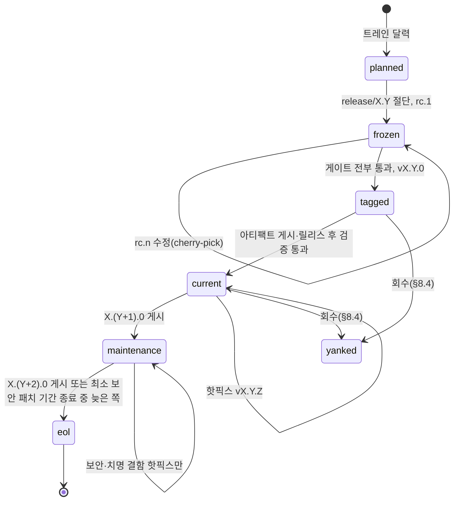
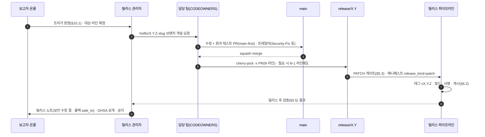

# 릴리스 프로세스

## 목적

이 문서는 RAG Platform 저장소에서 **무엇을, 어떤 버전으로, 어떤 주기와 절차로, 어떤 게이트를 통과시켜 어디에 게시하는지**를 확정한다. [저장소 구조](./01-repository-structure.md)가 "릴리스·태깅 절차는 릴리스 프로세스가 확정한다"고 위임한 태그 규약과 [업그레이드와 마이그레이션](../09-operations/08-upgrade-and-migration.md)이 "릴리스 프로세스가 확정할 때까지의 초안"으로 남긴 플랫폼 semver(Semantic Versioning) 증분 규칙·릴리스 종류·지원 창·기계 판독 매니페스트를 이 문서에서 결정으로 승격한다. 운영자가 배포 전에 읽는 것이 09-operations/08이라면, 이 문서는 릴리스 관리자와 기여자가 **태그를 만들기 전에** 읽는 문서다.

독자는 (1) 월간 릴리스를 절단·태깅·게시하는 릴리스 관리자, (2) 커밋 메시지에 릴리스 영향(브레이킹·재색인·플러그인 API)을 기록해야 하는 기여자, (3) 지원 창과 보안 패치 정책을 확인하는 플랫폼 담당자·플러그인 저자다.

## 범위

- 포함: 버전 체계(플랫폼 semver, 패키지별 동기·독립 결정, 사전 릴리스 표기, 버전의 단일 원천), 릴리스 주기와 종류, 브랜치·태그 규약, 커밋 규약(Conventional Commits)과 체인지로그 자동 생성·릴리스 트레일러, 릴리스 파이프라인과 게이트 체크리스트, 아티팩트 목록과 게시 채널, 서명·SBOM(Software Bill of Materials)·공급망 증명, 지원 정책(N-1, 보안 패치 기간, 회수), 릴리스 노트 템플릿과 `release-manifest.json`, 핫픽스 절차, 역할.
- 제외: CI 잡 정의와 러너·시크릿 구성([CI/CD](./05-ci-cd.md)), 테스트 종류와 마커([테스트 전략](./04-testing-strategy.md)), 브랜치 보호의 승인 수·리뷰 규칙([기여 가이드](./07-contributing.md)), 배포 순서·드레인·롤백·모델 업그레이드([업그레이드와 마이그레이션](../09-operations/08-upgrade-and-migration.md)), 계약 변경 분류·호환 매트릭스·폐기 헤더의 정의([스키마 버전 관리와 호환성](../03-contracts/14-schema-versioning-and-compatibility.md)), 취약점 SLA·스캐너 구성([보안과 컴플라이언스](../09-operations/05-security-and-compliance.md)), 플러그인 패키지 템플릿([플러그인 개발 가이드](./06-plugin-development-guide.md)).
- 정본 관계: 패키지·이미지·extras·entry point·엔드포인트·헤더 이름은 바이블 §6.7·§12·§14의 철자를 그대로 쓴다. 바이블·ADR·상위 문서가 뒷받침하는 규칙과 이 문서가 소유 위임을 받은 항목(태그 규약, semver 증분, 릴리스 종류, 지원 창, 매니페스트 형식)은 `**결정:**`으로 쓰고, 그 밖의 새 도입(도구 선정, CLI 플래그, 트레일러 어휘)은 `**제안:**`으로 표기해 "## 미해결 이슈"에 등재한다. 기간·횟수 수치는 모두 **초안 목표**다.
- 외부 도구: cosign·Trivy·Syft·cyclonedx-bom·pip-licenses·liccheck는 [기술 지형 12](../07-tech-landscape/12-security-multitenancy-pii-and-licensing.md)와 09-operations/05가 선정했으므로 단정한다. 체인지로그 생성기·커밋 린터·빌드 백엔드·PyPI/npm 게시 증명 방식은 07-tech-landscape에 비교 조사가 없어 "확인 필요(as of 2026-09)"로 표기한다.

---

## 1. 버전 체계

### 1.1 버전 축과 동기·독립 결정

한 클러스터에 공존하는 여덟 개 버전 축(플랫폼·계약·플러그인 API·프로파일·워크플로우·원장·인프라·모델)은 09-operations/08 §1.1이 정본이다. 이 문서는 그중 **이 저장소가 게시하는 패키지**의 버전 번호가 서로 잠기는지(동기) 따로 움직이는지(독립)를 결정한다.

**결정:** 코어 트레인(train)은 **동기 버전**, 계약·플러그인·클라이언트 SDK는 **독립 버전**이다. 동기 대상은 한 `uv.lock`·한 `Dockerfile`·한 통합 테스트 매트릭스로 함께 검증되어 한 번에 릴리스되는 것들이고, 독립 대상은 자기 호환 선언(`schema_version`, `contracts_compat`, SDK major = API 경로 major)을 이미 계약으로 갖고 있어 번호를 잠글 이유가 없는 것들이다(바이블 §1.2·§5.6·§6.4·§6.7·§12; [ADR-0035](../06-adr/0035-python-version-and-toolchain-pins.md) 대안 7 단일 잠금, [ADR-0036](../06-adr/0036-naming-and-identifier-conventions.md), [ADR-0032](../06-adr/0032-plugin-sdk-stage-protocol-and-conformance-kit.md); 09-operations/08 §1.1 "여덟 축은 서로 잠기지 않는다").

| 패키지·산출물 | 버전 | 동기/독립 | 근거 |
|---------------|------|-----------|------|
| 배포 패키지 `rag-platform`(PyPI, import `rag_platform`) | 플랫폼 semver `{MAJOR}.{MINOR}.{PATCH}` | **트레인 기준** | 바이블 §6.7·§12 단일 배포 패키지 |
| 코어 이미지 `rag-platform` | 태그 = 플랫폼 semver, 게시는 digest 병기 | 동기 | 08 §3.5(태그는 표시용, Helm은 digest 필수) |
| 사이드카 이미지 `parser-workers`, `ocr-gpu`(본 저장소 `sidecars/`) | 태그 = 플랫폼 semver | 동기 | 같은 통합 매트릭스에서 검증되고 digest가 `parser_fingerprint_hash`·`Producer.image_digest` 입력(바이블 §6.2)이므로 코어와 함께 고정 |
| Helm 차트 `rag-platform`, `rag-platform-data` | `Chart.yaml version`은 `{MAJOR}.{MINOR}`를 플랫폼과 잠그고 `PATCH`는 차트 전용 수정을 위해 독립; `appVersion` = 플랫폼 semver 정확값 | 부분 동기 | 09-operations/08 §2.1 "차트 minor = 코어 minor" 제안을 채택 |
| 계약 `schema_version`(`schemas/*.schema.json`) | 계약별 독립 semver, 초기 `1.0.0` | **독립** | 바이블 §5.1·§6.4, 14 §1.2 |
| 플러그인 `rag-plugin-{name}` | `PluginMeta.version` = 배포 패키지 버전 | **독립** | 바이블 §5.6; 출력에 영향 주는 변경은 minor 이상(05 §8) |
| 클라이언트 SDK `rag-platform-client`(PyPI), `@rag-platform/client`(npm) | 자체 semver; major = 요청·응답 계약 major = API 경로 major, minor 독립 | **독립(같은 트레인에서 게시)** | 05-api/06 §7·§10, 14 §9 |
| builtin 프로파일 `Profile.version`, 워크플로우 타입 `v{n}`, 원장 마이그레이션 리비전, `models.lock` | 각자 규약 | 독립 | 09-operations/08 §1.1(플랫폼 릴리스에 **실려서** 배포되지만 번호는 잠기지 않음) |
| 위성 저장소 `rag-platform-gpl-sidecars`(`lo-sidecar` 등) | 독립 태깅 | 독립(다른 저장소) | 바이블 §6.7; 본 저장소는 `optIn.*` digest 참조만 |

기각한 대안: (a) 저장소 전체 lockstep — 서버 내부 변경마다 SDK major가 오르고, 플러그인 patch가 출력을 바꿔도 `stage_key` 지문이 갈리지 않는 문제(바이블 §15 리스크 #8)를 해결하지 못한다. (b) 모듈별 독립 패키지(`rag-platform-core`·`rag-platform-api` 등) — 바이블 §12 단일 패키지 원칙과 [저장소 구조](./01-repository-structure.md) §5 금지 항목에 어긋난다. (c) 클라이언트 SDK를 코어와 같은 번호로 게시 — 05-api/06 §7이 "SDK minor는 서버 minor와 독립"으로 확정했으므로 채택하지 않는다.

플러그인 SDK API 버전은 별도 상수(`rag_platform.sdk.API_VERSION`, 05 §8 제안)를 두지 않고 **플랫폼 semver가 SDK 버전**이다. 플러그인은 `dependencies = ["rag-platform>=1.0,<2.0"]`와 `contracts_compat`로 두 축을 선언하며(05 §8), 이 문서 §9의 릴리스 노트 "플러그인 API 변경" 절이 사람이 읽는 변경 기록이다.

### 1.2 플랫폼 semver 증분 규칙

**결정:** 09-operations/08 §1.2의 초안 표를 그대로 확정한다(09-operations/08 미해결 이슈 1 해소; 신규 ADR 발의는 이 문서 미해결 이슈 1). 판정 근거가 되는 계약 변경 분류는 바이블 §1.2와 14 §2.1, 플러그인 SDK 변경 분류는 05 §8이다([ADR-0018](../06-adr/0018-api-rest-sse-mcp-no-grpc-rfc9457.md), [ADR-0032](../06-adr/0032-plugin-sdk-stage-protocol-and-conformance-kit.md), [ADR-0036](../06-adr/0036-naming-and-identifier-conventions.md)).

| 증분 | 조건(하나라도 해당) | 절차 요건 |
|------|---------------------|-----------|
| **MAJOR** | `/v1`이 노출하는 요청·응답 계약(14 §4.4 목록) 중 하나라도 major → `/v2` 개방; `Stage`·`StageContext`·`PipelineContext` 프로토콜 비호환(플러그인 전부 재빌드); 명명 규약·해시 결합식·오프셋 의미 변경(바이블 §1.2 3행, 14 §2.5); 지원 창 안에서 워크플로우 타입 병존이 불가능한 변경 | ADR 필수(바이블 §1.2 major 행) + 영향 문서 일괄 개정 + 14 §7.1 폐기 창 + 09-operations/08 §6 재생산 계획. **자동 판정 금지** — 커밋에 `BREAKING CHANGE:`가 있어도 릴리스 관리자와 `architecture` 팀이 확인해야 MAJOR가 된다 |
| **MINOR** | 내부 계약 minor(선택 필드·열거값 추가); 새 플러그인·확장 지점 역할; builtin 프로파일 `version` 증가; 원장 expand 마이그레이션; 새 워크플로우 타입 `v{n}` 병존 도입; `deprecated` 표기 추가; 새 기능(`feat`) 일반 | 월간 트레인(§2.1). 계약 minor는 ADR + 게이트 근거(바이블 §1.2 minor 행) |
| **PATCH** | 계약·프로파일·마이그레이션·워크플로우 히스토리에 영향 없음: 버그 수정, 취약점 재빌드, 문서, 의존성 pin-and-bump(계약 코퍼스 통과) | 핫픽스(§10). `Replayer` 회귀 필수 |

부속 규칙(09-operations/08 §1.2 그대로): (1) 플러그인 출력에 영향을 주는 변경은 `PluginMeta.version` minor 이상. (2) 코어 릴리스가 builtin 프로파일 값을 바꾸면 그것은 프로파일 `version` 증가이며 기존 컬렉션 바인딩은 바뀌지 않는다. (3) 플러그인 `config_schema` 기본값 변경은 `config_hash`만 바꾼다. 여기에 이 문서가 더하는 규칙: (4) **월간 트레인은 항상 MINOR**다 — 그 달에 `feat` 커밋이 없어도 MINOR를 올려 `rolling_from`(09-operations/08 §2.2)과 지원 창(§8) 계산을 단순하게 유지한다. (5) PATCH는 트레인 밖 핫픽스에서만 나온다.

### 1.3 사전 릴리스·개발 빌드 표기와 생태계 매핑

**결정:** 플랫폼 태그는 SemVer 2.0.0을 따르며 사전 릴리스는 `-rc.{n}`만 쓴다(`alpha`·`beta`는 쓰지 않는다; 0.x 프리뷰가 그 역할을 한다, §1.5). 봉투 `schema_version`은 사전 릴리스·빌드 메타데이터를 금지하지만(14 §1.2 불변식 1) 플랫폼 버전은 어떤 계약 인스턴스의 `schema_version`에도 들어가지 않으므로 충돌하지 않는다. 코어 어댑터의 `Producer.plugin_version`(= 플랫폼 버전)은 14 §1.2가 명시적으로 제한 대상에서 제외한다.

| 표기 대상 | 정식 릴리스 | RC | `main` 개발 빌드 |
|-----------|-------------|----|------------------|
| git 태그 | `v1.5.0` | `v1.5.0-rc.1` | 없음 |
| PyPI(PEP 440) | `1.5.0` | `1.5.0rc1` | `1.5.0.dev{N}+g{sha12}`(미게시; 로컬 버전 표기 때문에 PyPI가 거부한다) |
| npm | `1.5.0` | `1.5.0-rc.1`(dist-tag `next`) | 미게시 |
| 컨테이너 태그 | `1.5.0` + digest | `1.5.0-rc.1` | `main-{sha12}`, 이동 태그 `edge` |
| Helm `Chart.yaml version` / `appVersion` | `1.5.{p}` / `1.5.0` | `1.5.0-rc.1` / `1.5.0-rc.1` | 미게시(렌더 스냅샷만) |
| 이미지 라벨 `org.opencontainers.image.version` | `1.5.0` | `1.5.0-rc.1` | `1.5.0.dev{N}+g{sha12}` |

`latest` 태그는 어디에도 만들지 않는다 — Helm values가 digest를 필수로 받고(08 §3.5 P5) 이동 태그가 재현성을 깨기 때문이다. RC는 `release/{MAJOR}.{MINOR}` 브랜치에서만 만들고 RC 아티팩트는 정식과 같은 파이프라인·같은 서명으로 게시하되 매니페스트 `release_kind = "prerelease"`로 표시한다.

### 1.4 버전의 단일 원천과 파생 위치

**결정:** 플랫폼 버전의 단일 원천은 **git 태그 `v{semver}`**다. 코어 `pyproject.toml`은 `dynamic = ["version"]`으로 태그에서 유도한다([저장소 구조](./01-repository-structure.md) §3.2; 빌드 백엔드 hatch-vcs 선정은 같은 문서 미해결 이슈 5 — 확인 필요 as of 2026-09). 클라이언트 SDK·플러그인·Helm 차트·npm 패키지는 **정적 `version` 필드**를 쓰고, 릴리스 PR(§5.4)이 올린 값과 태그가 같은지 CI가 검사한다.

| 파생 위치 | 값 | 채우는 주체 | 검사 |
|-----------|-----|-------------|------|
| `pyproject.toml`(코어) | 태그 유도 | 빌드 백엔드 | `uv build` 결과 파일명 = 태그 |
| 이미지 라벨 `org.opencontainers.image.version`·`revision`·`io.rag.extras` | 태그·커밋·`EXTRAS` | Dockerfile 빌드 인자 | `tools/ci/check_release_versions.py`(제안) |
| `deploy/helm/rag-platform/Chart.yaml appVersion` | 태그 | 릴리스 PR | 동일 |
| `release-manifest.json.platform_version`, `deploy/compat-matrix.json.platform_version` | 태그 | 릴리스 파이프라인 생성 | 동일 |
| `sdk/python/pyproject.toml version`, `sdk/typescript/package.json version` | SDK 자체 태그 | 릴리스 PR | 태그 `sdk-python/v{x}` = 필드 |
| `plugins/*/pyproject.toml version` = `[tool.rag_platform.plugin] version` | 플러그인 태그 | 플러그인 릴리스 PR | 두 필드 동일 + 태그 일치(`PluginMeta.version` 검증은 레지스트리) |
| `CHANGELOG.md` 최상단 절 제목 | 태그 | 생성기(§4.4) | 재생성 diff |

빌드 백엔드가 확정되기 전에는 코어도 정적 `version` 필드로 두고 같은 검사(태그 = 필드)를 적용한다. 어느 쪽이든 "버전 문자열을 손으로 두 곳에 쓰는" 상태는 CI가 거부한다.

### 1.5 1.0 이전(0.x) 규칙

[마일스톤](../11-roadmap/01-milestones.md) §1.1의 태그(`0.1.0` M1 프리뷰, `0.2.0`, `0.5.0` 첫 공개 릴리스, `0.8.0`, `0.9.0` RC, `1.0.0` GA)를 그대로 따른다. 0.x에서는 SemVer 2.0.0 §4대로 MINOR가 비호환 변경을 담을 수 있으나, 계약 `schema_version`은 `0.1.0` 태그(첫 게시, 14 §1.2 "게시 = 릴리스 태그 + `GET /v1/schemas/{name}` 노출")부터 바이블 §1.2 절차를 그대로 적용한다. `0.5.0`부터 프로덕션이 허용되므로 `0.5`·`0.8`·`0.9` 라인은 §8 지원 정책의 `maintenance` 대상이 되고, 월간 트레인(§2.1)은 `1.0.0` 이후에 시작한다. GA 시점의 계약 동결 태그는 마일스톤 §9.3의 `contracts-v1.0`이다.

---

## 2. 릴리스 주기와 종류

### 2.1 트레인

**결정:** 1.0 GA 이후 MINOR는 **월간 트레인**, PATCH는 **수시**(핫픽스·보안), MAJOR는 **ADR 주도의 비정기 마이그레이션 릴리스**다. 트레인 일정(초안 목표)은 아래와 같고, 달력은 [CI/CD](./05-ci-cd.md) §6.1이 자동화한다.

| 단계 | 시점(초안 목표) | 동작 | 산출 |
|------|-----------------|------|------|
| 절단(cut) | 매월 첫 월요일 | `main`에서 `release/{MAJOR}.{MINOR}` 생성, 릴리스 PR 개설(§5.4) | 브랜치, `v{x}-rc.1` 태그 |
| 안정화 | 절단 후 1주 | RC를 스테이징에 배포해 09-operations/08 §9.2 검증; 수정은 `main`에 먼저 머지 후 cherry-pick | `-rc.{n}` 갱신 |
| 태그 | 절단 후 7~10일 | §5.2 게이트 전부 통과 → `v{x}` 태그 → 아티팩트 게시 | 정식 릴리스 |
| 관찰 | 태그 후 7일 | 카나리 테넌트·피드백 관측(09-operations/08 §9.3 롤백 관찰 창) | 다음 트레인 정리 릴리스 입력 |

트레인을 건너뛰는 조건은 "머지된 변경 0건" 하나뿐이다. 릴리스가 늦어지더라도 다음 절단일은 움직이지 않는다(늦은 트레인은 짧은 트레인이 된다).

### 2.2 릴리스 종류

09-operations/08 §1.4의 표를 확정하고 릴리스 파이프라인 관점의 열을 더한다.

| 종류 | 증분 | 브랜치·태그 | 게이트 축약 | 매니페스트 `release_kind` |
|------|------|-------------|-------------|---------------------------|
| 기능 릴리스 | MINOR | `release/X.Y` → `vX.Y.0` | 없음(전체) | `minor` |
| 핫픽스 | PATCH | `hotfix/X.Y.Z-{slug}` → `release/X.Y` → `vX.Y.Z` | §5.3 규칙 | `patch` |
| 마이그레이션 릴리스 | MAJOR | `release/X.0` → `vX.0.0`; 최소 RC 2회 | 없음 + 09-operations/08 §6 재생산 리허설 | `major` |
| 정리 릴리스 | MINOR(다음 트레인에 포함) | 일반 트레인 | 없음 | `minor` |
| RC | — | `release/X.Y` → `vX.Y.0-rc.n` | 없음(정식과 동일) | `prerelease` |
| 프로파일·모델 릴리스 | 플랫폼 버전 무관 | 일반 트레인에 실림(프로파일 `version`·`models.lock` 변경) | — | 해당 트레인의 종류 |
| 플러그인 릴리스 | 플러그인 semver | `rag-plugin-{name}/v{semver}` | 플러그인 CI(적합성 키트) | 코어 매니페스트에 포함되지 않음 |
| SDK 릴리스 | SDK semver | `sdk-python/v{semver}`, `sdk-typescript/v{semver}` — 코어 태그와 **같은 날** | SDK 적합성 테스트(05-api/06 §10) | 코어 매니페스트 `artifacts[]`에 기록 |

### 2.3 릴리스 라인의 수명

릴리스 라인은 `{MAJOR}.{MINOR}`이며 상태는 아래 기계를 따른다. 상태 값(`planned, frozen, tagged, current, maintenance, eol, yanked`)은 릴리스 도구의 어휘이고 바이블 §5.7 열거가 아니다.



---

## 3. 브랜치·태그

### 3.1 브랜치 모델

**결정:** 트렁크 기반(trunk-based)이다. `main`이 유일한 통합 브랜치이고, 릴리스 브랜치는 절단 이후 **cherry-pick만** 받는다. 모든 수정은 `main`에 먼저 머지된다("main-first"). 예외는 `main`이 이미 비호환하게 갈라져 그대로 적용할 수 없는 핫픽스 하나뿐이며, 그 경우 릴리스 브랜치에 먼저 머지하고 `main`으로의 forward-port PR을 같은 날 개설한다.

| 브랜치 | 목적 | 수명 | 머지 방식 |
|--------|------|------|-----------|
| `main` | 다음 MINOR의 통합 | 영구 | PR squash merge; PR 제목이 Conventional Commit 헤더가 된다(§4) |
| `release/{MAJOR}.{MINOR}` | 트레인 안정화와 지원 라인 유지 | 라인 `eol`까지 | cherry-pick PR만(`git cherry-pick -x`로 원 커밋 SHA 기록) |
| `hotfix/{MAJOR}.{MINOR}.{PATCH}-{slug}` | 핫픽스 작업 | 태그까지 | `release/X.Y`로 PR |
| `feat/…`, `fix/…`(자유) | 기여 작업 | PR 머지까지 | `main`으로 PR |
| `release/{MAJOR}.0` | MAJOR 마이그레이션 릴리스 | 라인 `eol`까지 | 위와 동일; 최소 RC 2회 |

### 3.2 태그 규약

**결정:** [저장소 구조](./01-repository-structure.md) §5 마지막 행의 제안과 05-api/06 §7, 14 §5.1의 제안을 아래 표로 확정한다([ADR-0036](../06-adr/0036-naming-and-identifier-conventions.md)). 태그는 모두 annotated tag이며 서명은 §7을 따른다.

| 대상 | 태그 형식 | 예 | 생성 주체 |
|------|-----------|----|-----------|
| 코어(플랫폼) | `v{semver}` | `v1.4.0`, `v1.4.1`, `v1.5.0-rc.1` | 릴리스 파이프라인 |
| 플러그인(본 저장소 `plugins/*`) | `rag-plugin-{name}/v{semver}` | `rag-plugin-lightrag/v0.3.0` | 플러그인 릴리스 워크플로우 |
| 클라이언트 SDK | `sdk-python/v{semver}`, `sdk-typescript/v{semver}` | `sdk-python/v1.2.3` | 릴리스 파이프라인(코어와 같은 날) |
| 계약 스키마 | `schemas/{kebab-name}@{semver}` | `schemas/parsed-document@1.1.0` | 계약 `schema_version`이 바뀐 릴리스에서 자동 생성(14 §5.1) |
| 계약 동결 | `contracts-v{MAJOR}.{MINOR}` | `contracts-v1.0`(GA) | GA·계약 major 릴리스 |
| Helm 차트 전용 패치 | `helm/{chart}/v{semver}` | `helm/rag-platform/v1.4.2` | 차트만 바뀐 PATCH(코어 이미지 불변) |

규칙: (1) 태그는 삭제·이동하지 않는다. 잘못된 릴리스는 회수(§8.4)로 표시하고 다음 PATCH로 고친다. (2) `schemas/…@…` 태그가 가리키는 커밋에서 해당 스키마 파일의 `$id` major와 `versioning.py` 표가 그 버전과 일치해야 한다(14 §10.4 게이트). (3) 코어 태그 하나는 이미지 3종·차트 2종·PyPI `rag-platform` 1종·스키마 번들·OpenAPI·매니페스트를 정확히 한 세트 생산한다(§6.1). 클라이언트 SDK(PyPI `rag-platform-client`, npm `@rag-platform/client`)는 같은 날 게시되지만 자기 태그(`sdk-python/v…`, `sdk-typescript/v…`)로 SDK 변경이 있을 때만 생산되며(§6.2), 코어 매니페스트 `artifacts[]`에 기록된다.

### 3.3 보호 규칙

`main`·`release/*`는 보호 브랜치다. 직접 push 금지, 필수 상태 검사 = §5.2의 PR 게이트, 필수 리뷰는 `.github/CODEOWNERS`([저장소 구조](./01-repository-structure.md) §8)를 따르며 승인 수는 [기여 가이드](./07-contributing.md) §5.4가 정한다. `release/*`로의 PR은 릴리스 관리자(§11)만 머지한다. 태그 생성은 릴리스 파이프라인의 게시 잡만 할 수 있다(사람의 로컬 태그 push 금지).

---

## 4. 커밋 규약과 체인지로그 자동 생성

### 4.1 Conventional Commits

**결정:** 커밋 메시지(정확히는 squash merge 후 `main`에 남는 커밋)는 Conventional Commits 1.0.0을 따른다. 헤더 `type(scope)!: subject`, 본문, 푸터 트레일러로 구성되며, 체인지로그(§4.4)와 `release-manifest.json`(§9.2)은 **커밋 트레일러에서 기계 생성**된다. 사람이 릴리스 노트를 처음부터 쓰지 않는다 — 트레일러가 없으면 릴리스 노트의 해당 절이 비고, 게이트(§5.2 "릴리스 영향 선언")가 그 공백을 잡는다. PR 제목·본문 린트는 CI가 수행한다(린터 도구는 미해결 이슈 2 — 확인 필요 as of 2026-09).

### 4.2 타입·스코프 어휘

| 타입 | 체인지로그 절(Keep a Changelog) | 기본 증분 기여 | 비고 |
|------|--------------------------------|----------------|------|
| `feat` | Added | MINOR | 새 기능·새 플러그인·새 렌더러·새 엔드포인트 |
| `fix` | Fixed | PATCH | 버그. 보안 수정은 `Security-Fix:` 트레일러 필수 → Security 절로 이동 |
| `perf` | Changed | PATCH | 성능. 출력이 바뀌면 `Reindex-Required:` 검토 |
| `refactor` | (표시 안 함) | 없음 | 출력·계약 불변이어야 한다 |
| `docs` | (표시 안 함; `docs/` 릴리스 노트에는 표시) | 없음 | |
| `build`, `deps` | Changed | PATCH | 의존성 pin-and-bump(매트릭스 공통 요구 3); C 등급 진입은 라이선스 게이트가 차단 |
| `ci`, `test`, `style`, `chore` | (표시 안 함) | 없음 | |
| `revert` | Removed/Fixed | 되돌린 커밋 기준 | 본문에 `This reverts commit <sha>` |
| 헤더 `!` 또는 `BREAKING CHANGE:` | **Breaking** 절 | MAJOR **후보**(§1.2 자동 판정 금지) | `Breaking-Kind:` 트레일러 필수 |

스코프는 선택이지만 아래 어휘 밖의 값은 린트 실패다. 어휘는 바이블 §12 최상위 모듈명과 이 저장소의 게시 단위에서 나온다.

| 스코프 군 | 값 |
|-----------|-----|
| 코어 모듈(바이블 §12) | `contracts`, `sdk`, `plugins`, `adapters`, `pipelines`, `retrieval`, `render`, `orchestration`, `ledger`, `storage`, `security`, `profiles`, `korean`, `eval`, `telemetry`, `api`, `mcp`, `testing`, `cli` |
| 어댑터 세부(선택) | `adapters/{fetch\|parse\|normalize\|chunk\|enrich\|embed\|index\|query\|retrieve\|rerank\|llm}` |
| 계약·스키마 | `schemas`(`schemas/*.schema.json`와 03-contracts 문서), `contracts`(Pydantic 모델) |
| 배포·이미지 | `helm`, `compose`, `docker`, `sidecar/parser-workers`, `sidecar/ocr-gpu` |
| 게시 단위 | `sdk-python`, `sdk-ts`, `plugin/{name}`(`plugin/lightrag`) |
| 저장소 | `docs`, `deps`, `release`, `tools` |

### 4.3 릴리스 트레일러

**제안(이 문서 정의; 미해결 이슈 3):** 아래 트레일러는 Conventional Commits 푸터 문법(`Token: value`, 토큰의 공백은 `-`)을 따르며, 각 값은 `release-manifest.json`(§9.2)의 필드에 1:1로 매핑된다. 열거 문자열은 바이블 정본 철자를 그대로 쓴다 — `from_stage`는 바이블 §14 `reprocess.from_stage`의 `parse, normalize, chunk, recount, enrich, embed, index`, 워크플로우 변경 종류는 09-operations/08 §3.5(`patched`, `deprecate_patch`, 타입 증분, 등록 해제), 계약 변경 수준은 14 `CompatLevel`(`patch, minor, major`)이다.

| 트레일러 | 값 형식 | 매니페스트 필드 | 필수 조건 |
|----------|---------|-----------------|-----------|
| `BREAKING CHANGE:` | 자유 문장(CC 표준) | `breaking = true` 후보 | 비호환 변경 |
| `Breaking-Kind:` | `api_contract_major \| plugin_sdk \| naming_or_hash \| workflow_type`(§1.2 MAJOR 조건 4종) | 릴리스 노트 "브레이킹" 절 분류 | `BREAKING CHANGE:`가 있을 때 |
| `Contract-Change:` | `{kebab-name} {from} -> {to} ({patch\|minor\|major})` | `contract_changes[]` | `schemas/`·`contracts/` 변경 커밋 |
| `Reindex-Required:` | `scope={profile\|collection\|all}; profile_id={id}?; from_stage={stage}; reason={문장}` | `reindex_required[]`(`automatic`은 항상 `false`) | 지문(파서·정규화기·청커·보강기·임베더) 변경 커밋 |
| `Profile-Version:` | `{profile_id} {from} -> {to}` | `profile_hash_changes[]`(해시는 빌드가 계산) | `profiles/builtin/*.yaml` 변경 커밋 |
| `Plugin-Api:` | `{minor\|major}; {설명}` | 릴리스 노트 "플러그인 API 변경" 절; `major`면 `breaking` 후보 | `sdk/` 프로토콜·`PluginMeta`·`Capabilities` 변경 커밋(05 §8 분류) |
| `Migration:` | `{expand\|backfill\|contract} {revision 또는 잡 이름}` | `migrations.{expand\|backfill\|contract}[]` | `ledger/migrations/` 변경 커밋 |
| `Workflow-Change:` | `{workflow_type} {patched\|deprecate_patch\|new_type\|unregister} [patch_id]` | `workflow_changes[]` | `orchestration/temporal/workflows` 변경 커밋 |
| `Deprecation:` | `target={…}; deprecation_at={RFC 3339}; sunset_at={RFC 3339}; successor={…}` | `deprecations[]` | `deprecated: true`·`x-rag-sunset` 추가 커밋 |
| `Cache-Invalidation:` | `prompt_cache_prefix \| plan \| qemb \| stage_key` | `cache_invalidation[]` | `ContextPack.content_hash`·플랜 캐시 키 입력을 바꾸는 커밋(14 §11) |
| `Models-Lock:` | `{add\|update\|remove} {model_id}` | `models_lock_changes[]` | `models.lock` 변경 커밋 |
| `Security-Fix:` | `{GHSA 또는 CVE id}; severity={critical\|high\|medium\|low}` | `security_fixes[]` | 보안 수정 커밋(공개 전에는 비공개 저장소에서만) |
| `ADR:` / `Refs:` | `{NNNN}` / 이슈·PR 번호 | 릴리스 노트 링크 | 계약·결정 변경 커밋은 `ADR:` 필수 |

린트 규칙: `schemas/*.schema.json`이 바뀐 커밋에 `Contract-Change:`가 없으면 실패, `profiles/builtin/`이 바뀐 커밋에 `Profile-Version:`이 없으면 실패, `ledger/migrations/`가 바뀐 커밋에 `Migration:`이 없으면 실패. 반대로 트레일러가 선언한 파일 변경이 diff에 없으면 경고다.

### 4.4 CHANGELOG 생성 규칙

**결정:** `CHANGELOG.md`(저장소 루트), `sdk/python/CHANGELOG.md`, `sdk/typescript/CHANGELOG.md`, `plugins/*/CHANGELOG.md`는 커밋 이력에서 생성되는 **커밋되는 생성물**이며 [저장소 구조](./01-repository-structure.md) §6 규칙(재생성 후 `git diff --exit-code`, 파일 첫 줄 `generated … do not edit`)을 따른다. 형식은 Keep a Changelog 절 이름(Added·Changed·Deprecated·Removed·Fixed·Security)에 플랫폼 전용 절(Breaking·Reindex required·Plugin API·Contracts·Profiles·Migrations·Workflows)을 앞에 둔 것이며, 05-api/06 §10이 SDK 체인지로그에 요구한 "항목마다 관련 계약 `schema_version`·`operationId` 명시"는 `Contract-Change:` 트레일러와 스코프 `api`의 PR 본문에서 채운다. 생성기(git-cliff 또는 release-please 계열)는 미해결 이슈 2다 — 확인 필요(as of 2026-09).

아래 블록은 **형식 예시**이며 실제 계약·프로파일·플러그인 API 변경 기록이 아니다. PR·ADR 번호와 Contracts 절의 `{field}`는 플레이스홀더다(`Block`의 실제 필드 표는 바이블 §5.3). Added·Fixed 절의 `late_interaction_pass`·`api.idempotency_payload_mismatch`는 바이블 §5.7 정본 값을 그대로 인용한 것이다.

```markdown
<!-- generated by release tooling from Conventional Commits — do not edit -->
# Changelog

## [1.4.0] - 2026-10-13

### Breaking
- 없음

### Reindex required
- `standard` 프로파일: `enricher.korean_keywords` 품사 필터 변경으로 `enricher_fingerprint` 변경 — `from_stage=enrich`, 자동 실행되지 않음 (#812, ADR-0016)

### Plugin API
- minor: `StageContext.token_counter`에 `count_many()` 추가(기본 구현 제공) (#798, ADR-0032)

### Contracts
- `parsed-document` 1.0.0 -> 1.1.0 (minor): `Block.{field}` 선택 필드 추가 (#790, ADR-{NNNN})

### Added
- **retrieval:** `explain[]`에 `late_interaction_pass` 설명 코드 기록 (#801)

### Fixed
- **api:** `POST /v1/ingest` 재전송 시 `Idempotency-Key` 페이로드 불일치가 409로 나오던 문제를 422 `api.idempotency_payload_mismatch`로 정정 (#805)

### Security
- 없음
```

### 4.5 커밋 예시

```text
feat(adapters/enrich)!: korean_keywords 품사 필터를 NNG/NNP에서 NNG/NNP/SL로 확장

한자·영문 고유명사(SL)가 키워드에서 빠져 법령·기술 문서의 lexical 채널 recall이
낮았다. 골든셋 ko-law-v1 nDCG@10 +0.012(Holm 보정 p<0.05, EvalRun 01J9ZQ…).

BREAKING CHANGE: enricher.korean_keywords 출력이 바뀌어 enricher_fingerprint가
변경된다. 기존 컬렉션은 재색인 전까지 이전 키워드로 검색된다.
Breaking-Kind: naming_or_hash
Reindex-Required: scope=profile; profile_id=standard; from_stage=enrich; reason=enricher_fingerprint 변경
Profile-Version: standard 1.0.0 -> 1.1.0
ADR: 0016
Refs: #812
```

위 예시에서 `BREAKING CHANGE:`는 릴리스 관리자 검토 대상이 될 뿐 MAJOR를 강제하지 않는다 — §1.2 표에서 지문 변경은 MINOR(프로파일 `version` 증가)이고 재색인은 운영자 선택이므로, 검토 결과 `breaking=false`·`reindex_required[]` 1건으로 매니페스트가 만들어진다. 기여자가 `BREAKING CHANGE:`를 남기는 기준은 "운영자가 무언가를 해야 한다"이고, 릴리스 관리자가 §1.2로 증분을 판정한다.

---

## 5. 릴리스 파이프라인과 체크리스트

### 5.1 파이프라인

```mermaid
flowchart LR
    CUT["절단<br/>release/X.Y · rc.1"] --> PR["릴리스 PR<br/>CHANGELOG · Chart.yaml · compat-matrix · openapi 재생성"]
    PR --> G1["게이트 1 정적·계약<br/>ruff · mypy · import-linter · uv lock --check<br/>스키마 문법 · 열거 대조 · Pydantic 동치 · SchemaDiffReport"]
    G1 --> G2["게이트 2 테스트<br/>3.12 · 3.13 매트릭스 · 계약 코퍼스 · 골든 · Replayer · 보안 카나리"]
    G2 --> G3["게이트 3 통합·평가<br/>Temporal × Qdrant × OpenSearch × PG 매트릭스<br/>소형 골든셋 gate_result · 재현성 commit_hash"]
    G3 --> G4["게이트 4 공급망<br/>pip-licenses · liccheck · cyclonedx-bom<br/>Trivy · Syft · models.lock verify"]
    G4 --> G5["게이트 5 릴리스 영향 선언<br/>트레일러 ↔ diff 대조 · 매니페스트 생성 · 버전 일치"]
    G5 --> TAG["태그 vX.Y.Z"]
    TAG --> BUILD["아티팩트 빌드<br/>이미지 3 · 차트 2 · PyPI · npm · 스키마 번들"]
    BUILD --> SIGN["서명·증명<br/>cosign · SBOM attestation · Trusted Publishing"]
    SIGN --> PUB["게시<br/>ghcr.io · OCI 차트 · PyPI · npm · GitHub Release"]
    PUB --> POST["릴리스 후 검증<br/>cosign verify · 5분 기동 e2e · 스키마 ETag · 매니페스트 재검증"]
    POST -->|통과| ANN["공지·라인 상태 current"]
    POST -->|실패| YANK["회수 §8.4 → 핫픽스 §10"]
```



### 5.2 게이트 체크리스트

**결정:** 아래 표의 항목은 정식 릴리스의 **필수 상태 검사**다. 실패 = 태그 불가. 도구 열의 명령은 [CI/CD](./05-ci-cd.md)가 잡으로 확정하며, 근거 열은 각 게이트를 요구하는 정본이다([ADR-0001](../06-adr/0001-license-grade-table-and-d02-interpretation.md), [ADR-0003](../06-adr/0003-orchestrator-neutral-pipeline-and-non-durable-local-runner.md), [ADR-0022](../06-adr/0022-observability-genai-semconv-pin-and-license-boundary.md), [ADR-0030](../06-adr/0030-single-coordinate-system-and-score-ledger.md), [ADR-0031](../06-adr/0031-profile-schema-extends-and-quality-gates.md), [ADR-0035](../06-adr/0035-python-version-and-toolchain-pins.md)).

| # | 게이트 | 검사 | 도구·명령 | 근거 | 소유 팀 |
|---|--------|------|-----------|------|---------|
| 1 | 잠금·툴체인 | `uv lock --check`; `requires-python = ">=3.12,<3.14"` 범위 검사; 3.12·3.13 두 인터프리터 모두 통과 | uv, `tools/ci/check_lock_ranges.py`(제안) | ADR-0035, 바이블 §11.6 | `devex` |
| 2 | 정적 검사 | ruff, mypy strict, import-linter 5계약(C 등급 임포트 차단 포함), 스팬 리터럴 린트 | 루트 `pyproject.toml` 설정 | 저장소 구조 §3.2·§4.2 | `devex` |
| 3 | 계약 | 스키마 문법(2020-12 메타스키마·`$ref` 해소·`additionalProperties` 명시), 래퍼 게이트, 열거 대조(바이블 §5.7·이벤트·오류 코드·메트릭), 골든 예시 회귀, Pydantic 동치, 불변식 테스트, 해시 벡터, `SchemaDiffReport.declared_level ≥ computed_level`, `versioning.py` 표 = 03-contracts `## 버전 이력` | `tools/validate-contracts.mjs`, `python -m rag_platform.contracts.export`, `rag schema diff`(제안) | 바이블 §1.2, 계약 개요 §10.3, 14 §10 | `contracts` |
| 4 | 테스트 | `tests/contracts`·`adapters`(계약 코퍼스)·`security`(카나리 E1~E17)·`replay`(`Replayer`)·`eval`(소형 골든셋)·`golden`·`unit`·`integration`·`e2e`(5분 기동) | pytest 매트릭스 | 저장소 구조 §7, ADR-0003 | 각 CODEOWNERS |
| 5 | 통합 매트릭스 | Temporal × Qdrant × OpenSearch(`analysis-nori` 동일 버전) × PostgreSQL 조합; 통과 조합 → `compat-matrix.json.components[].tested` | 스테이징 형상 | 09-operations/08 §2.3 | `platform-ops` |
| 6 | 평가 게이트 | 소형 골든셋 `EvalReport.gate_result.passed = true`(nDCG@10 회귀 `max_regression` 0.01, Holm); builtin 프로파일 값이 바뀐 릴리스는 해당 프로파일 `eval.gates` 전체 게이트 통과 근거(ADR 첨부) | `rag eval`(`[eval]` extra) | D-12, 바이블 §7.4, ADR-0031 | `evaluation` |
| 7 | 재현성 | 카나리 문서·같은 프로파일의 `IndexCommit.commit_hash`가 이전 RC와 동일(지문 변경 선언이 없을 때) | e2e | 브리프 §7 재현성 | `kernel` |
| 8 | 라이선스 | `uv lock --check` → pip-licenses(`--allow-only` A, `--fail-on` AGPL/GPL/SSPL/LGPL 정적/UNKNOWN) → liccheck(`CAUTIOUS`) → cyclonedx-bom; 경로 린트(GPL/AGPL 코드·Dockerfile 없음); Helm·compose 기본 `optIn.*` 전부 `false`; `models.lock` D 등급이 기본 프로파일에 없음, safetensors·picklescan | 09-operations/05 §6 순서 | D-02, ADR-0001 | `license-compliance` |
| 9 | 취약점 | Trivy `image`(코어·사이드카)·`fs`(`uv.lock`)·`config`(Helm·compose)·secret; Critical 0, High 미해결 0(예외는 만료일·승인자 기록) | Trivy, pip-audit(보완, 확인 필요) | NFR-SEC-11, 09-operations/05 §6.2 | `security` |
| 10 | 생성물 동기화 | `docs/05-api/openapi.yaml`, Weaver 상수, Helm 프로파일 사본, TS 생성층, `CHANGELOG.md` 재생성 후 diff 0 | 저장소 구조 §6 표 | ADR-0022, ADR-0030 | `devex` |
| 11 | 문서 | 문서 링크 검사(문서 맵 밖 링크 실패, 미작성 문서 경고), 릴리스 노트 §9.1 필수 절 존재, 09-operations/08 갱신 필요 항목(마이그레이션·재색인) 반영 | `tools/docs/*` | 브리프 §9.6, 매트릭스 CI 게이트 | `architecture` |
| 12 | 마이그레이션 | 빈 autogenerate(모델·마이그레이션 동기); expand 리비전만 포함(contract 리비전은 정리 릴리스에서만, 09-operations/08 §3.4); RLS `ENABLE`+`FORCE` 동반; `lock_timeout` 명시 | 마이그레이션 도구(미확정) | 09-operations/08 §3.4 | `platform-ops` |
| 13 | 호환성 매트릭스 | `deploy/compat-matrix.json` 재생성; `rolling_from`이 N-1 라인을 포함; `contracts` 표 = `versioning.py`; `supported` ⊇ `tested` | 릴리스 파이프라인 | 09-operations/08 §2 | `platform-ops` |
| 14 | 릴리스 영향 선언 | 트레일러 ↔ diff 대조(§4.3 린트); `release-manifest.json` 생성·스키마 검증; `migrations.contract ≠ []`이면 `rollback.requires_pitr = true`; `deprecations[].sunset_at ≥ deprecation_at + 14 §7.1 최소 기간`; `reindex_required[].automatic = false` | 릴리스 파이프라인 | 09-operations/08 §8.2 | 릴리스 관리자 |
| 15 | 버전 일치 | 태그 = `pyproject` 유도 버전 = `Chart.yaml appVersion` = 매니페스트 = 이미지 라벨; SDK·플러그인 태그 = 정적 `version` | `tools/ci/check_release_versions.py`(제안) | §1.4 | `devex` |
| 16 | Helm | `helm lint`, 프로파일별 values 렌더 스냅샷, `optIn.*` 기본 `false`, `image.digest` 필수 | helm | 08 §4 | `platform-ops` |
| 17 | 스테이징 리허설 | RC를 스테이징에 배포해 09-operations/08 §3.2 사전 점검·§9.2 smoke 14항목 통과; MAJOR는 §6 재생산 배치 리허설 추가 | 스테이징 | 09-operations/08 | `platform-ops` |

### 5.3 PATCH(핫픽스) 축약 규칙

**결정:** 17개 게이트는 PATCH에서도 전부 실행된다. 핫픽스는 게이트 1·2·3·4·7·8·9·10·11·12·13·14·15·16(14개)을 **전부** 정식 릴리스와 같은 기준으로 통과해야 하고, **축약할 수 있는 것은 5·6·17 세 개뿐**이다: 게이트 5는 해당 라인의 `compat-matrix.json.components[].tested` 조합만 재실행; 게이트 6은 검색 경로(`retrieval`·`render`·`adapters/{embed,index,retrieve,rerank,query}`)에 diff가 없을 때 소형 골든셋만; 게이트 17은 스테이징 smoke 14항목 중 1·2·4·5·8·9·11(상태·워커·카나리 수집·카나리 질의·결정론·정합성·지연)만.

필수 게이트 중 PATCH에서 검사 기준이 달라지는 것은 아래 표와 같고, 표에 없는 게이트(1·2·3·4·8·9·10·11·14·15)는 §5.2와 동일하다.

| 게이트 | PATCH에서의 검사 | 이유 |
|--------|------------------|------|
| 7 재현성 | 비교 기준이 이전 RC가 아니라 **직전 태그 `vX.Y.(Z-1)`**이다. 매니페스트 `reindex_required[]`가 비어 있으면 카나리 `IndexCommit.commit_hash`가 동일해야 하고, §10.4 예외(지문 무관 출력 버그 수정)로 `reindex_required[]`를 선언한 경우에만 차이를 허용한다 | PATCH는 지문 변경을 담을 수 없다(§1.2, §10.4) |
| 12 마이그레이션 | 빈 autogenerate에 더해 **새 리비전 0건**(`ledger/migrations/` diff 없음, `Migration:` 트레일러 없음)을 확인한다 | PATCH는 마이그레이션에 영향이 없어야 한다(§1.2) |
| 13 호환성 매트릭스 | 축약 없이 **반드시 재생성**한다: `platform_version` = 새 태그, `rolling_from`이 N-1 라인을 포함하고 회수 버전(§8.4)을 제외, `components[].tested`는 게이트 5 축약 결과로 갱신 | 회수 절차(§8.4)와 릴리스 후 검증(§5.5)이 PATCH의 매트릭스 갱신을 전제한다 |
| 16 Helm | 검사 내용은 같다. 코어 이미지가 바뀌지 않는 차트 전용 PATCH(`helm/{chart}/v{semver}`, §3.2)도 게이트 16·15·10을 통과해야 태그할 수 있다 | 차트는 릴리스 아티팩트다(§6.1) |

축약 여부는 매니페스트 `release_kind = "patch"`와 함께 릴리스 노트 "검증" 절에 적는다. 보안 수정 핫픽스는 게이트 9의 재스캔이 수정 대상 취약점의 부재를 보여야 한다.

### 5.4 릴리스 PR

절단 시 자동 개설되는 릴리스 PR(`release: vX.Y.0` 제목, 스코프 `release`)은 아래만 바꾼다. 코드 변경은 담지 않는다.

| 파일 | 변경 | 생성 방식 |
|------|------|-----------|
| `CHANGELOG.md`, SDK·플러그인 `CHANGELOG.md` | 새 절 추가 | 생성기(§4.4) |
| `deploy/helm/rag-platform/Chart.yaml`, `rag-platform-data/Chart.yaml` | `version`·`appVersion` | 릴리스 파이프라인 |
| `deploy/compat-matrix.json` | 게이트 5 결과 반영 | 릴리스 파이프라인 |
| `docs/05-api/openapi.yaml` | `info.version` = 태그, 재생성 | `python -m rag_platform.api.openapi`(제안) |
| `sdk/python/pyproject.toml`, `sdk/typescript/package.json` | SDK 변경이 있을 때만 `version` | 릴리스 관리자 |
| `docs/09-operations/08-upgrade-and-migration.md` | 릴리스별 마이그레이션 노트가 필요한 항목 반영 여부 확인(본문 규칙 자체는 바꾸지 않음) | 릴리스 관리자 |

### 5.5 릴리스 후 검증

게시 직후 파이프라인이 게시된 아티팩트만으로 수행한다(빌드 산출물 재사용 금지).

| 항목 | 방법 | 합격 |
|------|------|------|
| 서명 | `cosign verify`(이미지 3종·차트 2종·SBOM attestation) | 전부 통과 |
| 설치 | 게시된 차트·digest로 임시 클러스터 `lite` 설치 → 바이블 §11.6 5분 기동(`rag up` → `ingest` → `query` → `mcp`) | `succeeded`, `ContextPack` 반환 |
| 스키마 게시 | `GET /v1/schemas/common-types` ETag(본문 BLAKE3 앞 16자) = 태그 커밋의 파일 해시; `Content-Type: application/schema+json` | 일치 |
| 패키지 | `uv tool install rag-platform=={x}` 성공, `rag --version` = 태그; `pip install rag-platform-client=={y}`; `npm view @rag-platform/client version` | 일치 |
| 매니페스트 | GitHub Release 첨부 `release-manifest.json`의 `images[].digest`가 레지스트리 digest와 일치 | 일치 |
| 문서 | 문서 사이트 버전 선택기에 새 태그 노출(사이트 구성은 미해결 이슈 8) | 노출 |

---

## 6. 아티팩트

### 6.1 목록

**결정:** 코어 태그 하나는 아래 아티팩트를 정확히 한 세트 생산·게시한다. 예외는 "클라이언트 SDK" 행 하나로, SDK 변경이 있는 트레인에서만 자기 태그로 생산된다(§3.2 규칙 3, §6.2). `<org>`는 호스팅 조직 플레이스홀더다(배포 아키텍처·배포 가이드와 동일 표기).

| 아티팩트 | 이름·위치 | 형식 | 서명·증명 | SBOM |
|----------|-----------|------|-----------|------|
| 코어 이미지 | `ghcr.io/<org>/rag-platform:{semver}@sha256:…` | OCI 이미지(`linux/amd64` 필수; `arm64`는 미해결 이슈 9) | cosign 서명 | Syft CycloneDX + SPDX attestation |
| 사이드카 이미지 | `ghcr.io/<org>/parser-workers:{semver}`, `ghcr.io/<org>/ocr-gpu:{semver}` | OCI 이미지 | cosign 서명 | Syft attestation(JVM 의존은 CycloneDX Maven 플러그인 입력, 저장소 구조 미해결 6) |
| Helm 차트 | `oci://ghcr.io/<org>/charts/rag-platform:{chart_version}`, `…/rag-platform-data:{chart_version}` | OCI 차트 | cosign 서명(차트 OCI 아티팩트); `helm pull --verify` 병용 여부는 미해결 이슈 5 | — |
| Python 패키지 | PyPI `rag-platform`(sdist + wheel; 코어 태그마다) | PEP 517 산출물 | Trusted Publishing(OIDC) + 게시 증명(PEP 740; 확인 필요 as of 2026-09) | cyclonedx-bom `sbom.cdx.json` 첨부 |
| 클라이언트 SDK(같은 날, SDK 변경 시만 — §6.2) | PyPI `rag-platform-client`(태그 `sdk-python/v…`), npm `@rag-platform/client`(태그 `sdk-typescript/v…`, ESM tarball) | PEP 517 산출물 / npm tarball | Trusted Publishing(PyPI) / npm provenance 증명(확인 필요 as of 2026-09) | cyclonedx-bom(PyPI) / — |
| 스키마 번들 | GitHub Release 첨부 `schemas-{semver}.tar.gz`(`schemas/*.schema.json` 전부 + `versioning` 표) | tar.gz | cosign blob 서명 | — |
| OpenAPI | `openapi-{semver}.yaml`(= `docs/05-api/openapi.yaml`) | YAML | 번들과 함께 서명 | — |
| 매니페스트 | `release-manifest.json`, `compat-matrix.json` | JSON(§9.2, 09-operations/08 §2.2) | cosign blob 서명 | — |
| 계약 diff | `schema-diff/{kebab}.json`(`SchemaDiffReport`, 계약 변경이 있을 때만) | JSON(14 `## 스키마`) | 번들과 함께 | — |
| 보안 리포트 | Trivy SARIF·JSON(이미지·잠금·IaC), pip-audit 결과 | SARIF/JSON | — | — |
| 모델 잠금 | `models.lock` 릴리스 시점 사본 | 파일 형식은 09-operations/02 확정 | 번들과 함께 | CycloneDX ML-BOM 병기 여부는 미해결 이슈 6 |
| 체인지로그·릴리스 노트 | GitHub Release 본문 = §9.1 템플릿 채움; `CHANGELOG.md` 절 링크 | Markdown | — | — |
| 플러그인(별도 트레인) | PyPI `rag-plugin-{name}`, `conformance.json` 동봉 | wheel | Trusted Publishing(코어와 동일) | cyclonedx-bom |

게시하지 않는 것: `main` 개발 빌드의 PyPI·npm 게시, `latest` 태그, GPL/AGPL 이미지(위성 저장소), 모델 가중치(오브젝트 스토리지 미러, 08 §3.4).

### 6.2 게시 순서

의존 방향의 역순으로 게시해 소비자가 참조하는 것이 먼저 존재하게 한다: (1) 스키마 번들·OpenAPI·매니페스트(GitHub Release 초안, 비공개) → (2) 이미지 3종(digest 확정) → (3) 매니페스트 `images[].digest` 채움·재서명 → (4) Helm 차트(digest 값 포함) → (5) PyPI `rag-platform` → (6) 클라이언트 SDK(PyPI·npm; 변경이 있을 때만) → (7) GitHub Release 공개 → (8) 릴리스 후 검증(§5.5) → (9) 공지. 어느 단계가 실패하면 그 이전 단계의 게시물은 회수하지 않고(불변 레지스트리) 매니페스트 `support.status = "yanked"`로 표시한 뒤 PATCH로 재게시한다(§8.4).

### 6.3 스키마·OpenAPI 게시 규칙

- 런타임 게시는 `GET /v1/schemas/{name}`(바이블 §14; 14 §5.2)이며 배포된 빌드의 파일 바이트 그대로다. 릴리스 아티팩트의 스키마 번들은 같은 바이트여야 하고, 릴리스 후 검증이 ETag로 대조한다.
- 계약 `schema_version`이 바뀐 스키마마다 태그 `schemas/{kebab}@{semver}`를 코어 태그와 같은 커밋에 만든다(§3.2). 이전 minor의 골든 예시는 `tests/contracts/golden/{kebab}/{schema_version}/{NN}-{slug}.json`에 보존한다(14 §5.1 제안; [테스트 전략](./04-testing-strategy.md) §4.3 확정).
- `docs/05-api/openapi.yaml`의 `info.version`은 플랫폼 semver이고, 경로 major(`/v1`)는 요청·응답 계약 major를 따른다(14 §4.4; `/v2` 개방 규칙은 05-api/01 소유).
- 미디어 타입 `application/vnd.rag.{kebab-name}+json`은 버전을 운반하지 않는다(바이블 §6.4).

---

## 7. 서명·SBOM·공급망 증명

**결정:** 릴리스 아티팩트의 서명·SBOM 규약은 09-operations/05 §6과 배포 아키텍처 §3.5를 따른다 — cosign(Sigstore) 서명, CycloneDX SBOM(Python은 cyclonedx-bom, 이미지는 Syft, SPDX 병기), Trivy 스캔, pip-licenses + liccheck 라이선스 게이트, `models.lock` 검증(safetensors·picklescan)이 모두 **릴리스 파이프라인 게이트**다(D-02; [ADR-0001](../06-adr/0001-license-grade-table-and-d02-interpretation.md), [ADR-0035](../06-adr/0035-python-version-and-toolchain-pins.md)). 도구 버전(cosign 등)은 09-operations/05가 "확인 필요"로 둔 상태를 유지한다.

| 항목 | 규약 |
|------|------|
| 서명 키 | cosign keyless(릴리스 파이프라인의 OIDC 신원) 기본; 조직 키(KMS)는 에어갭 재서명·정책 요구 시 병행. 서명 신원(issuer·subject)은 `SECURITY.md`와 배포 가이드에 게시하고 `rag release verify`(제안)가 대조한다 |
| 서명 대상 | 이미지 3종, Helm 차트 2종, 스키마 번들·OpenAPI·매니페스트(blob), SBOM attestation. PyPI·npm은 각 생태계의 게시 증명(Trusted Publishing·provenance)을 쓰고 cosign을 중복 적용하지 않는다(확인 필요 as of 2026-09) |
| SBOM 종류 | Python 의존성 `sbom-rag-platform-{semver}.cdx.json`(빌드마다), 이미지별 `sbom-{image}-{semver}.cdx.json` + SPDX(릴리스), 모델 ML-BOM(미해결 이슈 6) |
| 재현 빌드 | `uv lock --check`, 베이스 이미지 digest 고정, `EXTRAS` 빌드 인자를 라벨 `io.rag.extras`에 기록(08 §3.5); 같은 태그 재빌드는 금지(digest가 달라지면 새 PATCH) |
| 취약점 SLA | Critical 7일·High 30일(09-operations/05 §6.2 초안) → 기한 안 핫픽스(§10) |
| 플러그인 아티팩트 | `verified` 등급 조건인 아티팩트 서명(05 §13 카탈로그)은 이 문서가 **cosign을 권고**하되 확정은 [플러그인 개발 가이드](./06-plugin-development-guide.md)·09-operations/05 미해결 이슈 12와 공동 |
| 검증 진입점 | 운영자: `cosign verify` + `rag release verify`(제안; 09-operations/08 §2.2·배포 가이드 §에어갭). 에어갭 반입은 `skopeo copy --all` 후 재검증(배포 가이드) |

---

## 8. 지원 정책

### 8.1 지원 등급

**결정:** 지원 라인은 **현재 minor(N)와 직전 minor(N-1)** 둘이다. 09-operations/08 §2.1의 "코어 현재 minor + 직전 minor 1개" 제안과 NFR-MNT-09("N-1 마이너에서 무중단 업그레이드")를 이 문서가 확정한다.

| 라인 상태 | 대상 | 받는 것 | 종료 시점(초안 목표) |
|-----------|------|---------|----------------------|
| `current` | 최신 minor N | 다음 트레인의 기능은 `main`; 이 라인에는 버그·보안·문서 PATCH 전부 | N+1 정식 릴리스 |
| `maintenance` | N-1 | **보안 패치(Critical·High)** + 치명 결함 핫픽스(데이터 손실, ACL 우회·교차 테넌트 노출, 검색 불가, 재현성 파괴, 잡 무한 실패)만 | N+2 정식 릴리스 또는 아래 최소 보안 패치 기간 종료 중 **늦은 쪽** |
| `eol` | ≤ N-2 | 없음. 업그레이드는 09-operations/08 `rolling_from` 규칙(중간 버전 경유) | — |
| 0.x | 최신 0.x만 `current`, 직전 프리뷰는 `eol`; `0.5`·`0.8`·`0.9`는 프로덕션 허용이므로 `maintenance` 적용 | 위와 동일 | `1.0.0` 이후 `0.9`는 180일 유지(마이그레이션 릴리스 규칙) |

### 8.2 보안 패치 기간과 SLA

| 항목 | 값(초안 목표) | 근거 |
|------|---------------|------|
| 라인당 최소 보안 패치 기간 | 정식 릴리스일 + **90일**(월간 트레인이면 N-1 규칙보다 길어 실질 하한) | 이 문서 |
| MAJOR 전환기 | 이전 major의 마지막 minor 라인은 `/v{n}` 폐기 창과 같은 **180일** 동안 `maintenance` 유지 | 14 §7.1, 05-api/01 §16, 05-api/06 §7 |
| 수정 SLA | Critical 7일, High 30일, Medium 다음 트레인, Low 다음 트레인 이후 | 09-operations/05 §6.2 |
| 대상 | `current`·`maintenance` 라인 **둘 다** 같은 날 PATCH(§10.3) | |
| 공지 | GitHub Security Advisory(GHSA) + 릴리스 노트 "보안 수정" 절(09-operations/05 SB-27) | |

### 8.3 호환 지원

| 축 | 지원 조합 | 정본 |
|----|-----------|------|
| 업그레이드 경로 | N-1 → N 직접 롤링(`rolling_from`); 두 minor 건너뛰기는 중간 버전 경유 | 09-operations/08 §2.2 |
| 플러그인 | 코어 N·N-1에서 `contracts_compat`·`rag-platform` 의존 범위 만족; 코어 MAJOR는 1 minor 릴리스 동안 로딩 경고 후 거부 | 05 §8, 14 §7.1 |
| 클라이언트 SDK | SDK major = API 경로 major; SDK N.x는 서버 N.(x−2) 이상에서 기능 게이트로 동작 | 05-api/06 §7 |
| API 경로 | `/v{n}` 폐기 180일, `Deprecation`·`Sunset`·`Link` 헤더 | 14 §7, 05-api/01 §16, [ADR-0018](../06-adr/0018-api-rest-sse-mcp-no-grpc-rfc9457.md) |
| 계약 major | N-1 산출물 읽기 180일 또는 2 minor 중 긴 것 | 14 §7.1 |
| Python | 3.12·3.13; 3.14는 검증 후 | D-01, ADR-0035 |
| 인프라(Temporal·Qdrant·OpenSearch·PostgreSQL·Valkey) | `compat-matrix.json.components[].supported` | 09-operations/08 §2 |

### 8.4 회수(yank)

릴리스가 게시 후 치명 결함(데이터 손실·보안·설치 불가)으로 판정되면 **삭제하지 않고 회수**한다: (1) 매니페스트를 `support.status = "yanked"`·사유·후속 버전으로 갱신해 재서명·재첨부, (2) PyPI yank(사유 명시)·npm `deprecate`(후속 버전 안내), (3) 이미지·차트는 digest를 남기고 GitHub Release 제목에 `[YANKED]`, (4) `compat-matrix.json.rolling_from`에서 회수 버전을 제외한 PATCH를 24시간 안에 게시(초안 목표), (5) 릴리스 노트 최상단에 회수 공지. 태그는 유지한다(§3.2 규칙 1).

---

## 9. 릴리스 노트

### 9.1 템플릿

**결정:** 릴리스 노트는 09-operations/08 §8.1 필수 절(프로파일 `profile_hash` 변경·재색인 컬렉션, `Deprecation`·`Sunset` 시각, 프롬프트 캐시 재구성)과 09-operations/05 §릴리스 요건(보안 수정·선택 구성요소 절)을 포함하며, 아래 템플릿의 **브레이킹·재색인 필요·플러그인 API 변경** 세 절은 내용이 없어도 "없음"으로 남긴다(생략 금지). 값은 `release-manifest.json`에서 채운다.

```markdown
# rag-platform {{platform_version}} ({{released_at}})

**릴리스 종류:** {{release_kind}} · **브레이킹:** {{breaking}} · **직접 롤링 가능:** {{rolling_from}}
**이미지:** rag-platform@{{digest}} · parser-workers@{{digest}} · ocr-gpu@{{digest}}
**호환성 매트릭스:** compat-matrix.json · **매니페스트:** release-manifest.json · **롤백 안전 버전:** {{rollback.safe_to}}

## 하이라이트
- (3~5줄, 사람이 작성)

## 브레이킹 변경
- 없음 | {{Breaking-Kind}}: {{설명}} — 마이그레이션 절차: 09-operations/08 §{{n}}, ADR-{{NNNN}}

## 재색인 필요
| scope | profile_id | from_stage | 사유 | 자동 실행 |
|-------|------------|------------|------|-----------|
| {{scope}} | {{profile_id}} | {{from_stage}} | {{reason}} | 아니오 |
> 재색인은 운영자가 09-operations/08 §4 절차로 실행합니다. 코어 업그레이드는 컬렉션 바인딩을 바꾸지 않습니다.

## 플러그인 API 변경
- 없음 | {{minor|major}}: {{설명}} — 영향 확장 지점: {{extension_points}}, 이 릴리스가 깨뜨리는 `contracts_compat` 상한: {{bound}}

## 계약 변경
| 계약 | from | to | level | SchemaDiffReport |
|------|------|----|-------|------------------|

## 프로파일 변경
| profile_id | version | profile_hash(앞 12자) from → to | 게이트 근거 |
|------------|---------|----------------------------------|-------------|

## 원장 마이그레이션
- expand: … · backfill: … · contract(정리): … · 예상 소요·잠금: …

## 워크플로우
- {{workflow_type}} {{patched|deprecate_patch|new_type|unregister}} {{patch_id}}

## 폐기
| 대상 | Deprecation | Sunset | 후속 |
|------|-------------|--------|------|

## 모델·인프라
- models.lock: … · 요구 최소 버전 상향: … · 변경 불가 파라미터: …

## 캐시
- 프롬프트 캐시 접두어 재구성 여부, `plan:`·`qemb:` 키 변경, `stage_key` 캐시 미스 예상 범위

## 보안 수정
| ID | 심각도 | 구성요소 | 수정 버전(현재·N-1) |
|----|--------|----------|----------------------|

## 선택 구성요소(C 등급, opt-in)
- rag-platform-gpl-sidecars 참조 digest 변경: …

## 롤백
- safe_to {{version}} · PITR 필요 {{yes|no}} · v{n}·v{n+1} 동시 등록 유지 기간 …

## 검증
- 이 릴리스 고유 추가 점검(새 게이트·카나리); PATCH 축약 적용 여부(§5.3)

## 기여자
- 자동 생성(Co-authored-by 포함)
```

### 9.2 `release-manifest.json`

**결정:** 09-operations/08 §8.2의 제안 형식을 이 문서가 **형식 `1.0.0`으로 확정**하고 다음 필드를 더한다: `release_kind`(`major|minor|patch|prerelease`), `git{tag, branch, commit}`, `images[].tag`, `artifacts[]{kind, name, version, uri, signed}`, `security_fixes[]{id, severity, component, summary, fixed_in, also_fixed_in[]}`, `support{line, status, security_until}`. 열거 문자열은 바이블 정본을 따르고(`from_stage`, 워크플로우 변경 종류, `CompatLevel`), 도구 어휘(`release_kind`, `support.status`, `artifacts[].kind`)는 이 문서가 정의한다. JSON Schema 파일(`schemas/release-manifest.schema.json`, 인벤토리 밖 도구 스키마 — 14 §5.1 `schema-diff-report`와 같은 지위)의 게시는 미해결 이슈 4다. 아래는 보안 핫픽스 `1.4.1`의 예시이며 digest·ID는 플레이스홀더다.

```json
{
  "schema_version": "1.0.0",
  "platform_version": "1.4.1",
  "release_kind": "patch",
  "released_at": "2026-11-03T02:00:00.000Z",
  "breaking": false,
  "git": {
    "tag": "v1.4.1",
    "branch": "release/1.4",
    "commit": "3c9f2b7a1d4e5f60718293a4b5c6d7e8f9a0b1c2"
  },
  "rolling_from": [">=1.3.0,<1.4.1"],
  "images": [
    {"name": "rag-platform", "tag": "1.4.1", "digest": "sha256:0f1e2d3c4b5a69788796a5b4c3d2e1f00f1e2d3c4b5a69788796a5b4c3d2e1f0"},
    {"name": "parser-workers", "tag": "1.4.1", "digest": "sha256:a3f1c2e4d5b6978012345678abcdef90fedcba98765432100f1e2d3c4b5a6978"},
    {"name": "ocr-gpu", "tag": "1.4.1", "digest": "sha256:7b6a5948372615049fedcba0123456789abcdef0123456789abcdef012345678"}
  ],
  "artifacts": [
    {"kind": "helm_chart", "name": "rag-platform", "version": "1.4.1", "uri": "oci://ghcr.io/<org>/charts/rag-platform:1.4.1", "signed": true},
    {"kind": "helm_chart", "name": "rag-platform-data", "version": "1.4.1", "uri": "oci://ghcr.io/<org>/charts/rag-platform-data:1.4.1", "signed": true},
    {"kind": "pypi", "name": "rag-platform", "version": "1.4.1", "uri": "https://pypi.org/project/rag-platform/1.4.1/", "signed": true},
    {"kind": "pypi", "name": "rag-platform-client", "version": "1.2.3", "uri": "https://pypi.org/project/rag-platform-client/1.2.3/", "signed": true},
    {"kind": "npm", "name": "@rag-platform/client", "version": "1.2.3", "uri": "https://www.npmjs.com/package/@rag-platform/client/v/1.2.3", "signed": true},
    {"kind": "schemas_bundle", "name": "schemas-1.4.1.tar.gz", "version": "1.4.1", "uri": "https://github.com/<org>/rag-platform/releases/download/v1.4.1/schemas-1.4.1.tar.gz", "signed": true},
    {"kind": "openapi", "name": "openapi-1.4.1.yaml", "version": "1.4.1", "uri": "https://github.com/<org>/rag-platform/releases/download/v1.4.1/openapi-1.4.1.yaml", "signed": true},
    {"kind": "sbom", "name": "sbom-rag-platform-1.4.1.cdx.json", "version": "1.4.1", "uri": "https://github.com/<org>/rag-platform/releases/download/v1.4.1/sbom-rag-platform-1.4.1.cdx.json", "signed": true}
  ],
  "contract_changes": [],
  "reindex_required": [],
  "profile_hash_changes": [],
  "migrations": {"expand": [], "backfill": [], "contract": []},
  "workflow_changes": [],
  "deprecations": [],
  "cache_invalidation": [],
  "models_lock_changes": [],
  "security_fixes": [
    {
      "id": "GHSA-xxxx-xxxx-xxxx",
      "severity": "high",
      "component": "rag_platform.security.egress_policy",
      "summary": "HTTP 리다이렉트 체인의 사설 IP 재검증 누락(E16)",
      "fixed_in": "1.4.1",
      "also_fixed_in": ["1.3.4"]
    }
  ],
  "compat_matrix": "deploy/compat-matrix.json",
  "rollback": {"safe_to": "1.4.0", "requires_pitr": false, "notes": "코드·이미지만 변경, 마이그레이션 없음"},
  "support": {"line": "1.4", "status": "current", "security_until": null}
}
```

의미 규칙(09-operations/08 §8.2 그대로 + 추가): `breaking`은 §1.2 MAJOR 조건; `reindex_required[].automatic`은 항상 `false`; `migrations.contract ≠ []`이면 `rollback.requires_pitr = true`; `deprecations[].sunset_at ≥ deprecation_at + 14 §7.1 최소 기간`; `security_fixes[]`가 비어 있지 않으면 `also_fixed_in[]`에 `maintenance` 라인의 PATCH가 있어야 한다(§8.2 "둘 다 같은 날"); `support.security_until`은 다음 minor 게시 전에는 `null`이고 게시 후 09-operations/08의 매트릭스 갱신 절차에서 채운다.

---

## 10. 핫픽스 절차

### 10.1 트리거

| 트리거 | 대상 라인 | 기한(초안 목표) |
|--------|-----------|-----------------|
| 보안 Critical·High(GHSA·CVE, 내부 발견 포함) | `current` + `maintenance` | 09-operations/05 SLA(7일·30일) |
| 교차 테넌트 노출·ACL 우회(E1~E17 위반), 데이터 손실, `is_current` 세대 불일치 | `current` + `maintenance` | 즉시(Sev1) |
| 검색 불가(`retrieve.unavailable` 지속), `contract.violation` 회귀로 수집 전면 실패 | `current` + `maintenance` | Sev1 |
| 재현성 파괴(같은 입력·프로파일에 다른 `commit_hash`) | `current` | Sev2, 다음 영업일 |
| 일반 버그·성능·문서 | `current`만; `maintenance`는 대상 아님 | 다음 트레인 또는 필요 시 PATCH |
| 취약점 재빌드(코드 변경 없는 베이스 이미지·의존성 범프) | 트리거 심각도에 따름 | SLA |

### 10.2 절차



단계별 규칙:

1. **판정·범위**: 릴리스 관리자가 §10.1로 트리거와 대상 라인을 정하고 이슈에 `hotfix` 라벨과 대상 태그(`vX.Y.Z`, `vX.(Y-1).Z'`)를 적는다.
2. **수정은 `main` 먼저**: 회귀 테스트(재현 → 수정 확인)가 없는 핫픽스 PR은 머지하지 않는다. 보안 경로는 `security` 팀 필수 승인(CODEOWNERS).
3. **cherry-pick**: `git cherry-pick -x`로 원 SHA를 남기고 `release/X.Y`에 PR. 충돌 해소가 코드 의미를 바꾸면 PR 본문에 명시하고 회귀 테스트를 다시 통과시킨다. `main`이 비호환하게 갈라진 경우에만 릴리스 브랜치 선머지 + forward-port PR 같은 날 개설.
4. **게이트**: §5.3 축약 규칙. `Replayer`(진행 중 히스토리 재생)는 어떤 경우에도 생략하지 않는다(ADR-0003).
5. **태그·게시**: §6.2 순서. `maintenance` 라인도 같은 날 태그.
6. **릴리스 노트**: §9.1 템플릿의 "보안 수정"·"롤백"·"검증(축약 적용)" 절을 채우고, 매니페스트 `security_fixes[]`·`also_fixed_in[]`을 확인한다.
7. **사후**: 다음 트레인 절단 전에 forward-port 누락이 없는지 `release/X.Y ⊆ main` 검사(cherry-pick `-x` 표기 대조)를 CI가 수행한다.

### 10.3 보안 핫픽스(엠바고)

공개 전 취약점은 비공개 보안 자문(GHSA 초안)과 비공개 포크에서 수정·검증하고, 공개일에 `current`·`maintenance` 두 라인의 PATCH·자문·CVE를 **동시에** 공개한다. 비공개 기간에는 커밋 메시지·PR 제목에 취약점 세부를 쓰지 않고(`fix(security): harden egress redirect validation`처럼 중립 표현), `Security-Fix:` 트레일러는 공개 머지 시점에 붙인다. 보고 채널·연 1회 모의 보고는 09-operations/05 SB-27(`SECURITY.md`)을 따른다. 임베딩·리랭커 서빙 이미지 등 업스트림 이미지의 취약점은 digest 갱신 PATCH(코드 변경 없음)로 처리하며 재빌드 사유를 릴리스 노트 "보안 수정" 절에 적는다.

### 10.4 핫픽스로 할 수 없는 것

| 변경 | 이유 | 올바른 경로 |
|------|------|-------------|
| builtin 프로파일 값·`parse.router` 변경 | `profile_hash` 변경 → 컬렉션 blue/green 함의(바이블 §7.4; 09-operations/06 미해결 10) | 다음 트레인(프로파일 `version` 증가) + 운영자 재색인 |
| 계약 `schema_version` minor·major | 바이블 §1.2 ADR 절차·14 §2.4 배포 순서 | 트레인 |
| 새 기능·새 엔드포인트·새 플러그인 | PATCH 정의 위반(§1.2) | 트레인 |
| 의존성 major 범프, Python 상한 변경 | 계약 코퍼스 재통과·ADR-0035 개정 | 트레인 |
| 원장 contract(수축) 마이그레이션 | 롤백 불가(09-operations/08 §3.4) | 정리 릴리스 |
| 워크플로우 타입 증분 `v{n+1}` | 워커 동시 등록·`Replayer` 절차 | 트레인 |
| `models.lock` 모델 추가·교체 | 미러 선행·게이트(09-operations/08 §4) | 트레인 |

예외: 지문에 영향 없는 **버그로 인한 잘못된 출력**의 수정(예: 오프셋 계산 오류)은 PATCH지만, 이미 저장된 산출물은 자동으로 고쳐지지 않으므로 릴리스 노트 "재색인 필요" 절에 `from_stage`와 사유를 적는다(자동 실행 없음).

---

## 11. 역할과 책임

| 역할 | 담당(CODEOWNERS 플레이스홀더) | 책임 |
|------|-------------------------------|------|
| 릴리스 관리자(release manager) | `devex` 순환 | 절단·릴리스 PR·§1.2 증분 판정·게이트 결과 확인·태그 승인·릴리스 노트·공지·회수 판정 |
| 브레이킹 승인 | `architecture` | MAJOR 판정, ADR 존재 확인, 영향 문서 개정 확인 |
| 계약 승인 | `contracts` | `Contract-Change:`·`SchemaDiffReport`·`versioning.py` 일치 |
| 보안 승인 | `security` | 보안 핫픽스·GHSA·엠바고, 게이트 9 예외 승인 |
| 운영 검증 | `platform-ops` | 통합 매트릭스·`compat-matrix.json`·스테이징 리허설·Helm |
| 라이선스 | `license-compliance` | 게이트 8, SBOM 첨부, `models.lock` |
| 품질 | `evaluation` | 게이트 6 근거(`EvalReport`) |
| 플러그인·SDK | `kernel`, `api` | 플러그인 API 변경 절, SDK 트레인 게시 |

최소 승인 수는 [기여 가이드](./07-contributing.md) §5.4가 확정했고(저장소 구조 미해결 이슈 7 해소), 팀 실명은 GitHub 조직 생성 시 치환한다.

---

## 결정 사항 요약

- **결정:** 코어 트레인(`rag-platform` PyPI·코어 이미지·`parser-workers`·`ocr-gpu`, Helm 차트 `MAJOR.MINOR`)은 동기 버전, 계약 `schema_version`·플러그인 `PluginMeta.version`·클라이언트 SDK는 독립 버전이며 SDK는 같은 날 게시된다. 플랫폼 semver가 플러그인 SDK 버전이고 별도 `API_VERSION` 상수는 두지 않는다(바이블 §1.2·§5.6·§6.4·§6.7·§12; [ADR-0032](../06-adr/0032-plugin-sdk-stage-protocol-and-conformance-kit.md), [ADR-0035](../06-adr/0035-python-version-and-toolchain-pins.md), [ADR-0036](../06-adr/0036-naming-and-identifier-conventions.md)).
- **결정:** 플랫폼 semver 증분 규칙은 09-operations/08 §1.2 표를 확정한 것이다. MAJOR는 자동 판정하지 않고 ADR·`architecture` 승인이 필요하며, 월간 트레인은 항상 MINOR, PATCH는 핫픽스에서만 나온다([ADR-0018](../06-adr/0018-api-rest-sse-mcp-no-grpc-rfc9457.md), [ADR-0032](../06-adr/0032-plugin-sdk-stage-protocol-and-conformance-kit.md)).
- **결정:** 버전의 단일 원천은 git 태그 `v{semver}`(코어 `pyproject` 동적 유도), SDK·플러그인·차트는 정적 `version` + 태그 일치 검사. 사전 릴리스는 `-rc.{n}`만, `latest` 태그 없음.
- **결정:** 1.0 이후 MINOR는 월간 트레인(절단 → 1주 안정화 → 태그 → 7일 관찰), PATCH 수시, MAJOR는 ADR 주도 마이그레이션 릴리스. 0.x는 마일스톤 태그를 따른다([마일스톤](../11-roadmap/01-milestones.md) §1.1).
- **결정:** 트렁크 기반·main-first·릴리스 브랜치 cherry-pick 전용. 태그 규약은 `v{semver}`, `rag-plugin-{name}/v{semver}`, `sdk-python/v{semver}`·`sdk-typescript/v{semver}`, `schemas/{kebab}@{semver}`, `contracts-v{MAJOR}.{MINOR}`, `helm/{chart}/v{semver}`; 태그는 삭제·이동하지 않는다([ADR-0036](../06-adr/0036-naming-and-identifier-conventions.md)).
- **결정:** 커밋은 Conventional Commits 1.0.0, 체인지로그·`release-manifest.json`은 커밋 트레일러에서 기계 생성되고 커밋되는 생성물 규칙(재생성 diff)을 따른다. 릴리스 노트의 브레이킹·재색인 필요·플러그인 API 변경 절은 생략 불가.
- **결정:** 릴리스 게이트 17항목(잠금·정적·계약·테스트·통합 매트릭스·평가·재현성·라이선스·취약점·생성물·문서·마이그레이션·호환성 매트릭스·릴리스 영향 선언·버전 일치·Helm·스테이징 리허설)은 필수 상태 검사이며 PATCH에서도 17개 전부 실행된다. 축약할 수 있는 것은 게이트 5·6·17만이고 그 범위는 §5.3으로 한정한다([ADR-0001](../06-adr/0001-license-grade-table-and-d02-interpretation.md), [ADR-0003](../06-adr/0003-orchestrator-neutral-pipeline-and-non-durable-local-runner.md), [ADR-0022](../06-adr/0022-observability-genai-semconv-pin-and-license-boundary.md), [ADR-0030](../06-adr/0030-single-coordinate-system-and-score-ledger.md), [ADR-0031](../06-adr/0031-profile-schema-extends-and-quality-gates.md)).
- **결정:** 서명·SBOM은 cosign(keyless 기본) + CycloneDX(cyclonedx-bom·Syft, SPDX 병기) + Trivy + 라이선스 게이트 + `models.lock` 검증을 릴리스 파이프라인 게이트로 둔다(D-02; [ADR-0001](../06-adr/0001-license-grade-table-and-d02-interpretation.md); 09-operations/05 §6, 08 §3.5).
- **결정:** 지원 라인은 `current`(N)·`maintenance`(N-1) 둘, 라인당 최소 보안 패치 90일, MAJOR 전환기 180일, 보안 PATCH는 두 라인 같은 날. 회수는 삭제가 아니라 `yanked` 표시 + 후속 PATCH.
- **결정:** `release-manifest.json` 형식 `1.0.0`(09-operations/08 §8.2 + `release_kind`·`git`·`artifacts[]`·`security_fixes[]`·`support`)을 확정한다. 열거 문자열은 바이블 정본 철자를 그대로 쓴다.
- **제안(미해결 이슈 1~9):** 신규 ADR, 체인지로그 생성기·커밋 린터 선정, 트레일러 어휘, 매니페스트 JSON Schema 게시, 차트 서명 방식, ML-BOM, 빌드 백엔드, 문서 사이트, `arm64` 이미지는 초안이다.

## 미해결 이슈

1. **신규 ADR 발의.** 플랫폼 semver 증분 규칙·릴리스 종류·지원 창·동기/독립 결정은 바이블 §3.3에 슬롯이 없다(09-operations/08 미해결 이슈 1). `0039-platform-release-versioning-and-support-policy`(slug 제안)로 발의하고 바이블 §3.3 표 추가(minor)를 architecture 소유자에게 요청한다. ADR이 게시되면 §1.1·§1.2·§8의 `**결정:**` 링크를 그 ADR로 바꾼다.
2. **체인지로그 생성기·커밋 린터 선정.** git-cliff, release-please, commitlint 계열은 07-tech-landscape에 비교 조사가 없어 이 문서가 단정하지 않는다(확인 필요 as of 2026-09). 요구 조건은 §4.3 트레일러 파싱·모노레포 경로 필터(`sdk/`, `plugins/*`)·Keep a Changelog 절 매핑이며 [CI/CD](./05-ci-cd.md)에서 확정한다.
3. **릴리스 트레일러 어휘(§4.3)의 지위.** 이 문서가 정의한 `Breaking-Kind`·`Reindex-Required`·`Contract-Change` 등은 도구 어휘다. 값 중 `from_stage`·워크플로우 변경 종류·`CompatLevel`은 바이블·14 정본을 참조하지만 `Breaking-Kind` 4값과 `Cache-Invalidation` 4값은 새 어휘이므로 CI/CD가 린트 규칙으로 확정하고 [기여 가이드](./07-contributing.md) PR 템플릿에 반영한다.
4. **`release-manifest.json`·`compat-matrix.json`의 JSON Schema.** `schemas/release-manifest.schema.json`·`schemas/compat-matrix.schema.json`을 14 §5.1 도구 스키마 지위(인벤토리 밖, `GET /v1/schemas` 미노출)로 게시할지, 바이블 §5.1 인벤토리로 승격할지(09-operations/08 미해결 이슈 2)는 03-contracts/00 소유자와 확정한다. 이 문서는 인벤토리를 늘리지 않는다.
5. **Helm 차트 서명 방식.** 09-operations/05 §6은 cosign으로 차트를 서명하고 배포 가이드는 `helm pull --verify`(provenance 파일)를 쓴다. OCI 차트에 두 방식을 병행할지, cosign 하나로 통일하고 배포 가이드 문구를 고칠지 확인 필요(as of 2026-09).
6. **모델 ML-BOM.** 기술 지형 12는 CycloneDX ML-BOM(`machine-learning-model` 컴포넌트)을 언급하지만 스펙 버전 확인 필요다. `models.lock`을 ML-BOM으로 병기해 릴리스에 첨부할지 09-operations/02(파일 형식)·05와 확정한다.
7. **빌드 백엔드와 태그 유도.** hatch-vcs 유도(저장소 구조 §3.2·미해결 이슈 5)는 확인 필요다. 확정 전 코어도 정적 `version` + 태그 일치 검사로 운영한다(§1.4). SDK를 태그 접두(`sdk-python/v…`)에서 유도할 수 있는지도 같은 항목.
8. **문서 사이트 버전 관리.** 릴리스 후 검증 §5.5 "문서" 행은 문서 사이트(브리프 §8 문서 세트의 게시 형태)가 태그별 버전을 제공한다고 가정한다. 사이트 도구·호스팅·`docs/` frontmatter `version`과 플랫폼 태그의 관계는 [기여 가이드](./07-contributing.md)·CI/CD에서 확정한다.
9. **`linux/arm64` 이미지.** 코어·사이드카 이미지의 다중 아키텍처 게시 여부(ONNX Runtime·JVM·CUDA 의존의 arm64 wheel 가용성)는 확인 필요(as of 2026-09)다. 확정 전 필수는 `linux/amd64`만이다.
10. **LTS 라인 요구.** `korean-gov`·에어갭 환경은 월간 트레인 N-1 창(§8.1)이 짧을 수 있다. 1.0 GA 시점에 "MAJOR.0 라인 12개월 보안 패치" 같은 LTS 정책의 필요를 채택자 수요로 재평가한다(마일스톤 §9.1 지원 정책 항목).
11. **0.x 기간의 계약 major 정책.** 14 §1.2는 첫 게시(`0.1.0`) 후 바이블 §1.2 절차를 적용하지만, GA 목표가 "계약 1.x 동결"(마일스톤 §9.1)이므로 0.x에서 계약 major가 오르면 GA 태그가 `contracts-v2.0`이 된다. 0.x 기간에 계약 major를 허용할지, 게시 시점을 `0.5.0`(첫 공개 릴리스)으로 늦출지 03-contracts/14·11-roadmap과 확정한다.
12. **`rag release verify|bundle`·`rag schema diff|export|check-artifacts`·`rag ledger migrate` CLI.** 바이블 §12 `cli/` 목록에 없는 제안들이다(09-operations/08 미해결 이슈 2·9, 14 미해결 이슈 13). 이 문서는 이름만 인용하며 바이블 §12 patch는 CI/CD·저장소 구조 소유자가 묶어 요청한다.
13. **PyPI Trusted Publishing·PEP 740 증명, npm provenance.** 두 생태계의 게시 증명이 cosign 서명을 대체할 수 있는지(§7 "중복 적용하지 않는다")는 확인 필요(as of 2026-09)다. 불가하면 wheel·tarball에도 cosign blob 서명을 첨부한다.
14. **정리 릴리스 조건 자동화.** 09-operations/08 §9.3 조건(`Running` 실행 0건, backfill 100%, 이전 major 산출물 0건, 롤백 창 경과)을 트레인 절단 시 자동 판정하는 `rag release check-cleanup`(09-operations/08 미해결 이슈 14)은 CI/CD에서 확정한다. 확정 전에는 릴리스 관리자가 §9.3 표를 손으로 확인한다.
15. **동시 작성 문서의 인용 절 번호.** 이 문서가 링크한 `10-development/04-testing-strategy.md`·`05-ci-cd.md`·`06-plugin-development-guide.md`·`07-contributing.md`는 동시 작성으로 모두 존재하지만 2026-09-23 확인 시점에 일부가 `status: review`다. 이 문서가 인용한 절(04 §4.3 골든 예시 보존 디렉터리·§2 L3 컴포넌트 층, 05 §6 릴리스 파이프라인·§6.1 트리거와 순서, 07 §5.4 브랜치 보호와 승인 규칙)은 각 문서가 `active`로 게시된 뒤 절 번호와 내용을 재검사한다.

## 참조

- [설계 브리프](../00-vision/00-design-brief.md) — 원칙 1(Contracts First)·4(멱등·콘텐츠 주소화), D-01(툴체인), D-02(라이선스 등급표·SBOM), D-12(평가 게이트), §7 재현성, §8 문서 맵, §9 문서 규약
- [설계 바이블](../02-architecture/00-design-bible.md) — §1.2 변경 절차, §3.3 ADR 목록, §5.1 계약 인벤토리, §5.6 `PluginMeta`·`Profile`, §5.7 열거·이벤트·오류 코드, §6.1·§6.2 식별자·지문, §6.4 `schema_version`·`$id`, §6.7 패키지·이미지·저장소·헤더, §7.4 게이트, §11.6 개발 모드·CI, §12 패키지 맵, §14 API 표면(`GET /v1/schemas/{name}`, `reprocess.from_stage`), §15 리스크 #8
- [기술 지형 종합: 선정 매트릭스](../07-tech-landscape/00-summary-and-selection-matrix.md) — 어댑터·플러그인 공통 요구 2(버전 고정·미러링)·3(pin-and-bump), 운영·평가 공통 요구 "CI 게이트"
- [보안·멀티테넌시·PII·라이선싱](../07-tech-landscape/12-security-multitenancy-pii-and-licensing.md) — 라이선스 도구 표(cyclonedx-bom·Syft·Trivy), SBOM·cosign 흐름, ML-BOM
- [저장소 구조](./01-repository-structure.md) — §1 저장소 경계, §3 uv 워크스페이스·`pyproject.toml`, §5 명명(태그 행), §6 생성 파일, §8 CODEOWNERS, 미해결 이슈 5·6·7·11
- [개발 환경](./02-development-environment.md) — pre-commit, `justfile`, Node.js 22 LTS 등재, 정적 검사 정본
- [업그레이드와 마이그레이션](../09-operations/08-upgrade-and-migration.md) — §1 버전 정책(§1.2 초안 → 이 문서 확정), §2 호환성 매트릭스·`compat-matrix.json`, §3 무중단 순서·§3.4 expand/contract, §8 릴리스 노트·`release-manifest.json`, §9 검증 체크리스트, 미해결 이슈 1·2·14
- [보안과 컴플라이언스](../09-operations/05-security-and-compliance.md) — §6 스캐너·SBOM·cosign, 취약점 SLA, 라이선스 게이트 순서, SB-20·SB-27, 릴리스 보안 요건
- [계약 개요](../03-contracts/00-contract-overview.md) — §2 인벤토리·소유, §6 명명 요약, §10.3 계약 테스트와 CI 게이트
- [스키마 버전 관리와 호환성](../03-contracts/14-schema-versioning-and-compatibility.md) — §1.2 `schema_version` 규칙(게시 시점·사전 릴리스 금지), §2.4 두 릴리스 규칙, §3 변경 절차·ADR 계약 영향, §4.4 경로 버전, §5 스키마 레지스트리(태그 제안), §7 폐기 정책·헤더, §9 SDK, §10 자동 호환성 테스트
- [배포 아키텍처](../02-architecture/08-deployment-architecture.md) — §3.5 공급망·digest 고정, §4 Helm 차트, `Chart.yaml appVersion`
- [플러그인 아키텍처](../02-architecture/05-plugin-architecture.md) — §8 버전 호환(SDK API 버전·`PluginMeta.version` 규칙), §10 적합성 키트, §13 카탈로그(`verified` 서명)
- [API 설계 가이드라인](../05-api/01-api-design-guidelines.md) — §16 폐기 헤더(`Deprecation`·`Sunset`·`Link`), OpenAPI 확장 `x-rag-sunset`
- [클라이언트 SDK](../05-api/06-client-sdks.md) — §7 버전 정책(SDK major·minor·릴리스 트레인 태그 제안), §10 릴리스·문서화(Keep a Changelog)
- [마일스톤](../11-roadmap/01-milestones.md) — §1.1 릴리스 태그(0.1.0~1.0.0), §9 1.0 GA(계약 동결 태그 `contracts-v1.0`, SBOM·서명 도구 위임)
- 개발 문서(동시 작성; 인용 절 재검사는 미해결 이슈 15): [테스트 전략](./04-testing-strategy.md) — §2 테스트 층·§4.3 골든 예시 보존 디렉터리, [CI/CD](./05-ci-cd.md) — §6 릴리스 파이프라인, [플러그인 개발 가이드](./06-plugin-development-guide.md) — 플러그인 패키지 템플릿·서명, [기여 가이드](./07-contributing.md) — §5.4 브랜치 보호와 승인 규칙
- ADR: [0001 라이선스 등급표](../06-adr/0001-license-grade-table-and-d02-interpretation.md), [0003 오케스트레이터 중립 파이프라인](../06-adr/0003-orchestrator-neutral-pipeline-and-non-durable-local-runner.md), [0018 API 규약](../06-adr/0018-api-rest-sse-mcp-no-grpc-rfc9457.md), [0022 관측성 규약 고정](../06-adr/0022-observability-genai-semconv-pin-and-license-boundary.md), [0030 단일 좌표계](../06-adr/0030-single-coordinate-system-and-score-ledger.md), [0031 프로파일 스키마](../06-adr/0031-profile-schema-extends-and-quality-gates.md), [0032 플러그인 SDK](../06-adr/0032-plugin-sdk-stage-protocol-and-conformance-kit.md), [0035 Python 버전·툴체인](../06-adr/0035-python-version-and-toolchain-pins.md), [0036 명명 규약](../06-adr/0036-naming-and-identifier-conventions.md)
- 외부 규격: Semantic Versioning 2.0.0, Conventional Commits 1.0.0, Keep a Changelog 1.1.0, PEP 440(버전 식별자), PEP 517(빌드 백엔드), PEP 740(게시 증명 — 확인 필요 as of 2026-09), RFC 9745(`Deprecation`), RFC 8594(`Sunset`), RFC 8288(`Link`), CycloneDX, SPDX, Sigstore cosign
