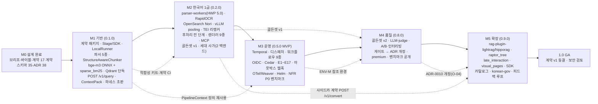
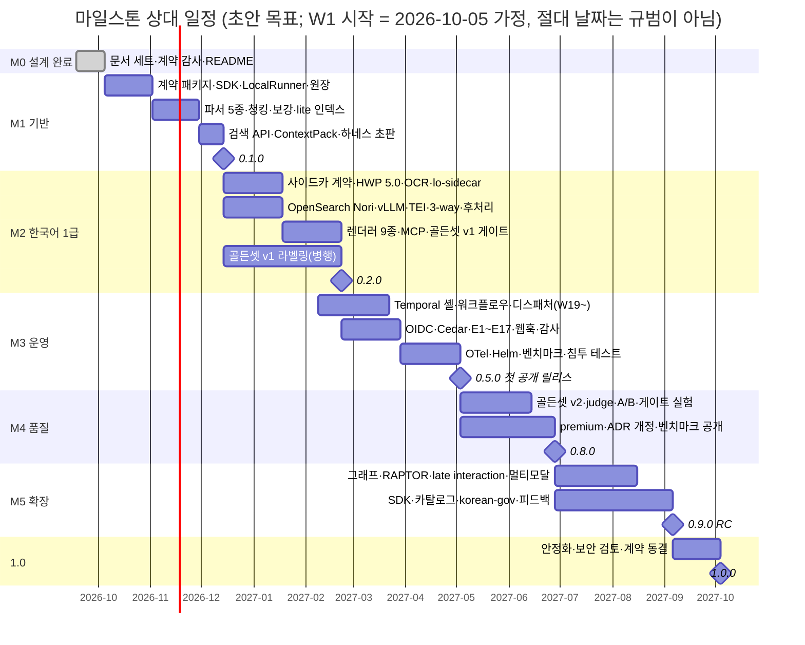

# 마일스톤

## 목적

이 문서는 RAG Platform 구현의 **마일스톤(milestone) 체계를 소유**한다. [사용자 스토리와 인수 기준](../01-requirements/04-user-stories-and-acceptance-criteria.md) §1.1·§15가 "작업 가설"로 둔 Phase 0~3, [비전과 목표](../00-vision/01-vision-and-goals.md) §3·§9가 이 문서에 위임한 단계 구분·KPI 최초 측정 시점, [기능 요구사항](../01-requirements/01-functional-requirements.md) §우선순위가 "첫 공개 릴리스(M1)"로 부른 시점을 **하나의 ID 체계(M0~M5, 1.0)** 로 통일한다(US-I-02). 각 마일스톤에 대해 목표, 포함 스토리(US ID), 종료 기준(Definition of Done, DoD), 산출물, 위험, 상대 일정, 의존성을 기록하고, 설계 바이블이 "게이트 통과 후 ADR 개정"으로 미룬 결정(O-04·O-09 등)이 어느 마일스톤에서 닫히는지 배정한다.

## 범위

- **포함**: 마일스톤 ID·이름·핵심 질문·릴리스 태그, 다른 문서의 단계 표기(Phase, FR "M1", NFR 검증 코드 M1~M6, 바이블 "M1 산출물/M2 골든셋")와의 대응, 마일스톤별 목표·스토리·컴포넌트 범위·산출물·DoD·위험·기간, 의존성 그래프와 상대 일정(Mermaid), KPI 최초 측정·판정 시점 배정, 게이트 기반 ADR 개정 일정, 마일스톤별 상위 리스크 요약.
- **제외**: 스토리 단위 백로그·산정([에픽과 백로그](02-epics-and-backlog.md)), 리스크 레지스터 상세([리스크와 완화](03-risks-and-mitigations.md)), 릴리스 절차·주기([릴리스 프로세스](../10-development/08-release-process.md)), 벤치마크 참조 환경 정의([벤치마크 계획과 베이스라인](../08-evaluation/05-benchmark-plan-and-baselines.md)), 골든셋 구축 절차([골든셋 구축](../08-evaluation/03-golden-dataset-construction.md)).
- **수치 표기**: 기간(주)은 모두 **초안 목표**이며 §1.3의 가정 위에서만 유효하다. 절대 날짜는 W0 기준 가정이다. 품질·성능 수치는 브리프 §7, 바이블 §7.2, 비전 §4 KPI 표의 값을 그대로 인용하며 새 수치를 만들지 않는다.
- **정본 규칙**: 컴포넌트·프로파일·열거·엔드포인트·이벤트 이름은 바이블 §5.7·§6·§7·§14를 그대로 쓴다. 작업 지시의 방향(예: "HWPX 파서는 M2", "평가 하네스는 M4")이 바이블·스토리와 다르면 바이블을 따르고 §결정 사항 요약에 그 이유를 적는다.

## 1. 마일스톤 체계

### 1.1 ID·이름·릴리스 태그

| ID | 이름 | 핵심 질문 | 이 마일스톤이 여는 프로파일(바이블 §7.1) | 릴리스 태그 | 프로덕션 허용 |
|----|------|-----------|--------------------------------------------|-------------|---------------|
| **M0** | 설계 완료(Design Complete) | 코드보다 먼저 계약과 결정이 확정되었는가 | — | 문서 세트(v1.x) | — |
| **M1** | 기반(Foundation) | 한 문서가 계약 위에서 끝까지 흐르는가 | `lite`(개발 모드, `LocalRunner`) | `0.1.0` 개발자 프리뷰 | 아니오(`LocalRunner`는 비내구, 바이블 §11.1) |
| **M2** | 한국어 1급(Korean First-Class) | 한국 공공·기업 문서를 표준 검색 경로로 최고 품질로 찾는가 | `standard`(검색 경로·파서·인덱스), `lite` 보강 | `0.2.0` 개발자 프리뷰 | 아니오 |
| **M3** | 운영(Operations) | 실제 조직이 멀티테넌트로 운영할 수 있는가 | `standard`(전체), `lite`(`temporal-lite`) | `0.5.0` **첫 공개 릴리스(MVP)** | 예 |
| **M4** | 품질(Quality) | 모든 기본값이 골든셋으로 정당화되고 공개적으로 증명되는가 | `premium` | `0.8.0` | 예 |
| **M5** | 확장(Extension) | 14개 확장 지점 모두에 선택지가 있는가 | `korean-gov`, 플러그인 카탈로그 | `0.9.0`(RC) | 예 |
| **1.0** | GA | 계약 v1을 동결하고 위에 쌓을 수 있는가 | 전부 | `1.0.0` | 예 |

- 릴리스 태그는 SemVer이며 코드 배포 패키지 `rag-platform`의 버전이다. 계약 `schema_version`은 M1부터 `1.0.0`으로 시작하고 코드 버전과 독립이다(바이블 §5, [스키마 버저닝과 호환성](../03-contracts/14-schema-versioning-and-compatibility.md)).
- "첫 공개 릴리스"는 FR 문서가 "M1"로, 사용자 스토리 문서가 "MVP"로 부른 시점이며 **이 문서의 M3(0.5.0)** 이다. 비전 §3의 Y1·Y2·Y3는 M3 완료 주를 기준으로 센다.
- 소스 저장소는 M1부터 공개(Apache-2.0)하되, 0.1.0·0.2.0은 프로덕션 비허용 프리뷰로 표기한다.

### 1.2 다른 문서의 단계 표기와의 대응

| 문서 | 표기 | 의미 | 본 문서 대응 |
|------|------|------|--------------|
| [사용자 스토리](../01-requirements/04-user-stories-and-acceptance-criteria.md) §15 | Phase 0 / 1 / 2 / 3 | 백로그 정렬용 작업 가설 | Phase 0 → **M1**, Phase 1 → **M2 + M3**, Phase 2 → **M4 + M5**, Phase 3 → **M5**. 스토리별 배정은 §2.4(일부 재배정 있음) |
| [기능 요구사항](../01-requirements/01-functional-requirements.md) §우선순위 | "첫 공개 릴리스(M1)" | Must 요구의 필수 포함 시점 | **M3(0.5.0)**. FR의 "M1"은 마일스톤 ID가 아닌 릴리스 명칭이므로 개명 제안(미해결 이슈 2) |
| [비기능 요구사항](../01-requirements/02-non-functional-requirements.md) §2 | M1~M6 | **검증 방법 코드**(M1 부하 벤치마크, M2 평가 하네스, M3 CI, M4 장애 주입, M5 보안 검토, M6 운영 SLI) | 마일스톤이 아니다. 충돌 방지를 위해 개명 제안(미해결 이슈 3). 본 문서는 NFR 검증 방법을 인용할 때 `NFR 검증 M1(부하)`처럼 괄호를 붙인다 |
| 바이블 §15 리스크 1 | "하네스 M1 산출물" | 평가 하네스를 첫 마일스톤 산출물로 앞당김 | **M1**(일치). 하네스 초판은 M1 DoD |
| 바이블 §3.2 O-04·O-09, §7.1 임베딩 행, 미해결 이슈 3·4 | "M2 골든셋", "M2 그리드", "KURE-v2(M2)" | 한국어 골든셋 위의 게이트 실험 | 골든셋 v1은 **M2 산출물**, 그 위에서 돌리는 게이트 실험과 ADR 개정은 **M4**(§7.3, §10.2) |
| [선정 매트릭스](../07-tech-landscape/00-summary-and-selection-matrix.md) §운영·평가 공통 요구 | "M2 평가 게이트 목록" | ADR 트리거 게이트 15종 | 실행 주체는 **M4 §7.3**, 게이트별 배정은 **§10.2 (a)**(M3 1종·M4 11종·M5 3종) |
| [고급 리트리벌](../04-pipelines/18-advanced-retrieval-graph-raptor-agentic.md) §10 | M1 계약·슬롯 / M2 실험 슬롯 / M3 승격 판정 / M4 에이전틱 | 그 문서 내부의 진입 순서 | "M1 계약·슬롯"은 **M1**(열거 CI 대조·왕복 테스트, `session_id`·`exclude_ids`·`budget`·`stop_signal` 계약 필드와 `exclude_ids` 제외 필터, 규칙 라우터 `complexity`)과 **M2**(`sufficiency`·`stop_signal` 규칙 판정, §5.3)로 나뉜다. "M2 실험 슬롯" → **M4**, "M3 승격 판정" → **M4~M5**, "M4 에이전틱" → **M5**(`Strategy` `iterative` 의미 확정·`complexity_classifier`·MCP v1.1). 해당 문서는 일정을 이 문서에 위임한다고 명시함 |
| [비전과 목표](../00-vision/01-vision-and-goals.md) §3·§4 | Y1 / Y2 / Y3, "베이스라인 측정 시점" | 첫 공개 릴리스 기준 연차, 하네스 초판 동작 시점 | Y1 = M3 + 52주. 베이스라인 측정 시점 = KPI별 §10.1 표 |

### 1.3 일정 표기와 가정

- 상대 주차 `W<n>`: **W0 = M0 완료 주**, W1이 첫 구현 주다. 절대 날짜는 `W0 = 2026-09-28(월) 주`, 따라서 `W1 시작 = 2026-10-05(월)`로 **가정**하며 규범이 아니다. `W<n>`의 시작일은 `2026-10-05 + 7 × (n − 1)`일이다(예: W11 = 2026-12-14, W19 = 2027-02-08, W21 = 2027-02-22). 각 마일스톤의 기간은 주 단위 초안 목표(사람 팀 기준, §2.1 "사람 팀 기준(참고)" 열)이며, **AI 주도 개발 기준 총 일정은 3~5개월**로 병기한다(§2.1 "작성"·"실제 경과" 열).
- 마일스톤은 순차이되, 다음 마일스톤의 기반 작업은 이전 마일스톤의 **마지막 2주**에 병행 착수할 수 있다(§2.3 간트의 겹침). 이 문서에서 유일한 병행 착수는 M3의 Temporal 셸(**W19~**, §5.7·§6.7·간트 `m3a`)이며, 병행 2주는 M2 10주 산정에 포함되지 않는 M3 인력이다.
- **AI 주도 개발 가정**: 개발은 LLM 에이전트가 작성·테스트하고 사람은 검토·판단(골든셋 라벨링, 모델·보안 승인, 공개 결정)만 한다. 기간은 **'작성(에이전트)'**과 **'검증·데이터·인프라(실제 경과 시간)'**로 나눠 적으며 후자가 지배한다. 근거: [6단계 실행 계획](../12-appendix/05-phase6-implementation-kit-plan.md) §8(3층 검증 전략 — 1층은 에이전트가 즉시 검증하나 2·3층은 Docker·GPU 머신으로 인계), [진행 보고서](../12-appendix/00-progress-report.md) §8(3단계 산출 10만 행이 실제 경과로는 5일 걸렸으나 에이전트 연산 시간 합계는 하루 남짓).

| 가정 | 값(초안) | 근거·비고 |
|------|----------|-----------|
| 코어 팀 | 4~6인(백엔드 3~4, 검색 품질 1, 인프라 1) | 산정 기준. 실측 속도 반영은 [에픽과 백로그](02-epics-and-backlog.md)(US-I-08) |
| GPU | M2부터 개발용 L4급 1장, M3부터 참조 환경 ENV-M(NFR §2 표) | NFR-PERF-01 측정에는 ENV-M이 필요하다 |
| 골든셋 라벨링 | M2 기간 중 병행, 라벨링 인력 별도(가정) | 바이블 §15 리스크 1. 규모·절차는 [골든셋 구축](../08-evaluation/03-golden-dataset-construction.md) |
| 외부 의존 확인 | kiwipiepy 0.24.0 PyPI 공개, Qdrant 벡터 없는 포인트, Anthropic `count_tokens` 한도 등은 "확인 필요(as of 2026-09)" | 확인 결과에 따라 M2·M4 범위가 조정된다(바이블 미해결 이슈 1·7·15) |
| 문서 세트 완료 | M0은 2026-09-22 현재 진행 중(진행 보고서 §3) | W0 이전 완료 가정 |

### 1.4 공통 종료 기준(모든 마일스톤)

아래 C1~C6은 §3~§9의 마일스톤별 DoD에 더해 항상 적용된다.

| ID | 기준 | 검증 |
|----|------|------|
| C1 | CI 게이트 전부 녹색: [계약 개요](../03-contracts/00-contract-overview.md) §10.3 8종(스키마 문법, 래퍼, 열거 대조, 골든 예시, Pydantic 동치, 불변식, 해시 벡터, 적합성 키트) + 바이블 §11.6 CI(`uv lock --check`, 라이선스 게이트, 소형 골든셋 게이트; `Replayer` 회귀는 M3부터) | CI |
| C2 | 포함 스토리의 인수 기준 전부 통과. 검증은 FR 문서의 T-코드(T-CONTRACT·T-INT·T-E2E·T-GOLD·T-FIXTURE·T-LOAD·T-SEC)로 자동화 | 테스트 리포트 |
| C3 | 마일스톤이 바꾼 값은 바이블 §1.2 절차로 반영(ADR → 바이블 표). 프로파일 품질 값 변경은 `EvalReport.gate_result.passed` 첨부(바이블 §7.4) | 문서 리뷰 |
| C4 | 라이선스 게이트 0 위반(등급표 A/B/C/D/X, `models.lock`, `territory`), SBOM 발행 | CI |
| C5 | 릴리스 태그·릴리스 노트·업그레이드 노트([릴리스 프로세스](../10-development/08-release-process.md), [업그레이드와 마이그레이션](../09-operations/08-upgrade-and-migration.md)) | 릴리스 |
| C6 | 리스크 레지스터 갱신([리스크와 완화](03-risks-and-mitigations.md))과 다음 마일스톤 진입 회고 | 회고 기록 |

## 2. 전체 그림

### 2.1 요약 표

"작성(에이전트 시간)"은 LLM 에이전트가 코드·테스트를 생성하는 데 드는 시간이고, "실제 경과(검증 포함)"는 사람 체크포인트·데이터 준비(골든셋 라벨링)·인프라 확보(Docker·GPU 머신 인계)·리뷰 대기를 포함한 실제 경과 시간이다(§1.3 AI 주도 개발 가정). 후자가 일정을 지배한다. "사람 팀 기준(참고)"은 코어 팀 4~6인 상근을 가정한 종전 산정이며 참고값으로만 남긴다(미해결 이슈 9).

| ID | 이름 | 사람 팀 기준(참고, 주) | 작성(에이전트 시간) | 실제 경과(검증 포함) | 구간(W) | 스토리 수 | 주 산출물 | 릴리스 |
|----|------|---------------:|----------------|----------------|---------|----------:|-----------|--------|
| M0 | 설계 완료 | (2.5, 진행 중) | — | — | W-2~W0 | — | 문서 세트·계약 스키마 35·ADR 38 | — |
| M1 | 기반 | 10 | 2~3일 | 1~2주 | W1~W10 | 30 | 계약 패키지, SDK, `LocalRunner`, `lite` 종단 간(end-to-end, e2e) | 0.1.0 |
| M2 | 한국어 1급 | 10 | 2~3일 | 2~3주 | W11~W20 | 24 | HWP 5.0 사이드카, Nori OpenSearch, 3-way 하이브리드+리랭커, 렌더러 9종, MCP, 골든셋 v1 | 0.2.0 |
| M3 | 운영 | 10 | 3~4일 | 3~4주 | W21~W30 | 22 | Temporal, 멀티테넌시·ACL(E1~E17), 관측성, Helm, 웹훅, NFR P0 벤치마크 | 0.5.0(MVP) |
| M4 | 품질 | 8 | 1~2일 | 3~4주 | W31~W38 | 8 | 하네스 완성, 골든셋 v2·공개, 게이트 ADR 개정, `premium`, 벤치마크 공개 | 0.8.0 |
| M5 | 확장 | 10 | 3~5일 | 4~8주+(외부 의존) | W39~W48 | 7 | GraphRAG/RAPTOR 플러그인, late interaction, 멀티모달, SDK, 카탈로그, `korean-gov` | 0.9.0 |
| 1.0 | GA | 4 | — | — | W49~W52 | — | 계약 v1 동결, 보안 검토, 업그레이드 가이드 | 1.0.0 |

스토리 수 합계 91 = 사용자 스토리 문서 §15.1 전체와 일치한다. M1~M3 합계 76은 그 문서의 MVP 포함 74에 US-PLG-06·US-ING-09를 편입한 결과다(§2.4, 결정 사항 요약).

"계약 스키마 35"는 바이블 1.3.0 §5.1 인벤토리의 계약 스키마 파일 수다(AM-01: `SchemaDiffReport`가 CI 도구 산출물 형식으로 인벤토리에 편입되어 34 → 35). 이 문서의 "35"는 모두 계약 스키마 분모이며 M1-D02 CI 게이트의 분모도 같다(미해결 이슈 16 해소).

### 2.2 의존성 그래프

### 2.3 상대 일정(간트)

### 2.4 스토리 배정 표

사용자 스토리 문서 §15.2와 같은 표기(`US-` 생략, 괄호는 부분 우선순위 스토리의 다른 부분)를 쓴다. 굵은 항목은 그 문서의 Phase와 다르게 배정한 스토리다.

| 마일스톤 | 수 | 스토리(에픽 순) |
|----------|---:|-----------------|
| M1 | 30 | ING-01, 02, 04(폴링·SSE), 05 · PRS-01, 02, 04, 06(DOCX), 07, 08, 09 · CHK-01, 02, 03, 04, 05 · EMB-01, 06 · RET-01 · PCK-01, 04 · MGT-02, 05, 08(`LocalRunner`) · EVL-01, 02 · OBS-04 · PLG-01, **PLG-02**, **PLG-06** |
| M2 | 24 | ING-06 · PRS-03, 05, (06 DOC) · CHK-07 · EMB-02, 03, 04, 05 · RET-02, 03, 04, 05, 07 · PCK-02, 03, 05, 06, 07 · MGT-06(문서·청크 조회) · MCP-01, 02, 03 · EVL-03, 04 |
| M3 | 22 | ING-03, (04 웹훅), 07, 08, **09**, 10 · MGT-01, 03, 04, 07(헬스·리밋), (08 Temporal 동등성) · OBS-01, 02, 03, 05 · SEC-01, 02, 03, 04, 05, 06, 07(삭제), 08 · PLG-05 |
| M4 | 8 | CHK-06, 08 · RET-06, 08 · PCK-08 · (MGT-07 answer) · EVL-05, 06 · OBS-06 |
| M5 | 7 | EMB-07 · RET-09 · MCP-04, 05 · (MGT-06 SDK) · EVL-07 · (SEC-07 PII) · PLG-03, 04 |

재배정 근거: PLG-02(적합성 검사)와 PLG-06(라이선스 게이트)은 바이블 §7.4 로딩 규칙 (1)·§11.6 CI에 속하는 M1 기반이다(ADR-0001은 P0). ING-09(정책 오버라이드·할당량)는 테넌트 정책·429 처리로 M3 운영 범위다. ING-04는 AC-2(웹훅 전달)가 US-ING-10 웹훅 구독을 전제하므로 폴링·SSE(AC-1·AC-3)는 M1, 웹훅 부분은 M3에 괄호 표기했다(집계는 M1). 그 밖의 Phase 1 스토리는 "검색 품질·한국어 파서"(M2)와 "운영·보안"(M3)으로 나눴다.

## 3. M0 설계 완료

### 3.1 목표

코드보다 먼저 계약·명명·결정을 확정하고(브리프 원칙 1), 이후 모든 마일스톤이 **그대로 복사해 쓰는** 타입명·필드·열거값·기본 파라미터를 게시한다. 이 문서 세트가 M0의 산출물이다.

### 3.2 산출물

| 영역 | 산출물 | 2026-09-22 상태([진행 보고서](../12-appendix/00-progress-report.md) §3) |
|------|--------|--------------------------------------------------------------------------|
| 앵커 | 브리프 v1.2.2, 바이블 v1.3.0 | active |
| 연구 | 기술 지형 14 + 선정 매트릭스 | active |
| 요구 | 비전·원칙·용어집·범위, FR 217·NFR 184·페르소나·스토리 91 | active |
| 아키텍처 | 01~09 | active(개정 요청 17건 4단계 처리 대기) |
| 계약 | 03-contracts 00~16, `schemas/` 계약 스키마 35종(1.3.0 AM-01로 `schema-diff-report` 인벤토리 편입) | active, 계약 감사 전 |
| ADR | 0001~0038(MADR), README 인덱스 | accepted, 인덱스 예정 |
| 파이프라인·API·평가·운영·개발·로드맵 | 04(19)·05(7 + `openapi.yaml`)·08(6)·09(8)·10(8)·11(3) | 04 review, 나머지 작성 중 |
| 부록 | 제안서 A/B/C, 진행 보고서, 완전성 비평 | 진행 중 |

### 3.3 종료 기준(DoD)

| ID | 기준 | 검증 |
|----|------|------|
| M0-D01 | 문서 맵(브리프 §8)의 모든 문서가 `status: active`이고 상호 링크가 문서 맵 경로만 가리킨다(미작성 링크 0) | 링크 검사 |
| M0-D02 | `tools/validate-contracts.mjs` 오류 0, 열거 대조(바이블 §5.7 ↔ `common-types.schema.json`) 불일치 0 | 기계 검증 |
| M0-D03 | 계약 타입 13개(D-05)에 스키마·JSON 예시·불변식 문서가 있다(KPI-15의 문서 부분; Pydantic 모델은 M1) | 계약 감사 |
| M0-D04 | 하위 문서가 남긴 바이블 개정 요청이 §1.2 절차로 처리되었다(patch/minor 일괄, 버전 1.2.x/1.3.0) | 바이블 변경 이력 |
| M0-D05 | 900행 초과 문서의 절 이관, ID 접두 정리, 루트 `README.md`·`CLAUDE.md`·`docs/README.md` 확정 | 4·5단계 완료 |

### 3.4 위험과 기간

- 위험: 설계 문서 간 불일치가 코드로 전파(4단계 감사가 완화), 바이블 미해결 이슈 17건 중 M1 착수를 막는 항목(`ChunkTextStore` 구현, RLS·pgbouncer)은 M1 첫 2주 스파이크로 흡수.
- 기간: 2026-09-18 착수, W0 완료 가정.

## 4. M1 기반(Foundation)

### 4.1 목표

**한 문서가 계약 위에서 끝까지 흐른다.** `lite` 프로파일(바이블 §7.1 `lite` 열)과 비내구 `LocalRunner`(ADR-0003)로 `IngestRequest → … → IndexCommit`과 `QueryRequest → … → ContextPack`이 동작하고, 바이블 §11.6 개발 모드 1~4단계(`uv tool install rag-platform` → `rag up --profile lite` → `rag ingest` → `rag query`)가 목표 시간 안에 끝난다. 모든 계약은 Pydantic v2 모델과 CI 게이트로 잠긴다. 바이블 1.3.0의 M1 필수 개정 AM-26(`chunk`·`enrich` LLM 서브스텝까지 `requires_lineage` 범위 확대 — 기본 청커 `structure_aware`가 `ParsedDocument` 구조 필드를 요구)과 AM-27(`StageContext` 선택 멤버 `plan`·`artifacts`)은 이미 반영되어 있다(트리아지 §5.1).

### 4.2 포함 스토리

US-ING-01, US-ING-02, US-ING-04(AC-1·AC-3 폴링·SSE 부분; AC-2 웹훅은 US-ING-10과 함께 M3), US-ING-05, US-PRS-01, US-PRS-02, US-PRS-04, US-PRS-06(DOCX), US-PRS-07, US-PRS-08, US-PRS-09, US-CHK-01, US-CHK-02, US-CHK-03, US-CHK-04, US-CHK-05, US-EMB-01, US-EMB-06, US-RET-01, US-PCK-01, US-PCK-04, US-MGT-02, US-MGT-05, US-MGT-08(`LocalRunner` 부분), US-EVL-01, US-EVL-02, US-OBS-04, US-PLG-01, US-PLG-02, US-PLG-06.

### 4.3 범위(컴포넌트)

| 영역 | M1 범위(바이블 정본) | 제외(후속) |
|------|----------------------|-----------|
| 계약 패키지 | `rag_platform.contracts`: 계약 스키마 35종 전부의 Pydantic v2 모델, `enums.py` 단일 소스, `versioning.py`; `GET /v1/schemas/{name}` 게시 | — |
| SDK·커널 | `Stage[In, Out]` 5멤버, `StageContext`, `PipelineContext`, `ArtifactRef` 단일 페이로드, `stage_key = H("stage", …, scope_key, …)` 캐시(ADR-0037), `hash_of(H)`·`canonical_json`, `TokenCounter`, 적합성 키트 6종(`contract_roundtrip`·`idempotency`·`security_invariants`·`renderer_citation_roundtrip`·`litm_order`·`fuser_equivalence`) | `SidecarStage`(M2) |
| 실행기 | `LocalRunner`(asyncio, 비내구), 파이프라인 정의 `pipelines.ingest`·`pipelines.query`(`temporalio`·`fastapi` 임포트 금지 린트) | Temporal(M3) |
| 원장·저장소 | PostgreSQL 원장 `jobs`·`artifacts`·`lineage`·`index_commits`·`outbox`·`usage_ledger`(바이블 K6·§13.1; `(tenant_id, day, meter)` 스키마와 비LLM 미터 `bytes_indexed`·`queries` 적재만) + `idempotency_keys`(모두 `tenant_id`, RLS 정책 정의), 오브젝트 스토리지 `file://`(S3 호환 어댑터 포함), Valkey(질의 임베딩·토큰 카운트 캐시, 멱등 키 조회 캐시) | RustFS/SeaweedFS 실측(M3), `usage_ledger` `llm_tokens`·`gpu_seconds` 집계·비용 산출(M4) |
| 수집 | `fetch`(fsspec/httpx, `EgressPolicy` 기본값 적용 — 개발 프로파일만 `file`), `detect`(puremagic + ZIP/OLE 스니퍼), 파서 5종 in_process: HWPX(python-hwpx + OWPML 어댑터), PDF `pdf_fast_cpu`(pypdfium2 + pdftext), DOCX(Docling `MsWordDocumentBackend` + docx2python), HTML(Trafilatura `xml` → Docling HTML), TXT/MD(charset-normalizer + ftfy + markdown-it-py) | HWP 5.0·OCR·DOC·`pdf_standard`(M2) |
| 정규화·청킹·보강 | 공백기 한국어 분석기(python-mecab-ko + kss `punct`, `[kiwi]` extra), `StructureAwareChunker`(512/2048/64) + `flat_text` + 표 행 그룹 256 + `recount`, 결정적 `context_prefix`·형태소 키워드·날짜 메타 | PII(`pii_detector` 역할은 M3·M5), GLiNER2(M2), LLM 보강(M4) |
| 임베딩·인덱스 | bge-m3 dense ONNX int8 in_process + `sparse_bm25`(형태소 토큰화 + BM25 TF 포화, `modifier: idf`, ADR-0012), Qdrant 단독(`dense` + `sparse_bm25`, `is_tenant` payload 인덱스, `payload_filter`), `record_id`·`point_id` 합성(ADR-0004), 단일 백엔드 세대 사가(`IndexCommit` 9단 상태, 플립은 벡터만) | OpenSearch·`sparse_learned`(M2) |
| 검색 | `plan`(`korean_normalize`, 규칙 라우터 `complexity`, 정규식 self-query, 보안/전략/사용자 필터 빌더, `exclude_ids` 제외 필터), 채널 `dense` + `lexical`(`retriever.qdrant_sparse_bm25`), 플랫폼 `fuser` RRF `k=60`(단일 컬렉션은 Qdrant `Fusion.RRF` 위임 가능), `hydrate`, 후처리 `relevance_gate → dedup`, `pack`(`acl_recheck → budget_cut → reorder → citation_align`, `litm_alternating`, `k_max` 10, 12,000 토큰), 렌더러 `xml_documents`·`markdown` | 리랭커(M2), `mmr`·`parent_expand`(M2) |
| API·인증 | `POST /v1/ingest`(`Idempotency-Key`, 202), `GET /v1/jobs`, `GET /v1/jobs/{job_id}`, `GET /v1/jobs/{job_id}/events`(SSE), `POST /v1/query`, `POST /v1/render`, `GET/POST /v1/collections`, `GET /v1/collections/{collection_id}`, `GET /v1/profiles`, `GET /v1/profiles/{profile_id}`, `POST /v1/profiles/validate`, `GET /v1/schemas/{name}`, `GET /healthz`·`/readyz`·`/metrics`; RFC 9457 `ProblemDetails`; API 키 + 정적 역할, `SecurityContext` 서버 주입(E1·E6) | OIDC·Cedar·레이트리밋(M3) |
| 이벤트 | 트랜잭셔널 아웃박스 + Procrastinate 릴레이 → SSE(`job.state.changed`, `ingest.document.*`, `index.commit.published`) | 웹훅 구독(M3) |
| 프로파일·플러그인 | `base`·`lite` YAML, `extends` 해소·`profile_hash`, `rag profile validate` 규칙 (1)~(12), entry point 레지스트리, `PluginMeta` 검증, 라이선스 게이트(`license_grade ≤ max_grade`, B+`static_bundled` 거부) | `standard` 완성(M2) |
| 관측성 | structlog JSON(`trace_id`·`tenant_id_hash`·`job_id`), OTel 스팬 `rag.{stage}` 골격 → Jaeger, Prometheus `/metrics` 기본 | Weaver 상수·Collector·대시보드(M3) |
| 평가 | 하네스 초판: `EvalDataset` 로더(TREC qrels/run + `answer_spans` JSONL), ranx 메트릭(nDCG 선형 이득), `EvalRun`·`EvalReport`, `rag eval` CLI, 소형 픽스처 골든셋(합성 표기) CI 게이트 | ir_measures·RAGAS·인터리빙(M2), LLM-judge(M4) |
| CLI·배포 | `rag up`(compose: PostgreSQL·Qdrant·Valkey), `rag ingest`, `rag query`, `rag profile validate/diff`, `rag plugin list --check-license`, `rag cache invalidate --stage`, `rag eval` | Helm(M3), `rag mcp serve`(M2) |

### 4.4 산출물

- 배포 패키지 `rag-platform` 0.1.0(단일 이미지, 역할은 CLI 플래그), `deploy/compose/` `lite` 구성, `schemas/` 게시, OpenAPI M1 부분집합(예시 스키마 검증 통과).
- 퀵스타트([개발 환경](../10-development/02-development-environment.md), [배포 가이드](../09-operations/01-deployment-guide.md)): 바이블 §11.6 1~4단계.
- 계약 코퍼스: 포맷 5종 픽스처와 골든 `ParsedDocument` 스냅샷([테스트 전략](../10-development/04-testing-strategy.md)).
- 픽스처 골든셋(합성, `label_provenance=synthetic`)과 첫 `EvalReport`.

### 4.5 종료 기준(DoD)

| ID | 기준 | 수치 근거 | 검증 |
|----|------|-----------|------|
| M1-D01 | 개발 모드 1~4단계가 목표 시간 안에 끝난다: 설치 60s, `rag up --profile lite` 90s, HWPX 샘플 수집 30s, 질의 2s | 바이블 §11.6(초안 목표) | T-E2E |
| M1-D02 | 계약 CI 8종(§1.4 C1) 전부 통과; 계약 스키마 35종(바이블 §5.1 인벤토리, 1.3.0 AM-01 `schema-diff-report` 편입) ↔ Pydantic 동치; `H()`·`block_id`·`chunk_id`·`record_id`·`point_id` 테스트 벡터 고정 | 계약 개요 §10.3 | T-CONTRACT |
| M1-D03 | 재현성: 동일 `IngestRequest` + 동일 프로파일 → 동일 `commit_hash`(KPI-09 100%, CI 회귀) | 브리프 §7, 비전 KPI-09 | T-E2E |
| M1-D04 | 포맷 5종 계약 코퍼스 파싱 성공, 모든 블록에 `element_path`·`char_start/char_end`(흐름 포맷은 `page`/`bbox` null), `ContextPack` 항목 출처 완전성 100%(KPI-04) | D-04, 비전 KPI-04 | T-FIXTURE |
| M1-D05 | 검색: `CandidateSet.channel_runs[]`에 `dense`·`lexical` 채널 원점수·순위, `RankedSet` 불변식 `Σ contribution = fused_score`, `cite_id` `d1..dK` 연속·관련도순, `litm_alternating` 테스트 벡터 통과, 설명 가능성 커버리지 100%(KPI-06) | 바이블 §2.1 K3·K4, §9.2 | T-CONTRACT, T-INT |
| M1-D06 | `lite` 3-채널 중 2채널(`dense`, `lexical`) 융합이 dense 단독보다 픽스처 골든셋에서 nDCG@10이 낮지 않다(부호 판정; 절대값 게이트는 M2) | 원칙 7 | T-GOLD |
| M1-D07 | 적합성 키트 6종이 코어 어댑터 전부를 통과; E17 `idempotency` 시나리오(두 테넌트·두 컬렉션 동일 바이트 → 서로 덮어쓰지 않음) 통과 | 바이블 §10.3 E17 | T-CONTRACT |
| M1-D08 | 라이선스 게이트: 코어 이미지 인프로세스 의존은 A 등급만, `models.lock`·SBOM 발행, `rag profile validate`가 B+`static_bundled`·C/D 미옵트인을 거부 | ADR-0001 | CI |
| M1-D09 | 하네스 초판이 픽스처 골든셋으로 `EvalReport`(nDCG@10·Recall@20·MRR·컨텍스트 정밀도, 질의별·전체)를 생성하고 CI 게이트로 동작; KPI-09·04·06·14·15의 베이스라인 기록 | D-12, 바이블 §15 리스크 1 | T-GOLD |
| M1-D10 | `EgressPolicy` 기본값이 `fetch`에 적용된다(`169.254.169.254`·RFC1918·`localhost`·리다이렉트 우회·`file://` 운영 거부 계약 테스트) | 바이블 §10.3 E16 | T-SEC |
| M1-D11 | `LocalRunner` 한계 문서화: 크래시 시 `failed`, 재시도는 클라이언트, 프로덕션 금지 배너(`rag up`이 `--durable` 없는 실행을 개발 모드로 표기) | 바이블 §11.1 | 문서 |

### 4.6 위험

| 위험 | 바이블 §15 | 완화(M1 조치) |
|------|-----------|---------------|
| python-hwpx Alpha·단일 메인테이너, 릴리스 빈번 | 4 | 상한 `<7` 고정 + 계약 코퍼스 pin-and-bump, OWPML lxml 직접 경로 대비 |
| Docling·docling-core 주 2회 릴리스로 어댑터 파손 | 9 | `uv lock --check`, semchunk 3.2.5/tiktoken 0.12 잠금(ADR-0020), Docling 청커는 `[docling-chunker]` extra |
| `lite` BM25 퇴화(TF×IDF·avgdl 왜곡) | 5 | 어댑터가 포화식 강제, bm25s 참조 구현과 점수 일치 테스트 |
| 캐시 키 지문 누락으로 낡은 산출물 재사용 | 8 | SDK가 `fingerprint()` 구성요소 검증, `scope_key` 합성 |
| lite int8 임베딩 공간과 standard fp16 공간이 달라(`embedding_space_id`에 `quantization` 포함) M2 승격 시 재색인 필요 | 8 | 업그레이드 노트에 blue/green 재색인 명시(미해결 이슈 8) |

### 4.7 기간·의존성

W1~W10(10주, 사람 팀 기준). 선행: M0. 후행: M2는 M1의 적합성 키트·계약 CI·`Stage` 프로토콜 위에 어댑터를 추가한다.

장대(long pole): Docker 머신 검증(2·3층 인계 — compose 기동, 통합 테스트, ONNX·모델 실측; [6단계 실행 계획](../12-appendix/05-phase6-implementation-kit-plan.md) §8). 에이전트 작성 시간이 아니라 이 인계·실측 대기가 실제 경과를 지배한다.

## 5. M2 한국어 1급(Korean First-Class)

### 5.1 목표

**한국 공공·기업 문서를 `standard` 검색 경로로 최고 품질로 찾는다.** HWP 5.0 사이드카 체인과 OCR로 브리프 R1의 1급 포맷을 채우고, OpenSearch Nori 렉시컬 레그 + BGE-M3 `sparse_learned`로 3-way 하이브리드를 완성한다. 크로스인코더 리랭커, 후처리 전 단계, 렌더러 9종, MCP 서버가 붙어 LLM이 소비할 수 있는 `ContextPack`이 나온다. 한국어 골든셋 v1이 만들어져 이후 모든 기본값의 게이트 기반이 된다.

### 5.2 포함 스토리

US-ING-06, US-PRS-03, US-PRS-05, US-PRS-06(DOC), US-CHK-07, US-EMB-02, US-EMB-03, US-EMB-04, US-EMB-05, US-RET-02, US-RET-03, US-RET-04, US-RET-05, US-RET-07, US-PCK-02, US-PCK-03, US-PCK-05, US-PCK-06, US-PCK-07, US-MGT-06(문서·청크 조회 API 부분), US-MCP-01, US-MCP-02, US-MCP-03, US-EVL-03, US-EVL-04.

### 5.3 범위(컴포넌트)

| 영역 | M2 범위(바이블 정본) | 제외(후속) |
|------|----------------------|-----------|
| 사이드카 계약·격리 사다리 | `ConvertRequest`/`ConvertResponse`, `POST /v1/convert`·`GET /healthz`, `SidecarStage`, 격리 모드 `helper_process`(unhwp) / `sidecar`(ADR-0033) | 플러그인 선언 격리 일반화(M5) |
| HWP 5.0·HWPX | `parser-workers`(Java 21: hwplib 1.1.11 + hwp2hwpx + hwpxlib 1.0.9 + Tika `HwpV5Parser`) → HWPX → 동일 OWPML 어댑터, 폴백 unhwp → hwp-hwpx-parser, `parser_chain[]` 기록, `derived` 산출물 캐시 `H("derived", …)`, 암호화 HWPX(`credentials_ref`), 배포용 `parse.distribution_document`(테넌트 옵트인 시 `quality=degraded`) | 상용 SDK 플러그인 |
| DOC/RTF/ODT | `lo-sidecar`(LibreOffice + H2Orestart, GPLv3) — 별도 저장소 `rag-platform-gpl-sidecars`, compose/Helm `optIn.*`만 | unoserver 풀(korean-gov, M5) |
| PDF | `pdf_standard`(Docling heron + TableFormer ACCURATE, `OMP_NUM_THREADS=4`), 스캔 판별 → RapidOCR PP-OCRv5 korean mobile(ONNX, CPU), 폴백 Tesseract 5 `kor+eng`, `page_status[]`·`Block.source=ocr`·`Block.confidence`, 페이지 하트비트·`Resumable` | `ocr-gpu`(M4), `kor_vert`·`pdf_airgapped`(M5) |
| 정규화·보강 | 컬렉션 사용자 사전 파이프라인(`UserDictEntry`, `dictionary_hash`, `GET/PUT /v1/collections/{collection_id}/dictionary`), GLiNER2 엔티티, `lang` 태깅, `enricher.korean_keywords` | LLM 보강(M4) |
| 임베딩·서빙 | vLLM pooling BGE-M3 dense + sparse(`sparse_learned`, `vocab_id=xlm-roberta-250k`), TEI dense 전용 옵션, 서빙 교체 동등성 게이트 코사인 ≥ 0.9999(ADR-0009), 청크 임베딩 캐시 `H("embed", …)`, `embedding_space_id`·`embedding_profile_hash` | `ko-quality` 후보 A/B(M4) |
| 인덱스 | OpenSearch 3.8 analysis-nori(`decompound_mode` 색인 `mixed`/질의 `discard`), `routing=tenant_id`, filtered alias, DLS 매핑, `lexical_profile_hash`; Qdrant + OpenSearch **2 백엔드 세대 사가**(플립 `[lexical, vector]`, `flipping_lexical`/`flipping_vector`, 보상 2종, ADR-0026), `IndexBackendCapabilities` 선언 | Milvus 등 대체 백엔드(M5) |
| 검색 | 채널 `sparse`(`sparse_learned`) 추가 → 3-way, 리랭커 bge-reranker-v2-m3 @ TEI GPU(100→20, `timeout_ms` 300, 폴백 `rerank.applied=false`), TEI/Cohere 응답 스키마 2종, 후처리 `relevance_gate → dedup → mmr → parent_expand → dedup → sentence_window(옵션)`, `ChunkTextStore`(`artifact_store`; 구현 확정은 바이블 이슈 1), `explain`·`ExplainCode`, 저신뢰 `confidence_tier`·`sufficiency.status`, 0건 사유(`filters.relaxable_keys` 완화) | `compress`(M4), 다중 컬렉션(M4) |
| ContextPack·렌더러 | `k_max` 20, 24,000 토큰, HTML 표 1차, 렌더러 9종(`anthropic_search_result` 1차, `anthropic_document`, `openai_messages`, `gemini_messages`, `xml_documents`, `markdown`, `mcp_tool_result`, `plain_records`, `dify_external_knowledge`), 대상 LLM 토크나이저 이중 카운트(`CountMethod`, `calibration_ratio`), 데이터마킹 `render_hints.data_marking`, 프롬프트 캐싱 규약(바이블 §9.4) | `document_order` 규제 변형(M5) |
| MCP | `mcp>=2,<3` Streamable HTTP, FastAPI `/mcp` 마운트, RFC 9728 PRM(`/.well-known/oauth-protected-resource`), 도구 `search`·`get_document`·`list_collections`, `cursor`/`next_cursor`(Valkey 핸들 10분, 테넌트 바인딩), `structuredContent` 슬림 팩 20k 토큰 상한, `McpToolAdapter` conformance CI(ADR-0025) | `search_batch`·`expand`(M5) |
| API | `GET /v1/documents/{document_id}`, `…/content?view=parsed\|normalized\|chunks`, `…/commits`, `GET/PUT …/dictionary`, `/mcp`, PRM | 관리 API 나머지(M3) |
| 평가·골든셋 | 한국어 골든셋 v1 4종(HWPX/HWP 공공문서, PDF 5종 × 50p+, HTML 200+, 문장 분리·형태소 표본) + Allganize KO·MIRACL-ko, `doc_id + answer_spans`, 골든 구조 코퍼스(KPI-08), ir_measures·RAGAS 0.4 collections, A/B 비교 + 스테이지 진단(리트리버 Recall@100·융합 Recall@50·리랭크 nDCG@10), CI 회귀 게이트(EVL-04, Holm 보정) | 인터리빙·쌍대·judge(M4) |
| 프로파일 | `standard` YAML 완성(검색 경로·파서·인덱스), `rag profile diff lite standard`, `lite` 리랭커 옵션(gte-multilingual-reranker-base @ TEI CPU 30→10) | `premium`(M4), `korean-gov`(M5) |

### 5.4 산출물

- `rag-platform` 0.2.0, 사이드카 이미지 `parser-workers`(본 저장소 `sidecars/`), `rag-platform-gpl-sidecars` 저장소 초판(`lo-sidecar`, 별도 LICENSE/NOTICE).
- 한국어 골든셋 v1(라이선스·출처·버전 메타 포함, `judgment_level`·`label_provenance` 기록)과 베이스라인 `EvalReport` 3종(dense-only / hybrid / hybrid+rerank).
- 렌더러 출력 골든 스냅샷 9종, MCP conformance 리포트, `standard` 프로파일 게이트 리포트.
- 개발 모드 5단계(`rag mcp serve`) 충족으로 퀵스타트 완성.

### 5.5 종료 기준(DoD)

| ID | 기준 | 수치 근거 | 검증 |
|----|------|-----------|------|
| M2-D01 | 구조 보존율: HWPX ≥ 0.95, 텍스트 PDF ≥ 0.90(골든 구조 코퍼스); HWP 5.0 계약 코퍼스 파싱 성공률 ≥ 95%(Y2 값의 진입 목표, 초안), 모든 시도가 `parser_chain[]`에 기록 | 비전 KPI-07·KPI-08 Y1·Y2 | T-FIXTURE |
| M2-D02 | `standard` 프로파일이 골든셋 v1에서 `eval.gates`를 만족: nDCG@10 ≥ 0.80, Recall@20 ≥ 0.92; dense-only 베이스라인 대비 +15%p | 브리프 §7, 바이블 §7.2 | T-GOLD |
| M2-D03 | 3-way 하이브리드: `ScoreBreakdown`에 `dense`·`sparse`·`lexical` 원점수·순위·`contribution`, 리랭크 점수 분해 커버리지 100%; 리랭커 중단 시 fused 순서 폴백 + `degraded{rerank, timeout\|unavailable}` + `rag_rerank_fallback_total` 증가 | 바이블 §4.3 | T-INT |
| M2-D04 | 2 백엔드 세대 사가: 한 백엔드 실패 시 커밋 비활성·이전 세대만 검색; 플립 전(새 세대 삭제)/플립 후(`previous_commit_id` 복원) 보상 2종 시나리오 통과; 커밋 전 v1만·플립 완료 후 v2만 응답(US-ING-06 AC-1; 플립 중 수 초 혼합은 바이블 §11.4 (2)대로 허용하고 `diagnostics.index_generations_seen`으로 관측, p99 실측은 §10.2 (b) M3); E17 재색인(`from_stage=embed`) 시 이전 세대가 플립 전까지 검색. **검증 경계**: `LocalRunner` 인프로세스 실패(백엔드 오류·타임아웃·`update_by_query` 충돌)에 대한 보상만 검증하며, 워커 크래시 후 `rolling_back`·`flipping_*` 상태 재개와 `index.consistency.mismatch` 복구는 M3-D01(러너 동등성)·M3-D05(장애 주입)에서 검증 | ADR-0026, 바이블 §11.4 | T-INT |
| M2-D05 | OpenSearch Nori: 조사 결합 질의가 형태소 분리 토큰으로 색인·매칭, 사용자 사전 변경 → `dictionary_hash` 변경 → 렉시컬 재색인 제안 응답 | D-15, ADR-0021 | T-INT |
| M2-D06 | 임베딩 캐시: 동일 문서 재수집 시 캐시 히트율 100%, 서빙 호출 0; 서빙 교체 코사인 ≥ 0.9999 게이트 테스트 | US-EMB-03 AC-2, ADR-0009 | T-INT |
| M2-D07 | 렌더러 9종이 `renderer_citation_roundtrip` 키트 통과, 동일 팩에 결정적 출력; `anthropic_search_result` + `citations` 블록이 Anthropic Messages API 검증 통과(블록 수 상한은 확인 필요 as of 2026-09) | D-20, ADR-0024 | T-CONTRACT |
| M2-D08 | MCP: `tools/list` 3종, `search`가 REST `POST /v1/query`와 동일 순위·`cite_id`, 커서 페이지네이션, PRM 게시, 인증 없는 호출 거절(E14) | D-13, ADR-0025 | conformance CI |
| M2-D09 | OCR: 혼합 PDF에서 페이지 단위 스캔 판별, 스캔 페이지만 OCR, `page_status`·`Block.confidence` 기록, GPU 없이 기능 완료(성능 목표는 M4 `ocr-gpu`) | ADR-0008 | T-FIXTURE |
| M2-D10 | 사이드카: `parser-workers` `POST /v1/convert` 계약 테스트, `parse.sidecar_unavailable` 재시도 후 폴백 체인 동작, `lo-sidecar`는 코어 이미지 미포함·옵트인 값으로만 기동 | ADR-0007, ADR-0033 | T-INT, CI |
| M2-D11 | 예비 지연 측정(단일 노드 GPU L4급, 골든셋 v1 코퍼스): 하이브리드+리랭크 Top-10 p95 < 800ms; 공식 측정은 M3 ENV-M | 브리프 §7(초안 목표) | T-LOAD(예비) |
| M2-D12 | CI 회귀 게이트: 기본 프로파일 변경 PR에서 골든셋 v1 서브셋 평가 실행, nDCG@10 하락 임계 초과 시 실패, 면제 기록 | US-EVL-04 | CI |

게이트 미달 절차: M2-D02 미달 시 M2를 종료하지 않고 최대 2주(초안) 연장해 `ko-quality` 후보(KURE-v1 + PIXIE-Splade-v1.5) A/B와 사용자 사전 보강을 시도한다. 그래도 미달이면 미달 폭과 원인 진단을 M4 진입 조건으로 기록하고 M3로 진행한다(운영 기능은 품질과 독립).

### 5.6 위험

| 위험 | 바이블 §15 | 완화(M2 조치) |
|------|-----------|---------------|
| 골든셋 v1 라벨링 지연·품질(사람 라벨 인력) | 1 | 라벨링을 W11부터 병행(간트 `m2d`), UMBRELA 라벨러 보조는 M4, `answer_spans`로 재청킹 불변 |
| hwp2hwpx × hwpxlib 조합 미검증, unhwp 크래시·arm64 미지원 | 4 | 3중 폴백이 프로파일 값, `helper_process` 격리, 변환 일치율 코퍼스 |
| 리랭커 top-100 × 512 GPU 병목 | 6 | 지연 예산 축소 규칙(바이블 §8.3), 300ms 폴백, `top_n_in` 게이트 |
| Kiwi 승격 지연(kiwipiepy 0.24.0 미공개) | 매트릭스 6 | 공백기 mecab-ko + kss 유지, `analyzer_id` 기록으로 전환 시 재색인 강제 |
| MCP 스펙 파괴적 개정 | 9 | `McpToolAdapter` 격리 + conformance CI, `mcp>=2,<3` 상한 |
| 인용 좌표 불일치(`offset_map`·표 직렬화) | 7 | K1 불변식 스키마 검증, `rag_pack_citation_unresolved_total` |

### 5.7 기간·의존성

W11~W20(10주, 사람 팀 기준). 선행: M1(적합성 키트·계약 CI·`Stage`). 병행 착수 가능: M3의 Temporal 셸(W19~, §1.3 "마지막 2주" 규칙; 간트 `m3a`). 후행: M4는 골든셋 v1을, M5는 사이드카 계약을 재사용한다.

장대(long pole): 골든셋 v1 라벨링·GPU 확보(질의 50~100개 사람 검수, 개발용 GPU 조달; §1.3 가정, 바이블 §15 리스크 1). 라벨링·조달 대기가 에이전트 작성 시간보다 길다.

## 6. M3 운영(Operations)

### 6.1 목표

**실제 조직이 멀티테넌트로 운영할 수 있다.** 같은 파이프라인 정의를 Temporal 셸로 내구 실행하고(ADR-0003), 강제 지점 E1~E17(ADR-0027)·`EgressPolicy`·웹훅 서명(ADR-0038)·관측성(ADR-0022)·Helm 배포가 갖춰진다. 사용자 스토리 §15.3의 MVP 판정 세 조건(포함 스토리 인수, NFR P0, FR Must 136)을 충족해 **첫 공개 릴리스 0.5.0**을 낸다.

### 6.2 포함 스토리

US-ING-03, US-ING-04(AC-2 웹훅 부분), US-ING-07, US-ING-08, US-ING-09, US-ING-10, US-MGT-01, US-MGT-03, US-MGT-04, US-MGT-07(헬스·레이트리밋), US-MGT-08(Temporal 동등성·Kubernetes 부분), US-OBS-01, US-OBS-02, US-OBS-03, US-OBS-05, US-SEC-01, US-SEC-02, US-SEC-03, US-SEC-04, US-SEC-05, US-SEC-06, US-SEC-07(삭제), US-SEC-08, US-PLG-05.

### 6.3 범위(컴포넌트)

| 영역 | M3 범위(바이블 정본) | 제외(후속) |
|------|----------------------|-----------|
| 오케스트레이션 | Temporal 1.32 + `temporalio` 1.33(`pydantic_data_converter`, `TracingInterceptor`), `TemporalContext`, 제네릭 액티비티 래퍼 1개, `StagePolicy` 표(바이블 §4.4) 적용, 큐 `ingest-io`/`ingest-cpu`/`ingest-gpu-embed`/`maintenance`(+`lite`는 `ingest`+`maintenance`), `temporal-lite`(단일 바이너리 + PostgreSQL), KEDA `temporal` 스케일러 `minReplicaCount: 1`, `Replayer` CI, `WorkflowEnvironment.start_time_skipping()` | `ingest-gpu-ocr`·`ingest-llm`(M4) |
| 워크플로우 | `ingest.document.v1`, `reprocess.document.v1`(`from_stage`, `recount`), `delete.document.v1`, `acl.update.v1`, `reindex.collection.v1`(슬라이딩 윈도우 50, `continue_as_new`, blue/green + alias), `eval.run.v1`, `maintenance.consistency.v1`, `maintenance.cleanup.v1`(`cleanup_delay` 1h), `tier.promotion.v1`; 디스패처(문서 단위 직렬화 `waiting_for`, `tenant_concurrent_jobs_max`), `commit_id`·`event_id` 워크플로우 1회 발급, 조정 스케줄(Temporal 불가 → 503 + `Retry-After`) | `build.graph.v1`(M5) |
| 인증·인가 | OIDC JWT(JWKS, Keycloak/Dex 연동), API 키, `PrincipalResolver`, Cedar 4.12 인가(`policy_version`), 역할(`tenant_admin`·`collection_admin`·`ingestor`·`reader`; 플랫폼 역할은 [멀티테넌시·보안 아키텍처](../02-architecture/07-multi-tenancy-and-security-architecture.md) 확정), 레이트리밋 `limits` + Valkey fail-closed(E3), `auth.*`·`api.rate_limited` 오류 | mTLS·ReBAC(M5) |
| 테넌트 격리·ACL | E1~E17 전부 검증: RLS `FORCE` + `SET LOCAL app.tenant_id`, OpenSearch DLS 요청별 단명 테넌트 JWT(E8), `acl.update.v1` payload 갱신 + `aclrev:` 회수 힌트 + `pack.acl_recheck`(E9·E11), `TieringPolicy` `shard_key` 승격(E15), 카나리 테넌트 침투 테스트 스위트, `ChunkTextStore`·`get_document` 동일 필터(E10) | `index_per_tenant`·OpenBao(M5) |
| 아웃바운드·웹훅 | `EgressPolicy` 프로파일 AND 테넌트 정책(E16), `credentials_ref` 간접 참조(`RAG_SECRETS__PROVIDER`), 웹훅 구독 API(`/v1/subscriptions`), `RAG-Signature` HMAC + 5분 재생 창, 릴레이(Temporal 액티비티 standard / Procrastinate lite), 재시도 시 동일 `event_id`, 실패 목록, `GET /v1/events` 테넌트 SSE, `outbox_lag_slo` standard 5s / lite 30s | NATS(M5 조건부) |
| 관리 API | 바이블 §14 나머지: `POST /v1/ingest/batch`(100건), `POST /v1/jobs/{job_id}/cancel`·`/retry`, `PATCH /v1/jobs/{job_id}`, `PATCH /v1/documents/{document_id}/acl`·`/metadata`, `POST …/reprocess`, `DELETE /v1/documents/{document_id}`, `GET/PATCH/DELETE /v1/collections/{collection_id}`(삭제는 `JobKind.delete_collection`·`collection.delete.v1` 워크플로우가 자식 문서에 `delete.document.v1`을 팬아웃하는 비동기 처리, AM-37), `POST …/reindex`, `GET …/stats`, `GET/POST /v1/tenants`·`GET/PATCH /v1/tenants/{tenant_id}`·`GET /v1/tenants/{tenant_id}/policies`, `GET/POST /v1/api-keys`·`DELETE /v1/api-keys/{api_key_id}`·`POST …/rotate`, `GET /v1/audit-events`(AM-39), `GET /v1/tenants/{tenant_id}/usage`(`usage_ledger` 중 M1부터 적재된 비LLM 미터 `bytes_indexed`·`queries`만 반환; `llm_tokens`·`gpu_seconds` 집계와 비용 산출은 M4 §7.3), `PATCH …/policies`; 잡 목록 커서·산출물 다운로드 URL | `/v1/eval/*`(M4), `/v1/feedback`(M5) |
| 관측성 | GenAI semconv 커밋 고정 + OTel Weaver 상수(`gen_ai.*`, OpenInference `retrieval.*`, `rag.*`), OTel Collector(redaction·transform), 메트릭 정본 목록(바이블 §6.5) 전부, `tenant_id` 라벨 금지·해시만, 콘텐츠 캡처 `none`, Grafana 대시보드(분리 컨테이너; P0 SLI 패널·번레이트 알림), Tempo/Loki/Langfuse는 OTLP 대상, AGPL 불가 대안 문서화, 리플레이 옵트인(`QueryRequest`·`QueryPlan` 저장) | 익스포터 옵션·드리프트·비용(M4) |
| 배포 | Helm 차트 `values-{tier}.yaml`(lite·standard), compose(lite), NetworkPolicy(워커·릴레이 내부망 egress 차단), 데이터 계층 외부 제공 원칙, `optIn.*` GPL 이미지, 에어갭 절차 초안([배포 아키텍처](../02-architecture/08-deployment-architecture.md)) | `premium` values(M4), `korean-gov` values(M5) |
| 감사·삭제 | `audit.*` 이벤트 append-only 저장, JSON Lines 내보내기(질의 원문은 옵트인), `trace_id` 연결; 삭제 완결성(메타 툼스톤 즉시, 인덱스 60s p95, NFR §9 SLA), 컬렉션 TTL | PII 정책(M5) |
| 저장소 | RustFS vs SeaweedFS 실측 → ADR-0011 확정, PostgreSQL HA·Temporal 전용 DB 분리, 백업·복구 리허설(산출물 재적재 1순위) | 리전 복제(M5) |
| 벤치마크·복원력 | NFR 검증 M1(부하) k6/Locust 스크립트, 참조 환경 ENV-M LP-M 측정, 장애 주입 시나리오(백엔드 단일 중단 → `degraded`, 워커 강제 종료 → 하트비트 재개, 롤링 업데이트 무오류) | 분기 chaos 정례화(1.0 이후 운영) |

### 6.4 산출물

- `rag-platform` 0.5.0(첫 공개 릴리스), Helm 차트(lite·standard), 대시보드 템플릿, 침투 테스트 스위트, 벤치마크 리포트(ENV-M), 런북([런북](../09-operations/06-runbooks.md)) 초판, [백업과 재해복구](../09-operations/07-backup-and-disaster-recovery.md) 리허설 기록.
- MVP 판정 리포트: 스토리 76건 인수 결과, NFR P0 표, FR Must 136 추적 매트릭스([에픽과 백로그](02-epics-and-backlog.md) US-I-01).

### 6.5 종료 기준(DoD)

| ID | 기준 | 수치 근거 | 검증 |
|----|------|-----------|------|
| M3-D01 | 러너 동등성: 동일 `IngestRequest`·프로파일·픽스처에서 `LocalRunner`와 Temporal의 `commit_hash`가 동일, 스테이지 모듈에 러너 분기 없음(정적 분석), `Replayer` 히스토리 회귀 CI | US-MGT-08 AC-1, ADR-0003 | T-E2E, CI |
| M3-D02 | 격리 침투 테스트 우회 0: REST·MCP·백엔드 직접 질의 로그 전부에 `tenant_id` 사전 필터 존재; "서비스 계정 토큰만으로는 DLS 0건" 테스트; ACL 회수 → 백엔드 전파 전 질의 → 미반환 골든 시나리오 | 바이블 §10.3 E7·E8·E9 | T-SEC(릴리스 게이트) |
| M3-D03 | ACL 전파: `rag_acl_propagation_seconds` p95 ≤ `acl_propagation_slo`(standard 5m, lite 15m), 벡터 재계산 0 | 바이블 §7.2 | 메트릭 |
| M3-D04 | NFR P0(LP-M, ENV-M): 하이브리드+리랭크 Top-10 p95 < 800ms(GPU) / < 1.5s(CPU), 텍스트 PDF 100p < 30s(`pdf_standard` Docling CPU 경로 포함 — §10.2 (a) 게이트 15 판정 데이터), 잡 성공률 ≥ 99.9%·멱등성 위반 0 | 브리프 §7, NFR-PERF-01·02·08, KPI-10·11 | T-LOAD |
| M3-D05 | 복원력 시나리오 100% 통과(KPI-13 정의 목록): 인덱스 백엔드 단일 중단 시 `degraded` 응답, 워커 강제 종료 후 `heartbeat_details` 재개, 플립 중간 상태(`flipping_lexical`)에서 워커 강제 종료 → 재개 후 이전 세대(`previous_commit_id`) 복원 보상 완료·`rolled_back`·`index.commit.rolled_back` 발행(M2-D04 경계 밖 시나리오), 롤링 업데이트 중 오류율 증가 없음, Temporal 불가 시 503 + 조정 재시작 | 비전 KPI-13, 바이블 §11.4·§11.5 | T-LOAD(장애 주입) |
| M3-D06 | 배포 이식성: Helm(standard, Kubernetes)과 compose(lite) 두 경로가 동일 통합 테스트 통과; `optIn` 없이 GPL 이미지 미배포 | NFR-PORT-02, ADR-0001 | T-INT |
| M3-D07 | 이벤트: `rag_outbox_lag_seconds` p95 ≤ SLO(standard 5s), 웹훅 `RAG-Signature` 검증, 재전송 `event_id` 동일, 구독 필터·타 테넌트 미전달, `outbox.egress_denied` 처리 | 바이블 §7.2, E12·E16 | T-INT |
| M3-D08 | 관측성: 수집 잡·검색 요청이 각각 단일 트레이스, 스팬 없는 스테이지 0, 메트릭 정본 목록 전부 노출, `tenant_id` 라벨 0, 스팬에 본문 문자열 없음, 오류·저하 요청 100% 기록 | D-11, E13 | 테스트 |
| M3-D09 | 삭제 완결성: 메타 툼스톤 즉시, 인덱스 관측 불가 60s p95, 캐시·`aclrev` 정리, 재삭제 멱등, 고아 레코드 0 | US-ING-07, NFR §9 | T-INT |
| M3-D10 | 감사: append-only, JSON Lines 내보내기, `trace_id` 연결, 관리 작업(취소·재처리·ACL 변경) 주체·시각·결과 기록 | US-SEC-06 | T-SEC |
| M3-D11 | MVP 판정: M1~M3 스토리 76건 인수 통과, NFR P0 전부 충족, FR Must 136 검증 완료(3자 추적 매트릭스) | 사용자 스토리 §15.3 | 판정 리포트 |
| M3-D12 | 저장소 결정: RustFS 또는 SeaweedFS 실측 후 ADR-0011 확정, Helm 기본값 반영 | 바이블 미해결 이슈 6 | ADR |

### 6.6 위험

| 위험 | 바이블 §15 | 완화(M3 조치) |
|------|-----------|---------------|
| 교차 테넌트 누출(필터 누락·그룹 폭증·Qdrant 단일 방어) | 3 | E1~E17 계약 테스트, 카나리 침투 주기 실행, Qdrant JWT RBAC 확인(미해결 이슈 13) |
| ENV-M 참조 환경(GPU 8장) 확보 실패로 NFR-PERF-01 측정 불가 | — | 축소 환경 측정 + 외삽 금지, 측정 연기를 릴리스 노트에 명시(미해결 이슈 13) |
| PostgreSQL 단일 장애 반경(원장·아웃박스·Temporal) | 10 | Temporal 전용 DB 분리, PG HA, 검색 핫패스 PG 미의존(ADR-0034) |
| 사이드카·Temporal 4 서비스 운영 복잡도 | 매트릭스 8 | `temporal-lite`, 큐별 워커 프로세스 다중화, tini·프로세스 그룹 KILL |
| Must 범위 과대로 M3 지연(FR 미해결 이슈 10) | — | Should 부분(리플레이·대시보드)은 0.5.1 이월 허용, Must는 불가 |

### 6.7 기간·의존성

W21~W30(10주, 사람 팀 기준; Temporal 셸은 W19 병행 착수, §1.3 규칙·간트 `m3a`). 선행: M2(검색 경로·인덱스 완성). 후행: M4는 ENV-M 참조 환경과 `eval.run.v1`을, M5는 Helm·격리 등급을 재사용한다.

장대(long pole): 클러스터 장애 주입·부하 테스트·보안 리뷰(ENV-M 참조 환경 확보, 침투 테스트 스케줄; §6.6 위험). 사람이 계획·판단해야 하는 실측·리뷰 대기가 지배적이다.

## 7. M4 품질(Quality)

### 7.1 목표

**모든 기본값이 골든셋으로 정당화되고 공개적으로 증명된다.** 하네스를 완성(LLM-judge·인터리빙·합성)하고 골든셋 v2·공개 골든셋을 만든 뒤, 선정 매트릭스의 게이트 목록을 실행해 바이블이 미룬 ADR 개정(O-04·O-05·O-08·O-09·CC 전환)을 닫는다. `premium` 프로파일과 LLM 보강 옵션, small-to-big·문장 윈도우·압축 튠이 붙고 벤치마크 결과가 공개된다.

### 7.2 포함 스토리

US-CHK-06, US-CHK-08, US-RET-06, US-RET-08, US-PCK-08, US-MGT-07(레퍼런스 `answer`), US-EVL-05, US-EVL-06, US-OBS-06.

### 7.3 범위(컴포넌트)와 게이트 목록

| 영역 | M4 범위(바이블 정본) |
|------|----------------------|
| 골든셋 v2·공개 | 외부 셋 확장(KoStrategyQA, LawIRKo, MLDR-ko, SDS KoPub VDR, KoViDoRe, AutoRAGRetrieval — 라이선스 확인 후), 공개 골든셋 `ko-public-v1`(공공누리 제1유형) + 비교표 운영(KPI-24 기반), UMBRELA 라벨러 + 사람 라벨 서브셋, `label_provenance` 구분 |
| 하네스 완성 | RAGAS collections + DeepEval 병기, judge 교정(사람 라벨 대비 일치도, 판정 모델 계열 분리), 인터리빙·쌍대 비교, Holm 보정, 합성 골든셋 생성(모델·프롬프트 기록), `POST/GET /v1/eval/datasets`·`/runs`·`/runs/{run_id}/report`, 인용 정확도(KPI-05)를 위한 레퍼런스 `POST /v1/answer`(인용 켠 텍스트 응답, 측정용 고정 하네스) |
| 게이트 실행 → ADR | 매트릭스 "M2 평가 게이트 목록" 15종(§10.2 (a) 표와 1:1)을 골든셋 v1·v2에서 실행하고 각 행의 ADR을 개정 또는 명시적 유보(유보 시 배정 마일스톤 기록). M3 선행 실행분(게이트 15)은 결과를 인계받아 판정만 기록하고, M5 배정분(게이트 6·11·12)은 "유보(M5)"로 기록 |
| 청킹·보강 | O-09 그리드 {256, 384, 512, 768} × {0, 10%, 15%}(ADR-0019 갱신), 대안 청커(`semantic_splitter`, late chunking은 mean pooling 모델 강제, proposition) 프로파일 옵션, LLM 보강 `contextual_llm`·`contextual_doc_summary`(dsRAG AutoContext식)·가상 질문(모두 기본 끔, 컬렉션 옵트인, `ingest-llm` 큐, `enrichment_budget_tokens`, 코퍼스 1.5배 상한, `partial` 종료, `generated_by`·`budget_used`), `hypothetical_questions`의 `index_text` 부착 ablation(바이블 이슈 10) |
| small-to-big·후처리 | `parent_expand.ratio_threshold`·`max_parent_tokens` 튠, `sentence_window` ±2, `compress`(EXIT 추출식 1차; 생성식은 옵션), `confidence_tiers`(0.7/0.4)·`relevance_gate.tau`(0.3) 컬렉션 캘리브레이션과 `calibrations` 표(바이블 이슈 2) |
| 검색 확장 | `quality` 변형(LLM self-query·라우터, multi-query 3 가중 0.5, HyDE dense), 대화 재작성, 다중 컬렉션 융합 규칙(채널 × 컬렉션 × 변형 RRF, `convex_*`는 동일 `embedding_profile_hash`·`analyzer_id`일 때만, 아니면 `rrf` 강등 + `degraded{fusion, profile_mismatch}`), CC 전환(`convex_minmax`, ranx `optimize_fusion`, ≥200 qrels, 프로파일 버전 증가 → blue/green) |
| `premium` 프로파일 | `ocr-gpu`(PaddleOCR PP-OCRv5 server) + `ingest-gpu-ocr` 큐, Qwen3-Reranker-4B @ vLLM/SGLang(50→20) 승격 판정, `ko-quality`(KURE-v1 + PIXIE-Splade-v1.5) / `quality-max`(Qwen3-Embedding-4B MRL 1024) A/B, 충분성 LLM 판정, `pdf_vlm_gpu` 골든셋 판정, Helm `values-premium.yaml` |
| 비용·드리프트 | `usage_ledger` 미터 완성(M1 스키마·`bytes_indexed`·`queries` 위에 `llm_tokens`·`gpu_seconds` 적재, 바이블 §13.1)과 테넌트·컬렉션 집계·비용 산출(M3에서 추가된 `/v1/tenants` 계열의 `GET /v1/tenants/{tenant_id}/usage`(AM-39) 전 미터 반환), `rag_enrich_llm_tokens_total`·`rag_enrich_llm_cost_usd_total`, 저신뢰·빈 결과 비율 드리프트 경보, Langfuse·Phoenix OTLP 익스포터 옵션 |
| 벤치마크 공개 | [벤치마크 계획과 베이스라인](../08-evaluation/05-benchmark-plan-and-baselines.md)에 따른 ENV-M 결과 공개(KPI-12), 프로파일별 품질·비용·지연 표, `rag_eval_metric_value{metric}` 추세 |

### 7.4 산출물

- `rag-platform` 0.8.0, `premium` Helm values, `ocr-gpu` 이미지, 공개 골든셋 `ko-public-v1` + 비교표, 벤치마크 리포트, ADR 개정판(0006·0008·0009·0010·0013·0016·0019·0021) 또는 유보 기록, VLM 파서·HTML 2차 추출기 신규 ADR 발의(미해결 이슈 17), `EvalReport` 아카이브(릴리스 태그 연결), 게이트 15종 판정표(§10.2 (a) 행별 채택/기각/유보).

### 7.5 종료 기준(DoD)

| ID | 기준 | 수치 근거 | 검증 |
|----|------|-----------|------|
| M4-D01 | 골든셋 v2에서 `standard`: nDCG@10 ≥ 0.80, Recall@20 ≥ 0.92, 컨텍스트 정밀도 ≥ 0.75, dense-only 대비 +15%p(KPI-01·02·03 Y1 판정) | 비전 §4.1 | T-GOLD |
| M4-D02 | 바이블 §7.2의 `gate`가 붙은 기본값 전부에 `EvalReport.gate_result` 기록이 있고, §10.2 (a) 게이트 15종 각각에 "채택/기각/유보(배정 마일스톤)" 결정과 ADR 개정 여부가 기록(M3 선행 실행분 1종·M5 배정분 3종 포함, 행 수 = 15) | 바이블 §7.4, 매트릭스 §운영·평가 공통 요구 | 문서·CI |
| M4-D03 | LLM-judge 교정: 사람 라벨 서브셋 대비 일치도 리포트(임계는 [LLM-judge와 생성 품질](../08-evaluation/04-llm-judge-and-generation-quality.md)이 확정), judge 모델·프롬프트 버전 기록; 인용 정확도 KPI-05 ≥ 0.90 | 비전 KPI-05 | T-GOLD |
| M4-D04 | 공개 골든셋 `ko-public-v1`과 비교표 공개, 외부 제출 절차 문서화(KPI-24 Y2 기반) | 비전 G-10 | 공개 |
| M4-D05 | `premium` 프로파일이 standard와 동일 통합 테스트 통과; 스캔 PDF 100p(GPU OCR) < 5min(KPI-10) | 브리프 §7 | T-LOAD |
| M4-D06 | LLM 보강 비용 정책: 예산 소진 → 잡 `partial`(비LLM 결과 커밋), 외부 LLM 미허용 테넌트에서 외부 호출 0, `usage_ledger` 집계 일치 | ADR-0016 | T-INT |
| M4-D07 | 다중 컬렉션: 프로파일 혼합 시 `rrf` 강등 + `degraded{fusion, profile_mismatch}`, 권한 없는 컬렉션은 `plan.collection_forbidden` | ADR-0013 | T-INT |
| M4-D08 | 캘리브레이션: `confidence_tiers`·`relevance_gate.tau`가 컬렉션 `calibrations` 표로 갱신되고 저신뢰 신호가 사람 판정과 부호 일치 | 바이블 이슈 2 | T-GOLD |

### 7.6 위험

| 위험 | 바이블 §15 | 완화(M4 조치) |
|------|-----------|---------------|
| 게이트 결과가 기본값을 뒤집어 재색인 비용 발생(`analyzer_id`·청크 그리드·CC 전환) | 1 | 프로파일 버전 증가 = blue/green 재색인 절차, 변경은 한 마일스톤에 묶어 1회 |
| LLM-judge 순환 편향(자기 리랭커 과대평가) | 매트릭스 9 | 판정 모델 계열 분리, 사람 라벨 게이트, 샘플링 1~5% |
| 비용 폭주(LLM 보강·판정·멀티벡터) | 10 | 기본 끔, `enrichment_budget_tokens`, 토큰 버킷, `partial` |
| 신규 모델 조기 채택(KURE-v2·PIXIE·Qwen3 계열) | 매트릭스 9 | 12개월 관찰 + 골든셋 재현 게이트 후 승격, 리더보드는 후보 선별에만 |

### 7.7 기간·의존성

W31~W38(8주, 사람 팀 기준). 선행: M2(골든셋 v1), M3(ENV-M·`eval.run.v1`·`ingest-llm` 큐 인프라). 후행: M5의 late interaction GA는 M4의 ADR-0010 개정 결과를 전제한다.

장대(long pole): 라벨링·벤치마크 실행(골든셋 v2 확장·공개 벤치마크 측정, 게이트 15종 실행; §7.3). 벤치마크 측정과 라벨 검수의 실제 경과 시간이 에이전트 작성 시간을 크게 앞선다.

## 8. M5 확장(Extension)

### 8.1 목표

**14개 확장 지점 모두에 코어 외 선택지가 있다(비전 G-08, KPI-21).** GraphRAG 외부 플러그인과 RAPTOR 코어 옵션(ADR-0015), late interaction 슬롯 GA(ADR-0010 개정 결과), 멀티모달 `visual_pages`, 반복 검색과 MCP v1.1 후보 도구, 클라이언트 SDK 2종, 플러그인 카탈로그·스캐폴딩, `korean-gov` 프로파일, 온라인 피드백 루프가 붙어 1.0 RC가 된다.

### 8.2 포함 스토리

US-EMB-07, US-RET-09, US-MCP-04(ADR-0025 개정 조건부), US-MCP-05(D-13 범위 확인 조건부), US-MGT-06(SDK 부분), US-EVL-07, US-SEC-07(PII 부분), US-PLG-03, US-PLG-04.

### 8.3 범위(컴포넌트)

| 영역 | M5 범위(바이블 정본) |
|------|----------------------|
| 그래프·요약 계층 | 외부 플러그인 `rag-plugin-lightrag`·`rag-plugin-hipporag`(`retriever` 채널 `graph` + `enricher`, PostgreSQL + Apache AGE, `build.graph.v1` `ingest-llm` 큐), 코어 옵션 `enricher.raptor_tree`(`item_kind=summary`, `level` 2, `Strategy` `tree_collapsed`), `graph_local`/`graph_global` 전략, `community_report`/`entity` 후보, 1차 엔진 확정(ADR-0015 개정), 다중 홉 골든셋 게이트 |
| late interaction | `embedder.pylate_late_interaction`(KURE-v2 128d) + `reranker.qdrant_maxsim`, Qdrant multivector(turbo4), 위치 (a) 인덱스 채널 `late_interaction` / (b) `late_interaction_rerank`는 ADR-0010 개정 결과대로, `capabilities.supports_multivector=false` 자동 비활성, `rag_index_bytes_total{vector="late_interaction"}` |
| 멀티모달 | `visual_pages` 전략(별도 컬렉션 필수), `item_kind=page_image`, 벡터 `page_multivector`·`pooled_page_multivector`·`page_dense`, `rag-plugin-colqwen-visual`, `enricher.figure_caption`(Qwen3-VL-8B, premium), `BlockSource` `vlm` |
| 에이전틱 | (`session_id`·`exclude_ids`·`budget`·`stop_signal` 계약 필드는 M1 스키마에 존재하고 `exclude_ids` 필터·규칙 라우터 `complexity`는 M1 §4.3, `sufficiency`·`stop_signal` 규칙 판정은 M2 §5.3; M5는 동작 확정) `Strategy` `iterative` 의미 확정(고급 리트리벌 §6.4 초안 → 바이블 §5.7 주석), `query_transformer.complexity_classifier`(규칙 라우터 대비 nDCG 중립·지연 절감 게이트), MCP v1.1 후보 `search_batch`·`expand`(ADR-0025 개정), 에이전트 시나리오 골든셋(`stop_signal` 정밀도 ≥ 0.8 초안) |
| SDK·카탈로그 | Python·TypeScript 클라이언트 SDK(OpenAPI + JSON Schema 코드젠, 렌더 형식별 정적 타입), 플러그인 카탈로그(레지스트리 목록·`PluginMeta`·라이선스 등급·적합성 결과 공개), 스캐폴딩(CLI 이름은 미해결 이슈 7), `rag-plugin-{name}` 템플릿, 플러그인 선언 격리(`Capabilities.isolation_modes` → `helper_process`/`sidecar` 실행) |
| 대체 백엔드 | `IndexBackend` 대체 어댑터 ≥ 1(D-15 목록: Milvus·Weaviate·pgvector + pg_textsearch·Vespa·Apache Solr·LanceDB 중 택1 이상) 적합성 통과, 인덱스 스키마 마이그레이션(alias 전환) |
| `korean-gov` | `index_per_tenant` + OpenBao Transit 테넌트 DEK(크립토 셰레딩), PII `tokenize`+`encrypt`, 주민등록번호 `reject`, L2 분류기 + NeMo rails, 감사 인덱스 2년, mTLS, NATS JetStream 조건부(ADR-0017 조건 충족 시), `kor_vert` 세로쓰기·`pdf_airgapped`(Tesseract 번들), `law_article` 장르 라우팅, **한국어 공문서 특화(바이블 §7.1 `korean-gov` 열)**: NFC 표시/NFKC 색인 이중 뷰·한자 독음 치환, `spacing_corrector` opt-in(색인 뷰만), HTML `docs-site` 선택자 훅(정부 보도자료·법령 포털), 컬렉션 사용자 사전 필수(검증 규칙 추가는 미해결 이슈 19), hwpxlib 사이드카(암호화 HWPX) + 한컴 고지 `NOTICE` CI, FileHeader 배포용·암호 플래그 정책 + 감사 로그, 2단·공문서 골든셋 회귀, unoserver 풀 옵션, `document_order`·상충 표지·데이터마킹 L3·`classification_max`, 셀프호스팅 judge(교정 후, 사람 라벨 100%), ISMS-P 체크리스트 매핑([보안과 컴플라이언스](../09-operations/05-security-and-compliance.md)) |
| 피드백 루프 | `POST /v1/feedback`(`FeedbackEvent`: `cited`·`rated`·`corrected`), `feedback.query.*` 이벤트, 골든셋 후보 내보내기(본문 미기록), `evaluator` 플러그인 등록 → 하네스 메트릭 표 확장 |
| PII(standard 이하) | Presidio + KR 인식기(`mask`·`tokenize`·`exclude` 정책), `normalize.pii_detector_unavailable` 시 `keep` 폴백 금지, 처리 기록 조회 |

### 8.4 산출물

- `rag-platform` 0.9.0(RC), `rag-plugin-lightrag`·`rag-plugin-hipporag`·`rag-plugin-colqwen-visual`·`rag-plugin-kure-late-interaction` 배포물, SDK 2종, 플러그인 카탈로그 사이트, `korean-gov` Helm values, [플러그인 개발 가이드](../10-development/06-plugin-development-guide.md) 완성, ADR-0010·0015·0025 개정판.

### 8.5 종료 기준(DoD)

| ID | 기준 | 수치 근거 | 검증 |
|----|------|-----------|------|
| M5-D01 | 14개 확장 지점 각각에 코어 외 대체 구현 ≥ 1이 적합성 키트를 통과하고 카탈로그에 등재(KPI-21 Y1 "지점별 ≥ 1") | 비전 KPI-21 | conformance CI |
| M5-D02 | SDK 커버리지: Python·TypeScript가 OpenAPI 전 엔드포인트 100%, 계약 테스트 통과(KPI-16) | 비전 KPI-16 | T-CONTRACT |
| M5-D03 | 그래프 프로파일 공개 여부가 다중 홉 골든셋 유의 개선 게이트로 판정되고 ADR-0015 개정에 기록; 미설치 시 프로파일 로딩 오류(런타임 무시 없음) | 매트릭스 게이트 목록 | T-GOLD |
| M5-D04 | late interaction 슬롯: ADR-0010 개정 위치로 동작, 미지원 백엔드에서 자동 비활성 + `degraded{channel.late_interaction, capability_unsupported}`, 저장 바이트 계량 | ADR-0010 | T-INT |
| M5-D05 | `korean-gov`: `index_per_tenant` 테넌트가 침투 테스트 통과, PII `reject` 정책 동작, 감사 스트림 손실 0, ISMS-P 항목 매핑표 완성; NFKC 색인 뷰에서 전각·호환 한자 질의가 NFC 표시 텍스트 청크에 매칭되는 골든 시나리오 통과(`text`는 NFC 불변, `index_text`만 NFKC), `spacing_corrector`·한자 독음 치환이 `offset_map`으로 원문 좌표에 역추적(K1) | 바이블 §7.1·§10.4, 매트릭스 §설계 원칙 6 | T-SEC, T-GOLD |
| M5-D06 | 플러그인 작성 시간: 개발 가이드만으로 `reranker` 플러그인 작성·등록·테스트 관찰 중앙값 ≤ 2h(KPI-18 Y1) | 비전 KPI-18 | 관찰 |
| M5-D07 | 피드백: `trace_id`·`cite_id` 연결 저장, 골든셋 초안 내보내기에 본문 미포함, `evaluator` 플러그인 메트릭이 `EvalReport`에 포함 | US-EVL-07 | T-INT |
| M5-D08 | MCP v1.1 후보 도구가 ADR-0025 개정으로 확정된 범위에서만 노출되고 conformance CI 통과 | D-13 | conformance CI |

### 8.6 위험

| 위험 | 바이블 §15 | 완화(M5 조치) |
|------|-----------|---------------|
| 그래프 인덱싱 비용(코퍼스 토큰의 수 배) | 10 | 외부 플러그인·증분 갱신·로컬 vLLM 추출, `enrichment_budget_tokens` |
| 멀티벡터 저장량(1024d colbert 저장 불가) | 10 | 128d + turbo4, 풀링 벡터 모드, 별도 컬렉션 |
| 플러그인 생태계 초기 부재(KPI-21 미달) | — | 코어 팀이 대체 구현 1종씩 우선 제공(Milvus 또는 pgvector, FlashRank 등 매트릭스 후보) |
| `korean-gov` 규제 요구 해석 차이 | — | ISMS-P 매핑은 09-operations/05 소유, 규제 테넌트 파일럿 1곳(가정) |

### 8.7 기간·의존성

W39~W48(10주, 사람 팀 기준). 선행: M4(ADR-0010·0016 개정, `premium` GPU 인프라), M3(격리 등급·Helm). 후행: 1.0.

장대(long pole): 커뮤니티(플러그인 카탈로그 등재·외부 기여자 유입, `korean-gov` 규제 테넌트 파일럿; §8.6 위험). 플랫폼이 직접 통제할 수 없는 외부 의존이라 4~8주 이상으로 벌어질 수 있다.

## 9. 1.0 GA

### 9.1 목표와 범위

계약 v1을 동결하고(비전 G-07) 위에 쌓을 수 있는 상태를 선언한다. 새 기능 없이 안정화·보안 검토·문서 완결에 집중한다.

| 영역 | 1.0 범위 |
|------|----------|
| 계약 | `schema_version` 1.x 동결: 이후 변경은 minor(가산)만, 제거·의미 변경은 2.0; 폐기 정책(`Deprecation`·`Sunset` 헤더) 확정([스키마 버저닝](../03-contracts/14-schema-versioning-and-compatibility.md)) |
| 보안 | NFR 검증 M5(보안 검토): SAST/DAST/SCA, 외부 침투 테스트 1회, 위협 모델 리뷰, SBOM·서명 |
| 운영 | 0.9 → 1.0 업그레이드 가이드, 호환성 매트릭스(Qdrant·OpenSearch·Temporal·PostgreSQL 버전), 지원 정책([릴리스 프로세스](../10-development/08-release-process.md)) |
| 문서 | 문서 사이트, ADOPTERS 등록 절차, 기여 가이드([기여](../10-development/07-contributing.md)) |

### 9.2 종료 기준(DoD)

| ID | 기준 | 근거 | 검증 |
|----|------|------|------|
| GA-D01 | NFR P0·P1 전부 충족(P2는 로드맵 기록), 블로커 이슈 0 | NFR §우선순위 | 릴리스 판정 |
| GA-D02 | KPI Y1 값 중 1.0 진입 조건: KPI-01·02·04·06·09·12·15·16 충족(그 외 Y1 항목은 M3 + 52주에 판정) | 비전 §4 | 리포트 |
| GA-D03 | 계약 스냅샷 동결 CI(1.x 내 breaking change 감지 시 빌드 실패) | 계약 개요 §10.3 | CI |
| GA-D04 | 보안 검토 결과 High 이상 0, 침투 테스트 재검증 완료 | NFR 검증 M5 | T-SEC |
| GA-D05 | 업그레이드 리허설: 0.9 데이터(원장·산출물·인덱스)로 1.0 무중단 업그레이드 및 롤백 성공 | 09-operations/08 | T-E2E |

### 9.3 산출물

- `rag-platform` 1.0.0 이미지·Helm 차트(lite·standard·premium·korean-gov values), SBOM·서명(코사인 서명 도구는 [릴리스 프로세스](../10-development/08-release-process.md)가 확정), `models.lock` 동결본.
- 계약 스냅샷 동결 태그(`schemas/` 34종 + `common-types` `$defs`, `contracts-v1.0` 태그)와 GA-D03 스냅샷 CI 기준선, OpenAPI 1.0 전문.
- 0.9 → 1.0 업그레이드 가이드와 마이그레이션 스크립트([업그레이드와 마이그레이션](../09-operations/08-upgrade-and-migration.md)), 호환성 매트릭스(Qdrant·OpenSearch·Temporal·PostgreSQL·Valkey 버전), 지원 정책.
- 외부 침투 테스트 리포트(재검증 포함), 위협 모델 리뷰 기록, 보안 검토 종결 리포트(GA-D04).
- 문서 사이트, ADOPTERS 등록 절차, 기여 가이드([기여](../10-development/07-contributing.md)), KPI Y1 진입 조건 리포트(GA-D02).

### 9.4 위험

| 위험 | 바이블 §15 | 완화(1.0 조치) |
|------|-----------|---------------|
| 계약 동결 직후 변경 압력(플러그인 생태계·`korean-gov` 요구가 minor 가산 이상을 요구) | 9 | 동결 = major 금지·minor 가산 허용(미해결 이슈 12), `Deprecation`·`Sunset` 폐기 정책, 2.0 후보를 백로그로 격리 |
| 외부 침투 테스트 일정·범위 확보 실패(High 이상 발견 시 재검증 왕복) | 3 | M5 종료 전 계약 체결(가정), 카나리 침투 스위트(M3)로 사전 자체 점검, High 이상 0을 릴리스 게이트로 고정(GA-D04) |
| 0.9 → 1.0 마이그레이션 실패(원장 스키마·인덱스 매핑·`embedding_space_id` 변경) | 5, 8 | 리허설(GA-D05) + 롤백 경로, blue/green 재색인 절차, 산출물 재적재로 인덱스 재구성(K6) |
| 라이선스 SCA 경고(전이 의존성 등급 변동) | 2 | 등급표 CI, SBOM 재발행, C/D 의존은 `optIn` 이미지로 격리 |

### 9.5 기간·의존성

W49~W52(4주). 선행: M5(RC 0.9.0). 후행: 없음(1.0 이후는 운영 주기·2.0 로드맵).

## 10. 교차 마일스톤 배정

### 10.1 KPI 최초 측정·판정 시점

비전 §9·미해결 이슈 10이 요청한 배정이다. "베이스라인"은 최초 측정 마일스톤, "Y1 판정"은 Y1 목표를 판정하는 시점이다(Y1 = M3 + 52주이므로 그 이전 판정은 "조기 판정").

| KPI | 베이스라인 측정 | Y1 판정 | 비고 |
|-----|-----------------|---------|------|
| KPI-01 nDCG@10, KPI-02 Recall@20 | M2(골든셋 v1, dense-only) | M4(골든셋 v2, 조기) → 1.0 진입 조건 | M2-D02, M4-D01 |
| KPI-03 컨텍스트 정밀도 | M2(qrels) | M4(judge 병기) | |
| KPI-04 출처 완전성, KPI-06 설명 가능성 커버리지 | M1 | M1(100%, 이후 상시 CI) | M1-D04·D05 |
| KPI-05 인용 정확도 | M4(레퍼런스 `answer` + judge) | M4 → 1.0 | M4-D03 |
| KPI-07 파싱 성공률 | M2(계약 코퍼스) | M3 + 52주(운영 측정) | HWP 5.0은 Y2 |
| KPI-08 구조 보존율 | M2(골든 구조 코퍼스) | M2(HWPX·텍스트 PDF), HWP 5.0 Y2, 스캔 PDF Y3 | M2-D01 |
| KPI-09 재현성 | M1 | M1(CI 상시) | M1-D03 |
| KPI-10 처리량 | M3(ENV-M) | M3 텍스트 PDF, M4 스캔 PDF(GPU) | M3-D04, M4-D05 |
| KPI-11 잡 성공률·멱등성 | M3 | M3 + 52주 | |
| KPI-12 p95 지연 | M2(예비, 단일 노드) | M3(ENV-M LP-M) | M2-D11, M3-D04 |
| KPI-13 복원력 | M3 | M3 | M3-D05 |
| KPI-14 Time-to-first-retrieval | M1(내부 관찰) | M2(외부 5인 관찰, ≤ 15분) | 개발 모드 5단계 완성 시점 |
| KPI-15 계약 커버리지 | M0(스키마·예시·불변식) | M1(Pydantic 포함 13/13) | M0-D03, M1-D02 |
| KPI-16 SDK 커버리지 | M5 | M5 | M5-D02 |
| KPI-17, 19, 20, 22, 23, 26 커뮤니티·채택 | M3(첫 공개 릴리스) 이후 상시 | M3 + 52주 | KPI-23은 릴리스 프로세스 확정 후 |
| KPI-18 플러그인 작성 시간 | M5 | M5 | M5-D06 |
| KPI-21 플러그인·대체 구현 | M5 | M5 | M5-D01 |
| KPI-24 공개 벤치마크 제출, KPI-25 스키마 외부 채택 | M4(비교표 공개) / 1.0 | Y2 | |

### 10.2 게이트 기반 ADR 개정 일정

두 표로 나눈다. (a)는 선정 매트릭스 §운영·평가 공통 요구의 "M2 평가 게이트 목록" 15종을 **한 행에 하나씩** 실은 표이며 M4-D02의 분모(15)와 행 수가 같다. (b)는 골든셋 게이트가 아닌 실측·외부 사실·조건 기반 결정이다. 매트릭스가 "M2"로 부른 시점은 골든셋 v1이 나오는 마일스톤(M2)이고 게이트 **실행**은 이 문서의 M4가 주체다(§1.2). 게이트 데이터셋의 "골든셋 v1 (n)"은 매트릭스 골든셋 4종의 번호다.

**(a) 평가 게이트 15종 → ADR**

| # | 게이트(매트릭스 표기) | 매트릭스 역할 행 | 데이터셋 | 실행 마일스톤 | ADR·바이블 반영 |
|--:|----------------------|------------------|----------|---------------|-----------------|
| 1 | `ko-quality` 임베딩 교체(nDCG@10 +2p) | `dense_embedder`·`sparse_encoder` | 골든셋 v1 | M4 | [ADR-0009](../06-adr/0009-embedding-serving-vllm-pooling-tei-inprocess.md)·[ADR-0010](../06-adr/0010-bge-m3-rationale-and-late-interaction-slot.md), 바이블 §7.1 `premium` 임베딩 행 |
| 2 | `dragonkue` 리랭커 교체(+2pt) | `reranker` | 골든셋 v1 | M4 실행 → M5 `korean-gov` A/B 반영 | ADR-0010, 바이블 §7.1 `korean-gov` 리랭커 행 |
| 3 | Qwen3-Reranker 기본 승격(+3pt & p95 800ms) | `reranker` | 골든셋 v1 + ENV-M 지연(M3-D04) | M4 | ADR-0010, 바이블 §7.1 `premium` 리랭커 행 |
| 4 | late interaction 위치(O-04) (a) 인덱스 vs (b) 리랭크 | `late_interaction_model` | 골든셋 v1 + Allganize KO | M4 실험 → M5 GA | ADR-0010 개정 |
| 5 | LLM 문맥 접두어(O-05) nDCG@10 +0.03 & 문서당 비용 상한 | `enricher` | 골든셋 v1 | M4 | [ADR-0016](../06-adr/0016-llm-enrichment-default-off-and-budget-policy.md) 개정(기본 끔 유지 여부) |
| 6 | 그래프 프로파일 공개(다중 홉 유의 개선) | `graph_module` | 다중 홉 골든셋 | M5(유보: M4 판정표에 "유보(M5)") | [ADR-0015](../06-adr/0015-graph-rag-external-plugin-raptor-core-option.md) 개정 |
| 7 | OCR 기본값 재확정(O-08, CER/WER) | `ocr_engine` | 골든셋 v1 (2) PDF 스캔 셋 | M4 | [ADR-0008](../06-adr/0008-ocr-default-rapidocr-ppocrv5-korean.md) 갱신 |
| 8 | 청크 그리드(O-09) {256, 384, 512, 768} × {0, 10%, 15%} | `chunker_default` | 골든셋 v1 | M4 | [ADR-0019](../06-adr/0019-chunk-size-tokenizer-defaults-and-recount-stage.md) 갱신, 바이블 §7.2 |
| 9 | 융합 CC 전환(O-01, ≥200 qrels, `convex_minmax`) | `fuser` | 컬렉션 골든셋 | M4 | [ADR-0013](../06-adr/0013-fusion-rrf-k60-then-convex-combination-and-postprocess-order.md) 절차대로 프로파일 버전 증가 |
| 10 | VLM 파서 1순위(PaddleOCR-VL vs MonkeyOCRv2-B-Parsing, `pdf_vlm_gpu`) | `vlm_document_parser` | 골든셋 v1 (2) PDF(디지털·스캔·2단·표) | M4(`premium` §7.3) | ADR-0008 갱신 또는 신규 ADR(D-18 PDF 행; 미해결 이슈 17), 바이블 §7.1 `premium` PDF 스캔 행 |
| 11 | `visual-pages` 모델(ColQwen2 vs SauerkrautLM-ColQwen3 vs Ops-Colqwen3) | `visual_page_retriever` | SDS KoPub VDR·KoViDoRe·자체 HWPX 렌더 셋 | M5(유보: M4 판정표에 "유보(M5)") | ADR-0010 개정(O-04 `visual-pages` 항), [고급 리트리벌](../04-pipelines/18-advanced-retrieval-graph-raptor-agentic.md) §10 |
| 12 | 그래프 1차 엔진(LightRAG vs HippoRAG 2, O-03) | `graph_module` | 다중 홉 골든셋 + 자체 코퍼스 토큰 측정 | M5(유보: M4 판정표에 "유보(M5)") | ADR-0015 개정 |
| 13 | 문장 분리기 1차(Kiwi `split_into_sents` vs kss `punct` vs wtpsplit SaT) | `sentence_splitter` | 골든셋 v1 (4) 문장 분리·형태소 표본 | M4(Kiwi 승격 (b)와 묶어 렉시컬·청킹 재색인 1회) | [ADR-0021](../06-adr/0021-korean-analyzer-kiwi-promotion-and-interim-mecab-kss.md) 개정 |
| 14 | HTML 2차 추출기(readability-lxml vs magic-html) | `html_extractor` | 골든셋 v1 (3) HTML 200+ | M4 | 신규 ADR 제안(D-18 HTML 행; 미해결 이슈 17), [HTML 파서](../04-pipelines/07-parser-html.md) |
| 15 | Docling CPU §7 판정(`pdf_standard` 텍스트 PDF 100p < 30s; 미달 시 layout egret-m 또는 `pdf_fast_cpu` 라우팅) | `pdf_layout_parser` | 계약 코퍼스 + ENV-M LP-M(M3-D04) | M3(M4 판정표에 결과 인계) | [ADR-0006](../06-adr/0006-pdf-fast-path-pypdfium2-pdftext-replaces-pymupdf.md) 갱신(라우팅 규칙), 바이블 §7.1 PDF 디지털 행 |

**(b) 실측·외부 사실·조건 기반 결정(게이트 아님)**

| 결정 | 데이터·조건 | 실행 | ADR·바이블 반영 |
|------|-------------|------|-----------------|
| Kiwi 승격(kiwipiepy 0.24.0 Apache-2.0 wheel 공개 확인) | 외부 사실(확인 필요 as of 2026-09) | M2 확인, 승격 시 렉시컬 재색인(게이트 13과 묶음) | ADR-0021 개정 |
| `ChunkTextStore` 구현(`artifact_store` vs `vector_payload`) | p95·저장량 실측 | M2 | 바이블 이슈 1, [후처리와 컨텍스트 패킹](../04-pipelines/17-post-processing-and-context-packing.md) |
| RustFS vs SeaweedFS | 실측 | M3(M3-D12) | [ADR-0011](../06-adr/0011-kv-and-object-storage-valkey-rustfs-seaweedfs.md) 확정 |
| `is_current` 플립 혼합 상태 p99, `index_generation_min` 필터 | 실측(M2-D04 관측값 인계) | M3 | 바이블 이슈 8, [갱신·삭제·재색인](../04-pipelines/19-update-delete-and-reindexing.md) |
| MCP v1.1 `search_batch`·`expand` | 에이전트 시나리오 왕복 절감 | M5 | [ADR-0025](../06-adr/0025-mcp-cursor-pagination-and-tool-set.md) 개정 |
| NATS JetStream 도입 조건 (a)(b)(c) | `korean-gov` 요구 | M5 | [ADR-0017](../06-adr/0017-event-delivery-outbox-cloudevents-no-broker.md) 조건부 |
| DBOS Transact 도입 | 안정화 관찰 | 1.0 이후 | 바이블 이슈 6 |

### 10.3 바이블 개정 창

바이블 §1.2 절차에 따라 개정은 마일스톤 종료 시점에 묶어 처리한다: M0 종료 시 하위 문서 개정 요청 일괄(1.2.x/1.3.0), M2·M4 종료 시 게이트 결과 반영(minor), major 개정은 1.0 이전에는 두지 않는다(계약 `schema_version` 1.0.0 유지).

## 11. 마일스톤별 상위 리스크 요약

상세 레지스터·완화 소유자는 [리스크와 완화](03-risks-and-mitigations.md)가 소유한다. 번호는 바이블 §15 리스크 Top 10이다.

| 마일스톤 | 상위 리스크(바이블 §15) | 조기 신호 | 대응 |
|----------|-------------------------|-----------|------|
| M1 | 4 HWP 생태계, 9 의존성 파손, 8 캐시 키 함정 | 계약 코퍼스 실패율 상승, `uv lock --check` 실패 빈도 | pin-and-bump, extra 분리, 지문 검증 |
| M2 | 1 골든셋 부재, 6 리랭커 p95, 7 인용 좌표 | 라벨링 진척 < 계획, 예비 p95 > 800ms | 라벨링 병행, 예산 축소 규칙, K1 불변식 |
| M3 | 3 교차 테넌트 누출, 5 두 백엔드 정합성, 10 PG 단일 장애 반경 | 침투 테스트 우회 > 0, `rag_consistency_mismatch_total` > 0 | E1~E17, 세대 사가·재적재, PG HA |
| M4 | 1 골든셋(judge 편향), 10 비용 폭주 | judge-사람 일치도 저조, `rag_enrich_llm_cost_usd_total` 급증 | 판정 모델 분리, 예산 정책 |
| M5 | 10 그래프·멀티벡터 비용, 2 라이선스(플러그인·모델) | 카탈로그 등재 거부 비율 | 등급표 CI, 128d·turbo4 |
| 1.0 | 2 라이선스, 계약 동결 후 변경 압력 | SCA 경고, 2.0 요구 누적 | SBOM·서명, 폐기 정책 |

## 결정 사항 요약

- **결정:** 마일스톤 ID는 M0(설계 완료)·M1(기반)·M2(한국어 1급)·M3(운영)·M4(품질)·M5(확장)·1.0(GA)이며 릴리스 태그는 0.1.0·0.2.0·0.5.0·0.8.0·0.9.0·1.0.0이다. 사용자 스토리 Phase 0 → M1, Phase 1 → M2 + M3, Phase 2 → M4 + M5, Phase 3 → M5로 대응한다(US-I-02 해소). 근거: 브리프 §8 문서 맵, 비전 §9.
- **결정:** "첫 공개 릴리스"(FR "M1", 스토리 "MVP")는 M3(0.5.0)이다. M1·M2는 프로덕션 비허용 개발자 프리뷰다. 근거: `LocalRunner` 비내구·프로덕션 금지([ADR-0003](../06-adr/0003-orchestrator-neutral-pipeline-and-non-durable-local-runner.md), 바이블 §11.1), MVP 판정 조건(스토리 §15.3).
- **결정:** HWPX(python-hwpx, in_process)·DOCX·HTML·TXT/MD·디지털 PDF 파서는 M1이다. 작업 지시는 HWPX/HWP를 M2로 두었으나 바이블 §11.6 개발 모드가 `rag ingest ./samples/*.hwpx`를 1급 퀵스타트로 정하고 스토리 US-PRS-02가 Phase 0이므로 HWPX는 M1, 사이드카가 필요한 HWP 5.0·DOC·OCR·암호화 HWPX는 M2다. 근거: [ADR-0007](../06-adr/0007-hwp5-java-sidecar-first-pyhwp-demoted.md), [ADR-0033](../06-adr/0033-sidecar-convert-contract-and-isolation-ladder.md).
- **결정:** 평가 하네스 초판(`EvalDataset`·ranx·`EvalReport`·CI 게이트)은 M1 산출물이고 한국어 골든셋 v1은 M2 산출물이다. 작업 지시는 하네스를 M4에 두었으나 바이블 §15 리스크 1과 선정 매트릭스가 "하네스 M1 산출물"로 확정했다. M4는 하네스 완성(LLM-judge·인터리빙·합성)과 골든셋 v2·공개, 게이트 기반 ADR 개정을 맡는다. 근거: [ADR-0023](../06-adr/0023-evaluation-qrels-answer-spans-and-linear-ndcg.md), 원칙 7.
- **결정:** 결정적 `context_prefix`·부모 생성·표 행 그룹은 M1(D-19 기본), `parent_expand`·`mmr`·`sentence_window`는 M2, LLM 보강·`compress`·캘리브레이션 튠은 M4다. 작업 지시의 "문맥 보강·small-to-big(M4)"은 LLM 보강과 튠으로 해석한다. 근거: [ADR-0029](../06-adr/0029-three-text-rule-and-deterministic-context-prefix.md), [ADR-0016](../06-adr/0016-llm-enrichment-default-off-and-budget-policy.md), [ADR-0020](../06-adr/0020-default-chunker-structure-aware-and-dependency-locks.md).
- **결정:** 적합성 검사(US-PLG-02)와 라이선스 게이트(US-PLG-06)는 M1, 정책 오버라이드·할당량(US-ING-09)은 M3로 재배정하여 MVP 스토리는 76건이다. 근거: [ADR-0001](../06-adr/0001-license-grade-table-and-d02-interpretation.md) P0, [ADR-0032](../06-adr/0032-plugin-sdk-stage-protocol-and-conformance-kit.md), 바이블 §7.4 (1)·§11.6 CI.
- **결정:** 2 백엔드 세대 사가·MCP 서버·렌더러 9종·문서 조회 API는 M2, Temporal·OIDC·Cedar·E1~E17 검증·웹훅·Helm·NFR P0 벤치마크는 M3다. 근거: [ADR-0026](../06-adr/0026-index-commit-generation-saga-and-ledger.md), [ADR-0025](../06-adr/0025-mcp-cursor-pagination-and-tool-set.md), [ADR-0024](../06-adr/0024-context-pack-ordering-and-anthropic-search-result-renderer.md), [ADR-0027](../06-adr/0027-security-context-injection-and-acl-enforcement-points.md), [ADR-0038](../06-adr/0038-outbound-egress-policy-and-webhook-signing.md), [ADR-0022](../06-adr/0022-observability-genai-semconv-pin-and-license-boundary.md).
- **결정:** GraphRAG 외부 플러그인·RAPTOR·late interaction GA·멀티모달·SDK·카탈로그·`korean-gov`·피드백 루프는 M5다. late interaction 위치 실험은 M4, GA는 M5다. 근거: [ADR-0015](../06-adr/0015-graph-rag-external-plugin-raptor-core-option.md), [ADR-0010](../06-adr/0010-bge-m3-rationale-and-late-interaction-slot.md).
- **결정:** 게이트가 붙은 기본값의 변경은 §10.2 일정의 마일스톤에서만 ADR 개정과 함께 일어나며, 바이블 major 개정은 1.0 이전에 두지 않는다. 근거: 바이블 §1.2·§7.4, [ADR-0031](../06-adr/0031-profile-schema-extends-and-quality-gates.md).
- **결정:** 선정 매트릭스의 평가 게이트 15종은 §10.2 (a)에 1:1 행으로 배정한다(M3 1종·M4 11종·M5 3종). M4-D02의 판정표는 이 15행을 분모로 하며, M5 배정분은 "유보(M5)"로, M3 선행 실행분은 결과 인계로 기록한다. 게이트가 아닌 실측·외부 사실 결정(Kiwi 승격, `ChunkTextStore`, RustFS/SeaweedFS, `is_current` p99, MCP v1.1, NATS, DBOS)은 (b) 표로 분리한다. 근거: 매트릭스 §운영·평가 공통 요구, 바이블 §7.4.
- **결정:** 마일스톤 간 병행 착수는 §1.3 "이전 마일스톤 마지막 2주" 규칙 하나로 통일하며, 유일한 병행 항목인 M3 Temporal 셸은 W19(2027-02-08 가정)에 착수한다. §2.3 간트 `m3a`·§5.7·§6.7은 이 값을 따른다.
- **결정:** 모든 기간은 §1.3 가정 위의 초안 목표이며 첫 두 마일스톤 실측 후 이 문서 minor 개정으로 갱신한다. 절대 날짜는 규범이 아니다.

## 미해결 이슈

| # | 이슈 | 제안 | 관련 |
|---|------|------|------|
| 1 | 사용자 스토리 문서 §1.1·§15의 Phase 열과 MVP 74건이 본 문서(M 배정, MVP 76건)와 다르다 | 그 문서 다음 개정에서 Phase 열을 M 열로 치환하고 US-PLG-06·US-ING-09를 MVP 포함으로 갱신(US-I-02 종결) | §2.4 |
| 2 | FR 문서가 "첫 공개 릴리스(M1)"로 쓰는 "M1"이 본 문서의 M1(기반)과 충돌한다 | FR §우선순위·결정 사항의 "M1"을 "첫 공개 릴리스(마일스톤 M3, 0.5.0)"로 정정 제안 | §1.2 |
| 3 | NFR 문서 §2의 검증 방법 코드 M1~M6이 마일스톤 ID와 충돌한다 | 코드를 `V1`~`V6`(또는 `VM-1`~`VM-6`)로 개명 제안. 확정 전까지 본 문서는 "NFR 검증 M1(부하)"처럼 괄호 병기 | §1.2, §9 |
| 4 | 바이블 §14에 테넌트 생성 엔드포인트가 없다(US-MGT-01 AC-1; 진행 보고서 §6 알려진 이슈) | **해소(바이블 1.3.0, AM-39)**: `GET/POST /v1/tenants`·`GET/PATCH /v1/tenants/{tenant_id}` 추가로 충족(§6.3). 역할 집합 확정은 02-architecture/07 소관으로 남긴다 | §6.3 |
| 5 | US-ING-06 AC-3 "관리 API로 롤백"에 대응하는 명시적 롤백 엔드포인트가 바이블 §14에 없다 | 세대 사가 보상 + `previous_commit_id` 복원을 [관리 API](../05-api/04-management-api.md)가 어떤 표면으로 노출할지 확정(예: `reprocess`와 분리된 커밋 복원 액션). 확정 전 M2 DoD는 사가 보상 테스트로 대체 | §5.5 M2-D04 |
| 6 | US-MCP-04 `resolve_citation`과 US-MCP-05 stdio 전송은 바이블 D-13(도구 3종 + v1.1 후보 `search_batch`·`expand`, Streamable HTTP)에 없다 | ADR-0025 개정 발의로 채택 여부 결정. 미채택 시 `resolve_citation`은 `get_document`로 흡수, stdio는 클라이언트 SDK 브리지로 대체. M5 배정은 조건부 | §8.2 |
| 7 | 플러그인 스캐폴딩 CLI(US-PLG-03)가 바이블 §12 `cli/` 목록(`plugin(list --check-license)`)에 없다 | `rag plugin new <extension_point> <name>` 추가를 바이블 §12 minor 개정으로 제안 | §8.3 |
| 8 | `lite`(bge-m3 ONNX int8)와 `standard`(vLLM fp16)의 `embedding_space_id`가 다르므로 lite → standard 승격은 재색인이다 | [업그레이드와 마이그레이션](../09-operations/08-upgrade-and-migration.md)에 blue/green 재색인 절차 명시; 동등성 게이트 0.9999는 같은 공간 내 서빙 교체에만 적용됨을 문서화 | §4.6 |
| 9 | 기간·팀 규모·GPU·라벨링 인력은 가정이다 | M1·M2 실측 속도로 이 문서 minor 개정, 스토리 크기 재산정은 [에픽과 백로그](02-epics-and-backlog.md)(US-I-08). **사람 팀 기준 48주 추정(§2.1 "사람 팀 기준(참고)" 열 합계, M1~M5)은 참고값으로만 남김**: AI 주도 개발에서는 §2.1 "작성"·"실제 경과" 열이 실질 기준이다 | §1.3, §2.1 |
| 10 | US-SEC-07 PII 부분을 M5에 두었다. `standard` 프로파일의 기본 `pii_policy`가 `keep`이 아니면 PII 탐지는 M3 필수가 된다 | [컬렉션·프로파일·정책 계약](../03-contracts/15-collection-profile-and-policy-contracts.md)의 기본값 확인 후 배정 조정 | §8.3 |
| 11 | `korean-gov`의 ISMS-P 체크리스트 매핑과 규제 테넌트 파일럿은 본 문서 범위 밖이다 | [보안과 컴플라이언스](../09-operations/05-security-and-compliance.md)가 M5 DoD M5-D05의 판정 기준을 소유 | §8.5 |
| 12 | 1.0 "계약 v1 동결"이 minor 가산(선택 필드·열거값 추가)까지 막는지 정해지지 않았다 | [스키마 버저닝과 호환성](../03-contracts/14-schema-versioning-and-compatibility.md)과 합의: 동결 = major 금지, minor 가산은 `Deprecation` 정책 하에 허용 | §9 |
| 13 | ENV-M 참조 환경(GPU 8장, NFR §2 표)을 M3에 확보하지 못하면 NFR-PERF-01 공식 측정이 불가하다 | 축소 환경 측정값에 외삽을 금지하고 "측정 연기"를 릴리스 노트에 명시; Qdrant JWT RBAC(바이블 이슈 13)와 함께 M3 진입 체크리스트 | §6.5 M3-D04 |
| 14 | 바이블 §11.6 개발 모드 5단계 중 `rag mcp serve`는 M2에서 충족된다 | M1 퀵스타트 문서는 1~4단계만 다루고 5단계는 0.2.0에서 추가됨을 표기 | §4.5 M1-D01 |
| 15 | 바이블 §7.2 `ingest.enrich.generated_prefix.enabled`가 `premium`에서도 `false`인데 §7.1 `premium` 청킹·보강 행은 `contextual_llm`을 컬렉션 옵션으로 둔다. 본 문서는 M4에서 "옵션 제공, 기본 끔"으로 읽었다 | 해석 확인은 [보강](../04-pipelines/11-enrichment.md) 소유 | §7.3 |
| 16 | 스키마 수 표기가 문서마다 달랐다(본 문서·docs/README·진행 보고서 계약 스키마 34 vs [저장소 구조](../10-development/01-repository-structure.md) 파일 35) | **해소(바이블 1.3.0, AM-01)**: `schema-diff-report`가 인벤토리에 편입되어 계약 스키마는 35종으로 통일(§2.1, §3.2, §4.5 M1-D02 전부 35 적용). docs/README·진행 보고서·10-development/01 정합은 5단계에서 확인 | §2.1, §3.2, §4.5 M1-D02 |
| 17 | 매트릭스 게이트 10(VLM 파서 1순위)·14(HTML 2차 추출기)는 바이블 §3.3 ADR 목록에 대응 ADR이 없다(D-18 파서 결정은 ADR-0006·0007·0008이 PDF 고속 경로·HWP·OCR만 다룬다) | M4 게이트 실행 시 신규 ADR(0040~; ADR-0039는 1.3.0 가산 묶음이 사용, slug는 바이블 §3.3 규약) 발의 또는 ADR-0008 범위 확장(VLM은 OCR 대체 아닌 보완이므로 별도 ADR 권고). 번호·slug 확정은 바이블 minor 개정 | §10.2 (a) |
| 18 | 본 문서의 상대 링크 64개 중 13개(`02-epics-and-backlog`, `03-risks-and-mitigations`, 10-development/02·04·06·07·08, 08-evaluation/05, 09-operations/05·06·07·08, 05-api/04; 2026-09-22 링크 검사 기준, 동시 작성 중이라 줄어든다)는 미작성 문서를 가리킨다. 경로는 모두 브리프 §8 문서 맵과 일치하며 바이블 이슈 11 규칙상 경고다 | M0-D01("미작성 링크 0") 판정 시 이 링크 대상의 작성 완료를 확인 항목으로 둔다. 미완이면 M0-D01을 "문서 맵 경로 일치"로 완화하고 미작성 목록을 M1 첫 스프린트로 이월 | §3.3 M0-D01 |
| 19 | 바이블 §7.1 `korean-gov` 한국어 분석기 행은 "컬렉션 사용자 사전 필수"라 하지만 §7.4 `rag profile validate` 규칙 (1)~(12)에는 이를 강제하는 규칙이 없다 | 규칙 (13) "`korean-gov`(또는 `lexical.user_dictionary_required: true`) 프로파일의 컬렉션은 `UserDictEntry` ≥ 1 없이는 생성 거부(`profile.invalid`)" 추가를 바이블 §7.4 minor 개정으로 제안. 확정 전 M5-D05는 검증 규칙 대신 `korean-gov` Helm values의 사전 시드로 대체 | §8.3, §8.5 M5-D05 |

## 참조

- [설계 브리프](../00-vision/00-design-brief.md) — §1 정의, §4 D-01~D-20, §6 범위, §7 품질 목표, §8 문서 맵, §9 문서 규약
- [설계 바이블](../02-architecture/00-design-bible.md) — §1 우선순위·변경 절차, §2.1 K1~K7, §3 결정 레지스터·ADR 목록, §4 파이프라인, §5.1 계약 인벤토리, §5.7 열거·이벤트·오류 코드, §6 명명, §7 프로파일, §10 강제 지점, §11 오케스트레이션·개발 모드, §12 패키지 맵, §14 API 표면, §15 리스크
- [기술 지형 종합: 선정 매트릭스](../07-tech-landscape/00-summary-and-selection-matrix.md) — 프로파일별 기본 조합, ADR 발의 목록, 운영·평가 공통 요구(골든셋 4종·M2 평가 게이트 목록), 종합 리스크
- [사용자 스토리와 인수 기준](../01-requirements/04-user-stories-and-acceptance-criteria.md) — US ID 91건, §15 MVP·Phase 매핑, US-I-01·02·08
- [계약 개요](../03-contracts/00-contract-overview.md) — §2 인벤토리·소유 문서, §10.3 계약 테스트와 CI 게이트
- [비전과 목표](../00-vision/01-vision-and-goals.md) — §3 G-01~G-10, §4 KPI-01~KPI-26, §9 로드맵 연결
- [기능 요구사항](../01-requirements/01-functional-requirements.md) — MoSCoW·"첫 공개 릴리스(M1)"·검증 코드 T-* / [비기능 요구사항](../01-requirements/02-non-functional-requirements.md) — §2 검증 방법 M1~M6, ENV-S/M/L·LP-S/M/L, NFR-PERF-01~06
- [고급 리트리벌](../04-pipelines/18-advanced-retrieval-graph-raptor-agentic.md) — §10 로드맵 단계(진입 조건)
- [진행 보고서](../12-appendix/00-progress-report.md) — M0 산출물 현황·재개 절차
- 로드맵: [에픽과 백로그](02-epics-and-backlog.md), [리스크와 완화](03-risks-and-mitigations.md)
- ADR: [0001](../06-adr/0001-license-grade-table-and-d02-interpretation.md), [0003](../06-adr/0003-orchestrator-neutral-pipeline-and-non-durable-local-runner.md), [0006](../06-adr/0006-pdf-fast-path-pypdfium2-pdftext-replaces-pymupdf.md), [0007](../06-adr/0007-hwp5-java-sidecar-first-pyhwp-demoted.md), [0008](../06-adr/0008-ocr-default-rapidocr-ppocrv5-korean.md), [0009](../06-adr/0009-embedding-serving-vllm-pooling-tei-inprocess.md), [0010](../06-adr/0010-bge-m3-rationale-and-late-interaction-slot.md), [0011](../06-adr/0011-kv-and-object-storage-valkey-rustfs-seaweedfs.md), [0012](../06-adr/0012-lite-profile-qdrant-only-client-bm25.md), [0013](../06-adr/0013-fusion-rrf-k60-then-convex-combination-and-postprocess-order.md), [0015](../06-adr/0015-graph-rag-external-plugin-raptor-core-option.md), [0016](../06-adr/0016-llm-enrichment-default-off-and-budget-policy.md), [0017](../06-adr/0017-event-delivery-outbox-cloudevents-no-broker.md), [0019](../06-adr/0019-chunk-size-tokenizer-defaults-and-recount-stage.md), [0020](../06-adr/0020-default-chunker-structure-aware-and-dependency-locks.md), [0021](../06-adr/0021-korean-analyzer-kiwi-promotion-and-interim-mecab-kss.md), [0022](../06-adr/0022-observability-genai-semconv-pin-and-license-boundary.md), [0023](../06-adr/0023-evaluation-qrels-answer-spans-and-linear-ndcg.md), [0024](../06-adr/0024-context-pack-ordering-and-anthropic-search-result-renderer.md), [0025](../06-adr/0025-mcp-cursor-pagination-and-tool-set.md), [0026](../06-adr/0026-index-commit-generation-saga-and-ledger.md), [0027](../06-adr/0027-security-context-injection-and-acl-enforcement-points.md), [0029](../06-adr/0029-three-text-rule-and-deterministic-context-prefix.md), [0031](../06-adr/0031-profile-schema-extends-and-quality-gates.md), [0032](../06-adr/0032-plugin-sdk-stage-protocol-and-conformance-kit.md), [0033](../06-adr/0033-sidecar-convert-contract-and-isolation-ladder.md), [0034](../06-adr/0034-retrieval-hot-path-postgres-independence-and-hydrate.md), [0037](../06-adr/0037-artifact-cache-scope-and-stage-key-composition.md), [0038](../06-adr/0038-outbound-egress-policy-and-webhook-signing.md)
