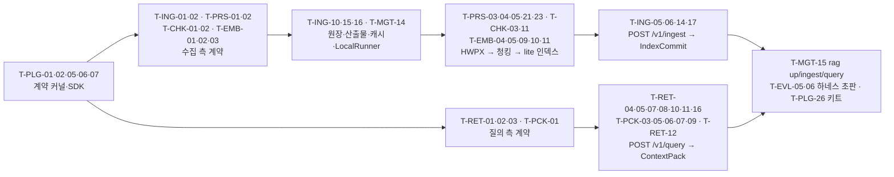

# 에픽과 백로그

## 목적

이 문서는 RAG Platform 구현 백로그(backlog)의 **정본**이다. [사용자 스토리와 인수 기준](../01-requirements/04-user-stories-and-acceptance-criteria.md)이 정의한 12개 에픽(epic)과 91개 스토리를 그대로 이어받아, 각 에픽을 **파일·모듈 수준의 기술 태스크(technical task)** 로 분해하고 크기·의존·마일스톤·담당 역할을 붙인다. 마일스톤 체계(M0~M5, 1.0)와 스토리 배정은 [마일스톤](01-milestones.md)이 소유하며, 이 문서는 그 배정을 **태스크 단위로 구체화**한다. 태스크의 모듈 경로는 설계 바이블 §12 모듈/패키지 맵을, 스테이지 경계·오류 코드·이벤트·엔드포인트 이름은 바이블 §4·§5.7·§6·§14를 그대로 쓴다.

이 문서는 이슈 트래커(GitHub Issues/Projects 등)로 기계적으로 옮겨질 수 있게 작성한다. 태스크 한 행 = 이슈 하나, 에픽 = 이슈 라벨 `epic:EP-xx`, 마일스톤 = 트래커 마일스톤, 의존 = `blocked by` 링크다(§4.3).

## 범위

- **포함**: 에픽 12개 각각의 목표·범위·관련 FR/NFR·스토리·기술 태스크 분해(에픽당 20개 이상)·크기·의존·마일스톤·역할, 전체 백로그 표, 우선순위 규칙, 이슈 트래커 이관 규칙, 산정 갱신 절차(US-I-08).
- **제외**: 마일스톤 정의·DoD·일정([마일스톤](01-milestones.md)), 리스크 레지스터([리스크와 완화](03-risks-and-mitigations.md)), 스프린트 운영·릴리스 절차([릴리스 프로세스](../10-development/08-release-process.md)), 저장소 레이아웃 확정([저장소 구조](../10-development/01-repository-structure.md)), 테스트 종류 정의([테스트 전략](../10-development/04-testing-strategy.md)).
- **정본 규칙**: 스토리 ID·크기·우선순위는 사용자 스토리 문서를, 마일스톤 배정은 마일스톤 문서 §2.4를 따른다. 태스크 크기(S/M/L)는 이 문서가 새로 산정한 **초안**이며 첫 두 마일스톤 실측 후 갱신한다(§4.4). 모듈·타입·열거·오류 코드·이벤트·엔드포인트는 바이블 정본을 그대로 쓰고, 바이블에 없는 것은 §미해결 이슈의 제안으로만 남긴다.
- **계약 커널의 귀속**: `contracts/common.py`·`enums.py`·`versioning.py`와 `sdk/`(`Stage[In, Out]`·`StageContext`·`PipelineContext`·`H()`)는 특정 스테이지에 속하지 않는 횡단 기반이다. 이 문서는 이를 **EP-12 플러그인 SDK**에 둔다(확장 지점 인터페이스와 함께 정의되므로, US-PLG-01). 각 스테이지 경계 계약 모델(`IngestRequest` 등 13 + 운영 계약)은 그 계약을 생산하는 스테이지의 에픽에 둔다.

## 1. 표기 규약

### 1.1 태스크 ID와 행 형식

태스크 ID는 `T-<에픽 코드>-<번호>`(예: `T-PRS-06`). 번호는 에픽 내 두 자리 일련번호이며 삭제된 번호는 재사용하지 않는다. 태스크 표의 열은 다음과 같다.

| 열 | 값 | 설명 |
|----|----|------|
| ID | `T-XXX-NN` | 이슈 제목 접두어로 그대로 쓴다 |
| 태스크 | `모듈: 내용` | `모듈`은 바이블 §12의 경로(`src/rag_platform/` 생략, 예 `adapters/parse/hwpx_python_hwpx`) 또는 `schemas/`·`sidecars/`·`deploy/`·`tests/`·`docs/`. 내용은 구현 단위와 완료 조건이 드러나게 쓴다 |
| 크기 | S / M / L | §1.2 |
| 의존 | `T-XXX-NN` 목록 또는 `—` | 착수 전 완료(또는 계약 확정)가 필요한 태스크. 에픽 밖 의존도 같은 표기 |
| 마일스톤 | M1 / M2 / M3 / M4 / M5 / 1.0 | [마일스톤](01-milestones.md) §1.1의 ID. 한 태스크는 한 마일스톤에만 속한다 |
| 역할 | §1.3 코드 | 1차 담당 역할(리뷰어는 트래커에서 지정) |

### 1.2 크기(초안 기준)

사용자 스토리 문서 §1.1의 S/M/L을 태스크 수준으로 내린 것이다. 상대 추정이며 산정 근거는 §4.4 절차로 갱신한다.

| 크기 | 기준(초안) | 트래커 포인트(제안) |
|------|-----------|--------------------|
| S | 1인 3일 이내, 단일 모듈, 계약 변경 없음 | 1 |
| M | 1인 1~2주(1 스프린트), 1~2 모듈, 단위·계약 테스트 포함 | 3 |
| L | 2주 초과 또는 2인 이상, 다중 모듈·외부 시스템(사이드카·백엔드) 포함, 통합 테스트 필수 | 8 |

### 1.3 담당 역할 코드

[마일스톤](01-milestones.md) §1.3의 코어 팀 가정(백엔드 3~4, 검색 품질 1, 인프라 1)을 역할로 나눈다. 한 사람이 여러 코드를 겸할 수 있다.

| 코드 | 역할 | 주 담당 |
|------|------|---------|
| ARCH | 아키텍트 | 결정·ADR·바이블 개정, 게이트 판정 |
| CORE | 코어 백엔드 | 계약 모델, SDK, 오케스트레이션, 원장, API |
| PIPE | 파이프라인 백엔드 | 파서·정규화·임베딩·인덱스 어댑터, 사이드카 |
| SRCH | 검색 품질 엔지니어 | 청킹·보강·융합·리랭크·후처리·패킹·렌더러 |
| INFRA | 인프라·SRE | 배포, 관측성, 벤치마크, 저장소 운영 |
| SEC | 보안 엔지니어 | 인증·인가, 격리 강제 지점, 감사, PII, egress |
| EVAL | 평가·데이터 | 골든셋, 하네스, 게이트 실행, 벤치마크 리포트 |
| PLG | 플러그인·SDK 개발 | 레지스트리, 적합성 키트, 클라이언트 SDK, 카탈로그 |
| DOCS | 테크니컬 라이터 | 퀵스타트, 개발 가이드, 릴리스 노트 |

### 1.4 에픽 맵과 스토리 배정 요약

에픽 정의는 사용자 스토리 문서 §2, 스토리의 마일스톤 배정은 마일스톤 문서 §2.4를 그대로 따른다. 괄호는 부분 배정(스토리의 일부 인수 기준만 해당 마일스톤)이다.

| 에픽 | 코드 | 이름 | 대응 FR 영역 | 스토리 | 마일스톤별 스토리 |
|------|------|------|--------------|-------:|-------------------|
| EP-01 | ING | 수집 API | ING, API(웹훅) | 10 | M1: ING-01, 02, 04(폴링·SSE), 05 · M2: ING-06 · M3: ING-03, (04 웹훅), 07, 08, 09, 10 |
| EP-02 | PRS | 파서군 | PRS, NRM | 9 | M1: PRS-01, 02, 04, 06(DOCX), 07, 08, 09 · M2: PRS-03, 05, (06 DOC) |
| EP-03 | CHK | 청킹·보강 | CHK, ENR | 8 | M1: CHK-01~05 · M2: CHK-07 · M4: CHK-06, 08 |
| EP-04 | EMB | 임베딩·인덱싱 | EMB, IDX | 7 | M1: EMB-01, 06 · M2: EMB-02, 03, 04, 05 · M5: EMB-07 |
| EP-05 | RET | 리트리벌 | QRY, RET, RNK | 9 | M1: RET-01 · M2: RET-02, 03, 04, 05, 07 · M4: RET-06, 08 · M5: RET-09 |
| EP-06 | PCK | 컨텍스트 패킹 | PCK | 8 | M1: PCK-01, 04 · M2: PCK-02, 03, 05, 06, 07 · M4: PCK-08 |
| EP-07 | MGT | 관리 API | MGT, API | 8 | M1: MGT-02, 05, 08(`LocalRunner`) · M2: MGT-06(문서·청크 조회) · M3: MGT-01, 03, 04, 07(헬스·리밋), (08 Temporal) · M4: (MGT-07 `answer`) · M5: (MGT-06 SDK) |
| EP-08 | MCP | MCP 서버 | MCP | 5 | M2: MCP-01, 02, 03 · M5: MCP-04, 05(조건부) |
| EP-09 | EVL | 평가 하네스 | EVL | 7 | M1: EVL-01, 02 · M2: EVL-03, 04 · M4: EVL-05, 06 · M5: EVL-07 |
| EP-10 | OBS | 관측성 | OBS | 6 | M1: OBS-04 · M3: OBS-01, 02, 03, 05 · M4: OBS-06 |
| EP-11 | SEC | 보안·멀티테넌시 | SEC | 8 | M3: SEC-01~06, 07(삭제), 08 · M5: (SEC-07 PII) |
| EP-12 | PLG | 플러그인 SDK(+계약 커널) | PLG | 6 | M1: PLG-01, 02, 06 · M3: PLG-05 · M5: PLG-03, 04 |

## 2. 에픽 상세

각 에픽은 목표 → 범위 → 관련 FR/NFR → 스토리 → 기술 태스크 표 → 에픽 간 의존 순으로 기술한다. FR/NFR ID는 [기능 요구사항](../01-requirements/01-functional-requirements.md)·[비기능 요구사항](../01-requirements/02-non-functional-requirements.md)의 것이며, 스토리별 상세 대응은 사용자 스토리 문서의 "관련" 행이 정본이다.

### 2.1 EP-12 플러그인 SDK와 계약 커널 (PLG)

- **목표**: 14개 확장 지점(D-10)의 `Stage[In, Out]` 5멤버 프로토콜과 계약 커널(공용 타입·열거·해시 결합식·버저닝)을 코드보다 먼저 확정하고, 어떤 어댑터든 적합성 키트를 통과해야만 등록되게 한다(ADR-0032, ADR-0001).
- **범위**: `contracts/common.py`·`enums.py`·`versioning.py`, `sdk/`, `plugins/`(레지스트리·`PluginMeta`·라이선스 게이트·능력 대조), `testing/` 적합성 키트 6종, `cli/plugin`, import-linter 계층 규칙, 플러그인 스캐폴딩·카탈로그(M5). 개별 계약 모델은 각 스테이지 에픽이 소유한다.
- **관련 FR/NFR**: FR-PLG-01~10 / NFR-MNT-04, NFR-MNT-05, NFR-MNT-06, NFR-MNT-08, NFR-USA-10, NFR-CMP-02, NFR-CMP-10, NFR-PORT-06.
- **스토리**: US-PLG-01(M1), US-PLG-02(M1), US-PLG-06(M1), US-PLG-05(M3), US-PLG-03(M5), US-PLG-04(M5).

| ID | 태스크 | 크기 | 의존 | 마일스톤 | 역할 |
|----|--------|------|------|----------|------|
| T-PLG-01 | `contracts/common.py`: 공용 타입 24종(`ArtifactRef` `Producer` `Provenance` `BlockRef` `Acl` `SecurityContext` `Principal` `TokenCounts` `Warning` `DegradedEntry` `ChannelScore` `ScoreBreakdown` `FilterNode` `Entity` `Relation` `TableData` `TableCell` `Block` `NormalizedBlock` `Chunk` `Enrichment` `VectorBundle` `RankedResult` `ContextItem`) Pydantic v2 모델 + `schemas/common-types.schema.json` `$defs` 동치 테스트 | L | — | M1 | CORE |
| T-PLG-02 | `contracts/enums.py`: 바이블 §5.7 열거 단일 소스(`BlockType`~`FilterableField`) + `$defs/EventType`·`$defs/ErrorCodeCatalog` + 열거 대조 CI 스크립트(스키마 ↔ enums ↔ 바이블 표) | M | — | M1 | CORE |
| T-PLG-03 | `contracts/versioning.py`: `schema_version` semver 호환 규칙(minor 가산·major 파괴), `contracts_compat` 범위 파서, `$id = urn:rag:schema:{kebab-name}:{major}` 검증 | S | T-PLG-01 | M1 | CORE |
| T-PLG-04 | `tools/`: `model_json_schema()` ↔ `schemas/*.schema.json` Pydantic 동치 게이트(필수 집합·열거·nullable) + 골든 예시 회귀 추출기(계약 개요 §10.3) | M | T-PLG-01, T-PLG-02 | M1 | CORE |
| T-PLG-05 | `sdk/hash_of`: `H(label, *parts)` 결합식(BLAKE3, `0x1F` 구분자), `canonical_json`, `block_id`·`chunk_id`·`record_id`·`point_id`(`uuid5(NAMESPACE_RAG_CHUNK, …)`) 테스트 벡터 고정 | S | — | M1 | CORE |
| T-PLG-06 | `sdk/stage`: `Stage[In, Out]` 프로토콜 5멤버(`plugin_id` `config_schema` `capabilities()` `fingerprint()` `run()`) + `StageContext`(`token_counter` `analyzer` `now()` `lineage`) + `requires_lineage` 처리 | M | T-PLG-01 | M1 | CORE |
| T-PLG-07 | `sdk/pipeline_context`: `PipelineContext`(오케스트레이터 중립), `ArtifactRef` 단일 경계 페이로드, 셸의 `ArtifactRef ↔ 계약 인스턴스` 변환·계보 기록 훅 | M | T-PLG-06 | M1 | CORE |
| T-PLG-08 | `contracts/capabilities.py` + `policies.py`: `Capabilities`·`IndexBackendCapabilities`·`StagePolicy`·`TieringPolicy`·`EgressPolicy` 모델 5종 + 래퍼 스키마 파일 4종(`capabilities`(공용)·`stage-policy`·`tiering-policy`·`egress-policy`, 바이블 §5.1) | S | T-PLG-01 | M1 | CORE |
| T-PLG-09 | `sdk/token_counter`: `TokenCounter{tokenizer_id}` 인터페이스(`hf:`·`tiktoken:` 구현, `anthropic:`·`gemini:`는 `adapters/llm`) + Valkey `tok:` 캐시 훅 | S | T-PLG-06 | M1 | CORE |
| T-PLG-10 | `sdk/fingerprint`: `fingerprint = H("producer", plugin_id, plugin_version, config_hash, image_digest, model_ids)` 조립기 + 구성요소 누락 검증(`analyzer_id`·`dictionary_hash`·`embedding_space_id` 포함 여부) | S | T-PLG-05, T-PLG-06 | M1 | CORE |
| T-PLG-11 | `plugins/registry`: entry point 그룹 `rag_platform.{extension_point}` 14종 로더, `plugin_id = {extension_point}.{implementation}` 규약 검증, 중복·누락 진단 | M | T-PLG-06 | M1 | PLG |
| T-PLG-12 | `contracts/plugin_meta.py` + `plugins/plugin_meta`: `PluginMeta`(`license` `license_grade` `territory` `linkage` `contracts_compat` `extension_point` `role`) 모델·스키마·`pyproject.toml` 로더 | S | T-PLG-02, T-PLG-03 | M1 | PLG |
| T-PLG-13 | `plugins/license_gate`: 등급표 A/B/C/D/X 판정, `license_grade ≤ license_policy.max_grade`, B+`static_bundled` 거부, D `model_license_ack` 필수, `models.lock`·pip-licenses·liccheck·SBOM CI 게이트(`plugin.license_denied`) | M | T-PLG-12 | M1 | SEC |
| T-PLG-14 | `plugins/capabilities_check`: 프로파일 로딩 시 `capabilities()` 대조(`supports_multivector`·`supports_server_fusion` 등), 미지원 시 자동 비활성 + `degraded{…, capability_unsupported}` 또는 `plugin.capability_unsupported` | S | T-PLG-08, T-PLG-11 | M2 | PLG |
| T-PLG-15 | `testing/contract_roundtrip` + `testing/idempotency`: 적합성 키트 1·2(계약 왕복, 동일 입력 → 동일 `stage_key`·출력, E17 두 테넌트·두 컬렉션 동일 바이트 비덮어쓰기 시나리오) | M | T-PLG-05, T-PLG-07 | M1 | PLG |
| T-PLG-16 | `testing/security_invariants`: 적합성 키트 3(모든 출력 봉투에 `tenant_id`·`collection_id`·`acl_*`·`acl_hash` 존재, 질의 측 `results[]` 전파) | M | T-PLG-15 | M1 | SEC |
| T-PLG-17 | `testing/renderer_citation_roundtrip` + `litm_order` + `fuser_equivalence`: 적합성 키트 4~6(`cite_id` 왕복, `litm_alternating` 테스트 벡터, ranx RRF 일치) | M | T-PLG-15 | M1 | PLG |
| T-PLG-18 | `sdk/sidecar_stage`: `SidecarStage`(`POST /v1/convert` 클라이언트, `ConvertRequest`/`ConvertResponse`, `GET /healthz` 준비 확인, `image_digest` 지문 포함) + `contracts/convert.py`·스키마 2종 | M | T-PLG-06, T-PLG-10 | M2 | CORE |
| T-PLG-19 | `sdk/isolation`: `helper_process` 실행기(`multiprocessing` spawn, 크래시 격리, 타임아웃 KILL, 결과는 `ArtifactRef`) | M | T-PLG-07 | M2 | CORE |
| T-PLG-20 | `plugins/isolation_declared`: `Capabilities.isolation_modes` 기반 플러그인 선언 격리 일반화(`in_process`/`helper_process`/`sidecar` 자동 선택, ADR-0033 사다리) | M | T-PLG-18, T-PLG-19 | M5 | PLG |
| T-PLG-21 | `telemetry/plugin_spans`: 플러그인 `run()` 자동 스팬·메트릭 래핑(`rag.{stage}`, 라벨 `stage`·`backend_id`, `tenant_id` 금지) + 플러그인별 오류율 | S | T-PLG-06, T-OBS-02 | M3 | PLG |
| T-PLG-22 | `cli/plugin`: `rag plugin list --check-license`(`--json`), 등급·`territory`·적합성 결과 출력 | S | T-PLG-11, T-PLG-13 | M1 | PLG |
| T-PLG-23 | `cli/plugin new`(스캐폴딩; 이름은 마일스톤 이슈 7) + `rag-plugin-{name}` 템플릿(`pyproject` entry point·`PluginMeta`·키트 테스트 포함) + `config_schema` 자동 문서 | M | T-PLG-12, T-PLG-17 | M5 | PLG |
| T-PLG-24 | `plugins/catalog` + `docs/`: 플러그인 카탈로그(레지스트리 목록·`PluginMeta`·라이선스 등급·적합성 결과 게시), 대체 구현 등재 절차 | M | T-PLG-22 | M5 | PLG |
| T-PLG-25 | `pyproject.toml` + import-linter: 계층 규칙(`contracts ← sdk ← plugins\|adapters\|pipelines\|retrieval\|render ← orchestration\|ledger\|storage\|security\|profiles\|eval ← api\|mcp\|cli`), `pipelines`·`retrieval`·`render`의 `temporalio`·`fastapi`·`ledger` 임포트 금지, `adapters`의 `storage` 임포트 금지, ruff·mypy strict·`uv lock --check` | S | — | M1 | CORE |
| T-PLG-26 | `testing/` 코어 어댑터 전수 통과 리포트(M1-D07): 키트 6종 × 코어 어댑터 매트릭스 CI 잡 | S | T-PLG-15, T-PLG-16, T-PLG-17 | M1 | PLG |

- **에픽 간 의존**: 모든 에픽이 T-PLG-01~T-PLG-07·T-PLG-25에 의존한다. M2의 사이드카(T-PRS-16~19)는 T-PLG-18·19에, M5 플러그인 카탈로그 DoD(M5-D01)는 T-PLG-24에 의존한다.

### 2.2 EP-01 수집 API (ING)

- **목표**: URI와 메타데이터만 받아(R1) 비동기 잡으로 원본을 가져오고, 멱등(`Idempotency-Key`·`content_hash`·`stage_key`)하게 처리하며, 상태 전이를 CloudEvents로 폴링·SSE·웹훅에 전달한다(D-08, ADR-0017, ADR-0037, ADR-0038).
- **범위**: `IngestRequest`·`SourceDocument`·`JobStatus`·`CloudEventEnvelope` 계약, `POST /v1/ingest`(+batch), `fetch` 스테이지와 `EgressPolicy`, 잡 조회·SSE·취소·재시도, 원장 테이블, 아웃박스·릴레이·웹훅 서명, 삭제 잡, 문서 갱신 e2e. 파서 라우팅은 EP-02, 세대 사가는 EP-04.
- **관련 FR/NFR**: FR-ING-01~15, FR-API-01, FR-API-14, FR-API-15 / NFR-REL-01~04, NFR-REL-06, NFR-REL-08, NFR-SEC-09, NFR-SEC-12, NFR-PERF-16, NFR-SCAL-07, NFR-OBS-05, NFR-PRV-03, NFR-PRV-09, NFR-PRV-10.
- **스토리**: US-ING-01, 02, 04(폴링·SSE), 05(M1); US-ING-06(M2); US-ING-03, 04(웹훅), 07, 08, 09, 10(M3).

| ID | 태스크 | 크기 | 의존 | 마일스톤 | 역할 |
|----|--------|------|------|----------|------|
| T-ING-01 | `contracts/ingest_request.py`: `IngestRequest`(`source_uri` `external_id` `metadata`(16KB) `acl` `dedup_policy` `split_hint` `credentials_ref` `profile_id` 오버라이드) + `schemas/ingest-request.schema.json` + 골든 예시 | S | T-PLG-01, T-PLG-02 | M1 | CORE |
| T-ING-02 | `contracts/source_document.py`: `SourceDocument`(`content_hash` `format` `format_confidence` `container_flags` `fetched_at`, 검증자 `etag`/`last_modified`) + 스키마 | S | T-PLG-01 | M1 | CORE |
| T-ING-03 | `contracts/jobs.py`: `JobStatus`(`JobState` 7종, `JobKind` 9종, `current_stage` `progress` `error` `workflow_run_id`) + `schemas/job-status.schema.json` | S | T-PLG-02 | M1 | CORE |
| T-ING-04 | `contracts/common.py` `CloudEventEnvelope` 정제 래퍼(`type ↔ data·subject` `oneOf`, `source = urn:rag:{component}`, `subject = tenant/{tenant_id}/{entity}/{id}`, 확장 `tenantid`) + 이벤트 카탈로그 `data` 타입 `$defs` | S | T-PLG-01, T-PLG-02 | M1 | CORE |
| T-ING-05 | `api/ingest`: `POST /v1/ingest` → `202 {job_id, status_url, events_url}`, 스키마 위반 → `contract.violation`(400, 필드 경로), 본문 상한 64KB | M | T-ING-01, T-MGT-11 | M1 | CORE |
| T-ING-06 | `api/idempotency` + `ledger` `idempotency_keys(tenant_id, key)`: draft-07 의미론(재전송 200 / `api.idempotency_conflict` 409 / `api.idempotency_payload_mismatch` 422), `jobs` INSERT 동일 트랜잭션, Valkey 조회 캐시 | M | T-ING-05, T-ING-10 | M1 | CORE |
| T-ING-07 | `adapters/fetch/fsspec_httpx`: `s3://`·`gs://`·`az://`·`file://`·`http(s)://` fetcher(`fetcher.fsspec_httpx`), 조건부 GET(304 → 이전 바이트 재사용, 봉투 새 발급), `content_hash` 확정 후 `sources/{blake3}` 저장 생략 판정, `smb://` 미설치 → `fetch.scheme_unsupported` + 확장 지점 힌트 | M | T-ING-02, T-ING-15 | M1 | PIPE |
| T-ING-08 | `security/egress_policy`: `EgressPolicy` 평가기(스킴·호스트 허용 목록, `169.254.169.254`·RFC1918·`localhost` 차단, 리다이렉트 상한·재해석, `file://` 루트 허용 목록·심볼릭 링크 해석 후 검사) + `fetch` 적용 + M1-D10 계약 테스트(`fetch.egress_denied`) | M | T-PLG-08, T-ING-07 | M1 | SEC |
| T-ING-09 | `adapters/fetch` 오류·정책: `fetch.access_denied`·`fetch.not_found`·`fetch.too_large`(`fetch.max_bytes`)·`fetch.timeout`·`fetch.upstream_error` 매핑, `StagePolicy` fetch(5회 지수, 최대 1m), 기대 해시·크기 불일치 실패(FR-ING-09) | S | T-ING-07 | M1 | PIPE |
| T-ING-10 | `ledger/models` + `ledger/migrations`: `jobs`·`artifacts(tenant_id, stage_key)`·`lineage`·`outbox`·`idempotency_keys`·`usage_ledger(tenant_id, day, meter)` 테이블, 모두 `tenant_id` + RLS `FORCE` 정책 정의, Alembic 전진·후진 | L | — | M1 | CORE |
| T-ING-11 | `api/jobs`: `GET /v1/jobs`(`collection_id`·`state`·`kind`·커서), `GET /v1/jobs/{job_id}` 원장 읽기 모델(p95 50ms 목표, NFR-PERF-16) | S | T-ING-03, T-ING-10 | M1 | CORE |
| T-ING-12 | `api/events`(SSE): `GET /v1/jobs/{job_id}/events`(`job.state.changed`·진행률, `Last-Event-ID` 재접속, 아웃박스 구독) | M | T-ING-11, T-ING-13 | M1 | CORE |
| T-ING-13 | `orchestration/outbox/relay_core` + `procrastinate_relay`: 순수 함수 3개(클레임·전달·확인), 소비자 멱등 `event_id`(ULID, 워크플로우 1회 발급), `lite` Procrastinate 실행기, `rag_outbox_lag_seconds` | M | T-ING-04, T-ING-10 | M1 | CORE |
| T-ING-14 | `pipelines/ingest.py`: 수집 파이프라인 정의(`fetch → detect·parse → normalize → chunk·recount → enrich → embed → index → publish`), `PipelineContext`만 의존, 스테이지별 `StagePolicy` 참조 | M | T-PLG-07, T-ING-07 | M1 | CORE |
| T-ING-15 | `storage/artifact_store` + `storage/keys`: S3 호환 + `file://` 어댑터, 오브젝트 키 규약(바이블 §13.3), 콘텐츠 주소화 put/get/exists, 미디어 타입 `application/vnd.rag.{kebab-name}+json` | M | T-PLG-01 | M1 | CORE |
| T-ING-16 | `orchestration/context` 캐시 판정: `stage_key = H("stage", stage_name, scope_key, input_ref.blake3, fingerprint)`, `artifacts` 행 존재 시 실행 생략(`cache_hit=true`, 계보 기록), `dedup_policy` `skip_if_same_hash`/`reindex_always` 분기, `rag cache invalidate --stage` | M | T-PLG-05, T-PLG-10, T-ING-10 | M1 | CORE |
| T-ING-17 | `publish` 로컬 액티비티: `IndexCommit` → `ingest.document.indexed`·`index.commit.published`·`job.state.changed` 아웃박스 기록(원장 갱신 동일 트랜잭션), 스테이지별 `ingest.document.*` 이벤트 | S | T-ING-13, T-EMB-13 | M1 | CORE |
| T-ING-18 | `api/ingest` batch: `POST /v1/ingest/batch`(최대 100건, 초과 시 전체 거절 + 상한값), 건별 `job_id`·독립 상태, 배치 조회 URL | S | T-ING-05 | M3 | CORE |
| T-ING-19 | `delete.document.v1` 워크플로우 + `DELETE /v1/documents/{document_id}`: 메타 툼스톤 즉시, 인덱스 레코드 삭제(60s p95), 캐시·`aclrev` 정리, 재삭제 멱등, 삭제·재수집 경합은 디스패처 직렬화, `ingest.document.deleted` | M | T-MGT-19, T-MGT-20 | M3 | CORE |
| T-ING-20 | `api/jobs` 액션: `POST /v1/jobs/{job_id}/cancel`(안전 지점 중단 → `cancelling → cancelled`, 부분 산출물 정리 정책), `POST …/retry?stages=`(성공 스테이지 산출물 재사용), `PATCH /v1/jobs/{job_id}` `priority`, 감사 기록 | M | T-MGT-19 | M3 | CORE |
| T-ING-21 | `api/subscriptions` + `ledger` `subscriptions`: 웹훅 구독 CRUD(`GET/POST/DELETE /v1/subscriptions`, `/{subscription_id}`), 이벤트 타입·컬렉션 필터, 타 테넌트 컬렉션 거부, `secret_ref` | M | T-ING-13, T-SEC-02 | M3 | CORE |
| T-ING-22 | `orchestration/outbox/webhook_signer` + `temporal_relay`: `RAG-Signature: t={unix_ts},v1={hex(HMAC-SHA256(secret, "{unix_ts}.{body}"))}`, 5분 재생 창, 재전송 동일 `event_id`, 실패 목록 조회, `EgressPolicy` 위반 → `outbox.egress_denied`, `outbox.relay_failed` 재시도 | M | T-ING-21, T-SEC-08 | M3 | SEC |
| T-ING-23 | `api/events` 테넌트 SSE: `GET /v1/events`(테넌트 스코프 CloudEvents 스트림, 타입 필터) | S | T-ING-12 | M3 | CORE |
| T-ING-24 | 수집 정책 오버라이드·한도: 요청 단위 `profile_id`·우선순위·타임아웃·OCR 강제 오버라이드 검증(테넌트 허용 목록 밖 → 422 필드 경로), 동시 잡 할당량 소진 → `api.rate_limited`(429) + `Retry-After` | S | T-ING-05, T-MGT-25 | M3 | CORE |
| T-ING-25 | 문서 갱신 e2e(US-ING-06): 동일 `external_id` 새 `content_hash` → 새 `doc_version` → 새 `index_generation` 세대 플립 → 커밋 전 v1만·후 v2만 응답 통합 테스트, `diagnostics.index_generations_seen` 관측 | M | T-EMB-11, T-EMB-18 | M2 | PIPE |
| T-ING-26 | `ledger/reconcile` + 조정 스케줄: 오케스트레이터 불가 시 `503` + `Retry-After`, 원장 ↔ 워크플로우 상태 대조·복구 스케줄(`maintenance` 큐) | S | T-MGT-18 | M3 | INFRA |

- **에픽 간 의존**: T-ING-10(원장)은 EP-04·EP-07의 원장 사용 태스크의 선행이다. M3 태스크는 EP-07 Temporal 셸(T-MGT-18~20)과 EP-11 인가(T-SEC-02)에 의존한다.

### 2.3 EP-02 파서군 (PRS, NRM)

- **목표**: 모든 포맷을 자체 소유 `ParsedDocument`로 변환하되(D-04) `element_path`·`char_start/char_end`를 필수로, `page`/`bbox`를 nullable로 보존하고(ADR-0002), HWPX/HWP 5.0을 1급으로(ADR-0007), OCR·사이드카를 격리 사다리(ADR-0033) 위에서 실행한다. 정규화는 출처 연결을 끊지 않는다(`offset_map`).
- **범위**: `ParsedDocument`·`NormalizedDocument` 계약, `detect` 서브스테이지·라우터·폴백 체인, 포맷별 어댑터(HWPX·HWP 5.0·PDF 고속/표준·OCR·DOCX·DOC·HTML·TXT/MD), `parser-workers` 사이드카, 정규화(NFC·furniture·제목 계층·언어·표 직렬화·품질 지표), 한국어 분석기·문장 분리기, 사용자 사전, 계약 코퍼스.
- **관련 FR/NFR**: FR-PRS-01~22, FR-NRM-01~09 / NFR-PERF-08, NFR-PERF-09, NFR-PERF-10, NFR-MNT-06, NFR-MNT-07, NFR-SEC-10, NFR-CMP-03, NFR-REL-05, NFR-REL-09, NFR-USA-07.
- **스토리**: US-PRS-01, 02, 04, 06(DOCX), 07, 08, 09(M1); US-PRS-03, 05, 06(DOC)(M2).

| ID | 태스크 | 크기 | 의존 | 마일스톤 | 역할 |
|----|--------|------|------|----------|------|
| T-PRS-01 | `contracts/parsed_document.py`: `ParsedDocument`(`Block` 트리, `TableData`/`TableCell`, `Provenance`, `parser_chain[]`, `page_status[]`, `source_kind`, `quality`, `warnings[]`) + `schemas/parsed-document.schema.json` + 불변식(`element_path`·offset 필수, `bbox` 좌상단 원점) | M | T-PLG-01, T-PLG-02 | M1 | CORE |
| T-PRS-02 | `contracts/normalized_document.py`: `NormalizedDocument`(`NormalizedBlock` `offset_map` `furniture` `furniture_reason` `text_source` `lang`, `genre`, 품질 지표) + 스키마 + `offset_map` 역추적 불변식 | M | T-PRS-01 | M1 | CORE |
| T-PRS-03 | `adapters/parse/format_detector`: puremagic + ZIP/OLE 스니퍼(`parser` role `format_detector`), `SourceFormat` 13종·`format_confidence`·`container_flags`(암호·배포용), 확장자 불일치 시 내용 우선, `parse.unsupported_format`·`parse.corrupt_container` | M | T-ING-02 | M1 | PIPE |
| T-PRS-04 | `adapters/parse` 라우터·폴백 실행기: `parse.router` 키(`SourceFormat`) → 프로파일 파서 체인, 1차 실패·품질 임계 미달 → 다음 파서, `parser_chain[]` 시도 순서 기록, 미지원 → `parse.unsupported_format` + `extension_point=parser` 힌트, `parse.document_encrypted`·`parse.distribution_document` 판정 | M | T-PRS-03 | M1 | PIPE |
| T-PRS-05 | `adapters/parse/hwpx_python_hwpx/owpml_adapter`: python-hwpx(`<7` 상한) 기반 OWPML → `Block`(heading·paragraph·list_item·footnote·figure·caption·page_break), `element_path`·코드포인트 offset, `page`/`bbox` null, 머리말·꼬리말 `furniture` | L | T-PRS-01, T-PRS-04 | M1 | PIPE |
| T-PRS-06 | `adapters/parse/hwpx`: 표 병합 셀(rowspan/colspan) `TableCell` 매핑, 중첩 표 부모-자식(`container=table_cell`), 텍스트박스 `container=text_box`, `TableRole` 판정(data/toc/form/layout) | M | T-PRS-05 | M1 | PIPE |
| T-PRS-07 | `adapters/parse/hwpx` 보안 플래그: 암호화 HWPX(`credentials_ref` 있으면 해제, 없으면 `parse.document_encrypted`), FileHeader 배포용 → 테넌트 `allow_distribution_documents` 시 Tika `HwpV5Parser` 텍스트(`quality=degraded`), 아니면 `parse.distribution_document` | S | T-PRS-05, T-PRS-16 | M2 | PIPE |
| T-PRS-08 | `adapters/parse/pdf_fast_pdftext`: pypdfium2 + pdftext 고속 텍스트 경로(`pdf_fast_cpu`), `page`·`bbox`(좌상단 원점·PDF 포인트) provenance, 텍스트 레이어 유무 판정 입력 제공 | M | T-PRS-01, T-PRS-04 | M1 | PIPE |
| T-PRS-09 | `adapters/parse/pdf_docling_standard/docling_to_parsed`: Docling 레이아웃(heron) + TableFormer ACCURATE → `Block` 변환(`TITLE → heading 0`, `DOCUMENT_INDEX → toc`, `KEY_VALUE_REGION/FORM → form_field`, `page_header/page_footer` `furniture=true`), 표 신뢰도 기록, 임계 미달 표 → 텍스트 폴백 + 영역 이미지 산출물, `OMP_NUM_THREADS` 설정 | L | T-PRS-08 | M2 | PIPE |
| T-PRS-10 | `adapters/parse/pdf` 스캔 판별: 페이지 단위 텍스트 레이어 판정 → `source_kind`(`born_digital`/`scanned`/`mixed`/`pre_ocr`), 스캔 페이지만 OCR 라우팅, 페이지 이미지 `derived` 산출물 | S | T-PRS-08 | M2 | PIPE |
| T-PRS-11 | `adapters/parse/ocr_rapidocr`: RapidOCR(`OCRVersion.PPOCRV5` + `ModelType.MOBILE` + `LangRec.KOREAN`, ONNX Runtime) 어댑터, `Block.source=ocr`·`Block.confidence`·`page_status[]`, 페이지 하트비트(CPU 60s)·`Resumable`(`heartbeat_details.page`), 프로파일 `ocr: {plugin, lang, version, model}` 필수 키 | L | T-PRS-10 | M2 | PIPE |
| T-PRS-12 | `adapters/parse/ocr_tesseract`: Tesseract 5 `kor+eng` 폴백 어댑터(`parse.sidecar_unavailable` 이후 체인), `kor_vert`·`pdf_airgapped` 번들 옵션은 프로파일 키만 준비(M5 `korean-gov`) | M | T-PRS-11 | M2 | PIPE |
| T-PRS-13 | `adapters/parse/docx_docling_docx2python`: Docling `MsWordDocumentBackend` + docx2python 각주·미주 병합(필수), 제목 스타일 수준·목록·표·이미지 캡션, 변경 추적·주석 정책(수락/거절/제외) 적용·기록 | M | T-PRS-01, T-PRS-04 | M1 | PIPE |
| T-PRS-14 | `adapters/parse/html_trafilatura_docling`: Trafilatura(`xml`) → Docling HTML 순서 고정, 보일러플레이트 제거 비율 메타, 본문 길이 임계 미달 → 전체 DOM 폴백 + `Warning`, `title`·OG·`author`·`lang`·canonical 메타 수확 | M | T-PRS-01, T-PRS-04 | M1 | PIPE |
| T-PRS-15 | `adapters/parse/text_charset_markdown_it`: charset-normalizer(EUC-KR/CP949) + ftfy + markdown-it-py(frontmatter·heading·table·code), 구조 없는 평문은 빈 줄 단락 추론, 감지 인코딩 메타 기록 | S | T-PRS-01, T-PRS-04 | M1 | PIPE |
| T-PRS-16 | `sidecars/parser-workers`: Java 21 이미지(hwplib + hwp2hwpx + hwpxlib + Tika `HwpV5Parser`), `POST /v1/convert`(`ConvertRequest → ConvertResponse`, 본문은 `ArtifactRef`), `GET /healthz`(JVM 준비), RFC 9457 오류, 이미지 digest 태깅 | L | T-PLG-18 | M2 | PIPE |
| T-PRS-17 | `adapters/parse/hwp5_java_sidecar`: `SidecarStage` 기반 HWP 5.0 → HWPX 변환, `derived` 산출물 `H("derived", content_hash, sidecar_image_digest)`(테넌트 내 공유·재변환 생략) → T-PRS-05 OWPML 어댑터 재사용, 변환 일치율 코퍼스 | M | T-PRS-16, T-PRS-05 | M2 | PIPE |
| T-PRS-18 | `adapters/parse/hwp5_unhwp` + `hwp5_hwp_hwpx_parser`: unhwp `helper_process` 폴백(x64) + hwp-hwpx-parser 순수 Python 폴백, `parse.sidecar_unavailable` 재시도 후 체인 진행, `parse.conversion_failed` → 다음 폴백, `lite` 체인(unhwp → hwp-hwpx-parser) | M | T-PLG-19, T-PRS-17 | M2 | PIPE |
| T-PRS-19 | `adapters/parse/office_lo_sidecar`: DOC/RTF/ODT → `lo-sidecar`(별도 저장소 `rag-platform-gpl-sidecars`, GPLv3) → DOCX → T-PRS-13, 결과 `text_source=converted`, 사이드카 미배포 → `parse.unsupported_variant`, 코어 이미지 미포함·Helm `optIn.*` CI 검사 | M | T-PLG-18, T-PRS-13 | M2 | PIPE |
| T-PRS-20 | `adapters/parse` 그림·수식·코드: 그림 별도 산출물(콘텐츠 주소) + `figure` 블록 캡션·alt·위치 연결, `formula`(LaTeX/MathML 텍스트 옵션)·`code` 블록 식별 | M | T-PRS-05, T-PRS-08 | M1 | PIPE |
| T-PRS-21 | `adapters/normalize/text`: NFC 정규화·제어 문자 제거·연속 공백 정리·하이픈 줄바꿈 복원 + `offset_map`(정규화 텍스트 ↔ 원문 코드포인트) 생성, `normalize.nfd_residual` 검사 | M | T-PRS-02 | M1 | PIPE |
| T-PRS-22 | `adapters/normalize/structure`: 반복 머리글·바닥글·페이지 번호 furniture 판정(`repeated_header`/`nav`/`boilerplate`, 제외 내용은 메타 보존), 번호 체계("제1장", "1.1", "가.") 기반 제목 계층 복원, 목록 수준·글머리 보존, 각주 양방향 연결 | M | T-PRS-21 | M1 | PIPE |
| T-PRS-23 | `adapters/normalize/korean/{mecab_ko,kss,kiwi}`: 공백기 분석기 python-mecab-ko + kss `punct`(`analyzer_id = mecab-ko:{ver}:{dic}`), `[kiwi]` extra(`kiwi:{ver}:{dic}`; kiwipiepy 0.24.0 Apache-2.0 wheel PyPI 공개 확인 필요 as of 2026-09, 승격은 ADR-0021 개정), 문장 분리기 예외 → kss → 정규식 폴백 + `normalize.segmenter_fallback` 경고, `ctx.analyzer` 제공 | M | T-PRS-02 | M1 | PIPE |
| T-PRS-24 | `adapters/normalize` 언어·표·품질: 문서·블록 BCP 47 `lang` 판별(한영 혼용 주 언어), 표 직렬화(`html`/`markdown`/`row_json`, 병합 셀 값 전파), `genre` 판정(`law_article`/`outline_report`/…), 품질 지표(텍스트 비율·OCR 비율·깨진 문자 비율·구조 신뢰도) + 임계 미달 경고·격리 정책 | M | T-PRS-21 | M1 | PIPE |
| T-PRS-25 | `contracts/user_dict.py` + `adapters/normalize/korean/user_dictionary` + `korean/`: `UserDictEntry`(`DictSource`) 모델·스키마, `UserDictEntry → Kiwi/Nori/synonym` 생성기, `dictionary_hash = H("dict", …)`, `normalizer_fingerprint`에 포함 | M | T-PRS-23 | M2 | PIPE |
| T-PRS-26 | `tests/adapters` 계약 코퍼스: 포맷 5종(HWPX·PDF·DOCX·HTML·TXT/MD) 픽스처 + 골든 `ParsedDocument` 스냅샷(T-FIXTURE), 구조 보존율(KPI-08) 측정 스크립트, 벤더 타입 미임포트 정적 검사(NFR-MNT-06) | M | T-PRS-05, T-PRS-08, T-PRS-13, T-PRS-14, T-PRS-15 | M1 | EVAL |
| T-PRS-27 | `tests/adapters` 코퍼스 확장: HWP 5.0·DOC·스캔/혼합 PDF·암호화·배포용 픽스처, 파싱 성공률(KPI-07) 측정, 페이지 타임아웃 → `page_status=timeout` 계속 시나리오 | M | T-PRS-17, T-PRS-19, T-PRS-11 | M2 | EVAL |
| T-PRS-28 | 부분 파싱·부분 성공: 일부 페이지 실패 시 `quality=degraded` + `warnings[]` + `page_status[]`로 `NormalizedDocument` 생성, 컬렉션 정책으로 부분 결과 허용 여부 제어, 잡 `partial` 종결 | S | T-PRS-04, T-PRS-24 | M1 | PIPE |

- **에픽 간 의존**: EP-03 청킹은 T-PRS-02·T-PRS-21(`offset_map`)에, EP-04 `sparse_bm25`·EP-05 `korean_normalize`는 T-PRS-23(`ctx.analyzer`)에 의존한다. M2 사이드카 태스크는 EP-12 T-PLG-18·19의 후행이다.

### 2.4 EP-03 청킹·보강 (CHK, ENR)

- **목표**: `ParsedDocument` 네이티브 `StructureAwareChunker`(D-19, ADR-0020)로 구조를 존중하는 자식 512 / 부모 2048 / 병합 하한 64 청크와 표 행 그룹을 만들고, 결정적 `context_prefix`(ADR-0029, 3-텍스트 규칙)로 보강한다. `chunk_id`는 콘텐츠 주소(ADR-0004), LLM 보강은 기본 끔·예산 정책(ADR-0016).
- **범위**: `ChunkSet`·`EnrichedChunkSet` 계약, 청커 4종(`structure_aware`·`table_rows`·`flat_text`·`recount`) + Docling 어댑터 extra, 결정적 보강기 4종, GLiNER2, LLM 보강 3종(M4), 대안 청커(M4), `ChunkTextStore`, O-09 그리드 실험.
- **관련 FR/NFR**: FR-CHK-01~12, FR-ENR-01~09 / NFR-REL-02, NFR-CST-02, NFR-CST-07, NFR-PRV-06, NFR-MNT-10, NFR-MNT-11, NFR-PERF-14, NFR-USA-13.
- **스토리**: US-CHK-01, 02, 03, 04, 05(M1); US-CHK-07(M2); US-CHK-06, 08(M4).

| ID | 태스크 | 크기 | 의존 | 마일스톤 | 역할 |
|----|--------|------|------|----------|------|
| T-CHK-01 | `contracts/chunk_set.py`: `ChunkSet`(`Chunk`: `chunk_id` `level` `item_kind` `block_refs[]` `sentence_spans[]` `token_counts` `parent_chunk_id` `text` `heading_path` `genre_route`, `chunker_config_hash`, `primary_tokenizer_id`) + `schemas/chunk-set.schema.json` + 불변식(부모 span ⊇ 자식 span, 청크 50,000 한계) | M | T-PLG-01, T-PLG-02 | M1 | CORE |
| T-CHK-02 | `contracts/enriched_chunk_set.py`: `EnrichedChunkSet`(`Enrichment`: `context_prefix` `embed_text` `index_text` `strip_offsets` `keywords[]{source: KeywordSource}` `entities[]` `status` `generated_by` `budget_used`) + 스키마 + `enrich → strip` 대칭 불변식 | S | T-CHK-01 | M1 | CORE |
| T-CHK-03 | `adapters/chunk/structure_aware`: `chunker.structure_aware` — 요소 단위 → 초과 분할(문장 → semchunk 3.2.5) → 동일 heading 병합 → 부모(level 1) 생성, 자식 512 / 부모 2048 / 병합 하한 64(임베딩 토크나이저 `hf:BAAI/bge-m3`), 구조 청크 오버랩 0 | L | T-CHK-01, T-PRS-02, T-PLG-09 | M1 | SRCH |
| T-CHK-04 | `adapters/chunk` 결정적 키: `block_id = H("block", doc_version, element_path)[:32]`, `chunk_id = H("chunk", doc_version, chunker_config_hash, str(level), span)`, `span = "{first_block_id}:{char_start}-{last_block_id}:{char_end}"`, 두 번 청킹 동일성 테스트(M1-D03) | S | T-PLG-05, T-CHK-03 | M1 | CORE |
| T-CHK-05 | `adapters/chunk/table_rows`: 표 행 그룹 256 토큰, 헤더 행 반복, 병합 셀 값 전파, `item_kind=table`/`table_part`, 캡션·표 번호 접두, `chunk.count_exceeded` 시 행 그룹 확대 후 재시도 | M | T-CHK-03 | M1 | SRCH |
| T-CHK-06 | `adapters/chunk/flat_text`: 구조 힌트 없는 평문·`flat_text` 장르 문장 윈도우 ±2, 폴백 분할 오버랩 10%, 오버랩 영역 `block_refs` 중첩 표시, 병합 하한 미만 청크 인접 병합·불가 시 단독 유지 + `Warning` | M | T-CHK-03 | M1 | SRCH |
| T-CHK-07 | `adapters/chunk` 분류·경로: `heading_path` breadcrumb(문서 제목 → 섹션), `item_kind` 분류(`text` `list_group` `code` `table` `table_part` `figure` `parent`), `level` 0/1, `chunk.block_oversized` 경고 후 강제 분할 | S | T-CHK-03 | M1 | SRCH |
| T-CHK-08 | `adapters/chunk` 좌표(K1): `BlockRef{block_id, element_path, char_start, char_end, original_char_start, original_char_end, page?, bbox?}`를 `offset_map`으로 기록, `sentence_spans[]`(`Chunk.text` 기준), 하류가 `offset_map` 없이 `Provenance` 생성 가능 테스트 | M | T-CHK-01, T-PRS-21 | M1 | CORE |
| T-CHK-09 | `adapters/chunk/recount`: `recount` 스테이지(`chunker` role `token_counter`) — `token_counts`에 새 `tokenizer_id` 추가만(재청킹 아님), `tiktoken:o200k_base` 병기, `chunk.tokenizer_missing` 비재시도 | S | T-CHK-01, T-PLG-09 | M1 | CORE |
| T-CHK-10 | `profiles/validate` 청킹 규칙: 오버랩 ≥ 최대 크기, 병합 하한 > 자식 최대, 표 행 그룹 > 부모 등 → `profile.invalid`(필드 경로), `chunker_config_hash` 산출 | S | T-MGT-03 | M1 | CORE |
| T-CHK-11 | `adapters/enrich/deterministic_prefix`: `enricher.deterministic_prefix` — `context_prefix`(문서 제목 + heading 경로 + 캡션) 조립, `embed_text = prefix + text`, `index_text = prefix + 렉시컬 뷰(NFKC)`, `strip_offsets` 기록 + 대칭 왕복 테스트(K2), `text` NFC 불변 | M | T-CHK-02 | M1 | SRCH |
| T-CHK-12 | `adapters/enrich/korean_keywords`: `ctx.analyzer` 위임 NNG/NNP 키워드(`KeywordSource` `analyzer_nng`/`analyzer_nnp`/`user_dict`), `sparse_top`은 임베딩 후 부착 훅 | S | T-CHK-02, T-PRS-23 | M1 | SRCH |
| T-CHK-13 | `adapters/enrich/derived_meta`: 날짜·조항·문서 번호 파생 메타(`doc_date`·`law_article` 조문), 청크 `lang`(주·보조) 태깅, 프로파일 도메인 태그 | S | T-CHK-02 | M1 | SRCH |
| T-CHK-14 | `adapters/enrich` 실행기·실패 격리: `enricher_fingerprint`(정렬된 플러그인 목록 + `policy_hash`), `Enrichment.generated_by`·`produced_at` 기록, 선택 보강 실패 → 빈 배열 + `status=partial` + `Warning`(`enrich.extractor_timeout`), 필수 보강 실패 → 잡 실패, `enrich.content_policy_violation` 비재시도, 하트비트 `chunk_offset` | S | T-CHK-11 | M1 | CORE |
| T-CHK-15 | `adapters/enrich/gliner2_entities`: GLiNER2 `Entity{extractor=gliner2}`·`Relation` 추출, `entity_ids` payload 필터 필드, 타임아웃 격리 | M | T-CHK-14 | M2 | SRCH |
| T-CHK-16 | `adapters/chunk/docling_hybrid_adapter`: `[docling-chunker]` extra(DoclingDocument 입력 전용), `StructureAwareChunker` 대비 CI 동등성 테스트(경계·토큰 수 허용 오차 명시) | M | T-CHK-03 | M2 | SRCH |
| T-CHK-17 | `adapters/enrich/llm_context_prefix`: `contextual_llm` 보강(`ingest-llm` 큐, 청크 단위 `H("llm-enrich", model_id, prompt_hash, embed_text)` 캐시, `enrichment_budget_tokens`·코퍼스 1.5배 상한 → `enrich.budget_exceeded` → 잡 `partial`, 테넌트 `llm_enrichment_allowed` 옵트인 없으면 `enrich.llm_policy_denied`, PII 정책 적용 텍스트만 외부 전송), 기본 끔 | L | T-CHK-14, T-SEC-09 | M4 | SRCH |
| T-CHK-18 | `adapters/enrich/doc_summary_autocontext`: `contextual_doc_summary`(dsRAG AutoContext식 문서·섹션 1회 요약) 저비용 기준선, 동일 예산 정책·캐시 | M | T-CHK-17 | M4 | SRCH |
| T-CHK-19 | `adapters/enrich/hypothetical_questions`: 가상 질문 생성(별도 명명 벡터 또는 `index_text` 부착) + ablation 실험 훅(바이블 이슈 10), 컬렉션 켬/끔·비용 상한 | M | T-CHK-17, T-EMB-14 | M4 | SRCH |
| T-CHK-20 | `adapters/chunk/{semantic_splitter,late_chunking,proposition}`: 의미 분할(문장 임베딩 변화점), late chunking(mean pooling 장문 모델 강제 검증, 아니면 `profile.invalid`), proposition 청킹 — 모두 동일 `ChunkSet` 계약·`chunker_config_hash` 기록 | L | T-CHK-03, T-EMB-14 | M4 | SRCH |
| T-CHK-21 | `eval/` O-09 그리드 실험: {256, 384, 512, 768} × {0, 10%, 15%} 자동 실행(골든셋 v1, `answer_spans` 재청킹 불변 판정) → 판정표 → ADR-0019 갱신 초안 | M | T-CHK-03, T-EVL-10 | M4 | EVAL |
| T-CHK-22 | `retrieval/pack/chunk_text_store` + `storage`: `ChunkTextStore`(부모 텍스트·좌표 번들, PostgreSQL 미의존, `artifact_store` 구현 1차; `vector_payload` 대안은 M2 실측 후 바이블 이슈 1), Valkey `ptxt:{tenant_id}:{chunk_set_blake3}` 24h, `get_document`와 동일 ACL 필터(E10) | M | T-CHK-01, T-ING-15 | M2 | CORE |
| T-CHK-23 | `telemetry` + `security`: `rag_enrich_llm_tokens_total`·`rag_enrich_llm_cost_usd_total`, Valkey 테넌트 토큰 버킷, `usage_ledger` `llm_tokens` 적재 | S | T-CHK-17, T-MGT-30 | M4 | INFRA |
| T-CHK-24 | `tests/` 청킹 회귀: 계약 코퍼스 × 프로파일 `lite`/`standard` 청크 경계 스냅샷, 섹션 가로지름 0·표 중간 분할 0 검사(FR-CHK-01), 재인덱싱 시 청킹 이후만 재실행(`from_stage=chunk`) 확인 | S | T-CHK-03, T-CHK-05, T-CHK-06 | M1 | EVAL |

- **에픽 간 의존**: EP-04 임베딩은 T-CHK-02·T-CHK-11(`embed_text`)에, EP-05 `parent_expand`·`sentence_window`는 T-CHK-08·T-CHK-22에 의존한다. M4 LLM 보강은 EP-07 `ingest-llm` 큐(T-MGT-18)와 EP-11 비밀 관리(T-SEC-09)의 후행이다.

### 2.5 EP-04 임베딩·인덱싱 (EMB, IDX)

- **목표**: BGE-M3 dense + `sparse_learned`(D-16, ADR-0009·0010·0014)와 `lite`의 플랫폼 측 `sparse_bm25`(ADR-0012)를 `IndexBackend` 뒤의 Qdrant·OpenSearch에 적재하고, 스코프·세대 합성 `record_id`(ADR-0004)와 `IndexCommit` 세대 사가(ADR-0026)로 원자적 교체·롤백을 보장한다. 보안 필드는 모든 레코드에 강제된다(D-09).
- **범위**: `EmbeddedChunkSet`·`IndexRecord`·`IndexCommit` 계약, 임베더 5종, 임베딩 캐시, Qdrant·OpenSearch 어댑터, 필터·포인트 ID, 세대 사가(1 → 2 백엔드), 커밋 원장, 정합성 검사·재구축, late interaction 슬롯, 대체 백엔드, 그래프 저장소.
- **관련 FR/NFR**: FR-EMB-01~10, FR-IDX-01~12 / NFR-PERF-11, NFR-PERF-12, NFR-REL-07, NFR-REL-12, NFR-REL-14, NFR-SEC-01, NFR-SEC-02, NFR-CST-01, NFR-CST-06, NFR-PORT-06, NFR-SCAL-05, NFR-AVL-07.
- **스토리**: US-EMB-01, 06(M1); US-EMB-02, 03, 04, 05(M2); US-EMB-07(M5).

| ID | 태스크 | 크기 | 의존 | 마일스톤 | 역할 |
|----|--------|------|------|----------|------|
| T-EMB-01 | `contracts/embedded_chunk_set.py`: `EmbeddedChunkSet`(`VectorBundle{dense, sparse_learned, sparse_bm25, late_interaction}`, `pooling`, `mode` const `document`, `embedding_space_id`, `embedding_profile_hash`, `embedder_fingerprint`) + 스키마 | S | T-PLG-01, T-PLG-02 | M1 | CORE |
| T-EMB-02 | `contracts/index_record.py`: `IndexRecord`(`record_id` `chunk_id` `tenant_id` `collection_id` `acl_visibility` `acl_classification` `acl_*` `acl_hash` `is_current` `index_generation` `commit_id` `block_refs` `sentence_spans` `text`(8,192B) `context_prefix` `lexical_terms` `entity_ids` `page_start/page_end`) + 스키마 + 필드별 원천(§5.4) 표 | M | T-PLG-01, T-CHK-01 | M1 | CORE |
| T-EMB-03 | `contracts/index_commit.py`: `IndexCommit`(`CommitStatus` 9단, `CommitKind`, `index_generation`, `commit_hash = H("commit", profile_hash, …)`, `previous_commit_id`, `compensation{failed_at_status}`, `backends[]`) + 스키마 + 상태 전이 불변식 | S | T-PLG-02 | M1 | CORE |
| T-EMB-04 | `adapters/embed/inprocess_sentence_transformers`: `embedder.inprocess_sentence_transformers` — bge-m3 dense ONNX int8 in_process(`lite`·개발), `EmbeddingMode` `document`/`query` 접두어, 정규화·차원 기록 | M | T-EMB-01, T-CHK-11 | M1 | PIPE |
| T-EMB-05 | `adapters/embed/sparse_bm25`: `ctx.analyzer` 형태소 토큰화 + BM25 TF 포화값(k1=1.2, b=0.75) `sparse_bm25` 벡터(`modifier: idf`는 컬렉션 설정), `lexical_terms` keyword payload, bm25s 참조 구현 점수 일치 테스트 | M | T-EMB-01, T-PRS-23 | M1 | SRCH |
| T-EMB-06 | `adapters/embed` 공간 식별: `embedding_space_id = H("space", model_id, revision, dim, normalized, prompt_hash, quantization, vocab_id)`, `embedding_profile_hash = H("spaces", …)`, 색인·질의 `vocab_id` 불일치 → `embed.space_mismatch`, `embed.tokenizer_missing` | S | T-PLG-05, T-EMB-01 | M1 | CORE |
| T-EMB-07 | `adapters/embed` 배치·재시도: 토큰 길이 기준 배치, 배치 단위 재시도(`embed.server_unavailable` 최대 간격 5m), `embed.token_overflow` truncate + `Warning`, 하트비트 `batch_offset`·`Resumable` | M | T-EMB-04 | M1 | PIPE |
| T-EMB-08 | `adapters/embed` 캐시: 청크 단위 `H("embed", embedding_space_id, "document", embed_text)`(봉투 없음, 테넌트 내 공유) Valkey/`artifact_store` 캐시, 재수집 히트율 100%·서빙 호출 0 테스트(M2-D06) | S | T-EMB-06, T-EMB-07 | M2 | PIPE |
| T-EMB-09 | `adapters/index/qdrant`: `index_backend.qdrant` — 컬렉션 생성(named vectors `dense`·`sparse_learned`·`sparse_bm25`·`late_interaction`, `modifier: idf`), payload 인덱스(`is_tenant` `tenant_id`, `collection_id`, `is_current`, `page_start`·`page_end`, `entity_ids`), upsert 배치 256, `prefer_grpc` | M | T-EMB-02 | M1 | PIPE |
| T-EMB-10 | `adapters/index/qdrant/{point_id,filters}`: `record_id = H("record", tenant_id, collection_id, document_id, str(index_generation), chunk_id)`, `point_id = uuid5(NAMESPACE_RAG_CHUNK, record_id)`, `FilterNode` → Qdrant 필터 변환(security + strategy + user, 깊이 ≤ 3), E17 두 테넌트 동일 바이트 비덮어쓰기 통합 테스트 | M | T-PLG-05, T-EMB-09 | M1 | CORE |
| T-EMB-11 | `adapters/index/saga` 단일 백엔드: `pending → vector_written → flipping_vector → committed`, 보상 `rolling_back → rolled_back`, `commit_id`(ULID)·`index_generation`은 워크플로우 1회 발급·액티비티 인자, 같은 `commit_id` `committed`면 no-op, `is_current` 플립 | L | T-EMB-03, T-EMB-10, T-ING-10 | M1 | CORE |
| T-EMB-12 | `adapters/index` 보안·오류: `tenant_id`·`collection_id`·`acl_*`·`acl_hash` 누락 배치 전체 거부(`index.security_fields_missing`), `index.generation_conflict` 비재시도, `index.backend_unavailable` 재시도, `index.partial_commit` → 보상, `requires_lineage`(`EnrichedChunkSet`·`ChunkSet`·`SourceDocument`) 로드 | M | T-EMB-11 | M1 | SEC |
| T-EMB-13 | `ledger/index_commits` + `api/documents` commits: commit ledger 테이블(세대·상태·`previous_commit_id`), `GET /v1/documents/{document_id}/commits`, `index.commit.published`·`index.commit.rolled_back` 이벤트 데이터 | S | T-EMB-03, T-ING-10 | M1 | CORE |
| T-EMB-14 | `adapters/embed/vllm_pooling_bge_m3`: `embedder.vllm_pooling_bge_m3` — vLLM pooling HTTP(dense 1024d + `sparse_learned` `vocab_id=xlm-roberta-250k` 단일 패스), fp16, 질의 임베딩 경로 공유 | M | T-EMB-06, T-EMB-07 | M2 | PIPE |
| T-EMB-15 | `adapters/embed/tei_dense`: TEI dense 전용 어댑터(교체 후보·`ko-quality`), 같은 공간 내 서빙 교체 동등성 게이트(코사인 ≥ 0.9999) 테스트 도구 | S | T-EMB-14 | M2 | PIPE |
| T-EMB-16 | `adapters/index/opensearch/nori_settings`: `index_backend.opensearch` — analysis-nori(색인 `decompound_mode=mixed` / 질의 `discard`), 컬렉션 사용자 사전·동의어 파이프라인, `routing=tenant_id`, filtered alias(blue/green), 매핑(`_id = record_id`, `index_text`, `lexical_terms`, 보안 필드), `lexical_profile_hash = H("lex", analyzer_id, dictionary_hash, mapping_version)` | L | T-EMB-02, T-PRS-25 | M2 | SRCH |
| T-EMB-17 | `adapters/index/opensearch/dls`: DLS 역할 매핑 + 요청별 단명 테넌트 JWT 헤더 주입(E8, 서명은 T-SEC-04), 서비스 계정 토큰만으로는 0건 테스트 | M | T-EMB-16 | M2 | SEC |
| T-EMB-18 | `adapters/index/saga` 2 백엔드: 플립 순서 `[lexical, vector]`, `lexical_written → flipping_lexical → flipping_vector → committed`, 보상 2종(플립 전 = 새 세대 삭제, 플립 후 = `previous_commit_id` 복원 후 삭제), `index.commit.rolled_back`, `diagnostics.index_generations_seen` | L | T-EMB-11, T-EMB-16 | M2 | CORE |
| T-EMB-19 | `adapters/index` `IndexBackendCapabilities` 선언(`supports_server_fusion[]`, `supports_multivector`, `supports_payload_prefilter`, `supports_dls`, `isolation_tiers[]`) + 프로파일 검증기 대조 + `plan` 6단계 입력 | S | T-PLG-08, T-EMB-09, T-EMB-16 | M2 | PLG |
| T-EMB-20 | `ledger/consistency_check` + `maintenance.consistency.v1`: 원장 ↔ Qdrant ↔ OpenSearch 세대·레코드 수 대조, `index.consistency.mismatch` 이벤트, `rag_consistency_mismatch_total`, 산출물 재적재 복구 절차 | M | T-EMB-18, T-MGT-19 | M3 | INFRA |
| T-EMB-21 | `cli/reindex` 재구축: `EmbeddedChunkSet` 산출물에서 인덱스 100% 재구축(NFR-REL-12), `reindex.collection.v1` 연동(슬라이딩 윈도우, alias 전환), 재색인 후 `commit_hash` 동일성 검증 | M | T-EMB-18, T-MGT-19 | M3 | INFRA |
| T-EMB-22 | `adapters/embed/pylate_late_interaction` + Qdrant multivector: `late_interaction` 슬롯(KURE-v2 128d 후보, turbo4, `m=0` 저장 옵션), `supports_multivector=false` → 자동 비활성 + `degraded{channel.late_interaction, capability_unsupported}`, `rag_index_bytes_total{vector="late_interaction"}` | L | T-EMB-09, T-PLG-14 | M5 | SRCH |
| T-EMB-23 | `adapters/index` 대체 백엔드 1종(D-15 목록 중 택1: Milvus·Weaviate·pgvector + pg_textsearch·Vespa·Solr·LanceDB) 적합성 키트 통과 + 인덱스 스키마 마이그레이션(alias 전환, 세대 유지) | L | T-EMB-19, T-PLG-17 | M5 | PLG |
| T-EMB-24 | `adapters/index` 격리 등급: `TieringPolicy` `payload_filter`(기본) → `shard_key` 승격 물리 배치(Qdrant shard key·OpenSearch 인덱스 라우팅), `tier.promotion.v1` 입력 | M | T-EMB-18, T-SEC-13 | M3 | SEC |
| T-EMB-25 | `adapters/index/age_graph_store`: PostgreSQL + Apache AGE 그래프 저장소 어댑터(`Entity`·`Relation` 적재, 테넌트 스코프), `build.graph.v1` 입력·`channel=graph` 리트리버 슬롯 | M | T-CHK-15 | M5 | PLG |
| T-EMB-26 | `tests/` 인덱스 회귀: 동일 `IngestRequest` + 프로파일 → 동일 `commit_hash`(M1-D03 CI), lite → standard 승격 시 `embedding_space_id` 변경 → 재색인 필요 검출 + 업그레이드 노트(마일스톤 이슈 8) | S | T-EMB-11, T-EMB-14 | M2 | EVAL |

- **에픽 간 의존**: EP-05 채널 어댑터는 T-EMB-09·T-EMB-16에, `hydrate`는 T-EMB-02 payload에 의존한다. EP-01 T-ING-25(문서 갱신 e2e)는 T-EMB-18의 후행이다. M3 정합성·재구축은 EP-07 워크플로우(T-MGT-19)를 필요로 한다.

### 2.6 EP-05 리트리벌 (QRY, RET, RNK)

- **목표**: `QueryRequest → QueryPlan → CandidateSet → RankedSet`을 오케스트레이터·PostgreSQL을 거치지 않는 인프로세스 핫패스(ADR-0034)로 구현한다. 3-way 하이브리드 → 플랫폼 `fuser` RRF(k=60) → `hydrate` → 크로스인코더 → 고정 순서 후처리(D-07, ADR-0013), 점수 원장(K3)과 보안 사전 필터(D-09, ADR-0027)를 계약으로 보장한다.
- **범위**: 질의 측 계약 4종, `SecurityContext` 주입, 플래너·필터 빌더, 채널 어댑터(Qdrant dense/sparse/sparse_bm25, OpenSearch BM25), 융합·`hydrate`, 리랭커, 후처리 7단계, explain·저신뢰·충분성, `quality` 변형, 다중 컬렉션, late interaction 2단, 고급 전략 슬롯.
- **관련 FR/NFR**: FR-QRY-01~11, FR-RET-01~12, FR-RNK-01~08 / NFR-PERF-01~07, NFR-PERF-13, NFR-QLT-01~03, NFR-REL-13, NFR-SEC-01, NFR-SEC-02, NFR-OBS-03, NFR-AVL-09, NFR-USA-13.
- **스토리**: US-RET-01(M1); US-RET-02, 03, 04, 05, 07(M2); US-RET-06, 08(M4); US-RET-09(M5).

| ID | 태스크 | 크기 | 의존 | 마일스톤 | 역할 |
|----|--------|------|------|----------|------|
| T-RET-01 | `contracts/query_request.py`: `QueryRequest`(`query`(4,000자) `collection_ids`(≤20) `filters: FilterNode`(8KB) `top_k` `strategy_hint` `retrieval_variant` `mode` `renderer` `response_format` `ordering_strategy` `session_id` `exclude_ids` `budget`) + 스키마, `as_of` 없음(E 우회 차단) | S | T-PLG-01, T-PLG-02 | M1 | CORE |
| T-RET-02 | `contracts/query_plan.py`: `QueryPlan`(`plan_id` `route` `complexity` `strategy` `rewritten_queries[]{variant_id, role}` `channels[]{channel, collection_id}` `filters.effective_hash` `filters.relaxable_keys` `late_interaction_rerank` `profile_hash` `planner_fingerprint` `budget`) + 스키마 | M | T-RET-01 | M1 | CORE |
| T-RET-03 | `contracts/candidate_set.py` + `ranked_set.py`: `CandidateSet`(`channel_runs[]{channel_run_id, channel, collection_id, variant_id, status, candidates[]{record_id, chunk_id, score, rank, payload_slim}}`), `RankedSet`(`stage`, `hydrated`, `results[RankedResult]{score_breakdown, explain[], acl_*}`, `degraded[]`, `postprocess_report`) + 불변식 `Σ contribution = fused_score` | M | T-RET-02 | M1 | CORE |
| T-RET-04 | `security/security_context` + `principal_resolver`(M1 API 키 + 정적 역할): `SecurityContext` 서버 주입(E1·E6, 클라이언트 보안 필드 → 422), `security_context_hash`, `plan.security_context_missing` → 400 | M | T-PLG-01 | M1 | SEC |
| T-RET-05 | `retrieval/planner`: `plan` 스테이지 파이프 `normalize_ko → router → self_query → rewrite → expand`, `planner_fingerprint`, 플랜 캐시 키 `H("plan", …)`, 질의 임베딩 Valkey `qemb:{embedding_space_id}:{H(normalized_query)}` 24h | M | T-RET-02, T-RET-04 | M1 | SRCH |
| T-RET-06 | `adapters/query/{korean_normalize,rule_router,regex_self_query}`: 한국어 질의 정규화(띄어쓰기·조사·한자 병기, `ctx.analyzer`), 규칙 라우터(`Route`·`Complexity`·`Strategy` 기본 `hybrid`), 정규식 self-query(날짜·문서 유형 → `FilterNode`), `plan.filter_field_forbidden`(422) | M | T-RET-05, T-PRS-23 | M1 | SRCH |
| T-RET-07 | `retrieval/filters`: 필터 빌더 security(`tenant_id`·`collection_id`·`acl_*`·`is_current`) + strategy(`item_kinds`·`level_in`·`index_generation`) + user(`FilterableField`, `page` 가상 필드 → `page_start <= v AND page_end >= v`, `custom.{key}` 선언 키만) + `exclude_ids`, `filters.effective_hash`, 0건 시 `relaxable_keys` 완화(보안·전략 불변) | M | T-RET-02, T-EMB-10 | M1 | SEC |
| T-RET-08 | `adapters/retrieve/{qdrant_dense,qdrant_sparse_bm25}`: `retriever.qdrant_dense`(채널 `dense`), `retriever.qdrant_sparse_bm25`(채널 `lexical`, `lite`), 채널 런당 300 후보·`payload_slim`, prefetch 미사용(채널 분리) | M | T-RET-03, T-EMB-09 | M1 | SRCH |
| T-RET-09 | `retrieval/channels`: 채널 × 컬렉션 × 변형 병렬 실행(asyncio), `channel_run_id = "{channel}:{collection_id}:{variant_id}"`, `retrieve.channel_timeout`·`retrieve.backend_error` → 채널 제외 + `degraded{channel.*}`, 전 채널 실패 → 503 `retrieve.unavailable` + `Retry-After`, 결과 캐시 금지 | M | T-RET-08 | M1 | SRCH |
| T-RET-10 | `retrieval/fusion`: `fuser.rrf`(k=60, 채널 가중 1:1:1, 변형 0.5, `contribution = w/(k+rank)`, 타이브레이크 `record_id` 오름차순) + `ScoreBreakdown` 기록, `fuse.k_missing` 로딩 차단, ranx 일치 CI, `lite` 단일 컬렉션 Qdrant `Fusion.RRF` 위임 옵션(점수 분해 보존 확인) | M | T-RET-03, T-RET-09 | M1 | SRCH |
| T-RET-11 | `retrieval/hydrate`: 상위 `hydrate.top_n`(기본 `rerank.top_n_in`) 후보 payload 1회 배치 조회(Qdrant `retrieve(record_ids, with_payload)`), `RankedSet(hydrated=true)` 조건 필수 필드 채움, 누락 → 제외 + `degraded{hydrate, partial_result}` + `hydrate_missing` explain, `hydrate.backend_error` 1회 재시도 → 503, `rag_hydrate_latency_seconds`·`rag_hydrate_missing_total` | M | T-RET-10, T-EMB-02 | M1 | SRCH |
| T-RET-12 | `pipelines/query.py` + `api/query`: 검색 파이프라인 정의(`plan → retrieve → fuse·hydrate → rerank → postprocess → pack → render`), `POST /v1/query` → `{context_pack, rendered?, explain?}`, `rag_query_latency_seconds`, 스팬 `rag.plan`·`rag.retrieve.{channel}` | M | T-RET-11, T-PCK-03 | M1 | CORE |
| T-RET-13 | `adapters/retrieve/{qdrant_sparse,opensearch_bm25}`: `retriever.qdrant_sparse`(채널 `sparse`, `sparse_learned`), `retriever.opensearch_bm25`(채널 `lexical`, 질의 `discard`, 사용자 사전, DLS JWT 헤더, filtered alias) → 3-way 완성 | M | T-RET-09, T-EMB-14, T-EMB-16, T-EMB-17 | M2 | SRCH |
| T-RET-14 | `adapters/rerank/tei_cross_encoder`: `reranker.tei_cross_encoder` — bge-reranker-v2-m3 @ TEI GPU, top-100 → 20, `timeout_ms` 300 → fused 순서 폴백(`rerank.applied=false`, explain `rerank_skipped`, `degraded{rerank, timeout\|unavailable}`, `rag_rerank_fallback_total`), `RerankResponseSchema` `tei`/`cohere` 양 파서(`rerank.schema_mismatch`) | L | T-RET-11 | M2 | SRCH |
| T-RET-15 | `retrieval/rerank`: 리랭커 토크나이저 절단(`query + context_prefix + text`), `ScoreNormalization`(`sigmoid`/`minmax`/`identity`), `ScoreBreakdown.rerank` 기록, Valkey `rr:{model_id}:{H(query, chunk_id)}` 60s, `lite` 옵션 gte-multilingual-reranker-base @ TEI CPU(30 → 10), `rag_rerank_latency_seconds` | M | T-RET-14 | M2 | SRCH |
| T-RET-16 | `retrieval/postprocess/{relevance_gate,dedup}`: 고정 순서 실행기 골격 + `relevance_gate`(`tau` 0.3 초안, explain `below_gate`) + `dedup`(`content_hash`·오버랩 span, explain `deduped`), `postprocess_report.steps[]`, `RankedSet(stage=postprocessed)` | S | T-RET-11 | M1 | SRCH |
| T-RET-17 | `retrieval/postprocess/{mmr,parent_expand,sentence_window}`: `mmr`(explain `mmr_demoted`), `parent_expand`(`ChunkTextStore`, `ratio_threshold`·`max_parent_tokens`, `item_kind=parent`, explain `parent_of_n_hits`, `postprocess.parent_text_miss` → 생략 + `degraded{parent_expand}`), 2차 `dedup`, `sentence_window` ±2(옵션, explain `window_added`), 예산 초과 시 `parent_expand` 생략 | M | T-RET-16, T-CHK-22 | M2 | SRCH |
| T-RET-18 | `retrieval` explain·저신뢰: `ExplainCode` 15종 부여(`lexical_only_hit` `dense_only_hit` `sparse_only_hit` `multi_channel_hit` `boost_entity` `boost_recency` …), `explain` 응답, `confidence_tier`(`high`/`medium`/`low`), `sufficiency{status, method=rule, coverage, confidence}`·`stop_signal` 규칙 판정, 0건 사유(`filters.relaxable_keys` 적용 기록), KPI-06 커버리지 100% 테스트 | M | T-RET-15, T-RET-17 | M2 | SRCH |
| T-RET-19 | `adapters/query/{llm_self_query,multi_query,hyde}` + 대화 재작성: `quality` 변형(LLM self-query·라우터, multi-query 3개 가중 0.5 `role=rewrite`, HyDE `role=hypothetical` dense 전용), `plan.llm_failed` → 원 질의 + 형태소 키워드 + `route=single` + `degraded{planner_llm, llm_failed}`, `session_id` 대화 이력 반영, 외부 LLM 테넌트 정책(NFR-PRV-06) | L | T-RET-06, T-SEC-09 | M4 | SRCH |
| T-RET-20 | `retrieval/fusion` 다중 컬렉션·CC: 런 = 채널 × 컬렉션 × 변형 RRF(컬렉션 차원 중복 기여 없음), `convex_minmax`(ranx `optimize_fusion`, 컬렉션 골든셋 ≥200 qrels, 프로파일 버전 증가 → `profile_hash` 변경 → blue/green), 컬렉션 간 `embedding_profile_hash`·`analyzer_id` 불일치 → `rrf` 강등 + `degraded{fusion, profile_mismatch}`, `plan.collection_forbidden` | M | T-RET-10, T-EVL-10 | M4 | SRCH |
| T-RET-21 | `retrieval/postprocess/compress`: 추출식 압축(EXIT 계열) 1차 + 생성식 옵션(`ingest-llm`과 별도 질의 시 LLM 정책), `compress` 단계 `postprocess_report`, `overflow_policy` `compress` 연동 | M | T-RET-17, T-PCK-05 | M4 | SRCH |
| T-RET-22 | `retrieval` 캘리브레이션: `confidence_tiers`(0.7/0.4 초안)·`relevance_gate.tau` 컬렉션 `calibrations` 표(골든셋 v2 사람 판정 부호 일치), 프로파일 로딩 시 표 검증 | S | T-RET-18, T-EVL-17 | M4 | EVAL |
| T-RET-23 | `adapters/rerank/qdrant_maxsim` + late interaction 2단: (a) 인덱스 채널 `late_interaction` 리트리버 / (b) `late_interaction_rerank`(Qdrant prefetch top-300 → MaxSim top-100 → 크로스인코더 50 → 20) — ADR-0010 개정 위치대로 활성, explain `late_interaction_pass`, `RerankBackend` `qdrant_maxsim` | L | T-EMB-22, T-RET-15 | M5 | SRCH |
| T-RET-24 | `retrieval` 고급 전략 슬롯: `Strategy` `graph_local`/`graph_global`(채널 `graph`, `community_report`/`entity` 후보)·`tree_collapsed`(`level_in=[0, 2]`, `summary`)·`visual_pages`(별도 컬렉션, `page_image`)·`iterative`(의미 확정) 전략 필터·라우팅, `query_transformer.complexity_classifier`(규칙 라우터 대비 nDCG 중립·지연 절감 게이트) | L | T-RET-06, T-EMB-25 | M5 | SRCH |
| T-RET-25 | `adapters/rerank/flashrank` + LLM 리랭커 옵션: FlashRank in_process(`RerankBackend` `in_process`) 대체 구현, LLM 리랭커(`vllm`/`sglang`) 옵션 어댑터(FR-RNK-04), 카탈로그 등재 후보 | M | T-RET-15 | M5 | PLG |
| T-RET-26 | `tests/retrieval` 지연 예산·회귀: 바이블 §8.3 단계별 예산 분배 검사(`standard` GPU p95 800ms 초안), 채널 1개 중단 → `degraded` 응답(NFR-REL-13), M2-D11 예비 지연 측정 스크립트 | M | T-RET-14, T-RET-18 | M2 | EVAL |

- **에픽 간 의존**: T-RET-12는 EP-06 T-PCK-03(패커)에, `parent_expand`는 EP-03 T-CHK-22에, 3-way·리랭커는 EP-04 M2 어댑터에 의존한다. EP-08 MCP `search`와 EP-09 하네스는 T-RET-12를 재사용한다. M4 `quality` 변형은 EP-11 비밀 관리(T-SEC-09)의 후행이다.

### 2.7 EP-06 컨텍스트 패킹 (PCK)

- **목표**: `RankedSet`을 LLM이 소비하는 `ContextPack`으로 패킹한다(R6, D-20, ADR-0024). `pack` 내부 고정 순서 `acl_recheck → budget_cut → reorder → citation_align`, `cite_id` 관련도순 불변, `litm_alternating` 정본 공식, 대상 LLM 토크나이저 이중 카운트, 렌더러 9종(Anthropic `search_result` 1차).
- **범위**: `ContextPack`·`RenderedContext` 계약, 패커 4서브스텝, 토큰 카운트, 렌더러 9종·인용 매핑, 출처·표·그림 항목, 충분성·상충·저신뢰, `POST /v1/render`, 레퍼런스 `POST /v1/answer`, 프롬프트 캐싱·데이터마킹.
- **관련 FR/NFR**: FR-PCK-01~15, FR-API-11 / NFR-PERF-14, NFR-USA-12, NFR-OBS-03, NFR-SEC-14, NFR-MNT-01, NFR-MNT-02, NFR-PRV-06.
- **스토리**: US-PCK-01, 04(M1); US-PCK-02, 03, 05, 06, 07(M2); US-PCK-08(M4); US-MGT-07(`answer` 부분, M4).

| ID | 태스크 | 크기 | 의존 | 마일스톤 | 역할 |
|----|--------|------|------|----------|------|
| T-PCK-01 | `contracts/context_pack.py`: `ContextPack`(`pack_id` `items[ContextItem]{cite_id, position, text, context_prefix, header, segments[], acl{source}, confidence_tier, text_source, conflicts_with[]}` `budget{count_method, calibration_ratio}` `ordering` `sufficiency` `omitted[]{reason}` `diagnostics.pack_steps[]` `render_hints` `content_hash = H("pack", canonical_json(items))` `profile_hash`) + 스키마(512KB, 항목 20, 24,000 토큰 초안) | M | T-PLG-01, T-PLG-02, T-RET-03 | M1 | CORE |
| T-PCK-02 | `contracts/rendered_context.py`: `RenderedContext`(`renderer` `count_method` `blocks`/`messages` `citation_map` `token_count`) + 스키마 | S | T-PCK-01 | M1 | CORE |
| T-PCK-03 | `retrieval/pack/packer`: `packer.default` — 고정 순서 실행기 `acl_recheck → budget_cut → reorder → citation_align`, `PackStep` 진단 기록, `ContextPack` 조립, `rag_pack_latency_seconds`·`rag_pack_tokens_count` | M | T-PCK-01, T-RET-16 | M1 | SRCH |
| T-PCK-04 | `retrieval/pack/acl_recheck`: payload ACL 재판정(`SecurityContext` 대비, `AclCheckSource` `payload`), 실패 항목 `omitted.reason=acl_denied`, `rag_acl_recheck_denied_total`; `aclrev:` 회수 힌트 연결은 T-SEC-07 | M | T-PCK-03, T-RET-04 | M1 | SEC |
| T-PCK-05 | `retrieval/pack/budget_cut`: `k_max`(lite 10 / standard 20)·토큰 예산(12,000 / 24,000 초안) 절단, `overflow_policy` 순서(`downgrade_tables → truncate → compress`), `pack.budget_overflow` 경고(오류 아님), `omitted.reason=budget_exceeded` | M | T-PCK-03, T-PCK-08 | M1 | SRCH |
| T-PCK-06 | `retrieval/pack/reorder`: `litm_alternating` 정본 공식(바이블 §9.2), `relevance_desc`·`document_order`, `position` 부여, `litm_order` 키트 테스트 벡터 | S | T-PCK-03 | M1 | SRCH |
| T-PCK-07 | `retrieval/pack/citation_align`: `cite_id = d{rank}`(관련도순 연속 `d1..dK`, 렌더 위치와 분리), `segments[]` 좌표(`block_refs → Provenance` 결정적 생성, `sentence_spans`), 미해소 → `rag_pack_citation_unresolved_total` | M | T-PCK-06, T-CHK-08 | M1 | SRCH |
| T-PCK-08 | `retrieval/pack` 토큰 카운트: `TokenCounter` 대상 LLM 토크나이저 이중 카운트(`tokenizer_id` `anthropic:`/`gemini:`/`tiktoken:`), Valkey `tok:{tokenizer_id}:{H(text)}`, `CountMethod` `exact_local`(M1) → `exact_api`(M2 `count_tokens`, 한도 확인 필요 as of 2026-09) → 실패 시 `approximate` + `calibration_ratio` + `degraded{token_count, approximate_count}`, `pack.tokenizer_mismatch` 구성 거부 | M | T-PLG-09 | M1 | SRCH |
| T-PCK-09 | `render/{xml_documents,markdown}`: 공급자 중립 XML `<documents>` + `[dN]` 마커, Markdown 렌더러, `render.empty_pack` 사전 검증, 결정적 출력(`H("render", content_hash, renderer, options_hash)` 캐시) | S | T-PCK-02, T-PCK-07 | M1 | SRCH |
| T-PCK-10 | `render/anthropic_search_result`: Anthropic Messages `search_result` 블록 + `citations` 활성(1차), 프롬프트 캐싱 규약(바이블 §9.4: 정적 접두·팩 블록 경계 `cache_control`), `render.citations_with_structured_output` 사전 검증(`output_config.format` 병용 거부) | M | T-PCK-09 | M2 | SRCH |
| T-PCK-11 | `render/anthropic_document`: `document` 블록(2차) + `citations`, `render.mixed_blocks`(search_result·document 혼합 금지) 검증 | S | T-PCK-10 | M2 | SRCH |
| T-PCK-12 | `render/{openai_messages,gemini_messages}`: OpenAI 호환 메시지·Gemini 메시지 렌더러(인용은 `bracket_id`), 대상 토크나이저 재계산 | M | T-PCK-09, T-PCK-08 | M2 | SRCH |
| T-PCK-13 | `render/{mcp_tool_result,plain_records,dify_external_knowledge}`: MCP `structuredContent` 슬림 팩(20k 토큰 상한, `text`·`cite_id`·`header`만), 외부 앱용 `plain_records`, Dify 외부 지식 API 형식 | M | T-PCK-09 | M2 | SRCH |
| T-PCK-14 | `render/citation_map`: 렌더러 공통 인용 매핑(`CitationStyle` `native`/`bracket_id`, `cite_id ↔ 렌더 위치` 표), `renderer_citation_roundtrip` 키트 9종 통과, 동일 팩 결정적 출력 스냅샷 | M | T-PCK-10, T-PCK-11, T-PCK-12, T-PCK-13 | M2 | SRCH |
| T-PCK-15 | `retrieval/pack` 출처 메타: `ContextItem.header`(`title` `source_uri` `external_id` `doc_date` `doc_type` `page` `heading_path` `lang`) 채움(`hydrate` payload 원천), 출처 완전성 100% 테스트(KPI-04, M1-D04), 외부 메타데이터 보존(US-ING-01 AC-3) | S | T-PCK-03, T-RET-11 | M1 | SRCH |
| T-PCK-16 | `retrieval/pack` 표·그림: 표 항목 `TableSerialization`(`html` 1차 → `markdown` 강등 `downgrade_tables`, `triplet`/`row_json` 옵션), `table_ref`·`html_ref` 산출물 로드, 그림 텍스트화(캡션·alt·OCR) 항목, `item_kind` 별 렌더 힌트 | M | T-PCK-05, T-PRS-24 | M2 | SRCH |
| T-PCK-17 | `retrieval/pack/{sufficiency,conflicts}`: `sufficiency{status: not_needed\|sufficient\|insufficient\|unknown, method=rule, coverage, confidence}`, `confidence_tier` 집계, `conflicts_with[]{kind: version\|source\|date}` 판정, `pack.conflict_unlabeled` 경고, 저신뢰 경고 필드 | M | T-RET-18, T-PCK-03 | M2 | SRCH |
| T-PCK-18 | `render_hints` + 데이터마킹: `render_hints{language, citation_style, data_marking: none\|delimit\|datamark}` 기본값(프로파일), 콘텐츠 = 데이터·지시 구조 분리 검증(NFR-SEC-14), 프롬프트 템플릿 힌트 텍스트 | S | T-PCK-09 | M2 | SEC |
| T-PCK-19 | `api/render`: `POST /v1/render` `{pack_id \| context_pack, renderer, options}` → `RenderedContext`, `pack_id` 조회는 요청 스코프 캐시(Valkey, 테넌트 바인딩), 렌더러 미지원 → 400 | S | T-PCK-09, T-MGT-11 | M1 | CORE |
| T-PCK-20 | `retrieval/pack` 압축 연동: `overflow_policy` `compress` → T-RET-21 호출, 압축 비율·원문 `segments` 유지 진단, `text_format` `plain`/`markdown` 선택 | S | T-RET-21, T-PCK-05 | M4 | SRCH |
| T-PCK-21 | `api/answer` + `adapters/llm/anthropic`: `POST /v1/answer` 레퍼런스(Claude, `anthropic_search_result` + `citations` 켠 텍스트 응답 1차; 구조화는 2단계 호출 또는 `bracket_id`), 인용 정확도 측정용 고정 하네스 연동(KPI-05), 외부 LLM 테넌트 정책 | M | T-PCK-10, T-SEC-09 | M4 | SRCH |
| T-PCK-22 | `adapters/llm/token_counters` + `openai_compat` + `gemini`: `anthropic:`·`gemini:` `tokenizer_id` 카운터(`count_tokens` API 클라이언트 + 근사기), OpenAI 호환·Gemini 클라이언트 골격(렌더러 검증·`answer` 옵션용) | S | T-PCK-08 | M2 | SRCH |
| T-PCK-23 | `tests/render` 골든 스냅샷 9종 + Anthropic Messages API 유효성 검증(블록 수 상한 확인 필요 as of 2026-09), MCP 슬림 팩 20k 상한 테스트, M2-D07 리포트 | S | T-PCK-14 | M2 | EVAL |
| T-PCK-24 | `premium`·`korean-gov` 패킹 옵션: `sufficiency.method=llm_judge`(premium, LLM 정책), `document_order` 규제 변형, 상충 표지·데이터마킹 L3·`classification_max` 헤더(korean-gov) | M | T-PCK-17, T-MGT-07 | M5 | SRCH |
| T-PCK-25 | `tests/pack` 계약·불변식: `cite_id` 연속·관련도순, `Σ items tokens ≤ budget`, `content_hash` 타임스탬프·`trace_id` 제외, `acl_recheck` 실패 항목 `omitted`, `litm_alternating` 테스트 벡터(M1-D05) | S | T-PCK-07, T-PCK-05 | M1 | EVAL |

- **에픽 간 의존**: EP-05 T-RET-12는 T-PCK-03을, EP-08 MCP `search`는 T-PCK-13을, EP-09 인용 정확도(KPI-05)는 T-PCK-21을 사용한다. `aclrev` 회수 힌트는 EP-11 T-SEC-07이 T-PCK-04에 연결한다.

### 2.8 EP-07 관리 API와 오케스트레이션 (MGT, API)

- **목표**: 테넌트·컬렉션·프로파일·잡·문서·재색인·사용량을 관리하는 `/v1` REST 표면(바이블 §14, ADR-0018)과 두 실행기(`LocalRunner`·Temporal)로 같은 파이프라인 정의를 실행하는 오케스트레이션(ADR-0003)을 제공한다. 프로파일은 `extends` 단일 상속·`profile_hash`·로딩 검증 규칙(ADR-0031)으로 잠긴다.
- **범위**: `CollectionSpec`·`Profile` 계약, 프로파일 로더·검증·내장 5종, RFC 9457 오류 모델, OpenAPI, `LocalRunner`, CLI, 헬스, 문서 조회 API, Temporal 셸·워크플로우 9종·디스패처, 관리 엔드포인트, 레이트리밋, 배포(compose·Helm), 클라이언트 SDK, `usage_ledger`, 저장소 운영, 업그레이드.
- **관련 FR/NFR**: FR-MGT-01~14, FR-API-03~10, FR-API-12, FR-API-16 / NFR-MNT-01, NFR-MNT-02, NFR-MNT-09, NFR-MNT-10, NFR-MNT-11, NFR-USA-01~04, NFR-USA-09, NFR-USA-11, NFR-PORT-01, NFR-PORT-02, NFR-AVL-03~07, NFR-REL-16, NFR-SCAL-02~04, NFR-SEC-13.
- **스토리**: US-MGT-02, 05, 08(`LocalRunner`)(M1); US-MGT-06(문서·청크 조회)(M2); US-MGT-01, 03, 04, 07(헬스·리밋), 08(Temporal)(M3); US-MGT-06(SDK)(M5).

| ID | 태스크 | 크기 | 의존 | 마일스톤 | 역할 |
|----|--------|------|------|----------|------|
| T-MGT-01 | `contracts/collection_spec.py`: `CollectionSpec`(`collection_id` `profile_id` `profile_hash` `filterable_fields` `pii_policy` `enrichment_budget_tokens` `tenant_isolation_tier` `embedding_space_ids` `dictionary_hash` `ttl`) + `schemas/collection-spec.schema.json` | S | T-PLG-01, T-PLG-02 | M1 | CORE |
| T-MGT-02 | `contracts/profile.py` + `profiles/loader`: `Profile` 모델(`schemas/profile.schema.json`, `tier`, `extends`), `extends` 단일 상속·깊은 병합(배열 교체)·기본값 채움, `profile_hash = H("profile", canonical_json(해소 결과))` | M | T-PLG-01, T-PLG-08 | M1 | CORE |
| T-MGT-03 | `profiles/validate`: 로딩 규칙 (1)~(12)(라이선스 게이트, `fusion.k` 필수, `ocr` 필수 키, `capabilities` 대조, 토크나이저·분석기 일치, 게이트 근거 첨부) → `profile.invalid`(필드 경로), `POST /v1/profiles/validate`·`rag profile validate` 공용 | M | T-MGT-02, T-PLG-13 | M1 | CORE |
| T-MGT-04 | `profiles/builtin/{base,lite}.yaml`: `lite`(Qdrant 단독, bge-m3 ONNX int8 + `sparse_bm25`, `k_max` 10, 12,000 토큰, 리랭커 옵션 끔), `rag profile diff` | S | T-MGT-02 | M1 | SRCH |
| T-MGT-05 | `profiles/builtin/standard.yaml`: 3-way + 리랭커 + 후처리 전 단계 + 렌더러 9종 + OpenSearch, `eval.gates`(nDCG@10 ≥ 0.80, Recall@20 ≥ 0.92), `outbox_lag_slo` 5s, `acl_propagation_slo` 5m | M | T-MGT-04, T-EMB-16, T-RET-14 | M2 | SRCH |
| T-MGT-06 | `profiles/builtin/premium.yaml` + `deploy/helm/values-premium.yaml`: `ocr-gpu`·`ingest-gpu-ocr`, Qwen3-Reranker 승격 판정 반영, `ko-quality`/`quality-max` A/B 슬롯, LLM 보강 옵션(기본 끔) | M | T-MGT-05, T-EVL-19 | M4 | SRCH |
| T-MGT-07 | `profiles/builtin/korean-gov.yaml` + `deploy/helm/values-korean-gov.yaml`: `extends: standard`, `index_per_tenant`, PII `tokenize`+`encrypt`·`reject`, NFC/NFKC 이중 뷰, `spacing_corrector` opt-in, `kor_vert`·`pdf_airgapped`, `law_article` 라우팅, `document_order`, 사용자 사전 시드(마일스톤 이슈 19) | L | T-MGT-05, T-SEC-17 | M5 | SRCH |
| T-MGT-08 | `api/profiles`: `GET /v1/profiles`, `GET /v1/profiles/{profile_id}`(해소 결과·`profile_hash`), `POST /v1/profiles/validate` | S | T-MGT-03 | M1 | CORE |
| T-MGT-09 | `api/collections`(M1 부분): `GET/POST /v1/collections`(`CollectionSpec` 프로파일 검증·`profile_hash` 고정), `GET /v1/collections/{collection_id}`, `collections` 원장 테이블(RLS) | S | T-MGT-01, T-MGT-03, T-ING-10 | M1 | CORE |
| T-MGT-10 | `api/collections`(M3 부분): `PATCH`(정책·프로파일 변경 → blue/green 재색인 제안)·`DELETE`(논리 삭제, 문서 수 비례 아님), `POST …/reindex`(`reindex.collection.v1`), `GET …/stats`(레코드·바이트·세대), `collection.profile.changed`·`collection.reindex.completed` | M | T-MGT-09, T-MGT-19 | M3 | CORE |
| T-MGT-11 | `api/problems`: RFC 9457 `ProblemDetails`(`type = urn:rag:error:{code}`, `instance`, `errors[]` 필드 경로) 예외 핸들러, `StageError` 1:1 매핑, 오류 카탈로그 ↔ `$defs/ErrorCodeCatalog` CI 대조, 해결 힌트 메시지 코드(`ko`·`en`) | M | T-PLG-02 | M1 | CORE |
| T-MGT-12 | `api` OpenAPI·버전: `docs/05-api/openapi.yaml` 생성·예시 스키마 검증 CI, `/v1` 경로 규약(`/v1/{plural-kebab}`, `{snake_id}`), `Deprecation`·`Sunset` 헤더 미들웨어, 공통 스칼라 형식(ULID 대문자·RFC 3339 `Z`·BCP 47) 검증기 | M | T-MGT-11 | M1 | CORE |
| T-MGT-13 | `api/schemas`: `GET /v1/schemas/{name}` JSON Schema 게시(`$id` 해소, ETag) | S | T-PLG-04 | M1 | CORE |
| T-MGT-14 | `orchestration/local/runner`: `LocalRunner`(asyncio 비내구, `StagePolicy` 타임아웃만 적용, 크래시 → `failed`, 재시도는 클라이언트), `--durable` 없는 `rag up` 개발 모드 배너, 한계 문서(M1-D11) | M | T-PLG-07, T-ING-14, T-ING-16 | M1 | CORE |
| T-MGT-15 | `cli/`: `rag up --profile lite`(compose PostgreSQL·Qdrant·Valkey 기동·마이그레이션), `rag ingest`, `rag query`, `rag profile validate\|diff`, `rag cache invalidate --stage`, `rag serve api\|worker\|relay`, 비대화식·종료 코드·`--json`(NFR-USA-09), 개발 모드 1~4단계 시간 측정(M1-D01) | M | T-MGT-14, T-MGT-04 | M1 | CORE |
| T-MGT-16 | `api/health`: `GET /healthz`, `GET /readyz`(PostgreSQL·Qdrant·Valkey·OpenSearch·Temporal 의존성 반영, NFR-AVL-06), `GET /metrics` | S | T-OBS-03 | M1 | INFRA |
| T-MGT-17 | `api/documents`(조회): `GET /v1/documents/{document_id}`(메타·현재 커밋·ACL), `GET …/content?view=parsed\|normalized\|chunks&cursor=`(산출물 로드, ACL 필터 E10, 커서), `GET …/commits` | M | T-EMB-13, T-CHK-22, T-RET-04 | M2 | CORE |
| T-MGT-18 | `orchestration/temporal/{context,activities,worker,converters,tracing}`: `TemporalContext`(`PipelineContext` 구현), 제네릭 액티비티 래퍼 1개(`stage.{stage_name}`, `ArtifactRef` 경계, `StagePolicy` → 재시도·하트비트·타임아웃), `pydantic_data_converter`, `TracingInterceptor`, 큐별 워커 프로세스(`ingest-io`/`ingest-cpu`/`ingest-gpu-embed`/`ingest-llm`/`ingest-gpu-ocr`/`maintenance`; `lite`는 `ingest`+`maintenance`) + `max_concurrent_activities` 고정 슬롯, `temporal-lite`(단일 바이너리 + PG) | L | T-PLG-07, T-ING-14 | M3 | CORE |
| T-MGT-19 | `orchestration/temporal/workflows`: `ingest.document.v1`, `reprocess.document.v1`(`from_stage` enum `parse\|normalize\|chunk\|recount\|enrich\|embed\|index`), `delete.document.v1`, `acl.update.v1`, `reindex.collection.v1`(슬라이딩 윈도우 50, `continue_as_new`, blue/green + alias), `eval.run.v1`, `maintenance.consistency.v1`, `maintenance.cleanup.v1`(`cleanup_delay` 1h), `tier.promotion.v1`; `commit_id`·`event_id` 1회 발급, 결정성 규칙(NFR-REL-16) | L | T-MGT-18, T-EMB-18 | M3 | CORE |
| T-MGT-20 | `orchestration/dispatcher`: 문서 단위 잡 직렬화(`waiting_for`, 삭제·재수집 경합 해소), `tenant_concurrent_jobs_max`, `priority` 반영, 큐 라우팅(`StagePolicy.task_queue`) | M | T-MGT-18 | M3 | CORE |
| T-MGT-21 | `orchestration/temporal` 테스트·스케줄: `Replayer` 히스토리 회귀 CI, `WorkflowEnvironment.start_time_skipping()` 단위 테스트, 조정·정리 스케줄, 러너 동등성(동일 픽스처 → `LocalRunner` = Temporal `commit_hash`, 스테이지 모듈에 러너 분기 없음 정적 검사, M3-D01), KEDA `temporal` 스케일러 값 | M | T-MGT-19 | M3 | CORE |
| T-MGT-22 | `api/documents`(액션): `PATCH …/acl`(→ `acl.update.v1`), `PATCH …/metadata`(접두어 영향 시 `reprocess from_stage=enrich` 제안 응답), `POST …/reprocess {from_stage}`, `DELETE`(T-ING-19 연결) | M | T-MGT-17, T-MGT-19 | M3 | CORE |
| T-MGT-23 | `api/tenants`: `GET /v1/tenants/{tenant_id}/usage`(`usage_ledger` 미터; M3는 `bytes_indexed`·`queries`), `PATCH …/policies`(`EgressPolicy`·`llm_enrichment_allowed`·`allow_distribution_documents`·할당량), 테넌트 생성 표면은 마일스톤 이슈 4(바이블 §14 개정 후) | M | T-MGT-29, T-SEC-02 | M3 | CORE |
| T-MGT-24 | `api/collections` 사전: `GET/PUT /v1/collections/{collection_id}/dictionary`(`UserDictEntry[]`, 변경 → `dictionary_hash` → `lexical_profile_hash` 변경 → 렉시컬 재색인 제안 응답) | S | T-PRS-25, T-MGT-09 | M2 | CORE |
| T-MGT-25 | `security/rate_limit`: 테넌트 QPS·동시 잡·일일 수집 바이트 `limits`(프로파일·테넌트 정책), Valkey 토큰 버킷 fail-closed(E3), `api.rate_limited`(429) + `Retry-After`, `RateLimit`·`RateLimit-Policy` 헤더 | M | T-MGT-23 | M3 | SEC |
| T-MGT-26 | `deploy/compose`: `lite` 구성(PostgreSQL·Qdrant·Valkey·API/worker 단일 이미지), `optIn.*` GPL 이미지 참조 링크만, 에어갭 절차 초안, 이미지 `linux/amd64`·`arm64` | S | T-MGT-15 | M1 | INFRA |
| T-MGT-27 | `deploy/helm`: 차트 + `values-lite.yaml`·`values-standard.yaml`, 큐별 워커 Deployment, KEDA, NetworkPolicy(워커·릴레이 내부망 egress 차단), 데이터 계층 외부 제공 원칙, `optIn.*`, 롤링 업데이트 무오류(NFR-AVL-04) | L | T-MGT-18, T-OBS-07 | M3 | INFRA |
| T-MGT-28 | `sdk/{python,typescript}`: OpenAPI + JSON Schema 코드젠(계약 모델 재사용), 렌더 형식별 정적 타입, 전 엔드포인트 100% 계약 테스트(KPI-16), MCP 클라이언트 브리지 예시 | L | T-MGT-12, T-PCK-14 | M5 | PLG |
| T-MGT-29 | `ledger/usage`(M1): `usage_ledger(tenant_id, day, meter)` 비LLM 미터 `bytes_indexed`·`queries` 적재(원장 트랜잭션·질의 핫패스 비동기 집계) | S | T-ING-10 | M1 | CORE |
| T-MGT-30 | `ledger/usage`(M4): `llm_tokens`·`gpu_seconds` 미터 정의·적재 경로, 테넌트·컬렉션 집계·비용 산출, `GET …/usage` 전 미터 반환, NFR-CST-05(`llm_tokens` 값 공급은 T-CHK-23이 이 미터에 적재) | M | T-MGT-29, T-CHK-17 | M4 | CORE |
| T-MGT-31 | 저장소 운영: RustFS vs SeaweedFS 실측(처리량·호환성) → ADR-0011 확정·Helm 기본값, PostgreSQL HA·Temporal 전용 DB 분리·pgbouncer 호환(RLS `SET LOCAL`), 백업·복구 리허설(산출물 재적재 1순위), PITR | M | T-MGT-27 | M3 | INFRA |
| T-MGT-32 | 업그레이드·동결: 0.9 → 1.0 업그레이드 가이드·마이그레이션 스크립트(전진·후진), 호환성 매트릭스(Qdrant·OpenSearch·Temporal·PostgreSQL·Valkey), 계약 스냅샷 동결 CI(`contracts-v1.0` 태그, 1.x breaking 감지 → 실패, GA-D03), 리허설(GA-D05) | M | T-PLG-03, T-MGT-31 | 1.0 | INFRA |
| T-MGT-33 | `api` 페이지네이션·필터 공통: 커서(opaque, 테넌트 바인딩)·`limit` 상한·정렬 규약, 목록 엔드포인트 공용 유틸, 산출물 다운로드 URL(서명·만료) | S | T-MGT-11 | M3 | CORE |

- **에픽 간 의존**: T-MGT-18~20(Temporal 셸)은 EP-01·EP-04·EP-11의 M3 태스크 대부분의 선행이다. T-MGT-03(검증기)은 EP-03 T-CHK-10·EP-04 T-EMB-19를 받는다. T-MGT-05(`standard`)는 EP-04·EP-05 M2 어댑터 완료 후 잠긴다.

### 2.9 EP-08 MCP 서버 (MCP)

- **목표**: LLM 에이전트가 REST와 동일한 보안·순위·인용으로 검색할 수 있는 MCP 서버(D-13, ADR-0025)를 FastAPI `/mcp`에 마운트한다. 세션 없는 스펙(2026-07-28)에 맞춰 `cursor`/`next_cursor` 페이지네이션, `structuredContent` 슬림 팩 20k 토큰 상한, RFC 9728 PRM.
- **범위**: 서버·`McpToolAdapter`, 도구 3종, 커서 저장소, 인증(외부 OIDC AS + PRM), 렌더 형식, conformance CI, v1.1 후보 도구, `resolve_citation`·stdio 판정.
- **관련 FR/NFR**: FR-MCP-01~06 / NFR-PERF-15, NFR-SEC-16, NFR-SEC-05, NFR-SEC-14, NFR-PORT-02.
- **스토리**: US-MCP-01, 02, 03(M2); US-MCP-04, 05(M5, 조건부).

| ID | 태스크 | 크기 | 의존 | 마일스톤 | 역할 |
|----|--------|------|------|----------|------|
| T-MCP-01 | `mcp/server`: `mcp>=2,<3` Streamable HTTP 서버를 FastAPI `/mcp`에 마운트, 스펙 버전 고정·업그레이드 가드, `rag serve api`와 동일 프로세스 옵션 | M | T-RET-12 | M2 | CORE |
| T-MCP-02 | `mcp/McpToolAdapter`: 도구 호출 → `QueryRequest`/문서 조회 변환 계층(격리 지점), 도구 입력 스키마를 계약 JSON Schema 정본에서 생성(FR-MCP-02, 드리프트 CI), 오류 → MCP 오류 매핑(`ProblemDetails` 보존) | M | T-MCP-01, T-RET-01 | M2 | CORE |
| T-MCP-03 | `mcp/tools/search`: `search(query, collection_ids?, top_k?, filters?, response_format?, cursor?)` → `structuredContent`(슬림 `ContextPack`, 20k 토큰 상한) + `next_cursor`, REST `POST /v1/query`와 동일 순위·`cite_id` 테스트 | M | T-MCP-02, T-PCK-13 | M2 | SRCH |
| T-MCP-04 | `mcp/tools/get_document`: `get_document(document_id, view?, cursor?)`(`parsed\|normalized\|chunks`), `GET /v1/documents/{document_id}/content`와 동일 ACL 필터(E10)·커서 | S | T-MCP-02, T-MGT-17 | M2 | CORE |
| T-MCP-05 | `mcp/tools/list_collections`: 주체가 읽을 수 있는 컬렉션만(`plan.collection_forbidden` 규칙 공유), 프로파일 요약 포함 | S | T-MCP-02, T-MGT-09 | M2 | CORE |
| T-MCP-06 | `mcp/cursor_store`: Valkey 커서 핸들(10분 TTL, 테넌트·주체 바인딩, opaque), `cursor` 위조·타 테넌트 사용 거절 테스트 | S | T-MCP-03 | M2 | CORE |
| T-MCP-07 | `mcp/auth`: 외부 OIDC AS 토큰 검증 + RFC 9728 PRM(`GET /.well-known/oauth-protected-resource`), 인증 없는 호출 거절(E14, `auth.unauthenticated`), `SecurityContext` 주입 경로 REST와 공유 | M | T-MCP-01, T-RET-04 | M2 | SEC |
| T-MCP-08 | `mcp` 렌더 형식: `response_format`(`concise`/`detailed`/`pack_only`) → `mcp_tool_result` 렌더러 연동, 텍스트 콘텐츠 + `structuredContent` 병행 규칙 | S | T-MCP-03, T-PCK-13 | M2 | SRCH |
| T-MCP-09 | `tests/mcp` conformance CI: `tools/list` 3종·입력 스키마 검증·REST 동등성·커서 왕복·PRM 게시·미인증 거절·20k 상한, MCP 스펙 파괴적 개정 감지(M2-D08) | M | T-MCP-03, T-MCP-04, T-MCP-05, T-MCP-06, T-MCP-07 | M2 | EVAL |
| T-MCP-10 | `telemetry` MCP: 스팬 `rag.mcp.{tool}`, REST 대비 추가 지연 메트릭(NFR-PERF-15), 도구 호출 카운터(라벨 `tool`·`outcome`) | S | T-MCP-01, T-OBS-02 | M2 | INFRA |
| T-MCP-11 | `cli/mcp`: `rag mcp serve`(개발 모드 5단계, 마일스톤 이슈 14), 퀵스타트 문서 갱신 | S | T-MCP-01 | M2 | CORE |
| T-MCP-12 | `mcp` 보안 부가: 도구 입력 스키마 검증 실패 → 400 매핑, 레이트리밋 공유(T-MGT-25), `audit.query.executed`(MCP 경로, 콘텐츠 미기록) | S | T-MCP-07, T-MGT-25, T-SEC-10 | M3 | SEC |
| T-MCP-13 | `mcp` 다중 컬렉션: `collection_ids` 권한 검사·`plan.collection_forbidden`, 프로파일 혼합 시 `degraded{fusion, profile_mismatch}` 전달 | S | T-MCP-03, T-RET-20 | M4 | SEC |
| T-MCP-14 | `mcp/tools` v1.1 후보: `search_batch`(질의 배열 → 팩 배열, 왕복 절감)·`expand`(`cite_id`/`chunk_id` → 부모·문장 윈도우 확장) — ADR-0025 개정으로 확정된 범위에서만 노출(M5-D08) | M | T-MCP-09, T-RET-17 | M5 | CORE |
| T-MCP-15 | `resolve_citation`·stdio 판정: US-MCP-04·05를 ADR-0025 개정 발의로 채택/흡수 결정(미채택 시 `get_document`로 흡수, stdio는 SDK 브리지), 결정 기록(마일스톤 이슈 6) | S | T-MCP-09 | M5 | ARCH |
| T-MCP-16 | `docs/` MCP 도구 설명·예시·에이전트 통합 가이드, 에이전트 시나리오 골든셋(`stop_signal` 정밀도 ≥ 0.8 초안) 연동 | S | T-MCP-14, T-EVL-23 | M5 | DOCS |
| T-MCP-17 | `mcp` 프롬프트 주입 표면: 도구 설명·결과 텍스트에 지시문 미포함 검토, `data_marking` 기본 적용, 결과 크기 상한 검증(NFR-SEC-14) | S | T-MCP-08, T-PCK-18 | M2 | SEC |
| T-MCP-18 | `mcp` 커서 페이지네이션 심화: `get_document` 대용량 뷰(`chunks` 50,000) 커서 안정성, `search` 2페이지 이후 순위 불변(플랜 캐시 키 재사용) 테스트 | S | T-MCP-06 | M2 | CORE |
| T-MCP-19 | `mcp` 관측·헬스: `/mcp` 준비 상태를 `GET /readyz`에 반영, 도구별 오류율 대시보드 패널 | S | T-MCP-10, T-OBS-08 | M3 | INFRA |
| T-MCP-20 | `sdk/python` MCP 클라이언트 예시 + TypeScript 에이전트 예시(Claude 도구 사용 흐름), 클라이언트 SDK 브리지(stdio 대체) | S | T-MGT-28 | M5 | PLG |

- **에픽 간 의존**: EP-05 T-RET-12·EP-06 T-PCK-13이 선행이다. 인증은 EP-11 T-SEC-01(OIDC)이 M3에 붙기 전까지 M2 외부 OIDC AS 토큰 검증(T-MCP-07)만으로 동작한다.

### 2.10 EP-09 평가 하네스 (EVL)

- **목표**: 모든 기본값을 골든셋으로 정당화한다(원칙 7, D-12, ADR-0023). 하네스는 프로덕션과 동일한 인프로세스 스테이지를 `LocalRunner`로 실행하고, TREC qrels/run + `answer_spans` JSONL(재청킹 불변), nDCG 선형 이득, Holm 보정, 프로파일 `gate`를 제공한다. 골든셋 v1(M2)·v2·공개(M4)와 게이트 15종 실행(M4)이 여기 속한다.
- **범위**: `EvalDataset`·`EvalRun`·`EvalReport`·`FeedbackEvent` 계약, 로더·메트릭·span hit·러너·게이트, 골든셋 구축, A/B·진단·CI 회귀 게이트, LLM-judge·인터리빙·합성, 평가 API, 게이트 판정표, 벤치마크 공개, 피드백 루프, `evaluator` 플러그인.
- **관련 FR/NFR**: FR-EVL-01~12 / NFR-QLT-01~04, NFR-OBS-10, NFR-MNT-03, NFR-MNT-08, NFR-USA-13, NFR-PRV-04, NFR-PRV-06, NFR-CST-02.
- **스토리**: US-EVL-01, 02(M1); US-EVL-03, 04(M2); US-EVL-05, 06(M4); US-EVL-07(M5).

| ID | 태스크 | 크기 | 의존 | 마일스톤 | 역할 |
|----|--------|------|------|----------|------|
| T-EVL-01 | `contracts/eval.py`: `EvalDataset`(`dataset_id` `judgment_level` `label_provenance` `qrels_ref` `answer_spans_ref` `corpus_commit_ids`), `EvalRun`(`run_id` `profile_hash` `index_commit_ids` `status`), `EvalReport`(`metrics{}` `per_query[]` `gate_result{passed, failed_gates[]}` `baseline_run_id`) + 스키마 3종 | M | T-PLG-01, T-PLG-02 | M1 | CORE |
| T-EVL-02 | `eval/trec`: TREC qrels/run 로더·라이터(`RankedSet` → run), `answer_spans` JSONL(`document_id` + 원문 코드포인트 구간) 로더, 형식 검증 | S | T-EVL-01 | M1 | EVAL |
| T-EVL-03 | `eval/metrics_ranx`: ranx 기반 nDCG@k(선형 이득 고정)·Recall@k·MRR·컨텍스트 정밀도, 질의별·전체 집계, Holm 보정(다중 비교) | M | T-EVL-02 | M1 | EVAL |
| T-EVL-04 | `eval/span_hit`: `answer_spans` ↔ `ContextItem.segments`/`block_refs` 좌표 매칭(K1, 재청킹 불변), 부분 겹침 규칙, 컨텍스트 정밀도 입력 | M | T-EVL-02, T-PCK-07 | M1 | EVAL |
| T-EVL-05 | `eval/harness` + `cli/eval`: `LocalRunner` 재사용 인프로세스 실행(`pipelines.query`), `EvalRun` 생성·`EvalReport` 저장(산출물), `rag eval --profile --dataset`, 결과 비교 출력 | M | T-EVL-03, T-EVL-04, T-MGT-14 | M1 | EVAL |
| T-EVL-06 | `eval/datasets` 픽스처 골든셋: 합성 소형 골든셋(`label_provenance=synthetic`, 포맷 5종 코퍼스 기반), CI 소형 게이트(부호 판정, M1-D06·D09), KPI-09·04·06·14·15 베이스라인 기록 | S | T-EVL-05, T-PRS-26 | M1 | EVAL |
| T-EVL-07 | `eval/gates`: 프로파일 `eval.gates` 판정(`gate_result.passed`), 게이트 근거 첨부 규칙(바이블 §7.4), `rag_eval_metric_value{metric}` 메트릭 출력 | S | T-EVL-05 | M1 | EVAL |
| T-EVL-08 | 한국어 골든셋 v1 라벨링 파이프라인: 4종(HWPX/HWP 공공문서, PDF 5종 × 50p+, HTML 200+, 문장 분리·형태소 표본) 라벨링 도구·지침, `doc_id + answer_spans`, 라이선스·출처·버전 메타, Allganize KO·MIRACL-ko 어댑터 적재(W11~ 병행) | L | T-EVL-02 | M2 | EVAL |
| T-EVL-09 | `eval/` 골든 구조 코퍼스: 구조 보존율(KPI-08) 정의·측정기(heading·table·footnote 매칭), HWPX ≥ 0.95 / 텍스트 PDF ≥ 0.90 판정(M2-D01) | M | T-PRS-26, T-PRS-27 | M2 | EVAL |
| T-EVL-10 | `eval/ab`: 프로파일 A/B 비교 러너(동일 골든셋·두 `profile_hash`), 스테이지 진단(리트리버 Recall@100 · 융합 Recall@50 · 리랭크 nDCG@10), Holm 보정 유의성 표 | M | T-EVL-07, T-MGT-05 | M2 | EVAL |
| T-EVL-11 | `eval/` ir_measures 병기 + ranx 메트릭 일치 테스트, RAGAS 0.4 collections 컨텍스트 메트릭 연결 골격(judge는 M4) | S | T-EVL-03 | M2 | EVAL |
| T-EVL-12 | CI 회귀 게이트: 기본 프로파일 변경 PR에서 골든셋 v1 서브셋 평가 실행, nDCG@10 하락 임계 초과 → 실패, 면제 라벨·기록(US-EVL-04, M2-D12) | M | T-EVL-08, T-EVL-10 | M2 | EVAL |
| T-EVL-13 | 베이스라인 `EvalReport` 3종(dense-only / hybrid / hybrid+rerank) + M2-D02 판정(nDCG@10 ≥ 0.80, Recall@20 ≥ 0.92, +15%p), 미달 시 `ko-quality` 후보 A/B 2주 연장 절차 실행 | S | T-EVL-10, T-RET-14 | M2 | EVAL |
| T-EVL-14 | `eval/judge_ragas`: RAGAS collections + DeepEval 병기 LLM-judge, judge 교정(사람 라벨 서브셋 일치도, 판정 모델 계열 분리, 샘플링 1~5%), 인용 정확도(KPI-05 ≥ 0.90, `POST /v1/answer` 고정 하네스), 외부 LLM 테넌트 정책 | L | T-EVL-10, T-PCK-21 | M4 | EVAL |
| T-EVL-15 | `eval/` 인터리빙·쌍대 비교: 팀 드래프트 인터리빙, 쌍대 선호 집계, 온라인 피드백 입력 훅 | M | T-EVL-10 | M4 | EVAL |
| T-EVL-16 | `eval/` 합성 골든셋 생성 + UMBRELA 라벨러: 생성 모델·프롬프트·버전 기록, `label_provenance` `synthetic`/`umbrela`, 사람 라벨 서브셋 대비 검증 | M | T-EVL-14 | M4 | EVAL |
| T-EVL-17 | 골든셋 v2·공개 `ko-public-v1`: 외부 셋 확장(KoStrategyQA·LawIRKo·MLDR-ko·SDS KoPub VDR·KoViDoRe·AutoRAGRetrieval — 라이선스 확인 후), 공공누리 제1유형 공개셋, 비교표·외부 제출 절차(KPI-24) | L | T-EVL-08, T-EVL-16 | M4 | EVAL |
| T-EVL-18 | `api/eval`: `POST/GET /v1/eval/datasets`, `POST/GET /v1/eval/runs`, `GET /v1/eval/runs/{run_id}`, `GET …/report`, `eval.run.v1` 워크플로우 연동(`eval.run.completed` 이벤트), `EvalReport` 아카이브(릴리스 태그 연결) | M | T-EVL-01, T-MGT-19 | M4 | CORE |
| T-EVL-19 | 게이트 15종 실행·판정표: 마일스톤 §10.2 (a) 행별 데이터셋·실행·판정(채택/기각/유보(M5))·ADR 개정 초안(0006·0008·0009·0010·0013·0016·0019·0021, 신규 0039~ 발의), M3 선행분(게이트 15) 인계, M4-D02 | L | T-EVL-17, T-CHK-21 | M4 | ARCH |
| T-EVL-20 | 벤치마크 공개: ENV-M LP-M 결과(KPI-12), 프로파일별 품질·비용·지연 표, `rag_eval_metric_value{metric}` 추세, [벤치마크 계획과 베이스라인](../08-evaluation/05-benchmark-plan-and-baselines.md) 절차 | M | T-EVL-13, T-OBS-21 | M4 | EVAL |
| T-EVL-21 | `contracts/feedback.py` + `api/feedback`: `FeedbackEvent`(`FeedbackKind` `cited`/`rated`/`corrected`, `query_id`·`cite_id`·`trace_id` 연결), `POST /v1/feedback`, `feedback.query.cited`·`feedback.query.rated` 이벤트, 골든셋 후보 내보내기(본문 미기록) | M | T-EVL-01, T-ING-13 | M5 | CORE |
| T-EVL-22 | `evaluator` 확장 지점: `evaluator` 플러그인 등록 → 하네스 메트릭 표 확장, `EvalReport.metrics` 네임스페이스 규약, 키트 통과 조건 | S | T-EVL-05, T-PLG-11 | M5 | PLG |
| T-EVL-23 | 다중 홉·에이전트 골든셋: 그래프 프로파일 판정용 다중 홉 셋, `stop_signal`·`sufficiency` 정밀도 시나리오 셋, 게이트 6·12·11 실행(M5) | M | T-EVL-17, T-RET-24 | M5 | EVAL |
| T-EVL-24 | `tests/eval` 하네스 자체 회귀: 메트릭 고정 벡터(ranx·ir_measures 일치), `answer_spans` 재청킹 불변 테스트(청커 설정 변경 후 동일 판정), `EvalReport` 스키마 골든 예시 | S | T-EVL-03, T-EVL-04 | M1 | EVAL |

- **에픽 간 의존**: T-EVL-05는 EP-07 `LocalRunner`(T-MGT-14)에, 골든 구조 코퍼스는 EP-02 코퍼스(T-PRS-26·27)에, 게이트 실행은 EP-03·EP-05·EP-06의 M4 옵션 구현에 의존한다. T-EVL-19의 결과가 EP-07 `premium`(T-MGT-06)과 EP-04·EP-05 M5 late interaction의 입력이다.

### 2.11 EP-10 관측성 (OBS)

- **목표**: 모든 스테이지가 OpenTelemetry 스팬·Prometheus 메트릭·structlog 로그를 남기고(D-11, ADR-0022), GenAI semantic conventions는 커밋 고정 + Weaver 상수로 안정화한다. `tenant_id`는 해시만, 콘텐츠 캡처 기본 끔, Grafana·Tempo·Loki·Langfuse·Phoenix는 OTLP 대상 분리 컨테이너만. 검색은 explain으로, 수집은 진행률·아웃박스 지연으로 설명된다.
- **범위**: 로깅·OTel·메트릭 부트스트랩, Weaver 상수, 메트릭 정본 목록, 샘플링·redaction, Collector·대시보드·알림, 트레이스 연결, 진행률, explain·리플레이, 비용·드리프트, 부하·장애 주입 자동화.
- **관련 FR/NFR**: FR-OBS-01~10, FR-MGT-12 / NFR-OBS-01~12, NFR-PRV-04, NFR-SEC-07, NFR-AVL-08, NFR-CST-05, NFR-REL-09.
- **스토리**: US-OBS-04(M1); US-OBS-01, 02, 03, 05(M3); US-OBS-06(M4).

| ID | 태스크 | 크기 | 의존 | 마일스톤 | 역할 |
|----|--------|------|------|----------|------|
| T-OBS-01 | `telemetry/logging`: structlog JSON(`event` `level` `tenant_id_hash` `job_id` `trace_id` `stage` `code`), 비밀·본문 미기록 프로세서, `RAG_*` 설정 바인딩 | S | — | M1 | INFRA |
| T-OBS-02 | `telemetry/otel`: OTel SDK 부트스트랩(트레이스·메트릭·로그), 스팬 이름 `rag.{stage}`(`rag.plan`, `rag.retrieve.{channel}`, `rag.rerank`, `rag.ingest.parse`) 골격, OTLP 익스포터(`RAG_OTEL__EXPORTER_OTLP_ENDPOINT`), 개발용 Jaeger | M | T-OBS-01 | M1 | INFRA |
| T-OBS-03 | `telemetry/metrics`: Prometheus `/metrics` 기본, `rag_ingest_stage_duration_seconds{stage}`·`rag_query_latency_seconds`·`rag_outbox_lag_seconds`, 라벨 허용 목록(`stage` `channel` `backend_id` `profile_id` `outcome` `renderer` `queue`) | S | T-OBS-02 | M1 | INFRA |
| T-OBS-04 | `telemetry/otel` Weaver: GenAI semconv 저장소 커밋 고정 + OTel Weaver로 속성 상수 생성(`gen_ai.*`, OpenInference `retrieval.documents.*`/`reranker.*`, 자체 `rag.*`: `rag.tenant_id_hash` `rag.profile_hash` `rag.plan_id` `rag.degraded_count`), `gen_ai.data_source.id = collection_id`, 개명 감지 CI | M | T-OBS-02 | M3 | INFRA |
| T-OBS-05 | `telemetry/metrics` 정본 목록 전부(바이블 §6.5 25종) 노출 + 저카디널리티 검사(`tenant_id` 라벨 금지 린트, 청크·문서 ID 라벨 금지), `rag_index_bytes_total{vector}`·`rag_egress_denied_total{component}` 등 | M | T-OBS-03 | M3 | INFRA |
| T-OBS-06 | `telemetry` 샘플링·캡처: `RAG_OTEL__CONTENT_CAPTURE=none` 기본, 오류·저하 요청 100%·정상 설정 가능 샘플러, 점수 분해는 스팬 이벤트 아닌 `RankedSet`에 | S | T-OBS-02 | M3 | INFRA |
| T-OBS-07 | `deploy/otel-collector`: Collector 구성(redaction·transform·tail sampling), Tempo/Loki/Langfuse/Phoenix OTLP 대상 분리 컨테이너 values(pip 의존 금지), AGPL 불가 대안(OpenSearch Observability + Perses, VictoriaMetrics/Logs + Jaeger) 문서 | M | T-OBS-04 | M3 | INFRA |
| T-OBS-08 | `deploy/grafana`: SLI 대시보드 템플릿(P0: 검색 p95·오류율·수집 성공률·아웃박스 지연·ACL 전파), 번레이트 알림 규칙(NFR-OBS-07), 분리 컨테이너 | M | T-OBS-05 | M3 | INFRA |
| T-OBS-09 | `orchestration/temporal/tracing`: `TracingInterceptor` → 수집 잡 단일 트레이스(워크플로우·액티비티·사이드카 컨텍스트 전파), 검색 요청 단일 트레이스, 스팬 없는 스테이지 0 검사 | S | T-OBS-02, T-MGT-18 | M3 | INFRA |
| T-OBS-10 | 잡 진행률: `heartbeat_details`(`page`/`chunk_offset`/`batch_offset`) → `JobStatus.progress` 읽기 모델, SSE 진행률 이벤트, `ingest.document.retried` | S | T-ING-12, T-MGT-18 | M3 | CORE |
| T-OBS-11 | `api/query` explain 표면: `explain=true` 응답(`QueryPlan` 요약·`RankedSet.score_breakdown`·`ExplainCode`·`degraded[]`·`pack_steps`), 설명 가능성 커버리지 100% CI(KPI-06) | S | T-RET-18 | M2 | SRCH |
| T-OBS-12 | `retrieval/replay`: 리플레이 옵트인(`QueryRequest`·`QueryPlan`·백엔드 응답 요약 저장, 본문 미포함), `rag query --replay {query_id}` 재실행·차이 비교 | S | T-OBS-11, T-ING-15 | M3 | SRCH |
| T-OBS-13 | 비용 계측: `rag_enrich_llm_cost_usd_total`·GPU 초 계량(임베딩·리랭커 서빙 호출 시간 기반) → `usage_ledger` 연계, 테넌트·컬렉션 집계(NFR-OBS-12·CST-05) | S | T-MGT-30 | M4 | INFRA |
| T-OBS-14 | 품질 드리프트: 저신뢰(`confidence_tier=low`)·빈 결과·`degraded` 비율 메트릭과 경보 규칙, `rag_eval_metric_value{metric}` 릴리스별 추세 패널 | S | T-OBS-08, T-RET-18 | M4 | EVAL |
| T-OBS-15 | 외부 익스포터 옵션: Langfuse·Phoenix OTLP 대상 values·문서, GenAI 스팬 속성 호환 확인(콘텐츠 캡처 옵트인 시 PII 정책 적용) | S | T-OBS-07 | M4 | INFRA |
| T-OBS-16 | `tests/telemetry` M3-D08 검증: 스팬 없는 스테이지 0, `tenant_id` 라벨 0, 스팬 속성에 본문 문자열 0, 오류·저하 요청 100% 기록 자동 검사 | S | T-OBS-05, T-OBS-06, T-OBS-09 | M3 | INFRA |
| T-OBS-17 | `telemetry/redaction`: 스팬·로그 속성 PII·비밀 마스킹 규칙(`credentials_ref`·토큰·이메일 패턴), 질의 원문 해시화, Collector 규칙과 이중화 | S | T-OBS-01 | M3 | SEC |
| T-OBS-18 | SLO·오류 예산 문서·규칙: 리트리벌 99.9%·수집 API·관리 API 가용성 SLI 계산 규칙, 오류 예산 정책(NFR-AVL-08), [관측성](../09-operations/03-observability.md) 반영 | S | T-OBS-08 | M3 | INFRA |
| T-OBS-19 | KPI 추세 기록: 릴리스 태그별 `EvalReport` 메트릭·지연·처리량을 `rag_eval_metric_value`와 문서 표로 기록(NFR-OBS-10), M2부터 상시 | S | T-EVL-07 | M2 | EVAL |
| T-OBS-20 | 보안 메트릭: `rag_acl_propagation_seconds`·`rag_acl_recheck_denied_total`·`rag_egress_denied_total{component}`·`rag_authz_errors_total`·`rag_pii_detector_errors_total`·`rag_parser_sidecar_unavailable_total` 계측 지점 연결 | S | T-OBS-05, T-SEC-06 | M3 | SEC |
| T-OBS-21 | `tests/load` 부하 벤치마크: k6/Locust 스크립트(LP-S/M/L), ENV-M 측정 자동화·리포트(NFR 검증 M1(부하)), M3-D04 판정(p95 800ms GPU / 1.5s CPU, 텍스트 PDF 100p < 30s) | M | T-MGT-27 | M3 | INFRA |
| T-OBS-22 | `tests/load` 장애 주입: 인덱스 백엔드 단일 중단 → `degraded`, 워커 강제 종료 → `heartbeat_details` 재개, `flipping_lexical` 중 종료 → `previous_commit_id` 복원·`rolled_back`, 롤링 업데이트 무오류, Temporal 불가 → 503 + 조정(M3-D05) | M | T-OBS-21, T-EMB-18, T-MGT-21 | M3 | INFRA |

- **에픽 간 의존**: T-OBS-02·03은 EP-12 T-PLG-21과 모든 API 메트릭의 선행이다. M3 대시보드·검증은 EP-07 Helm(T-MGT-27)·Temporal(T-MGT-18) 위에서만 의미가 있다.

### 2.12 EP-11 보안·멀티테넌시 (SEC)

- **목표**: `tenant_id`·`collection_id`·`acl_*`가 모든 계약과 인덱스 필터에 존재하고(D-09), `SecurityContext`는 서버가 주입하며, 강제 지점 17개(E1~E17, ADR-0027)가 계약 테스트로 검증된다. OIDC·API 키·Cedar 인가, RLS, DLS 테넌트 JWT, ACL payload 갱신(ADR-0005)과 회수 힌트, egress·웹훅 서명(ADR-0038), 감사·삭제 완결성·PII·격리 등급(ADR-0028).
- **범위**: 주체 해석·인가, RLS 검증, 백엔드 토큰, E1~E17 스위트·침투 테스트, ACL 갱신 워크플로우·회수 힌트, egress 확장, 비밀 관리, 감사, 삭제 완결성, 파서 샌드박스, 격리 등급, 프롬프트 주입 표면, SCA·SBOM·서명, PII, `korean-gov` 보안, 처리 기록, 위협 모델, 외부 침투 테스트.
- **관련 FR/NFR**: FR-SEC-01~12, FR-ENR-08, FR-PLG-07 / NFR-SEC-01~17, NFR-PRV-01~11, NFR-CMP-01~10, NFR-AVL-09.
- **스토리**: US-SEC-01, 02, 03, 04, 05, 06, 07(삭제), 08(M3); US-SEC-07(PII)(M5).

| ID | 태스크 | 크기 | 의존 | 마일스톤 | 역할 |
|----|--------|------|------|----------|------|
| T-SEC-01 | `security/principal_resolver`(M3 완성): OIDC JWT(JWKS 캐시, Keycloak/Dex 연동 테스트), API 키(서비스 계정), mTLS 옵션 → `Principal{auth_method}`·주체 문자열(`user:`·`group:`·`service:`·`tenant:*`), `auth.unauthenticated`·`auth.too_many_principals` | M | T-RET-04 | M3 | SEC |
| T-SEC-02 | `security/authz_cedar`: Cedar 4.12 정책(`policy_version` 기록), 역할 `tenant_admin`·`collection_admin`·`ingestor`·`reader`, API별 필요 역할 매트릭스 강제(`auth.forbidden` 403), 플랫폼 역할은 [멀티테넌시·보안 아키텍처](../02-architecture/07-multi-tenancy-and-security-architecture.md) 확정값 | L | T-SEC-01 | M3 | SEC |
| T-SEC-03 | RLS 검증(E2): 모든 원장 테이블 RLS `FORCE` + `SET LOCAL app.tenant_id` 트랜잭션 래퍼, pgbouncer 트랜잭션 풀 호환 테스트, 카나리 교차 테넌트 SELECT 0건 | M | T-ING-10 | M3 | SEC |
| T-SEC-04 | `security/backend_token`: 요청별 단명 테넌트 JWT 서명(OpenSearch DLS, E8), 키 회전, Qdrant JWT RBAC 확인(바이블 이슈 13) 및 적용 여부 결정 | M | T-EMB-17 | M3 | SEC |
| T-SEC-05 | `tests/security` E1~E17 스위트 + 카나리 침투 테스트: REST·MCP·백엔드 직접 질의 로그 전부 `tenant_id` 사전 필터 존재, "서비스 계정 토큰만으로는 DLS 0건", ACL 회수 → 전파 전 질의 → 미반환 골든 시나리오, 릴리스 게이트(M3-D02) | L | T-SEC-02, T-SEC-03, T-SEC-04, T-RET-07 | M3 | SEC |
| T-SEC-06 | `acl.update.v1` 워크플로우: `PATCH /v1/documents/{document_id}/acl` → payload ACL 갱신(벡터 재계산 0, `acl_hash` 갱신, `doc_version` 불변 ADR-0005), Valkey `aclrev:{tenant_id}:{document_id}` 회수 힌트 기록, `acl.document.updated`·`audit.acl.changed`, `rag_acl_propagation_seconds` p95 ≤ `acl_propagation_slo`(standard 5m / lite 15m) | M | T-MGT-19, T-MGT-22 | M3 | SEC |
| T-SEC-07 | `security/acl_recheck`: `pack.acl_recheck`에 `aclrev` 힌트 연결(E9·E11, `AclCheckSource` `revocation_hint`, explain `acl_revoked_hint`), 조회 실패 → payload ACL 판정 + `degraded{acl_recheck, unavailable}`(`pack.acl_hint_unavailable`), `rag_acl_recheck_denied_total` | S | T-PCK-04, T-SEC-06 | M3 | SEC |
| T-SEC-08 | `security/egress_policy` 확장(E16): 프로파일 정책 AND 테넌트 정책 병합, 릴레이(웹훅 대상)·LLM 보강·judge 호출에도 적용, `rag_egress_denied_total{component}`, 외부 호출 목록 조회(NFR-CMP-09) 기초 | S | T-ING-08, T-MGT-23 | M3 | SEC |
| T-SEC-09 | `security/key_provider`: `credentials_ref` 간접 참조 해석, `RAG_SECRETS__PROVIDER=env\|openbao\|aws_kms`, 비밀 값 로그·트레이스·오류 응답 미노출 테스트(NFR-SEC-07), 웹훅 `secret_ref`·LLM API 키 공급 | M | T-PLG-08 | M3 | SEC |
| T-SEC-10 | `security/audit`: `audit.query.executed`·`audit.document.accessed`·`audit.acl.changed`·`audit.admin.action` append-only 저장(원장 파티션), JSON Lines 내보내기(기간·테넌트, NFR-CMP-08), `trace_id` 연결, 질의 원문 옵트인, 관리 작업(취소·재처리·ACL 변경) 주체·시각·결과(M3-D10) | M | T-ING-13, T-SEC-02 | M3 | SEC |
| T-SEC-11 | 삭제 완결성(E 삭제 경로): 메타 툼스톤 즉시, 인덱스 60s p95, Valkey 캐시(`ptxt:`·`qemb:` 무관·`aclrev:`)·`ChunkTextStore` 정리, 고아 레코드 0(정합성 검사 연동), 컬렉션 TTL(`maintenance.cleanup.v1`, `cleanup_delay` 1h), 재삭제 멱등(M3-D09) | M | T-ING-19, T-EMB-20 | M3 | SEC |
| T-SEC-12 | 파서 샌드박스(NFR-SEC-10): 파서 워커 비루트·읽기 전용 루트·egress 차단(NetworkPolicy), zip bomb·XXE·경로 탈출(HWPX·DOCX ZIP+XML) 방어 테스트 코퍼스, 사이드카 리소스 제한·tini 프로세스 그룹 KILL | M | T-MGT-27, T-PRS-16 | M3 | SEC |
| T-SEC-13 | `TieringPolicy` 운용(ADR-0028): `payload_filter` 기본 → `shard_key` 승격 조건·`tier.promotion.v1`(E15), 컬렉션 생성 시 등급 검증, `index_per_tenant` 모드 값(`opt_in`/`auto`/`disabled`) 스키마만(M5 구현) | M | T-PLG-08, T-MGT-19 | M3 | SEC |
| T-SEC-14 | 프롬프트 주입 표면 축소(NFR-SEC-14): 렌더러 콘텐츠·지시 구조 분리 검증 테스트, `data_marking` 기본값 결정, MCP 도구 설명 검토, 인용 텍스트 이스케이프 규칙 | S | T-PCK-18, T-MCP-17 | M3 | SEC |
| T-SEC-15 | 공급망: SCA(릴리스 시 Critical·High 0), SBOM CycloneDX 발행, 컨테이너 이미지 서명·스캔 결과 공개(NFR-SEC-15), NOTICE·서드파티 라이선스 자동 생성(NFR-CMP-06), SPDX 헤더 검사 | M | T-PLG-13 | M3 | INFRA |
| T-SEC-16 | `adapters/normalize/pii_presidio`: `normalizer` role `pii_detector` — Presidio + 한국어 인식기(주민등록번호·전화·계좌), `PiiPolicy` `mask`/`tokenize`(`PiiTokenizeMode` `hash`/`encrypt`)/`exclude`/`reject`, `pii_policy_applied` 기록, `normalize.pii_detector_unavailable` 재시도·`keep` 폴백 금지·소진 시 잡 실패, `normalize.pii_policy_violation` | L | T-PRS-21 | M5 | SEC |
| T-SEC-17 | `korean-gov` 보안: `index_per_tenant`(E15 최상위) 물리 배치, OpenBao Transit 테넌트 DEK(크립토 셰레딩), PII `tokenize`+`encrypt`·주민등록번호 `reject`, 감사 인덱스 2년 보존, mTLS, NATS JetStream 조건 (a)(b)(c) 판정(ADR-0017 조건부) | L | T-SEC-13, T-SEC-16, T-EMB-24 | M5 | SEC |
| T-SEC-18 | 처리 기록·투명성: 테넌트별 데이터 흐름(저장소·외부 호출·보존 기간) 조회(NFR-PRV-08), 활성 외부 API 호출 목록(호스트·목적·데이터 종류, NFR-CMP-09), 데이터 거주성(버킷·리전 고정) 설정 | S | T-SEC-08, T-MGT-23 | M5 | SEC |
| T-SEC-19 | 위협 모델 문서 + 릴리스 검토 절차(NFR-SEC-17), [보안과 컴플라이언스](../09-operations/05-security-and-compliance.md) 반영, M3 진입 체크리스트(Qdrant RBAC·ENV-M) | S | T-SEC-05 | M3 | SEC |
| T-SEC-20 | 1.0 보안 검토: SAST/DAST/SCA 종합, 외부 침투 테스트 1회 + High 이상 재검증(GA-D04), 위협 모델 리뷰 기록, 보안 검토 종결 리포트 | M | T-SEC-05, T-SEC-15 | 1.0 | SEC |
| T-SEC-21 | ISMS-P 체크리스트 매핑표(`korean-gov`, M5-D05 판정 기준은 09-operations/05 소유), 규제 테넌트 파일럿 피드백 반영 | S | T-SEC-17 | M5 | SEC |
| T-SEC-22 | 레이트리밋·인증 오류 경계 테스트: Valkey 중단 시 fail-closed 정책 동작(E3, NFR-AVL-09와의 경계는 ISS-NFR-19), `auth.too_many_principals`(422) 그룹 폭증 시나리오, `rag_authz_errors_total` | S | T-MGT-25, T-SEC-01 | M3 | SEC |
| T-SEC-23 | E1·E6 M1 선행 검증: `SecurityContext` `readOnly` 스키마·클라이언트 보안 필드 422, API 키 + 정적 역할 최소 인가, `security_invariants` 키트를 코어 어댑터에 적용(M1-D07) | S | T-RET-04, T-PLG-16 | M1 | SEC |

- **에픽 간 의존**: T-SEC-01·02는 EP-01 웹훅 구독·EP-07 관리 API M3 태스크의 선행이다. T-SEC-05(E1~E17 스위트)는 EP-04 T-EMB-17, EP-05 T-RET-07, EP-06 T-PCK-04, EP-08 T-MCP-07이 갖춰진 뒤 실행된다. T-SEC-16(PII)은 EP-02 정규화(T-PRS-21) 위에 붙는다.

## 3. 전체 백로그

### 3.1 집계

§2의 태스크 표 303행을 기계적으로 집계한 것이다(생성 스크립트는 §4.3의 이관 규칙과 같은 파서를 쓴다). 포인트는 §1.2의 제안 환산(S=1, M=3, L=8)이며 초안이다.

| 에픽 | M1 | M2 | M3 | M4 | M5 | 1.0 | 합계 | S/M/L |
|------|---:|---:|---:|---:|---:|---:|---:|------|
| EP-01 | 17 | 1 | 8 | 0 | 0 | 0 | 26 | 11/14/1 |
| EP-02 | 17 | 11 | 0 | 0 | 0 | 0 | 28 | 4/20/4 |
| EP-03 | 15 | 3 | 0 | 6 | 0 | 0 | 24 | 10/11/3 |
| EP-04 | 12 | 8 | 3 | 0 | 3 | 0 | 26 | 8/13/5 |
| EP-05 | 13 | 6 | 0 | 4 | 3 | 0 | 26 | 3/19/4 |
| EP-06 | 12 | 10 | 0 | 2 | 1 | 0 | 25 | 11/14/0 |
| EP-07 | 14 | 3 | 11 | 2 | 2 | 1 | 33 | 10/18/5 |
| EP-08 | 0 | 13 | 2 | 1 | 4 | 0 | 20 | 14/6/0 |
| EP-09 | 8 | 6 | 0 | 7 | 3 | 0 | 24 | 7/13/4 |
| EP-10 | 3 | 2 | 14 | 3 | 0 | 0 | 22 | 15/7/0 |
| EP-11 | 1 | 0 | 17 | 0 | 4 | 1 | 23 | 8/11/4 |
| EP-12 | 19 | 3 | 1 | 0 | 3 | 0 | 26 | 11/14/1 |
| **합계** | 131 | 66 | 56 | 25 | 23 | 2 | **303** | 112/160/31 |

| 마일스톤 | 태스크 수 | S | M | L | 포인트(S=1, M=3, L=8) | 기간(주, 마일스톤 문서 초안) |
|----------|---:|---:|---:|---:|---:|---:|
| M1 | 131 | 54 | 72 | 5 | 310 | 10 |
| M2 | 66 | 24 | 35 | 7 | 185 | 10 |
| M3 | 56 | 21 | 30 | 5 | 151 | 10 |
| M4 | 25 | 7 | 12 | 6 | 91 | 8 |
| M5 | 23 | 6 | 9 | 8 | 97 | 10 |
| 1.0 | 2 | 0 | 2 | 0 | 6 | 4 |

**용량 점검(초안)**: 크기 중앙값을 S=2 · M=7 · L=12 인일로 두면 M1은 약 670 인일이다. 마일스톤 문서 §1.3의 코어 팀 4~6인 × 10주(400~600 인일)를 **12~68% 초과**한다. M2(약 370 인일)·M3(약 310 인일)은 범위 안이다. M1 초과는 §4.5의 이월 후보 규칙과 미해결 이슈 1로 다룬다(마일스톤 배정 자체는 마일스톤 문서가 소유하므로 여기서 바꾸지 않는다).

### 3.2 백로그 표

정렬은 마일스톤 → 에픽 번호 → ID다. `태스크` 열은 §2 표의 첫 구절을 70자에서 자른 요약이며 정본은 §2의 해당 행이다. 의존 열의 ID는 모두 이 표 안에 존재하고, 의존 대상의 마일스톤은 항상 해당 태스크의 마일스톤과 같거나 앞선다(생성 시 검증).

| ID | 태스크 | 에픽 | 마일스톤 | 크기 | 의존 |
|----|--------|------|----------|------|------|
| T-ING-01 | contracts/ingest_request.py: IngestRequest(source_uri external_id… | EP-01 | M1 | S | T-PLG-01, T-PLG-02 |
| T-ING-02 | contracts/source_document.py: SourceDocument(content_hash format… | EP-01 | M1 | S | T-PLG-01 |
| T-ING-03 | contracts/jobs.py: JobStatus(JobState 7종, JobKind 9종, current_stage… | EP-01 | M1 | S | T-PLG-02 |
| T-ING-04 | contracts/common.py CloudEventEnvelope 정제 래퍼(type ↔ data·subject… | EP-01 | M1 | S | T-PLG-01, T-PLG-02 |
| T-ING-05 | api/ingest: POST /v1/ingest → 202 {job_id, status_url, events_url}… | EP-01 | M1 | M | T-ING-01, T-MGT-11 |
| T-ING-06 | api/idempotency + ledger idempotency_keys(tenant_id, key): draft-07… | EP-01 | M1 | M | T-ING-05, T-ING-10 |
| T-ING-07 | adapters/fetch/fsspec_httpx: s3://·gs://·az://·file://·http(s)://… | EP-01 | M1 | M | T-ING-02, T-ING-15 |
| T-ING-08 | security/egress_policy: EgressPolicy 평가기(스킴·호스트 허용 목록… | EP-01 | M1 | M | T-PLG-08, T-ING-07 |
| T-ING-09 | adapters/fetch 오류·정책: fetch.access_denied·fetch.not_found·fetch.too_la… | EP-01 | M1 | S | T-ING-07 |
| T-ING-10 | ledger/models + ledger/migrations: jobs·artifacts(tenant_id… | EP-01 | M1 | L | — |
| T-ING-11 | api/jobs: GET /v1/jobs(collection_id·state·kind·커서), GET… | EP-01 | M1 | S | T-ING-03, T-ING-10 |
| T-ING-12 | api/events(SSE): GET /v1/jobs/{job_id}/events(job.state.changed·진행률… | EP-01 | M1 | M | T-ING-11, T-ING-13 |
| T-ING-13 | orchestration/outbox/relay_core + procrastinate_relay: 순수 함수… | EP-01 | M1 | M | T-ING-04, T-ING-10 |
| T-ING-14 | pipelines/ingest.py: 수집 파이프라인 정의(fetch → detect·parse → normalize →… | EP-01 | M1 | M | T-PLG-07, T-ING-07 |
| T-ING-15 | storage/artifact_store + storage/keys: S3 호환 + file:// 어댑터, 오브젝트 키… | EP-01 | M1 | M | T-PLG-01 |
| T-ING-16 | orchestration/context 캐시 판정: stage_key = H("stage", stage_name… | EP-01 | M1 | M | T-PLG-05, T-PLG-10, T-ING-10 |
| T-ING-17 | publish 로컬 액티비티: IndexCommit → ingest.document.indexed·index.commit.pu… | EP-01 | M1 | S | T-ING-13, T-EMB-13 |
| T-PRS-01 | contracts/parsed_document.py: ParsedDocument(Block 트리… | EP-02 | M1 | M | T-PLG-01, T-PLG-02 |
| T-PRS-02 | contracts/normalized_document.py: NormalizedDocument(NormalizedBlock… | EP-02 | M1 | M | T-PRS-01 |
| T-PRS-03 | adapters/parse/format_detector: puremagic + ZIP/OLE 스니퍼(parser role… | EP-02 | M1 | M | T-ING-02 |
| T-PRS-04 | adapters/parse 라우터·폴백 실행기: parse.router 키(SourceFormat) → 프로파일 파서 체인… | EP-02 | M1 | M | T-PRS-03 |
| T-PRS-05 | adapters/parse/hwpx_python_hwpx/owpml_adapter: python-hwpx(<7 상한) 기반… | EP-02 | M1 | L | T-PRS-01, T-PRS-04 |
| T-PRS-06 | adapters/parse/hwpx: 표 병합 셀(rowspan/colspan) TableCell 매핑, 중첩 표… | EP-02 | M1 | M | T-PRS-05 |
| T-PRS-08 | adapters/parse/pdf_fast_pdftext: pypdfium2 + pdftext 고속 텍스트… | EP-02 | M1 | M | T-PRS-01, T-PRS-04 |
| T-PRS-13 | adapters/parse/docx_docling_docx2python: Docling… | EP-02 | M1 | M | T-PRS-01, T-PRS-04 |
| T-PRS-14 | adapters/parse/html_trafilatura_docling: Trafilatura(xml) → Docling… | EP-02 | M1 | M | T-PRS-01, T-PRS-04 |
| T-PRS-15 | adapters/parse/text_charset_markdown_it: charset-normalizer(EUC-KR/CP9… | EP-02 | M1 | S | T-PRS-01, T-PRS-04 |
| T-PRS-20 | adapters/parse 그림·수식·코드: 그림 별도 산출물(콘텐츠 주소) + figure 블록 캡션·alt·위치 연결… | EP-02 | M1 | M | T-PRS-05, T-PRS-08 |
| T-PRS-21 | adapters/normalize/text: NFC 정규화·제어 문자 제거·연속 공백 정리·하이픈 줄바꿈 복원 … | EP-02 | M1 | M | T-PRS-02 |
| T-PRS-22 | adapters/normalize/structure: 반복 머리글·바닥글·페이지 번호 furniture… | EP-02 | M1 | M | T-PRS-21 |
| T-PRS-23 | adapters/normalize/korean/{mecab_ko,kss,kiwi}: 공백기 분석기… | EP-02 | M1 | M | T-PRS-02 |
| T-PRS-24 | adapters/normalize 언어·표·품질: 문서·블록 BCP 47 lang 판별(한영 혼용 주 언어), 표… | EP-02 | M1 | M | T-PRS-21 |
| T-PRS-26 | tests/adapters 계약 코퍼스: 포맷 5종(HWPX·PDF·DOCX·HTML·TXT/MD) 픽스처 + 골든… | EP-02 | M1 | M | T-PRS-05, T-PRS-08, T-PRS-13, T-PRS-14, T-PRS-15 |
| T-PRS-28 | 부분 파싱·부분 성공: 일부 페이지 실패 시 quality=degraded + warnings[] … | EP-02 | M1 | S | T-PRS-04, T-PRS-24 |
| T-CHK-01 | contracts/chunk_set.py: ChunkSet(Chunk: chunk_id level item_kind… | EP-03 | M1 | M | T-PLG-01, T-PLG-02 |
| T-CHK-02 | contracts/enriched_chunk_set.py: EnrichedChunkSet(Enrichment… | EP-03 | M1 | S | T-CHK-01 |
| T-CHK-03 | adapters/chunk/structure_aware: chunker.structure_aware — 요소 단위 → 초과… | EP-03 | M1 | L | T-CHK-01, T-PRS-02, T-PLG-09 |
| T-CHK-04 | adapters/chunk 결정적 키: block_id = H("block", doc_version… | EP-03 | M1 | S | T-PLG-05, T-CHK-03 |
| T-CHK-05 | adapters/chunk/table_rows: 표 행 그룹 256 토큰, 헤더 행 반복, 병합 셀 값 전파… | EP-03 | M1 | M | T-CHK-03 |
| T-CHK-06 | adapters/chunk/flat_text: 구조 힌트 없는 평문·flat_text 장르 문장 윈도우 ±2, 폴백 분할… | EP-03 | M1 | M | T-CHK-03 |
| T-CHK-07 | adapters/chunk 분류·경로: heading_path breadcrumb(문서 제목 → 섹션), item_kind… | EP-03 | M1 | S | T-CHK-03 |
| T-CHK-08 | adapters/chunk 좌표(K1): BlockRef{block_id, element_path, char_start… | EP-03 | M1 | M | T-CHK-01, T-PRS-21 |
| T-CHK-09 | adapters/chunk/recount: recount 스테이지(chunker role token_counter) —… | EP-03 | M1 | S | T-CHK-01, T-PLG-09 |
| T-CHK-10 | profiles/validate 청킹 규칙: 오버랩 ≥ 최대 크기, 병합 하한 > 자식 최대, 표 행 그룹 > 부모 등 →… | EP-03 | M1 | S | T-MGT-03 |
| T-CHK-11 | adapters/enrich/deterministic_prefix: enricher.deterministic_prefix —… | EP-03 | M1 | M | T-CHK-02 |
| T-CHK-12 | adapters/enrich/korean_keywords: ctx.analyzer 위임 NNG/NNP… | EP-03 | M1 | S | T-CHK-02, T-PRS-23 |
| T-CHK-13 | adapters/enrich/derived_meta: 날짜·조항·문서 번호 파생 메타(doc_date·law_article… | EP-03 | M1 | S | T-CHK-02 |
| T-CHK-14 | adapters/enrich 실행기·실패 격리: enricher_fingerprint(정렬된 플러그인 목록 … | EP-03 | M1 | S | T-CHK-11 |
| T-CHK-24 | tests/ 청킹 회귀: 계약 코퍼스 × 프로파일 lite/standard 청크 경계 스냅샷, 섹션 가로지름 0·표 중간… | EP-03 | M1 | S | T-CHK-03, T-CHK-05, T-CHK-06 |
| T-EMB-01 | contracts/embedded_chunk_set.py: EmbeddedChunkSet(VectorBundle{dense… | EP-04 | M1 | S | T-PLG-01, T-PLG-02 |
| T-EMB-02 | contracts/index_record.py: IndexRecord(record_id chunk_id tenant_id… | EP-04 | M1 | M | T-PLG-01, T-CHK-01 |
| T-EMB-03 | contracts/index_commit.py: IndexCommit(CommitStatus 9단, CommitKind… | EP-04 | M1 | S | T-PLG-02 |
| T-EMB-04 | adapters/embed/inprocess_sentence_transformers… | EP-04 | M1 | M | T-EMB-01, T-CHK-11 |
| T-EMB-05 | adapters/embed/sparse_bm25: ctx.analyzer 형태소 토큰화 + BM25 TF… | EP-04 | M1 | M | T-EMB-01, T-PRS-23 |
| T-EMB-06 | adapters/embed 공간 식별: embedding_space_id = H("space", model_id… | EP-04 | M1 | S | T-PLG-05, T-EMB-01 |
| T-EMB-07 | adapters/embed 배치·재시도: 토큰 길이 기준 배치, 배치 단위… | EP-04 | M1 | M | T-EMB-04 |
| T-EMB-09 | adapters/index/qdrant: index_backend.qdrant — 컬렉션 생성(named vectors… | EP-04 | M1 | M | T-EMB-02 |
| T-EMB-10 | adapters/index/qdrant/{point_id,filters}: record_id = H("record"… | EP-04 | M1 | M | T-PLG-05, T-EMB-09 |
| T-EMB-11 | adapters/index/saga 단일 백엔드: pending → vector_written →… | EP-04 | M1 | L | T-EMB-03, T-EMB-10, T-ING-10 |
| T-EMB-12 | adapters/index 보안·오류: tenant_id·collection_id·acl_*·acl_hash 누락 배치 전체… | EP-04 | M1 | M | T-EMB-11 |
| T-EMB-13 | ledger/index_commits + api/documents commits: commit ledger… | EP-04 | M1 | S | T-EMB-03, T-ING-10 |
| T-RET-01 | contracts/query_request.py: QueryRequest(query(4,000자)… | EP-05 | M1 | S | T-PLG-01, T-PLG-02 |
| T-RET-02 | contracts/query_plan.py: QueryPlan(plan_id route complexity strategy… | EP-05 | M1 | M | T-RET-01 |
| T-RET-03 | contracts/candidate_set.py + ranked_set.py… | EP-05 | M1 | M | T-RET-02 |
| T-RET-04 | security/security_context + principal_resolver(M1 API 키 + 정적 역할)… | EP-05 | M1 | M | T-PLG-01 |
| T-RET-05 | retrieval/planner: plan 스테이지 파이프 normalize_ko → router → self_query →… | EP-05 | M1 | M | T-RET-02, T-RET-04 |
| T-RET-06 | adapters/query/{korean_normalize,rule_router,regex_self_query}: 한국어… | EP-05 | M1 | M | T-RET-05, T-PRS-23 |
| T-RET-07 | retrieval/filters: 필터 빌더 security(tenant_id·collection_id·acl_*·is_cur… | EP-05 | M1 | M | T-RET-02, T-EMB-10 |
| T-RET-08 | adapters/retrieve/{qdrant_dense,qdrant_sparse_bm25}… | EP-05 | M1 | M | T-RET-03, T-EMB-09 |
| T-RET-09 | retrieval/channels: 채널 × 컬렉션 × 변형 병렬 실행(asyncio), channel_run_id =… | EP-05 | M1 | M | T-RET-08 |
| T-RET-10 | retrieval/fusion: fuser.rrf(k=60, 채널 가중 1:1:1, 변형 0.5, contribution =… | EP-05 | M1 | M | T-RET-03, T-RET-09 |
| T-RET-11 | retrieval/hydrate: 상위 hydrate.top_n(기본 rerank.top_n_in) 후보 payload 1회… | EP-05 | M1 | M | T-RET-10, T-EMB-02 |
| T-RET-12 | pipelines/query.py + api/query: 검색 파이프라인 정의(plan → retrieve →… | EP-05 | M1 | M | T-RET-11, T-PCK-03 |
| T-RET-16 | retrieval/postprocess/{relevance_gate,dedup}: 고정 순서 실행기 골격 … | EP-05 | M1 | S | T-RET-11 |
| T-PCK-01 | contracts/context_pack.py: ContextPack(pack_id… | EP-06 | M1 | M | T-PLG-01, T-PLG-02, T-RET-03 |
| T-PCK-02 | contracts/rendered_context.py: RenderedContext(renderer count_method… | EP-06 | M1 | S | T-PCK-01 |
| T-PCK-03 | retrieval/pack/packer: packer.default — 고정 순서 실행기 acl_recheck →… | EP-06 | M1 | M | T-PCK-01, T-RET-16 |
| T-PCK-04 | retrieval/pack/acl_recheck: payload ACL 재판정(SecurityContext 대비… | EP-06 | M1 | M | T-PCK-03, T-RET-04 |
| T-PCK-05 | retrieval/pack/budget_cut: k_max(lite 10 / standard 20)·토큰 예산(12,000… | EP-06 | M1 | M | T-PCK-03, T-PCK-08 |
| T-PCK-06 | retrieval/pack/reorder: litm_alternating 정본 공식(바이블 §9.2)… | EP-06 | M1 | S | T-PCK-03 |
| T-PCK-07 | retrieval/pack/citation_align: cite_id = d{rank}(관련도순 연속 d1..dK, 렌더… | EP-06 | M1 | M | T-PCK-06, T-CHK-08 |
| T-PCK-08 | retrieval/pack 토큰 카운트: TokenCounter 대상 LLM 토크나이저 이중 카운트(tokenizer_id… | EP-06 | M1 | M | T-PLG-09 |
| T-PCK-09 | render/{xml_documents,markdown}: 공급자 중립 XML <documents> + [dN] 마커… | EP-06 | M1 | S | T-PCK-02, T-PCK-07 |
| T-PCK-15 | retrieval/pack 출처 메타: ContextItem.header(title source_uri external_id… | EP-06 | M1 | S | T-PCK-03, T-RET-11 |
| T-PCK-19 | api/render: POST /v1/render {pack_id / context_pack, renderer… | EP-06 | M1 | S | T-PCK-09, T-MGT-11 |
| T-PCK-25 | tests/pack 계약·불변식: cite_id 연속·관련도순, Σ items tokens ≤ budget… | EP-06 | M1 | S | T-PCK-07, T-PCK-05 |
| T-MGT-01 | contracts/collection_spec.py: CollectionSpec(collection_id profile_id… | EP-07 | M1 | S | T-PLG-01, T-PLG-02 |
| T-MGT-02 | contracts/profile.py + profiles/loader: Profile… | EP-07 | M1 | M | T-PLG-01, T-PLG-08 |
| T-MGT-03 | profiles/validate: 로딩 규칙 (1)~(12)(라이선스 게이트, fusion.k 필수, ocr 필수 키… | EP-07 | M1 | M | T-MGT-02, T-PLG-13 |
| T-MGT-04 | profiles/builtin/{base,lite}.yaml: lite(Qdrant 단독, bge-m3 ONNX int8 … | EP-07 | M1 | S | T-MGT-02 |
| T-MGT-08 | api/profiles: GET /v1/profiles, GET /v1/profiles/{profile_id}(해소… | EP-07 | M1 | S | T-MGT-03 |
| T-MGT-09 | api/collections(M1 부분): GET/POST /v1/collections(CollectionSpec 프로파일… | EP-07 | M1 | S | T-MGT-01, T-MGT-03, T-ING-10 |
| T-MGT-11 | api/problems: RFC 9457 ProblemDetails(type = urn:rag:error:{code}… | EP-07 | M1 | M | T-PLG-02 |
| T-MGT-12 | api OpenAPI·버전: docs/05-api/openapi.yaml 생성·예시 스키마 검증 CI, /v1 경로… | EP-07 | M1 | M | T-MGT-11 |
| T-MGT-13 | api/schemas: GET /v1/schemas/{name} JSON Schema 게시($id 해소, ETag) | EP-07 | M1 | S | T-PLG-04 |
| T-MGT-14 | orchestration/local/runner: LocalRunner(asyncio 비내구, StagePolicy… | EP-07 | M1 | M | T-PLG-07, T-ING-14, T-ING-16 |
| T-MGT-15 | cli/: rag up --profile lite(compose PostgreSQL·Qdrant·Valkey… | EP-07 | M1 | M | T-MGT-14, T-MGT-04 |
| T-MGT-16 | api/health: GET /healthz, GET /readyz(PostgreSQL·Qdrant·Valkey·OpenSea… | EP-07 | M1 | S | T-OBS-03 |
| T-MGT-26 | deploy/compose: lite 구성(PostgreSQL·Qdrant·Valkey·API/worker 단일 이미지)… | EP-07 | M1 | S | T-MGT-15 |
| T-MGT-29 | ledger/usage(M1): usage_ledger(tenant_id, day, meter) 비LLM 미터… | EP-07 | M1 | S | T-ING-10 |
| T-EVL-01 | contracts/eval.py: EvalDataset(dataset_id judgment_level… | EP-09 | M1 | M | T-PLG-01, T-PLG-02 |
| T-EVL-02 | eval/trec: TREC qrels/run 로더·라이터(RankedSet → run), answer_spans… | EP-09 | M1 | S | T-EVL-01 |
| T-EVL-03 | eval/metrics_ranx: ranx 기반 nDCG@k(선형 이득 고정)·Recall@k·MRR·컨텍스트 정밀도… | EP-09 | M1 | M | T-EVL-02 |
| T-EVL-04 | eval/span_hit: answer_spans ↔ ContextItem.segments/block_refs 좌표… | EP-09 | M1 | M | T-EVL-02, T-PCK-07 |
| T-EVL-05 | eval/harness + cli/eval: LocalRunner 재사용 인프로세스 실행(pipelines.query)… | EP-09 | M1 | M | T-EVL-03, T-EVL-04, T-MGT-14 |
| T-EVL-06 | eval/datasets 픽스처 골든셋: 합성 소형 골든셋(label_provenance=synthetic, 포맷 5종… | EP-09 | M1 | S | T-EVL-05, T-PRS-26 |
| T-EVL-07 | eval/gates: 프로파일 eval.gates 판정(gate_result.passed), 게이트 근거 첨부 규칙(바이블… | EP-09 | M1 | S | T-EVL-05 |
| T-EVL-24 | tests/eval 하네스 자체 회귀: 메트릭 고정 벡터(ranx·ir_measures 일치), answer_spans… | EP-09 | M1 | S | T-EVL-03, T-EVL-04 |
| T-OBS-01 | telemetry/logging: structlog JSON(event level tenant_id_hash job_id… | EP-10 | M1 | S | — |
| T-OBS-02 | telemetry/otel: OTel SDK 부트스트랩(트레이스·메트릭·로그), 스팬 이름… | EP-10 | M1 | M | T-OBS-01 |
| T-OBS-03 | telemetry/metrics: Prometheus /metrics 기본… | EP-10 | M1 | S | T-OBS-02 |
| T-SEC-23 | E1·E6 M1 선행 검증: SecurityContext readOnly 스키마·클라이언트 보안 필드 422, API 키 … | EP-11 | M1 | S | T-RET-04, T-PLG-16 |
| T-PLG-01 | contracts/common.py: 공용 타입 24종(ArtifactRef Producer Provenance… | EP-12 | M1 | L | — |
| T-PLG-02 | contracts/enums.py: 바이블 §5.7 열거 단일 소스(BlockType~FilterableField) … | EP-12 | M1 | M | — |
| T-PLG-03 | contracts/versioning.py: schema_version semver 호환 규칙(minor 가산·major… | EP-12 | M1 | S | T-PLG-01 |
| T-PLG-04 | tools/: model_json_schema() ↔ schemas/*.schema.json Pydantic 동치… | EP-12 | M1 | M | T-PLG-01, T-PLG-02 |
| T-PLG-05 | sdk/hash_of: H(label, *parts) 결합식(BLAKE3, 0x1F 구분자), canonical_json… | EP-12 | M1 | S | — |
| T-PLG-06 | sdk/stage: Stage[In, Out] 프로토콜 5멤버(plugin_id config_schema… | EP-12 | M1 | M | T-PLG-01 |
| T-PLG-07 | sdk/pipeline_context: PipelineContext(오케스트레이터 중립), ArtifactRef 단일 경계… | EP-12 | M1 | M | T-PLG-06 |
| T-PLG-08 | contracts/capabilities.py + policies.py: Capabilities·IndexBackendCapa… | EP-12 | M1 | S | T-PLG-01 |
| T-PLG-09 | sdk/token_counter: TokenCounter{tokenizer_id} 인터페이스(hf:·tiktoken: 구현… | EP-12 | M1 | S | T-PLG-06 |
| T-PLG-10 | sdk/fingerprint: fingerprint = H("producer", plugin_id… | EP-12 | M1 | S | T-PLG-05, T-PLG-06 |
| T-PLG-11 | plugins/registry: entry point 그룹 rag_platform.{extension_point} 14종… | EP-12 | M1 | M | T-PLG-06 |
| T-PLG-12 | contracts/plugin_meta.py + plugins/plugin_meta: PluginMeta(license… | EP-12 | M1 | S | T-PLG-02, T-PLG-03 |
| T-PLG-13 | plugins/license_gate: 등급표 A/B/C/D/X 판정, license_grade ≤… | EP-12 | M1 | M | T-PLG-12 |
| T-PLG-15 | testing/contract_roundtrip + testing/idempotency: 적합성 키트 1·2(계약 왕복… | EP-12 | M1 | M | T-PLG-05, T-PLG-07 |
| T-PLG-16 | testing/security_invariants: 적합성 키트 3(모든 출력 봉투에… | EP-12 | M1 | M | T-PLG-15 |
| T-PLG-17 | testing/renderer_citation_roundtrip + litm_order + fuser_equivalence… | EP-12 | M1 | M | T-PLG-15 |
| T-PLG-22 | cli/plugin: rag plugin list --check-license(--json), 등급·territory·적합성… | EP-12 | M1 | S | T-PLG-11, T-PLG-13 |
| T-PLG-25 | pyproject.toml + import-linter: 계층 규칙(contracts ← sdk ←… | EP-12 | M1 | S | — |
| T-PLG-26 | testing/ 코어 어댑터 전수 통과 리포트(M1-D07): 키트 6종 × 코어 어댑터 매트릭스 CI 잡 | EP-12 | M1 | S | T-PLG-15, T-PLG-16, T-PLG-17 |
| T-ING-25 | 문서 갱신 e2e(US-ING-06): 동일 external_id 새 content_hash → 새 doc_version →… | EP-01 | M2 | M | T-EMB-11, T-EMB-18 |
| T-PRS-07 | adapters/parse/hwpx 보안 플래그: 암호화 HWPX(credentials_ref 있으면 해제, 없으면… | EP-02 | M2 | S | T-PRS-05, T-PRS-16 |
| T-PRS-09 | adapters/parse/pdf_docling_standard/docling_to_parsed: Docling… | EP-02 | M2 | L | T-PRS-08 |
| T-PRS-10 | adapters/parse/pdf 스캔 판별: 페이지 단위 텍스트 레이어 판정 →… | EP-02 | M2 | S | T-PRS-08 |
| T-PRS-11 | adapters/parse/ocr_rapidocr: RapidOCR(OCRVersion.PPOCRV5 … | EP-02 | M2 | L | T-PRS-10 |
| T-PRS-12 | adapters/parse/ocr_tesseract: Tesseract 5 kor+eng 폴백… | EP-02 | M2 | M | T-PRS-11 |
| T-PRS-16 | sidecars/parser-workers: Java 21 이미지(hwplib + hwp2hwpx + hwpxlib … | EP-02 | M2 | L | T-PLG-18 |
| T-PRS-17 | adapters/parse/hwp5_java_sidecar: SidecarStage 기반 HWP 5.0 → HWPX 변환… | EP-02 | M2 | M | T-PRS-16, T-PRS-05 |
| T-PRS-18 | adapters/parse/hwp5_unhwp + hwp5_hwp_hwpx_parser: unhwp… | EP-02 | M2 | M | T-PLG-19, T-PRS-17 |
| T-PRS-19 | adapters/parse/office_lo_sidecar: DOC/RTF/ODT → lo-sidecar(별도 저장소… | EP-02 | M2 | M | T-PLG-18, T-PRS-13 |
| T-PRS-25 | contracts/user_dict.py + adapters/normalize/korean/user_dictionary … | EP-02 | M2 | M | T-PRS-23 |
| T-PRS-27 | tests/adapters 코퍼스 확장: HWP 5.0·DOC·스캔/혼합 PDF·암호화·배포용 픽스처, 파싱… | EP-02 | M2 | M | T-PRS-17, T-PRS-19, T-PRS-11 |
| T-CHK-15 | adapters/enrich/gliner2_entities: GLiNER2… | EP-03 | M2 | M | T-CHK-14 |
| T-CHK-16 | adapters/chunk/docling_hybrid_adapter: [docling-chunker]… | EP-03 | M2 | M | T-CHK-03 |
| T-CHK-22 | retrieval/pack/chunk_text_store + storage: ChunkTextStore(부모 텍스트·좌표… | EP-03 | M2 | M | T-CHK-01, T-ING-15 |
| T-EMB-08 | adapters/embed 캐시: 청크 단위 H("embed", embedding_space_id, "document"… | EP-04 | M2 | S | T-EMB-06, T-EMB-07 |
| T-EMB-14 | adapters/embed/vllm_pooling_bge_m3: embedder.vllm_pooling_bge_m3 —… | EP-04 | M2 | M | T-EMB-06, T-EMB-07 |
| T-EMB-15 | adapters/embed/tei_dense: TEI dense 전용 어댑터(교체 후보·ko-quality), 같은 공간 내… | EP-04 | M2 | S | T-EMB-14 |
| T-EMB-16 | adapters/index/opensearch/nori_settings: index_backend.opensearch —… | EP-04 | M2 | L | T-EMB-02, T-PRS-25 |
| T-EMB-17 | adapters/index/opensearch/dls: DLS 역할 매핑 + 요청별 단명 테넌트 JWT 헤더 주입(E8… | EP-04 | M2 | M | T-EMB-16 |
| T-EMB-18 | adapters/index/saga 2 백엔드: 플립 순서 [lexical, vector], lexical_written →… | EP-04 | M2 | L | T-EMB-11, T-EMB-16 |
| T-EMB-19 | adapters/index IndexBackendCapabilities 선언(supports_server_fusion[]… | EP-04 | M2 | S | T-PLG-08, T-EMB-09, T-EMB-16 |
| T-EMB-26 | tests/ 인덱스 회귀: 동일 IngestRequest + 프로파일 → 동일 commit_hash(M1-D03 CI)… | EP-04 | M2 | S | T-EMB-11, T-EMB-14 |
| T-RET-13 | adapters/retrieve/{qdrant_sparse,opensearch_bm25}… | EP-05 | M2 | M | T-RET-09, T-EMB-14, T-EMB-16, T-EMB-17 |
| T-RET-14 | adapters/rerank/tei_cross_encoder: reranker.tei_cross_encoder —… | EP-05 | M2 | L | T-RET-11 |
| T-RET-15 | retrieval/rerank: 리랭커 토크나이저 절단(query + context_prefix + text)… | EP-05 | M2 | M | T-RET-14 |
| T-RET-17 | retrieval/postprocess/{mmr,parent_expand,sentence_window}… | EP-05 | M2 | M | T-RET-16, T-CHK-22 |
| T-RET-18 | retrieval explain·저신뢰: ExplainCode 15종 부여(lexical_only_hit… | EP-05 | M2 | M | T-RET-15, T-RET-17 |
| T-RET-26 | tests/retrieval 지연 예산·회귀: 바이블 §8.3 단계별 예산 분배 검사(standard GPU p95… | EP-05 | M2 | M | T-RET-14, T-RET-18 |
| T-PCK-10 | render/anthropic_search_result: Anthropic Messages search_result 블록 … | EP-06 | M2 | M | T-PCK-09 |
| T-PCK-11 | render/anthropic_document: document 블록(2차) + citations… | EP-06 | M2 | S | T-PCK-10 |
| T-PCK-12 | render/{openai_messages,gemini_messages}: OpenAI 호환 메시지·Gemini 메시지… | EP-06 | M2 | M | T-PCK-09, T-PCK-08 |
| T-PCK-13 | render/{mcp_tool_result,plain_records,dify_external_knowledge}: MCP… | EP-06 | M2 | M | T-PCK-09 |
| T-PCK-14 | render/citation_map: 렌더러 공통 인용 매핑(CitationStyle native/bracket_id… | EP-06 | M2 | M | T-PCK-10, T-PCK-11, T-PCK-12, T-PCK-13 |
| T-PCK-16 | retrieval/pack 표·그림: 표 항목 TableSerialization(html 1차 → markdown 강등… | EP-06 | M2 | M | T-PCK-05, T-PRS-24 |
| T-PCK-17 | retrieval/pack/{sufficiency,conflicts}: sufficiency{status… | EP-06 | M2 | M | T-RET-18, T-PCK-03 |
| T-PCK-18 | render_hints + 데이터마킹: render_hints{language, citation_style… | EP-06 | M2 | S | T-PCK-09 |
| T-PCK-22 | adapters/llm/token_counters + openai_compat + gemini… | EP-06 | M2 | S | T-PCK-08 |
| T-PCK-23 | tests/render 골든 스냅샷 9종 + Anthropic Messages API 유효성 검증(블록 수 상한 확인 필요… | EP-06 | M2 | S | T-PCK-14 |
| T-MGT-05 | profiles/builtin/standard.yaml: 3-way + 리랭커 + 후처리 전 단계 + 렌더러 9종 … | EP-07 | M2 | M | T-MGT-04, T-EMB-16, T-RET-14 |
| T-MGT-17 | api/documents(조회): GET /v1/documents/{document_id}(메타·현재 커밋·ACL), GET… | EP-07 | M2 | M | T-EMB-13, T-CHK-22, T-RET-04 |
| T-MGT-24 | api/collections 사전: GET/PUT /v1/collections/{collection_id}/dictionary… | EP-07 | M2 | S | T-PRS-25, T-MGT-09 |
| T-MCP-01 | mcp/server: mcp>=2,<3 Streamable HTTP 서버를 FastAPI /mcp에 마운트, 스펙 버전… | EP-08 | M2 | M | T-RET-12 |
| T-MCP-02 | mcp/McpToolAdapter: 도구 호출 → QueryRequest/문서 조회 변환 계층(격리 지점), 도구 입력… | EP-08 | M2 | M | T-MCP-01, T-RET-01 |
| T-MCP-03 | mcp/tools/search: search(query, collection_ids?, top_k?, filters?… | EP-08 | M2 | M | T-MCP-02, T-PCK-13 |
| T-MCP-04 | mcp/tools/get_document: get_document(document_id, view?… | EP-08 | M2 | S | T-MCP-02, T-MGT-17 |
| T-MCP-05 | mcp/tools/list_collections: 주체가 읽을 수 있는 컬렉션만(plan.collection_forbidden… | EP-08 | M2 | S | T-MCP-02, T-MGT-09 |
| T-MCP-06 | mcp/cursor_store: Valkey 커서 핸들(10분 TTL, 테넌트·주체 바인딩, opaque), cursor… | EP-08 | M2 | S | T-MCP-03 |
| T-MCP-07 | mcp/auth: 외부 OIDC AS 토큰 검증 + RFC 9728 PRM(GET… | EP-08 | M2 | M | T-MCP-01, T-RET-04 |
| T-MCP-08 | mcp 렌더 형식: response_format(concise/detailed/pack_only) →… | EP-08 | M2 | S | T-MCP-03, T-PCK-13 |
| T-MCP-09 | tests/mcp conformance CI: tools/list 3종·입력 스키마 검증·REST 동등성·커서 왕복·PRM… | EP-08 | M2 | M | T-MCP-03, T-MCP-04, T-MCP-05, T-MCP-06, T-MCP-07 |
| T-MCP-10 | telemetry MCP: 스팬 rag.mcp.{tool}, REST 대비 추가 지연 메트릭(NFR-PERF-15), 도구… | EP-08 | M2 | S | T-MCP-01, T-OBS-02 |
| T-MCP-11 | cli/mcp: rag mcp serve(개발 모드 5단계, 마일스톤 이슈 14), 퀵스타트 문서 갱신 | EP-08 | M2 | S | T-MCP-01 |
| T-MCP-17 | mcp 프롬프트 주입 표면: 도구 설명·결과 텍스트에 지시문 미포함 검토, data_marking 기본 적용, 결과 크기… | EP-08 | M2 | S | T-MCP-08, T-PCK-18 |
| T-MCP-18 | mcp 커서 페이지네이션 심화: get_document 대용량 뷰(chunks 50,000) 커서 안정성, search… | EP-08 | M2 | S | T-MCP-06 |
| T-EVL-08 | 한국어 골든셋 v1 라벨링 파이프라인: 4종(HWPX/HWP 공공문서, PDF 5종 × 50p+, HTML 200+, 문장… | EP-09 | M2 | L | T-EVL-02 |
| T-EVL-09 | eval/ 골든 구조 코퍼스: 구조 보존율(KPI-08) 정의·측정기(heading·table·footnote 매칭)… | EP-09 | M2 | M | T-PRS-26, T-PRS-27 |
| T-EVL-10 | eval/ab: 프로파일 A/B 비교 러너(동일 골든셋·두 profile_hash), 스테이지 진단(리트리버… | EP-09 | M2 | M | T-EVL-07, T-MGT-05 |
| T-EVL-11 | eval/ ir_measures 병기 + ranx 메트릭 일치 테스트, RAGAS 0.4 collections 컨텍스트… | EP-09 | M2 | S | T-EVL-03 |
| T-EVL-12 | CI 회귀 게이트: 기본 프로파일 변경 PR에서 골든셋 v1 서브셋 평가 실행, nDCG@10 하락 임계 초과 → 실패… | EP-09 | M2 | M | T-EVL-08, T-EVL-10 |
| T-EVL-13 | 베이스라인 EvalReport 3종(dense-only / hybrid / hybrid+rerank) + M2-D02… | EP-09 | M2 | S | T-EVL-10, T-RET-14 |
| T-OBS-11 | api/query explain 표면: explain=true 응답(QueryPlan… | EP-10 | M2 | S | T-RET-18 |
| T-OBS-19 | KPI 추세 기록: 릴리스 태그별 EvalReport 메트릭·지연·처리량을 rag_eval_metric_value와 문서… | EP-10 | M2 | S | T-EVL-07 |
| T-PLG-14 | plugins/capabilities_check: 프로파일 로딩 시 capabilities()… | EP-12 | M2 | S | T-PLG-08, T-PLG-11 |
| T-PLG-18 | sdk/sidecar_stage: SidecarStage(POST /v1/convert 클라이언트… | EP-12 | M2 | M | T-PLG-06, T-PLG-10 |
| T-PLG-19 | sdk/isolation: helper_process 실행기(multiprocessing spawn, 크래시 격리, 타임아웃… | EP-12 | M2 | M | T-PLG-07 |
| T-ING-18 | api/ingest batch: POST /v1/ingest/batch(최대 100건, 초과 시 전체 거절 + 상한값)… | EP-01 | M3 | S | T-ING-05 |
| T-ING-19 | delete.document.v1 워크플로우 + DELETE /v1/documents/{document_id}: 메타 툼스톤… | EP-01 | M3 | M | T-MGT-19, T-MGT-20 |
| T-ING-20 | api/jobs 액션: POST /v1/jobs/{job_id}/cancel(안전 지점 중단 → cancelling →… | EP-01 | M3 | M | T-MGT-19 |
| T-ING-21 | api/subscriptions + ledger subscriptions: 웹훅 구독 CRUD(GET/POST/DELETE… | EP-01 | M3 | M | T-ING-13, T-SEC-02 |
| T-ING-22 | orchestration/outbox/webhook_signer + temporal_relay: RAG-Signature… | EP-01 | M3 | M | T-ING-21, T-SEC-08 |
| T-ING-23 | api/events 테넌트 SSE: GET /v1/events(테넌트 스코프 CloudEvents 스트림, 타입 필터) | EP-01 | M3 | S | T-ING-12 |
| T-ING-24 | 수집 정책 오버라이드·한도: 요청 단위 profile_id·우선순위·타임아웃·OCR 강제 오버라이드 검증(테넌트 허용 목록… | EP-01 | M3 | S | T-ING-05, T-MGT-25 |
| T-ING-26 | ledger/reconcile + 조정 스케줄: 오케스트레이터 불가 시 503 + Retry-After, 원장 ↔ 워크플로우… | EP-01 | M3 | S | T-MGT-18 |
| T-EMB-20 | ledger/consistency_check + maintenance.consistency.v1: 원장 ↔ Qdrant ↔… | EP-04 | M3 | M | T-EMB-18, T-MGT-19 |
| T-EMB-21 | cli/reindex 재구축: EmbeddedChunkSet 산출물에서 인덱스 100% 재구축(NFR-REL-12)… | EP-04 | M3 | M | T-EMB-18, T-MGT-19 |
| T-EMB-24 | adapters/index 격리 등급: TieringPolicy payload_filter(기본) → shard_key 승격… | EP-04 | M3 | M | T-EMB-18, T-SEC-13 |
| T-MGT-10 | api/collections(M3 부분): PATCH(정책·프로파일 변경 → blue/green 재색인… | EP-07 | M3 | M | T-MGT-09, T-MGT-19 |
| T-MGT-18 | orchestration/temporal/{context,activities,worker,converters,tracing}… | EP-07 | M3 | L | T-PLG-07, T-ING-14 |
| T-MGT-19 | orchestration/temporal/workflows: ingest.document.v1… | EP-07 | M3 | L | T-MGT-18, T-EMB-18 |
| T-MGT-20 | orchestration/dispatcher: 문서 단위 잡 직렬화(waiting_for, 삭제·재수집 경합 해소)… | EP-07 | M3 | M | T-MGT-18 |
| T-MGT-21 | orchestration/temporal 테스트·스케줄: Replayer 히스토리 회귀 CI… | EP-07 | M3 | M | T-MGT-19 |
| T-MGT-22 | api/documents(액션): PATCH …/acl(→ acl.update.v1), PATCH …/metadata(접두어… | EP-07 | M3 | M | T-MGT-17, T-MGT-19 |
| T-MGT-23 | api/tenants: GET /v1/tenants/{tenant_id}/usage(usage_ledger 미터; M3는… | EP-07 | M3 | M | T-MGT-29, T-SEC-02 |
| T-MGT-25 | security/rate_limit: 테넌트 QPS·동시 잡·일일 수집 바이트 limits(프로파일·테넌트 정책)… | EP-07 | M3 | M | T-MGT-23 |
| T-MGT-27 | deploy/helm: 차트 + values-lite.yaml·values-standard.yaml, 큐별 워커… | EP-07 | M3 | L | T-MGT-18, T-OBS-07 |
| T-MGT-31 | 저장소 운영: RustFS vs SeaweedFS 실측(처리량·호환성) → ADR-0011 확정·Helm 기본값… | EP-07 | M3 | M | T-MGT-27 |
| T-MGT-33 | api 페이지네이션·필터 공통: 커서(opaque, 테넌트 바인딩)·limit 상한·정렬 규약, 목록 엔드포인트 공용 유틸… | EP-07 | M3 | S | T-MGT-11 |
| T-MCP-12 | mcp 보안 부가: 도구 입력 스키마 검증 실패 → 400 매핑, 레이트리밋 공유(T-MGT-25)… | EP-08 | M3 | S | T-MCP-07, T-MGT-25, T-SEC-10 |
| T-MCP-19 | mcp 관측·헬스: /mcp 준비 상태를 GET /readyz에 반영, 도구별 오류율 대시보드 패널 | EP-08 | M3 | S | T-MCP-10, T-OBS-08 |
| T-OBS-04 | telemetry/otel Weaver: GenAI semconv 저장소 커밋 고정 + OTel Weaver로 속성 상수… | EP-10 | M3 | M | T-OBS-02 |
| T-OBS-05 | telemetry/metrics 정본 목록 전부(바이블 §6.5 25종) 노출 + 저카디널리티 검사(tenant_id 라벨… | EP-10 | M3 | M | T-OBS-03 |
| T-OBS-06 | telemetry 샘플링·캡처: RAG_OTEL__CONTENT_CAPTURE=none 기본, 오류·저하 요청 100%·정상… | EP-10 | M3 | S | T-OBS-02 |
| T-OBS-07 | deploy/otel-collector: Collector 구성(redaction·transform·tail… | EP-10 | M3 | M | T-OBS-04 |
| T-OBS-08 | deploy/grafana: SLI 대시보드 템플릿(P0: 검색 p95·오류율·수집 성공률·아웃박스 지연·ACL 전파)… | EP-10 | M3 | M | T-OBS-05 |
| T-OBS-09 | orchestration/temporal/tracing: TracingInterceptor → 수집 잡 단일… | EP-10 | M3 | S | T-OBS-02, T-MGT-18 |
| T-OBS-10 | 잡 진행률: heartbeat_details(page/chunk_offset/batch_offset) →… | EP-10 | M3 | S | T-ING-12, T-MGT-18 |
| T-OBS-12 | retrieval/replay: 리플레이 옵트인(QueryRequest·QueryPlan·백엔드 응답 요약 저장, 본문… | EP-10 | M3 | S | T-OBS-11, T-ING-15 |
| T-OBS-16 | tests/telemetry M3-D08 검증: 스팬 없는 스테이지 0, tenant_id 라벨 0, 스팬 속성에 본문… | EP-10 | M3 | S | T-OBS-05, T-OBS-06, T-OBS-09 |
| T-OBS-17 | telemetry/redaction: 스팬·로그 속성 PII·비밀 마스킹 규칙(credentials_ref·토큰·이메일… | EP-10 | M3 | S | T-OBS-01 |
| T-OBS-18 | SLO·오류 예산 문서·규칙: 리트리벌 99.9%·수집 API·관리 API 가용성 SLI 계산 규칙, 오류 예산… | EP-10 | M3 | S | T-OBS-08 |
| T-OBS-20 | 보안 메트릭: rag_acl_propagation_seconds·rag_acl_recheck_denied_total·rag_e… | EP-10 | M3 | S | T-OBS-05, T-SEC-06 |
| T-OBS-21 | tests/load 부하 벤치마크: k6/Locust 스크립트(LP-S/M/L), ENV-M 측정 자동화·리포트(NFR 검증… | EP-10 | M3 | M | T-MGT-27 |
| T-OBS-22 | tests/load 장애 주입: 인덱스 백엔드 단일 중단 → degraded, 워커 강제 종료 →… | EP-10 | M3 | M | T-OBS-21, T-EMB-18, T-MGT-21 |
| T-SEC-01 | security/principal_resolver(M3 완성): OIDC JWT(JWKS 캐시, Keycloak/Dex 연동… | EP-11 | M3 | M | T-RET-04 |
| T-SEC-02 | security/authz_cedar: Cedar 4.12 정책(policy_version 기록), 역할… | EP-11 | M3 | L | T-SEC-01 |
| T-SEC-03 | RLS 검증(E2): 모든 원장 테이블 RLS FORCE + SET LOCAL app.tenant_id 트랜잭션 래퍼… | EP-11 | M3 | M | T-ING-10 |
| T-SEC-04 | security/backend_token: 요청별 단명 테넌트 JWT 서명(OpenSearch DLS, E8), 키 회전… | EP-11 | M3 | M | T-EMB-17 |
| T-SEC-05 | tests/security E1~E17 스위트 + 카나리 침투 테스트: REST·MCP·백엔드 직접 질의 로그 전부… | EP-11 | M3 | L | T-SEC-02, T-SEC-03, T-SEC-04, T-RET-07 |
| T-SEC-06 | acl.update.v1 워크플로우: PATCH /v1/documents/{document_id}/acl → payload… | EP-11 | M3 | M | T-MGT-19, T-MGT-22 |
| T-SEC-07 | security/acl_recheck: pack.acl_recheck에 aclrev 힌트 연결(E9·E11… | EP-11 | M3 | S | T-PCK-04, T-SEC-06 |
| T-SEC-08 | security/egress_policy 확장(E16): 프로파일 정책 AND 테넌트 정책 병합, 릴레이(웹훅 대상)·LLM… | EP-11 | M3 | S | T-ING-08, T-MGT-23 |
| T-SEC-09 | security/key_provider: credentials_ref 간접 참조 해석… | EP-11 | M3 | M | T-PLG-08 |
| T-SEC-10 | security/audit: audit.query.executed·audit.document.accessed·audit.acl… | EP-11 | M3 | M | T-ING-13, T-SEC-02 |
| T-SEC-11 | 삭제 완결성(E 삭제 경로): 메타 툼스톤 즉시, 인덱스 60s p95, Valkey 캐시(ptxt:·qemb… | EP-11 | M3 | M | T-ING-19, T-EMB-20 |
| T-SEC-12 | 파서 샌드박스(NFR-SEC-10): 파서 워커 비루트·읽기 전용 루트·egress 차단(NetworkPolicy), zip… | EP-11 | M3 | M | T-MGT-27, T-PRS-16 |
| T-SEC-13 | TieringPolicy 운용(ADR-0028): payload_filter 기본 → shard_key 승격… | EP-11 | M3 | M | T-PLG-08, T-MGT-19 |
| T-SEC-14 | 프롬프트 주입 표면 축소(NFR-SEC-14): 렌더러 콘텐츠·지시 구조 분리 검증 테스트, data_marking 기본값… | EP-11 | M3 | S | T-PCK-18, T-MCP-17 |
| T-SEC-15 | 공급망: SCA(릴리스 시 Critical·High 0), SBOM CycloneDX 발행, 컨테이너 이미지 서명·스캔 결과… | EP-11 | M3 | M | T-PLG-13 |
| T-SEC-19 | 위협 모델 문서 + 릴리스 검토 절차(NFR-SEC-17), [보안과 컴플라이언스](../09-operations/05-sec… | EP-11 | M3 | S | T-SEC-05 |
| T-SEC-22 | 레이트리밋·인증 오류 경계 테스트: Valkey 중단 시 fail-closed 정책 동작(E3, NFR-AVL-09와의… | EP-11 | M3 | S | T-MGT-25, T-SEC-01 |
| T-PLG-21 | telemetry/plugin_spans: 플러그인 run() 자동 스팬·메트릭 래핑(rag.{stage}, 라벨… | EP-12 | M3 | S | T-PLG-06, T-OBS-02 |
| T-CHK-17 | adapters/enrich/llm_context_prefix: contextual_llm 보강(ingest-llm 큐… | EP-03 | M4 | L | T-CHK-14, T-SEC-09 |
| T-CHK-18 | adapters/enrich/doc_summary_autocontext: contextual_doc_summary(dsRAG… | EP-03 | M4 | M | T-CHK-17 |
| T-CHK-19 | adapters/enrich/hypothetical_questions: 가상 질문 생성(별도 명명 벡터 또는… | EP-03 | M4 | M | T-CHK-17, T-EMB-14 |
| T-CHK-20 | adapters/chunk/{semantic_splitter,late_chunking,proposition}: 의미… | EP-03 | M4 | L | T-CHK-03, T-EMB-14 |
| T-CHK-21 | eval/ O-09 그리드 실험: {256, 384, 512, 768} × {0, 10%, 15%} 자동 실행(골든셋 v1… | EP-03 | M4 | M | T-CHK-03, T-EVL-10 |
| T-CHK-23 | telemetry + security: rag_enrich_llm_tokens_total·rag_enrich_llm_cost_… | EP-03 | M4 | S | T-CHK-17, T-MGT-30 |
| T-RET-19 | adapters/query/{llm_self_query,multi_query,hyde} + 대화 재작성: quality… | EP-05 | M4 | L | T-RET-06, T-SEC-09 |
| T-RET-20 | retrieval/fusion 다중 컬렉션·CC: 런 = 채널 × 컬렉션 × 변형 RRF(컬렉션 차원 중복 기여 없음)… | EP-05 | M4 | M | T-RET-10, T-EVL-10 |
| T-RET-21 | retrieval/postprocess/compress: 추출식 압축(EXIT 계열) 1차 + 생성식… | EP-05 | M4 | M | T-RET-17, T-PCK-05 |
| T-RET-22 | retrieval 캘리브레이션: confidence_tiers(0.7/0.4 초안)·relevance_gate.tau 컬렉션… | EP-05 | M4 | S | T-RET-18, T-EVL-17 |
| T-PCK-20 | retrieval/pack 압축 연동: overflow_policy compress → T-RET-21 호출, 압축… | EP-06 | M4 | S | T-RET-21, T-PCK-05 |
| T-PCK-21 | api/answer + adapters/llm/anthropic: POST /v1/answer 레퍼런스(Claude… | EP-06 | M4 | M | T-PCK-10, T-SEC-09 |
| T-MGT-06 | profiles/builtin/premium.yaml + deploy/helm/values-premium.yaml… | EP-07 | M4 | M | T-MGT-05, T-EVL-19 |
| T-MGT-30 | ledger/usage(M4): llm_tokens·gpu_seconds 미터 정의·적재 경로, 테넌트·컬렉션 집계·비용 산출… | EP-07 | M4 | M | T-MGT-29, T-CHK-17 |
| T-MCP-13 | mcp 다중 컬렉션: collection_ids 권한 검사·plan.collection_forbidden, 프로파일 혼합 시… | EP-08 | M4 | S | T-MCP-03, T-RET-20 |
| T-EVL-14 | eval/judge_ragas: RAGAS collections + DeepEval 병기 LLM-judge, judge… | EP-09 | M4 | L | T-EVL-10, T-PCK-21 |
| T-EVL-15 | eval/ 인터리빙·쌍대 비교: 팀 드래프트 인터리빙, 쌍대 선호 집계, 온라인 피드백 입력 훅 | EP-09 | M4 | M | T-EVL-10 |
| T-EVL-16 | eval/ 합성 골든셋 생성 + UMBRELA 라벨러: 생성 모델·프롬프트·버전 기록, label_provenance… | EP-09 | M4 | M | T-EVL-14 |
| T-EVL-17 | 골든셋 v2·공개 ko-public-v1: 외부 셋 확장(KoStrategyQA·LawIRKo·MLDR-ko·SDS… | EP-09 | M4 | L | T-EVL-08, T-EVL-16 |
| T-EVL-18 | api/eval: POST/GET /v1/eval/datasets, POST/GET /v1/eval/runs, GET… | EP-09 | M4 | M | T-EVL-01, T-MGT-19 |
| T-EVL-19 | 게이트 15종 실행·판정표: 마일스톤 §10.2 (a) 행별 데이터셋·실행·판정(채택/기각/유보(M5))·ADR 개정… | EP-09 | M4 | L | T-EVL-17, T-CHK-21 |
| T-EVL-20 | 벤치마크 공개: ENV-M LP-M 결과(KPI-12), 프로파일별 품질·비용·지연 표… | EP-09 | M4 | M | T-EVL-13, T-OBS-21 |
| T-OBS-13 | 비용 계측: rag_enrich_llm_cost_usd_total·GPU 초 계량(임베딩·리랭커 서빙 호출 시간 기반) →… | EP-10 | M4 | S | T-MGT-30 |
| T-OBS-14 | 품질 드리프트: 저신뢰(confidence_tier=low)·빈 결과·degraded 비율 메트릭과 경보 규칙… | EP-10 | M4 | S | T-OBS-08, T-RET-18 |
| T-OBS-15 | 외부 익스포터 옵션: Langfuse·Phoenix OTLP 대상 values·문서, GenAI 스팬 속성 호환 확인(콘텐츠… | EP-10 | M4 | S | T-OBS-07 |
| T-EMB-22 | adapters/embed/pylate_late_interaction + Qdrant multivector… | EP-04 | M5 | L | T-EMB-09, T-PLG-14 |
| T-EMB-23 | adapters/index 대체 백엔드 1종(D-15 목록 중 택1: Milvus·Weaviate·pgvector … | EP-04 | M5 | L | T-EMB-19, T-PLG-17 |
| T-EMB-25 | adapters/index/age_graph_store: PostgreSQL + Apache AGE 그래프 저장소… | EP-04 | M5 | M | T-CHK-15 |
| T-RET-23 | adapters/rerank/qdrant_maxsim + late interaction 2단: (a) 인덱스 채널… | EP-05 | M5 | L | T-EMB-22, T-RET-15 |
| T-RET-24 | retrieval 고급 전략 슬롯: Strategy graph_local/graph_global(채널 graph… | EP-05 | M5 | L | T-RET-06, T-EMB-25 |
| T-RET-25 | adapters/rerank/flashrank + LLM 리랭커 옵션: FlashRank… | EP-05 | M5 | M | T-RET-15 |
| T-PCK-24 | premium·korean-gov 패킹 옵션: sufficiency.method=llm_judge(premium, LLM… | EP-06 | M5 | M | T-PCK-17, T-MGT-07 |
| T-MGT-07 | profiles/builtin/korean-gov.yaml + deploy/helm/values-korean-gov.yaml… | EP-07 | M5 | L | T-MGT-05, T-SEC-17 |
| T-MGT-28 | sdk/{python,typescript}: OpenAPI + JSON Schema 코드젠(계약 모델 재사용), 렌더 형식별… | EP-07 | M5 | L | T-MGT-12, T-PCK-14 |
| T-MCP-14 | mcp/tools v1.1 후보: search_batch(질의 배열 → 팩 배열, 왕복… | EP-08 | M5 | M | T-MCP-09, T-RET-17 |
| T-MCP-15 | resolve_citation·stdio 판정: US-MCP-04·05를 ADR-0025 개정 발의로 채택/흡수 결정(미채택… | EP-08 | M5 | S | T-MCP-09 |
| T-MCP-16 | docs/ MCP 도구 설명·예시·에이전트 통합 가이드, 에이전트 시나리오 골든셋(stop_signal 정밀도 ≥ 0.8… | EP-08 | M5 | S | T-MCP-14, T-EVL-23 |
| T-MCP-20 | sdk/python MCP 클라이언트 예시 + TypeScript 에이전트 예시(Claude 도구 사용 흐름), 클라이언트… | EP-08 | M5 | S | T-MGT-28 |
| T-EVL-21 | contracts/feedback.py + api/feedback: FeedbackEvent(FeedbackKind… | EP-09 | M5 | M | T-EVL-01, T-ING-13 |
| T-EVL-22 | evaluator 확장 지점: evaluator 플러그인 등록 → 하네스 메트릭 표 확장, EvalReport.metrics… | EP-09 | M5 | S | T-EVL-05, T-PLG-11 |
| T-EVL-23 | 다중 홉·에이전트 골든셋: 그래프 프로파일 판정용 다중 홉 셋, stop_signal·sufficiency 정밀도 시나리오… | EP-09 | M5 | M | T-EVL-17, T-RET-24 |
| T-SEC-16 | adapters/normalize/pii_presidio: normalizer role pii_detector —… | EP-11 | M5 | L | T-PRS-21 |
| T-SEC-17 | korean-gov 보안: index_per_tenant(E15 최상위) 물리 배치, OpenBao Transit 테넌트… | EP-11 | M5 | L | T-SEC-13, T-SEC-16, T-EMB-24 |
| T-SEC-18 | 처리 기록·투명성: 테넌트별 데이터 흐름(저장소·외부 호출·보존 기간) 조회(NFR-PRV-08), 활성 외부 API 호출… | EP-11 | M5 | S | T-SEC-08, T-MGT-23 |
| T-SEC-21 | ISMS-P 체크리스트 매핑표(korean-gov, M5-D05 판정 기준은 09-operations/05 소유), 규제… | EP-11 | M5 | S | T-SEC-17 |
| T-PLG-20 | plugins/isolation_declared: Capabilities.isolation_modes 기반 플러그인 선언… | EP-12 | M5 | M | T-PLG-18, T-PLG-19 |
| T-PLG-23 | cli/plugin new(스캐폴딩; 이름은 마일스톤 이슈 7) + rag-plugin-{name} 템플릿(pyproject… | EP-12 | M5 | M | T-PLG-12, T-PLG-17 |
| T-PLG-24 | plugins/catalog + docs/: 플러그인 카탈로그(레지스트리 목록·PluginMeta·라이선스 등급·적합성 결과… | EP-12 | M5 | M | T-PLG-22 |
| T-MGT-32 | 업그레이드·동결: 0.9 → 1.0 업그레이드 가이드·마이그레이션 스크립트(전진·후진), 호환성… | EP-07 | 1.0 | M | T-PLG-03, T-MGT-31 |
| T-SEC-20 | 1.0 보안 검토: SAST/DAST/SCA 종합, 외부 침투 테스트 1회 + High 이상 재검증(GA-D04), 위협… | EP-11 | 1.0 | M | T-SEC-05, T-SEC-15 |

## 4. 우선순위 규칙과 운영

### 4.1 정렬 규칙(위에서 아래로 적용, 앞 규칙이 동률일 때만 다음 규칙)

| # | 규칙 | 근거 |
|---|------|------|
| P1 | **마일스톤 순서**: M1 태스크가 모두 `Done` 또는 명시적 이월 결정 전에는 M2 태스크를 착수하지 않는다. 예외는 마일스톤 문서 §1.3 "마지막 2주 병행" 규칙(현재 유일 항목 M3 Temporal 셸 T-MGT-18, W19~) | 마일스톤 §1.3 |
| P2 | **계약 먼저(Contracts First)**: 같은 마일스톤 안에서 `contracts/*` → `sdk/*` → `adapters/*`·`retrieval/*` → `api/*`·`cli/*` 순. 계약 태스크(T-PLG-01~05, 각 에픽의 `contracts/` 행)는 스프린트 1에 배치 | 브리프 원칙 1, 바이블 §1.2 |
| P3 | **보안 불변식 우선**: 같은 마일스톤 안에서 E1~E17·`EgressPolicy`·`security_fields_missing`·RLS 관련 태스크(T-ING-08, T-EMB-12, T-RET-04, T-RET-07, T-PCK-04, T-SEC-*)는 기능 태스크보다 먼저 `Ready`가 된다. 보안 태스크가 지연되면 그 마일스톤은 종료할 수 없다 | 브리프 원칙 9, ADR-0027 |
| P4 | **크리티컬 패스**: 종단 간 흐름을 잇는 태스크(§4.2)가 보조 태스크(CLI 편의, 대시보드, 문서)보다 앞선다 | 마일스톤 M1-D01 |
| P5 | **DoD 게이트 연결**: 마일스톤 DoD(M*-Dxx) 검증에 직접 필요한 태스크(예: T-PLG-26 → M1-D07, T-EVL-13 → M2-D02, T-SEC-05 → M3-D02)는 해당 마일스톤 후반 2주 전에 `Done`이어야 한다 | 마일스톤 §4.5~§8.5 |
| P6 | **MoSCoW**: 스토리 우선순위 Must > Should > Could. Could 스토리(US-CHK-06·08, US-RET-09, US-PCK-08, US-MGT-07 `answer`)의 태스크는 같은 마일스톤의 Must·Should가 끝나기 전 착수하지 않는다 | FR §우선순위, 스토리 §1.1 |
| P7 | **리스크 스파이크**: 바이블 §15 Top 10 리스크 완화 태스크(T-PRS-05 python-hwpx 상한, T-EMB-05 BM25 퇴화 방지, T-PLG-10 지문 누락, T-CHK-22 `ChunkTextStore` 실측)는 마일스톤 첫 2주 스파이크로 앞당긴다 | 마일스톤 §3.4·§11 |
| P8 | **외부 확인 필요 항목 분리**: "확인 필요(as of 2026-09)" 표기가 붙은 태스크(T-PCK-08 `count_tokens` 한도, T-PCK-23 블록 수 상한, T-PRS-23 kiwipiepy 공개, T-SEC-04 Qdrant RBAC)는 확인용 S 스파이크를 먼저 만들고 본 태스크는 결과에 따라 크기를 재산정한다 | 브리프 §11 |
| P9 | **의존 해소 순**: 의존이 모두 `Done`인 태스크만 `Ready`. 순환 의존은 금지(생성 스크립트가 검사) | §3.2 |
| P10 | **WIP 제한**: 역할당 진행 중 태스크 ≤ 2(L은 1). 초과 시 새 태스크를 뽑지 않고 리뷰·테스트를 돕는다 | 산정 신뢰성(§4.4) |

### 4.2 크리티컬 패스(M1 기준)

M1-D01(개발 모드 1~4단계)을 여는 최소 사슬이다. 이 사슬의 태스크는 스프린트 순서대로 잠기고, 나머지 M1 태스크는 사슬 옆에서 병행한다.

M2의 크리티컬 패스는 T-PLG-18 → T-PRS-16 → T-PRS-17(HWP 5.0)과 T-EMB-14 → T-EMB-16 → T-RET-13 → T-RET-14 → T-EVL-13(3-way + 리랭커 → M2-D02)이며, M3는 T-MGT-18 → T-MGT-19 → T-MGT-20 → {T-SEC-01·02 → T-SEC-05, T-ING-21·22, T-MGT-27 → T-OBS-21·22}다.

### 4.3 이슈 트래커 이관 규칙

| 항목 | 규칙 |
|------|------|
| 이슈 제목 | `T-XXX-NN 모듈: 요약`(§2 표의 태스크 셀 첫 절) |
| 본문 | §2 표의 태스크 셀 전문 + 완료 조건(관련 스토리 AC, DoD ID) + 바이블 절 번호 링크 |
| 라벨 | `epic:EP-xx`, `size:S|M|L`, `role:CORE|…`, `story:US-XXX-NN`(복수 가능), `fr:FR-XXX-NN`(선택), `adr:NNNN`(선택), `needs-verification`(P8 항목) |
| 마일스톤 | 트래커 마일스톤 `M1`~`M5`, `1.0`(마일스톤 문서 §1.1 이름·릴리스 태그를 설명에 기록) |
| 의존 | `blocked by #<issue>`(의존 열의 각 ID). 에픽 밖 의존도 동일 |
| 에픽 이슈 | EP-xx마다 상위 이슈 1개(목표·범위·스토리·DoD 링크), 하위 태스크 체크리스트는 생성 스크립트가 §2 표에서 갱신 |
| 상태 | `Backlog → Ready(의존 해소·P1~P9 통과) → In Progress → In Review → Done`. `Done` = 코드·테스트·문서·CI 게이트 통과(마일스톤 §1.4 C1·C2) |
| 동기화 | 이 문서가 정본이다. 트래커에서 크기·의존·마일스톤이 바뀌면 같은 PR에서 §2 표를 고치고 §3을 재생성한다(문서 → 트래커 단방향 생성, 역방향은 PR) |
| 신규 태스크 | 에픽 내 다음 번호. 삭제는 행을 지우지 않고 태스크 셀 앞에 `(취소)`를 붙이고 사유를 적는다 |

### 4.4 산정 갱신 절차(US-I-08)

1. 스프린트 종료 시 `Done` 태스크의 실제 인일을 기록한다(트래커 필드).
2. M1 종료 시 크기별 실측 중앙값(S/M/L)을 §1.2 표에 기록하고, 포인트 환산을 실측 비율로 갱신한다.
3. 실측 중앙값이 §1.2 기준의 1.5배를 넘는 크기 등급은 남은 마일스톤의 같은 등급 태스크를 한 등급 올려 재산정한다.
4. M1·M2 실측 속도(포인트/주)로 M3~M5 기간을 재추정하고 마일스톤 문서 §1.3·§2.1의 minor 개정을 요청한다(마일스톤 미해결 이슈 9).
5. 이 문서 버전은 크기·마일스톤 변경 시 minor, 요약 문구 수정만이면 patch.

### 4.5 이월 후보 규칙

§3.1의 용량 점검에서 M1이 초과이므로, 마일스톤 문서 §2.4 배정을 바꾸지 않는 범위에서 다음 순서로 **M1 후반에 이월을 검토**한다. 이월은 마일스톤 문서 소유자의 결정이며 이 표는 후보 목록이다.

| 순위 | 후보 | 이월 시 영향 | 조건 |
|------|------|--------------|------|
| 1 | T-CHK-06(`flat_text` 문장 윈도우·오버랩) | `flat_text` 장르만 영향, `structure_aware`로 대체 가능 | US-CHK-04 AC-1은 M2에서 검증 |
| 2 | T-PRS-20(그림·수식·코드 산출물) | `figure` 블록 캡션만 유지, 이미지 산출물은 M2 | FR-PRS-15 Must → M1-D04 출처 완전성에는 무영향 |
| 3 | T-PRS-22 중 제목 계층 복원(번호 체계) | 명시적 heading 없는 문서의 섹션 트리 품질 저하 | 골든 구조 코퍼스(M2)에서 측정 |
| 4 | T-MGT-12 중 `Deprecation`·`Sunset` 미들웨어 | 1.0 이전 사용 없음 | OpenAPI 생성·검증은 유지 |
| 5 | T-EVL-24, T-PCK-25, T-CHK-24 일부 회귀 테스트 | CI 커버리지 감소 | 키트 6종(T-PLG-15~17)은 이월 불가 |
| 금지 | 계약 태스크, T-ING-08(egress), T-EMB-12(보안 필드), T-PLG-13(라이선스 게이트), T-PLG-26(키트 전수), T-EVL-05·06(하네스 초판) | M1 DoD 직접 항목 | — |

## 결정 사항 요약

- **결정:** 태스크 ID는 `T-<에픽 코드>-<번호>`, 크기는 S/M/L(§1.2 초안 기준, 포인트 1/3/8 제안), 역할은 9개 코드(§1.3)로 표기하고, 에픽·스토리·마일스톤 배정은 사용자 스토리 문서와 마일스톤 문서를 그대로 따른다. 근거: 스토리 §1.1, 마일스톤 §2.4, [ADR-0036](../06-adr/0036-naming-and-identifier-conventions.md)(식별자 규약 준용).
- **결정:** 계약 커널(`contracts/common.py`·`enums.py`·`versioning.py`, `sdk/`)은 EP-12 플러그인 SDK에, 스테이지 경계 계약 모델은 그 계약을 생산하는 스테이지의 에픽에 둔다. 근거: `Stage[In, Out]` 프로토콜과 공용 타입이 함께 정의됨([ADR-0032](../06-adr/0032-plugin-sdk-stage-protocol-and-conformance-kit.md), [ADR-0030](../06-adr/0030-single-coordinate-system-and-score-ledger.md)).
- **결정:** 태스크 분해 단위는 바이블 §12 모듈/패키지 맵의 파일·디렉터리이며, 오류 코드·이벤트·엔드포인트·열거는 바이블 §5.7·§6·§14를 그대로 쓴다. 바이블에 없는 표면(테넌트 생성, 커밋 복원 액션, `resolve_citation`, 스캐폴딩 CLI 이름)은 태스크 안에 "마일스톤 이슈 N"으로 표기하고 확정을 기다린다. 근거: 바이블 §1.1.
- **결정:** 우선순위는 P1~P10(§4.1)의 사전식 적용이며, 보안 불변식 태스크는 같은 마일스톤 안에서 기능 태스크보다 먼저 `Ready`가 된다. 근거: 브리프 원칙 9, [ADR-0027](../06-adr/0027-security-context-injection-and-acl-enforcement-points.md), [ADR-0038](../06-adr/0038-outbound-egress-policy-and-webhook-signing.md).
- **결정:** 이 문서가 백로그의 정본이고 트래커는 생성물이다. 트래커 변경은 PR로 §2 표에 반영한 뒤 §3을 재생성한다. 근거: 브리프 원칙 1(계약이 코드보다 먼저)의 백로그 적용.
- **결정:** M1 산정 초과(§3.1)는 마일스톤 배정을 바꾸지 않고 §4.5 이월 후보 규칙과 미해결 이슈 1로 다룬다. 근거: 마일스톤 배정은 마일스톤 문서 소유(마일스톤 §범위).
- **결정:** 게이트가 붙은 기본값을 바꾸는 태스크(T-CHK-21, T-EVL-19, T-RET-20 CC 전환, T-EMB-22·T-RET-23 late interaction)는 마일스톤 문서 §10.2 일정의 마일스톤에서만 `Done`이 될 수 있으며 ADR 개정 초안을 완료 조건에 포함한다. 근거: 바이블 §1.2·§7.4, [ADR-0031](../06-adr/0031-profile-schema-extends-and-quality-gates.md).

## 미해결 이슈

| # | 이슈 | 제안 | 관련 |
|---|------|------|------|
| 1 | M1 태스크 131개(약 670 인일 초안)가 코어 팀 4~6인 × 10주(400~600 인일)를 초과한다 | (a) M1 기간을 실측 후 조정하거나 (b) §4.5 이월 후보 1~5를 M2 앞 2주로 옮기는 결정을 마일스톤 문서 소유자가 W4 회고에서 내린다. 크기 초안이 과대일 가능성도 있어 M1 스프린트 2회 실측 후 판정 | §3.1, §4.5, 마일스톤 이슈 9 |
| 2 | 테넌트 생성 엔드포인트(`POST /v1/tenants`)가 바이블 §14에 없어 T-MGT-23이 테넌트 정책·사용량만 다룬다 | 마일스톤 이슈 4의 바이블 minor 개정 결과에 따라 T-MGT-23을 분할(신규 T-MGT-34 "테넌트 생성·플랫폼 역할") | §2.8 |
| 3 | US-ING-06 AC-3 "관리 API로 롤백"의 표면(커밋 복원 액션)이 바이블 §14에 없다 | 마일스톤 이슈 5 확정 후 EP-07에 태스크 추가(`POST /v1/documents/{document_id}/commits/{commit_id}/restore` 등은 제안일 뿐). 그때까지 T-EMB-18 보상 테스트가 대체 | §2.5 |
| 4 | `resolve_citation`·stdio(US-MCP-04·05)는 D-13 범위 밖이라 T-MCP-15 판정 태스크만 두었다 | ADR-0025 개정 결과에 따라 구현 태스크 추가 또는 종결 | §2.9, 마일스톤 이슈 6 |
| 5 | 플러그인 스캐폴딩 CLI 이름(`rag plugin new`)은 바이블 §12 `cli/` 목록에 없다 | 마일스톤 이슈 7의 바이블 minor 개정으로 확정, T-PLG-23 제목 갱신 | §2.1 |
| 6 | `ChunkTextStore` 구현(`artifact_store` vs `vector_payload`)이 미확정이어서 T-CHK-22를 `artifact_store` 1차로 잡았다 | M2 실측(p95·저장량) 후 바이블 이슈 1 확정, 필요 시 T-CHK-22 후속 태스크 | §2.4 |
| 7 | 역할 코드 9종은 이 문서의 제안이며 팀 구성 문서가 없다 | [기여](../10-development/07-contributing.md)·[릴리스 프로세스](../10-development/08-release-process.md)에서 역할·리뷰어 규칙을 확정하면 §1.3을 그 문서로 위임 | §1.3 |
| 8 | `standard` 기본 `pii_policy`가 `keep`이 아니면 PII 탐지(T-SEC-16)는 M3 필수가 된다 | [컬렉션·프로파일·정책 계약](../03-contracts/15-collection-profile-and-policy-contracts.md) 기본값 확인 후 T-SEC-16 마일스톤 조정(마일스톤 이슈 10) | §2.12 |
| 9 | 태스크 크기 포인트(1/3/8)와 인일 중앙값(2/7/12)은 근거 없는 초안이다 | §4.4 절차로 M1 실측 후 갱신, 갱신 전 계획 수치로만 사용 | §1.2, §3.1 |
| 10 | 게이트 10(VLM 파서)·14(HTML 2차 추출기)에 대응 ADR이 없어 T-EVL-19가 "신규 ADR 0039~ 발의"를 완료 조건에 포함한다 | 마일스톤 이슈 17 확정(번호·slug는 바이블 §3.3 규약) 후 T-EVL-19 갱신 | §2.10 |
| 11 | 문서 태스크(퀵스타트·가이드)는 각 태스크 완료 조건에 포함하고 DOCS 역할 태스크를 1개만 두었다 | 10-development 문서 세트 완성 시 문서 태스크를 별도 행으로 분리할지 결정 | §3.1 |
| 12 | `korean-gov` 사용자 사전 필수 검증 규칙(마일스톤 이슈 19)이 미확정이어서 T-MGT-07이 "사전 시드"로 대체한다 | 바이블 §7.4 규칙 (13) 확정 시 T-MGT-03 후속 태스크 추가 | §2.8 |
| 13 | 패커 plugin_id `packer.default`(T-PCK-03)는 바이블 §6.1 예시에 없고 [플러그인 아키텍처](../02-architecture/05-plugin-architecture.md) 확장 지점 표의 표기를 따른 것이다 | 바이블 §6.1 예시 표에 `packer` 항목이 추가되면 그 이름으로 T-PCK-03·§3.2를 갱신(다른 어댑터는 모듈명 = implementation 규약을 그대로 쓴다) | §2.7 |

## 참조

- [설계 브리프](../00-vision/00-design-brief.md) — §3 원칙, §4 D-01~D-20, §6 범위, §8 문서 맵, §9 문서 규약
- [설계 바이블](../02-architecture/00-design-bible.md) — §1 우선순위·변경 절차, §3 결정 레지스터·ADR 목록, §4 스테이지 파이프라인, §5.1 계약 인벤토리, §5.7 열거·이벤트·오류 코드, §6 명명, §7 프로파일, §10 강제 지점, §11 오케스트레이션, §12 모듈/패키지 맵, §14 API 표면
- [마일스톤](01-milestones.md) — §1 체계·가정, §2.4 스토리 배정, §4~§9 범위·DoD, §10.2 게이트 일정, 미해결 이슈 4~19
- [사용자 스토리와 인수 기준](../01-requirements/04-user-stories-and-acceptance-criteria.md) — 에픽 12개·스토리 91개·크기·우선순위, US-I-01·02·08
- [기능 요구사항](../01-requirements/01-functional-requirements.md) — FR ID·MoSCoW·검증 코드 / [비기능 요구사항](../01-requirements/02-non-functional-requirements.md) — NFR ID
- [계약 개요](../03-contracts/00-contract-overview.md) — §2 인벤토리·소유 문서, §10.3 계약 테스트와 CI 게이트
- [기술 지형 종합: 선정 매트릭스](../07-tech-landscape/00-summary-and-selection-matrix.md) — 프로파일별 기본 조합, 평가 게이트 목록
- 로드맵: [리스크와 완화](03-risks-and-mitigations.md)
- 개발: [저장소 구조](../10-development/01-repository-structure.md), [테스트 전략](../10-development/04-testing-strategy.md), [CI/CD](../10-development/05-ci-cd.md), [플러그인 개발 가이드](../10-development/06-plugin-development-guide.md), [기여](../10-development/07-contributing.md), [릴리스 프로세스](../10-development/08-release-process.md)
- ADR: [0001](../06-adr/0001-license-grade-table-and-d02-interpretation.md), [0002](../06-adr/0002-provenance-element-path-and-nullable-page-bbox.md), [0003](../06-adr/0003-orchestrator-neutral-pipeline-and-non-durable-local-runner.md), [0004](../06-adr/0004-deterministic-chunk-id-scoped-record-id-and-ulid-exception.md), [0005](../06-adr/0005-doc-version-content-hash-only-and-acl-payload-update.md), [0007](../06-adr/0007-hwp5-java-sidecar-first-pyhwp-demoted.md), [0008](../06-adr/0008-ocr-default-rapidocr-ppocrv5-korean.md), [0009](../06-adr/0009-embedding-serving-vllm-pooling-tei-inprocess.md), [0010](../06-adr/0010-bge-m3-rationale-and-late-interaction-slot.md), [0012](../06-adr/0012-lite-profile-qdrant-only-client-bm25.md), [0013](../06-adr/0013-fusion-rrf-k60-then-convex-combination-and-postprocess-order.md), [0014](../06-adr/0014-sparse-representation-bge-m3-lexical-leg-kept.md), [0016](../06-adr/0016-llm-enrichment-default-off-and-budget-policy.md), [0017](../06-adr/0017-event-delivery-outbox-cloudevents-no-broker.md), [0018](../06-adr/0018-api-rest-sse-mcp-no-grpc-rfc9457.md), [0020](../06-adr/0020-default-chunker-structure-aware-and-dependency-locks.md), [0021](../06-adr/0021-korean-analyzer-kiwi-promotion-and-interim-mecab-kss.md), [0022](../06-adr/0022-observability-genai-semconv-pin-and-license-boundary.md), [0023](../06-adr/0023-evaluation-qrels-answer-spans-and-linear-ndcg.md), [0024](../06-adr/0024-context-pack-ordering-and-anthropic-search-result-renderer.md), [0025](../06-adr/0025-mcp-cursor-pagination-and-tool-set.md), [0026](../06-adr/0026-index-commit-generation-saga-and-ledger.md), [0027](../06-adr/0027-security-context-injection-and-acl-enforcement-points.md), [0028](../06-adr/0028-tenant-isolation-tiering-policy.md), [0029](../06-adr/0029-three-text-rule-and-deterministic-context-prefix.md), [0030](../06-adr/0030-single-coordinate-system-and-score-ledger.md), [0031](../06-adr/0031-profile-schema-extends-and-quality-gates.md), [0032](../06-adr/0032-plugin-sdk-stage-protocol-and-conformance-kit.md), [0033](../06-adr/0033-sidecar-convert-contract-and-isolation-ladder.md), [0034](../06-adr/0034-retrieval-hot-path-postgres-independence-and-hydrate.md), [0036](../06-adr/0036-naming-and-identifier-conventions.md), [0037](../06-adr/0037-artifact-cache-scope-and-stage-key-composition.md), [0038](../06-adr/0038-outbound-egress-policy-and-webhook-signing.md)
