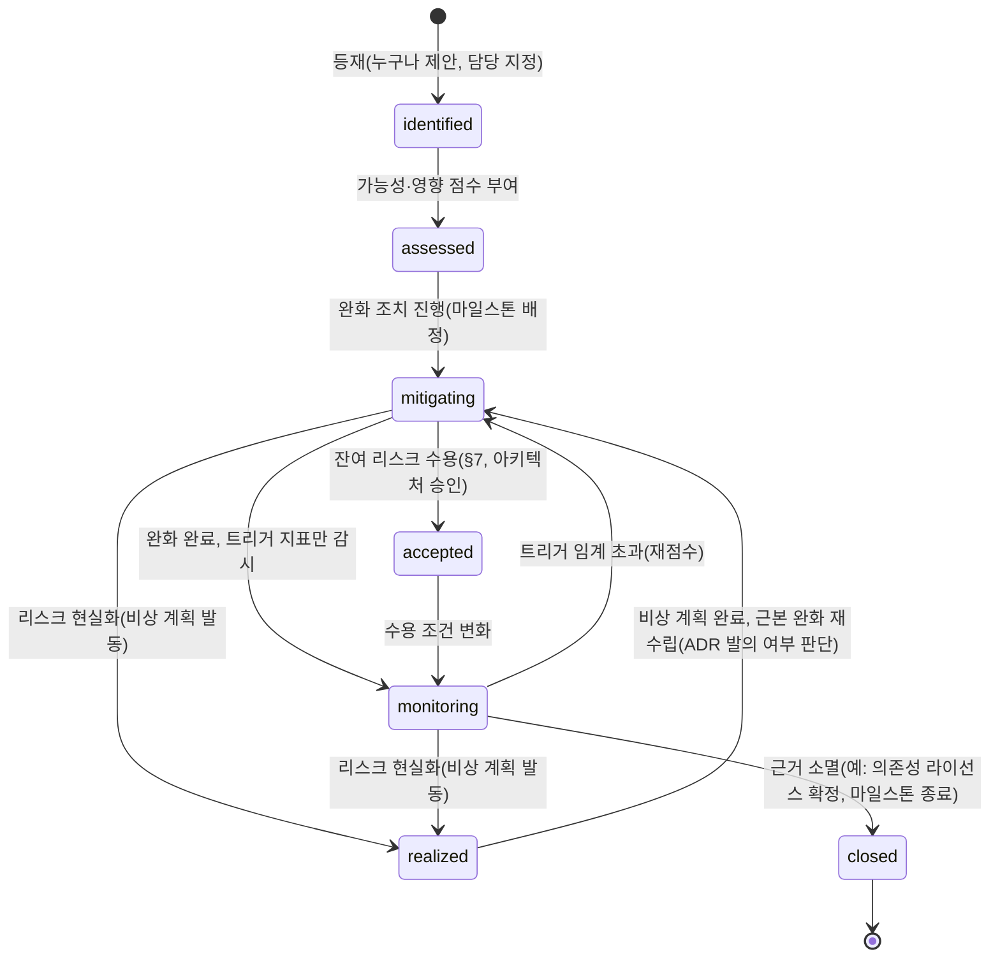
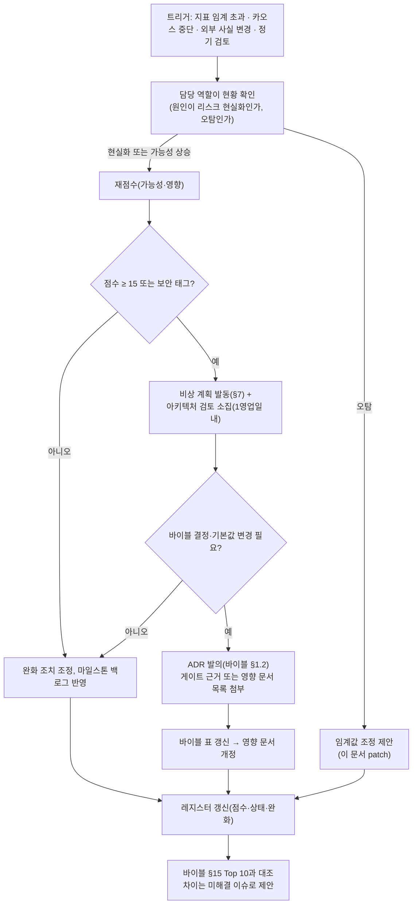

# 리스크와 완화

## 목적

이 문서는 RAG Platform의 **리스크 레지스터(risk register)를 소유**한다. 설계 바이블 §15는 리스크 Top 10을 요약하고, [선정 매트릭스](../07-tech-landscape/00-summary-and-selection-matrix.md) §종합 리스크 Top 10은 기술 지형 관점의 Top 10을, [실패 모드와 회복력](../02-architecture/09-failure-modes-and-resilience.md) §2는 컴포넌트 × 실패 모드의 FMEA(Failure Mode and Effects Analysis) 행 `F-nn`을, [마일스톤](01-milestones.md) §11은 마일스톤별 상위 리스크 요약을 각각 가진다. 이 문서는 그 넷을 **하나의 ID 체계(`R-{범주}-{nn}`)와 하나의 점수 척도**로 통합하고, 각 리스크에 완화(mitigation)·비상 계획(contingency)·담당·트리거 지표를 붙여 마일스톤 검토마다 재점수할 수 있게 한다.

이 문서는 바이블의 결정·기본값·열거값을 바꾸지 않는다. 리스크가 현실화되어 결정을 뒤집어야 하면 그 경로는 항상 ADR 발의(바이블 §1.2)이며, 이 문서는 "언제 그 절차를 시작할지"(트리거)와 "시작 전까지 무엇을 할지"(비상 계획)만 적는다.

## 범위

- **포함**: 리스크 범주·척도·점수 규칙, 리스크 레지스터(49건; 기술·라이선스·성능·품질·운영·커뮤니티·일정), 리스크 히트맵, 바이블 §15·매트릭스 Top 10·FMEA `F-nn`·마일스톤 §11과의 대응표, 마일스톤별 리스크 노출, 트리거 지표 정의(정본 메트릭과 비메트릭 관측의 구분), 검토 주기·절차·에스컬레이션, 치명 등급 리스크의 비상 계획 상세, 수용(accepted) 잔여 리스크.
- **제외**: 개별 실패 모드의 감지·자동 완화·복구 절차(09-failure-modes 소유), 런북 본문([런북](../09-operations/06-runbooks.md) 소유), 마일스톤 DoD·일정(01-milestones 소유), 백로그 산정([에픽과 백로그](02-epics-and-backlog.md) 소유), 보안 통제의 구현([멀티테넌시와 보안 아키텍처](../02-architecture/07-multi-tenancy-and-security-architecture.md)·[보안과 컴플라이언스](../09-operations/05-security-and-compliance.md) 소유).
- **수치 표기**: 가능성·영향 점수는 설계 단계의 **정성 판정**이며 확률 구간 정의(§1.2)는 초안이다. 성능·품질 임계값은 브리프 §7, 바이블 §7.2·§8.3, 09-failure-modes §10의 값을 그대로 인용하고 새 수치를 만들지 않는다. 트리거 지표의 메트릭 이름은 바이블 §6.5 정본 목록에 있는 것만 백틱으로 쓰고, 정본에 없는 관측값은 "관측(비정본)"으로 표기한다.

## 1. 리스크 관리 체계

### 1.1 ID와 범주

리스크 ID는 `R-{범주 코드}-{두 자리 번호}`다. 번호는 범주 안에서 등재 순이며 종결(closed) 후에도 재사용하지 않는다.

| 범주 코드 | 범주 | 정의 | 대표 원천 |
|-----------|------|------|-----------|
| `T` | 기술 | 선택한 라이브러리·프로토콜·계약·아키텍처 장치가 기대대로 동작하지 않거나 파손될 가능성 | 매트릭스 §매트릭스, 바이블 §15 #4·#5·#7·#8·#9 |
| `L` | 라이선스 | D-02 등급표(A/B/C/D/X) 위반 또는 라이선스 변동으로 Apache-2.0 배포·한국 내 사용이 훼손될 가능성 | [ADR-0001](../06-adr/0001-license-grade-table-and-d02-interpretation.md), 매트릭스 #2 |
| `P` | 성능 | 브리프 §7 지연·처리량·가용성 목표와 저장량·비용 한계를 지키지 못할 가능성 | 바이블 §8.3, 09-failure-modes §10 |
| `Q` | 품질 | 검색 품질 목표(nDCG@10 ≥ 0.80, Recall@20 ≥ 0.92)와 그 판정 근거(골든셋·평가) 자체가 흔들릴 가능성 | 바이블 §15 #1, [ADR-0023](../06-adr/0023-evaluation-qrels-answer-spans-and-linear-ndcg.md) |
| `O` | 운영 | 운영 복잡도, 장애 반경, 비용, 그리고 **보안**(태그 `보안`) — 교차 테넌트 누출·프롬프트 인젝션·SSRF는 운영 중 현실화되는 리스크로 이 범주에 `운영(보안)` 태그로 둔다(미해결 이슈 1) | 09-failure-modes §2.4, 바이블 §10 |
| `C` | 커뮤니티 | 오픈소스 채택·기여·문서 접근성·업스트림 관계가 형성되지 않을 가능성 | 비전 KPI, 매트릭스 §미해결 이슈 |
| `S` | 일정 | 마일스톤(M0~M5, 1.0) 일정·범위·자원 가정이 깨질 가능성 | 01-milestones §1.3·§11 |

### 1.2 가능성·영향 척도와 점수

| 등급 | 가능성(likelihood) — 다음 마일스톤 안에 현실화될 확률(초안 구간) | 영향(impact) — 현실화 시 결과 |
|:----:|------------------------------------------------------------------|------------------------------|
| 5 | 확실(> 90%, 또는 이미 부분적으로 발생) | 치명: 교차 테넌트 노출, Apache-2.0 배포 불가, 데이터 손실, 1.0 GA 1분기 이상 지연 |
| 4 | 높음(60~90%) | 높음: 브리프 §7 목표(nDCG@10 0.80, p95 800ms, 가용성 99.9%) 미달 또는 마일스톤 4주 이상 지연, 프로파일 하나가 프로덕션 비허용 |
| 3 | 중간(30~60%) | 중간: 프로파일 하나의 저하 응답 증가, 특정 포맷·장르 품질 저하, 마일스톤 2~4주 지연 |
| 2 | 낮음(10~30%) | 낮음: 운영 비용 증가, 문서·개정 작업, 2주 미만 지연 |
| 1 | 희박(< 10%) | 미미: 사용자 비가시 |

- **점수 = 가능성 × 영향**(1~25). 등급은 다음 넷이다: **치명(critical) ≥ 15**, **높음(high) 8~12**, **중간(medium) 4~6**, **낮음(low) ≤ 3**.
- 바이블 §15의 문구 매핑: 가능성 "확실" = 5, "높음" = 4, "중" = 3; 영향 "치명" = 5, 그 외는 §1.2 정의로 재판정한다. 이 매핑으로 바이블 §15의 10건을 재점수한 결과와, 매핑에서 벗어난 예외(§15 #2를 네 건으로 분해)의 근거는 §3.2에 있다.
- 점수가 바뀌는 검토는 이 문서의 patch 개정, 리스크 등재·종결은 minor 개정이다(브리프 §9.1 `version`).

### 1.3 다른 문서와의 관계

| 문서 | 이 문서와의 관계 | 충돌 시 |
|------|------------------|---------|
| 바이블 §15 리스크 Top 10 | 요약본. 이 문서의 치명·높음 등급 상위 10건과 대응(§3.2) | 바이블이 정본. 점수·완화 문구 차이는 이 문서 §미해결 이슈로 바이블 patch 제안 |
| 매트릭스 §종합 리스크 Top 10 | 기술 지형 관점의 원천. 각 행을 `R-*`로 흡수(§3.2) | 매트릭스는 "권고"이므로 이 문서가 최신 판정을 기록 |
| 09-failure-modes §2 FMEA `F-nn`, §8 카오스 `C-nn`, §9 런북 `RB-nn` | 리스크가 현실화된 **개별 실패 모드**의 감지·완화·복구. 이 문서의 비상 계획은 해당 `F-nn`·`RB-nn`을 참조만 한다 | 09 문서가 정본(감지·복구 절차) |
| 01-milestones §11 | 마일스톤별 상위 리스크 요약. 이 문서 §4가 확장판 | 01 문서가 마일스톤 배정의 정본 |
| 12-appendix/00 진행 보고서 | 미해결 이슈·알려진 이슈 추적. 설계 불일치 리스크(R-S-05)의 트리거 원천 | — |

### 1.4 리스크 수명주기

상태는 레지스터 표의 열이 아니라 검토 회의록(§6)에 기록한다. 이 문서의 표는 "현재 상태"만 반영하며, 초판(v0.1.0)의 모든 항목은 `assessed` 또는 `mitigating`이다.

## 2. 리스크 레지스터

표 열: ID · 범주 · 설명 · 가능성(L) · 영향(I) · 점수 · 완화(진행 중이거나 설계에 반영된 장치) · 비상 계획(현실화 시 조치) · 담당(역할, §2.8) · 트리거 지표(임계 초과 시 §6.2 절차 시작). 트리거 지표의 임계값은 초안 목표다.

### 2.1 기술(T)

| ID | 범주 | 설명 | L | I | 점수 | 완화 | 비상 계획 | 담당 | 트리거 지표 |
|----|------|------|:-:|:-:|:----:|------|-----------|------|-------------|
| R-T-01 | 기술 | **HWPX 파서 성숙도 부족** — python-hwpx는 PyPI Alpha 선언·단일 메인테이너·7주 24회 릴리스(메이저 3회, 조사 중 6.5.0 추가 공개). 표 병합·각주·BinData 처리 회귀가 잠금 갱신마다 유입될 수 있다 | 4 | 4 | 16 | 상한 `>=6.4,<7` + pin-and-bump; HWPX 계약 코퍼스 CI; 자체 OWPML lxml 어댑터가 heading·BinData·머리말을 직접 순회해 라이브러리 의존 면적 축소; `ParsedDocument.parser_chain[]` 기록; hwpxlib 사이드카 교차 검증(`korean-gov`) (D-18, [ADR-0007](../06-adr/0007-hwp5-java-sidecar-first-pyhwp-demoted.md)) | 릴리스 파손 시 잠금 유지·범프 보류; 회귀 지속 시 OWPML lxml 직접 경로로 전면 전환(어댑터 계약 불변, 프로파일 값 교체); 최후 `lo-sidecar` 렌더 폴백(opt-in, 표 구조 유실 감수) | parsing | HWPX 계약 코퍼스 실패 문서 수 > 0(main); pin-and-bump 2회 연속 실패; 업스트림 이슈 미응답 > 30일(비정본) |
| R-T-02 | 기술 | **HWP 5.0 사이드카 체인 미검증** — hwp2hwpx × hwpxlib 1.0.9 조합 미검증·변환 손실, unhwp ctypes 크래시·arm64 미지원, Tika `HwpV5Parser` 배포용 복호화 미실측 | 4 | 3 | 12 | 3중 폴백(Java 사이드카 → unhwp → hwp-hwpx-parser → `lo-sidecar` opt-in)이 프로파일 값; 격리 사다리 `in_process`/`helper_process`/`sidecar`([ADR-0033](../06-adr/0033-sidecar-convert-contract-and-isolation-ladder.md)); 변환 일치율 코퍼스(M2); 변환본 `derived` 콘텐츠 주소화 | 1차 경로 실패율 임계 초과 시 프로파일 값으로 순서 교체(코드 변경 없음); arm64 노드는 hwp-hwpx-parser 우선; 배포용 문서는 `parse.distribution_document` 유지 | parsing | `rag_parser_sidecar_unavailable_total` 증가율; `parse.conversion_failed` 비율(로그 집계, 비정본); `parser_chain[]` 길이 > 1 문서 비율(비정본) |
| R-T-03 | 기술 | **빠른 릴리스 의존성 파손** — Docling 주 2회 릴리스(`LayoutOptions` deprecated), docling-core[chunking] `semchunk<4`·`tiktoken<0.13` 상한, vLLM pooling API, MCP 스펙 13개월 3회 파괴적 개정(SDK v1→v2), OTel GenAI semconv 속성 개명(Development 단계) | 4 | 3 | 12 | `uv lock --check` CI(D-01); semchunk 3.2.5/tiktoken 0.12 잠금 + Docling 청커 `[docling-chunker]` extra([ADR-0020](../06-adr/0020-default-chunker-structure-aware-and-dependency-locks.md)); `McpToolAdapter` 격리 + conformance CI, `mcp>=2,<3`([ADR-0025](../06-adr/0025-mcp-cursor-pagination-and-tool-set.md)); semconv 커밋 고정 + Weaver 레지스트리 diff([ADR-0022](../06-adr/0022-observability-genai-semconv-pin-and-license-boundary.md)); 계약 스냅샷 테스트 | 파손 시 잠금 유지·범프 보류; 파손 어댑터의 extra만 비활성; MCP는 이전 스펙 버전 conformance 유지(`--spec-version` 병행) | platform | `uv lock --check` 실패 빈도(주 1회 초과, 비정본); 어댑터 계약 테스트 실패 수; Weaver diff 경고; conformance CI 실패 |
| R-T-04 | 기술 | **계약 변경 파급** — 34 계약 스키마·16 계약 문서·플러그인 `contracts_compat`·클라이언트 SDK 2종이 한 계약의 major 변경에 연쇄; 1.0 동결 후 플러그인·`korean-gov` 요구가 minor 가산 이상을 요구 | 3 | 4 | 12 | 바이블 §1.2 변경 절차(minor 가산만, major는 영향 문서 목록 첨부); CI가 `schemas/*.schema.json` ↔ §5.7 열거·이벤트·오류 코드 기계 대조; [스키마 버저닝과 호환성](../03-contracts/14-schema-versioning-and-compatibility.md) 규칙; 1.0 동결 = major 금지·minor 가산 허용 + `Deprecation`·`Sunset`([ADR-0030](../06-adr/0030-single-coordinate-system-and-score-ledger.md), [ADR-0036](../06-adr/0036-naming-and-identifier-conventions.md)) | major가 불가피하면 마일스톤 종료 창에 묶어 1회(01-milestones §10.3); 2.0 후보는 백로그 격리; 플러그인은 `contracts_compat` 범위로 구버전 병존 | architecture | 스키마 diff CI의 `breaking` 판정 수 > 0; 계약 문서 미해결 이슈 중 "필드 추가 제안" 누적 수(비정본); 플러그인 호환 실패 보고 |
| R-T-05 | 기술 | **인덱스 불일치(두 백엔드 정합성 붕괴)** — Qdrant·OpenSearch 부분 커밋, alias 교체 비원자성, 플립 중 실패(F-16), 세대 플립 경합으로 `hydrate` 누락(F-29), `lite` 클라이언트 BM25의 TF×IDF 퇴화 | 3 | 4 | 12 | 세대 사가 + commit ledger + `is_current` 플립 + 이전 세대 복원 보상([ADR-0026](../06-adr/0026-index-commit-generation-saga-and-ledger.md)); `maintenance.consistency.v1` 정합성 검사; 산출물 재적재가 복구 1순위; `sparse_bm25` 포화식 강제 + bm25s 일치 테스트([ADR-0012](../06-adr/0012-lite-profile-qdrant-only-client-bm25.md)); 카오스 C-10 매 PR | 불일치 문서는 `reprocess from_stage=index`; 광범위하면 컬렉션 blue/green 재색인; 런북 RB-03 | retrieval | `rag_consistency_mismatch_total` 증가분 > 0; `rag_hydrate_missing_total` 상승 추세; `index.commit.rolled_back` 비율(비정본); `ContextPack.diagnostics.index_generations_seen` 혼합 p99 > 5s(비정본) |
| R-T-06 | 기술 | **벡터 DB 벤더 변경** — Qdrant의 라이선스·가격·기능 정책 변경(멀티벡터·`modifier: idf`·JWT RBAC 등), 또는 도입 조직 표준(Milvus·pgvector·OpenSearch k-NN) 강제. named vectors·payload 사전 필터·`Fusion.RRF`·MaxSim 같은 백엔드 고유 기능이 어댑터 밖으로 누출되면 교체 비용이 커진다 | 2 | 4 | 8 | `IndexBackend` + `IndexBackendCapabilities`(`capabilities()`) 선언(D-15); 적합성 키트 `security_invariants`·`fuser_equivalence`([ADR-0032](../06-adr/0032-plugin-sdk-stage-protocol-and-conformance-kit.md)); M5에 대체 구현 1종(Milvus 또는 pgvector) 코어 제공; 산출물 재적재로 인덱스 재구성(K6) | 대체 백엔드 어댑터로 컬렉션 blue/green 재색인; `capabilities` 미지원 기능은 `degraded{…, capability_unsupported}` 자동 비활성; Qdrant 버전 잠금 유지 | retrieval | 적합성 키트 통과 백엔드 수 < 2(M5 이후); Qdrant 릴리스 노트의 라이선스·기능 정책 변경(외부 사실); 조직 표준 요구 이슈 수(비정본) |
| R-T-07 | 기술 | **캐시 키 = 멱등 키 규칙의 함정** — `stage_key` 지문(`image_digest`·`dictionary_hash`·`embedding_space_id`) 누락 시 낡은 산출물 재사용, 스코프 누락 시 타 테넌트·컬렉션 봉투 재사용, 검증자 없는 원천의 낡은 원본 재사용 | 3 | 3 | 9 | SDK가 `fingerprint()` 구성요소 강제 검증; `stage_key`에 `scope_key` 합성·`fetch` 캐시 제외([ADR-0037](../06-adr/0037-artifact-cache-scope-and-stage-key-composition.md)); 서빙 교체 코사인 ≥ 0.9999 게이트(D-16); 적합성 키트 `idempotency`; `rag cache invalidate --stage` | 오염 의심 스테이지 캐시 무효화 후 `reprocess from_stage`; 영향 범위는 `IndexCommit.*_fingerprint`로 식별 | platform | 적합성 키트 `idempotency` 실패; `Producer.fingerprint` 구성요소 누락 예외 수(비정본); 같은 `stage_key`에 다른 `image_digest` 관측(비정본) |
| R-T-08 | 기술 | **임베딩 서빙 단일 경로** — BGE-M3 dense+sparse 3-in-1 생산 경로가 vLLM `--runner pooling` + `bge_m3_sparse_plugin` 하나(TEI·Infinity 대안·기각, ADR-0009). vLLM 릴리스로 pooling API·플러그인이 파손되면 `embed`가 정지하고 폴백 모델이 없다(`embed.space_mismatch`) | 3 | 4 | 12 | vLLM 마이너 잠금 + 동등성 게이트(코사인 ≥ 0.9999); 인프로세스 FlagEmbedding 경로를 같은 공간 대체 서빙으로 게이트 검증([ADR-0009](../06-adr/0009-embedding-serving-vllm-pooling-tei-inprocess.md)); 서킷 브레이커 + Temporal 백오프(F-12); `lite`는 인프로세스 int8 | 서빙 파손 시 인프로세스 fp16/fp32 ONNX 경로로 임시 전환(게이트 통과 전제, 09-failure-modes 미해결 이슈 14); 장기화 시 `ko-quality`(KURE-v1 + PIXIE-Splade-v1.5) 프로파일로 blue/green | retrieval | `embed.server_unavailable` 재시도 소진 잡 수(비정본); 카오스 C-02 실패; vLLM 릴리스 노트 pooling 변경(외부 사실); 동등성 게이트 코사인 < 0.9999 |
| R-T-09 | 기술 | **인용 좌표 불일치** — 정규화 `offset_map`·문장 윈도우·압축·표 직렬화가 `block_refs`/`sentence_spans` → `Provenance` 좌표를 깨뜨려 `citations`와 `answer_spans` 평가가 무효화 | 3 | 3 | 9 | 단일 좌표계(K1) 불변식 스키마 검증([ADR-0030](../06-adr/0030-single-coordinate-system-and-score-ledger.md)); 3-텍스트 규칙([ADR-0029](../06-adr/0029-three-text-rule-and-deterministic-context-prefix.md)); 문장 단위 보존형 압축만 기본 후보; 적합성 키트 `renderer_citation_roundtrip`; `BlockRef.original_char_start/original_char_end` 병기 | 불일치율 임계 초과 시 `compress`·`sentence_window` 비활성(프로파일 값) 후 원인 스테이지 수정; 영향 커밋 재처리 | retrieval | `rag_pack_citation_unresolved_total` 증가율 > 0.1%(초안); `renderer_citation_roundtrip` 실패; `rag_eval_metric_value{metric="span_hit_rate@10"}` 하락(초안) |
| R-T-10 | 기술 | **한국어 분석기 단일 메인테이너·Kiwi 승격 지연** — kiwipiepy 0.24.0(Apache-2.0) PyPI 미공개(이슈 #233), 0.23.2는 LGPL 정적 링크 wheel(B 등급 거부); kss·pecab·python-mecab-ko 개인 프로젝트; Nori 사전 2018-07 고정; Kiwi/Nori 토큰 불일치 | 3 | 3 | 9 | 공백기 기본 python-mecab-ko 1.3.7 + kss 6.0 `punct`([ADR-0021](../06-adr/0021-korean-analyzer-kiwi-promotion-and-interim-mecab-kss.md)); `analyzer_id`·`dictionary_hash`를 `IndexCommit`·`QueryPlan`에 기록해 불일치 감지(`degraded{channel.lexical, analyzer_mismatch}`); `UserDictEntry` 단일 소스 → Kiwi/Nori/synonym 생성; Nori(ASF)·lindera 대안 | 승격 지연 장기화 시 mecab-ko 유지 + 컬렉션 사용자 사전 강화; 분석기 전환은 렉시컬 재색인 1회로 묶음(01-milestones §10.2 게이트 13) | evaluation | kiwipiepy PyPI 라이선스 메타(외부 사실, 확인 필요 as of 2026-09); `degraded{channel.lexical, analyzer_mismatch}` 비율; `lite` `eval.gates.ndcg@10.min`(0.70) 미달 |

### 2.2 라이선스(L)

| ID | 범주 | 설명 | L | I | 점수 | 완화 | 비상 계획 | 담당 | 트리거 지표 |
|----|------|------|:-:|:-:|:----:|------|-----------|------|-------------|
| R-L-01 | 라이선스 | **AGPL 의존 격리 복잡성** — 코어 이미지에는 AGPL 의존이 들어가면 안 된다. (1) 대안·기각(회귀 재유입 금지, 코어에 아예 쓰지 않음): PyMuPDF(대안·기각, ADR-0006 — `pdf_fast_cpu`로 대체), pyhwp(대안·기각, ADR-0007 — Java 사이드카로 대체), MinIO(AGPLv3; 대안·기각, ADR-0011 — RustFS/SeaweedFS로 대체), 실 Redis(AGPLv3; 대안·기각, ADR-0011 — Valkey로 대체, "Redis 호환(Valkey)"만 허용). (2) 옵트인 격리 사이드카(별도 저장소 `rag-platform-gpl-sidecars`, Helm `optIn.*`, 네트워크 API만): H2Orestart(GPLv3), Grafana·Tempo·Loki(AGPL). 개발 편의로 (1)을 인프로세스 `import`하거나 (2)를 Compose 기본값에 포함하는 회귀가 반복될 수 있다 | 3 | 4 | 12 | 등급표 CI 게이트(pip-licenses + liccheck + SBOM, [ADR-0001](../06-adr/0001-license-grade-table-and-d02-interpretation.md)); import-linter 금지 모듈; 별도 저장소·독립 릴리스(바이블 §6.7); AGPL 불가 환경 대안 문서화(OpenSearch Observability + Perses, VictoriaMetrics·VictoriaLogs + Jaeger; [ADR-0022](../06-adr/0022-observability-genai-semconv-pin-and-license-boundary.md)) | 회귀 발견 시 릴리스 차단·의존 제거 패치; 이미 배포된 이미지는 SBOM 재발행 + 공지 | security | 라이선스 게이트 차단 건수(PR, 비정본); SBOM에 C 등급 패키지 출현; Helm 기본 values의 `optIn.*=true` diff |
| R-L-02 | 라이선스 | **모델 라이선스(CC-BY-NC) 오용** — jina v3/v4/v5·jina-reranker(CC-BY-NC/Qwen Research), kanana(CC-BY-NC), SPLADE-v3(CC BY-NC-SA, 대안·기각 O-02/ADR-0014), ColQwen2.5·ColPali(Qwen Research·Gemma), Provence(CC BY-NC-ND)가 예시·프로파일·튜토리얼·커뮤니티 플러그인에 유입; BYO 모델의 `model_license_ack`가 형식적 체크로 전락 | 3 | 4 | 12 | `models.lock`(id, revision, sha256, license, grade, territory) + safetensors 전용; `PluginMeta.license_grade`·`territory` 필수; D 등급은 기본 프로파일 금지 + `model_license_ack: true`(D-02); 문서·예시의 미검증 모델 식별자는 플레이스홀더(바이블 결정); 가중치·LICENSE 자체 미러링([ADR-0010](../06-adr/0010-bge-m3-rationale-and-late-interaction-slot.md)) | 유입 발견 시 프로파일 로딩 거부(`profile.invalid`)·릴리스 노트 공지; 커뮤니티 카탈로그 등재 취소 | security | `plugin.license_denied` 발생 수(비정본); `models.lock` 외 모델 다운로드 시도 = 워커 `rag_egress_denied_total{component}` 급증; 카탈로그 등재 거부 비율(비정본) |
| R-L-03 | 라이선스 | **전이 의존성 등급 변동** — chardet 7의 0BSD 재라이선스 분쟁, Trafilatura `<1.8` GPLv3(핀 필요), kiwipiepy 정적 링크, Dramatiq LGPL, selectolax Modest 번들, Langfuse ClickHouse 인수 후 EE 경계. 업스트림이 라이선스를 바꾸면 잠금 갱신 시 조용히 유입 | 3 | 3 | 9 | 매 잠금 갱신마다 라이선스 게이트 + SBOM diff; 허용 목록(A) 명시·B 조건부·C/D/X 차단; ScanCode 주간; 릴리스마다 SBOM 서명 발행 | 변동 발견 시 해당 버전 상한 고정·매트릭스 대안 열로 전환; 릴리스된 버전은 공지 + 패치 | security | SCA 경고 수(비정본); SBOM diff 라이선스 필드 변경 건수; liccheck 실패 |
| R-L-04 | 라이선스 | **지역·매출 제한 모델 유입** — HunyuanOCR(대한민국 사용 비허가), Surya·Marker·Chandra(OpenRAIL-M 매출 임계), MinerU(귀속 의무), Gemma 파생(bge-reranker-v2-gemma·harrier·EXIT 어댑터 Terms 승계), NVIDIA Open Model License(Nemotron-OCR) | 2 | 4 | 8 | `territory` 대조(`rag profile validate` 규칙 (1)); D 등급 옵트인 + `model_license_ack`; 법무 검토 대기 목록 운영(매트릭스 미해결 이슈 7); OCR 기본은 RapidOCR([ADR-0008](../06-adr/0008-ocr-default-rapidocr-ppocrv5-korean.md)) | 발견 시 해당 모델을 X로 강등·프로파일 로딩 거부; 한국 배포 매니페스트에서 제거 | security | `territory` 검증 거부 건수(비정본); 법무 검토 미결 항목 수·경과일(비정본) |
| R-L-05 | 라이선스 | **법무 검토 대기·데이터셋 라이선스** — CDLA-Permissive-2.0(Docling 모델), spaCy `ko_core_news_lg` CC BY-SA 4.0(런타임 다운로드), 한컴 OWPML 고지, `inference-free-splade-ko-v1` 라이선스 태그 미기재; 골든셋 재료 KorQuAD CC BY-ND·AI Hub 재배포 불가·BERGEN NC → 골든셋 v2 공개 불가 | 3 | 3 | 9 | 법무 검토 대기 목록을 §6 검토 주기에 포함; `EvalDataset` 라이선스 필드 필수(데이터셋 레지스트리); 공개 골든셋은 허용 라이선스 원천(공공 문서)만; 모델 미번들·런타임 다운로드([ADR-0023](../06-adr/0023-evaluation-qrels-answer-spans-and-linear-ndcg.md)) | 불허 시 매트릭스 대안(layout egret 계열·정규식 PII·자체 라벨)으로 교체; 골든셋 v2 공개 범위 축소(qrels·`answer_spans`만 공개, 원문 미공개) | evaluation | 법무 대기 항목 수(목표 0 by M3, 비정본); `EvalDataset` 라이선스 필드 누락 수 |

### 2.3 성능(P)

| ID | 범주 | 설명 | L | I | 점수 | 완화 | 비상 계획 | 담당 | 트리거 지표 |
|----|------|------|:-:|:-:|:----:|------|-----------|------|-------------|
| R-P-01 | 성능 | **리랭커 p95 초과** — top-100 × 512 토큰 크로스인코더가 GPU 병목(바이블 §8.3 rerank 예산 250ms); TEI 타임아웃 300ms와 예산 250ms 불일치(09-failure-modes 미해결 이슈 18); Qwen3-Reranker는 TEI 미지원·디코더 지연 미실측 | 3 | 4 | 12 | 지연 예산 전파·저하 사다리 L2a/L2b/L3(09-failure-modes §3.1); 300ms 폴백(`rerank.applied=false`, `explain += rerank_skipped`); 컬렉션 캘리브레이션; KEDA; 2단 리랭크 옵션(MaxSim 300→100, [ADR-0010](../06-adr/0010-bge-m3-rationale-and-late-interaction-slot.md)); 카오스 C-06 주 1회 | 지속 초과 시 `query.rerank.top_n_in` 100→50을 프로파일 값으로 조정(게이트 첨부) 또는 GPU 증설; 최후 리랭크 생략 프로파일(`lite` 방식) | retrieval | `rag_rerank_latency_seconds` p95 > 250ms; `rag_rerank_fallback_total` 비율 > 1%(저하율 SLO); `rag_query_latency_seconds` p95 > 800ms |
| R-P-02 | 성능 | **GPU 비용** — 임베딩(vLLM pooling)·리랭커(TEI GPU)·OCR(`ocr-gpu`)·LLM 보강·판정 LLM·멀티벡터가 GPU 상주; KEDA 0→1 지연 때문에 `minReplicaCount: 1` 상주 비용; MIG·time-slicing 경합(F-40) | 4 | 3 | 12 | `lite`(GPU 0) 제공(바이블 §7.1); 벌크헤드(검색 리랭커 ↔ 수집 임베딩 서버 분리); `ingest-gpu-embed`·`ingest-gpu-ocr` 큐 분리 + KEDA; 대량 초기 색인은 배치; `enrichment_budget_tokens`; late interaction 128d + turbo4 | 비용 초과 시 CPU 경로로 강등(gte-multilingual-reranker-base @ TEI CPU, RapidOCR CPU); 수집을 야간 배치 창으로 이동(`korean-gov` 스케줄 방식) | platform | GPU 시간당 비용·사용률 < 30% 상주 시간(운영 대시보드, 비정본); `rag_enrich_llm_cost_usd_total` |
| R-P-03 | 성능 | **PDF 처리량 목표 미달** — 브리프 §7 "텍스트 PDF 100페이지 < 30s"를 Docling CPU `pdf_standard`(heron + TableFormer ACCURATE)가 충족하는지 공개 근거로 확정할 수 없다(OCR-off 추정 약 32s) | 3 | 2 | 6 | `pdf_fast_cpu`(pypdfium2 + pdftext) 라우팅이 목표를 확실히 달성([ADR-0006](../06-adr/0006-pdf-fast-path-pypdfium2-pdftext-replaces-pymupdf.md)); 01-milestones §10.2 게이트 15(계약 코퍼스 + ENV-M, M3) 실측; layout egret-m 옵션(334 vs 643 ms/img) | 미달 시 디지털 PDF 기본을 `pdf_fast_cpu`로, 표 밀도 높은 문서만 `pdf_standard` 라우팅(ADR-0006 갱신) | parsing | `rag_ingest_stage_duration_seconds{stage="parse"}` p95(100p 정규화) > 30s; 게이트 15 결과 |
| R-P-04 | 성능 | **저선택도 필터에서 ANN recall 급락** — `tenant_id`·`collection_id`·ACL·`is_current`·전략 필터가 겹치는 다중 사전 필터에서 HNSW recall 급락(소규모 테넌트·`restricted` 문서); 그룹 확장 폭증으로 `FilterNode` 절 ≤ 32 초과 | 3 | 3 | 9 | Qdrant `is_tenant` payload 파티셔닝 + payload 인덱스(바이블 §13.4); `TieringPolicy`(100만 청크 초과 시 `shard_key`, 규제 테넌트 `index_per_tenant`, [ADR-0028](../06-adr/0028-tenant-isolation-tiering-policy.md)); `FilterNode` 깊이 ≤ 3·절 ≤ 32; 골든셋 필터 시나리오 | 대형 테넌트 승격(`tier_promotion` 잡); `query.channels[*].top_k` 상향(프로파일 값, 게이트 첨부); 백엔드 필터 인식 탐색 기능 평가 | retrieval | 필터 시나리오 `eval.gates.recall@20.min`(0.92) 미달; `channel_runs[].status=timeout` 비율(비정본); 테넌트 청크 수 > 100만 |
| R-P-05 | 성능 | **`hydrate`의 Qdrant 단일 의존** — `standard`에서 Qdrant 전면 장애 시 lexical 후보도 payload를 채울 수 없어 503 `retrieve.unavailable`(F-22); "렉시컬만" 저하가 불가능 | 2 | 4 | 8 | Qdrant 복제 ≥ 2(NFR-AVL-05); `hydrate` 1회 재시도; `/readyz` 필수 의존성 규칙; 카오스 C-04·C-05([ADR-0034](../06-adr/0034-retrieval-hot-path-postgres-independence-and-hydrate.md)) | OpenSearch `_source` 미러를 `hydrate` 폴백 소스로 두는 ADR-0034 개정 검토(09-failure-modes 미해결 이슈 2); 장애 중에는 `Retry-After` 5s 유지 | retrieval | 503 `retrieve.unavailable` 비율(비정본); 검색 가용성 에러 버짓 소진율(빠른 소진 알림); 카오스 C-05 결과 |
| R-P-06 | 성능 | **저장량 팽창** — `record_id` 세대 합성으로 `cleanup_delay`(1h) 동안 세대별 레코드 2배 공존(바이블 미해결 이슈 17); `late_interaction` 128d 멀티벡터(100만 청크 × 300토큰 ≈ 77GB fp16); `page_multivector` | 3 | 2 | 6 | `cleanup_delay` 후 이전 세대 삭제; `rag_index_bytes_total{vector}` 별도 계량; turbo4/1-bit·풀링 벡터 모드; `visual-pages` 별도 컬렉션; late interaction 기본 끔([ADR-0004](../06-adr/0004-deterministic-chunk-id-scoped-record-id-and-ulid-exception.md), ADR-0010) | 팽창 시 `cleanup_delay` 단축(프로파일 값), `late_interaction` 채널 비활성, 디스크 증설(RB-05) | platform | `rag_index_bytes_total{vector="late_interaction"}` 증가율; 디스크 사용량 80%/90% 알림(초안) |

### 2.4 품질(Q)

| ID | 범주 | 설명 | L | I | 점수 | 완화 | 비상 계획 | 담당 | 트리거 지표 |
|----|------|------|:-:|:-:|:----:|------|-----------|------|-------------|
| R-Q-01 | 품질 | **한국어 문서 수준 골든셋 부재·지연** — 파서·OCR·청킹·임베딩·융합·리랭커의 모든 기본값이 영어 벤치마크·라인 OCR·벤더 수치에 의존; HWPX 공개 리트리벌 벤치마크 없음; 라벨링 인력 미확보 | 5 | 4 | 20 | 하네스를 M1 산출물로([ADR-0023](../06-adr/0023-evaluation-qrels-answer-spans-and-linear-ndcg.md)); 골든셋 4종 + Allganize KO·MIRACL-ko 외부 셋; `answer_spans`로 재청킹 불변; 모든 품질 기본값 `gate`(바이블 §7.4); 라벨링 W11 병행; UMBRELA 라벨러 보조(M4) | 골든셋 v1 지연 시 외부 셋만으로 M2 DoD 축소 판정 + "초안 목표" 라벨 유지; M4 게이트 실행 순연(01-milestones 미해결 이슈 9); §7.1 상세 | evaluation | 라벨 qrels 누적 수 / 계획 < 80%(비정본); 프로파일 게이트 `eval.gates.judged@10.warn_below`(0.7) 경고(바이블 §7.3); `rag_eval_metric_value{metric="ndcg@10"}`를 측정하지 못한 마일스톤 수 |
| R-Q-02 | 품질 | **한국어 리랭커 품질** — bge-reranker-v2-m3의 한국어 골든셋 성능 미검증; 대안(dragonkue ko 변종 +2pt, Qwen3-Reranker +3pt & p95)은 게이트 대기; jina-reranker 제외로 후보군 축소; 캘리브레이션 없이는 `confidence_tier`·`relevance_gate.tau` 의미가 약함(바이블 미해결 이슈 2) | 3 | 4 | 12 | 01-milestones §10.2 게이트 2·3(M4); 서빙 경로 동일한 모델 ID 교체 설계; 컬렉션 `calibrations`; 인터리빙·쌍대 비교; 리랭크 생략 시 `sufficiency.status=unknown`([ADR-0010](../06-adr/0010-bge-m3-rationale-and-late-interaction-slot.md)) | 게이트 미달 시 리랭크 생략 프로파일과 A/B 후 `top_n_out` 조정; `korean-gov`는 dragonkue A/B; 최후 `quality` 변형의 LLM 리랭커로 보완 | evaluation | `rag_eval_metric_value{metric="ndcg@10"}` 리랭크 on/off 차이 < +0.02; `confidence_tier` 분포 왜곡(high 비율 이상, 비정본) |
| R-Q-03 | 품질 | **OCR 품질** — RapidOCR PP-OCRv5 korean mobile의 공문서·표·도장·세로쓰기·2단 CER/WER 미실측(공개 비교는 영수증 라인 단위); Tesseract 한국어 최하위; `OCRVersion` 명시 누락 시 PP-OCRv6(한국어 미포함)이 기본 | 4 | 3 | 12 | 프로파일 `ocr: {plugin, lang, version, model}` 필수 키 + `OCRVersion.PPOCRV5`·`ModelType.MOBILE` 명시([ADR-0008](../06-adr/0008-ocr-default-rapidocr-ppocrv5-korean.md)); `Block.source=ocr`·`Block.confidence`·`page_status[]`; `premium` PaddleOCR server; `kor_vert` 라우팅; 게이트 7(M4 CER/WER); VLM 보완 채널(`pdf_vlm_gpu`, 게이트 10) | 미달 시 GPU OCR를 `standard`에 옵트인 사이드카로 확대; 저신뢰 페이지는 `visual-pages` 폴백; Nemotron-OCR 법무 검토 후 비교 | parsing | 게이트 7 CER/WER; `Block.confidence` 저조 페이지 비율(비정본); `page_status` 중 `ocr_failed`·`timeout` 비율(비정본) |
| R-Q-04 | 품질 | **청킹 기본값 튜닝 실패** — 512/2048/64·표 행 그룹 256·오버랩 0/10%가 한국어(bge-m3 512토큰 ≈ 900~1,000자)에서 최적이 아닐 수 있음; 한국어 팽창률 계수 미고정; 장르(`law_article`·`outline_report`) 편차 | 3 | 3 | 9 | O-09 그리드 {256, 384, 512, 768} × {0, 10%, 15%}(게이트 8, M4); `answer_spans`로 청킹 전략 비교; `recount` 스테이지로 토크나이저 교체 시 재청킹 회피([ADR-0019](../06-adr/0019-chunk-size-tokenizer-defaults-and-recount-stage.md)); `genre_route` 장르 라우팅([ADR-0020](../06-adr/0020-default-chunker-structure-aware-and-dependency-locks.md)) | 그리드 결과로 ADR-0019 갱신 + 프로파일 버전 증가 → blue/green 재색인 1회(M4 묶음); 장르별 프로파일 분기 | evaluation | 게이트 8의 nDCG@10 차이; `chunk.block_oversized` 경고 비율(비정본); Recall@20 장르별 편차 |
| R-Q-05 | 품질 | **평가셋 편향** — LLM-judge 순환 편향(자기 리랭커·임베딩 과대평가), 라벨러 편향, 장르·기관 편중(공공 문서 과다), 합성 질의와 실제 질의 분포 괴리, 리더보드 과적합 | 3 | 3 | 9 | 판정 모델 계열 분리; 사람 라벨 게이트(κ·τ 교정, `korean-gov` 100%); `EvalDataset.label_provenance`(`human`·`umbrela`·`synthetic`) 기록; Holm 보정·인터리빙([ADR-0023](../06-adr/0023-evaluation-qrels-answer-spans-and-linear-ndcg.md)); `FeedbackEvent` 온라인 신호 대조(M5) | 편향 확인 시 해당 서브셋 가중 축소·재라벨; 게이트 판정 보류(기본값 유지) | evaluation | judge–사람 일치도(κ) 하락(비정본); `label_provenance=synthetic` 비율 > 50%; 장르 분포 편차(비정본) |
| R-Q-06 | 품질 | **신규 모델 조기 채택** — KURE-v2(공개 1개월, 카드 자체 보고), MonkeyOCRv2-B(2개월), PIXIE·harrier·Qwen3-VL-Embedding(6~9개월) 등을 벤더 수치로 채택 → 재현 실패·기본값 오선정 | 3 | 3 | 9 | 매트릭스 판정 원칙(공개 1개월 이내·벤더 벤치마크는 근거 아님); 감시 목록 + 12개월 관찰 + 골든셋 재현 게이트; 리더보드는 후보 선별에만; `models.lock` revision 고정 | 재현 실패 시 후보 강등·기본값 유지; 이미 승격된 경우 이전 `embedding_space_id` 세대로 blue/green 롤백 | evaluation | 게이트 재현 실패 건수(비정본); 감시 목록 모델의 공개 경과 개월 < 12 |
| R-Q-07 | 품질 | **임베딩 공간 불일치·조용한 품질 회귀** — 서빙 모델 `model_id@revision`·차원·정규화·양자화가 프로파일과 달라 다른 벡터가 같은 공간에 적재(F-13); `lite` int8과 `standard` fp16 공간이 달라 승격 시 재색인(01-milestones 미해결 이슈 8) | 2 | 4 | 8 | 어댑터 `warmup`·`health`에서 `embedding_space_ids` 대조 → `embed.space_mismatch` 배치 거부 + 워커 `/readyz=false`; `Producer.model_ids`·`image_digest` 지문; 동등성 게이트 0.9999; 야간 `rag_eval_metric_value` 회귀([ADR-0009](../06-adr/0009-embedding-serving-vllm-pooling-tei-inprocess.md)) | 잘못 적재된 세대를 `IndexCommit.embedder_fingerprint`로 식별 → `reprocess from_stage=embed`(RB-12); lite→standard 승격은 [업그레이드와 마이그레이션](../09-operations/08-upgrade-and-migration.md)의 blue/green 절차 | retrieval | `embed.space_mismatch` 발생(비정본); 야간 nDCG@10 −0.01 초과 & p < 0.05; 워커 `/readyz=false` |

### 2.5 운영(O)

| ID | 범주 | 설명 | L | I | 점수 | 완화 | 비상 계획 | 담당 | 트리거 지표 |
|----|------|------|:-:|:-:|:----:|------|-----------|------|-------------|
| R-O-01 | 운영 | **Temporal 운영 부담** — frontend/history/matching + 별도 PG DB + 태스크 큐 6종 + KEDA 스케일러 + 서버·SDK 업그레이드; 소규모 도입 조직의 진입 장벽 | 4 | 3 | 12 | 오케스트레이터 중립 `PipelineContext` + 비내구 `LocalRunner`([ADR-0003](../06-adr/0003-orchestrator-neutral-pipeline-and-non-durable-local-runner.md)); 경량 프로덕션 = 단일 바이너리 + PG; 조정 틱은 api 타이머(Temporal 없이 동작); 리트리벌 미경유; Helm 프로파일 values; RB-02 | 운영 불가 조직은 `lite` + Procrastinate 부수 큐로 축소; 장기적으로 DBOS Transact ADR(1.0 이후, 바이블 미해결 이슈 6) | platform | `queued` 체류 p95(비정본); Temporal 업그레이드 소요·실패 수(비정본); 운영 문의 이슈 수(비정본) |
| R-O-02 | 운영 | **사이드카·GPU 운영 복잡도** — Java(`parser-workers`)·LibreOffice(좀비·행)·PaddlePaddle CUDA(`ocr-gpu`)·vLLM·TEI·Langfuse(ClickHouse); CPU 바운드 액티비티 GIL; MIG 프로파일 불일치 | 4 | 3 | 12 | REST `POST /v1/convert` 단일 계약([ADR-0033](../06-adr/0033-sidecar-convert-contract-and-isolation-ladder.md)); tini·프로세스 그룹 KILL·프로파일 락·`/healthz`; 큐별 워커 프로세스 다중화; `derived` 변환 캐시; 격리 사다리; RB-06 | 불안정 사이드카는 해당 포맷 폴백 체인 하위로(프로파일 값); GPU 사이드카는 CPU 폴백(`quality=degraded`) | platform | `rag_parser_sidecar_unavailable_total`; 사이드카 재시작 횟수(비정본); `parse.sidecar_unavailable`·`parse.conversion_failed` 비율(비정본) |
| R-O-03 | 운영 | **PostgreSQL 단일 장애 반경** — 원장·잡·멱등 키·아웃박스·레지스트리(+Temporal 별도 DB)가 PG에 집중; 다운 시 수집 정지(F-31); API 키 인증 캐시 미스도 실패(09-failure-modes 미해결 이슈 3); RLS·pgbouncer `SET LOCAL app.tenant_id` 강제 방법 미확정(바이블 미해결 이슈 9) | 3 | 4 | 12 | 검색 핫패스 PG 미의존([ADR-0034](../06-adr/0034-retrieval-hot-path-postgres-independence-and-hydrate.md)); Temporal 전용 DB 분리; 동기 복제 + 자동 페일오버 + PITR(RPO ≤ 5min); 원장 append-only; `statement_timeout`; 카오스 C-08; RB-01 | 페일오버 후 조정 틱이 `queued` 재시작; 장기 장애 시 수집 접수 503 + `Retry-After` 유지·검색 지속; DR은 [백업과 재해 복구](../09-operations/07-backup-and-disaster-recovery.md) | platform | `POST /v1/ingest` 503 비율(비정본); 수집 접수 가용성 에러 버짓 소진; 복제 지연(비정본) |
| R-O-04 | 운영(보안) | **교차 테넌트 누출** — 필터 누락, ACL 갱신 지연, 그룹 확장 폭증, 콘텐츠 키 충돌(동일 바이트 문서), Qdrant 사전 필터 단일 방어(JWT RBAC 미확인, 바이블 미해결 이슈 13), 새 어댑터·플러그인의 필터 우회 | 3 | 5 | 15 | 강제 지점 E1~E17([ADR-0027](../06-adr/0027-security-context-injection-and-acl-enforcement-points.md)); `record_id` 스코프·세대 합성([ADR-0004](../06-adr/0004-deterministic-chunk-id-scoped-record-id-and-ulid-exception.md)); DLS(요청별 테넌트 JWT)/RLS 이중 방어; `SecurityContext` 서버 주입; 적합성 키트 `security_invariants`; 카나리 침투 스위트(M3); `TieringPolicy` 승격([ADR-0028](../06-adr/0028-tenant-isolation-tiering-policy.md)); 외부 침투 테스트(1.0, High 이상 0) | §7.3 상세 — 노출 확인 시 해당 컬렉션 검색 차단(fail-closed) → 원인 어댑터 비활성 → `audit.document.accessed`·`audit.query.executed`로 영향 범위 산정 → 통지; `index_per_tenant` 강제 승격 | security | 카나리 침투 우회 > 0; `rag_authz_errors_total` 급증; `rag_acl_recheck_denied_total` 급증(회수 누락) 또는 급감(힌트 손실); 외부 침투 High 이상 > 0 |
| R-O-05 | 운영(보안) | **프롬프트 인젝션** — 수집 문서 본문·표·머리말에 심긴 지시문이 ContextPack → 렌더러 → LLM으로 전달되어 도구 호출·데이터 유출을 유도; MCP 에이전트 경로에서 증폭; 외부 LLM 보강(`llm_context_prefix`) 시 수집 단계에서도 노출 | 4 | 4 | 16 | L1 규칙 위생(정규화) + L3 데이터마킹 렌더(`render_hints.data_marking` `delimit`·`datamark`, `korean-gov` L3 기본) + L2 분류기(`korean-gov` 필수; 모델은 골든셋 실측 후); `omitted[].reason=risk_flagged`; 외부 LLM에는 PII 정책 적용 텍스트만·테넌트 `llm_enrichment_allowed` 옵트인([ADR-0016](../06-adr/0016-llm-enrichment-default-off-and-budget-policy.md)); 렌더러가 콘텍스트와 지시를 구조적으로 분리(`anthropic_search_result`, [ADR-0024](../06-adr/0024-context-pack-ordering-and-anthropic-search-result-renderer.md)); MCP 결과 20k 토큰 상한 | §7.4 상세 — 공격 패턴 확인 시 해당 컬렉션 `data_marking=datamark` 강제 + L2 분류기 활성; 의심 문서 `risk_flagged` 제외; 전용 ADR 부재(미해결 이슈 4) | security | `omitted[].reason=risk_flagged` 비율(비정본); L2 분류기 양성률(비정본); 레퍼런스 `answer` 레드팀 통과율([LLM 판정과 생성 품질](../08-evaluation/04-llm-judge-and-generation-quality.md)) |
| R-O-06 | 운영(보안) | **ACL 전파 지연·회수 힌트 손실** — `acl_update` 잡 지연 또는 Valkey `aclrev:` 힌트 손실(F-27) 시 회수된 문서가 `acl_propagation_slo`(standard 5m) 창 동안 재노출 | 3 | 4 | 12 | payload ACL·embargo·expires를 `as_of`로 항상 재평가(E9); `acl_recheck`는 저하 사다리에서 생략 불가; Valkey HA(`korean-gov` 필수); `rag_acl_propagation_seconds` SLO; 카오스 C-07; RB-10·RB-11([ADR-0027](../06-adr/0027-security-context-injection-and-acl-enforcement-points.md), [ADR-0005](../06-adr/0005-doc-version-content-hash-only-and-acl-payload-update.md)) | 힌트 손실 시 `degraded{acl_recheck, unavailable}` 공지 + 전파 완료까지 회수 대상 테넌트 질의 차단 옵션; 전파 지연 시 `acl_update` 우선 처리 | security | `rag_acl_propagation_seconds` p99 > SLO; `pack.acl_hint_unavailable` 발생(비정본); `rag_acl_recheck_denied_total` 급감 |
| R-O-07 | 운영(보안) | **아웃바운드 egress·SSRF** — `fetch`(URI 수집)·웹훅 릴레이가 내부망(메타데이터 엔드포인트·사설 CIDR)에 접근; `EgressPolicy.deny_cidrs` 축소 시도; 웹훅 서명 미검증 수신자 | 2 | 5 | 10 | `EgressPolicy`(프로파일 AND 테넌트 정책, 기본 deny 목록 축소 불가, 바이블 §7.4 (12)); `fetch.egress_denied`·`outbox.egress_denied`; 웹훅 HMAC `RAG-Signature` + 5분 재생 창([ADR-0038](../06-adr/0038-outbound-egress-policy-and-webhook-signing.md)); 사이드카 네트워크 차단 | 우회 발견 시 해당 스킴·CIDR 즉시 거부 목록 추가(프로파일 값) + 감사; 웹훅 구독 일시 중단 | security | `rag_egress_denied_total{component}` 급증(공격 시도) 또는 정책 누락으로 0 유지 실패; 침투 테스트 SSRF 항목 |
| R-O-08 | 운영 | **재시도 정책의 유효 인내 시간 부족** — `embed`·`index`·`enrich` `max_attempts` 5·백오프 {1s, 5m, 2.0}은 Σ 백오프 15s로 "최대 간격 5m"에 도달하지 못해 임베딩 서버·Qdrant의 수 분 재기동에도 잡이 `failed`(index는 보상 후)로 끝난다(09-failure-modes 미해결 이슈 16) | 4 | 3 | 12 | `Resumable`·`stage_key` 캐시로 재실행 비용 최소; 서킷 브레이커; 카오스 C-02·C-09로 실측 근거 확보; 포이즌 판정과 구분(`last_error.retryable`) | `StagePolicy` 기본값 개정 ADR(minor): 시도 12~15회 또는 `backoff.initial` 30s 또는 서킷 open 대기; 확정 전 운영자는 `POST /v1/jobs/{job_id}/retry` 일괄 재시도(RB-06) | platform | 재시도 소진 `failed` 잡 중 `last_error.retryable=true` 비율(비정본); 카오스 C-02 결과 |
| R-O-09 | 운영 | **비용 폭주(LLM 보강·그래프·판정)** — LLM 문맥 접두어(약 $1.02/M 토큰), 그래프 인덱싱(코퍼스 토큰의 수 배), 그래프 질의 비용 수십~수백 배, LLM-judge 배치, 멀티벡터 저장 | 3 | 3 | 9 | LLM 보강 기본 끔 + `enrichment_budget_tokens` + 코퍼스 1.5배 상한 → `partial`([ADR-0016](../06-adr/0016-llm-enrichment-default-off-and-budget-policy.md)); `ingest-llm` 큐 + Valkey 테넌트 토큰 버킷; 그래프는 외부 플러그인·증분·로컬 vLLM([ADR-0015](../06-adr/0015-graph-rag-external-plugin-raptor-core-option.md)); judge 샘플링 1~5% | 예산 초과 시 컬렉션 정책으로 LLM 보강 끔·`build_graph` 잡 중단; `usage_ledger` 기반 테넌트 청구·상한 | platform | `rag_enrich_llm_cost_usd_total` 일 증가율; `rag_enrich_llm_tokens_total` / 코퍼스 토큰 > 1.5; `enrich.budget_exceeded` 발생(비정본) |
| R-O-10 | 운영 | **레이트리밋 fail-closed × Valkey 장애** — `security.rate_limit.fail_mode=closed`(운영)에서 Valkey 전면 장애 = 전 요청 429(F-32); NFR-AVL-09와 충돌 | 2 | 4 | 8 | Valkey 복제 + 자동 페일오버; `/healthz` 의존성 상태; 카오스 C-07; RB-11 | 인스턴스별 인메모리 토큰 버킷 폴백(한도 = 테넌트 한도 / replica 수) 채택 검토(09-failure-modes 미해결 이슈 4, [멀티테넌시와 보안 아키텍처](../02-architecture/07-multi-tenancy-and-security-architecture.md)); `korean-gov`는 fail-closed 유지 | security | `api.rate_limited` 429 비율 급증(비정본); Valkey 커맨드 타임아웃(비정본) |
| R-O-11 | 운영 | **업그레이드·마이그레이션 실패** — 0.9→1.0 원장 스키마·인덱스 매핑·`embedding_space_id`·`analyzer_id` 변경; lite→standard 승격 재색인; 게이트 결과 반영 시 프로파일 버전 증가 = 컬렉션 blue/green 재색인; `profile_hash`만 바뀌는 재색인(두 해시 불변 변경)의 green 물리 이름과 원장 정합성 기준은 개방 결정 O-11·O-12로 보류 중(AM-45) | 3 | 4 | 12 | 프로파일 값 변경 = `profile_hash` 변경 = blue/green(바이블 §7.4); 세대 사가·`previous_commit_id` 롤백([ADR-0026](../06-adr/0026-index-commit-generation-saga-and-ledger.md)); 산출물 재적재로 인덱스 재구성(K6); 마이그레이션 리허설(01-milestones GA-D05); `Deprecation`·`Sunset`; [업그레이드와 마이그레이션](../09-operations/08-upgrade-and-migration.md); 개방 결정 O-11(green 물리 이름·재색인 모드 B)·O-12(blue/green 채움 중 원장 포인터·정합성 기준)는 ADR-0039 이후 ADR-0026 개정으로 해결 예정 — 확정 전 잠정 규칙(04-pipelines/19): `profile_hash`만 바뀐 재색인은 자동 실행 불가(부모 잡 `failed`) + 운영자가 변경을 묶거나 새 컬렉션으로 이관 | 실패 시 이전 세대 `is_current` 복원(사가 보상) + 코드 롤백; 재색인은 `reindex_collection` 슬라이딩 윈도우로 재실행 | platform | 리허설 실패 수(비정본); 마이그레이션 창의 `index.commit.rolled_back` 비율(비정본); 재색인 소요 시간 vs 창(비정본) |

### 2.6 커뮤니티(C)

| ID | 범주 | 설명 | L | I | 점수 | 완화 | 비상 계획 | 담당 | 트리거 지표 |
|----|------|------|:-:|:-:|:----:|------|-----------|------|-------------|
| R-C-01 | 커뮤니티 | **커뮤니티 형성 실패** — 14 확장 지점에 외부 플러그인이 등재되지 않음(비전 KPI, 01-milestones §8.6), 외부 이슈·PR 부재, 공개 사용 사례 부족 | 4 | 3 | 12 | 플러그인 SDK(`Stage` 프로토콜 5멤버 + 적합성 키트, [ADR-0032](../06-adr/0032-plugin-sdk-stage-protocol-and-conformance-kit.md)); 스캐폴딩 CLI 제안(01-milestones 미해결 이슈 7); 코어 팀이 대체 구현 1종씩 선제 제공(M5); 카탈로그(라이선스 등급 표시); [기여 가이드](../10-development/07-contributing.md)·[플러그인 개발 가이드](../10-development/06-plugin-development-guide.md); M1부터 프리뷰 공개 | 미형성 시 코어 팀이 카탈로그 최소 세트를 직접 유지·KPI 재설정; 파트너 조직 파일럿 | community | 분기 외부 기여자 수(비정본); 카탈로그 외부 플러그인 수(비정본); 이슈 첫 응답 시간(비정본) |
| R-C-02 | 커뮤니티 | **문서 영어화 지연** — D-03 한국어 기본 문서(설계·계약·운영)가 영문 사용자·기여자에게 진입 장벽; 번역 후 원문과 불일치(계약 문서 정합성) | 4 | 2 | 8 | 식별자·스키마·API·코드는 영문(D-03)이라 계약·OpenAPI·JSON Schema는 언어 중립; README·퀵스타트·플러그인 가이드·API 참조를 영문 1차 대상으로; 스키마 `description` 영문 병기 정책 검토(미해결 이슈 8); 번역은 원문 버전 태그 고정 | 미달 시 M3 공개 릴리스에서 릴리스 노트·퀵스타트·SDK README만 영문 보장, 설계 문서는 기계 번역 + 면책 표기 | community | 영문 문서 커버리지(문서 수 / 대상 문서 수, 비정본); 영문 이슈 비율(비정본) |
| R-C-03 | 커뮤니티 | **업스트림 무응답·기여 거부** — python-hwpx·kiwipiepy(#233)·docling-core 상한 완화·vLLM pooling·MCP 등 업스트림 이슈·PR이 장기 미응답 → 포크 유혹(원칙 2 위반) | 3 | 3 | 9 | Adapters over Forks(원칙 2); 어댑터 층에서 우회 구현(패치 미포함); pin-and-bump([ADR-0020](../06-adr/0020-default-chunker-structure-aware-and-dependency-locks.md)); 스프린트당 업스트림 기여 예산(초안) | 장기 무응답 시 매트릭스 2차 대안으로 전환; 최후 임시 포크는 별도 저장소 + 업스트림 복귀 조건을 ADR로 기록 | community | 업스트림 이슈 미응답 > 30일 건수(비정본); 임시 패치 수(비정본) |
| R-C-04 | 커뮤니티 | **차별화 실패·단일 조직 의존** — Dify·RAGFlow·Onyx·LlamaIndex 등 기존 플랫폼 대비 "표준 계약·한국어 1급·LLM 네이티브 출력"이 전달되지 않음; 단일 조직 로드맵·거버넌스 부재(버스 팩터) | 3 | 3 | 9 | [기존 RAG 플랫폼 갭 분석](../07-tech-landscape/11-existing-rag-platforms-gap-analysis.md) 기반 포지셔닝; 벤치마크 공개(M4, [벤치마크 계획과 베이스라인](../08-evaluation/05-benchmark-plan-and-baselines.md)); `dify_external_knowledge`·`plain_records` 렌더러로 기존 앱 연동([ADR-0024](../06-adr/0024-context-pack-ordering-and-anthropic-search-result-renderer.md)); 거버넌스·메인테이너 규칙(10-development/07) | 채택 부진 시 외부 앱 연동 채널에 집중; 메인테이너 2인 이상 규칙 | community | 외부 배포 사례 수(비정본); 벤치마크 공개 후 스타·포크 추세(비정본); 메인테이너 수 < 2 |

### 2.7 일정(S)

| ID | 범주 | 설명 | L | I | 점수 | 완화 | 비상 계획 | 담당 | 트리거 지표 |
|----|------|------|:-:|:-:|:----:|------|-----------|------|-------------|
| R-S-01 | 일정 | **스코프 크리프** — 14 확장 지점 × 프로파일 4 × 렌더러 9 × 포맷 13; Must 범위 과대(FR 미해결 이슈 10), 사용자 스토리 91건, 고급 RAG(그래프·멀티모달·late interaction) 조기 요구 | 4 | 4 | 16 | 마일스톤 DoD 고정(01-milestones); "기본은 검증된 조합, 고급은 플러그인"(브리프 R4 해석); 게이트 없이는 기본값 불변(바이블 §7.4); Should는 0.5.1 이월 허용·Must 불가; [에픽과 백로그](02-epics-and-backlog.md) 관리 | §7.5 상세 — 지연 시 M5 항목(GraphRAG·멀티모달)을 1.0 이후로 이월, `korean-gov`는 파일럿 1곳 한정 | program | 마일스톤별 스토리 수 증가(기준 30/24/22/8/7); DoD 항목 추가 건수; 스프린트 캐리오버 비율 > 20%(초안, 비정본) |
| R-S-02 | 일정 | **라벨링 인력·기간** — 골든셋 v1(M2)·v2(M4) 사람 라벨 인력·기간 미확보; `korean-gov` 사람 라벨 100% 요구 | 4 | 3 | 12 | W11 병행 착수(01-milestones 간트 `m2d`); `answer_spans`로 재라벨 최소화; UMBRELA 보조(M4); 라벨링 도구(Label Studio Community, [골든셋 구축](../08-evaluation/03-golden-dataset-construction.md)) | 인력 미확보 시 외부 셋 + 합성(`label_provenance=synthetic`)으로 대체하되 게이트 판정은 보류 | program | 라벨 qrels 누적 / 계획(비정본); 라벨러 주당 처리량(비정본) |
| R-S-03 | 일정 | **ENV-M 참조 환경 미확보** — GPU 8장 참조 환경([비기능 요구사항](../01-requirements/02-non-functional-requirements.md) §2) 없이는 NFR-PERF-01·게이트 3·15 공식 측정 불가(01-milestones 미해결 이슈 13) | 3 | 3 | 9 | M3 진입 체크리스트; 축소 환경 측정 + 외삽 금지; 클라우드 스팟 예산 대안(초안) | 미확보 시 "측정 연기"를 릴리스 노트에 명시, 게이트 3(Qwen3-Reranker)은 유보 | program | ENV-M 확보 여부(M3 진입 시점); 측정 연기 항목 수 |
| R-S-04 | 일정 | **게이트 결과 재작업** — M4 게이트(청크 그리드·CC 전환·`analyzer_id`·임베딩 교체)가 기본값을 뒤집으면 프로파일 버전 증가 → 재색인·문서 개정·ADR 개정 15종 연쇄 | 3 | 3 | 9 | 변경을 한 마일스톤에 묶어 1회(01-milestones §10.3); blue/green 절차; 바이블 개정 창(M2·M4 종료); [ADR-0031](../06-adr/0031-profile-schema-extends-and-quality-gates.md) | 연쇄 과다 시 ADR 개정 우선순위(P0→P3)로 분할, 일부는 1.0 이후 | program | 게이트 15종 중 기본값 변경 판정 수 > 5(초안); 재색인 대상 컬렉션 수 |
| R-S-05 | 일정 | **설계 불일치의 코드 전파** — 바이블 미해결 이슈 17건·각 문서 미해결 이슈(01-milestones 19건, 09-failure-modes 18건 등)가 M1 착수 전 미해결; 문서 간 수치·ID 표기 상이(스키마 수 34/35, NFR 검증 코드 M1~M6) | 3 | 3 | 9 | M0 4단계 감사; [진행 보고서](../12-appendix/00-progress-report.md) 추적; CI 열거·이벤트·오류 코드 기계 대조(바이블 §1.2); M1 첫 2주 스파이크(`ChunkTextStore`·RLS) | 착수 차단 이슈는 스파이크로 흡수, 나머지는 바이블 minor 개정 창으로 일괄 | architecture | 바이블 미해결 이슈 중 M1 차단 항목 수; 문서 링크 검사 경고 수; 스키마 대조 CI 실패 |
| R-S-06 | 일정 | **외부 침투 테스트 일정** — 1.0 게이트(High 이상 0)에 필요한 외부 침투 테스트 계약·일정 미확보, 발견 시 재검증 왕복 | 3 | 3 | 9 | M5 종료 전 계약(가정); 카나리 침투 스위트(M3)로 자체 점검; 범위 문서([보안과 컴플라이언스](../09-operations/05-security-and-compliance.md)) 선행 | 미확보 시 1.0 연기 또는 RC 연장(0.9.x), 자체 점검 결과 공개 | program | 계약 체결 시점(W44 목표, 초안); 자체 카나리 우회 수 |

### 2.8 담당 역할

"담당"은 개인이 아니라 역할이며, 바이블 §12 모듈 맵의 소유 영역과 대응한다. 역할 → 실제 팀·개인 매핑은 [기여 가이드](../10-development/07-contributing.md)의 거버넌스 절이 소유한다(미해결 이슈 2).

| 역할 | 바이블 §12 소유 영역 | 리스크 수 |
|------|----------------------|----------:|
| `architecture` | `contracts/`, `schemas/`, 바이블·브리프 | 2 |
| `parsing` | `adapters/parse/`, `sidecars/` | 4 |
| `retrieval` | `retrieval/`, `render/`, `adapters/{embed,index,retrieve,rerank}/` | 8 |
| `platform` | `orchestration/`, `ledger/`, `storage/`, `deploy/`, `telemetry/` | 10 |
| `security` | `security/`, `plugins/license_gate`, `api/` 인증 | 9 |
| `evaluation` | `eval/`, `korean/` | 7 |
| `community` | `docs/`, `sdk/`, `plugins/` 카탈로그, 기여 가이드 | 4 |
| `program` | 11-roadmap 문서, 마일스톤·자원 | 5 |

## 3. 리스크 히트맵

### 3.1 가능성 × 영향

행은 영향(5 → 1), 열은 가능성(1 → 5). 셀은 리스크 ID이며 셀 색은 점수 등급(치명 ≥ 15, 높음 8~12, 중간 4~6, 낮음 ≤ 3)이다.

| 영향 \ 가능성 | 1 희박 | 2 낮음 | 3 중간 | 4 높음 | 5 확실 |
|:-------------:|--------|--------|--------|--------|--------|
| **5 치명** | — | R-O-07 (10, 높음) | R-O-04 (15, 치명) | — | — |
| **4 높음** | — | R-T-06, R-L-04, R-P-05, R-Q-07, R-O-10 (8, 높음) | R-T-04, R-T-05, R-T-08, R-L-01, R-L-02, R-P-01, R-Q-02, R-O-03, R-O-06, R-O-11 (12, 높음) | R-T-01, R-O-05, R-S-01 (16, 치명) | R-Q-01 (20, 치명) |
| **3 중간** | — | — | R-T-07, R-T-09, R-T-10, R-L-03, R-L-05, R-P-04, R-Q-04, R-Q-05, R-Q-06, R-O-09, R-C-03, R-C-04, R-S-03, R-S-04, R-S-05, R-S-06 (9, 높음) | R-T-02, R-T-03, R-P-02, R-Q-03, R-O-01, R-O-02, R-O-08, R-C-01, R-S-02 (12, 높음) | — |
| **2 낮음** | — | — | R-P-03, R-P-06 (6, 중간) | R-C-02 (8, 높음) | — |
| **1 미미** | — | — | — | — | — |

등급별 분포: 치명 5건(R-Q-01, R-T-01, R-O-05, R-S-01, R-O-04), 높음 42건, 중간 2건, 낮음 0건. 설계 단계의 레지스터는 상위 등급에 몰리는 것이 정상이며, 완화가 코드·CI로 실현되는 M1~M3 검토에서 가능성 점수를 낮추는 것이 목표다(§4 노출 표의 "목표 점수").

### 3.2 상위 리스크와 바이블 §15·매트릭스 Top 10 대응

| 순위 | ID | 점수 | 바이블 §15 | 매트릭스 Top 10 | FMEA·카오스 |
|-----:|----|:----:|:----------:|:---------------:|-------------|
| 1 | R-Q-01 골든셋 부재 | 20 | #1 | #1 | — |
| 2 | R-T-01 HWPX 파서 성숙도 | 16 | #4 | #3 | C-11 |
| 2 | R-O-05 프롬프트 인젝션 | 16 | — | — | — |
| 2 | R-S-01 스코프 크리프 | 16 | — | — | — |
| 5 | R-O-04 교차 테넌트 누출 | 15 | #3 | #4 | F-17, F-27, C-07, C-13 |
| 6 | R-T-05 인덱스 불일치 | 12 | #5 | #5 | F-14~F-16, F-29, C-10 |
| 6 | R-P-01 리랭커 p95 | 12 | #6 | — | F-24, C-06 |
| 6 | R-T-03 의존성 파손 | 12 | #9 | #7 | — |
| 6 | R-L-01·R-L-02 라이선스 | 12 | #2 | #2 | — |
| 6 | R-O-03 PG 단일 장애 반경 | 12 | #10 | — | F-31, C-08 |
| 6 | R-O-09 비용 폭주(9)·R-P-02 GPU 비용(12) | 12 | #10 | #10 | F-11, F-40 |
| 6 | R-O-02 사이드카·GPU 운영 복잡도 | 12 | — | #8 | F-40 |
| — | R-T-09 인용 좌표 | 9 | #7 | — | — |
| — | R-T-07 캐시 키 함정 | 9 | #8 | — | C-01 |
| — | R-T-10 한국어 분석기 | 9 | — | #6 | F-38 |
| — | R-Q-06 신규 모델 조기 채택 | 9 | — | #9 | — |

바이블 §15에 없는 치명 등급 2건(R-O-05 프롬프트 인젝션은 바이블 §15에 없고, R-S-01 스코프 크리프는 일정 리스크로 바이블 범위 밖)은 다음 바이블 patch에서 §15 Top 10 갱신 대상으로 제안한다(미해결 이슈 6). 바이블 §15의 가능성 "중"을 3으로 옮긴 결과 #3(교차 테넌트 누출)이 15로 치명 등급에 남고, #5·#6·#7·#8·#10은 완화 장치가 설계에 이미 반영된 점을 고려해 높음(9~12)으로 재점수했다. §1.2 가능성 매핑의 유일한 예외는 #2(라이선스 지뢰, 가능성 "높음")다 — 바이블 #2는 AGPL 격리·모델 라이선스·전이 의존성·지역 제한을 한 행에 묶은 것이고 이 문서는 이를 R-L-01~R-L-04 네 건으로 분해했으므로, 바이블의 "높음"(4)은 분해 전 합산 가능성("네 건 중 하나라도 현실화")으로 보고 각 건의 가능성은 등급표 CI 게이트·import-linter·`models.lock`이 설계에 반영된 점을 근거로 §1.2 정의에 따라 개별 판정했다(R-L-01·R-L-02 L=3, 12점; R-L-03 L=3, 9점; R-L-04 L=2, 8점). 이 점수 차이는 미해결 이슈 6의 바이블 동기화 대상에 포함한다. 바이블 §15 #2의 기각 기술 문구(PyMuPDF·pyhwp·H2Orestart·MinIO·Redis 8·jina·Infinity·모델 지역/매출 제한)는 이 문서에서 PyMuPDF·pyhwp·H2Orestart·MinIO·Redis 8 → R-L-01, jina → R-L-02, 모델 지역/매출 제한 → R-L-04로 대응한다. Infinity는 기각 사유가 라이선스가 아니라 실현 불가(TEI·Infinity로는 BGE-M3 sparse 생산 불가, 바이블 D-16)이므로 이 문서는 기술 리스크 R-T-08에 둔다.

## 4. 마일스톤별 리스크 노출

01-milestones §11의 요약을 확장해, 각 마일스톤에서 **가장 먼저 현실화될 수 있는** 리스크와 그 마일스톤 종료 시 도달해야 할 목표 점수(완화 완료 기준, 초안)를 적는다.

| 마일스톤 | 노출 리스크(현재 점수) | 마일스톤 내 완화 산출물 | 종료 시 목표 점수 | 조기 신호 |
|----------|------------------------|--------------------------|:----------------:|-----------|
| M1 기반 | R-T-01(16), R-T-03(12), R-T-07(9), R-T-04(12), R-S-05(9), R-L-01(12) | 계약 CI·스키마 대조, `uv lock --check`, pin-and-bump 코퍼스, 적합성 키트 `idempotency`, 라이선스 게이트 | R-T-01 12, R-T-03 8, R-T-07 6, R-S-05 4, R-L-01 8 | 계약 코퍼스 실패율, 잠금 실패 빈도, 라이선스 게이트 차단 |
| M2 한국어 1급 | R-Q-01(20), R-T-02(12), R-P-01(12), R-T-09(9), R-T-10(9), R-Q-03(12), R-S-02(12) | 골든셋 v1, 3중 폴백 프로파일, 지연 예산 사다리, K1 불변식, `analyzer_id` 기록 | R-Q-01 12, R-T-02 8, R-P-01 8, R-T-09 6, R-Q-03 9, R-S-02 8 | 라벨링 진척 < 계획, 예비 p95 > 800ms, `rag_pack_citation_unresolved_total` |
| M3 운영 | R-O-04(15), R-T-05(12), R-O-03(12), R-O-01(12), R-O-02(12), R-O-06(12), R-O-07(10), R-O-08(12), R-O-10(8), R-P-05(8), R-S-03(9) | E1~E17 계약 테스트·카나리 침투, 세대 사가·정합성 검사, PG HA·Temporal DB 분리, 카오스 C-01~C-15, `StagePolicy` 개정 ADR | R-O-04 10, R-T-05 8, R-O-03 8, R-O-01 8, R-O-08 6, R-P-05 6 | 카나리 우회 > 0, `rag_consistency_mismatch_total` > 0, 재시도 소진 잡 |
| M4 품질 | R-Q-02(12), R-Q-04(9), R-Q-05(9), R-Q-06(9), R-O-09(9), R-S-04(9), R-L-05(9) | 게이트 15종 판정표, judge 교정, 예산 정책 운영, 법무 대기 목록 종결 | R-Q-02 8, R-Q-04 6, R-Q-05 6, R-O-09 6, R-L-05 4 | judge–사람 일치도 저조, `rag_enrich_llm_cost_usd_total` 급증, 기본값 변경 판정 수 |
| M5 확장 | R-P-02(12), R-P-06(6), R-L-02(12), R-L-04(8), R-C-01(12), R-T-06(8), R-O-05(16) | 128d + turbo4, 카탈로그 라이선스 표시, 대체 백엔드 1종, L2 분류기 골든셋 실측 | R-P-02 8, R-L-02 8, R-C-01 9, R-T-06 6, R-O-05 12 | 카탈로그 등재 거부 비율, `rag_index_bytes_total{vector}` 증가율, 레드팀 통과율 |
| 1.0 GA | R-L-03(9), R-T-04(12), R-O-11(12), R-S-06(9), R-C-02(8), R-C-04(9) | SBOM 서명, 계약 동결 규칙, 마이그레이션 리허설, 외부 침투 테스트, 영문 퀵스타트·SDK 문서 | R-T-04 8, R-O-11 8, R-S-06 4, R-C-02 6 | SCA 경고, 2.0 요구 누적, 리허설 실패 |

M1·M2 프리뷰는 프로덕션 비허용이므로(01-milestones §1.1) 운영·보안 리스크(R-O-*)의 노출은 M3부터 계산하되, 완화 장치의 설계 반영 여부는 M1 계약 CI에서 이미 검증한다.

## 5. 트리거 지표

### 5.1 정본 메트릭 기반 트리거

바이블 §6.5 정본 목록에 있는 메트릭만 백틱 이름으로 쓴다. 임계값은 모두 초안 목표이며, 알림 규칙 정의는 [관측성](../09-operations/03-observability.md)이 소유한다.

| 메트릭 | 임계(초안) | 트리거되는 리스크 |
|--------|------------|-------------------|
| `rag_query_latency_seconds` p95 | > 800ms(GPU) / > 1.5s(CPU) | R-P-01 |
| `rag_rerank_latency_seconds` p95 | > 250ms | R-P-01 |
| `rag_rerank_fallback_total` / 질의 수 | > 1%(저하율 SLO) | R-P-01, R-Q-02 |
| `rag_consistency_mismatch_total` 증가분 | > 0 | R-T-05, R-O-11 |
| `rag_hydrate_missing_total` | 상승 추세(주간) | R-T-05 |
| `rag_pack_citation_unresolved_total` / 팩 수 | > 0.1% | R-T-09 |
| `rag_acl_propagation_seconds` p99 | > `runtime.acl_propagation_slo`(standard 5m) | R-O-06 |
| `rag_acl_recheck_denied_total` | 급증(회수 누락) 또는 급감(힌트 손실) | R-O-04, R-O-06 |
| `rag_authz_errors_total` | 급증 | R-O-04 |
| `rag_egress_denied_total{component}` | 급증 또는 예상 시나리오에서 0 | R-O-07, R-L-02 |
| `rag_parser_sidecar_unavailable_total` | 증가율(시간당) | R-T-02, R-O-02 |
| `rag_pii_detector_errors_total` | > 0(fail-closed 잡 실패) | R-O-02 |
| `rag_enrich_llm_cost_usd_total`, `rag_enrich_llm_tokens_total` | 일 증가율, 코퍼스 토큰 대비 > 1.5 | R-O-09, R-P-02 |
| `rag_index_bytes_total{vector}` | `late_interaction` 증가율 | R-P-06 |
| `rag_ingest_stage_duration_seconds{stage="parse"}` p95 | 100p 정규화 > 30s | R-P-03 |
| `rag_eval_metric_value{metric}` | nDCG@10 < 0.80, 야간 −0.01 & p < 0.05; `span_hit_rate@10` 하락(초안, 키는 바이블 §5.1 `EvalReport.metrics`) | R-Q-01, R-Q-02, R-Q-07, R-T-09 |
| `rag_outbox_lag_seconds` p99 | > `runtime.outbox_lag_slo` | R-O-03(간접) |

### 5.2 비메트릭 트리거

| 관측(비정본) | 원천 | 트리거되는 리스크 |
|--------------|------|-------------------|
| 계약 코퍼스 실패 문서 수, pin-and-bump 실패 | CI(`tests/adapters`) | R-T-01, R-T-02, R-T-03 |
| `uv lock --check` 실패 빈도, Weaver diff, MCP conformance 실패 | CI | R-T-03 |
| 스키마 diff `breaking` 판정, 열거·이벤트·오류 코드 대조 실패 | CI(`schema-diff-report`) | R-T-04, R-S-05 |
| 라이선스 게이트 차단 수, SBOM diff, SCA 경고, `plugin.license_denied` | CI·릴리스 파이프라인 | R-L-01~R-L-04 |
| 법무 검토 대기 항목 수·경과일 | 검토 회의록 | R-L-04, R-L-05 |
| 카오스 실험 결과(C-01~C-15), 게임데이 TTD·TTR | 09-failure-modes §8 | R-T-05, R-T-08, R-O-03, R-O-06, R-O-08, R-O-10, R-P-05 |
| 카나리 침투 우회 수, 외부 침투 High 이상 | 09-operations/05 | R-O-04, R-O-07, R-S-06 |
| 라벨 qrels 누적 / 계획, judge–사람 κ, `label_provenance` 분포 | 하네스·`EvalDataset` | R-Q-01, R-Q-05, R-S-02 |
| 프로파일 게이트 판정(`eval.gates.ndcg@10.min`·`eval.gates.recall@20.min`·`eval.gates.judged@10.warn_below`) | 하네스 `EvalReport.gate_result`(바이블 §5.1·§7.3; 하네스 절차는 [골든셋 구축](../08-evaluation/03-golden-dataset-construction.md)·[벤치마크 계획과 베이스라인](../08-evaluation/05-benchmark-plan-and-baselines.md)) | R-T-10, R-P-04, R-Q-01 |
| 게이트 15종 판정 결과 | 01-milestones §10.2 | R-Q-02~R-Q-06, R-S-04 |
| GPU 비용·사용률 | 운영 대시보드 | R-P-02 |
| 외부 기여자 수, 카탈로그 등재 수, 이슈 응답 시간, 영문 문서 커버리지 | 저장소 지표 | R-C-01~R-C-04 |
| 스토리 수 증가, DoD 추가 건수, 캐리오버 비율, ENV-M 확보 | 02-epics-and-backlog, 01-milestones | R-S-01, R-S-03 |
| 외부 사실(라이선스 메타·릴리스 노트·스펙 개정) | 감시 목록 점검 | R-T-06, R-T-08, R-T-10, R-L-03 |

정본 메트릭이 없는 트리거 중 반복 사용되는 것(`rag_query_degraded_total{component}`, `rag_retrieve_circuit_open_total{backend_id}` 등)은 09-failure-modes 미해결 이슈 10과 함께 바이블 §6.5 추가(ADR-0036 개정, minor) 대상이다(미해결 이슈 3).

## 6. 검토 주기와 거버넌스

### 6.1 검토 주기

| 주기 | 범위 | 참가 | 산출물 |
|------|------|------|--------|
| 스프린트(2주) | 치명·높음 등급의 트리거 지표 대시보드 확인, 상태 갱신, 신규 등재 제안 | 담당 역할 대표 | 회의록(상태 변경 목록) |
| 마일스톤 종료(M1~M5, 1.0) | 전체 레지스터 재점수, §4 목표 점수 달성 판정, 종결·수용, 바이블 §15 동기화 제안 | 아키텍처 + 전 역할 | 이 문서 minor 개정, 바이블 patch 제안(미해결 이슈로) |
| 분기(게임데이 이후) | 카오스·게임데이 결과(TTD·TTR·런북 결함) 반영, 운영 리스크 재점수 | platform·security | 이 문서 patch 개정 |
| 이벤트 기반 | 트리거 임계 초과, 카오스 실험 자동 중단, SCA·법무 경고, 침투 테스트 발견, 업스트림 라이선스·스펙 변경 | 담당 역할 → 아키텍처 | §6.2 절차 즉시 시작 |
| 연 1회 | 척도(§1.2)·범주(§1.1)·담당 역할(§2.8) 재검토 | 아키텍처 | 이 문서 minor 개정 |

### 6.2 검토 절차

- 재점수와 상태 변경은 회의록에 "ID, 이전 점수 → 새 점수, 근거(지표 값·링크)"로 남긴다.
- 비상 계획 발동은 담당 역할이 결정하되, 보안 태그 리스크(R-O-04~R-O-07)는 발동과 동시에 아키텍처·security 역할에 통지한다. 발동 권한의 세부(누가 컬렉션 검색을 차단할 수 있는가)는 [보안과 컴플라이언스](../09-operations/05-security-and-compliance.md)가 소유한다(미해결 이슈 10).
- 어떤 검토도 바이블 §7.4의 품질 게이트를 우회하지 못한다. "리스크 대응"을 이유로 프로파일 기본값을 바꾸는 것은 게이트 근거가 첨부된 ADR로만 가능하다(09-failure-modes §10.3 (4)와 같은 원칙).

### 6.3 에스컬레이션

| 조건 | 대응 시한(초안) | 대응 주체 |
|------|-----------------|-----------|
| 치명 등급 리스크 현실화(§7) | 1영업일 내 아키텍처 검토 소집 | 담당 역할 + architecture |
| 보안 태그 리스크의 트리거 초과 | 즉시(운영 알림 채널), fail-closed 조치 우선 | security |
| 높음 등급의 트리거 초과 | 다음 스프린트 검토 | 담당 역할 |
| 같은 리스크의 비상 계획 2회 발동 | 근본 완화 재수립(ADR 발의 여부 판단) | architecture |
| 마일스톤 종료 시 목표 점수(§4) 미달 | 01-milestones 미해결 이슈로 일정 영향 기록 | program |

## 7. 치명 등급 리스크의 비상 계획 상세

점수 ≥ 15인 5건에 대해 발동 조건·절차·되돌리기·기록을 적는다. 절차의 각 단계는 기존 장치(런북·API·프로파일 값)만 사용하며 새 기능을 전제하지 않는다.

### 7.1 R-Q-01 골든셋 부재·지연

- **발동 조건**: M2 W16 시점 라벨 qrels 누적이 계획의 80% 미만, 또는 M2 종료 시 골든셋 v1 4종 중 2종 이상 미완.
- **절차**: (1) 외부 셋(Allganize RAG-Evaluation-Dataset-KO, MIRACL-ko)만으로 M2 DoD의 품질 항목을 "예비 판정"으로 표기; (2) 모든 프로파일 수치의 "초안 목표" 라벨 유지, 바이블 §7.2 변경 금지; (3) M4 게이트 15종 중 골든셋 v1 의존 항목(1·2·3·5·7·8·13·14)을 순연하고 01-milestones §10.2 (a) 표를 개정; (4) 라벨링 인력 재배치(R-S-02 비상 계획과 연동), UMBRELA 보조 라벨러 조기 투입(`label_provenance=umbrela`로 구분).
- **되돌리기**: 골든셋 v1 완성 시 예비 판정을 정식 판정으로 교체, 순연 게이트를 M4에서 일괄 실행.
- **기록**: `EvalRun`·`EvalReport`에 데이터셋 ID로 예비·정식 구분; 릴리스 노트에 "측정 연기" 명시(01-milestones 미해결 이슈 13과 동일 규칙).

### 7.2 R-T-01 HWPX 파서 성숙도

- **발동 조건**: HWPX 계약 코퍼스 실패 문서 수 > 0이 main에서 2주 이상 지속, 또는 python-hwpx 업스트림이 상한 `<7` 안에서 회귀를 수정하지 않음.
- **절차**: (1) 잠금을 마지막 통과 버전에 고정(범프 보류); (2) 회귀 항목(표 병합·각주·BinData)을 OWPML lxml 직접 순회 어댑터로 흡수(어댑터 계약 `ParsedDocument` 불변, `parser_chain[]`에 기록); (3) `korean-gov`·`standard`는 hwpxlib 사이드카 교차 검증을 켜 `Warning`으로 차이를 표면화; (4) 업스트림 이슈·PR 제출(R-C-03).
- **되돌리기**: 업스트림 수정 릴리스가 계약 코퍼스를 통과하면 pin-and-bump로 복귀, lxml 직접 경로는 유지(이중 경로가 비용이면 프로파일 값으로 하나만 활성).
- **기록**: `ParsedDocument.parser_chain[]`·`Producer.plugin_version`으로 어느 경로가 생산했는지 추적 가능.

### 7.3 R-O-04 교차 테넌트 누출

- **발동 조건**: 카나리 침투 스위트 우회 > 0, 외부 침투 테스트 High 이상, 또는 테넌트 신고로 타 테넌트 문서 노출 확인.
- **절차**: (1) 영향 컬렉션의 검색을 fail-closed로 차단(`plan.collection_forbidden`로 응답하도록 컬렉션 정책 변경) — 발동 권한은 security; (2) 원인 어댑터·플러그인 비활성(프로파일 값) 또는 api 롤백; (3) `audit.query.executed`·`audit.document.accessed` 이벤트로 노출 범위(테넌트·문서·기간) 산정; (4) 영향 테넌트 통지(09-operations/05 절차); (5) 근본 원인이 필터 누락이면 적합성 키트 `security_invariants`에 회귀 테스트 추가, 콘텐츠 키 충돌이면 `record_id` 합성 검증, 그룹 폭증이면 `TieringPolicy` `index_per_tenant` 강제 승격.
- **되돌리기**: 회귀 테스트 통과 + 카나리 재실행 우회 0 확인 후 컬렉션 검색 재개.
- **기록**: `audit.admin.action` 이벤트로 차단·재개 기록; 이 문서 §6.3 "2회 발동" 규칙 적용.

### 7.4 R-O-05 프롬프트 인젝션

- **발동 조건**: 레퍼런스 `answer` 레드팀 통과율 임계 미달(08-evaluation/04 소유), 또는 운영 중 문서 내 지시문이 도구 호출·데이터 유출을 유도한 사례 확인.
- **절차**: (1) 영향 컬렉션의 `render_hints.data_marking`을 `datamark`로 강제(프로파일·컬렉션 정책 값); (2) L2 분류기를 해당 컬렉션에 활성(모델은 골든셋 실측 완료 후보만, D 등급 금지); (3) 의심 문서를 `omitted[].reason=risk_flagged`로 제외하고 `reprocess_document` 잡으로 재정규화(L1 규칙 갱신); (4) MCP 경로는 `response_format=concise`·20k 토큰 상한 유지, `expand` 등 v1.1 도구 도입은 보류; (5) 외부 LLM 보강이 켜진 컬렉션은 `llm_enrichment_allowed` 재검토.
- **되돌리기**: 레드팀 재통과 후 `data_marking`을 프로파일 기본으로 복귀(L2 분류기는 유지 권고).
- **기록**: 현재 인젝션 방어에는 전용 ADR이 없다 — 발동 1회로 ADR 발의(미해결 이슈 4).

### 7.5 R-S-01 스코프 크리프

- **발동 조건**: 마일스톤 스토리 수가 01-milestones §2.1 기준(30/24/22/8/7)보다 20% 이상 증가, 또는 스프린트 캐리오버 비율 > 20%가 2스프린트 연속.
- **절차**: (1) 신규 스토리는 [에픽과 백로그](02-epics-and-backlog.md)의 "다음 마일스톤" 열로만 수용(현 마일스톤 DoD 불변); (2) Should 항목을 x.y.1 패치로 이월(Must 불가 규칙 유지); (3) M5 항목(GraphRAG 플러그인·멀티모달·`korean-gov` 파일럿 확대)을 1.0 이후 후보로 격리; (4) 01-milestones 기간 가정 재산정(minor 개정).
- **되돌리기**: 캐리오버 비율이 기준 이하로 2스프린트 유지되면 이월 항목을 원 마일스톤에 복귀 검토.
- **기록**: 01-milestones 미해결 이슈 9(기간 가정)에 실측치로 반영.

### 7.6 수용(accepted) 잔여 리스크

완화 후에도 남는 리스크 중 아키텍처가 수용을 명시한 항목이다. 수용 조건이 깨지면 `monitoring`으로 되돌린다(§1.4).

| 잔여 리스크 | 원 리스크 | 수용 조건 | 재검토 시점 |
|-------------|-----------|-----------|-------------|
| Qdrant는 `payload_filter`·`shard_key` 등급에서 사전 필터 단일 방어(서버 측 이중 방어는 OpenSearch·PG만) | R-O-04 | 적합성 키트 `security_invariants` 매 PR 통과 + 카나리 침투 주기 실행; Qdrant JWT RBAC 확인(바이블 미해결 이슈 13) 전까지 | M3 진입 |
| `lite`는 리랭크 생략 또는 CPU 리랭커(30→10)로 품질 게이트가 0.70/0.85 | R-Q-02, R-P-01 | `lite`는 개발·단일 노드 용도이며 프로파일 문서에 명시 | M4 |
| `standard`에서 Qdrant 전면 장애 시 렉시컬만 저하가 아니라 503 | R-P-05 | 복제 ≥ 2 + 카오스 C-05 월 1회; ADR-0034 개정 검토 전까지 | M3 |
| LLM-judge는 사람 라벨의 보조이며 단독 게이트 근거가 아님 | R-Q-05 | `korean-gov` 사람 라벨 100%, 그 외 κ·τ 교정 통과 판정 모델만 | M4 |
| 재시도 정책 5회(Σ 백오프 15s)로는 수 분 재기동을 견디지 못함 | R-O-08 | 운영자 일괄 `retry` 런북으로 임시 대응; `StagePolicy` 개정 ADR 전까지 | M3 |

## 결정 사항 요약

- **결정:** 리스크 ID는 `R-{T|L|P|Q|O|C|S}-{nn}`이며 번호는 재사용하지 않는다. 범주는 기술·라이선스·성능·품질·운영·커뮤니티·일정 7종이고, 보안 리스크는 `운영(보안)` 태그로 둔다. 근거: 브리프 §9 문서 규약, 바이블 §15·매트릭스 Top 10·09-failure-modes FMEA·01-milestones §11의 통합 필요.
- **결정:** 점수 = 가능성(1~5) × 영향(1~5), 등급은 치명 ≥ 15 / 높음 8~12 / 중간 4~6 / 낮음 ≤ 3. 바이블 §15 문구 매핑은 확실 5·높음 4·중 3, 치명 5이며, 매핑에서 벗어난 재점수(§15 #2의 분해)는 §3.2에 근거를 남긴다. 확률 구간 정의는 초안이며 M2 실측 후 보정한다(미해결 이슈 9).
- **결정:** 초판 레지스터는 49건(기술 10·라이선스 5·성능 6·품질 7·운영 11·커뮤니티 4·일정 6)이고 치명 등급은 R-Q-01 골든셋 부재(20), R-T-01 HWPX 파서 성숙도(16), R-O-05 프롬프트 인젝션(16), R-S-01 스코프 크리프(16), R-O-04 교차 테넌트 누출(15) 5건이다. 근거: 바이블 §15, 매트릭스 §종합 리스크, 09-failure-modes §2, 01-milestones §3~§9 위험 표.
- **결정:** 이 문서는 리스크 레지스터의 정본이고 바이블 §15는 요약본이다. 점수·문구가 어긋나면 바이블이 우선하며 이 문서는 바이블 patch를 미해결 이슈로 제안한다(바이블 §1.1). 리스크 대응이 결정·기본값 변경을 요구하면 경로는 항상 ADR 발의이며(바이블 §1.2, [ADR-0031](../06-adr/0031-profile-schema-extends-and-quality-gates.md)) 이 문서는 트리거와 비상 계획만 소유한다.
- **결정:** 검토 주기는 스프린트(지표 확인·상태 갱신), 마일스톤 종료(전체 재점수·바이블 동기화 제안), 분기(게임데이 반영), 이벤트 기반(트리거 초과·카오스 중단·외부 사실 변경), 연 1회(척도·범주 재검토)다. 치명 등급 현실화와 보안 태그 트리거는 1영업일 내 아키텍처 검토를 소집한다.
- **결정:** 트리거 지표는 바이블 §6.5 정본 메트릭만 백틱 이름으로 쓰고, 그 외는 "관측(비정본)"으로 구분한다. 반복 사용되는 비정본 관측은 09-failure-modes 미해결 이슈 10과 함께 ADR-0036 개정(minor)으로 정본화를 제안한다.
- **결정:** 담당은 역할(`architecture`·`parsing`·`retrieval`·`platform`·`security`·`evaluation`·`community`·`program`)이며 바이블 §12 모듈 맵의 소유 영역과 대응한다. 역할 → 팀·개인 매핑은 [기여 가이드](../10-development/07-contributing.md)가 소유한다.
- **결정:** 마일스톤별 목표 점수(§4)는 초안 목표이며 마일스톤 종료 검토에서 미달 시 01-milestones 미해결 이슈로 일정 영향을 기록한다. 수용 잔여 리스크(§7.6) 5건은 명시된 조건이 유지되는 동안만 수용된다.

## 미해결 이슈

| # | 이슈 | 제안 | 관련 |
|---|------|------|------|
| 1 | 보안 리스크(R-O-04~R-O-07)를 `운영(보안)` 태그로 두었다. 작업 지시의 범주 7종에 보안이 없어서인데, 4건이 모두 높음 이상이라 별도 범주가 가시성에 유리하다 | 첫 마일스톤 종료 검토(M1)에서 `B`(보안) 범주 신설 여부 결정; 신설 시 ID는 `R-B-01~04`로 재부여하고 이 표에 구 ID 병기 | §1.1, §2.5 |
| 2 | 담당 "역할"이 실제 팀·개인에 매핑되지 않았다 | [기여 가이드](../10-development/07-contributing.md) 거버넌스 절에 역할 표(§2.8)와 메인테이너 매핑 추가 요청; 확정 전 아키텍처가 전 역할을 겸임 | §2.8 |
| 3 | 트리거 지표 중 상당수가 정본 메트릭이 아니다(재시도 소진 잡 비율, 사이드카 재시작, 저하율, 서킷 open, 라이선스 게이트 차단 수 등) | 09-failure-modes 미해결 이슈 10의 후보(`rag_query_degraded_total{component}`, `rag_retrieve_circuit_open_total{backend_id}`, `rag_retrieve_retry_budget_ratio{backend_id}`)와 함께 [관측성](../09-operations/03-observability.md)에서 일괄 정리 → ADR-0036 개정(minor). CI·저장소 지표는 메트릭이 아닌 대시보드 소스로 유지 | §5.2 |
| 4 | 프롬프트 인젝션 방어(L1 위생·L2 분류기·L3 데이터마킹)는 바이블 §7.1 PII 행과 [ADR-0024](../06-adr/0024-context-pack-ordering-and-anthropic-search-result-renderer.md) 렌더 규칙에 분산되어 있고 전용 ADR이 없다. 치명 등급(16)인데 결정 근거 문서가 없다 | 신규 ADR(번호·slug는 바이블 §3.3 규약으로 바이블 minor 개정 시 부여) "프롬프트 인젝션 방어 계층과 데이터마킹 기본값" 발의 제안; 발의 전까지 §7.4 비상 계획은 기존 프로파일 값만 사용 | R-O-05, §7.4 |
| 5 | 재시도 정책 유효 인내 시간(R-O-08)은 바이블 §4.4 `StagePolicy` 기본값 변경이 필요하다 | 09-failure-modes 미해결 이슈 16의 후보 (a)(b)(c)를 카오스 C-02·C-09 결과와 함께 ADR(minor)로 발의; M3 진입 전 확정 권고 | R-O-08 |
| 6 | 바이블 §15 Top 10과 이 문서 상위 10건이 다르다(R-O-05 프롬프트 인젝션·R-S-01 스코프 크리프는 §15에 없고, §15 #7·#8은 이 문서에서 9점, §15 #2는 R-L-01~R-L-04로 분해되어 가능성 4 대신 개별 판정 3·2를 적용 — §3.2) | M1 종료 시 바이블 patch로 §15에 "상세는 11-roadmap/03" 링크 추가 및 Top 10 갱신 제안; 점수 체계는 이 문서가 소유 | §3.2 |
| 7 | 레지스터가 Markdown 표만 있어 대시보드·CI에서 기계적으로 읽을 수 없다 | 도구용 `risks.yaml`(계약 인벤토리 외, `schemas/` 미등재) 도입 여부를 [CI/CD](../10-development/05-ci-cd.md)와 합의; 도입 시 이 문서 표를 생성물로 전환 | §2 |
| 8 | 문서 영어화(R-C-02)의 범위가 D-03(문서 기본 한국어)과 어떻게 양립하는지 정책이 없다 | 영문 1차 대상(README·퀵스타트·플러그인 가이드·API 참조·릴리스 노트)과 스키마 `description` 영문 병기 여부를 브리프 §9 개정 제안으로 정리; 설계 문서 번역은 범위 밖 | R-C-02 |
| 9 | 가능성 척도의 확률 구간(§1.2)과 마일스톤별 목표 점수(§4)는 정성 판정이다 | M1·M2 종료 검토에서 실제 현실화 건수로 구간·목표를 보정하고 이 문서 minor 개정 | §1.2, §4 |
| 10 | 비상 계획 발동 권한(컬렉션 검색 차단, 프로파일 값 강제 변경, 웹훅 구독 중단)이 역할 수준으로만 적혀 있다 | [보안과 컴플라이언스](../09-operations/05-security-and-compliance.md)에서 `audit.admin.action` 대상 관리 액션과 승인 역할 확정; 관리 API 표면(01-milestones 미해결 이슈 5의 롤백 액션 포함)은 [관리 API](../05-api/04-management-api.md) | §6.2, §7.3 |
| 11 | 골든셋 v2 공개 범위(R-L-05)가 원문 라이선스에 좌우된다 | [골든셋 구축](../08-evaluation/03-golden-dataset-construction.md)에서 원천별 라이선스와 공개 형식(qrels·`answer_spans`만 공개 vs 원문 포함) 확정 | R-L-05 |
| 12 | 게임데이 결과(TTD·TTR·런북 결함)를 이 문서에 반영하라고 09-failure-modes §8.3이 지시하지만 반영 형식이 없다 | 분기 검토 회의록에 "실험 ID, TTD, TTR, 결함, 영향 리스크 ID, 재점수"를 고정 열로 기록하고 §7.6 수용 조건 재판정에 사용 | §6.1 |
| 13 | [에픽과 백로그](02-epics-and-backlog.md)·[CI/CD](../10-development/05-ci-cd.md)·[관리 API](../05-api/04-management-api.md)는 이 문서와 같은 날(2026-09-23) 동시 작성되어 내용 대조 없이 링크만 걸었다. 이 문서가 전제한 항목(백로그의 "다음 마일스톤" 열, CI 라이선스 게이트·스키마 diff 판정, 관리 API의 컬렉션 검색 차단·롤백 액션)이 실제 그 문서에 있는지 확인되지 않았다 | M1 종료 검토 전 세 문서와 상호 대조하고, 없는 항목은 해당 문서 미해결 이슈로 제안(이 문서는 patch 개정) | §5.2, §7.3, §7.5, §미해결 이슈 7·10 |

## 참조

- [설계 브리프](../00-vision/00-design-brief.md) §3 원칙, §4 D-01~D-20, §7 품질 목표, §9 문서 규약
- [설계 바이블](../02-architecture/00-design-bible.md) §1.2 변경 절차, §3 결정 레지스터, §5.7 열거·이벤트·오류 코드, §6.5 메트릭 정본, §7.2·§7.4 프로파일 파라미터와 게이트, §8.3 지연 예산, §10 멀티테넌시, §11.3 재시도 분류, §12 모듈 맵, §15 리스크 Top 10
- [마일스톤](01-milestones.md) §1.1, §2.1, §3~§9 위험 표, §10.2 게이트 일정, §11 마일스톤별 상위 리스크
- [에픽과 백로그](02-epics-and-backlog.md)
- [기술 지형 종합: 선정 매트릭스와 결정 권고](../07-tech-landscape/00-summary-and-selection-matrix.md) §문서 간 상충 판정, §매트릭스, §브리프 수정 제안, §종합 리스크 Top 10, §미해결 이슈
- [보안·멀티테넌시·PII·라이선스](../07-tech-landscape/12-security-multitenancy-pii-and-licensing.md)
- [기존 RAG 플랫폼 갭 분석](../07-tech-landscape/11-existing-rag-platforms-gap-analysis.md)
- [실패 모드와 회복력](../02-architecture/09-failure-modes-and-resilience.md) §1.2, §2 FMEA, §3.1 저하 사다리, §5.3 재시도 예산, §8 카오스, §9 런북, §10 SLO, §미해결 이슈
- [멀티테넌시와 보안 아키텍처](../02-architecture/07-multi-tenancy-and-security-architecture.md)
- [계약 개요](../03-contracts/00-contract-overview.md) §2 인벤토리, §6 명명 규약
- [스키마 버저닝과 호환성](../03-contracts/14-schema-versioning-and-compatibility.md)
- [비기능 요구사항](../01-requirements/02-non-functional-requirements.md)
- [갱신·삭제·재색인](../04-pipelines/19-update-delete-and-reindexing.md)
- [관리 API](../05-api/04-management-api.md)
- [골든셋 구축](../08-evaluation/03-golden-dataset-construction.md), [LLM 판정과 생성 품질](../08-evaluation/04-llm-judge-and-generation-quality.md), [벤치마크 계획과 베이스라인](../08-evaluation/05-benchmark-plan-and-baselines.md)
- [관측성](../09-operations/03-observability.md), [보안과 컴플라이언스](../09-operations/05-security-and-compliance.md), [런북](../09-operations/06-runbooks.md), [백업과 재해 복구](../09-operations/07-backup-and-disaster-recovery.md), [업그레이드와 마이그레이션](../09-operations/08-upgrade-and-migration.md)
- [CI/CD](../10-development/05-ci-cd.md), [플러그인 개발 가이드](../10-development/06-plugin-development-guide.md), [기여 가이드](../10-development/07-contributing.md)
- [진행 보고서](../12-appendix/00-progress-report.md)
- ADR: [0001](../06-adr/0001-license-grade-table-and-d02-interpretation.md), [0003](../06-adr/0003-orchestrator-neutral-pipeline-and-non-durable-local-runner.md), [0004](../06-adr/0004-deterministic-chunk-id-scoped-record-id-and-ulid-exception.md), [0005](../06-adr/0005-doc-version-content-hash-only-and-acl-payload-update.md), [0006](../06-adr/0006-pdf-fast-path-pypdfium2-pdftext-replaces-pymupdf.md), [0007](../06-adr/0007-hwp5-java-sidecar-first-pyhwp-demoted.md), [0008](../06-adr/0008-ocr-default-rapidocr-ppocrv5-korean.md), [0009](../06-adr/0009-embedding-serving-vllm-pooling-tei-inprocess.md), [0010](../06-adr/0010-bge-m3-rationale-and-late-interaction-slot.md), [0012](../06-adr/0012-lite-profile-qdrant-only-client-bm25.md), [0015](../06-adr/0015-graph-rag-external-plugin-raptor-core-option.md), [0016](../06-adr/0016-llm-enrichment-default-off-and-budget-policy.md), [0019](../06-adr/0019-chunk-size-tokenizer-defaults-and-recount-stage.md), [0020](../06-adr/0020-default-chunker-structure-aware-and-dependency-locks.md), [0021](../06-adr/0021-korean-analyzer-kiwi-promotion-and-interim-mecab-kss.md), [0022](../06-adr/0022-observability-genai-semconv-pin-and-license-boundary.md), [0023](../06-adr/0023-evaluation-qrels-answer-spans-and-linear-ndcg.md), [0024](../06-adr/0024-context-pack-ordering-and-anthropic-search-result-renderer.md), [0025](../06-adr/0025-mcp-cursor-pagination-and-tool-set.md), [0026](../06-adr/0026-index-commit-generation-saga-and-ledger.md), [0027](../06-adr/0027-security-context-injection-and-acl-enforcement-points.md), [0028](../06-adr/0028-tenant-isolation-tiering-policy.md), [0029](../06-adr/0029-three-text-rule-and-deterministic-context-prefix.md), [0030](../06-adr/0030-single-coordinate-system-and-score-ledger.md), [0031](../06-adr/0031-profile-schema-extends-and-quality-gates.md), [0032](../06-adr/0032-plugin-sdk-stage-protocol-and-conformance-kit.md), [0033](../06-adr/0033-sidecar-convert-contract-and-isolation-ladder.md), [0034](../06-adr/0034-retrieval-hot-path-postgres-independence-and-hydrate.md), [0036](../06-adr/0036-naming-and-identifier-conventions.md), [0037](../06-adr/0037-artifact-cache-scope-and-stage-key-composition.md), [0038](../06-adr/0038-outbound-egress-policy-and-webhook-signing.md)
