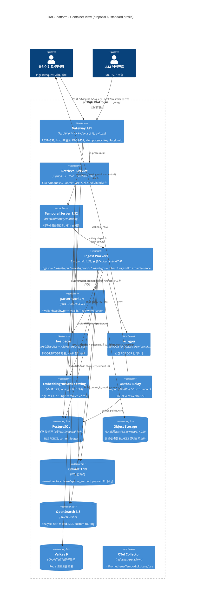
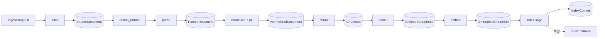
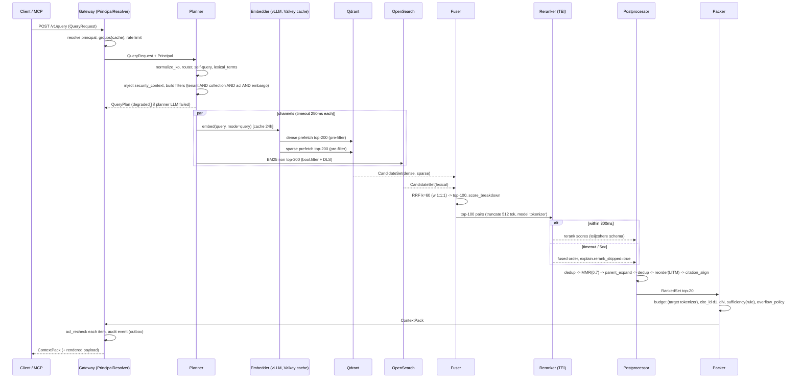
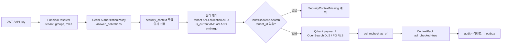
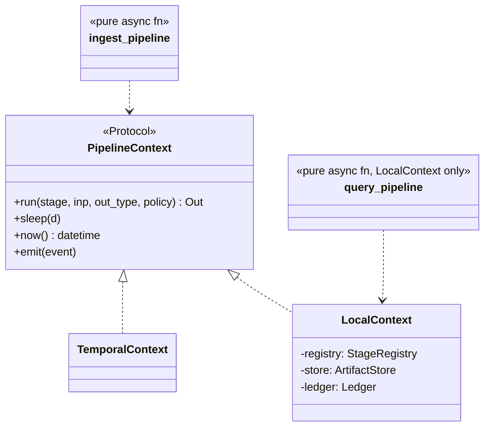
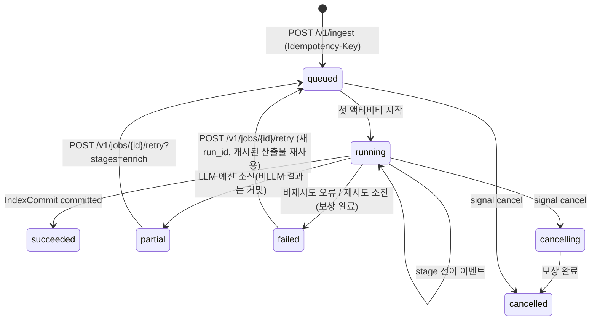

# 설계 제안 A: 운영성 우선(Operability-First) 아키텍처

## 목적

이 문서는 RAG Platform 설계 경쟁에 제출하는 세 제안 중 하나로, **운영성·내구성·정합성**을 최우선 축으로 놓고 전체 아키텍처를 제안한다. 장시간 배치(스캔 OCR·대량 재색인), 부분 실패, 재처리, 데이터 계보(lineage), 관측성, 멀티테넌시 격리, 비용 통제를 "나중에 붙이는 기능"이 아니라 **계약 필드와 스테이지 경계의 형태**로 설계에 심는다. 검색 품질(D-07·§7)과 계약 표준화(D-05)는 요구사항이므로 동일한 엄격함으로 다룬다.

인용 규칙: 기술 선택은 모두 `07-tech-landscape` 문서를 근거로 든다. 표기 `[00 §매트릭스]`는 `00-summary-and-selection-matrix.md`의 해당 절, `[08 §통합]`은 `08-orchestration-messaging-and-api-frameworks.md`의 "통합 설계 함의" 절을 뜻한다. 브리프의 확정 결정(D-xx)은 존중하되 연구 결과상 문제가 있는 항목은 §6에서 "수정 제안"으로 명시한다.

## 범위

- 포함: 브리프 §6의 포함 범위 전체(수집·파서·정규화·청킹·보강·임베딩·인덱싱·리트리벌·패킹·MCP·관리 API·평가 하네스·관측성·플러그인 SDK).
- 제외: 크롤러·챗봇 UI·파인튜닝·인증 서버(OIDC 연동만). 개별 계약의 JSON Schema 전문과 API 경로 상세는 03-contracts·05-api 문서의 몫이며, 이 문서는 필드 인벤토리와 불변식을 제안한다.

---

## 1. 아키텍처 요약(한 페이지)

### 1.1 핵심 아이디어 5개

| # | 아이디어 | 한 줄 정의 | 무엇을 우아하게 만드는가 |
|---|----------|-----------|--------------------------|
| A1 | **원장 중심(Ledger-Centric)** | PostgreSQL의 `commit ledger`(jobs · artifacts · index_commits · lineage 네 표)가 유일한 진실이고, Qdrant·OpenSearch 인덱스는 콘텐츠 주소화 산출물에서 **언제든 재구성되는 투영(projection)** 이다 | 복구 절차가 하나로 수렴한다: "산출물 재적재(replay)". 스냅샷 복원은 시간 단축용 2순위 [06 §리스크, 00 §운영] |
| A2 | **경계는 ArtifactRef 하나** | 모든 스테이지 경계 페이로드는 `ArtifactRef{uri, blake3, media_type, schema_version, size_bytes}`만. 스테이지는 `Stage[In, Out]` 순수 변환 | 멱등성 키·캐시 키·계보 기록·재처리 단위·Temporal 2MB 한계 대응이 **같은 한 개념**으로 해결된다 [08 §페이로드] |
| A3 | **세대(generation) 기반 IndexCommit 사가** | 문서 갱신은 insert-then-delete 사가, 모든 레코드에 `index_generation`과 `commit_id`, 리트리벌은 `committed` 세대만 통과 | 두 백엔드(Qdrant·OpenSearch)의 비원자성을 "허용된 혼합 상태"로 명시적으로 모델링한다. 검색 공백 없음, 롤백 = 세대 삭제 [06 §IndexCommit] |
| A4 | **격리 등급(isolation tier)을 1급 개념으로** | 어댑터 격리 3단계(`in_process` / `helper_process` / `sidecar`)와 테넌트 격리 3단계(`payload_filter` / `shard_key` / `index_per_tenant`)를 **같은 `tiering` 정책 모델**로 선언하고 프로파일 로딩 시 검증 | 크래시·라이선스·노이지 네이버가 모두 "등급 승격"으로 처리된다. 타입드 오류(`sidecar_unavailable` 등)와 Temporal 하트비트가 등급별로 자동 결합 [00 §어댑터 공통 1, 12 §1] |
| A5 | **예산과 저하(degradation)는 계약 필드** | `QueryPlan.budget`, `enrichment_budget_tokens`, `degraded[]`, `quality`, `warnings[]`가 모든 출력 계약에 공통 존재. 리랭커 타임아웃·채널 비활성·표 강등은 숨기지 않고 필드에 기록 | 실패가 예측 가능해진다: 어떤 저하가 일어났는지 계약을 읽으면 안다. 비용 폭주는 큐·토큰 버킷·`partial` 종료로 상한이 있다 [00 O-05, 07 §실패, 10 §D2] |

### 1.2 개념 최소화

이 설계가 도입하는 개념은 여덟 개다. 그 외는 모두 이들의 인스턴스다.

| 개념 | 정의 | 정본 저장소 |
|------|------|-------------|
| `Stage` | `Stage[In, Out]` 순수 변환. I/O·시간·난수 금지 | 코드(플러그인) |
| `ArtifactRef` | 콘텐츠 주소화 산출물 참조 | 오브젝트 스토리지 + `artifacts` 표 |
| `Commit` | 한 문서 버전의 인덱싱 결과(세대 단위) | `index_commits` 표 |
| `Profile` | 버전드 파이프라인 프리셋(해시로 식별) | `profiles` 표 + YAML |
| `Plugin` | D-10 확장 지점의 구현체(entry point) | 레지스트리 |
| `Policy` | `StagePolicy`·`PiiPolicy`·`AclPolicy`·`TieringPolicy`·`BudgetPolicy` | 프로파일·컬렉션·테넌트 |
| `Job` | 수집·재색인·평가 실행 단위(상태 기계) | `jobs` 표(읽기 모델) + Temporal(실행) |
| `Event` | CloudEvents 1.0.2 봉투의 도메인 이벤트 | `outbox` 표 → 릴레이 |

### 1.3 일관된 규약(모든 계약에 공통)

- 식별자 `*_id`는 ULID, 해시 `*_hash`·`blake3`는 BLAKE3 hex, 시각 `*_at`은 RFC 3339 UTC, 언어는 BCP 47(D-06).
- 모든 스테이지 출력에 **품질 삼중항**: `quality: enum[full, degraded]`, `warnings[]`, `degraded[]`(질의 측) 또는 `page_status[]`(문서 측).
- 모든 출력에 **재현성 지문**: `producer{plugin_id, plugin_version, config_hash, image_digest}`.
- 모든 인덱스 레코드·질의 계획에 **보안 삼중항**: `tenant_id`, `collection_id`, `acl_*`(D-09).
- 실패는 타입드 오류(RFC 9457 `type` URI와 1:1)로만 표현하고 재시도 가능 여부를 오류 타입이 결정한다.

---

## 2. 컨테이너/컴포넌트 구조

### 2.1 C4 Container



### 2.2 컴포넌트 책임 표

| 컴포넌트 | 책임 | 소유 계약 | 상태 | 격리 등급 | 근거 |
|----------|------|-----------|------|-----------|------|
| Gateway API | 인증(OIDC JWT, API 키), `PrincipalResolver`, 레이트 리밋, 멱등 키, 잡 생성, 상태 조회(읽기 모델), MCP 마운트 | `IngestRequest`, `QueryRequest`, `JobStatus` | 무상태 | in_process | [08 §API], [12 §3] |
| Retrieval Service | `QueryRequest → QueryPlan → CandidateSet → RankedSet → ContextPack`를 인프로세스 `LocalContext`로 실행. 지연 예산 분배·저하 기록 | `QueryPlan`, `CandidateSet`, `RankedSet`, `ContextPack` | 무상태(캐시만) | in_process | [08 §수집 요청 처리 순서] |
| Temporal Server | 워크플로우 실행·재시도·하트비트·사가·시그널·스케줄. 영속화·가시성 모두 PostgreSQL | - | 유상태(PG) | sidecar | [08 §권고] |
| Ingest Workers | `Stage[In, Out]` 액티비티 래퍼. ArtifactRef 로드→스테이지 실행→콘텐츠 주소화 저장→참조 반환. 하트비트·`Resumable` | `SourceDocument`~`IndexCommit` | 무상태 | in_process(+helper) | [08 §통합] |
| parser-workers(Java) | HWP 5.0→HWPX 변환(hwplib 1.1.11+hwp2hwpx+hwpxlib 1.0.9), 암호화 HWPX, 배포용 텍스트(Tika 3.2.1 HwpV5Parser) | `derived_artifact` | 무상태 | sidecar | [01 §권고], [00 J-1] |
| lo-sidecar | DOC/RTF/ODT→DOCX, HWP 렌더 폴백(H2Orestart, GPL 격리, opt-in). tini·프로세스 그룹 KILL·프로파일 락 분리 | `derived_artifact` | 무상태 | sidecar(C 등급) | [00 §매트릭스 doc_converter] |
| ocr-gpu | PaddleOCR PP-OCRv5 server 전면 OCR(premium) | 페이지 OCR 결과 산출물 | 무상태 | sidecar | [02 §권고] |
| Embedding/Rerank Serving | vLLM pooling(bge-m3 dense+sparse 단일 패스), TEI(리랭커·dense 전용 모델) | `EmbeddedChunkSet` 벡터 | 무상태 | sidecar | [05 §서빙 권고] |
| Outbox Relay | `select_unpublished → publish → mark_published` 순수 코어, Temporal 액티비티(standard) / Procrastinate(lite) 실행기 | `CloudEventEnvelope` | PG 오프셋 | in_process | [08 §미해결 7] |
| Commit Ledger(PG) | `jobs`, `job_events`, `artifacts`, `lineage`, `index_commits`, `outbox`, `profiles`, `collections`, `usage_ledger` | `IndexCommit`, `JobStatus` | 유상태 | - | [06 §IndexCommit], [12 §1.5] |
| Object Storage | 원본·파생 산출물·벡터 산출물·평가 셋. 키 `tenants/{tenant_id}/blake3/{hash[:2]}/{hash}` | `ArtifactRef` | 유상태 | - | [12 §1.4] |
| Qdrant | dense·sparse_learned(+선택 late_interaction) 벡터, payload 파티셔닝 `is_tenant`, `payload_m=16, m=0` | `IndexRecord` 투영 | 유상태 | - | [06 §권고] |
| OpenSearch | BM25(Nori `mixed`/`discard`), DLS 이중 방어, 감사 로그 별도 인덱스 | `IndexRecord` 투영 | 유상태 | - | [06 §권고], [12 §권고] |
| Valkey | 질의 임베딩 캐시(24h), 레이트 리밋, Idempotency-Key, MCP 커서 핸들, 그룹 확장 캐시(5~15분) | - | 휘발 | - | [00 §매트릭스 cache_kv_store] |
| OTel Collector | redaction(콘텐츠 차단)·transform(Langfuse 속성)·팬아웃 | 트레이스·메트릭·로그 | 무상태 | sidecar | [09 §프라이버시] |
| Eval Harness | `evaluator` 플러그인 3종(`RetrievalMetricEvaluator`, `JudgeEvaluator`, `SpanHitEvaluator`), 인프로세스 러너로 프로덕션 동일 경로 | `EvalDataset`, `EvalRun`, `EvalReport` | PG+오브젝트 | in_process | [09 §통합] |

---

## 3. 스테이지 파이프라인 정의

### 3.1 공통 규약

| 항목 | 규약 |
|------|------|
| 입력·출력 | 모두 `ArtifactRef`(본문은 오브젝트 스토리지). 액티비티 래퍼가 로드·저장을 담당하고 스테이지는 Pydantic 모델만 본다 |
| 멱등성 키 | `stage_key = blake3(stage_name + input_ref.blake3 + config_hash + producer_fingerprint)`. 같은 키의 산출물이 `artifacts` 표에 있으면 스테이지를 건너뛰고 참조만 반환(`cache_hit=true`, 계보에 기록) |
| 캐시 키 | 멱등성 키와 동일(콘텐츠 주소화가 곧 캐시). 질의 측만 별도 Valkey 키 사용 |
| 격리 등급 | `in_process`(순수 Python, A 등급) / `helper_process`(`multiprocessing spawn`, ctypes·네이티브 크래시 위험) / `sidecar`(JVM·LibreOffice·CUDA·GPL/AGPL) [00 §어댑터 공통 1] |
| 실패 분류 | `retryable`(일시 장애: `sidecar_unavailable`, HTTP 5xx, 타임아웃) / `non_retryable`(`contract_violation`, `unsupported_format`, `document_encrypted`, `distribution_document`, `access_denied`, `not_found`) / `partial`(페이지 단위 실패는 `page_status`로 기록하고 계속) |
| 계보 | `lineage(child_ref, parent_ref, stage_key, job_id, produced_at)` 행을 산출물 저장과 같은 트랜잭션에 기록 |

### 3.2 수집 파이프라인



| 스테이지 | 입력 → 출력 | 실패 모드 | 멱등성 키 구성 요소 | 캐시 키 | 격리 | 큐 / 정책 |
|----------|-------------|-----------|---------------------|---------|------|-----------|
| `fetch` | `IngestRequest` → `SourceDocument` | `access_denied`·`not_found`(비재시도), 네트워크 5xx(재시도 5, 지수 백오프), 크기 상한 초과 `payload_too_large` | `uri + etag/last_modified + tenant_id` → 다운로드 후 `blake3` 확정. 같은 `blake3`가 이미 있으면 원본 저장 생략 | 원본 `blake3` | in_process(fsspec/httpx, 확인 필요) | `ingest-io`, 5m, hb 30s |
| `detect_format` | `SourceDocument` → `SourceDocument.detected{media_type, variant, flags}` | `unsupported_format`(비재시도), HWP FileHeader 암호·배포 플래그 사전 판정 → `document_encrypted`/`distribution_document` | `blake3 + detector_version` | 동일 | in_process(puremagic + ZIP/OLE 스니퍼) | `ingest-cpu`, 1m |
| `parse` | `SourceDocument` → `ParsedDocument`(+파생 산출물: 페이지 이미지·표 HTML·벤더 JSON·HWPX 변환본) | 페이지 타임아웃(`page_status=timeout`, 저해상도 재시도 후 스킵), 사이드카 5xx(`sidecar_unavailable` 재시도 후 폴백 체인), 변환 실패 `conversion_failed`, `corrupt_container` | `blake3 + parser_fingerprint(plugin, model revision, sidecar image digest, profile)` | 동일; HWP→HWPX 변환본은 별도 `derived_artifact` 키(`blake3 + sidecar_digest`)로 재변환 생략 | 포맷별: HWPX in_process(python-hwpx), HWP sidecar(Java) → helper(unhwp) → in_process(hwp-hwpx-parser) → sidecar(LO), PDF in_process(Docling/pypdfium2) 또는 sidecar(ocr-gpu) | `ingest-cpu` 15m hb 60s / `ingest-gpu-ocr` 60m hb 60s, `Resumable`(heartbeat_details.page) |
| `normalize` | `ParsedDocument` → `NormalizedDocument`(display NFC / lexical NFKC 이중 뷰, 문장 스팬, PII 스팬·`offset_map`) | PII 모델 로딩 실패는 **잡 실패**(`keep` 폴백 금지), 문장 분리기 예외 → kss → 정규식 폴백(`warnings`) | `parsed.blake3 + normalizer_config_hash + pii_policy + dictionary_hash` | 동일 | in_process(python-mecab-ko/Kiwi extra, Presidio) | `ingest-cpu`, 5m |
| `chunk` | `NormalizedDocument` → `ChunkSet` | 단일 블록 초과 → 문장→semchunk 강제 분할(`chunk.block.oversized` 경고), 문서당 청크 상한 초과 → 행 그룹 확대 | `normalized.blake3 + chunker_config_hash`; `chunk_id = blake3(document_hash + chunker_config_hash + block_path + char_range)` | 동일 | in_process | `ingest-cpu`, 5m |
| `enrich` | `ChunkSet` → `EnrichedChunkSet` | 비LLM(결정적 접두어·GLiNER2·키워드·날짜/조항)은 실패 시 잡 실패; LLM 보강(옵션)은 예산 초과 시 `partial` 종료, `content_policy_violation` 비재시도 | 비LLM: `chunkset.blake3 + enricher_config_hash`; LLM: 청크별 `blake3(model_id + prompt_hash + chunk_text)` | LLM 결과는 청크 단위 캐시(문서 재청킹에도 재사용) | in_process / LLM은 외부 HTTP | `ingest-cpu` / `ingest-llm` 30m hb 60s, 테넌트 토큰 버킷 |
| `embed` | `EnrichedChunkSet` → `EmbeddedChunkSet` | 서빙 5xx/타임아웃 재시도(최대 간격 5m), 토큰 초과 `truncate=true`+경고, `vocab_id` 불일치 `embedding_space_mismatch`(비재시도) | 청크별 `blake3(embedding_space_id + mode + embed_text)` | 청크 단위 캐시(오브젝트 스토리지 + `artifacts` 표), 질의는 Valkey 24h | 외부 HTTP(vLLM/TEI) 또는 in_process(lite) | `ingest-gpu-embed`, 20m hb 60s |
| `index` | `EmbeddedChunkSet` → `IndexCommit` | 한쪽 백엔드 실패 → 보상 `index.rollback(commit_id)` 양쪽 후 실패 전파; 필수 필드(`tenant_id`·`collection_id`·`acl`) 누락 배치 전체 거부 | `embedded.blake3 + collection_id + index_generation` | 없음(쓰기) — 재시도는 `commit_id` 멱등 upsert | 외부(Qdrant gRPC prefer, OpenSearch REST) | `ingest-io`, 10m hb 30s, 사가 |
| `outbox.publish` | `EventDraft` → 없음 | 릴레이 중복 발행은 소비자 멱등(`event_id`) | `event_id` | - | in_process | 로컬 액티비티, 상태 갱신과 동일 트랜잭션 |

### 3.3 검색 파이프라인(오케스트레이터 미경유)

| 스테이지 | 입력 → 출력 | 실패 모드 | 캐시 키 | 격리 | 지연 예산(GPU p95 800ms) |
|----------|-------------|-----------|---------|------|---------------------------|
| `resolve_principal` | 토큰/API 키 → `Principal` | JWKS 실패 시 캐시 키로 검증, 만료 시 401; 그룹 상한 초과 `too_many_principals` | Valkey `principal:{token_hash}` 5~15분 | in_process | 10ms |
| `plan` | `QueryRequest` + `Principal` → `QueryPlan` | LLM 구조화 출력 실패 → 원 질의 + 형태소 키워드로 `route=single`(`degraded+=planner_llm_failed`); self-query 0건 → 추출 필터 완화(보안 필터는 유지) | Valkey `plan:{tenant}:{profile_hash}:{normalized_query}` | in_process(형태소 분석 <5ms; LLM 재작성은 `default` 끔) | 30ms |
| `embed_query` | `QueryPlan.rewritten_queries[]` → 질의 벡터(dense+sparse 단일 패스) | 서빙 타임아웃 → dense·sparse 채널 비활성(`degraded+=channel_disabled:dense`), lexical만으로 진행 | Valkey `qemb:{embedding_space_id}:{normalized_text}` 24h | 외부 HTTP | 60ms(타임아웃 150ms) |
| `retrieve` | `QueryPlan` → `CandidateSet`(채널별 병렬) | 채널 타임아웃 → 해당 채널 제외 + `degraded`; `tenant_id` 필터 부재는 **예외**(요청 실패) | 없음 | 외부(Qdrant, OpenSearch) | 120ms(채널 타임아웃 250ms, 최소 1채널 성공 필요) |
| `fuse` | `CandidateSet` → 융합 순위 | 없음(순수 계산) | 없음 | in_process | 5ms |
| `rerank` | top-100 → `RankedSet` top-20 | 타임아웃 300ms/5xx → fused 순서 폴백, `explain.rerank_skipped=true`, `rag_rerank_fallback_total` | 없음 | 외부 HTTP(TEI) | 300ms |
| `postprocess` | `RankedSet` → 후처리 `RankedSet` | 없음 | 없음 | in_process | 20ms |
| `pack` | `RankedSet` → `ContextPack` | 토큰 예산 초과 → `overflow_policy` 순서 적용; 정확 카운트 API 지연 시 캐시/근사+`calibration_ratio`(`degraded+=token_count_approximate`) | Valkey `tok:{tokenizer}:{blake3(text)}` | in_process(+선택 count_tokens API) | 80ms |
| `acl_recheck` + `audit` | `ContextPack` → 응답 | 재검증 실패 항목 `omitted.reason=acl_denied` | 없음 | in_process | 10ms |
| (예비) | - | - | - | - | 165ms |

CPU 프로파일(p95 1.5s)은 리랭크 예산을 700ms(top-30→10, gte-multilingual-reranker-base @ TEI CPU)로 늘리고 나머지는 동일하다 [07 §프로파일].

---

## 4. 계약 인벤토리

필드 표기는 `필드명 | 타입 | 필수 | 의미`. 크기 한계는 "초안 목표"이며 스키마의 `maxItems`/`maxLength`로 게시한다. 모든 타입은 `schema_version`(semver 문자열)을 첫 필드로 갖는다.

### 4.0 공용 타입

| 타입 | 필드 | 타입 | 필수 | 의미 |
|------|------|------|------|------|
| `ArtifactRef` | `uri` | string(uri) | 예 | 오브젝트 스토리지 위치(`s3://…/tenants/{tenant_id}/blake3/…`) |
| | `blake3` | string(64 hex) | 예 | 콘텐츠 해시 |
| | `media_type` | string | 예 | `application/vnd.rag.parsed-document+json` 등 자체 미디어 타입 |
| | `schema_version` | string | 예 | 산출물 스키마 버전 |
| | `size_bytes` | integer | 예 | 크기(Temporal 2MB 한계 검증에는 무관, 운영 계량용) |
| `Producer` | `plugin_id` | string | 예 | entry point 이름(`parser.hwpx.python_hwpx`) |
| | `plugin_version` | string | 예 | 패키지 버전 |
| | `config_hash` | string | 예 | 스테이지 설정 BLAKE3 |
| | `image_digest` | string | 아니오 | 사이드카·서빙 이미지 digest |
| `Acl` | `allow_principals` | array<string> | 예 | `user:`/`group:`/`tenant:*` 접두어 주체(최대 1,024) |
| | `deny_principals` | array<string> | 아니오 | 명시 거부(허용보다 우선) |
| | `visibility` | enum[public, tenant, restricted] | 예 | 가시성 |
| | `embargo_until` | string(date-time) | 아니오 | 이 시각 전 검색 불가 |
| | `expires_at` | string(date-time) | 아니오 | 이 시각 후 검색 불가 |
| | `classification` | enum[public, internal, confidential, secret] | 아니오 | 정보 등급 |
| | `source_acl_hash` | string | 아니오 | 원천 ACL 해시(변경 감지) |
| `TypedError` | `type` | string(uri) | 예 | RFC 9457 `type`(`urn:rag:error:document_encrypted`) |
| | `retryable` | boolean | 예 | 오케스트레이터 재시도 여부 |
| | `stage` | string | 예 | 발생 스테이지 |
| | `detail` | string | 아니오 | 사람용 설명(콘텐츠 미포함) |
| `CloudEventEnvelope` | `id`, `source`, `type`, `time`, `subject`, `datacontenttype`, `data` | CloudEvents 1.0.2 | 예 | `type`은 `ingest.document.parsed` 등 `domain.entity.action` |

### 4.1 `IngestRequest`(생산: 클라이언트 → 소비: `fetch`, Gateway)

| 필드 | 타입 | 필수 | 의미 |
|------|------|------|------|
| `schema_version` | string | 예 | 계약 버전 |
| `request_id` | string(ulid) | 예 | 클라이언트 요청 ID(Idempotency-Key와 별개) |
| `tenant_id` | string | 예 | 테넌트(토큰의 테넌트와 일치해야 함) |
| `collection_id` | string(ulid) | 예 | 대상 컬렉션(프로파일 고정) |
| `source_uri` | string(uri) | 예 | `s3://`, `gs://`, `az://`, `file://`, `http(s)://`, `smb://`(플러그인) |
| `source_id` | string | 예 | 원천 시스템의 문서 식별자(버전 추적 키) |
| `source_version` | string | 아니오 | 원천 버전 라벨(etag 등) |
| `media_type_hint` | string | 아니오 | 힌트만; 판정은 시그니처 |
| `metadata` | object | 아니오 | 제목·작성자·부서 등 자유 메타(최대 16KB) |
| `acl` | `Acl` | 예 | 문서 ACL |
| `pii_policy` | enum[mask, tokenize, exclude, keep, reject] | 아니오 | 컬렉션 기본값 상속 |
| `pii_tokenize_mode` | enum[hash, encrypt] | 아니오 | `tokenize`일 때만, 기본 `encrypt` |
| `document_password` | string(secret) | 아니오 | 암호화 문서용(로그·트레이스 마스킹) |
| `allow_distribution_documents` | boolean | 아니오 | 배포용 HWP 텍스트 폴백 허용(테넌트 정책과 AND) |
| `llm_enrichment_allowed` | boolean | 아니오 | 외부 LLM 보강 옵트인 |
| `profile_override` | string | 아니오 | 컬렉션 프로파일 내 허용된 옵션만(예: `pdf_fast_cpu`) |
| `priority` | enum[low, normal, high] | 아니오 | 큐 우선순위(Temporal 업데이트로 변경 가능) |
| `callback_url` | string(uri) | 아니오 | 웹훅 |
| `dedup_mode` | enum[skip_if_same_hash, reindex_always] | 아니오 | 동일 `blake3` 재수집 처리 |
| `split_hint` | object | 아니오 | JSON 배열 다중 문서 분할 힌트 |
| `language_hint` | string(bcp47) | 아니오 | OCR·분석기 힌트 |

크기 한계: 요청 본문 ≤ 64KB, 원본 파일 ≤ 2GB(프로파일 설정), `acl.allow_principals` ≤ 1,024.

### 4.2 `SourceDocument`(생산: `fetch`, `detect_format` → 소비: `parse`)

| 필드 | 타입 | 필수 | 의미 |
|------|------|------|------|
| `schema_version` | string | 예 | |
| `document_id` | string(ulid) | 예 | 플랫폼 문서 ID(`tenant_id + collection_id + source_id`로 결정적 조회) |
| `doc_version` | string | 예 | `blake3` 앞 16자 또는 `source_version` |
| `tenant_id`, `collection_id` | string | 예 | |
| `source_uri`, `source_id` | string | 예 | |
| `original` | `ArtifactRef` | 예 | 저장된 원본 |
| `blake3` | string | 예 | 원본 해시(= `original.blake3`) |
| `size_bytes` | integer | 예 | |
| `detected` | object | 예 | `{media_type, variant: enum[hwpx, hwp5, hwp3, pdf, docx, doc, rtf, odt, html, txt, md, json, unknown], encoding, confidence}` |
| `flags` | object | 아니오 | HWP `{compressed, encrypted, distribution}`, PDF `{encrypted, source_kind_probe}` |
| `fetched_at` | string(date-time) | 예 | |
| `http_headers` | object | 아니오 | etag·last_modified·charset(원본 재현) |
| `acl` | `Acl` | 예 | 전달 |
| `pii_policy` | enum | 예 | 확정된 정책 |
| `metadata` | object | 아니오 | 요청 메타 |
| `producer` | `Producer` | 예 | fetcher/detector 지문 |
| `warnings` | array<string> | 예 | |

### 4.3 `ParsedDocument`(생산: `parse` → 소비: `normalize`)

| 필드 | 타입 | 필수 | 의미 |
|------|------|------|------|
| `schema_version` | string | 예 | |
| `document_id`, `doc_version`, `tenant_id`, `collection_id` | string | 예 | |
| `source` | `ArtifactRef` | 예 | 입력 원본 |
| `source_kind` | enum[born_digital, scanned, mixed, pre_ocr, flow] | 예 | `flow`는 HWP/HWPX/DOCX/HTML/MD 등 페이지 없는 포맷 |
| `parser_fingerprint` | `Producer` + `{model_ids[], sidecar_image_digest, profile_option}` | 예 | 재현성 |
| `metadata` | object | 예 | `{title, authors[], created_at, modified_at, language, genre: enum[general, law_article, report, news, form, manual], page_count, has_tracked_changes, page_header_text, page_footer_text, navigation_text, web{canonical_url, site_name}}` |
| `blocks` | array<Block> | 예 | 문서 순서의 평탄 배열(트리는 `parent_block_id`로 표현) |
| `page_status` | array<object> | 아니오 | `[{page, status: enum[ok, timeout, ocr_failed, skipped], ocr_confidence}]` |
| `quality` | enum[full, degraded] | 예 | 배포용 텍스트 폴백·렌더 폴백 등은 `degraded` |
| `warnings` | array<string> | 예 | 미지 태그·캡션 누락 등 |
| `artifacts` | object | 아니오 | `{page_images[]: ArtifactRef, table_html{block_id: ArtifactRef}, vendor_json: ArtifactRef, derived_hwpx: ArtifactRef}` |
| `annotations` | array<object> | 아니오 | 변경 추적·메모(`kind, block_id, char_start, char_end, text`) 인덱싱 제외 기본 |
| `source_encoding` | string | 아니오 | TXT/HTML 원 인코딩 |
| `block_count`, `char_count` | integer | 예 | 계량 |

**`Block`**

| 필드 | 타입 | 필수 | 의미 |
|------|------|------|------|
| `block_id` | string | 예 | 문서 내 유일(`b{ordinal}`; 결정적) |
| `type` | enum[heading, paragraph, list_item, table, figure, caption, footnote, code, formula, page_break, page_header, page_footer, toc, form_field] | 예 | Block 타입 |
| `parent_block_id` | string | 아니오 | 섹션 트리·중첩 표·글상자 소속 |
| `ordinal` | integer | 예 | 문서 순서 |
| `text` | string | 조건 | 표·그림 외 필수. NFC 미적용 원문(정규화는 다음 스테이지) |
| `level` | integer | heading·list_item | 1-based 계층 |
| `heading_inferred` | boolean | heading | 휴리스틱 추론 여부 |
| `numbering_label` | string | 아니오 | "제3조", "1.1", "가." 등 본문과 분리 |
| `ordered` | boolean | list_item | |
| `furniture` | boolean | 예 | 머리말/꼬리말/nav 등 본문 아님(청킹 제외 기본) |
| `container` | enum[body, text_box, table_cell, footnote_body] | 예 | 소속 컨테이너 |
| `caption_of` | string | caption | 대상 table/figure `block_id`(양방향: 대상 블록의 `caption_block_id`) |
| `caption_block_id` | string | table·figure | |
| `footnote` | object | footnote | `{kind: enum[footnote, endnote], anchor_block_id, anchor_char_offset, marker}` |
| `table` | `TableData` | table | 아래 표 |
| `figure` | object | figure | `{image: ArtifactRef, kind: enum[image, ole, chart, equation_image], alt_text, caption_generated, caption_model}` |
| `formula` | object | formula | `{script, latex}`(HWP 수식 스크립트 원문 필수 보존) |
| `code` | object | code | `{language}` |
| `links` | array<object> | 아니오 | `[{char_start, char_end, href}]` |
| `fields` | array<object> | 아니오 | HWP 필드·폼 `{name, type, value}` |
| `provenance` | object | 예 | `{element_path(필수), char_start(필수), char_end(필수), page(nullable), bbox(nullable, [x0,y0,x1,y1] 좌상단 원점·포인트), section_index}` |
| `lang` | string(bcp47) | 아니오 | 블록 언어(정규화에서 확정) |
| `confidence` | number | 아니오 | OCR/VLM 신뢰도(`source=vlm`이면 필수 또는 `unknown`) |
| `source` | enum[text_layer, ocr, vlm, converted] | 예 | 텍스트 출처 |

**`TableData`(표 표현)**

| 필드 | 타입 | 필수 | 의미 |
|------|------|------|------|
| `n_rows`, `n_cols` | integer | 예 | 격자 크기 |
| `cells` | array<Cell> | 예 | 앵커 셀만 내용 보유. `Cell{row, col, row_span, col_span, text, is_header, header_kind: enum[column, row, section, none], nested_table_block_id, provenance{bbox, char_start, char_end}}` |
| `header_row_indices` | array<integer> | 예 | 헤더 행(추정이면 `header_inferred=true`) |
| `header_inferred` | boolean | 예 | |
| `quality` | object | 예 | `{merged_cells_preserved: boolean, structure_source: enum[native, tableformer, line_based, render_fallback], cell_match_rate}` |
| `serializations` | object | 예 | `{html: ArtifactRef, markdown: string(≤32KB), triplet: string}` — HTML은 병합 셀 무손실 1차 [10 §A4] |
| `role` | enum[data, toc, form, layout] | 예 | `layout` 표는 청킹에서 문단으로 강등 |

크기 한계: 블록 ≤ 200,000/문서, 셀 ≤ 100,000/표, `text` ≤ 1MB/블록(초과 시 분할 경고).

### 4.4 `NormalizedDocument`(생산: `normalize` → 소비: `chunk`, `enrich`)

| 필드 | 타입 | 필수 | 의미 |
|------|------|------|------|
| `schema_version`, `document_id`, `doc_version`, `tenant_id`, `collection_id` | | 예 | |
| `parsed` | `ArtifactRef` | 예 | 입력 |
| `blocks` | array<NormalizedBlock> | 예 | `Block` + `display_text`(NFC) + `lexical_text`(NFKC, 띄어쓰기 교정 opt-in) + `sentence_spans[]{start, end}` + `offset_map`(원문↔정규화 오프셋 구간 배열) |
| `analyzer_id` | string | 예 | 문장 분리·형태소 분석기 식별(`mecab-ko:1.3.7+ko-dic:2018-07` 또는 `kiwi:0.24.0`) |
| `dictionary_hash` | string | 예 | 사용자 사전(`UserDictEntry` 단일 소스) 해시 |
| `pii_report` | object | 예 | `{policy_applied, entity_counts{}, spans[]{entity_type, block_id, start, end, score, operator}, detector_version}` |
| `content_risk` | array<object> | 아니오 | 인젝션 위생(L1) 결과 `{block_id, kind, action}` |
| `boilerplate_removed` | array<string> | 예 | 제거된 반복 머리말/꼬리말 `block_id` |
| `normalization_report` | object | 예 | `{nfd_fixed, spacing_restored, garbled_ratio, dropped_blocks}` |
| `language` | string(bcp47) | 예 | 문서 주 언어 |
| `producer` | `Producer` | 예 | |
| `quality`, `warnings` | | 예 | |

### 4.5 `ChunkSet`(생산: `chunk` → 소비: `enrich`, 부모 확장·문장 윈도우 후처리)

| 필드 | 타입 | 필수 | 의미 |
|------|------|------|------|
| `schema_version`, `document_id`, `doc_version`, `tenant_id`, `collection_id` | | 예 | |
| `chunk_set_id` | string(ulid) | 예 | |
| `document_hash` | string | 예 | `NormalizedDocument` blake3 |
| `chunker_id`, `chunker_config_hash` | string | 예 | |
| `primary_tokenizer_id` | string | 예 | `hf:BAAI/bge-m3` |
| `chunks` | array<Chunk> | 예 | |
| `stats` | object | 예 | `{leaf_count, parent_count, table_chunk_count, oversized_blocks}` |
| `producer`, `quality`, `warnings` | | 예 | |

**`Chunk`(계층)**

| 필드 | 타입 | 필수 | 의미 |
|------|------|------|------|
| `chunk_id` | string(64 hex) | 예 | `blake3(document_hash + chunker_config_hash + block_path + char_range)` — 결정적 |
| `kind` | enum[text, table, table_part, code, figure_caption, list, parent, sentence_window, summary] | 예 | |
| `level` | integer | 예 | 0=리프(임베딩 대상), 1=부모(섹션, 반환 단위), 2=문서(요약, RAPTOR 옵션) |
| `parent_chunk_id` | string | level 0·1 | 같은 셋 내 `level+1` |
| `child_ids` | array<string> | level ≥1 | |
| `ordinal` | integer | 예 | 부모 내 순서 |
| `text` | string | 예 | 색인 본문(접두어 미포함) |
| `heading_path` | array<string> | 예 | 루트부터 heading 텍스트 |
| `block_refs` | array<object> | 예 | `[{block_id, char_start, char_end, page, bbox}]` — 합집합이 `text`를 재구성 |
| `token_counts` | object | 예 | `{tokenizer_id: integer}` 다중(`hf:BAAI/bge-m3` 필수, `tiktoken:o200k_base` 병기) |
| `lang` | string(bcp47) | 예 | |
| `table_ref` | object | table·table_part | `{table_block_id, header_row_indices[], row_range[2], col_range[2], serialization: enum[triplet, markdown, html, row_json]}` |
| `window` | object | 아니오 | `{before_chunk_ids[], after_chunk_ids[]}` |
| `context_prefix` | object | 예 | `{deterministic: string, generated: string|null, generated_by: string|null}` — `text`에 미포함 |
| `lexical_terms` | array<string> | 예 | 형태소 키워드(NNG/NNP/SL/SN), Qdrant keyword payload용 |
| `sentence_spans` | array<[int,int]> | 아니오 | 인용 세그먼트 경계 |
| `genre_route` | string | 아니오 | `law_article` 등 장르 라우팅 결과 |

불변식: (1) `block_refs` 합집합 = `text`; (2) `level=0`의 `token_counts[primary_tokenizer_id] ≤ max_tokens`; (3) `context_prefix ⊄ text`; (4) 부모는 임베딩하지 않는다(반환 단위). 한계: 청크 ≤ 50,000/문서.

### 4.6 `EnrichedChunkSet`(생산: `enrich` → 소비: `embed`, `index`)

| 필드 | 타입 | 필수 | 의미 |
|------|------|------|------|
| `schema_version`, 식별자군 | | 예 | `ChunkSet`과 동일 + `chunk_set` `ArtifactRef` |
| `chunks[].enrichment` | object | 예 | 아래 |
| `enrichment.embed_text` | string | 예 | `enrich(chunk)` 결과: `prefix.deterministic + "\n" + text`(+generated) — 임베딩·BM25 입력 |
| `enrichment.index_text` | string | 예 | 렉시컬 색인 입력(`lexical_text` 기반) |
| `enrichment.strip_recipe` | object | 예 | `strip(index_text) -> text` 대칭 복원 규칙(접두어 길이) |
| `enrichment.entities` | array<object> | 예 | GLiNER2 `{text, type, start, end, score, entity_id}` |
| `enrichment.relations` | array<object> | 아니오 | 그래프 플러그인용 `{head_id, relation, tail_id}` |
| `enrichment.dates` | array<object> | 아니오 | `{text, iso, kind: enum[effective, published, mentioned]}` |
| `enrichment.law_refs` | array<string> | 아니오 | 법령 조항 파생 메타 |
| `enrichment.keywords` | array<object> | 예 | `{term, weight}` |
| `enrichment.figure_caption` | string | 아니오 | VLM 캡션(옵션, `caption_model` 기록) |
| `enrichment.summary` | string | level 2 | RAPTOR 요약(옵션) |
| `chunks[].risk_flags` | array<string> | 예 | 인젝션 스캔 결과(`scan_timeout` 포함) |
| `chunks[].risk_score` | number | 예 | 0~1 |
| `chunks[].pii_entity_counts` | object | 예 | |
| `llm_usage` | object | 예 | `{provider, model, input_tokens, output_tokens, cost_usd_estimate, budget_remaining_tokens}` — 비용 계량 |
| `partial` | boolean | 예 | 예산 초과로 LLM 보강이 일부만 수행됨 |
| `producer`, `quality`, `warnings` | | 예 | |

### 4.7 `EmbeddedChunkSet`(생산: `embed` → 소비: `index`)와 `IndexRecord`

| 필드(`EmbeddedChunkSet`) | 타입 | 필수 | 의미 |
|------|------|------|------|
| `schema_version`, 식별자군, `enriched` `ArtifactRef` | | 예 | |
| `embedding_space_id` | string | 예 | `blake3(model_id + revision + dimensions + normalized + prompt_hash + quantization)` |
| `spaces` | array<object> | 예 | `[{name: enum[dense, sparse_learned, sparse_bm25, late_interaction], model_id, model_revision, dim, vocab_id, pooling: enum[cls, mean, late], serving_image_digest}]` |
| `records` | array<IndexRecord> | 예 | 아래 |
| `vectors_artifact` | `ArtifactRef` | 예 | 벡터 본문(npz/parquet) — 레코드는 참조·오프셋만 |
| `cache_hits` | integer | 예 | 청크 캐시 적중 수(비용 계량) |
| `producer`, `quality`, `warnings` | | 예 | |

**`IndexRecord`(백엔드 저장 최종 레코드; payload 필드)**

| 필드 | 타입 | 필수 | 의미 |
|------|------|------|------|
| `record_id` | string(uuid) | 예 | Qdrant 포인트 ID: `ulid_to_uuid(chunk_ulid)` 결정적 변환(원본 `chunk_id`도 payload에) [06 §매핑] |
| `chunk_id` | string | 예 | |
| `document_id`, `doc_version` | string | 예 | |
| `tenant_id` | string | 예 | payload 인덱스 `is_tenant=true`; OpenSearch custom routing |
| `collection_id` | string | 예 | |
| `commit_id` | string(ulid) | 예 | 소속 커밋 |
| `index_generation` | integer | 예 | 컬렉션 내 단조 증가 세대 |
| `is_current` | boolean | 예 | 커밋 완료 시 이전 세대 `false` |
| `acl_allow`, `acl_deny` | array<string> | 예/아니오 | 평탄화 ACL |
| `acl_visibility` | enum | 예 | |
| `acl_embargo_until`, `acl_expires_at` | string(date-time) | 아니오 | |
| `acl_classification` | enum | 아니오 | |
| `content_hash` | string | 예 | `blake3(embed_text)` 변경 감지 |
| `embedding_space_id` | string | 예 | |
| `item_kind` | enum[chunk, summary, community_report, entity, page_image, table, figure] | 예 | O-03 확장 슬롯 |
| `level`, `parent_chunk_id`, `ordinal` | | 예 | 부모 확장용 |
| `heading_path` | array<string> | 예 | |
| `lang` | string | 예 | |
| `page_start`, `page_end` | integer | 아니오 | |
| `lexical_terms` | array<string> | 예 | Qdrant 한국어 키워드 필터(형태소 keyword 배열) |
| `entity_ids` | array<string> | 아니오 | |
| `text` | string | 예 | 표시 본문(비정규화 복제; 질의 시 3번째 홉 제거) — 정본은 `ChunkSet` 산출물 |
| `index_text` | string | OpenSearch | Nori 색인 필드(`analyzer: nori_index`, `search_analyzer: nori_search`) |
| `context_prefix` | string | 예 | 결정적 접두어(렌더 헤더·BM25 필드 가중) |
| `pii_policy_applied` | enum | 예 | |
| `risk_score` | number | 예 | |
| `updated_at` | string(date-time) | 예 | |
| `vectors` | object | 예 | `{dense: name→ref, sparse_learned: {indices[], values[], vocab_id}, sparse_bm25?: {…}, late_interaction?: {dim, count, ref}}` |

### 4.8 `IndexCommit`(생산: `index` 사가 → 소비: 리트리벌 필터, 관리 API, 평가 `EvalRun`)

| 필드 | 타입 | 필수 | 의미 |
|------|------|------|------|
| `schema_version` | string | 예 | |
| `commit_id` | string(ulid) | 예 | |
| `tenant_id`, `collection_id`, `document_id`, `doc_version` | | 예 | |
| `index_generation` | integer | 예 | |
| `status` | enum[pending, vector_written, lexical_written, committed, rolling_back, rolled_back, failed] | 예 | 사가 상태 |
| `record_count` | integer | 예 | |
| `backends` | array<object> | 예 | `[{backend_id, backend_version, collection_name, alias, upsert_result{written, failed}, completed_at}]` |
| `commit_hash` | string | 예 | `blake3(정렬된 record content_hash 목록 + profile_hash)` — §7 재현성 검증 키 |
| `profile_id`, `profile_hash` | string | 예 | |
| `embedding_space_id` | string | 예 | |
| `analyzer_id`, `dictionary_hash` | string | 예 | 변경 시 렉시컬 재색인 트리거 |
| `chunker_config_hash`, `parser_fingerprint_hash` | string | 예 | |
| `lineage` | array<ArtifactRef> | 예 | Source→…→Embedded 산출물 체인 |
| `supersedes_commit_id` | string(ulid) | 아니오 | 대체한 이전 커밋 |
| `superseded_by` | string(ulid) | 아니오 | |
| `job_id` | string(ulid) | 예 | |
| `started_at`, `committed_at` | string(date-time) | 예/아니오 | |
| `compensation` | object | 아니오 | `{reason, deleted_counts{backend_id: n}, completed_at}` |
| `stats` | object | 예 | `{bytes_vector, bytes_lexical, llm_tokens, wall_seconds}` — `usage_ledger` 원천 |

### 4.9 `QueryRequest`(생산: 클라이언트/MCP → 소비: `plan`)

| 필드 | 타입 | 필수 | 의미 |
|------|------|------|------|
| `schema_version`, `query_id` | | 예 | |
| `tenant_id` | string | 예 | 토큰과 대조 |
| `collection_ids` | array<string(ulid)> | 예 | 최대 16 |
| `query` | string | 예 | ≤ 4,000자 |
| `conversation` | array<object> | 아니오 | 대화 맥락 `{role, text}` 최근 N턴(재작성용) |
| `filters` | object | 아니오 | 사용자 메타 필터(D-09 필터와 AND) |
| `k` | integer | 아니오 | 요청 항목 수(≤ `k_max`) |
| `max_context_tokens` | integer | 아니오 | 팩 예산 |
| `target_model` | object | 아니오 | `{provider, model}` 토크나이저 결정 |
| `response_format` | enum[concise, detailed] | 아니오 | |
| `renderer` | enum | 아니오 | §9 렌더러 열거 |
| `explain` | boolean | 아니오 | 점수 분해 반환 |
| `session_id`, `exclude_ids` | | 아니오 | 에이전트 반복 검색용 |
| `cursor` | string | 아니오 | MCP "더 보기" 핸들 |
| `max_latency_ms` | integer | 아니오 | 예산(초과 예상 시 저하 선택) |
| `experiment_id` | string | 아니오 | A/B 배정 |
| `as_of` | string(date-time) | 아니오 | 시점 질의(embargo 평가 기준) |

### 4.10 `QueryPlan`(생산: `plan` → 소비: `retrieve`, `fuse`, `rerank`, `pack`)

| 필드 | 타입 | 필수 | 의미 |
|------|------|------|------|
| `schema_version`, `query_id`, `plan_id` | | 예 | |
| `security_context` | object | 예 | `{tenant_id, principals[], collection_ids[], as_of, policy_version}` — **서버 주입, 읽기 전용, 클라이언트 입력 무시** |
| `profile_id`, `profile_hash` | string | 예 | |
| `normalized_query` | string | 예 | 오타·띄어쓰기 교정 결과 |
| `rewritten_queries` | array<object> | 예 | `[{query_ref_id, text, role: enum[original, rewrite, abstraction, hypothetical], weight}]` 원 질의 항상 포함 |
| `sub_queries` | array<object> | 아니오 | 분해 결과 |
| `lexical_terms` | array<object> | 예 | `[{term, weight}]` |
| `filters` | object | 예 | 최종 백엔드 필터(보안 필터 + 사용자 필터 + self-query 필터), `relaxable_keys[]` |
| `route` | enum[no_retrieval, single, multi] | 예 | |
| `strategy` | enum[hybrid, graph_local, graph_global, tree_collapsed, visual_pages, iterative] | 예 | |
| `channels` | array<object> | 예 | `[{channel: enum[dense, sparse, lexical, graph, tree, visual, late_interaction], backend_id, top_k, timeout_ms, enabled}]` |
| `fusion` | object | 예 | `{method: enum[rrf, convex_minmax, convex_zscore, dbsf, combmnz], k: integer(필수), weights{channel: w}}` |
| `rerank` | object | 예 | `{model_id, backend, top_n_in, top_n_out, max_tokens_per_text, timeout_ms, enabled}` |
| `postprocess` | object | 예 | `{steps[]: enum[dedup, mmr, parent_expand, dedup_parent, sentence_window, compress, reorder, citation_align, token_budget_pack], mmr_lambda, dedup{cosine_threshold, minhash{num_perm, seed, scheme, threshold}}}` |
| `pack` | object | 예 | `{k_max, max_context_tokens, tokenizer{provider, model, name}, ordering, renderer, overflow_policy[]}` |
| `budget` | object | 예 | `{max_latency_ms, max_tool_calls, max_context_tokens, llm_calls_allowed}` |
| `analyzer_id`, `embedding_space_id`, `index_generation_min` | | 예 | 색인·질의 일관성 검증; 세대 하한 |
| `cache_keys` | object | 예 | `{plan, query_embedding[]}` |
| `degraded` | array<string> | 예 | `planner_llm_failed`, `channel_disabled:sparse`, `filter_relaxed:…` |
| `explain_requested` | boolean | 예 | |
| `created_at` | string(date-time) | 예 | |

### 4.11 `CandidateSet`(생산: `retrieve` → 소비: `fuse`)

| 필드 | 타입 | 필수 | 의미 |
|------|------|------|------|
| `schema_version`, `query_id`, `plan_id` | | 예 | |
| `channel_runs` | array<object> | 예 | `[{channel, backend_id, source_query_ref_id, latency_ms, status: enum[ok, timeout, error, disabled], returned}]` |
| `candidates` | array<object> | 예 | `[{chunk_id, record_id, document_id, scores{dense, sparse, lexical, graph, late_interaction}, ranks{…}, source_query_ref_ids[], index_generation, payload_min{heading_path, level, parent_chunk_id, item_kind, acl_classification}}]` |
| `graph_paths` | array<object> | 아니오 | 그래프 채널 경로 |
| `filters_applied` | object | 예 | 실제 전송된 필터(감사) |
| `security_context_hash` | string | 예 | 필터에 `tenant_id`가 포함되었음을 어댑터가 서명 |
| `degraded` | array<string> | 예 | |
| `total_latency_ms` | integer | 예 | |

한계: 채널당 top_k ≤ 500, 후보 총 ≤ 1,500.

### 4.12 `RankedSet`(생산: `fuse`+`rerank`+`postprocess` → 소비: `pack`, 평가)

| 필드 | 타입 | 필수 | 의미 |
|------|------|------|------|
| `schema_version`, `query_id`, `plan_id` | | 예 | |
| `results` | array<RankedResult> | 예 | |
| `fusion_applied` | object | 예 | `{method, k, weights, candidates_in, candidates_out}` |
| `rerank_applied` | object | 예 | `{model_id, backend, response_schema: enum[tei, cohere], normalization: enum[sigmoid, minmax, identity], top_n_in, top_n_out, latency_ms}` |
| `postprocess_applied` | array<object> | 예 | `[{step, removed, added, latency_ms}]` |
| `explain` | object | 예 | `{rerank_skipped: boolean, rerank_skip_reason, channels_degraded[], filters_relaxed[]}` |
| `calibration` | object | 아니오 | `{collection_id, rerank_score_p50, p90}` 컬렉션별 캘리브레이션(게이트 판단용) |
| `relevance_gate` | object | 예 | `{threshold, max_rerank_score, passed}` |

**`RankedResult`와 점수 분해**

| 필드 | 타입 | 필수 | 의미 |
|------|------|------|------|
| `chunk_id`, `document_id`, `doc_version`, `record_id` | | 예 | |
| `final_rank` | integer | 예 | 1-based |
| `final_score` | number | 예 | 리랭크 정규화 점수(리랭크 생략 시 fused) |
| `score_breakdown` | object | 예 | `{dense{score, rank, contribution}, sparse{…}, lexical{…}, graph{…}?, late_interaction{…}?, fused{score, rank}, rerank{raw_score, normalized_score, rank}}` — `contribution`은 RRF 기여분 `1/(k+rank)×w` 또는 CC 가중 정규화 점수 |
| `source_query_ref_ids` | array<string> | 예 | multi-query 출처 |
| `expanded_from` | array<string> | 아니오 | 부모 확장 시 자식 chunk_id들 |
| `dedup_group` | string | 아니오 | 대표 chunk_id |
| `text` | string | 예 | 반환 본문(부모 확장 후) |
| `context_prefix`, `heading_path`, `item_kind`, `level`, `lang`, `page_start`, `page_end`, `acl_classification` | | 예 | payload 전달 |
| `segments` | array<object> | 예 | 인용 세그먼트 `[{index, text, char_start, char_end}]` |
| `tables` | array<object> | 아니오 | `[{table_id, html_ref, markdown, json_records, caption}]` |

### 4.13 `ContextPack`(생산: `pack` → 소비: 렌더러, MCP, 클라이언트)

| 필드 | 타입 | 필수 | 의미 |
|------|------|------|------|
| `schema_version`, `pack_id`, `query_id`, `plan_id` | | 예 | |
| `tenant_id`, `collection_ids` | | 예 | |
| `profile_id`, `profile_hash` | string | 예 | |
| `created_at` | string(date-time) | 예 | |
| `budget` | object | 예 | `{tokenizer{provider, model, name}, count_method: enum[exact_api, exact_local, approximate], safety_margin, calibration_ratio, overflow_policy[], max_context_tokens, used_tokens, reserved_answer_tokens, k_max}` |
| `ordering` | object | 예 | `{strategy: enum[litm_alternating, relevance_desc, document_order], applied}` |
| `items` | array<ContextItem> | 예 | **렌더 순서** |
| `omitted` | array<object> | 예 | `[{chunk_id, reason: enum[below_threshold, duplicate, budget_exceeded, acl_denied, parent_merged, risk_flagged]}]` |
| `sufficiency` | object | 예 | `{status: enum[not_needed, sufficient, partial, insufficient, unknown], coverage, missing_aspects[], method: enum[rule, llm_judge]}` |
| `compression` | object | 아니오 | `{method, rate, granularity}` |
| `redaction_summary` | object | 예 | `{pii_policy, entity_counts{}}` |
| `classification_max` | enum | 예 | 항목 중 최고 정보 등급 |
| `render_hints` | object | 예 | `{preferred_renderer, citation_style: enum[native, bracket_id], instructions_template_id, stable_prefix_ref, table_format_preference[], language, expose_confidence, data_marking: enum[none, delimit, datamark]}` |
| `explain` | object | 아니오 | `explain=true`일 때 `RankedSet.score_breakdown` 상위 k |
| `degraded` | array<string> | 예 | 파이프라인 전 구간 누적 |
| `diagnostics` | object | 예 | `{dedup_removed, parent_expansions, mmr_lambda, filters_applied, latency_ms{stage: ms}, trace_id, index_generations_seen[]}` |
| `next_cursor` | string | 아니오 | MCP 더 보기 |
| `content_hash` | string | 예 | `items` 직렬화 BLAKE3(캐시·멱등) |

**`ContextItem`**

| 필드 | 타입 | 필수 | 의미 |
|------|------|------|------|
| `cite_id` | string | 예 | `d1..dN` 관련도순 부여, 렌더 위치와 분리·불변 |
| `chunk_id`, `document_id`, `doc_version`, `parent_chunk_id` | | 예/아니오 | |
| `item_kind` | enum | 예 | O-03 슬롯 |
| `rank` | integer | 예 | 관련도 순위 |
| `position` | integer | 예 | 렌더 순서(0-based) |
| `confidence_tier` | enum[high, medium, low] | 예 | 리랭크 점수 구간(원시 점수는 미노출) |
| `header` | object | 예 | `{title, section_path[], source_uri, doc_date, page_start, page_end, language, doc_type}` |
| `text` | string | 예 | |
| `text_format` | enum[markdown, plain, html] | 예 | |
| `segments` | array<object> | 예 | 인용 경계 |
| `context_prefix` | string | 아니오 | |
| `tables` | array<object> | 아니오 | `{table_id, html, markdown, json_records, caption}` |
| `figures` | array<object> | 아니오 | `{figure_id, caption, alt_text}` |
| `parent` | object | 아니오 | `{parent_chunk_id, expanded, parent_text_included}` |
| `duplicates_of` | string | 아니오 | |
| `conflicts_with` | array<object> | 아니오 | `[{cite_id, kind: enum[version, source, date], note}]` |
| `provenance` | object | 예 | `{page, bbox, char_offset{start, end}, element_path}` |
| `acl_checked` | boolean | 예 | 반환 직전 재검증 통과 |
| `token_count` | integer | 예 | `budget.tokenizer` 기준 |
| `scores` | object | 아니오 | `explain` 시만 |

### 4.14 잡·이벤트

| 타입 | 핵심 필드 |
|------|-----------|
| `JobStatus` | `job_id, tenant_id, kind: enum[ingest_document, reindex_collection, evaluate, acl_update], state: enum[queued, running, succeeded, failed, cancelling, cancelled, partial], stage, progress{done, total, unit}, attempts, last_error: TypedError, index_commit_id, created_at, updated_at, run_id, idempotency_key, events_url, cost{llm_tokens, gpu_seconds}` |
| 이벤트 이름 | `ingest.document.{fetched, parsed, normalized, chunked, enriched, embedded, indexed, retried}`, `job.state.changed`, `index.commit.{published, rolled_back}`, `acl.document.updated`, `audit.*`, `feedback.query.cited`, `eval.run.completed` |
| `EvalDataset` / `EvalRun` / `EvalReport` | [09 §어댑터 계약]의 필드를 그대로 채택(`content_hash`, `qrels_uri`, `answer_spans_uri`, `judgment_level`, `label_provenance`; `index_commit_ids[]`, `judge_model`; `metrics`, `comparison`, `gate_result`) |

---

## 5. 개방 결정 O-01~O-10

| ID | 결정 | 근거(기술 지형 인용) | 운영성 관점의 추가 조건 |
|----|------|----------------------|--------------------------|
| O-01 융합 | **RRF k=60, 채널 가중 1:1:1 기본** → 컬렉션 골든셋 ≥200 qrels 확보 시 min-max convex combination(ranx `optimize_fusion` 오프라인 튠, 프로파일 고정). 융합은 플랫폼 `fuser`(점수 분해 보존). `fusion.k` 프로파일 필수 | 세 채널이 두 백엔드에 걸쳐 서버 융합 불가 [07 §2.2]; Bruch et al. 2023 튠된 CC 우위·RRF k 민감 [07 §2.1]; Qdrant 기본 k=2 함정 [06 §O-01] | CC 전환은 컬렉션 단위 프로파일 버전 증가 → `profile_hash` 변경 → 평가 게이트 통과 후 적용. 융합 파라미터는 `QueryPlan.fusion`에 항상 기록되어 재현 가능 |
| O-02 sparse | **BGE-M3 sparse 기본**(단일 패스, 추가 인코더 0). `ko-quality`는 PIXIE-Splade-v1.5(`vocab_id=ax-encoder-50k`), `unified-opensearch`는 inference-free-splade-ko-v1(라이선스 확인 후). SPLADE-v3 제외(CC BY-NC-SA). lexical 레그는 항상 유지 | MIRACL-ko sparse 61.5 vs BM25 37.1, MLDR 장문 sparse>dense [05 §O-02]; 라이선스 [12 §O-02] | `SparseVector.vocab_id` 불일치는 `embedding_space_mismatch`로 색인·질의 모두 거부. sparse 모델 교체는 `embedding_space_id` 변경 = 새 컬렉션 blue/green |
| O-03 GraphRAG/RAPTOR | **이분**: GraphRAG 계열(LightRAG·HippoRAG 2)은 외부 플러그인(채널 `graph` + `enricher`), 코어는 계약 슬롯(`item_kind`, `enrichment.entities/relations`, `channel=graph`, `strategy`, `graph_paths`)만. RAPTOR는 코어 옵션 `enricher`(기본 끔). 그래프 저장소 PostgreSQL + Apache AGE | 인덱싱 비용 코퍼스 토큰 수 배, 질의 비용 수십~수백 배, 단일 홉 열세 [00 §매트릭스 graph_module]; 1차 엔진 보류 [00 J-8] | 그래프 인덱싱은 별도 잡 종류(`build_graph`)와 `ingest-llm` 큐·예산 정책 적용. 코어 배포 매니페스트에 그래프 컴포넌트 없음 |
| O-04 late interaction | **기본 끔.** 별도 `late_interaction` 슬롯. BGE-M3 colbert(1024d)는 리랭크 비교 기준만, KURE-v2(128d)는 M2에서 인덱스 단계 vs 리랭크 단계 비교 후 ADR. `visual-pages`는 별도 컬렉션·인덱스 단계 | 100만 청크 1024d 약 614GB 비현실 [00 J-2]; 128d 저장량 fp16 77GB/turbo4 19GB [05 §O-04] | `IndexBackendCapabilities.supports_multivector=false`면 프로파일 로딩 시 채널 자동 비활성 + `degraded` 기록. 멀티벡터 저장 바이트는 `rag_index_bytes_total{vector=late_interaction}`로 별도 계량 |
| O-05 LLM 보강 | **비LLM 보강만 기본 켬**(결정적 `context_prefix`, GLiNER2, 키워드, 날짜·조항). LLM 보강은 컬렉션 정책으로 켬. 비용 정책: `ingest-llm` 큐 + `max_concurrent_activities` + Valkey 테넌트 토큰 버킷 + 컬렉션 `enrichment_budget_tokens` + 코퍼스 대비 배수 상한(1.5×) 초과 시 `partial` 종료 | 다수 의견 [00 J-3]; 재현 연구 비용 $1.02/M·20GB VRAM [04 §O-05]; 큐 분리 [08 §O-05] | `EnrichedChunkSet.llm_usage`와 `IndexCommit.stats.llm_tokens`가 `usage_ledger`로 집계되어 테넌트 과금·알림. 켬 게이트: nDCG@10 +0.03 & 문서당 비용 상한 이하 |
| O-06 이벤트 버스 | **v1 브로커 없음.** 제어 = Temporal 시그널/업데이트/쿼리, 도메인 = CloudEvents 1.0.2 + PostgreSQL 트랜잭셔널 아웃박스 + 릴레이(웹훅·SSE). NATS JetStream은 (a) 외부 소비자 ≥2 + 재생, (b) 감사 스트림 장기 보존(`korean-gov`), (c) 멀티 리전 조건에서만 | 일반 점수 아웃박스 4.55 1위, 조건부 NATS 4.15 [08 §점수표]; 감사 손실 불가 [12 §O-06] | 릴레이 지연 `rag_outbox_lag_seconds` SLO(초안 5s). 상태 갱신·이벤트 삽입은 같은 트랜잭션(로컬 액티비티). 관측 신호(OTLP)와 도메인 이벤트 분리 |
| O-07 HWP 5.0 | **1급 지원, LibreOffice는 opt-in 최후 폴백.** 1차 Apache-2.0 Java 사이드카(hwplib+hwp2hwpx+hwpxlib) → HWPX → 단일 OWPML 어댑터; `lite`는 unhwp(helper, x64) → hwp-hwpx-parser; 배포용은 Tika `HwpV5Parser` 텍스트(`quality=degraded`, 테넌트 옵트인); 암호화는 자격 증명 없으면 `document_encrypted`; pyhwp는 AGPL 선택 플러그인 | [01 §권고], [00 J-1] | 변환본은 `derived_artifact`로 콘텐츠 주소화 → 재처리 시 재변환 생략. 사이드카 헬스체크 실패는 `sidecar_unavailable` → 폴백 체인 자동, `rag_parser_sidecar_unavailable_total` |
| O-08 OCR | **RapidOCR 3.9.2(PP-OCRv5 korean mobile, ONNX; `OCRVersion.PPOCRV5`+`ModelType.MOBILE`+`LangRec.KOREAN` 명시) 기본**, `premium` GPU는 PaddleOCR PP-OCRv5 server 컨테이너, 폴백 Tesseract 5 `kor+eng`(+`kor_vert`, 에어갭). Surya 옵트인, `OcrAutoOptions` 금지 | [02 §O-08], [00 J-4] | 페이지 단위 하트비트·타임아웃(CPU 60s/GPU 20s), `heartbeat_details.page`에서 재개(`Resumable`). 모델 번들 이미지 + 기동 헬스체크로 에어갭 실패 조기 노출 |
| O-09 청크 | **예산 토크나이저 = 임베딩 모델 HF 토크나이저(`hf:BAAI/bge-m3`)**, `tiktoken:o200k_base` 병기. 자식 512(병합 하한 64) / 부모 2048(반환 단위) / 구조 오버랩 0 / 폴백 텍스트 10% / 표 행 그룹 256 / `flat_text` 윈도우 ±2. 렉시컬은 형태소 분석기로 분리. ContextPack 예산은 대상 LLM 토크나이저로 재계산(이중 카운트) | [04 §O-09], [00 J-5], [10 §O-09] | 임베더 교체 시 `token_counts`에 새 키가 없으면 **재카운트 스테이지**(재청킹 아님)로 처리. 그리드 {256,384,512,768}×{0,10%,15%}는 평가 하네스 기본 실험 |
| O-10 gRPC | **REST + SSE + MCP, gRPC v1 미제공.** 필요 시 `connectrpc`를 같은 ASGI 앱에 마운트, protobuf는 JSON Schema 정본에서 코드젠. 내부 사이드카도 REST(`ArtifactRef` 교환) | [08 §O-10], [00 J-6] | 사이드카 계약 하나(REST + RFC 9457)로 통일 → 헬스체크·타임아웃·오류 변환 코드가 사이드카 종류에 무관하게 동일 |

---

## 6. 브리프 확정 결정(D-xx) 수정 제안

| ID | 문제 | 수정 제안 | 구분 | 근거 |
|----|------|-----------|------|------|
| D-18 (PDF) | PyMuPDF 1.28.2는 AGPL-3.0/상용 듀얼. 파서 워커 `import`는 인프로세스 링크 → D-02 위반 | pypdfium2 5.13 + pdftext 0.7(`pdf_fast_cpu`) 또는 Docling `PYPDFIUM2` 백엔드로 대체. PyMuPDF는 옵트인 별도 컨테이너만 | **ADR 필수(라이선스)** | [02 §충돌], [12 §충돌] |
| D-18 (HWP 5.0) | pyhwp AGPL-3.0+, 2020-05 이후 무릴리스, Python ≤3.8; H2Orestart는 GPLv3(MIT 표기는 오류) | O-07 결정으로 대체. H2Orestart는 `lo-sidecar` GPL 격리 컨테이너 opt-in, 별도 저장소·고지·Helm opt-in | **ADR 필수(라이선스·정체)** | [01 §충돌] |
| D-18 (OCR·DOCX·HTML) | OCR 후보 순서 미정의; DOCX "Docling/python-docx" 모두 각주·미주 미처리; HTML 순서 미명시 | OCR은 O-08; DOCX에 "docx2python 3.7.1 각주·미주 병합 필수"; HTML "Trafilatura 2.2.0(xml) → Docling HTML" 순서 고정 | 문구 보정 | [00 §브리프 수정] |
| D-16 (서빙) | TEI는 BGE-M3 sparse/colbert 생산 불가, Infinity는 "no sparse"+13개월 무릴리스 → "dense+sparse 기본"이 실현 불가 | "vLLM 0.29 pooling(BGE-M3 3-in-1) + TEI 1.9.4(dense 전용·리랭커) + 인프로세스(개발·lite)". Infinity 제외. 같은 space 내 서빙 교체는 코사인 ≥0.9999 동등성 게이트 | **ADR 필수(실현 불가)** | [05 §충돌], [08 §충돌] |
| D-16 (교체 후보) | jina-v3/v4/v5·jina-reranker CC-BY-NC/Qwen Research | 목록에서 제거, D 등급 BYO 모델(`model_license_ack` 필수)로만. 시각 문서용은 Qwen3-VL-Embedding/Reranker(Apache-2.0) | **ADR 필수(라이선스)** | [05 §충돌], [07 §충돌] |
| D-16 (colbert·근거) | BGE-M3 colbert 1024d 인덱스 불가; 한국어 dense 리더보드에서 bge-m3가 뒤짐 | `late_interaction` 별도 슬롯; BGE-M3 유지 근거를 "3-in-1 단일 패스 + 생태계 + 드롭인 파인튠"으로 재기술, M2 `ko-quality` 교체 게이트(+2p) | ADR(근거 재기술) | [05 §결정 논리] |
| D-14 (Redis) | Redis 8.0+ RSALv2/SSPLv1/AGPLv3 삼중 | 기본 Valkey 9.x(BSD-3), "Redis 호환 KV" 표기 | **ADR 필수(라이선스)** | [08 §충돌], [12 §충돌] |
| D-14 (MinIO) | MinIO community 2026-04-25 아카이브, 소스 전용(AGPL) | RustFS 또는 SeaweedFS(둘 다 Apache-2.0; 12 점수 SeaweedFS 82 > RustFS 81, 성숙도 5 vs 3). **이 제안은 운영성 관점에서 SeaweedFS를 1차로 권고**하되 ADR 실측 후 확정 | **ADR 필수(라이선스·정체)** | [12 §권고] |
| D-15 (경량) | Qdrant는 BM25를 계산하지 않고 IDF만; FastEmbed BM25는 한국어 형태소 미처리; `text` 인덱스 한국어 분석 없음 | "플랫폼이 형태소 토큰화 + BM25 TF 포화값(k1=1.2, b=0.75, avgdl 정책) 계산 → `modifier: idf` + 1.19 테넌트 IDF"; 한국어 키워드 필터는 `lexical_terms` keyword payload; bm25s 참조 구현 점수 일치 테스트 | 문구 정밀화(ADR 권고) | [06 §충돌 1·2] |
| D-15 (목록) | Solr 10·pg_textsearch 누락; Elasticsearch 공식 이미지 ELv2/SSPL; Nori 기본 `discard` | 목록 확장; ES는 어댑터 호환만; Nori 인덱스 `mixed` + 사용자 사전 파이프라인 필수 | 목록 확장 | [06 §충돌 3·5·6] |
| D-02 (정책 공백) | LGPL·BSL/SSPL·GPL 서버·MPL·모델 라이선스·지역 제한·매출 임계·귀속 의무 규칙 부재 | 12 문서 §6.1 A/B/C/D/X 등급표를 D-02 해석 지침으로 채택, 플러그인·모델 메타 `license`·`territory` 필수, CI 게이트(pip-licenses+liccheck+cyclonedx+Syft+Trivy, `models.lock`) | **ADR 필수(정책)** | [12 §6], [00 §브리프 수정] |
| D-04 | 흐름 포맷(HWP/HWPX/DOCX/HTML/MD)은 page/bbox 부재 | `provenance.page`/`bbox` nullable, `element_path` + `char_start/char_end` 필수, bbox 좌상단 원점·포인트 | 계약 표현 조정 | [01 §매핑], [02 §계약] |
| D-19 | Docling 청커는 DoclingDocument 전용(HWP 백엔드 없음); "문맥 보강 기본"이 LLM으로 읽히면 O-05 충돌; late chunking은 mean pooling 전제인데 BGE-M3 dense는 [CLS] | 기본 청커 = ParsedDocument 네이티브 `StructureAwareChunker`(Docling 어댑터 2차, extra 분리, CI 동등성); 문맥 보강 = 결정적(켬) + LLM(O-05) 분리; late chunking 프로파일은 mean pooling 모델 강제 검증 | 문구 보정 + ADR | [04 §충돌] |
| D-17 | "인프로세스 러너(같은 워크플로우 정의 재사용)" — `@workflow.defn` 직접 재사용은 로컬에서 불가, 내구성 미명시 | "비내구 인프로세스 `LocalRunner`; 파이프라인 정의는 오케스트레이터 중립 `PipelineContext`에만 의존(`temporalio` 임포트 금지 린트); 프로덕션 경량은 Temporal 단일 바이너리 + PG(DBOS는 3.0.x 안정화 후 ADR)" | 명세 보강 | [08 §통합·O-06] |
| D-11 | GenAI semconv Development 단계; Phoenix ELv2; Grafana·Tempo·Loki AGPL-3.0 | 고정 커밋 + Weaver 상수 모듈 + `schema_url` 고정; Phoenix·Grafana 계열은 OTLP 대상·분리 컨테이너만(pip 의존 금지); AGPL 불가 환경 대안(OpenSearch Observability·Perses·SigNoz·Victoria*) | 정밀화 + ADR(라이선스 경계) | [09 §관측성], [12 §충돌] |
| D-12 | 문서 단위 qrels만으로는 청킹 비교(O-09) 불가 | TREC qrels/run + `answer_spans` JSONL, 인터리빙·쌍대 비교, nDCG 선형 이득 고정, Holm 보정 | 계약 추가 | [09 §통합] |
| D-20 | Anthropic RAG 전용 GA 경로는 `search_result` 블록; 인용은 `output_config.format`과 병용 불가(400) | "Anthropic `search_result`/`document` + `citations`"로 보정; `answer` 레퍼런스는 인용 켠 텍스트 1차, 구조화는 2단계 호출 또는 `bracket_id` | 문구 보정 | [10 §충돌] |
| D-13 | MCP 2026-07-28 스펙이 세션 제거 | `search`·`get_document`에 `cursor`/`next_cursor`, 도구 `search_batch`·`expand` 검토, `mcp>=2,<3` 핀, `McpToolAdapter` 격리 | 계약 추가 | [10 §C], [00 §브리프 수정] |
| D-01 | Unstructured `<3.14`, RapidOCR `≤3.13`, Nemotron extra 3.12 한정 | 파서 워커 이미지 3.12/3.13 고정, 3.14 채택 전 호환성 검증; 외부 앱 SDK는 HTTP 어댑터만 | 명세 보강 | [02 §충돌], [00 §브리프 수정] |
| D-07 (후처리 순서) | "중복 제거, 부모 확장, MMR" 순서는 확장 후 다양성 판단 둔화·부모 중복 재발 | `dedup → MMR(λ 0.7) → parent_expand → dedup → sentence_window → compress → reorder(LITM) → citation_align → token_budget_pack` | 순서 보정(ADR에 통합) | [07 §4] |
| D-08 (운영성 보강) | "비동기 잡" 결정은 유효하나 읽기 모델·멱등성·조정(reconcile)이 미명시 | `POST /v1/ingest`는 `Idempotency-Key` 필수(draft-07 의미론 400/422/409), 잡 상태 정본은 PostgreSQL `jobs`(Temporal은 실행 엔진), 조정 스케줄이 `queued`인데 미시작인 워크플로우를 재시작 | 명세 보강(이 제안 고유) | [08 §페이로드·수집 순서] |
| D-06 (운영성 보강) | Qdrant 포인트 ID는 u64/UUID만 | 어댑터 소유 `ulid_to_uuid` 결정적 변환 + 원본 ULID payload 보존 | 명세 보강 | [06 §매핑] |

---

## 7. 프로파일 정의

프로파일은 컬렉션에 고정되는 버전드 프리셋이며 `profile_hash = blake3(정규화 YAML)`가 `IndexCommit`·`QueryPlan`·`ContextPack`에 기록된다. 아래 값은 [00 §프로파일별 기본 조합]을 이 제안의 운영 파라미터(큐·타임아웃·격리·예산)로 확장한 것이다.

### 7.1 컴포넌트 표

| 컴포넌트 | `lite` | `standard` | `premium` | `korean-gov` |
|----------|--------|------------|-----------|--------------|
| 배포 형태 | 단일 노드, GPU 없음, 컨테이너 5개(API+워커, PG, Qdrant, Valkey, 오브젝트) | K8s, Temporal 분리, 워커 큐 4개, GPU 1~2 | standard + GPU 큐 3개(`ocr`·`embed`·`llm`), MIG/전용 GPU | standard + 멀티 네임스페이스, mTLS, OpenBao, NATS(감사) 조건부 |
| 오케스트레이션 | Temporal 단일 바이너리 + PG; `LocalRunner`는 dev/CI만; 부수 큐 Procrastinate 3.9 | Temporal 1.32(frontend/history/matching), PG advanced visibility, KEDA `temporal` 스케일러 | standard + `ingest-gpu-ocr`/`ingest-gpu-embed`/`ingest-llm` | standard + 테넌트 등급별 네임스페이스, 야간 재색인·평가 스케줄 |
| 포맷 판별 | puremagic 2.2.0 + 자체 ZIP/OLE 스니퍼 | 동일 | 동일 | 동일 + FileHeader 배포용·암호 플래그 정책 + 감사 로그 |
| HWPX | python-hwpx `>=6.4,<7` + OWPML 어댑터(in_process) | 동일 | 동일 | 동일 + hwpxlib 사이드카(암호화 HWPX) + 한컴 고지 CI |
| HWP 5.0 | unhwp 0.11(helper, x64) → hwp-hwpx-parser 1.0(in_process); 배포용 `distribution_document` 오류 | Java 사이드카(hwplib 1.1.11+hwp2hwpx+hwpxlib 1.0.9) → unhwp → hwp-hwpx-parser → `lo-sidecar`(opt-in) | standard | standard + Tika `HwpV5Parser` 배포용 텍스트(옵트인) + `spacing_corrector` opt-in |
| PDF 디지털 | `pdf_fast_cpu`(pypdfium2 5.13 + pdftext 0.7) | `pdf_standard`(Docling 2.129.x heron + TableFormer ACCURATE, `OMP_NUM_THREADS=4`; egret-m 옵션) | `pdf_standard` GPU L4 | standard + 2단·공문서 골든셋 회귀 |
| PDF 스캔 | RapidOCR PP-OCRv5 korean mobile(CPU) | 동일(비트맵 영역만) | `pdf_scanned_gpu`(PaddleOCR server 컨테이너) / `pdf_vlm_gpu`(골든셋 후) | standard + `kor_vert` 라우팅 + `pdf_airgapped`(Tesseract, 모델 번들) |
| DOC/RTF/ODT | DOC `unsupported_format`; ODT odfdo 3.26; RTF striprtf(degraded) | `lo-sidecar`(LibreOffice 26.8) → DOCX → Docling | 동일 | 동일 + unoserver 풀 옵션 |
| DOCX / HTML / TXT | Docling `MsWordDocumentBackend` + docx2python 3.7.1 / Trafilatura 2.2.0 xml → 자체 lxml / charset-normalizer 3.5.1 + ftfy + markdown-it-py 4.2 | 동일(HTML은 Trafilatura → Docling HTML) | 동일 | 동일 + `docs-site` 선택자 훅 |
| 한국어 정규화 | python-mecab-ko 1.3.7 + kss 6.0.6 `punct`(Kiwi extra 선택) | 동일 → kiwipiepy `>=0.24.0` 공개 후 승격 | 동일 | Kiwi + 컬렉션 사용자 사전 필수, NFC/NFKC 이중 뷰, 한자 독음 |
| PII | Presidio 정규식 + KR 인식기 5종(명시 활성) | Presidio + spaCy `ko_core_news_lg`(런타임 다운로드) | standard | `tokenize`+`encrypt`(OpenBao DEK), 주민등록번호 `reject`, L2 분류기 필수 |
| 청킹 | `default_ko_structured` 512/2048/0 + `flat_text` 384·10% | 동일 + 표 행 그룹 256 + 결정적 접두어 | 동일 + `contextual_llm`(컬렉션 옵션) + RAPTOR(`graph`) | standard + `law_article` 장르 라우팅 |
| 임베딩 | bge-m3 dense ONNX int8 in_process(sentence-transformers `>=6.0`) + Qdrant BM25 sparse(형태소 + TF 포화) | bge-m3 dense+sparse @ vLLM 0.29 pooling(GPU 1) | `quality-max` Qwen3-Embedding-4B(MRL 1024) 또는 `ko-quality` KURE-v1 + PIXIE-Splade-v1.5; `ko-late-interaction` KURE-v2(M2) | standard; 가중치·LICENSE 자체 미러링 필수 |
| 인덱스 | Qdrant 단독(`dense`+`sparse_learned`+`sparse_bm25`, 테넌트 IDF, payload 파티셔닝) | Qdrant 1.19 + OpenSearch 3.8(Nori `mixed`, custom routing, DLS) | standard + Qdrant multivector(turbo4) | standard + 대형 테넌트 shard_key/전용 인덱스, 감사 로그 별도 인덱스 |
| 융합 | Qdrant `prefetch`+`Fusion.RRF(k=60)` 또는 플랫폼 fuser | 플랫폼 fuser RRF k=60 → CC(골든셋 후) | 동일 + multi-query(0.5)·HyDE(dense) | standard |
| 리랭커 | gte-multilingual-reranker-base @ TEI CPU(top-30→10) → FlashRank | bge-reranker-v2-m3 @ TEI GPU(top-100→20, 300ms) | Qwen3-Reranker-4B @ vLLM/SGLang(top-50→20) | standard + dragonkue ko A/B |
| 후처리·패킹 | dedup → reorder → pack; k_max 10; 12k; Markdown 표; XML 렌더러 | 전 단계; k_max 20; 24k; HTML 표; `anthropic_search_result` | standard + 충분성 LLM 판정·EXIT/LLMLingua-2 옵션 | `regulatory-ko`: `document_order`, 상충 표지, `get_document` 유도, 데이터마킹 L3, `classification_max` |
| 이벤트 | 아웃박스 → 웹훅/SSE(Procrastinate 릴레이) | 아웃박스 → 웹훅/SSE(Temporal 액티비티), KEDA `postgresql` | 동일 | + NATS JetStream 2.15(감사 스트림 2년 보존) 조건부 |
| 저장소 | PG, SeaweedFS/RustFS(ADR), Valkey, Qdrant | + OpenSearch | 동일 | + OpenBao Transit(테넌트 DEK, 크립토 셰레딩) |
| 인증·인가 | API 키 + 정적 역할 | OIDC(Keycloak/Dex) + Cedar 4.12 + limits/Valkey | standard | + mTLS, 감사 2년, ReBAC(OpenFGA) 옵션 |
| 관측성 | OTel → Jaeger + Prometheus | Collector(redaction) → Tempo/Loki/Prometheus + Grafana(분리) + Langfuse | standard | AGPL 불가 시 OpenSearch Observability + Perses; `NO_CONTENT` 강제 |
| 평가 | ranx + DeepEval pytest(소형 골든셋) | ranx + ir_measures + RAGAS 0.4.3/DeepEval 4.2.3 + 인터리빙 | + ablation 프로파일 | + 셀프호스팅 judge + KoPub 골든셋 + Allganize KO |

### 7.2 운영 파라미터 표

| 파라미터 | `lite` | `standard` | `premium` | `korean-gov` |
|----------|--------|------------|-----------|--------------|
| 워커 큐 | `ingest`(단일) + `maintenance` | `ingest-io`, `ingest-cpu`, `ingest-gpu-embed`, `maintenance` | + `ingest-gpu-ocr`, `ingest-llm` | standard + 테넌트 등급 접미(`-premium`) |
| 테넌트 동시 잡 상한 | 4 | 32 | 64 | 등급별 8/32/128 |
| `enrichment_budget_tokens`(문서당 기본) | 0(LLM 끔) | 0 | 20,000 + 코퍼스 1.5× 상한 | 0(옵트인 컬렉션만) |
| 리트리벌 p95 목표 | 1.5s(CPU) | 800ms | 800ms(default) / 2.5s(quality) | 800ms |
| 리랭크 타임아웃 | 700ms | 300ms | 300ms / 1.5s | 300ms |
| 채널 타임아웃 | 400ms | 250ms | 250ms | 250ms |
| ACL 회수 전파 SLO | 15분 | 5분 | 5분 | 1분(푸시 갱신 필수) |
| 아웃박스 지연 SLO | 30s | 5s | 5s | 2s |
| 정합성 검사 주기 | 일 1회 | 시간 1회(샘플) + 일 1회(전체) | 동일 | 시간 1회 전체 |
| 스냅샷 | 일 1회 | 6시간 | 6시간 | 1시간 + 리전 복제 |
| 콘텐츠 캡처(트레이스) | 끔 | 끔(explain은 ID·해시만) | 끔 | `NO_CONTENT` 강제·정책으로 잠금 |
| 테넌트 격리 등급 기본 | `payload_filter` | `payload_filter` → 100만 청크 초과 시 `shard_key` 승격 | 동일 | 규제 테넌트 `index_per_tenant` 선택 |

---

## 8. 검색 경로 상세

### 8.1 흐름



### 8.2 플래너 알고리즘

1. `normalized_query = analyzer.correct(query)`(python-mecab-ko 공백기: 정규화 생략, Kiwi 승격 후 `typos='basic'` + `space`) [07 §1.1].
2. 라우터: 규칙(길이·의문형·잡담 패턴) → `no_retrieval | single | multi`. `default`는 LLM 호출 없음; `quality`/`agentic`은 LLM 구조화 출력(Pydantic), 실패 시 `single` + `degraded+=planner_llm_failed`.
3. self-query 필터 추출(`quality` 이상): 날짜·부서·문서유형 → `filters` + `relaxable_keys`. 보안 필터는 `relaxable` 불가.
4. `lexical_terms`: NNG/NNP/SL/SN 품사 토큰 + 가중(BGE-M3 sparse 상위 토큰 병합 옵션).
5. `security_context` 주입: `tenant_id`(토큰), `principals = [user, groups…, tenant:*]`(그룹 확장 캐시), `collection_ids ∩ allowed_collections(Cedar)`. 교집합이 비면 403.
6. 채널·융합·리랭크·팩 파라미터는 프로파일에서 복사(`fusion.k` 누락은 프로파일 로딩 실패로 사전 차단).
7. `index_generation_min`: 컬렉션 `current_generation`을 원장에서 읽어 기록(혼합 세대 관측용).

### 8.3 병렬 리트리버

| 채널 | 백엔드 호출 | 필터 | top_k | 실패 시 |
|------|-------------|------|-------|---------|
| dense | Qdrant Query API `prefetch`(named vector `dense`, cosine) | payload pre-filter(§10.2 JSON) | 200 | 채널 제외, `degraded` |
| sparse | Qdrant `prefetch`(named vector `sparse_learned`, `vocab_id` 검증) | 동일 | 200 | 동일 |
| lexical | OpenSearch `multi_match`(`index_text^1.0`, `context_prefix^0.5`, `cjk_bigram^0.2`) + `bool.filter` + routing=tenant_id | filter + DLS | 200 | 동일 |
| graph/tree/visual/late_interaction | 프로파일이 켤 때만; `capabilities` 불일치는 로딩 시 비활성 | 동일 | 프로파일 | 동일 |

최소 1채널 성공이면 진행하고 `CandidateSet.degraded`에 기록한다. 3채널 모두 실패면 503(`retrieval_unavailable`, `Retry-After`).

### 8.4 융합

```text
RRF: fused(d) = Σ_c w_c / (k + rank_c(d)),  k = 60,  w = {dense:1, sparse:1, lexical:1, variant queries: 0.5}
CC : fused(d) = Σ_c w_c · minmax_c(score_c(d)),  Σ w_c = 1  (골든셋 ≥200 qrels, ranx optimize_fusion, 프로파일 고정)
```

각 후보에 `score_breakdown.{channel}.contribution`을 기록하고 상위 `rerank.top_n_in`(100)만 다음 단계로 넘긴다. multi-query 변형 질의는 `source_query_ref_ids`로 출처를 남긴다 [07 §2].

### 8.5 리랭킹

- 입력 절단은 **리랭커 모델 토크나이저**로 `max_tokens_per_text=512` [07 §O-09].
- 어댑터는 TEI(`texts`/`score`)와 Cohere(`documents`/`relevance_score`) 두 스키마를 모두 파싱해 `raw_score` → `normalized_score`(sigmoid)로 통일 [07 §3.5].
- 타임아웃 300ms(GPU)/700ms(CPU) 또는 5xx → fused 순서 폴백 + `explain.rerank_skipped=true` + `rag_rerank_fallback_total`.
- relevance gate: `max(normalized_score) < τ`(컬렉션 캘리브레이션)이고 재시도 예산이 남으면 `quality`에서 재작성·필터 완화 후 1회 재검색; `default`는 `sufficiency=insufficient`로 즉시 반환 [07 §5].

### 8.6 후처리(고정 순서)

`dedup(코사인 ≥0.95, 폴백 MinHash{num_perm 128, seed, scheme 고정}) → MMR(λ 0.7, 리랭크 점수 min-max) → parent_expand(자식 ≥50% 적중 시 부모로 병합; 표는 표 전체+캡션) → dedup(부모 포함) → sentence_window(flat_text만) → compress(끔) → reorder(LITM: 관련도 오름차순 정렬 후 짝수 인덱스 앞 삽입·홀수 뒤 추가 → r1이 질의 직전, r2가 처음; 단위 테스트 불변식 "상위 2개가 양 끝") → citation_align(문장 세그먼트, 표는 행 단위) → token_budget_pack` [07 §4], [10 §A1].

### 8.7 패킹과 지연 예산 요산

| 구간 | GPU p95 예산 | 누적 | CPU p95 예산 |
|------|--------------|------|--------------|
| 인증·주체 해석·레이트 리밋 | 10ms | 10 | 10ms |
| 플래너(LLM 없음) | 30ms | 40 | 30ms |
| 질의 임베딩(캐시 미스) | 60ms | 100 | 120ms(ONNX int8) |
| 병렬 채널(최대값) | 120ms | 220 | 200ms |
| 융합 | 5ms | 225 | 5ms |
| 리랭크 | 300ms | 525 | 700ms |
| 후처리 | 20ms | 545 | 20ms |
| 패킹·토큰 카운트(캐시) | 80ms | 625 | 80ms |
| ACL 재검증·감사·직렬화 | 10ms | 635 | 10ms |
| 예비(GC·네트워크 꼬리) | 165ms | **800** | 325ms → **1,500** |

`QueryRequest.max_latency_ms`가 예산보다 작으면 플래너가 저하를 **사전 선택**한다(순서: multi-query 끔 → 리랭크 top_n_in 100→50 → 리랭크 끔 → 채널 축소). 선택된 저하는 `QueryPlan.degraded`에 기록된다.

---

## 9. LLM 소비 최적화: ContextPack 구조와 렌더링 규칙

### 9.1 구조 원칙

| 원칙 | 규칙 | 근거 |
|------|------|------|
| 인용 ID 불변 | `cite_id = d1..dN` 관련도순 부여, `position`(렌더 순서)과 분리 | [10 §B1·B3] |
| 순서 | `litm_alternating` 기본(r1 질의 직전, r2 처음), `document_order`(규정·법령), `relevance_desc` 폴백 | [10 §A1] |
| 노출 정보 최소화 | 원시 점수 숨김, `confidence_tier` 3단계만, 헤더 `title › section_path (doc_date)` + `source_uri` | [10 §A3·A6] |
| 표 | HTML 1차(병합 셀 무손실) → Markdown → JSON records; 예산 초과 시 `overflow_policy` 순서로 강등 | [10 §A4] |
| 토큰 예산 | 대상 LLM 토크나이저로 재계산(Anthropic `count_tokens` API, Gemini `count_tokens`, OpenAI `tiktoken`, 로컬 HF `tokenizers`); 공급자·카운터 불일치는 구성 거부; 근사는 `calibration_ratio` + 10% 마진 | [10 §A7] |
| 결정적 직렬화 | 동일 팩 → 바이트 동일(`sort_keys`, 타임스탬프 제외) → 프롬프트 캐시 접두어 일치 | [10 §R1] |
| 안정 접두어/가변 접미어 | `render_hints.stable_prefix_ref`(컬렉션 용어집 등) + 팩 본문 분리, Anthropic `cache_control` 브레이크포인트 | [10 §R2] |
| 충분성 | 규칙 기반 `sufficiency.status`가 지시문 변형을 결정(`insufficient` → 기권 지시) | [10 §R6] |
| 상충 | `conflicts_with[]`가 있으면 헤더에 버전·날짜 필수, 안내 문구는 `search_result.content[]` 내부 또는 `tool_result` 밖 user `text` | [10 §R7] |
| 데이터마킹 | `render_hints.data_marking`(L3) — 검색 콘텍스트를 지시문과 구분하는 구분자/마킹 | [12 §5] |

### 9.2 렌더러 열거와 매핑

| 렌더러 | 대상 | 매핑 요지 | 인용 역매핑 |
|--------|------|-----------|-------------|
| `anthropic_search_result`(1차) | Anthropic Messages, `tool_result` 내 사용 가능 | 항목 → `search_result{source: source_uri#cite_id, title: header, content[]: segments 텍스트 블록(표는 HTML 문자열 블록)}`, `citations` 활성. 동종 블록 규칙 준수. 인용 켠 상태에서 `output_config.format` 차단(400 예방) | `search_result_index` + 블록/문자 범위 → `CitationMap[cite_id, chunk_id, segment]` |
| `anthropic_document`(2차) | 문서 전체·PDF 페이지 인용 | `document{title, context(JSON 메타), content}` Custom content | `document_index` |
| `anthropic_xml` / `xml_documents` | Anthropic 폴백·OpenAI·Gemini·로컬 | `<documents><document index="d3"><title/><section/><date/><source/><confidence/>본문</document>…</documents>` + `[dN]` 마커 + 구조화 출력 인용 배열 | 정규식 `[dN]` + 구조화 출력 |
| `openai_messages` | OpenAI 호환 | system 지시 + user에 XML 팩 | 동일 |
| `markdown` | 사람·디버그 | 헤더·본문·표 Markdown | 없음 |
| `mcp_tool_result` | MCP 도구 결과 | `structuredContent`(슬림 팩: cite_id·chunk_id·header·text·confidence_tier·next_cursor) + `content[0].text`(XML) + 20k 토큰 상한 + `truncated`/`next_cursor` | 그대로 |
| `dify_external_knowledge`, `plain_records` | 외부 앱 호환 | 레코드 배열 `{content, score(tier→수치), title, metadata}` | 없음 |

### 9.3 렌더러 계약

`ContextRenderer.render(pack, options) -> RenderedContext{provider_payload, stable_prefix, volatile_suffix, citation_map}`; `CitationMapper.map_back(provider_response, citation_map) -> list[ResolvedCitation{cite_id, chunk_id, segment_range, cited_text}]`. 렌더링 후 실제 토큰을 재카운트해 `budget.used_tokens`를 갱신하고 초과 시 `overflow_policy`(표 강등 → 중앙 항목 제거 → 선택적 압축)로 재렌더한다 [10 §R8]. 계약 테스트: 문서 내용 문자열이 트레이스에 없음, `LongContextReorder` 상위 2개가 양 끝, K=1..5 결정적 케이스 [10 §R11].

---

## 10. 멀티테넌시·ACL 강제 지점

### 10.1 강제 지점 표

| # | 지점 | 강제 내용 | 실패 시 | 검증 방법 |
|---|------|-----------|---------|-----------|
| 1 | Gateway `PrincipalResolver` | 토큰의 `tenant_id`와 요청 본문 `tenant_id` 일치, 그룹 확장(캐시 5~15분, 상한 1,024) | 403 / `too_many_principals` 422 | 계약 테스트 |
| 2 | `AuthorizationPolicy`(Cedar 4.12) | `allowed_collections(principal, read)`로 `collection_ids` 교집합; 결정에 `policy_version` | 403 | 정책 단위 테스트 |
| 3 | `QueryPlan.security_context` | **서버 주입·읽기 전용**; 클라이언트 필드 무시 | - | 스키마 `readOnly` |
| 4 | `IndexBackend.search` 불변식 | `security.tenant_id` 부재 → `SecurityContextMissing` 예외; 모든 검색은 pre-filter | 요청 실패(fail closed) | 어댑터 계약 테스트("필터에 tenant_id 존재") |
| 5 | 백엔드 이중 방어 | Qdrant payload 파티셔닝(`is_tenant`) + OpenSearch Security DLS(`term tenant_id=${attr.jwt.tenant_id}`) + PostgreSQL RLS `FORCE` | 서버 측 거부 | 카나리 테넌트 침투 테스트(주기) |
| 6 | 색인 시 | `tenant_id`·`collection_id`·`acl` 누락 레코드는 **배치 전체 거부**; 오브젝트 키 접두어 `tenants/{tenant_id}/` | 잡 실패 | 스키마 필수 + 어댑터 테스트 |
| 7 | 반환 직전 `acl_recheck` | 항목별 ACL·embargo·expires 재평가(`as_of`), 실패 항목 `omitted.reason=acl_denied`, `acl_checked=true` | 항목 제거 | 단위 테스트 |
| 8 | MCP 도구 | 동일 `PrincipalResolver`(OIDC JWT, RFC 9728 PRM); `list_collections`는 `allowed_collections`만 | 401/403 | conformance CI |
| 9 | 이벤트·웹훅 | 아웃박스 이벤트에 `tenant_id`; 릴레이는 테넌트별 구독만 전달; 이벤트 `data`에 콘텍스트 본문 금지 | 미전달 | 계약 테스트 |
| 10 | 관측성 | 트레이스 `rag.tenant_id`는 해시; 콘텐츠 캡처 기본 끔; Collector redaction | - | "본문 문자열이 스팬에 없음" 테스트 |
| 11 | 레이트 리밋·계량 | `limits` + Valkey 키 `tenant_id`/`api_key_id`, 운영 fail-closed(429); `usage_ledger` 일 집계 | 429 | 부하 테스트 |
| 12 | ACL 갱신 | `PATCH /v1/documents/{id}/acl` → `update_acl` payload만 갱신(재임베딩 없음), `acl.document.updated` 이벤트, 회수 전파 SLO `rag_acl_propagation_seconds` | SLO 알림 | 메트릭 |
| 13 | 격리 등급 승격 | `TieringPolicy{threshold_chunks, threshold_qps}` 초과 테넌트는 `shard_key`(Qdrant custom sharding) / `index_per_tenant`(OpenSearch)로 승격 — blue/green 재색인 잡 | - | 운영 런북 |

### 10.2 필터 구성(Qdrant, standard)

```json
{
  "must": [
    {"key": "tenant_id", "match": {"value": "t_01J..."}},
    {"key": "collection_id", "match": {"any": ["c_01J..."]}},
    {"key": "is_current", "match": {"value": true}},
    {"should": [
      {"key": "acl_visibility", "match": {"value": "tenant"}},
      {"key": "acl_allow", "match": {"any": ["user:alice@corp", "group:finance", "tenant:*"]}}
    ]},
    {"should": [
      {"is_empty": {"key": "acl_embargo_until"}},
      {"key": "acl_embargo_until", "range": {"lte": "2026-09-22T09:00:00Z"}}
    ]}
  ],
  "must_not": [
    {"key": "acl_deny", "match": {"any": ["user:alice@corp", "group:finance"]}}
  ]
}
```

`is_current`를 필터에 두는 것이 세대 모델(A3)의 리트리벌 측 반쪽이다. 커밋 완료 전 새 세대는 `is_current=false`로 적재되고, 커밋 시 `set_payload`/`update_by_query`로 새 세대 `true`, 이전 세대 `false`로 뒤집는다(insert-then-delete의 "delete"는 지연 정리 잡이 수행) [06 §IndexCommit].

### 10.3 강제 흐름



---

## 11. 오케스트레이션 모델과 개발 모드

### 11.1 두 실행기, 하나의 정의

파이프라인 정의는 `PipelineContext` 프로토콜(`run`, `sleep`, `now`, `emit`)에만 의존하는 순수 비동기 함수다. `TemporalContext`가 `workflow.execute_activity`로, `LocalContext`가 `asyncio` + 재시도로 감싼다. 파이프라인 모듈은 `temporalio`를 임포트하지 않는다(import-linter 규칙) [08 §통합].



| 모드 | 실행기 | 내구성 | 용도 | 제약 |
|------|--------|--------|------|------|
| `temporal` | Temporal 1.32 + `temporalio` 1.33, `pydantic_data_converter`, `TracingInterceptor` | 내구(재시도·하트비트·사가·시그널) | standard/premium/korean-gov 수집·재색인·평가 | 페이로드 `ArtifactRef`만(2MB), 결정론(`Replayer` CI) |
| `temporal-lite` | Temporal 단일 바이너리 + PG | 내구 | `lite` 프로덕션 | DBOS Transact 3.x는 안정화 후 ADR |
| `local` | `LocalRunner`(asyncio) | **비내구**(크래시 시 잡 `failed`, 재시도는 클라이언트) | 개발·CI·평가 하네스·라이브러리 임베딩 | 프로덕션 금지 |
| `query` | `LocalContext` 인프로세스 | 무상태 | 모든 프로파일의 리트리벌 경로 | 오케스트레이터 미경유(p95 800ms) |

### 11.2 스테이지 실행 정책(`StagePolicy`)

| 스테이지 | 큐 | start_to_close | heartbeat | 최대 시도 | 비재시도 오류 | Resumable |
|----------|----|----------------|-----------|-----------|---------------|-----------|
| fetch | `ingest-io` | 5m | 30s | 5(지수) | `access_denied`, `not_found`, `payload_too_large` | 아니오 |
| detect_format | `ingest-cpu` | 1m | - | 3 | `unsupported_format` | 아니오 |
| parse(텍스트) | `ingest-cpu` | 15m | 60s | 3 | `document_encrypted`, `distribution_document`(정책 불허), `corrupt_container`, `contract_violation` | 예(페이지) |
| parse(OCR) | `ingest-gpu-ocr` | 60m | 60s | 3 | 동일 | 예(페이지) |
| normalize / chunk | `ingest-cpu` | 5m | - | 3 | `contract_violation`, `pii_detector_unavailable`(잡 실패, keep 폴백 금지) | 아니오 |
| enrich(LLM) | `ingest-llm` | 30m | 60s | 5(최대 간격 5m) | `content_policy_violation`, `budget_exhausted`(→ `partial`) | 예(청크 오프셋) |
| embed | `ingest-gpu-embed` | 20m | 60s | 5 | `embedding_space_mismatch` | 예(배치 오프셋) |
| index | `ingest-io` | 10m | 30s | 5 | `acl_missing` | 아니오(사가) |
| outbox.publish | 로컬 액티비티 | 10s | - | 10 | - | - |

CPU 바운드 액티비티의 GIL 병목은 큐별 워커 프로세스 다중화 + `max_concurrent_activities` 고정 슬롯(리소스 튜너와 상호 배타)로 대응한다 [08 §리스크].

### 11.3 IndexCommit 사가

```mermaid
sequenceDiagram
    participant W as ingest workflow
    participant L as Ledger (PG)
    participant Q as Qdrant adapter
    participant O as OpenSearch adapter
    W->>L: INSERT index_commits(commit_id, gen=N+1, status=pending)
    W->>Q: upsert(records, commit_id, is_current=false)  [idempotent by record_id]
    Q-->>W: ok
    W->>L: status=vector_written
    W->>O: bulk(records, commit_id, is_current=false, routing=tenant_id)
    O-->>W: ok
    W->>L: status=lexical_written
    W->>O: update_by_query(doc_id, gen=N+1 -> is_current=true; gen<=N -> false)
    W->>Q: set_payload(doc_id, gen=N+1 -> is_current=true; gen<=N -> false)
    W->>L: status=committed, collections.current_generation=N+1, outbox(index.commit.published)
    Note over W,L: 실패 시 보상: delete_by_filter(commit_id) 양쪽 → status=rolled_back, outbox(index.commit.rolled_back)
    Note over Q,O: 이전 세대 물리 삭제는 maintenance 잡(지연 정리)
```

원칙: (1) 새 세대는 `is_current=false`로 먼저 들어가므로 검색에 보이지 않는다(공백·중복 없음). (2) 플립 순서는 **렉시컬 → 벡터**로 고정하고 수 초의 혼합 상태를 허용한다(`ContextPack.diagnostics.index_generations_seen`으로 관측). (3) 보상은 세대 단위 삭제 하나다. (4) 정합성 검사 잡이 `doc_id`별 레코드 수·`content_hash` 집합을 원장과 두 백엔드 간 대조하고 불일치는 **산출물 재적재**로 복구한다 [06 §IndexCommit·재색인].

### 11.4 잡 상태 기계와 API 매핑



| API | Temporal 매핑 | 원장 |
|-----|---------------|------|
| `GET /v1/jobs/{id}` | 기본은 PG 읽기 모델; 불일치 시 `handle.query(get_status)` | `jobs` |
| `POST /v1/jobs/{id}/cancel` | `handle.signal(cancel)` → 진행 액티비티 취소 + 보상 | `job_events` |
| `PATCH /v1/jobs/{id}` (priority) | `handle.execute_update(set_priority)` | |
| `POST /v1/collections/{id}/reindex` | `reindex.collection.v1` 부모 워크플로우(`id_conflict_policy=USE_EXISTING`), 자식 `ingest.document.v1` 슬라이딩 윈도우 50, 1,000개마다 `continue_as_new` | `jobs(kind=reindex)` |
| 야간 재색인·평가·정합성 검사 | `client.create_schedule`, `ScheduleOverlapPolicy.SKIP` | |
| Temporal 불가 | API 503 + `Retry-After`, 잡 `queued` 유지, 조정 스케줄이 미시작 워크플로우 재시작 | |

### 11.5 재처리(reprocess) 모델

재처리는 "어느 스테이지부터"를 지정하는 잡이다: `POST /v1/documents/{id}/reprocess {from_stage: chunk}`. `from_stage` 이전 산출물은 원장 계보에서 조회해 재사용하고(`cache_hit`), 이후만 재실행한다. 프로파일 변경(청커·임베더)은 새 `profile_hash`이므로 멱등성 키가 자연히 달라져 캐시를 우회한다. 컬렉션 단위 프로파일 변경은 blue/green: `col_{collection_id}_{profile_hash}` 신규 백엔드 컬렉션/인덱스를 채우고 평가 게이트 통과 후 alias 교체(렉시컬 → 벡터) [06 §재색인].

---

## 12. 플러그인 확장 지점과 프로파일 YAML 스키마 개요

### 12.1 확장 지점(D-10)과 인터페이스

| entry point 그룹 | 인터페이스(개념) | 격리 등급 선언 | capabilities 필수 항목 |
|------------------|------------------|----------------|------------------------|
| `rag_platform.fetcher` | `fetch(req: IngestRequest, sink: ArtifactSink) -> SourceDocument` | in_process | `schemes[]`, `supports_range` |
| `rag_platform.parser` | `can_parse(detected) -> bool`, `parse(src: SourceDocument, opts) -> ParsedDocument` | in_process / helper_process / sidecar | `formats[]`, `architectures[]`, `requires_sidecar`, `page_resumable`, `license`, `territory` |
| `rag_platform.normalizer` | `normalize(doc: ParsedDocument, policy) -> NormalizedDocument`; 서브 역할 `korean_tokenizer`, `sentence_splitter`, `pii_detector` | in_process | `analyzer_id`, `dictionary_hash` |
| `rag_platform.chunker` | `chunk(doc: NormalizedDocument, config, token_counter) -> ChunkSet` | in_process | `chunker_config_schema` |
| `rag_platform.enricher` | `enrich(chunks: ChunkSet, budget) -> EnrichedChunkSet` (대칭 `strip`) | in_process / 외부 LLM | `uses_llm`, `cost_model` |
| `rag_platform.embedder` | `embed(texts, options{mode, return_*}) -> vectors`; `capabilities()` | 외부 HTTP / in_process | `EmbedderCapabilities`(dense/sparse/multivector, `max_input_tokens`, `requires_instruction`, `sparse_vocab_id`) [05 §계약] |
| `rag_platform.index_backend` | `capabilities()`, `ensure_collection`, `upsert(records, commit_id)`, `set_current(doc_id, generation)`, `delete_by_filter`, `search(plan, security)`, `swap_alias`, `snapshot`, `update_acl` | 외부 | `IndexBackendCapabilities`(§6 문서 필드 + `supports_partial_payload_update`) |
| `rag_platform.query_transformer` | `transform(req, principal, profile) -> QueryPlan` 단계 함수들 | in_process | `uses_llm` |
| `rag_platform.retriever` | `retrieve(plan, channel, security) -> CandidateSet 채널 런` | 외부 | `channel` |
| `rag_platform.fuser` | `fuse(runs, weights, k) -> list[(chunk_id, score)]` | in_process | `methods[]` |
| `rag_platform.reranker` | `rerank(RerankRequest) -> list[RerankScore]` | 외부 HTTP / in_process | `response_schema: tei|cohere`, `max_tokens_per_text`, `device` |
| `rag_platform.postprocessor` | `apply(ranked, plan) -> RankedSet` | in_process | `step` |
| `rag_platform.packer` | `pack(ranked, plan, profile) -> ContextPack`; `ContextRenderer.render` | in_process | `renderers[]`, `token_counters[]` |
| `rag_platform.evaluator` | `evaluate(run: EvalRun) -> EvalReport` | in_process | `metrics[]` |

플러그인 메타데이터 필수 필드: `plugin_id`, `version`, `license`(SPDX), `license_grade: enum[A,B,C,D,X]`, `territory`, `isolation: enum[in_process, helper_process, sidecar]`, `capabilities`. 로딩 시 C/D/X 등급은 프로파일 명시 opt-in이 없으면 거부하고, D 등급 모델은 `model_license_ack` 필수 [12 §6].

### 12.2 프로파일 YAML 스키마 개요

```yaml
# profiles/standard-ko-hybrid.yaml  (스키마: schemas/profile.schema.json)
schema_version: "1.0.0"
profile_id: standard-ko-hybrid
version: "1.3.0"                 # 변경 시 profile_hash 변경 → blue/green
tier: standard                   # lite | standard | premium | korean-gov
ingest:
  fetch:   {plugin: fetcher.fsspec, policy: {queue: ingest-io, start_to_close: 5m, heartbeat: 30s, max_attempts: 5}}
  parse:
    router:
      hwpx: [parser.hwpx.python_hwpx]
      hwp5: [parser.hwp5.java_sidecar, parser.hwp5.unhwp, parser.hwp5.hwp_hwpx_parser, parser.any.lo_sidecar]
      pdf:  {born_digital: parser.pdf.docling, scanned: parser.pdf.docling_rapidocr, fast_cpu: parser.pdf.pdftext}
    options: {ocr: {engine: rapidocr, version: PPOCRV5, model: MOBILE, lang: [korean]}, page_timeout: {cpu: 60s, gpu: 20s}}
    policy: {queue: ingest-cpu, start_to_close: 15m, heartbeat: 60s, max_attempts: 3}
  normalize:
    analyzer: {plugin: normalizer.korean.mecab_ko, user_dictionary_ref: null}
    sentence_splitter: normalizer.sentence.kss_punct
    pii: {plugin: normalizer.pii.presidio_ko, policy: mask, recognizers_kr: [rrn, phone, account, card, passport]}
  chunk:
    plugin: chunker.structure_aware
    config: {max_tokens: 512, min_merge_tokens: 64, parent_max_tokens: 2048, overlap: 0,
             fallback: {plugin: chunker.recursive_text, max_tokens: 384, overlap_ratio: 0.10, sentence_window: 2},
             table_row_group_tokens: 256, tokenizer_id: "hf:BAAI/bge-m3", secondary_tokenizers: ["tiktoken:o200k_base"]}
  enrich:
    deterministic_prefix: true
    entities: {plugin: enricher.gliner2}
    llm: {enabled: false, budget_tokens_per_doc: 0, corpus_multiplier_cap: 1.5, queue: ingest-llm}
  embed:
    plugin: embedder.vllm_pooling
    model: {id: BAAI/bge-m3, revision: "<sha>", image_digest: "<digest>"}
    outputs: [dense, sparse_learned]
    embedding_space_id: "<blake3>"          # 로딩 시 재계산·검증
  index:
    backends:
      - {plugin: index_backend.qdrant, role: vector, tenant_isolation: payload_filter, hnsw: {m: 0, payload_m: 16}}
      - {plugin: index_backend.opensearch, role: lexical, analyzer: {index: nori_mixed, search: nori_discard, stop_tags: ["J*","E*","S*"]}, dls: true}
    commit: {flip_order: [lexical, vector], cleanup_delay: 1h}
    tiering: {shard_key_threshold_chunks: 1000000, index_per_tenant: opt_in}
query:
  planner: {analyzer: normalizer.korean.mecab_ko, router: rules, self_query: false, rewrite: false}
  channels:
    - {channel: dense, backend: qdrant, top_k: 200, timeout_ms: 250}
    - {channel: sparse, backend: qdrant, top_k: 200, timeout_ms: 250}
    - {channel: lexical, backend: opensearch, top_k: 200, timeout_ms: 250, fields: {index_text: 1.0, context_prefix: 0.5, cjk_bigram: 0.2}}
  fusion: {method: rrf, k: 60, weights: {dense: 1, sparse: 1, lexical: 1, variant: 0.5}}
  rerank: {plugin: reranker.tei, model: BAAI/bge-reranker-v2-m3, response_schema: tei, top_n_in: 100, top_n_out: 20, max_tokens_per_text: 512, timeout_ms: 300}
  postprocess:
    steps: [dedup, mmr, parent_expand, dedup, reorder, citation_align, token_budget_pack]
    mmr_lambda: 0.7
    dedup: {cosine_threshold: 0.95, minhash: {num_perm: 128, seed: 42, scheme: affine32, threshold: 0.8}}
  pack:
    k_max: 20
    max_context_tokens: 24000
    ordering: litm_alternating
    tokenizer: {provider: anthropic, model: claude, count_method: exact_api, safety_margin: 0.10}
    renderer: anthropic_search_result
    table_format_preference: [html, markdown, json]
    overflow_policy: [downgrade_tables, truncate]
  budget: {max_latency_ms: 800}
security:
  authz: {plugin: authz.cedar, policy_version: "2026-09"}
  rate_limit: {backend: valkey, fail_mode: closed}
observability: {content_capture: none, tenant_id_hash: true}
```

검증 규칙(로딩 시): `fusion.k` 필수; 공급자·토큰 카운터 일치; `embedding_space_id` 재계산 일치; 백엔드 `capabilities` vs 채널 요구(multivector 등) 대조 → 미충족 채널 자동 비활성 + 경고; late chunking 프로파일은 mean pooling 모델 강제; C/D/X 등급 플러그인 opt-in 확인.

---

## 13. 모듈/패키지 맵(Python)

```text
rag_platform/                         # 코어 패키지(Apache-2.0), Python 3.12/3.13
  contracts/                          # Pydantic v2 모델 + JSON Schema 2020-12 내보내기(schemas/와 1:1)
    common.py        (ArtifactRef, Producer, Acl, TypedError, CloudEventEnvelope)
    ingest.py        (IngestRequest, SourceDocument)
    document.py      (ParsedDocument, Block, TableData, NormalizedDocument)
    chunks.py        (ChunkSet, Chunk, EnrichedChunkSet)
    index.py         (EmbeddedChunkSet, IndexRecord, IndexCommit, CollectionSpec, IndexBackendCapabilities)
    query.py         (QueryRequest, QueryPlan, CandidateSet, RankedSet)
    pack.py          (ContextPack, ContextItem, RenderedContext, CitationMap)
    jobs.py          (JobStatus, EventDraft, 이벤트 이름 상수)
    eval.py          (EvalDataset, EvalRun, EvalReport)
    versioning.py    (schema_version 호환 규칙)
  stages/                             # Stage[In, Out] 순수 구현(플러그인 기본 구현체)
    fetch/  detect/  parse/{hwpx,hwp5,pdf,docx,html,text,router}/  normalize/{korean,pii}/
    chunk/  enrich/  embed/  index/{saga.py, qdrant/, opensearch/}/
  retrieval/                          # 질의 파이프라인(LocalContext 전용)
    planner/  channels/  fusion/  rerank/  postprocess/  pack/{packer.py, renderers/, token_counters/}
  orchestration/
    context.py       (PipelineContext, StagePolicy)
    pipelines/       (ingest.py, reindex.py, evaluate.py, query.py — temporalio 임포트 금지)
    local/           (LocalRunner, LocalContext)
    temporal/        (workflows.py, activities.py, worker.py, converters.py)
    outbox/          (relay_core.py 순수 함수, temporal_relay.py, procrastinate_relay.py)
  ledger/                             # PostgreSQL 원장: jobs, artifacts, lineage, index_commits, collections, profiles, usage_ledger, outbox
    models.py  repo.py  migrations/  reconcile.py  consistency_check.py
  artifacts/                          # 콘텐츠 주소화 저장(S3 호환), 키 규칙, 스트리밍
  plugins/                            # entry point 레지스트리, 메타데이터 검증, 라이선스 등급 게이트, capabilities 대조
  profiles/                           # YAML 로더·검증·profile_hash
  security/                           # PrincipalResolver, Cedar AuthorizationPolicy, filter builder, acl_recheck, rate limit, KeyProvider
  api/                                # FastAPI 앱: /v1/ingest, /v1/query, /v1/jobs, /v1/collections, /v1/documents, /v1/feedback, SSE, RFC 9457
  mcp/                                # McpToolAdapter(search, get_document, list_collections, search_batch, expand), /mcp 마운트
  telemetry/                          # OTel SDK 설정, Weaver 생성 상수(gen_ai.*, rag.*), 메트릭 정의, redaction 정책
  evaluation/                         # 하네스 러너(LocalRunner), evaluator 플러그인 3종, TREC 변환, 게이트(Holm)
  cli/                                # rag-platform CLI: ingest/query/reprocess/reindex/consistency-check/profile validate

rag_platform_parsers_ext/             # 선택 extra: [docling-chunker], [kiwi], [unhwp], [surya] 등 B 등급·무거운 의존성 분리
sidecars/
  parser-workers/   (Java: hwplib, hwp2hwpx, hwpxlib, Tika HwpV5Parser; REST + RFC 9457; ArtifactRef 교환)
  lo-sidecar/       (LibreOffice 26.8 + H2Orestart; GPL 격리, 별도 저장소·고지, Helm opt-in)
  ocr-gpu/          (PaddleOCR PP-OCRv5 server; premium)
sdk/
  python/           (rag-platform-client: IngestRequest/QueryRequest 모델 재사용, SSE 구독, 렌더러 헬퍼)
  typescript/       (JSON Schema → 타입 생성)
schemas/                              # JSON Schema 2020-12(contracts와 1:1, CI에서 diff)
deploy/
  helm/  compose/   (profiles: lite, standard, premium, korean-gov; GPL/AGPL 이미지는 opt-in values)
docs/tools/                           # check_scores.py, link check, license gate, weaver diff
```

계층 규칙(import-linter): `contracts` ← `stages`/`retrieval` ← `orchestration` ← `api`/`mcp`; `orchestration/pipelines`는 `temporalio` 금지; `security`는 `api`·`retrieval`·`stages/index`만 의존.

---

## 14. 리스크 Top 10과 완화

| # | 리스크 | 영향 | 가능성 | 완화(이 설계의 장치) | 출처 |
|---|--------|------|--------|----------------------|------|
| 1 | 한국어 문서 수준 골든셋 부재로 모든 기본값이 "초안 목표" | 품질 목표 미달을 늦게 인지 | 확실 | D-12 하네스를 M1 산출물로; 골든셋 4종(HWPX 공공문서·PDF 5종·HTML 200+·문장 분리 표본) + 외부 셋; M2 게이트 목록; 모든 수치 라벨링 | [00 §리스크 1] |
| 2 | 라이선스 지뢰(PyMuPDF·pyhwp·H2Orestart·MinIO·Redis 8·jina·Infinity·모델 지역/매출 제한) | Apache-2.0 채택성 훼손, 한국 내 비허가 모델 유입 | 높음 | §6 ADR 일괄 발의; 등급표 CI 게이트; `models.lock` + `territory`; 플러그인 메타 `license_grade`; GPL/AGPL 이미지 별도 저장소·opt-in | [00 §리스크 2], [12 §6] |
| 3 | HWP 파서 생태계 취약(python-hwpx Alpha·7주 24회 릴리스, unhwp 크래시·arm64 미지원, hwp2hwpx×hwpxlib 미검증) | R1 1급 요구 품질·안정성 | 높음 | pin-and-bump + 계약 코퍼스 CI; 격리 등급(helper/sidecar)과 폴백 체인 자동; `derived_artifact` 캐시; `Preview/PrvText` 유사도 회귀 신호 | [01 §리스크] |
| 4 | 교차 테넌트 누출(필터 누락·ACL 지연·그룹 폭증·저선택도 ANN recall 급락) | 치명(보안)·Recall@20 미달 | 중 | §10 13개 강제 지점, 어댑터 불변식 + DLS/RLS 이중 방어 + 카나리 침투 테스트; `is_tenant`·`payload_m`; 티어 승격; `rag_acl_propagation_seconds` SLO | [12 §리스크], [06 §필터 ANN] |
| 5 | 두 백엔드 정합성 붕괴(부분 커밋·alias 비원자·백업 시점 불일치) | 검색 누락·중복 | 중 | A3 세대 사가 + 원장 + `is_current` 플립 + 정합성 검사 잡 + 재적재 복구 1순위; lite BM25 포화식 강제·bm25s 일치 테스트 | [06 §리스크] |
| 6 | Kiwi 라이선스 전환 지연·한국어 분석기 단일 메인테이너·Nori 사전 2018 고정 | 플랫폼 측 분석기 품질·기관명 recall 저하 | 중 | 공백기 python-mecab-ko + kss; `analyzer_id`·`dictionary_hash`를 `IndexCommit`에 기록해 전환 시 렉시컬 재색인 강제; `UserDictEntry` 단일 소스; 온보딩 체크리스트 | [00 §리스크 6], [13 via 00 J-7] |
| 7 | 빠른 릴리스 의존성 파손(Docling 주 2회, docling-core 상한 semchunk<4·tiktoken<0.13, vLLM pooling API, MCP 스펙 13개월 3회 개정, OTel GenAI 속성 개명) | 어댑터 파손·빌드 실패·대시보드 깨짐 | 높음 | `uv lock --check`; semchunk 3.2.5/tiktoken 0.12 잠금 + Docling 어댑터 extra 분리; `McpToolAdapter` 격리 + conformance CI; Weaver 상수·레지스트리 diff; 계약 스냅샷 테스트 | [04 §리스크], [10 §리스크], [09 §실패] |
| 8 | 사이드카·GPU 운영 복잡도(Java·LibreOffice 좀비/행·PaddlePaddle CUDA·vLLM·Temporal 4 서비스·GIL·KEDA 0→1) | 수집 지연·워커 누수·비용 | 높음 | 격리 등급별 표준 처리(tini·프로세스 그룹 KILL·헬스체크·재시작), `sidecar_unavailable` 타입드 오류 + 하트비트, 큐별 프로세스 다중화, `minReplicaCount: 1`, MIG/전용 GPU, `lite` 프로파일, 변환 결과 캐시 | [00 §리스크 8], [08 §리스크] |
| 9 | 신규 모델 조기 채택(KURE-v2 1개월, MonkeyOCRv2 2개월, LLM-judge 순환 편향) | 재현 실패·기본값 오선정 | 중 | 감시 목록 + 12개월 관찰 + 골든셋 게이트; 판정 모델 계열 분리·`judge_model` 기록; 리더보드는 선별에만 | [05 §리스크], [09 §실패] |
| 10 | 비용 폭주(LLM 보강·그래프 인덱싱·판정 LLM·멀티벡터 저장) | 운영 비용·§7 처리량 위협 | 중 | A5: O-05 기본 끔 + `enrichment_budget_tokens` + 테넌트 토큰 버킷 + `partial`; 그래프 외부 플러그인·별도 잡; 128d + turbo4/1-bit; judge 샘플링 1~5%; `usage_ledger`·`rag_enrich_llm_cost_usd_total` 알림 | [00 §리스크 10] |

이 제안 고유의 추가 리스크: **원장 단일 장애점** — PostgreSQL이 잡·원장·아웃박스·Temporal 영속화를 모두 맡아 장애 반경이 크다. 완화: Temporal 전용 DB 분리(같은 인스턴스 가능), 원장 표는 append-only 위주로 설계, PG HA(Patroni 등 조직 표준), 리트리벌 경로는 PG 미의존(프로파일·컬렉션 세대만 캐시). **`text` 비정규화 복제** — 청크 본문을 두 백엔드 payload에 복제해 저장량이 증가한다(100만 청크·1,500자 기준 약 1.5GB×2). 완화: 질의 홉 제거로 p95를 지키는 대가로 수용하고, 정본은 산출물이므로 정합성 검사가 `content_hash`로 감지·복구한다.

---

## 15. 자기 평가

### 15.1 이 설계가 다른 접근보다 나은 이유

| 관점 | 이 설계 | 품질 우선·기능 우선 접근에서 흔한 대안 | 차이 |
|------|---------|------------------------------------------|------|
| 복구 | 원장 + 콘텐츠 주소화 산출물 → 재적재 하나로 모든 복구 | 인덱스 스냅샷 복원 중심 | 스냅샷 시점 불일치·백엔드별 절차 분기가 사라진다 [06 §백업] |
| 부분 실패 | 페이지 단위 `Resumable` + `page_status` + 타입드 오류 + 세대 사가 | 문서 단위 재시도 | 60분 OCR 잡이 59분에 죽어도 마지막 페이지부터 재개 [08 §실패] |
| 재처리 | `from_stage` 재처리 + 멱등성 키가 곧 캐시 키 → 변경된 스테이지만 재실행 | 전량 재수집 | 프로파일 변경 시 파싱·OCR 비용 재지불 없음 |
| 정합성 | `is_current` 플립 + `index_generation` + 정합성 검사 잡 | insert-then-delete만 | 혼합 상태를 관측 가능한 상태로 만들고 복구 절차가 결정적 |
| 저하의 가시성 | `degraded[]`·`quality`·`explain.rerank_skipped`·`omitted.reason`이 계약 필드 | 로그에만 남김 | 클라이언트·평가 하네스·대시보드가 같은 필드를 본다(원칙 8) |
| 격리 | 어댑터 격리 3등급 + 테넌트 격리 3등급을 하나의 `tiering` 모델로 | 컴포넌트별 임기응변 | 새 파서·새 대형 테넌트가 들어와도 "등급을 정한다" 한 가지 결정만 필요 |
| 비용 | 예산이 계약·큐·토큰 버킷·원장에 걸쳐 상한 | 사후 청구서 확인 | 폭주 전에 `partial`로 멈추고 계량된다 |
| 검색 품질 | D-07 3-way + RRF→CC + 크로스인코더 + 고정 후처리 순서 + LITM + `search_result` 인용을 모두 기본 프로파일에 포함; M2 게이트로 `ko-quality`·Qwen3-Reranker·late interaction 승격 경로 명시 | 동일 수준 | 품질 축에서 양보한 것은 "기본 켬" 항목 수(LLM 보강·HyDE·multi-query 끔)이며, 이는 재현성·비용 근거가 있다 [00 J-3] |

### 15.2 약점(정직하게)

1. **초기 구축 비용이 크다.** 원장 4표·아웃박스·사가·정합성 검사·재처리 API는 M1에서 코드가 많고, `lite` 프로파일에서도 Temporal 단일 바이너리가 필요하다. DBOS Transact가 안정화되면 `lite`의 서버 하나를 없앨 수 있지만 ADR 이전까지는 운영 표면이 남는다.
2. **PostgreSQL 집중.** 잡·원장·아웃박스·Temporal 영속화·(postgres-only 프로파일이면 인덱스까지) PG에 모이므로 PG 튠·HA가 곧 플랫폼 가용성이다. 리트리벌 경로를 PG 미의존으로 설계해 99.9% 목표는 지키지만 수집 가용성은 PG에 종속된다.
3. **`text` 비정규화와 `is_current` 플립의 쓰기 증폭.** 세대 전환마다 두 백엔드에 payload 갱신(`set_payload`/`update_by_query`)이 발생한다. 갱신 빈도가 매우 높은 컬렉션(분 단위 갱신 문서)에서는 삭제 지연 잡과 함께 백엔드 세그먼트 부담이 커진다. 대안(alias만 교체)은 문서 단위 갱신에 맞지 않아 이 설계는 세대 플립을 택했다.
4. **품질 기본값이 보수적이다.** LLM 문맥 접두어·HyDE·multi-query·late interaction·LLM 리랭커가 모두 기본 끔이다. 골든셋에서 큰 이득이 확인되는 컬렉션은 프로파일 값 하나로 켤 수 있지만, "처음 켜 본 인상"은 품질 우선 제안보다 낮을 수 있다.
5. **연구 공백을 그대로 상속한다.** `uri_fetcher`(fsspec/obstore/httpx/smbprotocol)는 연구 문서가 없어 잠정 선택이고, 로컬 오브젝트 스토리지(SeaweedFS vs RustFS)·DBOS·NATS 시점·O-04·O-09 값은 ADR/M2 게이트 이후에야 확정된다. 이 제안은 그 게이트를 계약 필드와 운영 파라미터로 "받을 자리"를 만든 것이지 답을 낸 것이 아니다.
6. **개념 수를 8개로 눌렀지만 필드 수는 많다.** `ParsedDocument`·`IndexRecord`·`QueryPlan`·`ContextPack`이 각 25~40 필드다. 운영 가시성을 위해 넣은 필드(`degraded`, `diagnostics`, `producer`, `lineage`)가 계약 문서 분량과 스키마 진화 비용을 늘린다. `schema_version` 호환 규칙(추가는 마이너, 제거·의미 변경은 메이저)을 03-contracts/14에서 엄격히 운용해야 한다.
7. **한국어 분석기 공백기 품질.** python-mecab-ko + kss 공백기 기본은 Kiwi 대비 오타·띄어쓰기 교정이 없어 `lite`·`standard` 질의 정규화가 약하다. `analyzer_id` 기록으로 전환 시 재색인은 강제되지만, 전환 자체가 컬렉션 전체 렉시컬 재색인 비용을 유발한다.

---

## 결정 사항 요약

- **결정(제안):** 아키텍처의 축은 원장 중심(A1)·ArtifactRef 단일 경계(A2)·세대 사가(A3)·격리 등급 1급(A4)·예산·저하의 계약화(A5) 다섯이다.
- **결정(제안):** `standard` 기본 조합은 [00 §매트릭스]의 1차 선택을 그대로 채택한다(python-hwpx, Java 사이드카, Docling+pypdfium2/pdftext, RapidOCR, StructureAwareChunker, bge-m3 @ vLLM pooling, Qdrant+OpenSearch Nori, 플랫폼 RRF k=60, bge-reranker-v2-m3 @ TEI, Temporal+PG, 아웃박스, FastAPI, `mcp` 2.x, Valkey, SeaweedFS/RustFS(ADR)).
- **결정(제안):** O-01~O-10은 §5의 표대로 확정 권고하고, O-04·O-09·O-03 1차 엔진·O-05 게이트 값은 M2 골든셋 게이트로 남긴다.
- **결정(제안):** D-18(PyMuPDF·pyhwp/H2Orestart), D-16(서빙·jina), D-14(Redis·MinIO), D-02(등급표), D-11(라이선스 경계)은 ADR 필수로 일괄 발의하고, D-04·D-19·D-17·D-20·D-13·D-12·D-15·D-01·D-07·D-08·D-06은 문구 보정·명세 보강으로 처리한다.
- **미정:** `uri_fetcher` 조사, 로컬 오브젝트 스토리지 실측, DBOS 채택 시점, NATS 도입 시점, `is_current` 플립 vs 지연 삭제 세부(04-pipelines/19), `PipelineContext.emit` 트랜잭션 경계(08 §미해결 2).

## 미해결 이슈

1. `IndexRecord.text` 비정규화 복제의 저장량·쓰기 증폭 실측(100만 청크) 후 "payload 본문 vs 산출물 조회" 최종 결정 — 04-pipelines/13.
2. `is_current` 플립 순서(렉시컬 → 벡터)에서 혼합 상태 지속 시간 p99 측정과 `index_generation_min` 필터 도입 여부 — 04-pipelines/19.
3. 원장 표 스키마(`jobs`, `artifacts`, `lineage`, `index_commits`, `outbox`, `usage_ledger`)의 RLS 정책과 pgbouncer 트랜잭션 모드에서 `SET LOCAL app.tenant_id` 강제 방법 — 02-architecture/04·07.
4. `Resumable` 스테이지의 `heartbeat_details` 스키마(페이지 인덱스·배치 오프셋)와 재개 시 산출물 부분 병합 규칙 — 04-pipelines/01.
5. Anthropic `count_tokens` API를 리트리벌 핫패스에서 호출할 때의 RPM 한도·지연과 캐시 적중률; 미스 시 근사+`calibration_ratio` 폴백을 `degraded`로 표기하는 정책 — 04-pipelines/17.
6. `TieringPolicy` 승격 임계(100만 청크·QPS)와 승격 잡의 blue/green 절차 — 09-operations/04.
7. 프로파일 YAML 스키마의 JSON Schema 초안과 `profile_hash` 정규화 규칙(키 정렬·기본값 채움 여부) — 09-operations/02.
8. 이 문서가 참조하는 03-contracts·04-pipelines·05-api·06-adr·09-operations 하위 문서는 문서 맵에 있으나 미작성이다.

## 참조

- [설계 브리프](../../00-vision/00-design-brief.md)
- [00 기술 지형 종합: 선정 매트릭스와 결정 권고](../../07-tech-landscape/00-summary-and-selection-matrix.md)
- [01 HWPX/HWP 문서 파싱](../../07-tech-landscape/01-document-parsing-hwpx-hwp.md)
- [02 PDF 파싱·레이아웃 분석·OCR](../../07-tech-landscape/02-document-parsing-pdf-layout-ocr.md)
- [04 청킹 전략과 라이브러리](../../07-tech-landscape/04-chunking-strategies-and-libraries.md)
- [05 임베딩·스파스·멀티벡터 모델과 서빙](../../07-tech-landscape/05-embedding-models-and-serving.md)
- [06 벡터·렉시컬 인덱스 백엔드](../../07-tech-landscape/06-vector-and-lexical-index-backends.md)
- [07 리트리벌 기법: 질의 이해·융합·리랭킹·후처리](../../07-tech-landscape/07-retrieval-techniques-fusion-reranking.md)
- [08 오케스트레이션·메시징·API 프레임워크](../../07-tech-landscape/08-orchestration-messaging-and-api-frameworks.md)
- [09 평가 프레임워크·벤치마크·관측성](../../07-tech-landscape/09-evaluation-and-observability.md)
- [10 LLM 컨텍스트 최적화·인용·MCP 연동](../../07-tech-landscape/10-llm-context-optimization-and-mcp.md)
- [12 보안·멀티테넌시·PII·라이선스 컴플라이언스](../../07-tech-landscape/12-security-multitenancy-pii-and-licensing.md)
