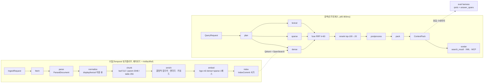
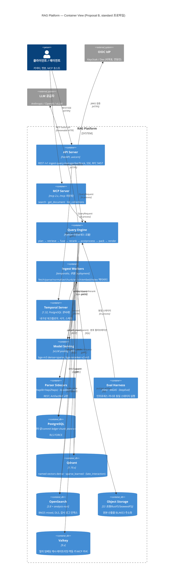
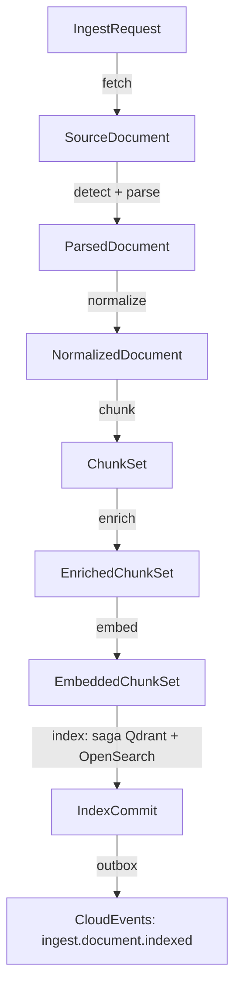
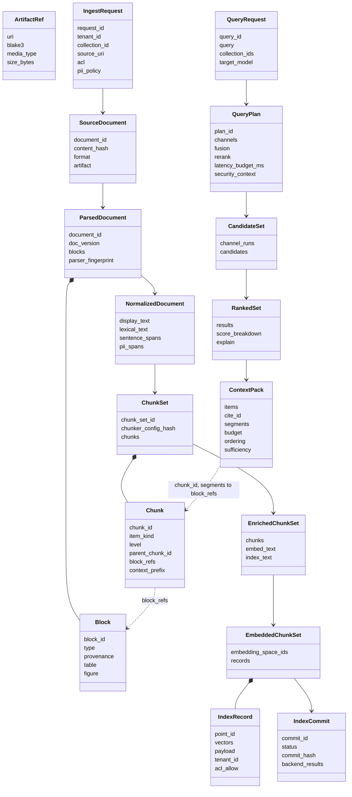
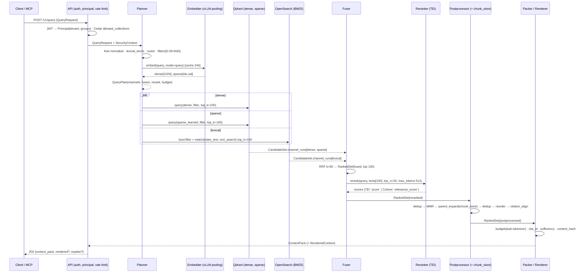
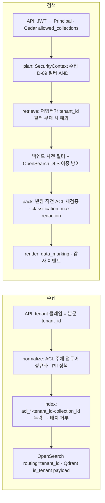
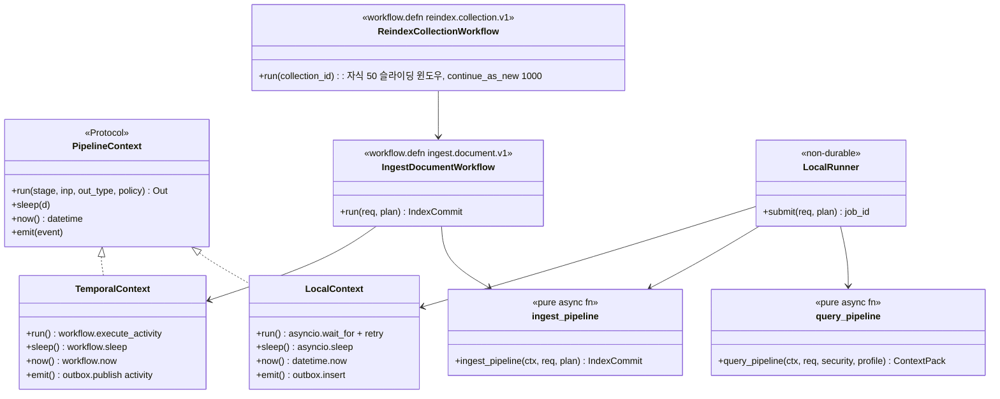

# 설계 제안 B — 검색 품질 우선(Retrieval-Quality-First) 아키텍처

## 목적

브리프(00-design-brief) D-01~D-20과 기술 지형 연구(07-tech-landscape 01~14, 종합 00)를 입력으로, **Top-K 컨텍스트 팩의 품질과 LLM 소비 최적화를 제1 설계 변수**로 삼는 전체 아키텍처를 제안한다. 다른 두 제안(운영 단순성 우선, 확장성 우선)과 심사단이 비교 평가한다. 본 제안은 운영성과 단순성을 포기하지 않는다. 대신 "품질을 만드는 부품은 코어에 두고 검증 게이트로 고정하며, 품질을 만들지 않는 부품은 최소화한다"는 원칙으로 두 요구를 조화시킨다.

## 범위

- 포함: 컨테이너·컴포넌트 구조, 수집·검색 스테이지 정의, D-05 계약 인벤토리(필드 수준), 개방 결정 O-01~O-10, 확정 결정 수정 제안, 4개 프로파일, 검색 경로 알고리즘·지연 예산, ContextPack 렌더링, 멀티테넌시·ACL, 오케스트레이션, 플러그인·프로파일 스키마, 패키지 맵, 리스크, 자기 평가.
- 제외: 계약 문서(03-contracts)의 JSON Schema 전문, API 문서(05-api)의 OpenAPI 전문, 운영 런북. 본 문서의 필드는 03-contracts 작성자가 확정하기 전의 **제안**이며, 명명은 브리프 §9 규약(PascalCase 타입, snake_case 필드, snake_case 열거값)을 따른다.
- 수치 표기: 성능·크기 수치는 출처가 있는 경우 문서 번호를 병기하고, 없는 경우 "초안 목표"로 표기한다(브리프 §9.8).

## 1. 아키텍처 요약(한 페이지)

### 1.1 핵심 아이디어 5개

| # | 아이디어 | 한 줄 정의 | 무엇을 우아하게 만드는가 |
|---|----------|-----------|--------------------------|
| K1 | **단일 좌표계(One Coordinate System)** | 모든 검색 단위(리프 청크·부모·표 조각·요약·페이지 이미지)는 `IndexRecord` 하나로 표현되고, `block_refs[] → Block.provenance(element_path, char_start/char_end, page?, bbox?)`로 원문 좌표에 역추적된다. 인용(`segments`), 평가 진실값(`answer_spans`), 부모 확장, 문장 윈도우가 **같은 좌표**를 쓴다 | 인용 정확도·평가·설명 가능성이 별도 부품이 아니라 좌표계의 파생물이 된다. 재청킹해도 골든셋이 무효화되지 않는다(09 문서) |
| K2 | **3-텍스트 규칙(Three-Text Rule)** | 청크마다 `text`(표시 원문), `embed_text`(결정적 접두어 + 원문; dense·sparse 입력), `index_text`(NFKC 렉시컬 뷰 + 접두어; BM25 입력)를 분리 보관하고 `enrich → strip` 대칭을 계약으로 강제한다(04·11·13 문서) | Contextual Embedding + Contextual BM25(10 문서 A3, 실패율 -49%)를 비용 0의 결정적 접두어로 얻고, LLM 접두어는 정책 스위치 하나로 켠다. 팩에는 항상 원문만 실린다 |
| K3 | **점수 원장(Score Ledger)** | `CandidateSet(채널별 score·rank) → RankedSet(score_breakdown{dense, sparse, lexical, graph, late_interaction, fused, rerank} + explain[]) → ContextPack(confidence_tier)`로 점수가 사라지지 않고 누적된다. 융합은 플랫폼 `fuser`가 수행한다(07·06 문서) | "왜 이 청크가 뽑혔나"가 트레이스가 아니라 계약에 있다(원칙 8). RRF→CC 전환, 리랭커 교체, 채널 추가가 원장의 열 하나를 더하는 일이 된다 |
| K4 | **예산·순서·인용이 있는 팩(Budgeted, Ordered, Citable Pack)** | 후처리 `dedup → MMR → parent_expand → dedup → reorder(litm_alternating) → citation_align → pack`을 고정 순서로 두고, 토큰 예산은 임베딩 토크나이저(청크)와 대상 LLM 토크나이저(팩)로 **이중 카운트**한다. `cite_id`는 관련도순으로 불변, 렌더 위치와 분리(10 문서) | LLM이 소비하는 형태(Anthropic `search_result`+`citations`, XML `<documents>`+`[dN]`)가 팩의 뷰일 뿐이다. 순서 전략·표 형식·압축은 팩을 바꾸지 않고 렌더 힌트만 바꾼다 |
| K5 | **평가 하네스 = 스테이지 소비자(Harness as Consumer)** | 하네스는 프로덕션과 동일한 `QueryRequest → ContextPack` 인프로세스 스테이지를 실행하고, 골든셋은 `doc_id + answer_spans`로 저장한다. 모든 기본값은 "초안 가설 + 승격 게이트"로 프로파일에 기록된다(09 문서, 00 문서 M2 게이트) | 기본값 논쟁이 사람의 의견이 아니라 게이트 조건으로 닫힌다. `RankedSet`·`ContextPack`이 곧 평가 입력이라 별도 로깅 포맷이 없다 |

### 1.2 한 장 그림



### 1.3 이 제안이 지키는 세 가지 불변식

1. **모든 스테이지 경계는 계약 하나, 페이로드는 `ArtifactRef` 하나.** 스테이지는 `Stage[In, Out]` 순수 변환이고, 오케스트레이터는 참조만 옮긴다(08 문서, Temporal 2MB 한계).
2. **검색 경로는 오케스트레이터를 거치지 않고, 상태를 만들지 않는다.** 캐시(Valkey)는 성능 최적화일 뿐 정확성에 관여하지 않는다.
3. **품질 기본값은 게이트 없이 바뀌지 않는다.** 프로파일의 모든 `default_*` 값에는 `gate` 필드가 붙는다(§12).

## 2. 컨테이너/컴포넌트 구조

### 2.1 C4 Container



### 2.2 컴포넌트 책임 표

| 컴포넌트 | 책임(소유) | 소유하지 않는 것 | 격리 모드 | 근거 문서 |
|----------|-----------|------------------|-----------|-----------|
| API Server | 인증(JWT 검증)·인가(Cedar)·레이트리밋·멱등 키·RFC 9457·SSE 릴레이, `IngestRequest` 검증 후 워크플로우 시작, `QueryRequest`에 `security_context` 주입 | 파이프라인 로직, 인덱스 접근 | 프로세스(ASGI) | 08, 12 |
| MCP Server | D-13 도구 3종 + `cursor`/`next_cursor`, `structuredContent`=슬림 팩, `content[0].text`=XML 렌더 | 검색 로직(Query Engine 호출만) | API 프로세스에 마운트 | 10 |
| Query Engine | `QueryRequest → QueryPlan → CandidateSet → RankedSet → ContextPack → RenderedContext`. 병렬 리트리버, 플랫폼 fuser, 리랭커 어댑터, 후처리, 패커, 렌더러 | 상태 저장, 오케스트레이션 | 인프로세스(API·하네스에 임베드) | 07, 10 |
| Ingest Workers | `Stage[In, Out]` 어댑터 실행, 산출물 콘텐츠 주소화 저장, 하트비트 | 재시도·타임아웃 정책(오케스트레이터), 사이드카 내부 | 큐별 프로세스(`ingest-io/cpu/gpu-ocr/gpu-embed/llm`) | 08 |
| Temporal Server | 잡 상태 전이, 재시도, 사가 보상, 자식 워크플로우, 스케줄 | 잡 조회 정본(PostgreSQL `jobs`) | 별도 서비스 | 08 |
| Model Serving | bge-m3 3-in-1(vLLM pooling), 리랭커·dense 전용(TEI) | 프롬프트 소유(어댑터가 소유) | 별도 Deployment + KEDA | 05 |
| Parser Sidecars | HWP 5.0→HWPX 변환(Java), DOC/RTF/ODT→DOCX·HWP 렌더 폴백(LibreOffice, GPL 격리), GPU OCR(PaddleOCR) | `ParsedDocument` 생성(워커 어댑터가 수행) | 별도 컨테이너, REST, 네트워크 차단 | 01, 02, 03 |
| Eval Harness | 골든셋 로딩, 동일 스테이지 실행, ranx/ir_measures, RAGAS/DeepEval, 게이트 판정, `EvalReport` | 별도 검색 경로 | 인프로세스 러너 | 09 |
| PostgreSQL | 테넌트·컬렉션·프로파일 레지스트리, `jobs`·`job_events`·outbox, `index_commits` 원장, `chunk_texts`(부모 확장용), `user_dictionary`, `eval_*`, 점수 캘리브레이션 | 벡터·렉시컬 검색 | RLS `FORCE` | 08, 12, 13 |
| Qdrant | dense·sparse_learned(·late_interaction) 검색, payload 사전 필터, `is_tenant` 파티셔닝 | BM25 계산(lite에서는 클라이언트 계산 값 적재) | 별도 서비스 | 06 |
| OpenSearch | BM25(Nori `mixed`), custom routing, DLS 이중 방어, 감사 로그 | dense 검색(standard) | 별도 서비스 | 06, 12 |
| Object Storage | 원본·파생·`ParsedDocument`~`EmbeddedChunkSet` 산출물, 페이지 이미지, 모델 가중치 미러 | 조회 인덱스 | 별도 서비스 | 08, 12 |
| Valkey | 질의 임베딩 캐시(24h), `count_tokens` 캐시, 레이트리밋, `Idempotency-Key`, MCP 커서 핸들(10분) | 정확성에 영향 주는 상태 | 별도 서비스, 운영 fail-closed(레이트리밋) | 08, 12 |

## 3. 스테이지 파이프라인 정의

스테이지는 `Stage[In, Out]` 순수 변환이다. 표의 "멱등성 키"는 같은 값이면 출력이 동일함을 보장하는 키이고, "캐시 키"는 산출물 스토리지·Valkey에서 재사용을 판정하는 키다(둘은 대체로 같되 캐시 키에는 구현 버전이 추가된다). "격리 모드"는 00 문서 "격리 경계 3단계"(인프로세스 / 헬퍼 프로세스 / 사이드카 컨테이너)를 따른다.

### 3.1 수집 파이프라인



| 스테이지 | 입력 → 출력 | 실패 모드(타입드 오류) | 멱등성 키 | 캐시 키 | 격리 모드 | 큐 / 타임아웃 |
|----------|-------------|------------------------|-----------|---------|-----------|---------------|
| `fetch` | `IngestRequest → SourceDocument` | `fetch.access_denied`(비재시도), `fetch.not_found`(비재시도), `fetch.timeout`, `fetch.too_large` | `blake3(bytes)` = `content_hash` | `content_hash` (원본 산출물) | 인프로세스(fsspec/httpx; smb 플러그인) | `ingest-io`, 5m, 재시도 5 |
| `detect` (parse 내부 서브스테이지) | `SourceDocument → SourceDocument(format, container_flags)` | `parser.unsupported_format`(비재시도), `parser.corrupt_container` | `content_hash` | 동일 | 인프로세스(puremagic + ZIP/OLE 스니퍼) | parse에 포함 |
| `parse` | `SourceDocument → ParsedDocument` | `parser.document_encrypted`, `parser.distribution_document`, `parser.unsupported_variant`, `parser.conversion_failed`(사이드카 → 폴백), `parser.sidecar_unavailable`(재시도), `parser.page_timeout`(페이지 단위 `page_status`) | `content_hash + parser_fingerprint` | 동일(파생 HWPX·페이지 이미지·벤더 JSON 포함) | 포맷별: python-hwpx·pdftext·Docling·Trafilatura 인프로세스 / unhwp 헬퍼 프로세스 / Java·LibreOffice·PaddleOCR 사이드카 | `ingest-cpu` 15m(텍스트), `ingest-gpu-ocr` 60m(스캔), 하트비트 60s, 페이지 인덱스로 재개 |
| `normalize` | `ParsedDocument → NormalizedDocument` | `normalize.nfd_residual`(버그로 취급, 실패), `normalize.pii_detector_unavailable`(재시도; `keep` 폴백 금지), `normalize.segmenter_fallback`(경고) | `parsed_hash + normalizer_fingerprint + analyzer_id + dictionary_hash + pii_policy` | 동일 | 인프로세스(Kiwi/mecab-ko, kss, Presidio) | `ingest-cpu`, 5m |
| `chunk` | `NormalizedDocument → ChunkSet` | `chunk.block_oversized`(경고, 강제 분할), `chunk.count_exceeded`(행 그룹 확대), `chunk.tokenizer_missing`(비재시도) | `normalized_hash + chunker_config_hash + primary_tokenizer_id` | 동일 | 인프로세스(StructureAwareChunker, semchunk 3.2.5) | `ingest-cpu`, 5m |
| `enrich` | `ChunkSet → EnrichedChunkSet` | `enrich.budget_exceeded`(잡 `partial` 종료), `enrich.extractor_timeout`(빈 배열 + `status=partial`), `enrich.content_policy_violation`(비재시도) | `chunk_set_hash + enricher_fingerprint + policy_hash` (LLM 보강은 `+ model_id + prompt_hash`) | 결정적 보강: 동일 / LLM 보강: 청크 단위 `blake3(prompt_hash + embed_text)` | 인프로세스(GLiNER2, Kiwi) / LLM 호출은 `ingest-llm` 큐 | `ingest-cpu` 5m / `ingest-llm` 30m, 동시성 상한 |
| `embed` | `EnrichedChunkSet → EmbeddedChunkSet` | `embed.server_unavailable`(재시도, 지수 백오프), `embed.token_overflow`(truncate + 경고), `embed.space_mismatch`(비재시도) | `embedding_space_id + mode + blake3(embed_text)` (청크 단위) | 동일(Valkey → 산출물) | HTTP 클라이언트(vLLM/TEI) / lite 인프로세스 | `ingest-gpu-embed`, 20m, 하트비트 60s |
| `index` | `EmbeddedChunkSet → IndexCommit` | `index.backend_unavailable`(재시도), `index.partial_commit`(보상 `index.rollback` 후 실패), `index.security_fields_missing`(배치 전체 거부, 비재시도) | `commit_id`(ULID) + `chunk_id` 단위 upsert 멱등 | 없음(쓰기) | 어댑터 인프로세스 → Qdrant gRPC / OpenSearch HTTP | `ingest-io`, 10m, 사가 |
| `publish` | `IndexCommit → CloudEventEnvelope[]` | `outbox.relay_lag`(메트릭) | `event_id`(ULID) | 없음 | 로컬 액티비티(트랜잭션 동거) | 10s |

### 3.2 검색 파이프라인

| 스테이지 | 입력 → 출력 | 실패 모드 | 멱등성 키 | 캐시 키 | 격리 모드 | 지연 예산(GPU, 초안) |
|----------|-------------|-----------|-----------|---------|-----------|---------------------|
| `plan` | `QueryRequest + SecurityContext → QueryPlan` | `plan.security_context_missing`(예외, 500 방지용 400), `plan.llm_understanding_failed`(원 질의 + Kiwi 키워드로 폴백, `route=single`), `plan.filters_too_narrow`(추출 필터 제거 재시도, ACL 유지) | `blake3(normalized_query + collection_ids + filters + profile_hash + principals_hash)` | 질의 임베딩 `embedding_space_id + mode=query + normalized_query` (24h) | 인프로세스 | 20ms(+ 임베딩 40ms) |
| `retrieve` ×N 병렬 | `QueryPlan.channels[i] → CandidateSet.channel_runs[i]` | `retrieve.channel_timeout`(채널 제외, `degraded[]`), `retrieve.backend_error`(동일), `retrieve.zero_results`(정상) | 채널별 `plan_id + channel` | 없음(사전 필터 결과는 캐시하지 않음, ACL 시점성) | Qdrant gRPC / OpenSearch HTTP 병렬 | 120ms(max of 채널) |
| `fuse` | `CandidateSet → RankedSet(fused)` | `fuse.k_missing`(프로파일 검증에서 차단) | `candidate_set_hash + fusion_config_hash` | 없음 | 인프로세스 순수 함수 | 5ms |
| `rerank` | `RankedSet(fused, top_n_in) → RankedSet(rerank)` | `rerank.timeout`(300ms; fused 순서 폴백 + `explain.rerank_skipped`), `rerank.schema_mismatch`(양 스키마 파서) | `model_id + blake3(query + chunk_id 목록)` | 없음(선택: Valkey 60s) | HTTP(TEI/vLLM) | 250ms |
| `postprocess` | `RankedSet → RankedSet(post)` | `postprocess.parent_fetch_failed`(확장 생략, explain 기록) | `ranked_hash + postprocess_config_hash` | 부모 텍스트 `chunk_id` (chunk_store) | 인프로세스 + PostgreSQL 조회 | 60ms |
| `pack` | `RankedSet(post) + QueryPlan → ContextPack` | `pack.budget_overflow`(overflow_policy 순서 적용), `pack.tokenizer_mismatch`(구성 거부) | `ranked_hash + pack_config_hash + tokenizer` → `content_hash` | `blake3(text) + tokenizer` 토큰 카운트 캐시 | 인프로세스(+ 선택 `count_tokens` API) | 40ms |
| `render` | `ContextPack + renderer → RenderedContext{provider_payload, stable_prefix, volatile_suffix, citation_map}` | `render.mixed_blocks`(사전 검증), `render.citations_with_structured_output`(사전 검증 400 예방) | `content_hash + renderer + options_hash` | 동일 | 인프로세스 | 10ms |

합계 초안 약 545ms(직렬 합) + 네트워크·직렬화 여유 ≈ p95 800ms 목표(브리프 §7) 내. 각 스테이지 예산은 `QueryPlan.latency_budget_ms`에 기록되어 스테이지가 남은 예산을 보고 스스로 축소(예: rerank `top_n_in` 100→50)할 수 있다(§8.7).

## 4. 계약 인벤토리

D-05의 13개 타입과 공용 타입을 정의한다. 타입 표기는 JSON Schema 용어(브리프 §9.5). "필수" 열은 `Y`/`N`/조건. 모든 계약은 `schema_version`(semver 문자열)을 갖고, 모든 ID는 ULID(D-06), 해시는 BLAKE3 hex, 시각은 RFC 3339 UTC, 언어는 BCP 47이다. 계약 간 관계는 아래 클래스 다이어그램이 요약한다.



### 4.0 공용 타입

| 타입 | 필드 | 타입 | 필수 | 의미 |
|------|------|------|------|------|
| `ArtifactRef` | `uri` | string(uri) | Y | 오브젝트 스토리지 경로(`s3://…/{blake3}`) |
| | `blake3` | string | Y | 콘텐츠 해시(hex) |
| | `media_type` | string | Y | `application/json`, `application/pdf`, `image/png` 등 |
| | `schema_version` | string | 조건 | 계약 산출물이면 계약 버전 |
| | `size_bytes` | integer | Y | 크기 |
| `Provenance` | `element_path` | string | Y | 원본 요소 경로(OWPML 경로, Docling `self_ref`, HTML CSS 경로). 흐름 포맷 대응(D-04 수정, §6) |
| | `char_start`, `char_end` | integer | Y | 블록 `text` 기준 0-based 코드포인트 오프셋(미포함 끝) |
| | `page` | integer \| null | Y(nullable) | 1-based 페이지, 흐름 포맷은 null |
| | `bbox` | array<number>[4] \| null | Y(nullable) | `[x0, y0, x1, y1]`, 좌상단 원점, PDF 포인트(02 문서) |
| | `section_index` | integer \| null | N | HWPX 구역(secPr) 인덱스 |
| `Acl` | `allow_principals` | array<string> | Y | `user:`/`group:`/`tenant:*` 접두어 주체(12 문서 §2.1) |
| | `deny_principals` | array<string> | N | 허용보다 우선 |
| | `visibility` | enum[public, tenant, restricted] | Y | |
| | `embargo_until`, `expires_at` | string(date-time) | N | |
| | `classification` | enum[public, internal, confidential, secret] | N | 팩 `classification_max`로 전파 |
| | `source_acl_hash` | string | N | 원천 ACL 변경 감지 |
| `SecurityContext` | `tenant_id` | string(ulid) | Y | 서버 주입, 읽기 전용 |
| | `principals` | array<string> | Y | 사용자 + 확장 그룹(상한 1024) |
| | `collection_ids` | array<string(ulid)> | Y | 인가된 컬렉션 교집합 |
| | `as_of` | string(date-time) | Y | embargo/expiry 판정 시각 |
| | `classification_max` | enum | N | 주체가 볼 수 있는 최고 등급 |
| `TokenCounts` | `{tokenizer_id: integer}` | object | Y | 예: `{"hf:BAAI/bge-m3": 387, "tiktoken:o200k_base": 455}` (04 문서) |
| `CloudEventEnvelope` | `id, source, type, time, subject, datacontenttype, data` | — | Y | CloudEvents 1.0.2, `type`은 `ingest.document.parsed` 등 |

### 4.1 `IngestRequest`

생산: 클라이언트(`POST /v1/ingest`) → 소비: `fetch`. 크기 한계: 64KB(JSON), `metadata` 16KB, `acl.allow_principals` ≤ 1,024개.

| 필드 | 타입 | 필수 | 의미 |
|------|------|------|------|
| `schema_version` | string | Y | `"1.0.0"` |
| `request_id` | string(ulid) | Y | 서버 발급(응답에 `job_id`와 함께 반환) |
| `tenant_id` | string(ulid) | Y | 토큰 클레임에서 도출, 본문 값과 불일치 시 403 |
| `collection_id` | string(ulid) | Y | 프로파일이 고정된 컬렉션 |
| `source_uri` | string(uri) | Y | `s3://`, `gs://`, `az://`, `file://`, `http(s)://`, `smb://`(플러그인) |
| `media_type_hint` | string | N | 클라이언트 힌트, 시그니처 판정이 우선 |
| `external_id` | string | N | 원천 시스템 문서 ID(갱신·삭제 조회 키) |
| `external_version` | string | N | 원천 버전 라벨 |
| `metadata.title` | string | N | 파서 메타로 보완 |
| `metadata.authors` | array<string> | N | |
| `metadata.doc_date` | string(date) | N | 팩 헤더·상충 판정에 사용 |
| `metadata.doc_type` | string | N | 예: `regulation`, `press_release`, `report` |
| `metadata.language_hint` | string(bcp47) | N | 기본 `ko` |
| `metadata.tags` | array<string> | N | 필터용 keyword |
| `metadata.genre` | enum[law_article, outline_report, narrative, web_article, form, unknown] | N | 청커 장르 라우팅(13·04 문서) |
| `acl` | `Acl` | Y | D-09 |
| `pii_policy` | enum[mask, tokenize, exclude, keep, reject] | N | 컬렉션 기본값 상속(12 문서) |
| `pii_tokenize_mode` | enum[hash, encrypt] | 조건 | `tokenize`일 때, 기본 `encrypt` |
| `credentials_ref` | string | N | 비밀번호·토큰 참조(KeyProvider), 본문에 평문 금지 |
| `dedup_policy` | enum[skip_if_same_hash, reindex_always] | N | 기본 `skip_if_same_hash` |
| `priority` | integer(0..9) | N | Temporal 업데이트로 변경 가능 |
| `callback.webhook_url` | string(uri) | N | |
| `callback.events` | array<string> | N | 구독 이벤트 이름 |
| `split_hint` | enum[none, json_array, zip_members] | N | 컨테이너 내 다중 문서 분할 힌트(03 문서) |
| `profile_overrides` | object | N | 컬렉션 프로파일의 허용된 키만(예: `parse.pdf.route`), 그 외 422 |
| `requested_at` | string(date-time) | Y | |

### 4.2 `SourceDocument`

생산: `fetch`(+`detect`) → 소비: `parse`. 크기 한계: 원본 기본 200MB(프로파일), 계약 JSON 32KB.

| 필드 | 타입 | 필수 | 의미 |
|------|------|------|------|
| `schema_version` | string | Y | |
| `document_id` | string(ulid) | Y | `external_id`가 같으면 재사용, 아니면 신규 |
| `tenant_id`, `collection_id` | string(ulid) | Y | |
| `request_id` | string(ulid) | Y | 역참조 |
| `source_uri`, `resolved_uri` | string(uri) | Y | 리다이렉트·프리사인 해소 결과 |
| `artifact` | `ArtifactRef` | Y | 원본 바이트 |
| `content_hash` | string | Y | `= artifact.blake3` |
| `size_bytes` | integer | Y | |
| `media_type` | string | Y | 시그니처 판정 결과 |
| `format` | enum[hwpx, hwp5, hwp3, pdf, docx, doc, rtf, odt, html, txt, md, json, unknown] | Y | 라우터 키 |
| `format_confidence` | number(0..1) | Y | |
| `container_flags.encrypted` | boolean | Y | HWP FileHeader·PDF 암호 |
| `container_flags.distribution` | boolean | Y | HWP 배포용 비트 |
| `container_flags.compressed` | boolean | Y | |
| `http_metadata.etag`, `.last_modified` | string | N | 조건부 재수집 |
| `metadata` | object | Y | `IngestRequest.metadata` 복사 |
| `acl`, `pii_policy`, `pii_tokenize_mode` | — | Y | 전파 |
| `external_id`, `external_version` | string | N | |
| `doc_version` | string | Y | `blake3(content_hash + metadata_hash + acl_hash)`; 재현성 단위 |
| `fetched_at` | string(date-time) | Y | |
| `fetch_report` | object | N | `{attempts, bytes_per_sec, redirects}` |

### 4.3 `ParsedDocument`

생산: `parse` → 소비: `normalize`(및 `get_document`). 크기 한계: 블록 수 ≤ 200,000, 단일 블록 텍스트 ≤ 1MB, 계약 JSON ≤ 256MB(산출물로 저장, 인라인 금지). 벤더 모델(DoclingDocument·OWPML·pdftext)은 어댑터가 이 모델로 변환한다(D-04).

| 필드 | 타입 | 필수 | 의미 |
|------|------|------|------|
| `schema_version` | string | Y | |
| `document_id`, `doc_version` | string | Y | |
| `parser_fingerprint.parser_id` | string | Y | 예: `hwpx_python_hwpx`, `pdf_docling_standard`, `pdf_fast_pdftext` |
| `parser_fingerprint.parser_version` | string | Y | 라이브러리 버전 |
| `parser_fingerprint.model_ids` | array<string> | N | heron, TableFormer, PP-OCRv5 korean mobile 등 |
| `parser_fingerprint.sidecar_image_digest` | string | N | Java/LO/OCR 이미지 digest |
| `parser_fingerprint.profile_id` | string | Y | 파서 프로파일(`pdf_standard` 등) |
| `source_kind` | enum[born_digital, scanned, mixed, pre_ocr, flow] | Y | `flow`는 HWP/HWPX/DOCX/HTML/MD(페이지 없음) |
| `quality` | enum[full, degraded] | Y | 배포용 텍스트 전용·렌더 폴백은 `degraded` |
| `warnings` | array<object> | Y | `{code, message, block_id?}` |
| `page_count` | integer \| null | Y | |
| `page_status` | array<object> | N | `{page, status: enum[ok, timeout, ocr_failed, skipped], ocr_confidence}` |
| `language` | string(bcp47) | Y | 문서 주 언어 |
| `metadata.title` | string | N | |
| `metadata.authors` | array<string> | N | |
| `metadata.created_at`, `.modified_at` | string(date-time) | N | |
| `metadata.page_header_text`, `.page_footer_text` | array<string> | N | 보일러플레이트 제거 근거(01 문서) |
| `metadata.has_tracked_changes` | boolean | N | 기본 정책 `accept_all` |
| `metadata.navigation_text` | array<string> | N | HTML nav/aside(03 문서) |
| `metadata.web` | object | N | `{url, site_name, published_at, author}` |
| `metadata.genre` | enum | N | 요청 힌트 또는 파서 추론 |
| `blocks` | array<Block> | Y | **문서 순서 평탄 리스트**, 계층은 `parent_block_id`로 표현 |
| `artifacts` | array<ArtifactRef> | N | 페이지 이미지, 그림 크롭, 표 HTML, 벤더 원본 JSON |
| `annotations` | array<object> | N | `{kind: enum[memo, tracked_change, comment], block_id, text}` 인덱싱 제외 기본 |
| `fields` | array<object> | N | HWPX 필드 `{name, type, value}` |
| `links` | array<object> | N | `{block_id, char_start, char_end, url}` |
| `text_length`, `block_count` | integer | Y | |
| `source_encoding` | string | N | TXT/HTML 원 인코딩 |

**`Block` 타입 enum(확정 제안)**: `heading, paragraph, list_item, table, figure, caption, footnote, code, formula, page_break, page_header, page_footer, toc, form_field`. Docling `TITLE`은 `heading(level=1)`, `DOCUMENT_INDEX`는 `toc`, `KEY_VALUE_REGION/FORM`은 `form_field`로 매핑한다(02 문서). `page_header/page_footer/toc`는 기본 청킹 제외(`furniture=true`).

| `Block` 필드 | 타입 | 필수 | 의미 |
|------|------|------|------|
| `block_id` | string | Y | `blake3(doc_version + element_path)[:32]` — 결정적 |
| `type` | enum(위) | Y | |
| `parent_block_id` | string \| null | Y | 계층(섹션 트리는 heading 레벨로 파생) |
| `ordinal` | integer | Y | 형제 내 순서 |
| `text` | string | Y | 원문(표·그림은 캡션 제외 빈 문자열 가능) |
| `level` | integer | 조건 | heading 1..6, list_item 깊이 |
| `numbering_label` | string | N | "제3조", "1.1", "가." — 텍스트에서 분리 보존(01 문서) |
| `heading_inferred` | boolean | N | 휴리스틱 heading(01·02 문서) |
| `ordered` | boolean | 조건 | list_item |
| `furniture` | boolean | Y | 머리말·꼬리말·nav 등 본문 아님 |
| `container` | enum[body, text_box, footnote_area, header, footer, cell] | Y | |
| `lang` | string(bcp47) | N | 블록 언어(정규화에서 채움) |
| `provenance` | `Provenance` | Y | |
| `caption_of` | string \| null | N | caption → 대상 figure/table `block_id` |
| `caption_block_ids` | array<string> | N | 역방향 |
| `table` | `TableData` | 조건 | type=table |
| `figure` | object | 조건 | `{artifact: ArtifactRef, kind: enum[image, chart, ole, equation_image], alt_text, caption_generated, caption_model}` |
| `formula` | object | 조건 | `{script, latex}` — `script`(한컴 수식 원문) 필수 보존 |
| `footnote` | object | 조건 | `{kind: enum[footnote, endnote], anchor_block_id, anchor_char_offset}` |
| `code` | object | 조건 | `{language}` |
| `page_break` | object | 조건 | `{page_no, section_index}` |

**표 표현(`TableData`)** — 셀 격자를 무손실로 보존해 HTML(`rowspan/colspan`)을 재생성할 수 있어야 한다(10 문서 A4).

| `TableData` 필드 | 타입 | 필수 | 의미 |
|------|------|------|------|
| `n_rows`, `n_cols` | integer | Y | |
| `cells` | array<TableCell> | Y | 앵커 셀만(병합 셀은 앵커 1개) |
| `cells[].row`, `.col` | integer | Y | 0-based |
| `cells[].row_span`, `.col_span` | integer | Y | ≥1 |
| `cells[].text` | string | Y | 셀 내 문단 병합, 중첩 표는 `[table:{block_id}]` 플레이스홀더 |
| `cells[].is_header` | boolean | Y | |
| `cells[].header_kind` | enum[column, row, section, none] | Y | Docling `column_header/row_header/row_section` 매핑 |
| `cells[].provenance` | `Provenance` | N | 셀 bbox·오프셋 |
| `cells[].nested_table_block_id` | string | N | 깊이 ≤ 3 |
| `header_row_indices` | array<integer> | Y | 표 행 그룹 청킹 시 반복 |
| `quality.merged_cells_preserved` | boolean | Y | 렌더 폴백(LibreOffice) 경로는 false 가능 |
| `quality.structure_confidence` | number(0..1) | N | TableFormer/선 기반 |

### 4.4 `NormalizedDocument`

생산: `normalize` → 소비: `chunk`, `get_document`. `ParsedDocument`를 포함(참조)하고 블록별 이중 뷰를 덧붙인다. 한계: `ParsedDocument`와 동일.

| 필드 | 타입 | 필수 | 의미 |
|------|------|------|------|
| `schema_version` | string | Y | |
| `document_id`, `doc_version` | string | Y | |
| `parsed_ref` | `ArtifactRef` | Y | 원 `ParsedDocument` |
| `normalizer_fingerprint` | string | Y | 버전 + 규칙 해시 |
| `analyzer_id` | string | Y | 예: `kiwi:0.24.0:cong`, `mecab-ko:1.3.7:ko-dic`(13 문서) |
| `dictionary_hash` | string | Y | 컬렉션 사용자 사전 BLAKE3 |
| `blocks` | array<NormalizedBlock> | Y | `block_id`로 원 블록과 1:1 |
| `blocks[].display_text` | string | Y | NFC, 제어·PUA·zero-width 제거, 표시·인용용 |
| `blocks[].lexical_text` | string | Y | NFKC, 기호 통일, 한자 독음, BM25·키워드용 |
| `blocks[].offset_map` | array<[integer, integer]> | 조건 | `display_text` ↔ 원 `text` 오프셋 매핑(길이 변화 시) |
| `blocks[].sentence_spans` | array<object> | Y | `{start, end, sub_spans[]}` display 기준(Kiwi/kss) |
| `blocks[].lang` | string(bcp47) | Y | 감지 결과 |
| `blocks[].boilerplate` | boolean | Y | 반복 머리말·꼬리말·nav 판정 |
| `annotations.pii_spans` | array<object> | Y | `{block_id, entity_type, start, end, score, operator: enum[mask, tokenize, exclude, keep]}` |
| `annotations.content_risk` | array<object> | N | 인젝션 패턴 등 `{block_id, kind, score}` |
| `pii_report.policy_applied` | enum | Y | |
| `pii_report.entity_counts` | object | Y | `{entity_type: integer}` |
| `normalization_report.removed_control_chars` | integer | Y | |
| `normalization_report.nfd_composed` | integer | Y | 0이 아닌데 잔존 시 실패 |
| `normalization_report.hanja_replaced` | integer | Y | |
| `normalization_report.spacing_corrected` | boolean | Y | opt-in, 색인 뷰만 |
| `derived_meta.dates` | array<string(date)> | N | ISO 변환(연도 필수 패턴만) |
| `derived_meta.law_refs` | array<string> | N | `law/제1조/제2항` 경로 |
| `genre` | enum | Y | 최종 장르(요청 힌트 > 파서 > 휴리스틱) |

### 4.5 `ChunkSet`과 `Chunk` 계층

생산: `chunk` → 소비: `enrich`. 한계: 문서당 청크 ≤ 50,000, 리프 `token_counts[primary] ≤ leaf_max_tokens`(기본 512), 부모 ≤ 2048, 표 행 그룹 목표 256(04·13 문서). 청크 ID는 `blake3(doc_version + chunker_config_hash + block_path + char_range)`로 결정적이다.

**계층**: `level 0` 리프(임베딩·색인 단위) → `level 1` 부모(섹션; 반환 단위만, 임베딩 안 함) → `level 2` 문서 요약(LLM 옵션). `item_kind`는 검색 단위의 의미를 하나의 열거로 통일한다(04·10·14 문서의 두 열거를 병합): `text, list_group, code, table, table_part, figure_caption, parent, summary, community_report, entity, page_image`.

| 필드 | 타입 | 필수 | 의미 |
|------|------|------|------|
| `schema_version` | string | Y | |
| `chunk_set_id` | string(ulid) | Y | |
| `document_id`, `doc_version` | string | Y | |
| `chunker_id` | string | Y | `structure_aware`, `flat_text`, `docling_hybrid_adapter` |
| `chunker_config_hash` | string | Y | 크기·오버랩·장르 규칙 해시 |
| `primary_tokenizer_id` | string | Y | `hf:BAAI/bge-m3` |
| `stats` | object | Y | `{leaf_count, parent_count, table_part_count, oversized_blocks}` |
| `chunks` | array<Chunk> | Y | |
| `chunks[].chunk_id` | string | Y | 결정적 해시 |
| `chunks[].item_kind` | enum(위) | Y | |
| `chunks[].level` | integer(0..2) | Y | |
| `chunks[].parent_chunk_id` | string \| null | Y | 같은 세트 내 `level+1` |
| `chunks[].child_chunk_ids` | array<string> | 조건 | parent/summary |
| `chunks[].ordinal` | integer | Y | 부모 내 순서 |
| `chunks[].text` | string | Y | `display_text` 조각, **접두어 미포함** |
| `chunks[].lexical_text` | string | Y | `lexical_text` 조각(BM25 입력 원료) |
| `chunks[].heading_path` | array<string> | Y | 루트→현재 heading 텍스트 |
| `chunks[].numbering_path` | array<string> | N | `["제2장", "제3조"]` |
| `chunks[].block_refs` | array<object> | Y | `{block_id, char_start, char_end, page, bbox}` — 합집합이 `text`를 재구성(불변식) |
| `chunks[].sentence_spans` | array<[integer, integer]> | Y | `text` 기준, 인용 세그먼트·문장 윈도우의 원천 |
| `chunks[].token_counts` | `TokenCounts` | Y | primary + `tiktoken:o200k_base` 병기 |
| `chunks[].lang` | string(bcp47) | Y | |
| `chunks[].table_ref` | object | 조건 | `{table_block_id, header_row_indices, row_range, col_range, serialization: enum[html, markdown, triplet, row_json]}` |
| `chunks[].window` | object | N | `{before_chunk_ids, after_chunk_ids}` |
| `chunks[].context_prefix.deterministic` | string | Y | `"{title} › {heading_path} › {caption?}"` 50~100토큰 |
| `chunks[].context_prefix.generated` | string \| null | Y | LLM 문맥(O-05 정책, 기본 null) |
| `chunks[].context_prefix.generated_by` | string \| null | Y | `model_id@revision` |
| `chunks[].tree_level` | integer | N | RAPTOR |
| `chunks[].page_image_ref` | string | N | `visual-pages` |
| `chunks[].content_hash` | string | Y | `blake3(text)` 변경 감지 |

불변식: (1) `block_refs` 오프셋 합집합 = `text`(표는 `serialization`으로 재구성) (2) `level=0`이면 `token_counts[primary] ≤ leaf_max_tokens` (3) `context_prefix`는 `text`에 포함되지 않는다 (4) `parent_chunk_id`는 같은 세트 내 존재.

### 4.6 `EnrichedChunkSet`

생산: `enrich` → 소비: `embed`, `index`(payload 필드). 한계: `embed_text` ≤ `max_input_tokens − prompt_tokens`, `hypothetical_questions` ≤ 5개/청크, `enrichment_budget_tokens`(컬렉션).

| 필드 | 타입 | 필수 | 의미 |
|------|------|------|------|
| `schema_version`, `chunk_set_id`, `document_id`, `doc_version` | — | Y | |
| `enricher_fingerprint` | string | Y | 보강기 집합·버전·정책 해시 |
| `budget_used` | object | Y | `{llm_tokens_in, llm_tokens_out, cost_usd, calls}` |
| `status` | enum[complete, partial] | Y | 예산 초과·추출기 타임아웃 시 `partial` |
| `chunks` | array<EnrichedChunk> | Y | `Chunk` 전체 필드 + 아래 |
| `chunks[].embed_text` | string | Y | `context_prefix.deterministic + "\n" + (generated?) + "\n" + text` — dense·sparse 입력 |
| `chunks[].index_text` | string | Y | `prefix(lexical) + "\n" + lexical_text` — BM25 입력 |
| `chunks[].strip_offsets` | object | Y | `{text_start_in_embed, text_start_in_index}` — `strip()` 대칭 보장 |
| `chunks[].enrichment.keywords` | array<object> | Y | `{term, weight, source: enum[kiwi_nnp, kiwi_nng, sparse_top, user_dict]}` |
| `chunks[].enrichment.entities` | array<Entity> | Y | `{name, type, canonical_id, span, confidence, extractor: enum[gliner2, spacy_ko, llm]}`(14 문서) |
| `chunks[].enrichment.relations` | array<Relation> | N | `{subject_id, predicate, object_id, weight, evidence_chunk_ids}` 그래프 플러그인 |
| `chunks[].enrichment.dates` | array<string(date)> | N | 필터·부스트 |
| `chunks[].enrichment.law_refs` | array<string> | N | |
| `chunks[].enrichment.figure_caption` | string | N | VLM 생성(옵션), 원본 캡션과 분리 |
| `chunks[].enrichment.figure_table_markdown` | string | N | 차트→표(옵션) |
| `chunks[].enrichment.hypothetical_questions` | array<string> | N | LLM 옵션(질의 유사도용 별도 벡터 생성 안 함; `embed_text`에 미포함, 평가용) |
| `chunks[].enrichment.summary` | string | N | 문서/섹션 1회 요약(dsRAG AutoContext식, 부모 `summary` 청크로도 생성 가능) |
| `chunks[].risk_flags` | array<string> | Y | `["injection_pattern", "scan_timeout"]` |
| `chunks[].risk_score` | number(0..1) | Y | |
| `chunks[].pii_entity_counts` | object | Y | |

### 4.7 `EmbeddedChunkSet`과 `IndexRecord`

생산: `embed` → 소비: `index`. `IndexRecord`는 백엔드 어댑터가 Qdrant 포인트 / OpenSearch 문서로 매핑한다(06 문서 매핑표). 한계: dense 1024d fp32(int8 옵션), sparse 비영 항 ≤ 512, `late_interaction` ≤ 512 토큰 × 128d(옵션), payload ≤ 32KB, `text` payload ≤ 8KB(초과 시 `chunk_store` 참조만).

| 필드 | 타입 | 필수 | 의미 |
|------|------|------|------|
| `schema_version`, `chunk_set_id`, `document_id`, `doc_version` | — | Y | |
| `embedding_space_ids` | object | Y | `{dense, sparse_learned, late_interaction?}` 각 `blake3(model_id + revision + dim + normalized + prompt_hash + quantization)`(05 문서) |
| `embedder_fingerprint` | string | Y | 서빙 스택 이미지 digest 포함 |
| `records` | array<IndexRecord> | Y | |
| `records[].record_id` | string | Y | `= chunk_id` |
| `records[].point_id` | string(uuid) | Y | `ulid_to_uuid(chunk_id 기반 ULID)` 결정적 변환(06 문서; Qdrant는 UUID/uint만) |
| `records[].tenant_id`, `.collection_id` | string(ulid) | Y | 누락 시 배치 전체 거부 |
| `records[].document_id`, `.doc_version`, `.commit_id` | string | Y | |
| `records[].is_current` | boolean | Y | 커밋 완료 시 이전 버전 false |
| `records[].index_generation` | integer | Y | blue/green 세대 |
| `records[].item_kind`, `.level`, `.parent_chunk_id` | — | Y | |
| `records[].vectors.dense` | object | Y | `{name: "dense", dim: 1024, values[]}` L2 정규화 |
| `records[].vectors.sparse_learned` | object | Y(standard) | `{name, vocab_id: "xlm-roberta-250k", indices[], values[]}` |
| `records[].vectors.sparse_bm25` | object | Y(lite) | 클라이언트 계산 TF 포화값, `modifier: idf` 적재(06 문서) |
| `records[].vectors.late_interaction` | object | N | `{name, dim: 128, count, values[][]}` |
| `records[].vectors.page_multivector`, `.page_dense` | object | N | `visual-pages` |
| `records[].lexical.index_text` | string | Y | OpenSearch `text` 필드(Nori `mixed`) |
| `records[].lexical.terms` | array<string> | Y | 형태소 keyword 배열(Qdrant 한국어 키워드 필터) |
| `records[].payload.text` | string | Y | 표시 원문(≤8KB) |
| `records[].payload.context_prefix` | string | Y | 결정적 접두어(팩 헤더 재생성) |
| `records[].payload.title`, `.heading_path`, `.numbering_path` | — | Y | |
| `records[].payload.source_uri`, `.doc_date`, `.doc_type`, `.lang`, `.genre` | — | Y | |
| `records[].payload.page_start`, `.page_end` | integer \| null | Y | |
| `records[].payload.acl_allow`, `.acl_deny` | array<string> | Y | 평탄화(12 문서) |
| `records[].payload.acl_visibility`, `.acl_embargo_until`, `.acl_expires_at`, `.acl_classification` | — | Y/N | |
| `records[].payload.entity_ids` | array<string> | N | 필터·부스트 |
| `records[].payload.content_hash` | string | Y | 변경 감지 |
| `records[].payload.token_count_primary` | integer | Y | 패킹 사전 예산 |
| `records[].payload.risk_score`, `.pii_policy_applied` | — | Y | |
| `records[].payload.embedding_space_id`, `.analyzer_id`, `.dictionary_hash` | string | Y | 질의 시 불일치 감지 |
| `records[].payload.updated_at` | string(date-time) | Y | |

### 4.8 `IndexCommit`

생산: `index` → 소비: 관리 API, 평가(`EvalRun.index_commit_ids`), 재색인. PostgreSQL `index_commits` 원장이 정본이다(06·08 문서 사가).

| 필드 | 타입 | 필수 | 의미 |
|------|------|------|------|
| `schema_version` | string | Y | |
| `commit_id` | string(ulid) | Y | |
| `tenant_id`, `collection_id`, `document_id`, `doc_version` | — | Y | |
| `previous_commit_id` | string \| null | Y | 이전 버전 |
| `status` | enum[pending, committed, rolled_back, failed] | Y | |
| `profile_id`, `profile_hash` | string | Y | |
| `parser_fingerprint`, `normalizer_fingerprint`, `chunker_config_hash`, `enricher_fingerprint`, `embedder_fingerprint` | — | Y | 재현성 조건 전부 |
| `embedding_space_ids` | object | Y | |
| `analyzer_id`, `dictionary_hash` | string | Y | 변경 시 렉시컬 재색인 트리거(13 문서) |
| `index_generation` | integer | Y | |
| `record_count` | integer | Y | |
| `commit_hash` | string | Y | `blake3(sorted(record content_hash + vectors hash))` — 브리프 §7 재현성 목표 |
| `backend_results` | array<object> | Y | `{backend_id, backend_version, upserted, deleted, duration_ms, status: enum[ok, failed, compensated]}` |
| `artifact_refs` | object | Y | `{parsed, normalized, chunk_set, enriched, embedded}` 산출물 참조 |
| `stats` | object | Y | `{bytes_dense, bytes_sparse, bytes_lexical, leaf_count, parent_count}` |
| `started_at`, `committed_at` | string(date-time) | Y/N | |
| `events_emitted` | array<string(ulid)> | Y | outbox event_id |

### 4.9 `QueryRequest`

생산: 클라이언트(`POST /v1/query`, MCP `search`) → 소비: `plan`. 한계: `query` ≤ 4,000자, `collection_ids` ≤ 20, `filters` ≤ 8KB, `conversation` ≤ 10턴.

| 필드 | 타입 | 필수 | 의미 |
|------|------|------|------|
| `schema_version` | string | Y | |
| `query_id` | string(ulid) | Y | 서버 발급 |
| `query` | string | Y | 원 질의 |
| `collection_ids` | array<string(ulid)> | Y | 인가 교집합으로 축소 |
| `conversation` | array<object> | N | `{role, text}` 재작성 맥락 |
| `filters.doc_date_gte`, `.doc_date_lte` | string(date) | N | |
| `filters.doc_type`, `.tags`, `.language`, `.genre` | array<string> | N | |
| `filters.document_ids` | array<string(ulid)> | N | 문서 내 검색 |
| `filters.item_kinds` | array<enum> | N | 기본 `[text, table_part, list_group, code, figure_caption]` |
| `top_k` | integer(1..50) | N | 기본 10(팩 `k_max`와 별개) |
| `mode` | enum[hybrid, dense, lexical, sparse] | N | 기본 `hybrid` |
| `retrieval_profile` | enum[default, quality, lite] | N | 컬렉션 프로파일이 허용한 변형만 |
| `target_model` | object | N | `{provider: enum[anthropic, openai, google, local], model}` 토큰 예산·렌더러 선택 |
| `max_context_tokens` | integer | N | 기본 프로파일(24k) |
| `renderer` | enum[anthropic_search_result, anthropic_document, xml_documents, openai_messages, gemini_messages, markdown, mcp_tool_result, plain_records, dify_external_knowledge] | N | 기본 `target_model`에서 유도 |
| `ordering_strategy` | enum[litm_alternating, relevance_desc, document_order] | N | |
| `include_parents` | boolean | N | small-to-big 강제 켬/끔(기본 프로파일) |
| `response_format` | enum[concise, detailed] | N | MCP 결과 크기 |
| `session_id` | string(ulid) | N | 반복 검색(에이전트) |
| `exclude_ids` | array<string> | N | 이미 본 청크 |
| `budget` | object | N | `{max_tool_calls, max_latency_ms, max_context_tokens}` |
| `experiment_id`, `team_assignment` | string | N | 인터리빙·A/B(09 문서) |
| `explain` | boolean | N | `RankedSet.explain`·팩 `diagnostics` 포함 |
| `cursor` | string | N | MCP 더 보기 |
| `requested_at` | string(date-time) | Y | |

### 4.10 `QueryPlan`

생산: `plan` → 소비: `retrieve`, `fuse`, `rerank`, `postprocess`, `pack`. 순수 데이터이며 스테이지는 이를 재해석하지 않는다.

| 필드 | 타입 | 필수 | 의미 |
|------|------|------|------|
| `schema_version`, `plan_id`, `query_id` | — | Y | |
| `security_context` | `SecurityContext` | Y | 서버 주입, 읽기 전용 |
| `original_query`, `normalized_query` | string | Y | Kiwi 오타·띄어쓰기 교정(13·07 문서) |
| `analyzer_id`, `dictionary_hash` | string | Y | 컬렉션 값과 불일치 시 `degraded += ["analyzer_mismatch"]` |
| `route` | enum[no_retrieval, single, multi] | Y | 라우터(07 문서) |
| `complexity` | enum[no_retrieval, single_step, multi_step] | N | Adaptive-RAG(14 문서) |
| `strategy` | enum[hybrid, graph_local, graph_global, tree_collapsed, visual_pages, iterative] | Y | 기본 `hybrid` |
| `rewritten_queries` | array<object> | Y | `{query_id, text, role: enum[original, rewrite, abstraction, hypothetical], weight, channels[]}` — `original` 항상 포함, weight 1.0 |
| `sub_queries` | array<object> | N | `route=multi` |
| `lexical_terms` | array<object> | Y | `{term, weight, tag}` Kiwi NNG/NNP/SL/SN + 사용자 사전 |
| `filters` | object | Y | 요청 필터 + self-query 추출 필터 + **D-09 필터(tenant/collection/acl/embargo/is_current) AND 결합** |
| `channels` | array<object> | Y | `{channel: enum[dense, sparse, lexical, graph, tree, visual, late_interaction], backend_id, collection_alias, index_generation, top_k, embedding_space_id?, query_vector_ref?, timeout_ms, weight, enabled}` |
| `fusion` | object | Y | `{method: enum[rrf, convex_minmax, convex_zscore, dbsf, combmnz], k: integer(필수), weights: {channel: number}, variant_query_weight: 0.5}` |
| `rerank` | object | Y | `{enabled, model_id, backend: enum[tei, vllm, sglang, llamacpp, inprocess], response_schema: enum[tei, cohere], top_n_in, top_n_out, max_tokens_per_text, timeout_ms, instruction?}` |
| `late_interaction_rerank` | object | N | `{enabled, model_id, top_n_in, top_n_out}` 1차 경량 단계(O-04) |
| `postprocess` | object | Y | `{dedup: {cosine_threshold, minhash: {num_perm, seed, scheme, threshold}}, mmr: {enabled, lambda}, parent_expand: {enabled, ratio_threshold, max_parent_tokens}, sentence_window: {enabled, n}, compress: {enabled, method}, relevance_gate: {tau}}` |
| `pack` | object | Y | `{k_max, max_context_tokens, reserved_answer_tokens, tokenizer: {provider, model, name}, count_method, renderer, ordering, table_format_preference[], overflow_policy[], expose_confidence, confidence_tiers: {high, medium}}` |
| `latency_budget_ms` | object | Y | `{total, plan, retrieve, rerank, postprocess, pack}` 남은 예산 전파 |
| `cache_keys` | object | Y | `{query_embedding, plan}` |
| `degraded` | array<string> | Y | 비활성 채널·폴백 기록 |
| `explain` | boolean | Y | |
| `created_at` | string(date-time) | Y | |

### 4.11 `CandidateSet`

생산: `retrieve` → 소비: `fuse`. 한계: 채널당 `top_k` ≤ 300, 후보 슬림 payload ≤ 1KB.

| 필드 | 타입 | 필수 | 의미 |
|------|------|------|------|
| `schema_version`, `candidate_set_id`, `plan_id` | — | Y | |
| `channel_runs` | array<object> | Y | 채널 × 질의 변형 단위 |
| `channel_runs[].channel` | enum | Y | |
| `channel_runs[].source_query_id` | string | Y | `rewritten_queries[].query_id` |
| `channel_runs[].backend_id`, `.index_generation` | — | Y | |
| `channel_runs[].status` | enum[ok, timeout, error, disabled] | Y | |
| `channel_runs[].took_ms` | integer | Y | |
| `channel_runs[].returned` | integer | Y | |
| `channel_runs[].candidates` | array<object> | Y | |
| `…candidates[].chunk_id` | string | Y | |
| `…candidates[].score` | number | Y | 채널 원점수(cosine / dot / BM25) |
| `…candidates[].rank` | integer | Y | 1-based |
| `…candidates[].document_id`, `.item_kind`, `.level`, `.parent_chunk_id` | — | Y | |
| `…candidates[].payload_slim` | object | Y | `{heading_path, page_start, doc_date, acl_classification, token_count_primary}` — 후처리·게이트용 |
| `…candidates[].graph_path` | array<string> | N | 그래프 채널 설명 |
| `total_unique` | integer | Y | |
| `degraded` | array<string> | Y | |

### 4.12 `RankedSet`과 점수 분해

생산: `fuse`(fused) → `rerank`(rerank) → `postprocess`(post) — 같은 타입이 세 번 갱신되며 `stage` 필드로 구분한다. 소비: `pack`, 평가 하네스(TREC run 변환).

| 필드 | 타입 | 필수 | 의미 |
|------|------|------|------|
| `schema_version`, `ranked_set_id`, `plan_id` | — | Y | |
| `stage` | enum[fused, reranked, postprocessed] | Y | |
| `fusion` | object | Y | `{method, k, weights}` 실제 적용값 |
| `rerank` | object | Y | `{applied, model_id, backend, took_ms, skipped_reason?, normalization: enum[sigmoid, minmax, identity]}` |
| `postprocess_report` | object | 조건 | `{dedup_removed, mmr_applied, parents_expanded, windows_added, compressed, reordered}` |
| `calibration_ref` | string | N | 컬렉션별 리랭크 점수 분포(게이트·tier 경계) |
| `results` | array<RankedResult> | Y | `final_rank` 오름차순 |
| `results[].chunk_id`, `.document_id`, `.item_kind`, `.level` | — | Y | |
| `results[].final_rank` | integer | Y | 현 스테이지 기준 |
| `results[].fused_score`, `.fused_rank` | number, integer | Y | |
| `results[].rerank_raw_score`, `.rerank_normalized_score`, `.rerank_rank` | — | 조건 | 리랭크 적용 시 |
| `results[].score_breakdown.dense` | object | Y | `{score, rank, contribution, source_query_ids[]}` (미적중이면 `null`) |
| `results[].score_breakdown.sparse`, `.lexical`, `.graph`, `.late_interaction`, `.visual` | object \| null | Y | 동일 구조 |
| `results[].score_breakdown.fused` | number | Y | |
| `results[].score_breakdown.rerank` | number \| null | Y | |
| `results[].channels_hit` | array<enum> | Y | 적중 채널 집합(설명·MMR 다양성 특징) |
| `results[].expanded_from` | array<string> | N | 부모 확장 시 원 자식 chunk_id 목록 |
| `results[].duplicates_of` | string | N | 대표 chunk_id |
| `results[].explain` | array<string> | Y | `["lexical_only_hit", "rerank_skipped", "parent_of_3_hits", "mmr_demoted", "below_gate"]` |
| `stats` | object | Y | `{n_in, n_out, gate_passed}` |

`contribution`은 융합 방식에 따라 정의된다: RRF는 `1/(k + rank)`, CC는 `w_c · normalized_score`. 세 채널의 `contribution` 합 = `fused_score`가 불변식이다(점수 원장 K3).

### 4.13 `ContextPack`

생산: `pack` → 소비: 렌더러, MCP `structuredContent`(슬림), 클라이언트, 평가 하네스. 한계: `items` ≤ `k_max`(기본 20), `budget.max_context_tokens` 기본 24,000(초안, 10 문서), 항목 `text` ≤ 8KB, 팩 JSON ≤ 512KB. 10 문서 D1~D4 제안을 채택하고 12·14 문서 필드를 병합했다.

| 필드 | 타입 | 필수 | 의미 |
|------|------|------|------|
| `schema_version`, `pack_id`, `query_id`, `plan_id` | — | Y | |
| `tenant_id`, `collection_ids` | — | Y | |
| `profile_id`, `profile_hash` | string | Y | |
| `created_at`, `trace_id` | string | Y | |
| `budget.tokenizer` | object | Y | `{provider, model, name}` |
| `budget.count_method` | enum[exact_api, exact_local, approximate] | Y | Anthropic는 `exact_api`(`count_tokens`) 또는 `approximate + calibration_ratio` |
| `budget.calibration_ratio`, `.safety_margin` | number | 조건/Y | 근사 시 필수 / 기본 0.10 |
| `budget.max_context_tokens`, `.used_tokens`, `.reserved_answer_tokens`, `.k_max` | integer | Y | |
| `budget.overflow_policy` | array<enum[downgrade_tables, truncate, compress]> | Y | 적용 순서, 기본 `[downgrade_tables, truncate]` |
| `ordering` | object | Y | `{strategy: enum[litm_alternating, relevance_desc, document_order], applied}` |
| `items` | array<ContextItem> | Y | **렌더 순서** |
| `items[].cite_id` | string | Y | `d1..dN` 관련도순, 불변 |
| `items[].chunk_id`, `.parent_chunk_id`, `.document_id`, `.doc_version` | — | Y/N | |
| `items[].item_kind` | enum | Y | |
| `items[].rank`, `.position` | integer | Y | 관련도 순위(1-based) / 렌더 위치(0-based) |
| `items[].confidence_tier` | enum[high, medium, low] | Y | 리랭크 정규 점수 구간(융합 점수 아님) |
| `items[].header` | object | Y | `{title, section_path[], numbering_path[], source_uri, doc_date, page_start, page_end, language, doc_type, doc_version_label}` |
| `items[].text` | string | Y | 원문(접두어 제외) |
| `items[].text_format` | enum[markdown, plain, html] | Y | |
| `items[].segments` | array<object> | Y | `{index, text, char_start, char_end, block_id}` — 문장·셀 단위 인용 경계(`sentence_spans` 파생) |
| `items[].context_prefix` | string | N | 결정적 접두어(렌더러가 `title`/`context`로 매핑) |
| `items[].tables` | array<object> | N | `{table_id, html, markdown, json_records, caption, merged_cells}` 다중 형식 |
| `items[].figures` | array<object> | N | `{figure_id, caption, alt_text, image_ref?}` |
| `items[].parent` | object | N | `{parent_chunk_id, expanded, parent_text_included, child_cite_ids[]}` |
| `items[].duplicates_of`, `.conflicts_with` | string / array<object> | N | `conflicts_with[]{cite_id, kind: enum[version, source, date], note}` 규칙 기반 표지만 |
| `items[].provenance` | array<object> | Y | `block_refs`와 동일 구조(page/bbox/char/element_path) |
| `items[].acl` | object | Y | `{classification, checked: true}` 반환 직전 재검증 증적 |
| `items[].scores` | object | Y | `{fused, rerank, dense, sparse, lexical}` 관측용, 렌더 시 숨김 |
| `items[].token_count` | integer | Y | `budget.tokenizer` 기준 |
| `omitted` | array<object> | Y | `{chunk_id, reason: enum[below_threshold, duplicate, budget_exceeded, acl_denied, parent_merged, item_kind_excluded]}` |
| `sufficiency` | object | Y | `{status: enum[not_needed, sufficient, partial, insufficient, unknown], coverage, missing_aspects[], method: enum[rule, llm_judge]}` |
| `stop_signal` | object | N | `{sufficient, coverage_estimate, reason}` 에이전트 루프 |
| `redaction_summary` | object | Y | `{pii_masked, entity_counts}` |
| `classification_max` | enum | Y | 항목 최고 등급 |
| `render_hints` | object | Y | `{preferred_renderer, citation_style: enum[native, bracket_id], instructions_template_id, stable_prefix_ref, table_format_preference[], language, expose_confidence, data_marking: enum[none, delimit, datamark]}` |
| `diagnostics` | object | N | `{dedup_removed, parent_expansions, mmr_lambda, filters_applied, latency_ms{…}, degraded[]}` |
| `truncated`, `next_cursor` | boolean, string | N | MCP |
| `content_hash` | string | Y | `items` 결정적 직렬화의 BLAKE3(캐시·멱등) |

**렌더러 열거와 산출**: `RenderedContext{provider_payload, stable_prefix, volatile_suffix, citation_map}`을 반환하며 `CitationMap`은 공급자 인용(`search_result_index + block range`, `document_index`, `[dN]`)을 `{cite_id, chunk_id, segment_range}`로 역매핑한다. 세부 규칙은 §9.

### 4.14 크기 한계 요약

| 계약 | 인라인(API) 한계 | 산출물 한계 | 전달 방식 |
|------|------------------|------------|-----------|
| `IngestRequest` | 64KB | — | API 본문 |
| `SourceDocument` | 32KB(JSON) | 원본 200MB(프로파일) | `ArtifactRef` |
| `ParsedDocument` / `NormalizedDocument` | 참조만 | 256MB, 블록 200k | `ArtifactRef` |
| `ChunkSet` / `EnrichedChunkSet` | 참조만 | 청크 50k | `ArtifactRef` |
| `EmbeddedChunkSet` | 참조만 | 레코드 50k × ~6KB | `ArtifactRef`, 배치 upsert 256/요청 |
| `IndexCommit` | 16KB | — | PostgreSQL 원장 + 이벤트 |
| `QueryRequest` | 16KB | — | API 본문 |
| `QueryPlan` | 32KB | — | 인프로세스(explain 시 응답 포함) |
| `CandidateSet` | 채널 300 × 1KB | — | 인프로세스 |
| `RankedSet` | 100 × 2KB | — | 인프로세스(explain 시 응답 포함) |
| `ContextPack` | 512KB, 항목 20, 24k 토큰 | — | API 응답 / MCP `structuredContent`(슬림 ≤ 20k 토큰) |

## 5. 개방 결정 O-01~O-10

각 결정은 기술 지형 문서를 근거로 인용한다. "게이트"는 이 결정을 뒤집을 수 있는 평가 조건이며 프로파일 YAML의 `gate` 필드로 기록된다(§12).

| ID | 결정(제안 B) | 근거(문서) | 승격·재검토 게이트 |
|----|--------------|-----------|--------------------|
| **O-01 융합 기본값** | **RRF(k=60, 채널 가중 1:1:1, 변형 질의 0.5)를 기본으로 하되 융합은 반드시 플랫폼 `fuser`에서 수행**한다(서버 융합은 `lite`의 Qdrant `Fusion.RRF(k=60)`만). 골든셋 ≥200 qrels가 확보된 컬렉션은 min-max convex combination(CC)으로 전환하고 가중치를 프로파일에 고정한다. DBSF·z-score CC는 sparse 롱테일 컬렉션 옵션 | 07 §2(Bruch et al. 2023: 튠된 CC > RRF, RRF k 민감), 06(세 채널이 두 백엔드에 걸침 → 플랫폼 융합만 점수 분해 보존; Qdrant 기본 k=2 함정), 13(한국어 `mixed` BM25 스케일 이식성 낮음 → RRF 기본), 00 J-없음/O-01 권고 | 하네스 그리드 `rrf_k ∈ {10,30,60,100}` × CC 가중 0.05 단위, Fisher p<0.05, 홀드아웃 과적합 확인; LTR은 qrels ≥2,000 |
| **O-02 sparse 표현** | **BGE-M3 sparse(동일 패스, `vocab_id=xlm-roberta-250k`)** 기본. lexical(BM25 형태소) 레그는 sparse가 있어도 항상 유지(제3 레그). `ko-quality`는 PIXIE-Splade-v1.5(`ax-encoder-50k`), `unified-opensearch`는 inference-free-splade-ko-v1(라이선스 확인 후) → opensearch multilingual-v1 폴백. SPLADE-v3 제외(CC BY-NC-SA) | 05(MIRACL-ko sparse 61.5 vs BM25 37.1, MLDR 장문 sparse > dense), 13(서브워드 vs 형태소는 단위가 달라 상호 보완), 12(SPLADE-v3 라이선스), 06(OpenSearch neural sparse) | Recall@100·Judged@100을 MIRACL-ko·LawIRKo·자체 공공문서 3종에서 비교, 일관 우세 시 교체; `vocab_id` 계약 필수 |
| **O-03 GraphRAG/RAPTOR** | **이분.** GraphRAG 계열(LightRAG, HippoRAG 2, MS GraphRAG)은 외부 플러그인(`retriever` 채널 `graph` + `enricher`), 코어는 계약 슬롯(`item_kind`, `enrichment.entities/relations`, `channel=graph`, `strategy`, `graph_path`)만. **RAPTOR collapsed tree는 코어 옵션 `enricher`**(`item_kind=summary`, 기본 끔). 그래프 저장소 PostgreSQL + Apache AGE. 1차 엔진은 자체 측정까지 보류 | 14(인덱싱 비용 코퍼스 토큰의 수 배, 질의 비용 수십~수백 배, 단일 홉 열세; RAPTOR는 같은 인덱스에 요약 청크 추가로 충분), 10(`item_kind` 예약 슬롯), 11 인용(00 J-8) | MultiHop-RAG·KoStrategyQA 다중 홉 회귀에서 `default` 대비 유의 개선 + 질의당 토큰 측정 후 `graph` 프로파일 공개 |
| **O-04 late interaction 위치** | **모델·차원별 분리, 기본 끔, 별도 `late_interaction` 슬롯.** BGE-M3 colbert(1024d)는 리랭크 단계 비교 기준만(인덱스 저장 불가). 128d 한국어 ColBERT(KURE-v2, Apache-2.0)는 `premium`에서 (a) 인덱스 단계 1차 검색 vs (b) 리랭크 단계 재점수를 M2 골든셋에서 비교. **제안 B의 사전 선호는 (b) 리랭크 단계**(`m=0` 저장 + prefetch 후 MaxSim, top-300→100)로 크로스인코더 입력을 줄이는 "2단 리랭크"다 — 3-way 파이프라인 구조를 바꾸지 않고 p95를 지키면서 리랭커 GPU 병목을 완화한다. 페이지 이미지(ColQwen)는 `visual-pages` 별도 컬렉션에서 인덱스 단계 필수 | 05(KURE-v2 128d/8192 토큰; 100만 청크 fp16 77GB, turbo4 19GB), 14(Qdrant `MultiVectorConfig(MAX_SIM)`, `m=0` 재점수), 07(리랭크 단계 경량 1차), 00 J-2 | 같은 골든셋에서 nDCG@10·p95·인덱스 크기 비교; 인덱스 단계는 dense+sparse 융합 대비 +2p 이상일 때만; `capabilities.supports_multivector=false` 백엔드는 자동 비활성 |
| **O-05 LLM 보강 기본값·비용** | **결정적 보강은 항상 켬**(결정적 `context_prefix`, Kiwi NNG/NNP 키워드, GLiNER2 엔티티, 날짜·조항 파생 메타). **LLM 보강은 `standard` 기본 끔**, `premium`은 **문서·섹션 1회 요약(dsRAG AutoContext 방식, 문서당 1~수 회 호출)** 을 기본 켬으로 두고 청크 단위 Contextual Retrieval(`contextual_llm`)은 컬렉션 옵션. 비용 정책: `ingest-llm` 큐 + 워커 동시성 상한 + Valkey 토큰 버킷(테넌트) + 컬렉션 `enrichment_budget_tokens`·코퍼스 배수 상한(1.5배) 초과 시 잡 `partial`. 질의 측 LLM(HyDE·multi-query·충분성 판정)은 `default` 끔, `quality` 켬 | 04(재현 연구 비용 $1.02/M 또는 20GB VRAM, 문서 내 검색 저하), 10 A3(실패율 -35~-67%; 리랭킹 포함 -67%), 14(그래프 인덱싱 14M 토큰/5M 코퍼스), 08(`ingest-llm` 큐·동시성), 12(PII 정책 적용 텍스트만 외부 LLM 전달, `llm_enrichment_allowed`), 00 J-3 | 켬/끔 ablation nDCG@10 +0.03 이상 & 문서당 보강 비용 상한 이하 → 컬렉션 켬; `premium` 문서 요약은 청크 접두어 대비 비용/이득 비교 후 `standard` 승격 여부 결정 |
| **O-06 이벤트 버스** | **v1 브로커 없음.** 제어 = Temporal 시그널/업데이트/쿼리, 도메인 이벤트 = CloudEvents 1.0.2 봉투 + PostgreSQL 트랜잭셔널 아웃박스 + 릴레이(웹훅·SSE). NATS JetStream은 `korean-gov`에서 감사 스트림 손실 불가·2년 보존 요구가 확인될 때, 또는 외부 소비자 ≥2 + 재생 요구 시 조건부 추가 | 08(아웃박스 4.55 1위, NATS 조건부 4.15; Redpanda BSL 제외), 12(감사·ACL 이벤트 순서 보장) | 외부 소비자 요구 확인 시 ADR; `rag_outbox_lag_seconds` SLO |
| **O-07 HWP 5.0 범위·LibreOffice** | **HWP 5.0 1급 지원, LibreOffice는 opt-in 최후 폴백.** `standard`: Apache-2.0 Java 사이드카(hwplib 1.1.11 + hwp2hwpx + hwpxlib 1.0.9) → HWPX → 단일 OWPML 어댑터 재사용 → 실패 시 unhwp(헬퍼 프로세스, x64) → hwp-hwpx-parser(순수 Python) → `lo-sidecar`(H2Orestart, GPL 격리, opt-in). `lite`: unhwp → hwp-hwpx-parser(JVM 없음). 배포용 문서: 테넌트 `allow_distribution_documents` 옵트인 시 Tika `HwpV5Parser` 텍스트 전용(`quality=degraded`), 암호화: 자격 증명 없으면 `document_encrypted`. pyhwp는 AGPL 선택 플러그인으로 강등. HWP 경로는 `spacing_corrector` opt-in 비용 포함 | 01(점수 455/425, 구조 보존이 D-19 청킹 품질 좌우), 03·12(LibreOffice 렌더는 표 구조 유실·GPL), 13(HWP5 공백 소실), 00 J-1 | hwp2hwpx × hwpxlib 1.0.9 골든셋 변환 일치율(공공문서 200건, 표 셀·각주·그림); `PrvText` 유사도 손실 감지 |
| **O-08 스캔 PDF OCR** | **RapidOCR(PP-OCRv5 korean mobile, ONNX Runtime; `OCRVersion.PPOCRV5` + `ModelType.MOBILE` + `LangRec.KOREAN` 명시) 기본**, `premium`(GPU) PaddleOCR PP-OCRv5 server + 방향·왜곡 전처리(별도 컨테이너), 폴백 Tesseract 5 `kor+eng`(에어갭; 세로쓰기 `kor_vert` 라우팅). Surya 옵트인(OpenRAIL-M), EasyOCR·HunyuanOCR 제외. Docling `OcrAutoOptions` 금지. `visual-pages`는 OCR 대체가 아닌 `ocr_confidence` 저조 페이지 보완 채널 | 02(점수 87/85/74; KORIE CER Paddle 15.84 vs Tesseract 25.43은 영수증 도메인), 13(v3.9.0+ 기본 PP-OCRv6 한국어 미포함), 12(Surya 매출 임계), 14(보완 채널), 00 J-4 | 한국어 스캔 골든셋(공문서·보고서·2단 논문) CER/WER·처리량 재측정 후 ADR |
| **O-09 청크 크기·오버랩·토크나이저** | **예산 토크나이저 = 프로파일 임베딩 모델 HF 토크나이저(`hf:BAAI/bge-m3`)**, `tiktoken:o200k_base` 병기. 자식 512(병합 하한 64) / 부모 2048(반환 단위만) / 구조 청크 오버랩 0 / 폴백 텍스트 분할 오버랩 10% / 표 행 그룹 256 / `flat_text` 문장 윈도우 ±2. 렉시컬 토큰화는 형태소 분석기로 분리. **ContextPack 예산은 대상 LLM 토크나이저로 재계산(이중 카운트)**, 리랭커 절단은 리랭커 토크나이저 | 04 §15·O-09(Wang et al. 512 최고, Chroma 오버랩 무이득, NVIDIA 15%), 13(bge-m3 512토큰 ≈ 한국어 900~1,000자 = 법령 1조; cl100k 대비 1.8배 차이), 05(모델별 `max_input_tokens` 편차), 10 A7(Anthropic 근사 금지), 00 J-5 | 한국어 골든셋 그리드 {256, 384, 512, 768} × {0, 10%, 15%} → nDCG@10·Recall@20·Span hit rate@k·IoU; 팽창률 프로파일 계수 고정 |
| **O-10 gRPC** | **REST + SSE + MCP 우선 확정, gRPC v1 미제공.** 필요 시 `connectrpc`를 같은 ASGI 앱에 마운트(단일 포트), protobuf는 JSON Schema 정본에서 코드젠. 내부 사이드카도 REST + `ArtifactRef` 교환(RFC 9457). Qdrant 클라이언트 `prefer_grpc=True`는 라이브러리 설정으로 허용 | 08(FastAPI 규약, ConnectRPC 유보), 03·01(사이드카 4종 → 계약 하나로 통일; 01의 gRPC 요구는 `ArtifactRef`로 해소), 10·14(에이전트 인터페이스는 MCP), 12(인증 `PrincipalResolver` 통일), 00 J-6 | 리트리벌 핫패스 p95 측정으로 직렬화 이득 정당화(ContextPack 수십 KB에서는 미미 예상) |

## 6. 확정 결정 D-01~D-20 수정 제안

브리프의 확정 결정은 존중하되 연구 결과상 라이선스 충돌·실현 불가·정밀화 필요 항목을 ADR 발의 대상으로 명시한다(00 문서 "브리프 수정 제안"과 정합). "구분"이 **ADR 필수**인 항목은 P0/P1로 먼저 기록해야 다른 설계 문서가 전제로 삼을 수 있다.

| 결정 | 문제 | 제안 B의 대안 | 구분 | 근거 |
|------|------|--------------|------|------|
| **D-02** | LGPL·BSL/SSPL·GPL 서버·MPL·모델 라이선스·지역 제한(HunyuanOCR 대한민국 제외)·매출 임계(OpenRAIL-M)에 대한 규칙 부재 | 12 문서 §6.1 등급표(A 자유 / B LGPL 조건부 / C 네트워크 분리 / D 모델 제한 / X 금지)를 D-02 해석 지침으로 채택. 플러그인·모델 메타데이터에 `license`·`territory`·`grade` 필수, `models.lock`, CI 라이선스 게이트(pip-licenses + liccheck + Syft/Trivy) | **ADR 필수(P0)** | 12, 02, 04~09, 13, 14 |
| **D-04** | "provenance: page/bbox 필수"는 흐름 포맷(HWP/HWPX/DOCX/HTML/MD)에서 불가 | `page`/`bbox` nullable, `element_path` + `char_start/char_end` 필수(§4.0 `Provenance`). bbox는 좌상단 원점·PDF 포인트 | **ADR 필수(P0)** | 01, 02, 03 |
| **D-17** | "인프로세스 러너(같은 워크플로우 정의 재사용)"이 내구성·재사용 방식 미명시 | 파이프라인 정의는 오케스트레이터 중립 `PipelineContext`에만 의존(`temporalio` 임포트 금지 린트), `LocalRunner`는 **비내구**, 프로덕션 `lite`는 Temporal 단일 바이너리 + PostgreSQL(DBOS는 ADR 후) | **ADR 필수(P0)** | 08 |
| **D-18(PDF)** | PyMuPDF 1.28.x는 AGPL-3.0/상용 듀얼, 인프로세스 `import`는 D-02 위반 | pypdfium2 5.13 + pdftext 0.7(`pdf_fast_cpu`) 또는 Docling `PYPDFIUM2` 백엔드. PyMuPDF는 옵트인 별도 컨테이너만 | **ADR 필수(P1)** | 02, 03, 12 |
| **D-18(HWP 5.0)** | pyhwp AGPL-3.0+, 2020년 이후 무릴리스, Python ≤3.8; H2Orestart는 GPLv3(MIT 표기는 오류) | O-07 결정으로 대체(Java 사이드카 1차, pyhwp 강등, H2Orestart GPL 격리 opt-in) | **ADR 필수(P1)** | 01, 11, 03, 12 |
| **D-18(OCR)** | 후보 나열에 우선순위·조건 없음, RapidOCR v3.9+ 기본이 한국어 미포함 PP-OCRv6 | O-08 결정으로 재정의 | ADR(O-08 통합) | 02, 13 |
| **D-18(DOCX·HTML)** | Docling·python-docx 모두 각주·미주 미처리(소스 확정); Trafilatura+Docling 순서 미명시 | DOCX: Docling `MsWordDocumentBackend` + docx2python 각주·미주 병합 **필수**; HTML: Trafilatura(`output_format="xml"`) → Docling HTML 순서 고정 | 문구 보정 | 03 |
| **D-16(서빙)** | TEI는 BGE-M3 sparse/colbert 생산 불가(`/embed_sparse` BERT MLM 전용), Infinity는 "no sparse" + 13개월 무릴리스 → D-16 기본값이 D-16 서빙으로 실현 불가 | vLLM 0.29 `--runner pooling`(BGE-M3 3-in-1) + TEI 1.9(dense 전용 모델·리랭커) + 인프로세스 FlagEmbedding/sentence-transformers(개발·`lite`). Infinity 제외. 같은 space 내 스택 교체는 코사인 ≥0.9999 동등성 게이트 | **ADR 필수(P1)** | 05, 08 |
| **D-16(교체 후보)** | jina-v3/v4/v5 및 jina 리랭커는 CC-BY-NC/Qwen Research → Apache-2.0 플랫폼 권장 목록 불가 | 예시에서 제거, D 등급 BYO(`model_license_ack`)만. Qwen3-VL-Embedding/Reranker(Apache-2.0)를 시각 문서 후보로 추가 | **ADR 필수(P1)** | 05, 07, 12, 14 |
| **D-16(colbert·근거)** | BGE-M3 colbert 1024d는 인덱스 저장 불가; 한국어 dense 리더보드에서 bge-m3(79.30)가 KURE-v1(80.76)·arctic-ko(82.14)에 뒤짐 | late interaction을 별도 `late_interaction` 슬롯으로 분리(O-04); BGE-M3 유지 근거를 "3-in-1 단일 패스 + 생태계 + 드롭인 한국어 파인튠"으로 재기술, `ko-quality` M2 게이트(+2p) 명시 | ADR(근거 재기술) | 05, 14, 07 |
| **D-14(Redis)** | Redis 8.0+ RSALv2/SSPLv1/AGPLv3 삼중 라이선스 | 기본 Valkey 9.x(BSD-3), "Redis 호환 KV"로 표기, Redis 8은 호환 옵션 | **ADR 필수(P1)** | 08, 12 |
| **D-14(MinIO)** | MinIO community 2026-04-25 아카이브, 소스 전용 AGPL | RustFS 또는 SeaweedFS(Apache-2.0) — ADR에서 실측 후 확정(12 점수는 SeaweedFS 82 > RustFS 81) | **ADR 필수(P1)** | 12 |
| **D-15(경량)** | Qdrant는 BM25를 계산하지 않고 IDF만 적용; FastEmbed BM25는 한국어 형태소 미처리; `text` 인덱스는 유니코드 경계만 | "플랫폼이 Kiwi(공백기 MeCab-ko)로 토큰화하고 TF 포화값(k1=1.2, b=0.75, avgdl 정책)을 계산한 `sparse_bm25`를 `modifier: idf` + 1.19 테넌트 IDF로 적재; 한국어 키워드 필터는 형태소 keyword payload; `lite` 전제 조건에 플랫폼 측 `korean_analyzer` 필수"로 정밀화 | 문구 정밀화(ADR 권고) | 06, 13 |
| **D-15(목록·Nori)** | 라이선스 깨끗한 Solr 10·pg_textsearch 누락; Elasticsearch 공식 이미지 ELv2/SSPL; Nori 기본 `discard`가 복합명사 원형 폐기 | 목록에 Solr·pg_textsearch 추가, Elasticsearch는 어댑터 호환만; "Nori 색인 `mixed` / 질의 `discard` + `UserDictEntry` 단일 소스 사전 파이프라인 필수" | 목록 확장 | 06, 13 |
| **D-19** | Docling HybridChunker는 DoclingDocument만 입력(HWP/HWPX 백엔드 없음); "문맥 보강 기본"이 LLM 요약으로 읽히면 O-05 충돌; late chunking은 mean pooling 전제(BGE-M3 dense는 [CLS]) | 기본 청커 `StructureAwareChunker`(ParsedDocument 네이티브, HybridChunker 알고리즘 재현), Docling 어댑터는 `[docling-chunker]` extra 2차 + CI 동등성; 문맥 보강을 "결정적 접두어(켬) + LLM 접두어(O-05)"로 분리; late chunking 프로파일에 mean pooling 검증 규칙; semchunk 3.2.5 + tiktoken 0.12 잠금 | 문구 보정 + ADR(chunker-default) | 04 |
| **D-11** | GenAI semconv는 Development 단계; Phoenix ELv2; Grafana·Tempo·Loki AGPL | semconv 커밋 고정 + Weaver 상수 모듈; Phoenix·Grafana 계열은 OTLP 대상·분리 컨테이너만(pip 의존 금지); AGPL 불가 환경 대안(OpenSearch Observability + Perses, Victoria*, Jaeger) | 정밀화 + ADR(라이선스 경계) | 09, 12 |
| **D-12** | 문서 단위 qrels만으로는 청킹 비교(O-09) 불가 | TREC qrels/run + `answer_spans` JSONL 확장, nDCG 선형 이득 고정, 인터리빙·쌍대 비교(RAGElo) 추가 | 계약 추가 | 09, 04 |
| **D-20** | Anthropic RAG 전용 GA 경로는 `search_result` 블록; 인용은 `output_config.format`과 병용 불가(400) | "Anthropic `search_result`/`document` + `citations`"로 보정; 레퍼런스 `answer`는 인용 켠 텍스트 1차, 구조화 필요 시 2단계 호출 또는 `bracket_id` | 문구 보정 | 10 |
| **D-13** | MCP 2026-07-28이 세션 제거 → "더 보기"를 세션 상태로 설계 불가 | `search`·`get_document`에 `cursor`/`next_cursor`(Valkey 핸들 10분), `search_batch`·`expand` 추가 검토 | 계약 추가 | 10, 14 |
| **D-07(후처리 순서)** | "중복 제거, 부모 확장, MMR" 순서는 확장 후 큰 텍스트 간 유사도로 다양성 판단이 둔화되고 부모 중복 재발 | `dedup → MMR → parent_expand → dedup → (window) → (compress) → reorder → citation_align → pack` | 문구 보정 | 07 |
| **D-01** | Unstructured `<3.14`, RapidOCR `≤3.13`, flytekit `<3.13` | 파서 워커 이미지 3.12/3.13 고정, 3.14 채택 전 검증 | 명세 보강 | 02, 04 |
| **§7 처리량** | "텍스트 PDF 100p < 30s"는 Docling CPU 표준 구성에서 충족·미달 미확정 | 목표에 프로파일 조건 명시(`pdf_fast_cpu` 또는 GPU 워커 기준), Docling CPU는 자체 재측정 후 별도 목표 | 각주 보정 | 02 |
| **원칙 6** | kiwipiepy 0.24.0(Apache-2.0) PyPI 미배포(0.23.2 LGPLv3 정적 링크 휠) | 플랫폼 측 공백기 기본 python-mecab-ko + kss `punct`, Kiwi는 `[kiwi]` extra → 공개 후 승격; 서버 측 Nori `mixed` | 문구 보정 | 13, 06, 07, 04 |

## 7. 프로파일 정의

프로파일은 컬렉션에 고정되는 버전드 프리셋이다(브리프 §10). 네 프로파일은 00 문서의 프로파일 표를 제안 B의 스테이지 구조 위에 재배치한 것이며, 세부 프로파일 ID(`pdf_fast_cpu`, `ko-quality` 등)는 스테이지 옵션으로 내부 참조된다.

### 7.1 컴포넌트 표

| 스테이지/컴포넌트 | `lite`(단일 노드, GPU 없음) | `standard`(기본, 멀티테넌트) | `premium`(GPU, 품질 우선) | `korean-gov`(공공·규제, ISMS-P) |
|------|------|------|------|------|
| 포맷 판별 | puremagic + ZIP/OLE 스니퍼 | 동일 | 동일 | 동일 + FileHeader 배포용·암호 플래그 정책(`allow_distribution_documents` 감사) |
| HWPX / HWP 5.0 | python-hwpx + OWPML 어댑터 / unhwp(x64) → hwp-hwpx-parser | 동일 / Java 사이드카 → unhwp → hwp-hwpx-parser → `lo-sidecar`(opt-in) | standard 동일 | standard + hwpxlib 사이드카(암호화 HWPX) + Tika 배포용 텍스트 폴백 + `spacing_corrector` opt-in + 한컴 고지 CI |
| PDF 디지털 / 스캔 | `pdf_fast_cpu`(pypdfium2+pdftext) / RapidOCR CPU | `pdf_standard`(Docling heron + TableFormer ACCURATE, 4 thread) / RapidOCR | `pdf_standard` GPU L4 / `pdf_scanned_gpu`(PaddleOCR server) + `pdf_vlm_gpu`(PaddleOCR-VL vs MonkeyOCRv2-B 게이트) | standard + 2단·공문서 골든셋 회귀 + 세로쓰기 Tesseract `kor_vert` + `pdf_airgapped` |
| DOC/RTF/ODT | DOC `unsupported_format`, ODT odfdo, RTF striprtf(degraded) | `lo-sidecar` → DOCX → Docling | 동일 | 동일 + `archive` 프로파일(unoserver 풀) |
| DOCX / HTML / TXT | Docling+docx2python / Trafilatura xml → lxml 어댑터 / charset-normalizer+markdown-it-py | Docling+docx2python / Trafilatura → Docling HTML / 동일 | 동일 | 동일 + `docs-site`(정부 보도자료·법령 포털 선택자 훅) |
| 정규화·문장 분리·PII | python-mecab-ko + kss `punct`; Presidio 정규식 + KR 인식기 | Kiwi(0.24+) / 공백기 MeCab-ko + kss; Presidio + spaCy ko | 동일 | Kiwi + 컬렉션 사용자 사전 필수, NFC/NFKC 이중 뷰, 한자 독음; `tokenize`+`encrypt`, 주민등록번호 `reject` |
| 청킹 | `default_ko_structured`(512/2048/0) + `flat_text`(384, 10%) | 동일 + 표 행 그룹 256 + 결정적 접두어 | 동일 + 문서·섹션 요약 `summary` 청크(AutoContext) + `contextual_llm` 옵션 + RAPTOR(`advanced`) | standard + `law_article` 장르 라우팅(조·항 heading 경로) |
| 임베딩·서빙 | bge-m3 dense ONNX int8 인프로세스 + `sparse_bm25`(Kiwi 토큰 + TF 포화) | bge-m3 dense+sparse @ vLLM pooling(GPU 1) | `ko-quality`(KURE-v1 + PIXIE-Splade-v1.5) 또는 `quality-max`(Qwen3-Embedding-4B MRL 1024); `late_interaction` KURE-v2 슬롯(M2) | standard, `ko-quality`는 게이트 통과 시; 가중치·LICENSE 미러링 필수 |
| 인덱스 | Qdrant 단독(`dense` + `sparse_bm25`; 인프로세스 FlagEmbedding으로 bge-m3 sparse 생성이 가능한 노드는 `sparse_learned` 추가), 1.19 테넌트 IDF, payload 파티셔닝 | Qdrant(dense, sparse_learned) + OpenSearch(Nori `mixed`, routing, DLS) | standard + Qdrant multivector(`late_interaction`, `page_multivector`, turbo4) | standard + 대형 테넌트 전용 shard_key/인덱스 + 감사 로그 별도 인덱스 |
| 질의 이해 | Kiwi 교정·키워드, 규칙 라우터 | + self-query 필터(LLM, 캐시), 대화 재작성, 라우터(no/single/multi) | + multi-query(3, 가중 0.5) + HyDE(dense 채널) + 질의 분해 | standard(외부 LLM 옵트인, 온프레미스 Qwen3 기본) |
| 융합 | Qdrant `prefetch` + `Fusion.RRF(k=60)` 또는 플랫폼 fuser | 플랫폼 fuser RRF k=60 → 골든셋 후 min-max CC | 동일 + 변형 질의 0.5 | standard(CC는 캘리브레이션 후) |
| 리랭커 | gte-multilingual-reranker-base @ TEI CPU(top-30→10) → FlashRank | bge-reranker-v2-m3 @ TEI GPU(top-100→20, 300ms 타임아웃) | KURE-v2 MaxSim 1차(top-300→100, 옵션) → Qwen3-Reranker-4B @ vLLM/SGLang(top-50→20) | standard + dragonkue ko 변종 A/B(+2pt 시 교체) |
| 후처리·패킹 | dedup → reorder → pack; k_max 10, 12k 토큰, Markdown 표, XML + `json_schema` 인용 | dedup → MMR(λ 0.7) → parent → dedup → reorder(LITM) → citation_align → pack; k_max 20, 24k, HTML 표, `search_result`+citations | standard + 충분성 LLM 판정 + `compress`(EXIT, 한국어 검증 후) 옵션 | `regulatory-ko`: `document_order`, 버전 상충 표지, `get_document` 유도, 데이터마킹(L3), `classification_max` |
| 그래프·요약 계층 | 끔 | 끔(GLiNER2 엔티티는 필터·부스트용 켬) | `graph` 플러그인(LightRAG/HippoRAG 2, PG+AGE) + RAPTOR, 채널 `graph` | 끔 기본(다중 홉 게이트 통과 컬렉션만) |
| 오케스트레이션 | Temporal 단일 바이너리 + PostgreSQL; Procrastinate 부수 큐; `LocalRunner` 개발·CI | Temporal(frontend/history/matching 분리), 큐별 워커 + KEDA | + `ingest-gpu-ocr`/`ingest-gpu-embed`/`ingest-llm` 큐, MIG 또는 전용 GPU | + 멀티 네임스페이스(테넌트 등급), 야간 재색인·평가 스케줄 |
| 이벤트·API | 아웃박스 → 웹훅/SSE; FastAPI + MCP | 동일 + KEDA `postgresql` | 동일 | + NATS JetStream(감사 스트림 조건부), mTLS |
| 저장소 | PostgreSQL, RustFS/SeaweedFS, Valkey, Qdrant | + OpenSearch | 동일 | + OpenBao Transit(테넌트 DEK), 저장 암호화 확인 |
| 보안 | API 키 + 정적 역할, L1+L3 | OIDC(Keycloak/Dex) + Cedar + limits/Valkey, L1+L3(+L2 실측 후) | standard | 인덱스-퍼-테넌트 옵션, L2 분류기 필수 + NeMo rails, 감사 2년, 사람 라벨 게이트 100% |
| 평가 | ranx + DeepEval pytest(소형 골든셋), 판정 LLM 로컬 | ranx + ir_measures + RAGAS/DeepEval + UMBRELA 라벨러 + RAGElo + 인터리빙 | standard + O-04/O-05/O-03 ablation 프로파일 | standard + 셀프호스팅 judge(Selene/M-Prometheus 교정 후) + KoPub·Allganize KO |
| 관측성 | OTel → Jaeger + Prometheus | Collector(redaction) → Tempo/Loki/Prometheus + Grafana(분리) + Langfuse | standard | AGPL 불가 시 OpenSearch Observability + Perses; `NO_CONTENT` 강제 |

### 7.2 핵심 파라미터 표

| 파라미터 | `lite` | `standard` | `premium` | `korean-gov` |
|----------|--------|------------|-----------|--------------|
| `chunk.leaf_max_tokens` / `parent_max_tokens` / `merge_min_tokens` | 512 / 2048 / 64 | 512 / 2048 / 64 | 512 / 2048 / 64 | 512 / 2048 / 64 |
| `chunk.table_row_group_tokens` | 256 | 256 | 256 | 256 |
| `chunk.fallback_overlap_ratio` | 0.10 | 0.10 | 0.10 | 0.10 |
| `enrich.context_prefix.generated` | false | false | `doc_summary`(문서·섹션 1회) | false |
| `enrich.enrichment_budget_tokens` (컬렉션) | 0 | 0 | 코퍼스 토큰 × 1.5 상한 | 0 |
| `embed.space.dense` | `bge-m3@rev int8` | `bge-m3@rev fp16` | `KURE-v1@rev` 또는 `Qwen3-Embedding-4B@rev`(MRL 1024) | `bge-m3@rev` |
| `retrieve.top_k` (dense/sparse/lexical) | 50/50/50 | 100/100/100 | 150/150/150 | 100/100/100 |
| `fusion.method` / `k` / `weights` | rrf / 60 / 1:1:1 | rrf / 60 / 1:1:1 → CC(게이트) | rrf(변형 0.5) / 60 → CC | rrf / 60 |
| `rerank.top_n_in → top_n_out` / `max_tokens_per_text` / `timeout_ms` | 30→10 / 512 / 400 | 100→20 / 512 / 300 | (300→100 MaxSim) → 50→20 / 1024 / 600 | 100→20 / 512 / 300 |
| `postprocess.mmr.lambda` | 끔 | 0.7 | 0.7 | 0.7 |
| `postprocess.parent_expand.ratio_threshold` / `max_parent_tokens` | 끔 | 0.5 / 2048 | 0.4 / 2048 | 0.5 / 2048 |
| `postprocess.relevance_gate.tau` (정규 리랭크 점수) | 0.2 | 0.3 | 0.3 | 0.3 |
| `pack.k_max` / `max_context_tokens` / `reserved_answer_tokens` | 10 / 12,000 / 2,000 | 20 / 24,000 / 4,000 | 20 / 32,000 / 4,000 | 20 / 24,000 / 4,000 |
| `pack.ordering` | litm_alternating | litm_alternating | litm_alternating | document_order(문서 내) |
| `pack.table_format_preference` | [markdown, json] | [html, markdown, json] | [html, markdown, json] | [html, markdown] |
| `pack.confidence_tiers` (high ≥ / medium ≥) | 0.7 / 0.4 | 0.7 / 0.4(컬렉션 캘리브레이션 후 갱신) | 동일 | 동일 |
| `pack.renderer` 기본 | xml_documents | anthropic_search_result | anthropic_search_result | xml_documents(온프레미스) |
| `latency_budget_ms.total` (p95 목표) | 1,500 | 800 | 2,500(`quality`) | 800 |
| `eval.gate.ndcg10_min` / `recall20_min` | 0.70 / 0.85(초안) | 0.80 / 0.92(§7) | 0.80 / 0.92 | 0.80 / 0.92 + 사람 라벨 100% |

## 8. 검색 경로 상세

### 8.1 시퀀스



### 8.2 플래너(plan)

| 단계 | 알고리즘 | 비용 | 기본 |
|------|----------|------|------|
| 보안 컨텍스트 | JWT 클레임 → `Principal{subject, groups[], tenant_id}`; 그룹 확장(디렉터리 캐시 TTL 5~15분, 상한 1024) → Cedar `allowed_collections` ∩ 요청 컬렉션 | <5ms | 항상 |
| 한국어 정규화 | Kiwi `typos='basic'` + `space()`(색인 뷰와 동일 규칙) → `normalized_query`; NNG/NNP/SL/SN 품사 → `lexical_terms[]`(사용자 사전 매칭 가중 1.5) | <5ms | 항상 |
| 라우터 | 규칙(길이·의문사·명령형) → `route ∈ {no_retrieval, single, multi}`; `quality`는 LLM 구조화 출력, 골든셋 후 소형 분류기 증류 | 0~500ms | 규칙 항상, LLM은 `quality` |
| self-query 필터 | 날짜·문서유형·부서 정규식 1차 → LLM 구조화 출력(`quality`, 캐시) → `filters`에 AND. 결과 0건이면 추출 필터 제거 후 재검색(D-09 필터는 유지) | 0~800ms | 규칙 항상 |
| 질의 임베딩 | bge-m3 1패스 → dense + sparse; Valkey 키 `embedding_space_id + mode=query + normalized_query`(24h) | 40ms(캐시 미스) | 항상 |
| 채널 구성 | 컬렉션 `CollectionSpec`의 `IndexBackendCapabilities`와 대조: multivector 미지원이면 `late_interaction` 비활성 + `degraded`; `analyzer_id` 불일치면 `degraded += analyzer_mismatch` | <1ms | 항상 |
| 지연 예산 배분 | `latency_budget_ms = {plan: 60, retrieve: 120, rerank: 250, postprocess: 60, pack: 40, reserve: 270}`(합 800). 각 스테이지는 `deadline`을 받아 초과 위험 시 축소(§8.7) | — | 항상 |

### 8.3 병렬 리트리버(retrieve)

- 세 채널은 `asyncio.gather`로 동시 실행, 채널별 `timeout_ms`(초안 100ms) 초과 시 해당 채널만 `status=timeout`으로 제외하고 `degraded`에 기록한다(14 문서 채널 장애 패턴). 하나 이상의 채널이 성공하면 검색은 성공이다.
- 모든 채널은 **사전 필터**를 받는다(12 문서 §2.3 fail-closed): `tenant_id = ? AND collection_id IN ? AND is_current = true AND (acl_visibility = tenant OR acl_allow ANY principals) AND NOT acl_deny ANY principals AND (embargo IS NULL OR embargo ≤ as_of) AND (expires IS NULL OR expires > as_of) AND index_generation = ? AND item_kind IN ?`. Qdrant 필터 문법은 12 문서의 JSON을 그대로 쓰고 `payload_m=16, m=0`, `is_tenant` 인덱스를 전제한다(06 문서).
- dense: Qdrant `query_points(using="dense", query=vec, filter, limit=top_k, with_payload=slim)`. sparse: `using="sparse_learned"`. 두 호출은 Qdrant `prefetch` 하나로 묶지 않는다(플랫폼 융합이 점수 분해를 보존해야 하므로; `lite`만 서버 융합).
- lexical: OpenSearch `bool{filter: [...D-09...], must: [match(index_text, normalized_query, analyzer=nori_search)], should: [terms(lexical.terms, lexical_terms, boost 0.3), match(cjk_bigram, boost 0.1)]}` + `routing=tenant_id`. 질의 분석기는 `discard`, 색인은 `mixed`(06·13 문서).
- 변형 질의(`quality`): `rewritten_queries[]` 각각에 대해 채널 실행 → `channel_runs`에 `source_query_id`로 구분, 융합에서 `variant_query_weight=0.5`.
- 그래프·시각 채널: 플러그인 `retriever`가 같은 `CandidateSet.channel_runs` 스키마로 결과를 실으며 `graph_path`·`item_kind=page_image`를 채운다.

### 8.4 융합(fuse)

```python
def rrf(runs: dict[str, list[tuple[str, float]]], weights: dict[str, float], k: int) -> list[RankedResult]:
    # runs[channel_or_variant] = [(chunk_id, raw_score), ...] rank-ordered
    ledger: dict[str, RankedResult] = {}
    for run_id, hits in runs.items():
        w = weights[run_id]                       # 원 질의 1.0, 변형 0.5, 채널 가중 1.0
        for rank, (cid, raw) in enumerate(hits, start=1):
            c = w / (k + rank)                    # contribution
            r = ledger.setdefault(cid, RankedResult(chunk_id=cid))
            r.score_breakdown[channel_of(run_id)] = ChannelScore(score=raw, rank=rank, contribution=c,
                                                                  source_query_ids=[query_of(run_id)])
            r.fused_score += c
    out = sorted(ledger.values(), key=lambda r: (-r.fused_score, r.chunk_id))   # 결정적 타이브레이크
    for i, r in enumerate(out, start=1):
        r.fused_rank = r.final_rank = i
        r.channels_hit = [ch for ch, s in r.score_breakdown.items() if s]
    return out
```

- CC(`convex_minmax`)는 채널별 min-max 정규화 후 `Σ w_c · s_c`; 가중치는 ranx `optimize_fusion`으로 오프라인 튠하여 프로파일에 고정한다(07 문서). 온라인 `fuser`는 자체 구현이며 ranx와의 일치 테스트가 CI에 있다.
- 불변식: `Σ contribution = fused_score`, 동일 입력 → 동일 순서(타이브레이크 `chunk_id`).
- 부모(`level=1`)·요약(`summary`)은 기본 `item_kinds` 필터로 1차 검색에서 제외되고 후처리에서 자식을 통해 도달한다. `tree_collapsed` 전략에서만 요약이 직접 후보가 된다.

### 8.5 리랭킹(rerank)

| 항목 | 규칙 |
|------|------|
| 입력 | fused 상위 `top_n_in`(100). 각 텍스트는 `context_prefix.deterministic + "\n" + text`를 **리랭커 토크나이저**로 `max_tokens_per_text`(512)에 절단(07·04 문서). 접두어 포함 이유: 표 조각·짧은 리프의 문맥 복원 |
| 호출 | `POST /rerank {query, texts, top_n}`; 어댑터는 TEI(`texts`/`score`)·Cohere(`documents`/`relevance_score`) 두 스키마 파싱 |
| 정규화 | 시그모이드([0,1]) 기본; `normalization` 기록. 컬렉션별 점수 분포(`calibration_ref`)를 저장해 `confidence_tier`·`relevance_gate.tau` 경계를 컬렉션 단위로 보정 |
| 2단 리랭크(`premium`, O-04) | 1단: 저장된 KURE-v2 토큰 벡터로 Qdrant 서버 측 MaxSim(prefetch 300 → 100), `score_breakdown.late_interaction` 기록 → 2단: 크로스인코더/Qwen3-Reranker 50→20 |
| 폴백 | 타임아웃(300ms)·5xx → fused 순서 유지, `rerank.applied=false`, `explain += rerank_skipped`, `rag_rerank_fallback_total` 증가 |
| 게이트 | `max(normalized) < tau`이면 `relevance_gate` 실패 → `quality`는 재작성/필터 완화 1회 재시도, `default`는 `sufficiency=insufficient`로 진행(07 문서 적응형 흐름) |

### 8.6 후처리(postprocess)

고정 순서 `dedup → MMR → parent_expand → dedup → sentence_window(옵션) → compress(옵션) → reorder → citation_align`.

| 단계 | 알고리즘 | 파라미터 |
|------|----------|----------|
| dedup(1차) | `content_hash` 동일 제거 → 임베딩 코사인 ≥ 0.95 근중복 제거(dense 벡터는 후보 payload에 없으므로 Qdrant `retrieve(with_vectors)` 배치 1회 또는 chunk_store 캐시) → 대표는 상위 순위, 제거된 것은 `duplicates_of` | `cosine_threshold 0.95`; MinHash는 `{num_perm 128, seed, scheme affine32, threshold 0.8}` 고정(datasketch 2.0 호환) |
| MMR | `argmax λ·rel_norm(d) − (1−λ)·max_{s∈S} cos(d, s)`; `rel_norm`은 리랭크 정규 점수(min-max) | `λ 0.7`, 선택 수 `top_n_out` |
| parent_expand(small-to-big) | 같은 `parent_chunk_id`를 가진 자식이 `ratio_threshold`(0.5) 이상 적중했거나 자식 합 토큰이 부모 토큰의 60%를 넘으면 부모로 병합(LlamaIndex AutoMerging 개념). 부모 텍스트는 PostgreSQL `chunk_texts`에서 일괄 조회. 표 조각은 부모 대신 **표 전체 + 캡션**으로 확장. 병합 항목은 `expanded_from[]`, `explain += parent_of_N_hits`. 팩 예산을 넘는 부모는 확장 취소 | `ratio_threshold 0.5`, `max_parent_tokens 2048` |
| dedup(2차) | 부모에 흡수된 자식 제거(`omitted.reason=parent_merged`), 부모 간 중복 제거 | — |
| sentence_window(옵션, `flat_text`) | 적중 문장 ±N을 `sentence_spans`로 원문 슬라이스, `window` 참조 | `n 2` |
| compress(옵션) | `ContextCompressor` 플러그인; 문장 단위 보존형(EXIT) 1차 후보, 토큰 단위(LLMLingua-2)는 `text_format=plain` + `segments` 재계산 | 기본 끔 |
| reorder | `litm_alternating`: 순위 k(1-based), K 항목 → 홀수 k는 `position = K − (k+1)/2`, 짝수 k는 `position = k/2 − 1`. 결과 `r1`은 항상 마지막(질의 직전), `r2`는 항상 처음. 테스트 벡터: K=3 `[r2, r3, r1]`, K=4 `[r2, r4, r3, r1]`, K=5 `[r2, r4, r5, r3, r1]`(10 문서 A1). `document_order`는 문서 간 관련도, 문서 내 원문 순서 | 전략은 `pack.ordering` |
| citation_align | `sentence_spans`(문장)·표 셀 행을 `segments[]`로 확정, `cite_id = d{rank}`(관련도순, 위치와 분리), 규칙 기반 `conflicts_with`(같은 `document_id` 다른 `doc_version`, 같은 `section_path` 다른 문서, 날짜 역전) | — |

### 8.7 지연 예산 분배와 축소 규칙

| 스테이지 | 예산(ms, GPU standard) | 초과 위험 시 축소 규칙 | 관측 메트릭 |
|----------|------------------------|------------------------|-------------|
| 인증·인가·레이트리밋 | 10 | 없음(fail-closed) | `rag_auth_latency_seconds` |
| plan(정규화·라우터·필터) | 20 | LLM self-query 생략(규칙만) | `rag_plan_latency_seconds` |
| 질의 임베딩 | 40 | 캐시 히트 시 0 | `rag_embed_query_latency_seconds` |
| retrieve(병렬 max) | 120 | 채널 타임아웃 100ms → 채널 제외 | `rag_retrieve_latency_seconds{channel}` |
| fuse | 5 | — | — |
| rerank | 250 | 남은 예산 < 250이면 `top_n_in` 100→50; < 120이면 리랭크 생략 | `rag_rerank_latency_seconds`, `rag_rerank_fallback_total` |
| postprocess(+chunk_store) | 60 | parent_expand 생략 | `rag_postprocess_latency_seconds` |
| pack(토큰 카운트) | 40 | `count_tokens` API 대신 캐시/근사(`approximate` + `calibration_ratio`) 표기 | `rag_pack_latency_seconds`, `rag_pack_tokens_count` |
| render + 직렬화 | 15 | — | — |
| 네트워크·GC 여유 | 240 | — | `rag_query_latency_seconds`(p50/p95/p99) |
| **합계** | **800** | | |

CPU 프로파일(`lite`)은 리랭크 예산 700ms(top-30, gte-multilingual-reranker-base CPU), 총 1,500ms(브리프 §7 CPU 목표 이내, 초안). 모든 수치는 초안 목표이며 08-evaluation 벤치마크로 대체한다.

## 9. LLM 소비 최적화: ContextPack 구조와 렌더링 규칙

### 9.1 패커(pack) 규칙

| 규칙 | 내용 | 근거 |
|------|------|------|
| 이중 제한 | 항목 수 `k_max`(20)와 토큰 예산 `max_context_tokens`(24k) − `reserved_answer_tokens`를 동시에 적용 | 10 A2(역U자, hard negative) |
| 이중 카운트 | 청크 예산은 임베딩 토크나이저로 이미 계산됨(`token_count_primary`); 팩 예산은 **대상 LLM 토크나이저**로 재계산. Anthropic은 `count_tokens`(`exact_api`, Valkey 캐시 `blake3(text)+tokenizer`) 또는 실측 `calibration_ratio` + 10% 마진(`approximate`); OpenAI `tiktoken`; Gemini `count_tokens`/`LocalTokenizer`; 로컬 HF `tokenizers`. 공급자·카운터 불일치는 구성 검증에서 거부 | 10 A7, 13(팽창률 1.8~2.6배) |
| 임계값 컷 | `rerank_normalized_score < tau` 항목은 `omitted.reason=below_threshold` | 10 A2 |
| 예산 초과 | `overflow_policy` 순서: `downgrade_tables`(HTML→Markdown→JSON) → `truncate`(중앙=하위 순위 항목부터 제거) → `compress`(옵션) | 10 A9 |
| 헤더 | `title › section_path (doc_date)` + `source_uri` + `confidence_tier`; 원시 점수는 숨김 | 10 A3·A6 |
| 충분성 | 규칙: `max(normalized) ≥ high_tier → sufficient`, `≥ tau → partial`, 그 외 `insufficient`; `route=no_retrieval → not_needed`; LLM 오토레이터는 `premium` 옵션 | 10 A6(Joren et al.) |
| 상충 표지 | 규칙 기반 `conflicts_with[]`만; LLM 판정은 옵션 | 10 A5(ClashEval) |
| 결정성 | `items` 직렬화는 `sort_keys` + 고정 순서, 타임스탬프 제외 → `content_hash`; 같은 `RankedSet`·설정이면 바이트 동일 | 10 R1, 원칙 4 |
| 데이터마킹 | `korean-gov`·`regulated`는 `render_hints.data_marking=datamark`(L3): 문서 텍스트 토큰 앞에 마커 삽입 지시 | 12 문서 인젝션 완화 |

### 9.2 렌더러 규칙

| 렌더러 | 매핑 | 인용 | 제약·주의 |
|--------|------|------|-----------|
| `anthropic_search_result`(1차) | 항목 1개 → `{"type":"search_result","source":"rag://{tenant}/{collection}/{chunk_id}","title":"{title} › {section_path} ({doc_date}) [{confidence_tier}]","content":[segments[] 각각 text 블록],"citations":{"enabled":true}}`; 표는 HTML 문자열 텍스트 블록 | `search_result_location{search_result_index, start_block_index, end_block_index, cited_text}` → `CitationMap[search_result_index] → {cite_id, chunk_id}`, 블록 인덱스 → `segments[index]` | 요청 내 `citations.enabled` all-or-nothing; **`tool_result.content`에 `search_result`와 `text` 혼합 금지** → 팩 수준 안내(sufficiency·conflicts·절단)는 첫 `search_result.content[0]` 텍스트 블록 또는 시스템 지시문 변형; `output_config.format`과 병용 불가(사전 검증 400 예방); 빈 결과는 `{"type":"text","text":"No results found."}` 단일 블록; `cache_control`은 최상위 블록에만(빈 텍스트 블록 금지) |
| `anthropic_document`(2차) | `get_document`·`long-context` 프로파일: `{"type":"document","source":{"type":"content","content":[…]},"title","context":"{json meta}","citations":{"enabled":true}}` Custom content로 우리가 문장 경계를 정함 | `content_block_location` → `CitationMap[document_index]` | 스캔 PDF(텍스트 없음) 인용 불가 |
| `xml_documents`(공급자 중립 폴백; OpenAI·Gemini·로컬 골격) | `<documents><document index="n"><source/><title/><date/><confidence/><document_content/></document></documents>` + 지시문 "인용문을 먼저 추출(ground in quotes), `[dN]`으로 표기" | `[dN]` 마커 정규식 + 구조화 출력(`json_schema`: `{answer, citations[]}`) 강제(OpenAI `text.format`, vLLM `structured_outputs`, Ollama `format`) | 20k+ 토큰 자료는 프롬프트 상단·질의 위에 배치; 환각 인용 방지를 위해 `cite_id` 화이트리스트 검증 |
| `openai_messages` / `gemini_messages` | `xml_documents`를 `input_text`/`parts`에 포장 | 위와 동일; Gemini `start_index/end_index`는 문자 범위 인용과 호환 | `file_search`/File Search는 관리형 스토어 전용이라 우리 결과에 네이티브 인용 경로 없음 |
| `markdown` | 사람 검토·로그용 | `[dN]` | — |
| `mcp_tool_result` | `structuredContent` = 슬림 팩(`items[].{cite_id, header, text|summary, confidence_tier, provenance}`, `sufficiency`, `truncated`, `next_cursor`), `content[0].text` = `xml_documents` 렌더 | 위와 동일 | 20k 토큰 상한, `response_format=concise` 기본; `tool_result`로 재전달되는 Anthropic 호스트 경로에서는 동종 블록 규칙 준수 |
| `plain_records` / `dify_external_knowledge` | 외부 앱 연동(11 문서 제안) | 없음/`[dN]` | — |

### 9.3 프롬프트 캐싱 규약

- `RenderedContext.stable_prefix`(시스템 지시문 템플릿 `instructions_template_id`, 도구 정의, 컬렉션 고정 문맥 `stable_prefix_ref`)와 `volatile_suffix`(이번 팩 항목, 질의)를 분리하고 브레이크포인트는 접두어 끝에 둔다(Anthropic `cache_control`, vLLM prefix caching 동일 원리; 10 A8).
- 멀티턴 에이전트 루프에서는 이전 턴 팩을 재정렬하지 않고 **추가만** 한다(`session_id`·`exclude_ids`).
- MCP `tools/list`는 결정적 순서로 반환한다(스펙 2026-07-28 권고).

### 9.4 팩 한 개의 예시(요약)

```json
{
  "schema_version": "1.0.0", "pack_id": "01J9ZQ…", "query_id": "01J9ZP…",
  "budget": {"tokenizer": {"provider": "anthropic", "model": "claude-opus-5", "name": "claude-4.7+"},
             "count_method": "exact_api", "max_context_tokens": 24000, "used_tokens": 9870,
             "k_max": 20, "overflow_policy": ["downgrade_tables", "truncate"]},
  "ordering": {"strategy": "litm_alternating", "applied": true},
  "items": [
    {"cite_id": "d2", "rank": 2, "position": 0, "confidence_tier": "high",
     "header": {"title": "정보보호 지침", "section_path": ["제2장 운영", "제3조 절차"], "doc_date": "2026-03-01",
                "source_uri": "s3://docs/…", "page_start": null, "page_end": null, "language": "ko"},
     "text": "제3조(절차) ① …", "text_format": "markdown",
     "segments": [{"index": 0, "text": "제3조(절차) ① …", "char_start": 0, "char_end": 41, "block_id": "b12"}],
     "provenance": [{"element_path": "/hml/body/section[0]/p[37]", "char_start": 0, "char_end": 41, "page": null, "bbox": null}],
     "acl": {"classification": "internal", "checked": true}, "token_count": 512},
    {"cite_id": "d1", "rank": 1, "position": 1, "…": "…"}
  ],
  "sufficiency": {"status": "sufficient", "coverage": 0.8, "missing_aspects": [], "method": "rule"},
  "render_hints": {"preferred_renderer": "anthropic_search_result", "citation_style": "native",
                   "instructions_template_id": "rag-answer-ko@2", "table_format_preference": ["html", "markdown"],
                   "language": "ko", "expose_confidence": true, "data_marking": "none"},
  "content_hash": "9f3a…"
}
```

## 10. 멀티테넌시·ACL 강제 지점

원칙은 **fail-closed**와 **이중 방어**다(12 문서 §2.3). 아래 지점 중 하나라도 누락되면 검색·색인이 실패해야 하며, 각 지점은 어댑터 단위 계약 테스트와 카나리 테넌트 침투 테스트로 검증된다.



| # | 강제 지점 | 무엇을 | 실패 시 | 근거 |
|---|-----------|--------|---------|------|
| E1 | API 인증 | OIDC JWT(JWKS, Authlib) 검증, `tenant_id`·`groups` 클레임 추출; API 키는 `api_key_id → tenant` 매핑. `IngestRequest.tenant_id`가 클레임과 다르면 403 | 401/403 | 12 §3 |
| E2 | API 인가 | Cedar 4.12(cedarpy) `authorize(principal, action, resource)`; `allowed_collections(principal, read)`로 요청 컬렉션 교집합. 결정에 `policy_version` 기록 | Deny(fail-closed) | 12 |
| E3 | 레이트리밋 | `limits` + Valkey, 테넌트·API 키 단위, `RateLimit` 헤더 + 429; Valkey 장애 시 운영 fail-closed | 429 | 08, 12 |
| E4 | 수집 정규화 | `acl.allow_principals` 접두어(`user:`/`group:`/`tenant:*`) 정규화, 상한 1,024; `pii_policy` 적용(`keep` 불가 항목: 고유식별정보·계좌·카드); PII 모델 로딩 실패 시 `keep` 폴백 금지(잡 실패) | 잡 실패 | 12 §4 |
| E5 | 인덱스 쓰기 | `IndexBackend.upsert`는 `tenant_id`·`collection_id`·`acl_*` 누락 레코드가 하나라도 있으면 **배치 전체 거부**; Qdrant payload 인덱스 `is_tenant=true`, OpenSearch `routing=tenant_id` + filtered alias | `index.security_fields_missing`(비재시도) | 06, 12 |
| E6 | 플래너 | `SecurityContext`는 서버가 주입(요청 본문에서 받지 않음); D-09 필터(tenant, collection, acl_allow/deny, visibility, embargo, expires, is_current)를 사용자 필터와 AND | `plan.security_context_missing` | 12 |
| E7 | 리트리버 어댑터 | `search(plan, security)`에 `security.tenant_id` 없으면 `SecurityContextMissing` 예외; 백엔드 필터에 `tenant_id`가 포함됨을 어댑터 단위 테스트로 고정 | 예외(500 아닌 계약 위반) | 12, 06 |
| E8 | 백엔드 이중 방어 | OpenSearch Security 플러그인 DLS `{"term":{"tenant_id":"${attr.jwt.tenant_id}"}}`; PostgreSQL RLS `FORCE`(jobs, chunk_texts, index_commits) | 백엔드 레벨 차단 | 12 |
| E9 | 패커 재검증 | 반환 직전 각 항목의 `acl_*`를 `SecurityContext`로 재평가(`items[].acl.checked=true`), `classification_max` 계산, 주체 등급 초과 항목 `omitted.reason=acl_denied`; `redaction_summary` | 항목 제외 | 12 |
| E10 | 부모 확장·문서 조회 | `chunk_texts`·`get_document` 조회도 동일 필터(RLS + 애플리케이션 필터); 부모가 자식보다 넓은 ACL을 가질 수 없음(수집 시 부모 ACL = 자식 ACL 교집합) | 확장 생략 | 본 제안 |
| E11 | ACL 갱신 | `PATCH /v1/documents/{id}/acl` → payload만 갱신(`set_payload`/`update_by_query`, 재임베딩 없음); 회수 전파 SLO 5분, `rag_acl_propagation_seconds` | 알림 | 12 §2.4 |
| E12 | 관측성 | 트레이스 콘텐츠 캡처 기본 끔, `rag.tenant_id`는 해시, Collector redaction; `korean-gov`는 `NO_CONTENT` 강제 | — | 09, 12 |
| E13 | MCP | 토큰 검증자만 구현(AS는 외부), RFC 9728 PRM 게시, `Authorization: Bearer`만, audience 검증; 커서 핸들은 `tenant_id`에 바인딩되어 타 테넌트가 사용 불가 | 401/403, `isError` | 10 C2 |
| E14 | 격리 등급 | `standard`: Qdrant payload 파티셔닝 + 대형 테넌트 shard_key 승격; `korean-gov`: 인덱스-퍼-테넌트 옵션 + OpenBao Transit 테넌트 DEK(크립토 셰레딩) | — | 12 §1 |

## 11. 오케스트레이션 모델과 개발 모드

### 11.1 두 실행기, 하나의 정의

파이프라인 정의는 오케스트레이터 중립 `PipelineContext` 프로토콜에만 의존하는 순수 비동기 함수다(08 문서). Temporal 셸(`@workflow.defn`)과 비내구 `LocalRunner`가 각자 컨텍스트를 주입한다. 파이프라인 모듈은 `temporalio`를 임포트하지 않는다(import-linter 규칙).



| 항목 | 결정 |
|------|------|
| 오케스트레이터 | Temporal Server 1.32 + `temporalio` 1.33(MIT), 영속화·가시성 모두 PostgreSQL(ES/Cassandra 미도입) |
| 태스크 큐 | `ingest-io`(fetch, index, publish), `ingest-cpu`(parse 텍스트, normalize, chunk, enrich 결정적), `ingest-gpu-ocr`, `ingest-gpu-embed`, `ingest-llm`(O-05 보강, 동시성 상한), `maintenance`(재색인·평가·정합성 검사). 큐별 워커 Deployment + KEDA `temporal` 스케일러, `minReplicaCount: 1` |
| 액티비티 래퍼 | `Stage[In, Out]`을 감싸는 제네릭 래퍼 1개: `ArtifactRef` 로드 → 실행 → 콘텐츠 주소화 저장 → 참조 반환; `on_progress` → `activity.heartbeat(details)`; `Resumable` 스테이지(OCR)는 `heartbeat_details.page`에서 재개 |
| 정책 | `StagePolicy{task_queue, start_to_close, heartbeat, max_attempts, non_retryable_error_types}`; 비재시도 = 계약 위반·미지원 포맷·암호화·접근 거부 |
| 사가 | `index`는 insert-then-delete; Qdrant 성공·OpenSearch 실패 시 `index.rollback(commit_id)` 보상 후 실패 전파. 커밋 원장(PostgreSQL)이 정본, 주기 정합성 검사가 `maintenance` 스케줄 |
| 잡 상태 | PostgreSQL `jobs`가 조회 정본, Temporal은 실행 엔진. `queued → running → succeeded|failed|cancelling → cancelled`, `failed → queued`(retry 새 run). 취소·우선순위는 시그널/업데이트, 진행률은 쿼리 |
| 이벤트 | `job.state.changed`, `ingest.document.{fetched,parsed,normalized,chunked,enriched,embedded,indexed,retried}`, `index.commit.{published,rolled_back}`, `audit.*`, `feedback.query.cited` — CloudEvents 봉투, 아웃박스 + 릴레이(웹훅·SSE), 소비자 멱등(`event_id`) |
| 대량 재색인 | `reindex.collection.v1` 부모가 문서 ID 페이지를 조회 → 자식 `ingest.document.v1` 50개 슬라이딩 윈도우 → 자식 1,000개마다 `continue_as_new`; blue/green 컬렉션 `col_{collection_id}_{profile_hash}` 채운 뒤 하네스 게이트 통과 시 alias 교체(순서 렉시컬 → 벡터, `index_generation`으로 혼합 상태 차단) |
| 리트리벌 | 오케스트레이터 미경유. `query_pipeline`을 `LocalContext`로 API 프로세스 안에서 실행(p95 800ms에 워크플로우 왕복 불필요) |
| 개발 모드 | `LocalRunner`: 비내구, 크래시 시 `failed` 기록·재시도는 클라이언트 책임; `docker compose`(PostgreSQL, Qdrant, Valkey, RustFS/SeaweedFS, 선택 OpenSearch); 사이드카 없는 `lite` 파서 경로; `rag dev ingest ./file.hwpx --profile lite`, `rag dev query "…" --explain`. CI는 `Replayer` 히스토리 회귀(결정론), 계약 스냅샷, 하네스 소형 골든셋 게이트 |
| 경량 프로덕션 | Temporal 단일 바이너리 + PostgreSQL(`temporal server start-dev` 아님); 부수 큐(릴레이·웹훅·평가 배치)는 Procrastinate(PostgreSQL 단독); DBOS Transact는 3.0.x 안정화 후 ADR |

### 11.2 수집 요청 처리 순서(요약)

`POST /v1/ingest`(Idempotency-Key) → PostgreSQL `jobs INSERT(queued)` + 멱등 키 저장 → `start_workflow(ingest.document.v1, id=job_id, id_conflict_policy=USE_EXISTING)` → `202 {job_id, status_url, events_url}` → 액티비티 순차 실행, 각 스테이지 종료 시 `jobs UPDATE + job_events INSERT`(동일 트랜잭션) → `IndexCommit` 게시 → 릴레이가 웹훅/SSE 전송. Temporal 불가 시 API 503 + `Retry-After`, 잡은 `queued` 유지, 조정 스케줄이 재시작.

## 12. 플러그인 확장 지점과 프로파일 YAML 스키마 개요

### 12.1 확장 지점(D-10 14종)과 계약

Python entry points 그룹 `rag_platform.plugins.<extension_point>`. 각 플러그인은 `PluginMeta{plugin_id, version, license(SPDX), grade(A..X), territory[], capabilities}`를 선언하고 프로파일 로딩 시 요구 능력과 대조된다(00 문서 "capabilities 선언"). 라이선스 등급 C/D/X는 기본 프로파일에서 로드 거부(D-02 ADR).

| 확장 지점 | 인터페이스(개념) | 기본 구현 | 대안·플러그인 예 | 능력 선언 |
|-----------|------------------|-----------|------------------|-----------|
| `fetcher` | `fetch(IngestRequest) -> SourceDocument` | fsspec(s3fs/gcsfs/adlfs) + httpx | smbprotocol(smb), obstore | `schemes[]`, `supports_range` |
| `parser` | `can_parse(SourceDocument) -> bool`, `parse(SourceDocument, options) -> ParsedDocument` | `hwpx_python_hwpx`, `hwp5_java_sidecar`, `pdf_docling_standard`, `pdf_fast_pdftext`, `docx_docling_docx2python`, `html_trafilatura_docling`, `text_charset_markdown_it` | `hwp5_unhwp`(헬퍼), `hwp5_hwp_hwpx_parser`, `office_lo_sidecar`, `pdf_vlm_paddleocr_vl`, `pdf_pymupdf_sidecar`(옵트인) | `formats[]`, `provenance_kind: enum[page_bbox, flow]`, `isolation`, `arch[]` |
| `normalizer` | `normalize(ParsedDocument, policy) -> NormalizedDocument`(하위: `KoreanAnalyzer`, `SentenceSegmenter`, `PiiDetector`) | Kiwi/mecab-ko + kss + Presidio | wtpsplit SaT, GLiNER PII | `analyzer_id`, `tagset` |
| `chunker` | `chunk(NormalizedDocument, config, TokenCounter) -> ChunkSet` | `structure_aware` | `docling_hybrid_adapter`(extra), `flat_text`, `chonkie_semantic`, `narrative_llm_split` | `genres[]`, `supports_tables` |
| `enricher` | `enrich(ChunkSet, policy) -> EnrichedChunkSet` (+ `strip()` 대칭) | `deterministic_prefix`, `kiwi_keywords`, `gliner2_entities`, `derived_meta` | `llm_context_prefix`, `doc_summary_autocontext`, `raptor_tree`, `vlm_figure_caption`, `content_risk_scanner` | `requires_llm`, `budget_aware` |
| `embedder` | `capabilities() -> EmbedderCapabilities`, `embed(texts, EmbedRequestOptions) -> Dense/Sparse/MultiVector[]` | `vllm_pooling_bge_m3` | `tei_dense`, `inprocess_sentence_transformers`, `pylate_late_interaction`, `colqwen_pages` | `supports_dense/sparse/multivector`, `max_input_tokens`, `sparse_vocab_id`, `requires_instruction` |
| `index_backend` | `IndexBackend` 프로토콜(06 문서: `capabilities, ensure_collection, upsert, delete_by_filter, search, swap_alias, snapshot, update_acl`) | `qdrant`, `opensearch` | `milvus`, `pgvector_pg_textsearch`, `solr`, `lancedb`(dev), `age_graph_store` | `IndexBackendCapabilities`(supports_server_bm25, korean_analyzer, supports_multivector, tenant_isolation, …) |
| `query_transformer` | `transform(QueryRequest, SecurityContext, profile) -> QueryPlan`(파이프: normalize_ko → router → self_query → rewrite → expand) | `kiwi_normalize`, `rule_router`, `regex_self_query` | `llm_self_query`, `llm_rewrite`, `multi_query`, `hyde`, `adaptive_router` | `requires_llm` |
| `retriever` | `search(QueryPlan.channel, SecurityContext) -> ChannelRun` | `qdrant_dense`, `qdrant_sparse`, `opensearch_bm25` | `lightrag_graph`, `hipporag_graph`, `colqwen_visual`, `kure_late_interaction` | `channel`, `backend_id` |
| `fuser` | `fuse(runs, weights, k) -> RankedSet` | `rrf` | `convex_minmax`, `convex_zscore`, `dbsf`, `combmnz` | `requires_scores` |
| `reranker` | `rerank(RerankRequest) -> RerankScore[]` | `tei_cross_encoder`(bge-reranker-v2-m3) | `vllm_qwen3_reranker`, `sglang_reranker`, `flashrank`, `llamacpp_rerank`, `qdrant_maxsim_late_interaction` | `response_schema: tei|cohere`, `max_tokens`, `backend` |
| `postprocessor` | `apply(RankedSet, QueryPlan) -> RankedSet`(순서는 프로파일 고정) | `dedup`, `mmr`, `parent_expand`, `reorder_litm`, `citation_align` | `sentence_window`, `exit_compressor`, `llmlingua2_compressor`, `relevance_gate_crag`, `sufficiency_llm` | `preserves_segments` |
| `packer` | `pack(RankedSet, QueryPlan, PackProfile) -> ContextPack`; `ContextRenderer.render(pack, options) -> RenderedContext` | `default_packer` + 렌더러 7종 | `dify_external_knowledge`, `plain_records` | `renderers[]`, `token_counters[]` |
| `evaluator` | `evaluate(EvalRun, artifacts) -> EvalReport` | `retrieval_metric_evaluator`(ranx), `span_hit_evaluator`, `judge_evaluator`(RAGAS/DeepEval) | `ragelo_pairwise`, `umbrela_labeler`, `open_rag_eval` | `needs_llm`, `needs_answer_spans` |

### 12.2 프로파일 YAML 스키마 개요

프로파일은 JSON Schema 2020-12로 게시되며 로딩 시 (1) 플러그인 능력 대조, (2) 토크나이저·공급자 일치, (3) `fusion.k` 필수, (4) late chunking↔pooling 규칙, (5) 라이선스 등급 검증을 수행한다. `profile_hash`는 정규화 YAML의 BLAKE3이며 `IndexCommit`·`ContextPack`에 기록된다. 모든 품질 기본값에는 `gate`가 붙는다.

```yaml
schema_version: "1.0.0"
profile_id: standard-ko-hybrid
version: 1.3.0
extends: base@1            # 상속(깊은 병합, 배열은 교체)
license_policy: {max_grade: B, territory: [KR]}
ingest:
  fetch: {plugin: fsspec_httpx, max_bytes: 209715200}
  parse:
    router:
      hwpx: [hwpx_python_hwpx]
      hwp5: [hwp5_java_sidecar, hwp5_unhwp, hwp5_hwp_hwpx_parser]
      pdf:
        born_digital: pdf_docling_standard
        scanned: {plugin: pdf_docling_standard, ocr: rapidocr_ppocrv5_korean_mobile}
        mixed: page_route
      docx: [docx_docling_docx2python]
      doc: [office_lo_sidecar]
      html: [html_trafilatura_docling]
      txt: [text_charset_markdown_it]
    options: {pdf: {layout_model: heron, table_model: tableformer_accurate, threads: 4}}
  normalize:
    analyzer: {plugin: kiwi, fallback: mecab_ko, user_dictionary: collection}   # analyzer_id는 런타임 기록
    sentence_segmenter: {plugin: kiwi, fallback: kss_punct}
    pii: {plugin: presidio_ko, policy: mask, recognizers: [KR_RRN, KR_PHONE, KR_BANK, KR_CARD, KR_PASSPORT]}
  chunk:
    plugin: structure_aware
    tokenizer: hf:BAAI/bge-m3
    secondary_tokenizers: [tiktoken:o200k_base]
    leaf_max_tokens: {value: 512, gate: {metric: ndcg@10, grid: [256, 384, 512, 768], dataset: ko-public-v1}}
    parent_max_tokens: 2048
    merge_min_tokens: 64
    fallback_overlap_ratio: {value: 0.10, gate: {grid: [0, 0.10, 0.15]}}
    table_row_group_tokens: 256
    genre_rules: {law_article: {heading_regex: "^제\\d+조", split_on: [항]}}
  enrich:
    deterministic: [deterministic_prefix, kiwi_keywords, gliner2_entities, derived_meta]
    generated_prefix: {enabled: false, plugin: llm_context_prefix,
                       gate: {metric: ndcg@10, min_delta: 0.03, max_cost_per_doc_usd: 0.05}}
    budget: {enrichment_budget_tokens: 0, corpus_multiplier_max: 1.5}
  embed:
    dense: {plugin: vllm_pooling_bge_m3, model_id: BAAI/bge-m3, revision: "<sha>", dim: 1024, normalized: true, dtype: fp16}
    sparse: {plugin: vllm_pooling_bge_m3, vocab_id: xlm-roberta-250k}
    late_interaction: {enabled: false}
    equivalence_gate: {cosine_min: 0.9999, sample: 1000}
  index:
    vector: {plugin: qdrant, named_vectors: [dense, sparse_learned], tenant_isolation: payload_filter, payload_m: 16, m: 0}
    lexical: {plugin: opensearch, analyzer: {index: nori_mixed, search: nori_discard, stop_tags: [J*, E*, S*]}, routing: tenant_id, dls: true}
    commit: {strategy: insert_then_delete, alias_swap_order: [lexical, vector]}
query:
  transform: [kiwi_normalize, rule_router, regex_self_query]
  channels:
    - {channel: dense, retriever: qdrant_dense, top_k: 100, timeout_ms: 100}
    - {channel: sparse, retriever: qdrant_sparse, top_k: 100, timeout_ms: 100}
    - {channel: lexical, retriever: opensearch_bm25, top_k: 100, timeout_ms: 100}
  fusion: {method: rrf, k: 60, weights: {dense: 1.0, sparse: 1.0, lexical: 1.0}, variant_query_weight: 0.5,
           gate: {promote_to: convex_minmax, min_qrels: 200, tool: ranx.optimize_fusion}}
  rerank: {plugin: tei_cross_encoder, model_id: BAAI/bge-reranker-v2-m3, response_schema: tei,
           top_n_in: 100, top_n_out: 20, max_tokens_per_text: 512, timeout_ms: 300, normalization: sigmoid,
           gate: {candidate: dragonkue/bge-reranker-v2-m3-ko, min_delta_pt: 2}}
  postprocess:
    order: [dedup, mmr, parent_expand, dedup, reorder, citation_align]
    dedup: {cosine_threshold: 0.95, minhash: {num_perm: 128, seed: 42, scheme: affine32, threshold: 0.8}}
    mmr: {lambda: 0.7}
    parent_expand: {ratio_threshold: 0.5, max_parent_tokens: 2048}
    relevance_gate: {tau: 0.3}
  pack:
    k_max: 20
    max_context_tokens: 24000
    reserved_answer_tokens: 4000
    tokenizer: {provider: anthropic, model: claude-opus-5, count_method: exact_api, calibration_ratio: null, safety_margin: 0.10}
    ordering: litm_alternating
    table_format_preference: [html, markdown, json]
    overflow_policy: [downgrade_tables, truncate]
    confidence_tiers: {high: 0.7, medium: 0.4}
    renderer: anthropic_search_result
    instructions_template_id: rag-answer-ko@2
  latency_budget_ms: {total: 800, plan: 60, retrieve: 120, rerank: 250, postprocess: 60, pack: 40}
eval:
  datasets: [ko-public-v1, allganize-ko]
  gates: {ndcg@10: {min: 0.80, max_regression: 0.01, p: 0.05, correction: holm}, recall@20: {min: 0.92}, judged@10: {warn_below: 0.7}}
```

## 13. 모듈/패키지 맵(Python)

단일 저장소, `uv` 워크스페이스. 코어 패키지 `rag_platform`은 순수 Python(A 등급)만 인프로세스 의존한다. 사이드카·GPL/AGPL 플러그인은 별도 배포물이다.

```text
rag-platform/
├── pyproject.toml                # uv workspace, extras: [kiwi], [docling-chunker], [gpu], [opensearch]
├── schemas/                      # JSON Schema 2020-12 (contracts와 1:1, CI에서 export diff)
├── src/rag_platform/
│   ├── contracts/                # Pydantic v2 모델 — 코드보다 먼저(원칙 1)
│   │   ├── common.py             # ArtifactRef, Provenance, Acl, SecurityContext, TokenCounts, CloudEventEnvelope
│   │   ├── ingest_request.py  source_document.py  parsed_document.py  normalized_document.py
│   │   ├── chunk_set.py  enriched_chunk_set.py  embedded_chunk_set.py  index_commit.py
│   │   ├── query_request.py  query_plan.py  candidate_set.py  ranked_set.py  context_pack.py
│   │   ├── jobs_events.py  errors.py (RFC 9457 Problem + 타입드 오류 코드)  eval.py
│   │   └── versioning.py         # schema_version 호환 규칙
│   ├── stages/                   # Stage[In, Out] 프로토콜, StagePolicy, StageRegistry, 산출물 로드/저장 래퍼
│   ├── plugins/                  # D-10 확장 지점 ABC + PluginMeta + entry point 레지스트리 + capabilities 대조
│   │   ├── fetcher.py parser.py normalizer.py chunker.py enricher.py embedder.py index_backend.py
│   │   └── query_transformer.py retriever.py fuser.py reranker.py postprocessor.py packer.py evaluator.py
│   ├── adapters/                 # 벤더 구현(Adapters over Forks)
│   │   ├── fetch/ (fsspec_httpx)
│   │   ├── parse/ hwpx_python_hwpx/ (owpml_adapter.py) hwp5_sidecar/ hwp5_unhwp/ hwp5_pure/
│   │   │          pdf_docling/ (docling_to_parsed.py) pdf_pdftext/ docx_docling/ html_trafilatura/ text_plain/ format_detect/
│   │   ├── normalize/ korean/ (kiwi.py mecab_ko.py kss.py user_dictionary.py) pii_presidio/
│   │   ├── chunk/ structure_aware/ flat_text/ docling_hybrid_adapter/ (extra)
│   │   ├── enrich/ deterministic_prefix.py kiwi_keywords.py gliner2_entities.py derived_meta.py llm_context_prefix.py doc_summary.py raptor.py
│   │   ├── embed/ vllm_pooling.py tei.py inprocess_st.py pylate.py
│   │   ├── index/ qdrant/ (filters.py ulid_uuid.py bm25_sparse.py) opensearch/ (nori_settings.py dls.py) age_graph/
│   │   ├── rerank/ tei_cohere_client.py qdrant_maxsim.py flashrank.py
│   │   └── llm/ anthropic.py openai_compat.py token_counters.py
│   ├── pipelines/                # 오케스트레이터 중립 순수 함수(temporalio 임포트 금지)
│   │   ├── ingest.py             # ingest_pipeline(ctx, req, plan) -> IndexCommit
│   │   ├── reindex.py            # 문서 페이지 → 자식 실행 계획
│   │   └── query.py              # query_pipeline(ctx, req, security, profile) -> ContextPack
│   ├── orchestration/
│   │   ├── context.py            # PipelineContext, StagePolicy
│   │   ├── temporal/ workflows.py activities.py worker.py converters.py (pydantic_data_converter) tracing.py
│   │   └── local/ runner.py      # LocalRunner(비내구)
│   ├── retrieval/                # 검색 핫패스(인프로세스)
│   │   ├── planner.py filters.py (D-09 필터 빌더) channels.py fusion.py rerank.py
│   │   ├── postprocess/ dedup.py mmr.py parent_expand.py reorder.py citation_align.py compress.py
│   │   └── pack/ packer.py budget.py sufficiency.py conflicts.py
│   ├── render/                   # ContextRenderer 구현 + CitationMap
│   │   ├── anthropic_search_result.py anthropic_document.py xml_documents.py openai_messages.py gemini_messages.py markdown.py mcp_tool_result.py
│   ├── security/                 # principal_resolver.py authz_cedar.py rate_limit.py audit.py key_provider.py
│   ├── storage/                  # artifact_store.py(S3) commit_ledger.py(PG) chunk_store.py(PG chunk_texts) kv.py(Valkey) outbox.py
│   ├── api/                      # FastAPI 라우터: ingest.py query.py manage.py feedback.py jobs.py sse.py problem.py idempotency.py
│   ├── mcp/                      # McpToolAdapter, tools(search/get_document/list_collections), cursor_store.py
│   ├── profiles/                 # YAML 로더, JSON Schema, validation(capabilities·tokenizer·license), profile_hash
│   ├── korean/                   # UserDictEntry 단일 소스 → Kiwi/Nori/synonym 생성기, 팽창률 계수
│   ├── eval/                     # harness/ runner.py(LocalRunner 재사용) trec.py metrics_ranx.py judge_ragas.py span_hit.py gates.py datasets/
│   ├── telemetry/                # OTel 설정, Weaver 생성 상수(gen_ai.*, rag.*), metrics.py, redaction.py
│   └── cli/                      # rag dev ingest|query|eval|profile validate|schema export
├── sidecars/                     # 별도 이미지(코어 의존 없음)
│   ├── parser-java/ (hwplib + hwp2hwpx + hwpxlib + Tika HwpV5Parser, REST, ArtifactRef)
│   ├── lo-sidecar/  (LibreOffice + H2Orestart, GPL 격리, 별도 저장소 고지)
│   └── ocr-gpu/     (PaddleOCR PP-OCRv5 server)
├── plugins/                      # 별도 배포물(entry points)
│   ├── rag-plugin-lightrag/ rag-plugin-hipporag/ rag-plugin-colqwen-visual/ rag-plugin-kure-late-interaction/
│   └── rag-plugin-pyhwp-sidecar/ (AGPL, 네트워크 분리)
├── deploy/                       # Helm(코어), compose(dev), KEDA, Temporal values; GPL/AGPL 이미지는 opt-in values
└── tests/                        # contracts(스냅샷·불변식), adapters(계약 테스트 코퍼스), security(tenant 필터·카나리), replay(Temporal), eval(소형 골든셋 게이트)
```

계층 규칙(import-linter): `contracts` ← `stages/plugins` ← `adapters` ← `pipelines/retrieval/render` ← `orchestration/api/mcp/eval`. 역방향 임포트 금지. `pipelines`·`retrieval`은 `temporalio`·`fastapi`를 임포트하지 않는다.

## 14. 리스크 Top 10과 완화

| # | 리스크 | 영향 | 가능성 | 완화(제안 B의 장치) | 출처 |
|---|--------|------|--------|---------------------|------|
| 1 | **한국어 문서 수준 골든셋 부재** — 모든 품질 기본값이 영어·라인 OCR·벤더 수치에 의존 | nDCG@10 ≥ 0.80 미달을 늦게 인지, 잘못된 기본값 고착 | 확실 | K5: 하네스를 M1 산출물로 앞당김; 골든셋 4종(HWPX/HWP 공공문서, PDF 5종, HTML 200+, 문장·형태소 표본) + Allganize KO·MIRACL-ko; 진실값 `doc_id + answer_spans`로 재청킹 불변; 모든 기본값에 `gate` | 00 R1, 09 |
| 2 | **리랭커 p95 초과** — 크로스인코더 top-100 × 512 토큰 GPU 병목, `quality`의 디코더 리랭커 | §7 800ms 위반 | 중 | 지연 예산 전파 + 축소 규칙(top_n_in 100→50→생략), 300ms 타임아웃 fused 폴백, 2단 리랭크(MaxSim 1차) 옵션, KEDA Prometheus 스케일링, 컬렉션별 캘리브레이션 | 07, 08 |
| 3 | **라이선스 지뢰** — PyMuPDF·pyhwp·H2Orestart·MinIO·Redis 8·jina·Infinity, 모델 가중치 임계·지역 제한 | Apache-2.0 채택성 훼손 | 높음 | §6 ADR 일괄 발의, 12 §6.1 등급표 CI 게이트, `PluginMeta.license/grade/territory`, `models.lock` + 가중치·LICENSE 미러링 | 12, 02, 05 |
| 4 | **교차 테넌트 누출** — 필터 누락·ACL 갱신 지연·그룹 확장 폭증·저선택도 필터 recall 급락 | 치명 | 중 | §10 E1~E14, 어댑터 불변식 계약 테스트, DLS/RLS 이중 방어, 카나리 침투 테스트, payload 인덱스·`is_tenant`·shard 승격, `rag_acl_propagation_seconds` SLO | 12, 06 |
| 5 | **HWP 파서 생태계 취약** — python-hwpx Alpha·단일 메인테이너, unhwp 크래시·arm64 미지원, hwp2hwpx×hwpxlib 조합 미검증 | R1 1급 요구 품질·안정성 | 높음 | 3중화 경로 + 격리 3단계, pin-and-bump 계약 코퍼스 CI, lxml 직접 경로 보유, `PrvText` 유사도 회귀 신호, 한컴 고지 CI | 01 |
| 6 | **두 백엔드 정합성 붕괴** — 부분 커밋, alias 비원자성, lite BM25 퇴화 | 검색 누락·중복, 한국어 렉시컬 recall 저하 | 중 | IndexCommit 사가 + 원장 + `is_current`·`index_generation`, 주기 정합성 검사, 산출물 재적재(replay) 복구, lite는 TF 포화식 강제 + bm25s 참조 일치 테스트 | 06, 08, 13 |
| 7 | **인용 좌표 불일치** — 정규화(offset_map)·압축·표 직렬화로 `segments`가 원문과 어긋나 `cited_text` 역매핑 실패 | 인용 신뢰도·평가 무효 | 중 | K1 단일 좌표계 불변식(block_refs 합집합 = text) 스키마 검증, 압축은 문장 단위 보존형만 기본 후보, `rag_pack_citation_unresolved_total`, CI에 "문서 내용 문자열이 스팬에 있음" 계약 테스트 | 10, 04 |
| 8 | **토큰 예산 오차** — Anthropic 근사 카운터 불가(신 토크나이저 약 30% 팽창), `count_tokens` RPM 한도, 한국어 팽창률 편차 | 컨텍스트 초과 400 또는 과소 활용 | 중 | 이중 카운트, `exact_api` + Valkey 캐시, 근사 시 실측 `calibration_ratio` + 10% 마진, 렌더 후 재검증 + overflow_policy, 공급자·카운터 불일치 구성 거부 | 10 A7, 13 |
| 9 | **빠른 릴리스 의존성 파손** — Docling 주 2회, `docling-core[chunking]` 상한(semchunk<4, tiktoken<0.13), vLLM pooling API, MCP 13개월 3회 파괴적 개정, OTel GenAI 속성 개명 | 어댑터 파손·빌드 실패 | 높음 | `uv lock` 정확 고정 + `uv lock --check`, semchunk 3.2.5/tiktoken 0.12 잠금 + Docling 어댑터 extra 분리, `McpToolAdapter` 격리 + conformance CI, Weaver 레지스트리 diff 게이트, 계약 스냅샷 테스트 | 02, 04, 05, 09, 10 |
| 10 | **비용 폭주** — LLM 보강·문서 요약·그래프 인덱싱·판정 LLM, 멀티벡터 저장 | 운영 비용·§7 처리량 | 중 | O-05 기본 끔(standard) + `enrichment_budget_tokens` + 코퍼스 배수 상한 + 테넌트 토큰 버킷 + `partial` 종료; 그래프는 외부 플러그인; 128d + turbo4/1-bit; judge 샘플링 1~5% | 14, 04, 08, 09, 05 |

부수 리스크(감시): Kiwi 0.24 PyPI 배포 지연(공백기 MeCab-ko + kss, `analyzer_id` 기록으로 전환 시 재색인 강제), 신규 모델 조기 채택(KURE-v2·MonkeyOCRv2 12개월 관찰), LITM 재배열이 현세대 모델에서 무효할 가능성(비용 0, A/B `r1` 위치 변형 준비), 사이드카·GPU 운영 복잡도(tini·프로세스 그룹 KILL·`lite` 제공).

## 15. 자기 평가

### 15.1 이 설계가 다른 접근보다 나은 이유

| 관점 | 제안 B의 강점 | 대비되는 접근에서 흔한 약점 |
|------|---------------|-----------------------------|
| 인용·평가·설명의 통합 | 단일 좌표계(K1)와 점수 원장(K3) 덕분에 인용 정확도, 골든셋 판정(`Span hit rate@k`), "왜 뽑혔나"가 모두 계약의 파생물이다. 별도 로깅 포맷·별도 평가 어댑터가 없다 | 운영 단순성 우선 설계는 점수 분해를 트레이스 속성에 흘려보내고, 인용을 렌더러의 후처리로 두어 재청킹·압축 시 어긋난다 |
| 문맥 보강의 비용 구조 | 3-텍스트 규칙(K2)으로 Contextual Embedding + Contextual BM25를 결정적 접두어로 무비용 획득하고, LLM 접두어·문서 요약·RAPTOR는 같은 슬롯의 정책 값이다 | "문맥 보강 = LLM 요약"으로 묶으면 켜면 비용 폭주, 끄면 이득 0의 이분법이 된다 |
| 검색 품질의 상한 | 3-way 하이브리드 + 플랫폼 융합 + 2단 리랭크 옵션 + 고정 후처리 순서 + 예산·순서·인용 팩(K4)이 브리프 R3·R6을 직접 겨냥한다. 프로파일 승격 게이트(K5)로 기본값이 골든셋 없이 바뀌지 않는다 | 확장성 우선 설계는 채널 추가는 쉽지만 융합·후처리가 백엔드에 위임되어 점수 분해·순서 제어를 잃기 쉽다 |
| 개념 수 | 검색 단위 의미는 `item_kind` 하나, 계층은 `level` 하나, 텍스트 뷰는 3개, 스테이지 경계는 D-05 13개 + `ArtifactRef` 1개. 오케스트레이터는 참조만 옮기고 검색 경로는 상태를 만들지 않는다 | 스테이지마다 다른 페이로드·다른 ID 체계·서버 융합/플랫폼 융합 혼재 |
| 운영성 | Temporal + PostgreSQL 단일 저장소, 브로커 없는 v1, 사이드카 3종으로 격리 경계 고정, `lite`는 Qdrant 단독 + 인프로세스 임베딩으로 GPU 없이 동작 | — |

### 15.2 약점(정직하게)

| 약점 | 영향 | 완화 또는 수용 |
|------|------|----------------|
| **검색 경로 부품 수가 많다** — plan·3채널·fuse·rerank·6단 후처리·pack·render. 각 부품이 순수 함수라도 튜닝 표면이 넓고 장애 조합이 많다 | 운영 학습 곡선, `lite`에서도 코드 경로는 동일 | 후처리 순서 고정·프로파일 검증·`explain[]`로 관측; `lite`는 dedup→reorder→pack만 활성 |
| **두 백엔드 운영 부담** — Qdrant + OpenSearch(+ Nori 사전 파이프라인)는 단일 엔진 대안(Milvus 내장 BM25, `unified-opensearch`)보다 무겁다 | 정합성·백업·스케일 두 배 | 사가 + 원장 + 정합성 검사; `lite`·`unified-opensearch` 프로파일 제공; 융합을 플랫폼 측에 둔 대가로 받아들인다 |
| **RRF 기본값은 최적이 아니다** — Bruch et al.이 보인 CC 우위를 골든셋 전까지 포기한다 | 초기 컬렉션 nDCG 손실 가능(수치 미확정) | 게이트(≥200 qrels)로 자동 승격, ranx 튠 도구 내장 |
| **부모 확장은 조회 비용을 낳는다** — `chunk_texts` 일괄 조회와 2차 dedup이 60ms 예산을 차지하고, LlamaIndex 평가에서 이득이 미미(4.27 vs 4.21)했다 | p95 압박, 이득 불확실 | 예산 초과 시 생략 규칙, 표 전체 확장에 집중, ablation 게이트 |
| **초안 수치가 많다** — 지연 예산·임계값(τ 0.3, tier 0.7/0.4, cosine 0.95)·k_max 20·24k 토큰은 모두 실측 전 | 첫 배포 전 재조정 필요 | 모두 프로파일 값 + `gate`, 하네스 그리드 |
| **GPU 의존** — `standard`의 p95 800ms는 GPU 리랭커·GPU 임베딩을 전제한다. CPU 전용은 `lite`(1.5s)로만 보장 | 인프라 요구 | 브리프 §7과 동일 전제; `lite` 제공 |
| **Anthropic 우선 렌더러** — `search_result` 경로에 최적화되어 있어 타 공급자는 XML + 마커 + 구조화 출력의 간접 인용에 머문다 | 타 공급자 인용 정확도 | 공급자 중립 팩 + `CitationMap` 문자 범위 통일; 공급자 네이티브 경로가 생기면 렌더러만 추가 |
| **자체 구현 비중** — `StructureAwareChunker`, 플랫폼 fuser, 후처리, 패커, 렌더러는 검증된 라이브러리를 어댑터로 쓰는 대신 계약 위에서 재현한다(R2 "Not-Invented-Here 금지"와의 긴장) | 초기 버그 리스크 | Docling 어댑터·ranx·LlamaIndex 개념과의 동등성 CI, 알고리즘은 문서화된 참조 구현을 따름 |

## 결정 사항 요약

- **결정(제안):** 검색 단위는 `IndexRecord` 하나로 통일하고 `item_kind`·`level`·`block_refs`로 의미·계층·좌표를 표현한다(K1). 인용 `segments`·평가 `answer_spans`·부모 확장은 같은 좌표를 쓴다.
- **결정(제안):** 청크는 `text`/`embed_text`/`index_text` 3-텍스트로 저장하고 결정적 `context_prefix`는 항상 켜며 LLM 접두어는 O-05 정책으로 켠다(K2).
- **결정(제안):** 융합은 플랫폼 `fuser`에서 RRF(k=60)로 시작해 골든셋 게이트로 CC로 승격하고, 점수 분해는 `RankedSet.score_breakdown`에 보존한다(K3, O-01).
- **결정(제안):** 후처리 순서 `dedup → MMR → parent_expand → dedup → reorder(litm_alternating) → citation_align → pack`, 팩은 이중 토큰 카운트·`cite_id` 불변·Anthropic `search_result` 1차 렌더러(K4, D-07·D-20 보정).
- **결정(제안):** 하네스는 동일 스테이지를 인프로세스로 실행하고 모든 품질 기본값은 프로파일 `gate`와 함께 기록된다(K5, D-12 확장).
- **결정(제안):** O-01~O-10은 §5 표대로 확정 권고하며, O-04·O-09·O-03 1차 엔진·O-05 게이트 값은 M2 골든셋 후 ADR로 닫는다.
- **결정(제안):** D-02·D-04·D-17(P0), D-18·D-16·D-14(P1)는 ADR 필수로 발의한다(§6).
- **미정(O-04):** KURE-v2 위치(인덱스 vs 리랭크) — 제안 B의 사전 선호는 리랭크 단계.
- **미정(O-09):** 512/2048/0 초안 — 한국어 골든셋 그리드 후 확정.

## 미해결 이슈

1. `item_kind` 단일 열거 통합(04의 `kind` + 10·14의 `item_kind`)은 03-contracts 작성자의 확정이 필요하다. 본 문서는 11개 값을 제안했다.
2. `IndexRecord.payload.text`(≤8KB) 인라인 저장과 `chunk_texts` 테이블 이중 보관은 저장량을 늘린다. 부모 확장 p95와 저장 비용의 절충을 04-pipelines/17에서 실측 후 확정한다.
3. `confidence_tier` 경계(0.7/0.4)와 `relevance_gate.tau`(0.3)는 리랭커·컬렉션별 캘리브레이션 없이는 의미가 없다. 캘리브레이션 저장 형식(`calibration_ref`)을 08-evaluation과 합의해야 한다.
4. `litm_alternating`에서 `r1`을 끝(질의 직전)에 두는 규칙은 recency bias 근거이며 Haystack은 처음에 둔다. 골든셋 A/B 항목으로 두고 `litm_alternating_primacy` 변형을 열어 둔다.
5. `uri_fetcher`는 연구 문서가 없다(00 문서 미해결 1). fsspec/obstore/httpx/smbprotocol 비교와 라이선스 확인을 04-pipelines/02 작성 전에 수행한다.
6. `premium`의 문서·섹션 1회 요약(AutoContext) 기본 켬은 00 문서 J-3(다수 의견 기본 끔)보다 한 단계 공격적이다. 비용 상한이 있으므로 프로파일 수준에서 허용하되, `standard` 승격은 게이트로만 한다.
7. lite 프로파일에서 `sparse_learned`(인프로세스 FlagEmbedding) 생성 가능 여부는 노드 사양에 따라 달라 프로파일 검증에서 자동 판정하는 규칙이 필요하다.
8. 2단 리랭크(KURE-v2 MaxSim → 크로스인코더)의 `score_breakdown.late_interaction` 기여를 융합에 다시 넣을지(재융합) 아니면 순서 필터로만 쓸지 미정. 현재는 순서 필터.
9. Anthropic `count_tokens` RPM(티어별 5k~20k)이 대량 평가 배치에서 병목일 수 있다. 하네스는 `approximate + calibration_ratio`를 허용하고 결과에 `count_method`를 남긴다.
10. 03-contracts·04-pipelines·05-api·06-adr·08-evaluation 문서가 미작성이라 본 문서의 상대 링크는 문서 맵 경로만 참조한다.

## 참조

- [설계 브리프](../../00-vision/00-design-brief.md)
- [기술 지형 종합: 선정 매트릭스와 결정 권고](../../07-tech-landscape/00-summary-and-selection-matrix.md)
- [01 HWPX/HWP 문서 파싱](../../07-tech-landscape/01-document-parsing-hwpx-hwp.md)
- [02 PDF 파싱·레이아웃 분석·OCR](../../07-tech-landscape/02-document-parsing-pdf-layout-ocr.md)
- [04 청킹 전략과 라이브러리](../../07-tech-landscape/04-chunking-strategies-and-libraries.md)
- [05 임베딩·스파스·멀티벡터 모델과 서빙](../../07-tech-landscape/05-embedding-models-and-serving.md)
- [06 벡터·렉시컬 인덱스 백엔드](../../07-tech-landscape/06-vector-and-lexical-index-backends.md)
- [07 리트리벌 기법: 질의 이해·융합·리랭킹·후처리](../../07-tech-landscape/07-retrieval-techniques-fusion-reranking.md)
- [08 오케스트레이션·메시징·API 프레임워크](../../07-tech-landscape/08-orchestration-messaging-and-api-frameworks.md)
- [09 평가 프레임워크·벤치마크·관측성](../../07-tech-landscape/09-evaluation-and-observability.md)
- [10 LLM 컨텍스트 최적화·인용·MCP 연동](../../07-tech-landscape/10-llm-context-optimization-and-mcp.md)
- [12 보안·멀티테넌시·PII·라이선스 컴플라이언스](../../07-tech-landscape/12-security-multitenancy-pii-and-licensing.md)
- [13 한국어 NLP](../../07-tech-landscape/13-korean-nlp-tokenization-and-language-resources.md)
- [14 고급 RAG: GraphRAG·RAPTOR·에이전틱·멀티모달·late interaction](../../07-tech-landscape/14-advanced-rag-graph-raptor-agentic-multimodal.md)
