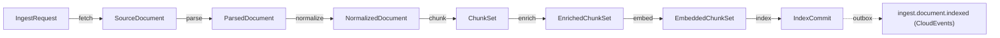
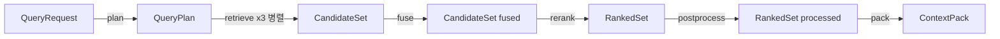
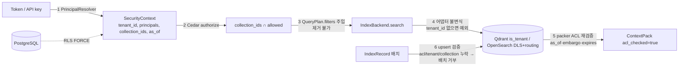
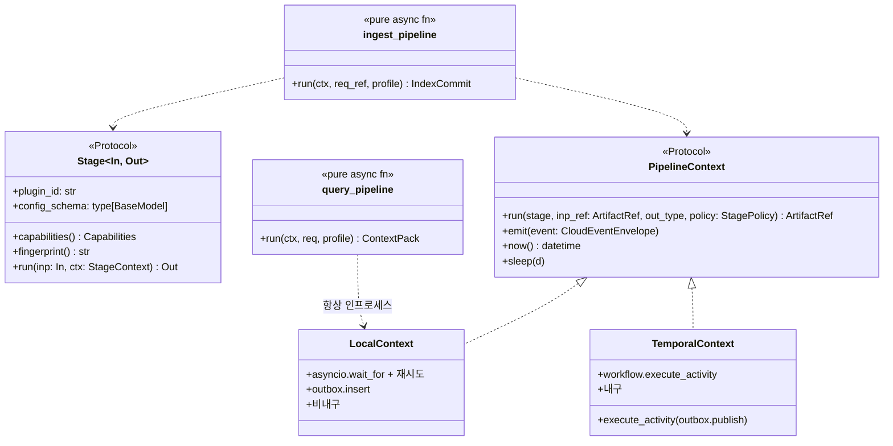

# 설계 제안 C: 단순성·확장성 우선 아키텍처

## 목적

브리프(00-design-brief)의 확정 결정 D-01~D-20과 기술 지형 연구(07-tech-landscape 00~14)를 전제로, **움직이는 부품을 최소화하고 경계를 명확히 하며 로컬에서 5분 내 기동되는** RAG 플랫폼 아키텍처를 제안한다. 다른 두 제안(A·B)이 품질 극대화·운영 견고성을 강조한다면, 본 제안은 "개발자가 하루 안에 이해하고 플러그인 하나를 작성할 수 있는 플랫폼"을 목표로 삼되 검색 품질(nDCG@10 ≥ 0.80)과 운영성(p95 800ms, 멀티테넌시)을 요구사항으로 그대로 충족한다.

## 범위

- 포함: 컨테이너·컴포넌트 구조, 스테이지 파이프라인 정의, D-05 계약 인벤토리, 개방 결정 O-01~O-10 판정, D-xx 수정 제안, 4개 프로파일, 검색 경로 알고리즘·지연 예산, Context Pack 렌더링, 멀티테넌시·ACL, 오케스트레이션 모델, 플러그인 SDK·프로파일 YAML, 패키지 맵, 리스크, 자기 평가.
- 제외: 개별 파서·모델의 상세 비교(07-tech-landscape가 정본), API 엔드포인트별 OpenAPI(05-api), 평가 하네스 내부(08-evaluation). 계약 필드는 03-contracts 확정 전의 **제안**이다.

---

## 1. 아키텍처 요약(한 페이지)

### 1.1 핵심 아이디어 5개

| # | 아이디어 | 한 줄 정의 | 무엇을 단순하게 만드는가 |
|---|----------|-----------|--------------------------|
| K1 | **하나의 커널, 두 개의 셸(One Kernel, Two Shells)** | 수집·검색 파이프라인은 모두 `Stage[In, Out]` 순수 변환의 **리스트**다. 실행은 `PipelineContext` 프로토콜 뒤의 두 셸(`LocalRunner` 비내구 / `TemporalShell` 내구)이 맡는다(08 §통합 설계 함의) | 파이프라인 정의에 `temporalio` 임포트가 없다. 개발자는 스테이지만 작성하고, 로컬과 프로덕션이 같은 코드를 실행한다 |
| K2 | **경계 페이로드는 `ArtifactRef` 하나** | 모든 스테이지 경계는 `ArtifactRef{uri, blake3, media_type, schema_version, size_bytes}`만 주고받는다(08 §페이로드 한계, 00 §계약 제안). 사이드카 REST 계약도 동일 | Temporal 2MB 한계·캐시·재현성·감사가 한 규칙으로 해결된다. 멱등성 키 = 캐시 키 = `blake3(input.blake3 + stage_config_hash + plugin_fingerprint)` |
| K3 | **프로파일 YAML이 시스템의 전부를 결정한다** | 파서·청커·임베더·인덱스·검색 전략·예산은 하나의 스키마를 가진 `Profile` 문서로 표현되고, `lite → standard → premium → korean-gov`는 **같은 스키마의 diff**다. 프로파일 해시가 컬렉션에 바인딩된다 | 점진적 복잡성. 운영자는 값을 바꾸고, 코드는 바뀌지 않는다. 미지원 조합(pgvector + late_interaction 등)은 로딩 시점에 거부된다(00 §capabilities 선언) |
| K4 | **격리 사다리(Isolation Ladder) 3단** | 인프로세스(A 등급 순수 Python) → 헬퍼 프로세스(ctypes 네이티브) → 사이드카 컨테이너(JVM·LibreOffice·CUDA·GPL/AGPL). 어느 단이든 어댑터 인터페이스는 같고, 사이드카는 `POST /v1/convert`(ArtifactRef in/out) 하나의 REST 계약을 공유한다(00 §어댑터·플러그인 공통 요구 1, J-6) | 라이선스(D-02)·크래시 격리·운영 부담을 **선언 하나**(`isolation: sidecar`)로 표현한다. `lite`는 사다리 1단만 사용한다 |
| K5 | **보안 불변식은 한 곳에서** | `SecurityContext`는 API 계층이 서버 측에서 주입하고, `IndexBackend.search`는 `tenant_id`가 없으면 예외를 낸다. `IndexRecord`에 `tenant_id/collection_id/acl_*` 누락은 배치 전체 거부(12 §어댑터 계약) | 테넌트 격리를 "모든 개발자가 기억할 것"이 아니라 "어댑터 계약 테스트가 강제하는 것"으로 바꾼다 |

### 1.2 개념 수: 8개 명사

플랫폼 전체를 설명하는 명사는 여덟 개다. 이 수를 늘리는 변경은 ADR을 요구한다.

| 명사 | 정의 | 소유 패키지 |
|------|------|-------------|
| `Contract` | 스테이지 경계의 버전드 Pydantic v2 모델(D-05의 13개 타입 + 공용 타입) | `rag_platform.contracts` |
| `Stage` | `Contract → Contract` 순수 변환. `fingerprint()`와 `config_schema`를 선언 | `rag_platform.stages` |
| `ArtifactRef` | 콘텐츠 주소화된 계약 인스턴스의 참조. 경계를 넘는 유일한 페이로드 | `rag_platform.contracts.common` |
| `Profile` | 스테이지 조합·파라미터·예산의 버전드 프리셋(YAML). 해시가 컬렉션에 바인딩 | `rag_platform.profiles` |
| `Plugin` | entry point로 등록된 `Stage` 구현체 + `capabilities()` + `license` 메타 | `rag_platform.plugins` |
| `Collection` | 테넌트 내 인덱스 논리 단위. 정확히 하나의 `Profile` 해시·`embedding_space_id`·`analyzer_id`에 고정 | `rag_platform.catalog` |
| `Job` | 수집 파이프라인 1회 실행. 상태 정본은 PostgreSQL, 실행 엔진은 셸 | `rag_platform.orchestration` |
| `SecurityContext` | `{tenant_id, principals[], collection_ids[], as_of}` 서버 주입·읽기 전용 | `rag_platform.security` |

### 1.3 무엇을 우아하게 만드는가

- **경계의 명확성**: 13개 계약 타입 사이의 화살표는 정확히 12개이고, 각 화살표는 스테이지 하나다. 스테이지는 다음 스테이지를 모른다.
- **일관된 규약**: ID는 ULID, 해시는 BLAKE3 hex, 시간은 RFC 3339 UTC(D-06). 멱등성 키·캐시 키·산출물 경로·재현성 조건이 **같은 해시 식**으로 정의된다.
- **예측 가능한 실패**: 오류는 타입드(`document_encrypted`, `sidecar_unavailable`, `EmbeddingSpaceMismatch` 등)이고, 재시도 가능/불가능이 오류 타입에 붙어 있다. 셸은 오류 타입만 보고 정책을 적용한다.
- **최소 인프라**: `lite`는 컨테이너 5개(app, PostgreSQL, Qdrant, Valkey, 오브젝트 스토리지)로 동작하고 사이드카·GPU·OpenSearch·Temporal 서버가 없다. `standard`는 여기에 OpenSearch·Temporal·TEI/vLLM을 **더한다**(빼거나 바꾸지 않는다).

---

## 2. 컨테이너/컴포넌트 구조

### 2.1 C4 Container

```mermaid
C4Container
    title RAG Platform - Container Diagram (standard profile; lite는 점선 컨테이너 없이 동작)
    Person(dev, "통합 개발자 / 에이전트", "REST·MCP 클라이언트")
    System_Ext(idp, "OIDC IdP", "Keycloak / Dex")
    System_Ext(src, "문서 원천", "S3 / GCS / Azure / HTTP / SMB")
    System_Ext(llm, "LLM 공급자", "Anthropic / OpenAI / vLLM")

    Container_Boundary(core, "rag-platform 코어 (단일 Python 이미지, 역할은 CLI 플래그)") {
        Container(api, "api", "FastAPI + mcp 2.x", "수집·리트리벌·관리 API, MCP /mcp 마운트, SecurityContext 주입, 질의 파이프라인 인프로세스 실행")
        Container(worker, "worker", "Python, Stage 러너", "수집 스테이지 액티비티. 큐: ingest-io / ingest-cpu / ingest-gpu-* / ingest-llm")
        Container(relay, "relay", "Procrastinate 또는 Temporal 액티비티", "아웃박스 → 웹훅·SSE(CloudEvents 1.0.2)")
    }
    Container_Boundary(sidecars, "사이드카 (선택, 격리 사다리 3단, 동일 REST 계약 POST /v1/convert)") {
        Container(java, "parser-workers", "Java 21: hwplib+hwp2hwpx+hwpxlib+Tika", "HWP 5.0 → HWPX 변환, 암호화 HWPX, 배포용 문서 텍스트")
        Container(lo, "lo-sidecar", "LibreOffice 26.x + H2Orestart(GPL, 별도 저장소)", "DOC/RTF/ODT → DOCX, HWP 렌더 폴백")
        Container(ocr, "ocr-gpu", "PaddleOCR PP-OCRv5 server", "premium 스캔 OCR")
    }
    Container_Boundary(models, "모델 서빙 (lite는 인프로세스 ONNX로 대체)") {
        Container(embed, "embedding-server", "vLLM pooling (BGE-M3 3-in-1)", "dense + sparse 단일 패스")
        Container(rerank, "reranker-server", "TEI", "bge-reranker-v2-m3")
    }
    Container_Boundary(data, "데이터 계층") {
        ContainerDb(pg, "PostgreSQL", "메타·잡·아웃박스·레지스트리·Temporal 영속화", "RLS FORCE")
        ContainerDb(qdrant, "Qdrant", "dense / sparse_learned / sparse_bm25(lite) / late_interaction(옵션)", "payload 파티셔닝 is_tenant")
        ContainerDb(os, "OpenSearch", "BM25 Nori mixed, DLS", "standard 이상")
        ContainerDb(s3, "Object Storage", "RustFS 또는 SeaweedFS (S3 호환)", "원본·산출물 BLAKE3 주소화")
        ContainerDb(kv, "Valkey", "캐시·레이트리밋·멱등 키·질의 임베딩 24h", "")
        Container(temporal, "Temporal", "Server 1.32 (standard: 분리 배포 / lite: 단일 바이너리 또는 미사용)", "내구 실행")
    }

    Rel(dev, api, "POST /v1/ingest, /v1/query, MCP search", "HTTPS")
    Rel(api, idp, "JWKS 검증", "HTTPS")
    Rel(api, pg, "jobs INSERT + outbox (동일 트랜잭션)")
    Rel(api, temporal, "start_workflow(id=job_id)")
    Rel(temporal, worker, "activity stage.*")
    Rel(worker, src, "fetch", "fsspec/httpx")
    Rel(worker, s3, "put/get ArtifactRef")
    Rel(worker, java, "POST /v1/convert (ArtifactRef)")
    Rel(worker, lo, "POST /v1/convert (ArtifactRef)")
    Rel(worker, ocr, "POST /v1/convert (ArtifactRef)")
    Rel(worker, embed, "POST /pooling")
    Rel(worker, qdrant, "upsert (commit_id)")
    Rel(worker, os, "bulk (routing=tenant_id)")
    Rel(api, qdrant, "prefetch dense/sparse (pre-filter tenant)")
    Rel(api, os, "BM25 (DLS + filter)")
    Rel(api, rerank, "POST /rerank top-100")
    Rel(api, kv, "cache / ratelimit")
    Rel(relay, pg, "select_unpublished → mark_published")
    Rel(api, llm, "answer 레퍼런스만 (선택)")
```

### 2.2 컴포넌트 책임 표

| 컴포넌트 | 프로세스/이미지 | 책임 | 하지 않는 것 | lite 포함 |
|----------|-----------------|------|--------------|-----------|
| `api` | 코어 이미지 `rag serve api` | REST(RFC 9457, Idempotency-Key, 커서, RateLimit 헤더), MCP 마운트, OIDC/API 키 → `SecurityContext`, 질의 파이프라인 **인프로세스** 실행, 잡 읽기 모델 조회 | 수집 스테이지 실행, 오케스트레이터 경유 검색 | 예 |
| `worker` | 코어 이미지 `rag serve worker --queue ingest-cpu` | 스테이지 액티비티 실행(제네릭 래퍼 1개), ArtifactRef 로드·저장, 하트비트, 사이드카 호출 | 상태 보관, 재시도 정책 결정 | 예(LocalRunner 모드에서는 api와 같은 프로세스) |
| `relay` | 코어 이미지 `rag serve relay` | 아웃박스 릴레이(`select_unpublished → publish → mark_published`), 웹훅·SSE | 브로커 운영 | 예 |
| `cli` | 코어 이미지 `rag …` | `rag up`, `rag ingest`, `rag query`, `rag profile validate`, `rag plugin list`, `rag eval run` | - | 예 |
| `parser-workers` | Java 사이드카(Apache-2.0) | HWP 5.0 → HWPX(hwplib 1.1.11 + hwp2hwpx), 암호화 HWPX(hwpxlib 1.0.9), 배포용 텍스트(Tika `HwpV5Parser`, degraded) | ParsedDocument 생성(어댑터는 Python 측) | 아니오(unhwp 헬퍼 → hwp-hwpx-parser) |
| `lo-sidecar` | LibreOffice + H2Orestart(GPL, 별도 저장소·Helm opt-in) | DOC/RTF/ODT → DOCX, HWP 렌더 최후 폴백 | - | 아니오(DOC은 `unsupported_format`) |
| `ocr-gpu` | PaddleOCR PP-OCRv5 server 컨테이너 | premium 스캔 OCR | - | 아니오(RapidOCR 인프로세스) |
| `embedding-server` | vLLM `--runner pooling` | BGE-M3 dense+sparse 단일 패스(05 §서빙 권고) | - | 아니오(sentence-transformers ONNX int8 인프로세스) |
| `reranker-server` | TEI 1.9 | 크로스인코더 리랭킹, TEI/Cohere 응답 스키마 2종 | - | 아니오(gte-multilingual-reranker-base TEI CPU 또는 생략) |
| PostgreSQL | 서비스 | `jobs`, `job_events`, `outbox`, `collections`, `index_commits`, `profiles`, `dictionaries`, `idempotency_keys`, Temporal 영속화(별도 DB) | 벡터·렉시컬 인덱스(postgres-only 프로파일 제외) | 예 |
| Qdrant | 서비스 | named vectors, payload 필터, alias swap | BM25 계산(클라이언트 포화식) | 예 |
| OpenSearch | 서비스 | Nori BM25, DLS, 감사 로그 인덱스(korean-gov) | - | 아니오 |
| Object Storage | RustFS 또는 SeaweedFS | 원본·산출물·모델 미러 | - | 예(로컬 디렉터리 백엔드도 허용: `file://`) |
| Valkey | 서비스 | 캐시·레이트리밋·멱등·MCP 커서 핸들 | 이벤트 버스 | 예 |
| Temporal | 서비스 | 내구 실행·시그널·스케줄·사가 | 잡 상태 조회 정본(PostgreSQL) | 선택(단일 바이너리) |

---

## 3. 스테이지 파이프라인 정의

### 3.1 공통 규약

| 규약 | 정의 |
|------|------|
| 스테이지 시그니처 | `async def run(self, inp: In, ctx: StageContext) -> Out` — `In`/`Out`은 계약 타입. 셸이 `ArtifactRef` ↔ 계약 인스턴스 변환을 담당하므로 스테이지 코드는 참조를 모른다 |
| 스테이지 지문 | `fingerprint = blake3(plugin_id + plugin_version + model_ids + sidecar_image_digests + config_hash)` |
| **멱등성 키 = 캐시 키** | `stage_key = blake3(input_artifact.blake3 + fingerprint)`. 산출물 경로는 `s3://{bucket}/artifacts/{schema_type}/{stage_key[:2]}/{stage_key}.json` |
| 캐시 히트 규칙 | 셸이 `stage_key` 존재를 확인하면 스테이지를 실행하지 않는다. 문서 벡터는 TTL 없음, 질의 벡터는 Valkey 24h(05 §캐싱) |
| 격리 모드 | `inprocess`(A 등급 순수 Python) / `helper`(multiprocessing spawn, ctypes) / `sidecar`(REST `POST /v1/convert`) — 프로파일이 선언하고 어댑터가 `capabilities().isolation_supported`로 응답 |
| 오류 모델 | `StageError{code, retryable: bool, detail, stage, artifact_ref?}`. RFC 9457로 API에 노출 |
| 부분 성공 | 문서 전체 실패로 확대하지 않는다. `quality: enum[full, degraded]` + `warnings[]` + 페이지/블록 단위 `status` |

### 3.2 수집 파이프라인(7 스테이지)



| 스테이지 | 입력 → 출력 | 실패 모드(타입드 오류) | 멱등성 키 구성요소 | 캐시 히트 조건 | 격리 모드 | 큐(standard) / 타임아웃 |
|----------|-------------|------------------------|---------------------|----------------|-----------|--------------------------|
| `fetch` | `IngestRequest` → `SourceDocument` | `fetch.access_denied`(비재시도), `fetch.not_found`(비재시도), `fetch.timeout`(재시도), `fetch.too_large`(비재시도) | `uri + etag/last_modified + fetcher_fingerprint` (원본 바이트는 BLAKE3로 재확인) | 같은 `content_hash`가 이미 `sources/`에 존재 | inprocess(fsspec/httpx) | `ingest-io` / 5m, hb 30s |
| `parse` | `SourceDocument` → `ParsedDocument` | `document_encrypted`, `distribution_document`, `unsupported_format`, `unsupported_variant`, `corrupt_container`(비재시도) / `sidecar_unavailable`, `conversion_failed`(재시도 후 폴백 체인) | `content_hash + parser_fingerprint(파서·모델·사이드카 digest·pdf 프로파일)` | 동일 키 산출물 존재. HWP→HWPX 파생 산출물도 별도 캐시 | 포맷별: HWPX·pdftext·DOCX·HTML·TXT inprocess / unhwp helper / HWP5·DOC·GPU OCR sidecar | `ingest-cpu` 15m hb 60s; OCR `ingest-gpu-ocr` 60m, 페이지 재개 |
| `normalize` | `ParsedDocument` → `NormalizedDocument` | `normalize.nfd_residue`(버그로 취급, 실패), `pii.detector_unavailable`(재시도; `keep` 폴백 금지) | `parsed.blake3 + analyzer_id + dictionary_hash + pii_policy` | 동일 키 | inprocess(Kiwi/MeCab-ko, kss, Presidio) | `ingest-cpu` / 5m |
| `chunk` | `NormalizedDocument` → `ChunkSet` | `chunk.block_oversized`(경고 후 강제 분할), `chunk.count_exceeded`(행 그룹 확대 후 재시도, 최종 비재시도) | `normalized.blake3 + chunker_config_hash + tokenizer_id` | 동일 키 | inprocess | `ingest-cpu` / 5m |
| `enrich` | `ChunkSet` → `EnrichedChunkSet` | `enrich.budget_exceeded`(잡 `partial`), `enrich.llm_policy_denied`(비재시도), `enrich.extractor_timeout`(빈 배열 + `status=partial`) | `chunkset.blake3 + enricher_fingerprint + enrichment_policy_hash` | 동일 키; LLM 보강은 청크 단위 캐시 | inprocess(GLiNER2·Kiwi) / LLM 호출은 외부 HTTP | `ingest-cpu`; LLM 켬 시 `ingest-llm` 30m |
| `embed` | `EnrichedChunkSet` → `EmbeddedChunkSet` | `EmbeddingSpaceMismatch`(비재시도), `embed.server_unavailable`(재시도, 최대 간격 5m), `embed.token_overflow`(truncate + 경고) | `enriched.blake3 + embedding_space_id` (청크 단위 키 `blake3(space_id + mode + embed_text)`) | 청크 단위 캐시 히트는 서버 호출 생략 | 외부 HTTP(vLLM/TEI) 또는 inprocess ONNX | `ingest-gpu-embed` / 20m |
| `index` | `EmbeddedChunkSet` → `IndexCommit` | `index.record_missing_acl`(배치 거부, 비재시도), `index.backend_unavailable`(재시도), `index.partial_commit`(보상 `index.rollback` 후 실패) | `embedded.blake3 + collection_id + index_generation` | 같은 `commit_id`가 `committed`면 no-op | inprocess 어댑터 → 서비스 | `ingest-io` / 10m, 사가 |

### 3.3 검색 파이프라인(6 스테이지, 인프로세스)



| 스테이지 | 입력 → 출력 | 실패 모드 | 멱등성/캐시 키 | 격리 | 지연 예산(standard, p95 800ms) |
|----------|-------------|-----------|----------------|------|-------------------------------|
| `plan` | `QueryRequest` → `QueryPlan` | LLM 구조화 출력 실패 → 원 질의 + Kiwi 키워드, `route=single`; self-query 0건 → 필터 완화(ACL/tenant 제외) | `blake3(normalized_query + collection_ids + filters + profile_hash)`; self-query 결과 Valkey 캐시 | inprocess(+선택 LLM) | 10ms(규칙) / 300~800ms(LLM 켬, default 끔) |
| `retrieve` | `QueryPlan` → `CandidateSet`(채널별) | 채널 타임아웃 → 채널 제외 + `degraded[]`; `SecurityContextMissing` → 500 차단 | 질의 임베딩 `blake3(space_id + "query" + text)` Valkey 24h | 인프로세스 어댑터 → Qdrant/OpenSearch | 임베딩 30ms + 병렬 검색 120ms |
| `fuse` | `CandidateSet[]` → `CandidateSet` | `fusion.k` 미설정 → 프로파일 검증 실패(로딩 시점) | 없음(순수 계산) | inprocess | 5ms |
| `rerank` | `CandidateSet` → `RankedSet` | 서버 타임아웃(300ms) → fused 순서 폴백, `explain.rerank_skipped=true` | `blake3(model_id + query + chunk_id)` 선택 캐시 | HTTP(TEI) | 250ms(top-100, GPU) |
| `postprocess` | `RankedSet` → `RankedSet` | 부모 로드 실패 → 자식 유지 + 경고 | 없음 | inprocess(+PostgreSQL/S3 부모 텍스트 조회) | 40ms |
| `pack` | `RankedSet` → `ContextPack` | 토큰 카운트 API 실패 → 근사 × `calibration_ratio` + 10% 마진, `count_method=approximate` | `content_hash = blake3(items)` | inprocess(+선택 `count_tokens`) | 30ms(+ API 카운트 시 100ms) |

합계 예산: 규칙 플래너 기준 약 485ms(여유 315ms). LLM 플래너를 켜는 `premium`은 목표를 p95 2.5s로 별도 선언한다(07 §프로파일별 조합 `quality`).

---

## 4. 계약 인벤토리

모든 계약은 JSON Schema 2020-12 + Pydantic v2(D-05), `schema_version`은 semver 문자열, 모든 ID는 ULID, 해시는 BLAKE3 hex, 시간은 RFC 3339 UTC(D-06). 아래 필드는 03-contracts 확정 전 제안이며 00 문서 "계약 제안 묶음"의 이름을 그대로 사용한다. 표 열: `필드 | 타입 | 필수 | 의미`.

### 4.0 공용 타입

| 타입 | 필드 | 타입 | 필수 | 의미 |
|------|------|------|------|------|
| `ArtifactRef` | `uri` | string(uri) | 예 | `s3://…` 또는 `file://…` |
| | `blake3` | string(hex64) | 예 | 콘텐츠 해시. 산출물 경로의 일부 |
| | `media_type` | string | 예 | `application/vnd.rag.parsed-document+json` 등 |
| | `schema_type` | string | 예 | `ParsedDocument` 등 PascalCase 계약 이름 |
| | `schema_version` | string(semver) | 예 | 계약 버전 |
| | `size_bytes` | integer | 예 | 크기(2MB 초과 페이로드 인라인 금지 검증용) |
| `Provenance` | `element_path` | string | 예 | 파서 원본 경로(OWPML 경로, Docling self_ref, HTML XPath). 흐름 포맷 대응(D-04 수정) |
| | `char_start`, `char_end` | integer | 예 | 블록 텍스트 내 0-based 코드포인트 오프셋 |
| | `page` | integer \| null | 아니오 | 1-based. 흐름 포맷은 null |
| | `bbox` | array<number>(4) \| null | 아니오 | `[x0,y0,x1,y1]` 좌상단 원점 PDF 포인트(02 §어댑터 계약) |
| `Acl` | `allow` | array<string> | 예 | 주체 ID(`user:…`, `group:…`, `*`) |
| | `deny` | array<string> | 아니오 | 거부 우선 |
| | `visibility` | enum[private, tenant, public] | 예 | 기본 `tenant` |
| | `classification` | enum[public, internal, confidential, restricted] | 아니오 | korean-gov 데이터마킹 입력 |
| | `embargo_until`, `expires_at` | string(date-time) \| null | 아니오 | 시간 기반 가시성 |
| `StageError` | `code` | string | 예 | `parse.document_encrypted` 등 `stage.reason` |
| | `retryable` | boolean | 예 | 셸 재시도 정책 입력 |
| | `detail` | string | 아니오 | 사람이 읽는 설명(콘텐츠 미포함) |
| | `stage`, `plugin_id` | string | 예 | 발생 위치 |
| `CloudEventEnvelope` | `id`, `source`, `type`, `time`, `subject`, `datacontenttype`, `data` | CloudEvents 1.0.2 | 예 | `type`은 `ingest.document.parsed` 등 `domain.entity.action` |

### 4.1 `IngestRequest` (생산: 클라이언트 → 소비: `fetch`)

| 필드 | 타입 | 필수 | 의미 |
|------|------|------|------|
| `schema_version` | string | 예 | 계약 버전 |
| `request_id` | string(ulid) | 예 | 서버 발급. `Idempotency-Key`와 매핑 |
| `tenant_id` | string | 예 | 서버가 `SecurityContext`에서 덮어씀(본문 값 불신) |
| `collection_id` | string(ulid) | 예 | 대상 컬렉션(프로파일 고정) |
| `source_uri` | string(uri) | 예 | `s3://`, `gs://`, `az://`, `file://`, `http(s)://`, `smb://`(플러그인) |
| `source_etag` | string | 아니오 | 변경 감지 힌트 |
| `external_id` | string | 아니오 | 원천 시스템 문서 ID(업데이트·삭제 매핑) |
| `document_version` | string | 아니오 | 원천 버전 라벨 |
| `media_type_hint` | string | 아니오 | 판별 실패 시 힌트(신뢰하지 않음) |
| `metadata` | object | 아니오 | 자유 메타(`title`, `authors[]`, `doc_date`, `doc_type`, `department`, `language`) |
| `acl` | `Acl` | 예 | 컬렉션 기본값 상속 가능 |
| `pii_policy` | enum[mask, tokenize, exclude, keep, reject] | 아니오 | 기본 컬렉션 정책 `mask`(12) |
| `pii_tokenize_mode` | enum[hash, encrypt] | 아니오 | `tokenize`일 때만, 기본 `encrypt` |
| `document_password` | string(secret) | 아니오 | 암호화 문서. 로그·산출물 미기록 |
| `allow_distribution_document` | boolean | 아니오 | 배포용 HWP 텍스트 폴백 허용(테넌트 옵트인 AND) |
| `llm_enrichment_allowed` | boolean | 아니오 | 외부 LLM 보강 옵트인(테넌트 정책 AND) |
| `profile_overrides` | object | 아니오 | 허용 목록 키만(`parse.pdf_profile`, `enrich.generated_prefix`) |
| `priority` | enum[low, normal, high] | 아니오 | 큐 우선순위 |
| `callback_url` | string(uri) | 아니오 | 웹훅 |
| `split_hint` | object | 아니오 | JSON 배열 다중 문서 분할(`items_path`) |
| `deadline_at` | string(date-time) | 아니오 | 초과 시 `cancelled` |

크기 한계: 본문 64KB, `metadata` 16KB.

### 4.2 `SourceDocument` (생산: `fetch` → 소비: `parse`)

| 필드 | 타입 | 필수 | 의미 |
|------|------|------|------|
| `schema_version`, `document_id` | string, string(ulid) | 예 | 문서 ID는 `(tenant_id, collection_id, external_id or source_uri)` 기준 재사용 |
| `tenant_id`, `collection_id` | string | 예 | 전파 |
| `request_id` | string(ulid) | 예 | 원 요청 |
| `source_uri` | string(uri) | 예 | 원본 위치 |
| `content_ref` | `ArtifactRef` | 예 | 원본 바이트(`sources/{blake3}`) |
| `content_hash` | string(hex64) | 예 | `content_ref.blake3`와 동일(조회 편의) |
| `size_bytes` | integer | 예 | |
| `detected_media_type` | string | 예 | puremagic + ZIP/OLE 스니퍼 결과(00 `format_detector`) |
| `detected_format` | enum[hwpx, hwp5, hwp3, pdf, docx, doc, rtf, odt, html, markdown, text, json, unknown] | 예 | 파서 라우팅 키 |
| `format_flags` | object | 아니오 | `{encrypted, distribution, compressed, hwp_version}` 사전 판정(01) |
| `fetched_at`, `source_last_modified` | string(date-time) | 예/아니오 | |
| `source_etag` | string | 아니오 | |
| `metadata` | object | 예 | `IngestRequest.metadata` 복사 |
| `acl` | `Acl` | 예 | |
| `pii_policy`, `pii_tokenize_mode` | enum | 예/아니오 | 확정값 |
| `fetcher_fingerprint` | string | 예 | |

### 4.3 `ParsedDocument` (생산: `parse` → 소비: `normalize`)

문서 수준 필드:

| 필드 | 타입 | 필수 | 의미 |
|------|------|------|------|
| `schema_version`, `document_id`, `tenant_id`, `collection_id` | | 예 | 전파 |
| `source_hash` | string(hex64) | 예 | `SourceDocument.content_hash` |
| `parser_fingerprint` | string | 예 | 파서·모델·사이드카 digest·pdf 프로파일(02) |
| `parser_chain` | array<string> | 예 | 실제 시도 순서(`["java_sidecar","unhwp"]`) |
| `source_kind` | enum[born_digital, scanned, mixed, pre_ocr, flow] | 예 | PDF 판별 결과; 흐름 포맷은 `flow` |
| `quality` | enum[full, degraded] | 예 | 배포용 텍스트·렌더 폴백은 `degraded` |
| `warnings` | array<{code, detail, block_id?}> | 예 | 미지 태그, 표 구조 실패 등 |
| `language` | string(bcp47) | 예 | 기본 `ko` |
| `metadata` | object | 예 | `title, authors[], created_at, modified_at, page_count, section_count, page_header_text, page_footer_text, has_tracked_changes, navigation_text, web{canonical_url, site_name}, genre` |
| `blocks` | array<Block> | 예 | **문서 순서 평탄 리스트**, 계층은 `parent_block_id`로 표현 |
| `page_status` | array<{page, status: enum[ok, timeout, ocr_failed, skipped], ocr_confidence?}> | 아니오 | PDF만 |
| `artifacts` | array<{kind: enum[page_image, figure_crop, table_html, vendor_json, derived_source], ref: ArtifactRef, page?, block_id?}> | 예 | 산출물 목록 |
| `annotations` | array<{kind: enum[memo, tracked_change, field, link], block_id, span, payload}> | 아니오 | 인덱싱 제외 기본 |
| `source_encoding` | string | 아니오 | TXT/HTML 감지 인코딩 |

`Block`:

| 필드 | 타입 | 필수 | 의미 |
|------|------|------|------|
| `block_id` | string | 예 | `blake3(document_id + element_path)[:16]` 결정적 |
| `type` | `BlockType` | 예 | 아래 enum |
| `parent_block_id` | string \| null | 예 | 계층(섹션 트리·표 셀 내 중첩) |
| `ordinal` | integer | 예 | 부모 내 순서 |
| `text` | string | 예 | 블록 텍스트(표는 셀 텍스트 제외한 캡션 없음 → `""`) |
| `level` | integer \| null | 아니오 | heading 1..6, list 깊이 |
| `heading_inferred` | boolean | 아니오 | 휴리스틱 heading(01·02) |
| `numbering_label` | string | 아니오 | `제3조`, `1.1`, `가.` 등 본문과 분리 |
| `ordered` | boolean | 아니오 | list_item |
| `furniture` | boolean | 예 | 머리말/꼬리말/nav → 기본 청킹 제외 |
| `container` | enum[body, text_box, table_cell, footnote_body] | 예 | 배치 컨텍스트 |
| `caption_of` / `target_block_id` | string | 아니오 | caption ↔ table/figure 양방향 |
| `footnote` | {kind: enum[footnote, endnote], anchor_block_id, anchor_char} | 아니오 | |
| `table` | `TableData` | table만 | 아래 |
| `figure` | {artifact_ref, alt_text?, kind: enum[image, ole, chart], caption_generated?, caption_model?} | figure만 | |
| `formula` | {script, latex?} | formula만 | 한컴 스크립트 원문 필수 보존(01) |
| `code` | {language?} | code만 | |
| `provenance` | `Provenance` | 예 | |
| `lang` | string(bcp47) | 아니오 | 블록 언어(정규화 단계 채움) |

`BlockType` enum: `heading, paragraph, list_item, table, figure, caption, footnote, code, formula, page_break, page_header, page_footer, toc, form_field, title`. (브리프 §10 목록 + 00 문서 추가 후보 4종; `title`은 level 0 heading의 별칭이 아니라 문서 제목 블록.)

`TableData`(표 표현 — 격자 + 셀 span, 직렬화는 청킹·패킹 단계 책임):

| 필드 | 타입 | 필수 | 의미 |
|------|------|------|------|
| `n_rows`, `n_cols` | integer | 예 | 격자 크기 |
| `cells` | array<TableCell> | 예 | 앵커 셀만(병합 셀은 앵커 하나) |
| `cells[].row`, `cells[].col` | integer | 예 | 0-based |
| `cells[].row_span`, `cells[].col_span` | integer | 예 | 기본 1 |
| `cells[].text` | string | 예 | 셀 문단 병합 텍스트 |
| `cells[].is_header` | boolean | 예 | |
| `cells[].header_kind` | enum[column, row, section] \| null | 아니오 | Docling `column_header/row_header/row_section` 매핑(02) |
| `cells[].nested_table_ids` | array<string> | 아니오 | 중첩 표 자식 블록(깊이 ≤ 3, 텍스트에 `[table:{block_id}]` 플레이스홀더) |
| `cells[].provenance` | `Provenance` | 아니오 | 셀 단위 bbox |
| `header_row_indices` | array<integer> | 예 | 헤더 반복 기준 |
| `quality` | {merged_cells_preserved: boolean, structure_confidence: number} | 예 | |
| `html_ref` | `ArtifactRef` | 아니오 | 파서 산출 HTML(무손실 렌더 1차) |

불변식: `blocks`를 `ordinal` 순으로 DFS하면 읽기 순서; `provenance.element_path`는 문서 내 유일; `type=table`이면 `table` 필수. 크기 한계: 블록 100,000개, 인라인 텍스트 총 50MB(초과 시 `blocks_ref`로 분할, ArtifactRef).

### 4.4 `NormalizedDocument` (생산: `normalize` → 소비: `chunk`)

| 필드 | 타입 | 필수 | 의미 |
|------|------|------|------|
| `schema_version`, `document_id`, `tenant_id`, `collection_id` | | 예 | |
| `parsed_hash` | string(hex64) | 예 | 입력 산출물 해시 |
| `analyzer_id` | string | 예 | `kiwi:0.24.0:cong` / `mecab-ko:1.3.7:ko-dic-2.1.1`(13) |
| `dictionary_hash` | string(hex64) | 예 | 컬렉션 사용자 사전 BLAKE3 |
| `blocks` | array<NormalizedBlock> | 예 | `Block`을 상속하되 텍스트 이중 뷰 |
| `blocks[].display_text` | string | 예 | NFC, 제어·PUA·zero-width 제거. ContextPack 렌더 원문 |
| `blocks[].lexical_text` | string | 예 | NFKC, 기호 통일, 한자 독음, 띄어쓰기 교정(opt-in). 색인·BM25 입력 |
| `blocks[].offset_map` | array<[display_start, lexical_start, len]> | 예 | 두 뷰 간 오프셋 사상 |
| `blocks[].sentence_spans` | array<{start, end, sub_spans[]}> | 예 | `display_text` 기준(Kiwi/kss) |
| `blocks[].lang` | string(bcp47) | 예 | 감지 언어 |
| `blocks[].furniture_reason` | enum[repeated_header, nav, boilerplate] \| null | 아니오 | 정규화가 추가로 판정한 furniture |
| `heading_tree` | array<{block_id, level, path: array<string>}> | 예 | 청커·접두어용 heading 경로 사전 계산 |
| `entities_normalized` | array<{block_id, kind: enum[date, law_article, unit, org], span, value}> | 아니오 | 날짜 ISO, 조항 경로 등(13) |
| `annotations.pii_spans` | array<{block_id, entity_type, start, end, score, operator}> | 아니오 | 적용된 PII 조작 |
| `annotations.content_risk` | array<{block_id, kind, score}> | 아니오 | 인젝션 L1 규칙 결과 |
| `pii_policy_applied` | enum | 예 | |
| `normalization_report` | {removed_chars, nfd_composed, hanja_replaced, spacing_corrected: boolean, pii_entity_counts{}} | 예 | 감사·재현성 |
| `normalizer_fingerprint` | string | 예 | |

불변식: `lexical_text`에 U+1100~11FF(NFD 잔존) 없음; `pii_policy_applied ≠ keep`이면 원문 PII 문자열이 `display_text`·`lexical_text`에 없음(계약 테스트).

### 4.5 `ChunkSet` → `EnrichedChunkSet` → `EmbeddedChunkSet` (가산 봉투)

세 계약은 **같은 `Chunk` 배열에 필드를 더하기만 하는** 가산 봉투(additive envelope)다. `EnrichedChunkSet = ChunkSet + enrichment{chunk_id → Enrichment}`, `EmbeddedChunkSet = EnrichedChunkSet + vectors{chunk_id → VectorBundle}`. 소비자는 상위 봉투를 하위 봉투로 읽을 수 있다(Pydantic `extra="allow"` 대신 명시 상속).

`ChunkSet` 최상위:

| 필드 | 타입 | 필수 | 의미 |
|------|------|------|------|
| `schema_version`, `chunk_set_id`(ulid), `document_id`, `tenant_id`, `collection_id` | | 예 | |
| `document_hash` | string(hex64) | 예 | `NormalizedDocument` 산출물 해시 |
| `chunker_id`, `chunker_config_hash` | string | 예 | 예: `structure_aware@1`, config BLAKE3 |
| `primary_tokenizer_id` | string | 예 | `hf:BAAI/bge-m3`(O-09) |
| `chunks` | array<Chunk> | 예 | 리프·부모·표·요약 모두 포함 |
| `stats` | {leaf_count, parent_count, table_chunk_count, oversized_blocks} | 예 | |

`Chunk`(계층):

| 필드 | 타입 | 필수 | 의미 |
|------|------|------|------|
| `chunk_id` | string(ulid) | 예 | 결정적: `ulid_from_hash(blake3(document_hash + chunker_config_hash + block_path + char_range))` — 시간 부분 대신 해시 상위 비트 사용, Qdrant는 `ulid_to_uuid` |
| `item_kind` | enum[chunk, parent, table, table_part, figure, summary, community_report, entity, page_image, sentence_window] | 예 | 04·14 열거 통합(00 미해결 6) |
| `level` | integer | 예 | 0 리프(임베딩·색인), 1 섹션 부모(반환 전용), 2 문서 |
| `parent_chunk_id` | string(ulid) \| null | 예 | small-to-big |
| `child_ids` | array<string(ulid)> | 아니오 | 부모·RAPTOR 요약 |
| `tree_level` | integer | 아니오 | RAPTOR 레벨(리프 0) |
| `ordinal` | integer | 예 | 부모 내 순서(문장 윈도우·인접 확장) |
| `text` | string | 예 | 색인 본문(접두어 미포함, `display_text` 기준) |
| `lexical_text` | string | 예 | 색인 뷰 조각(BM25·sparse 입력) |
| `heading_path` | array<string> | 예 | 루트부터 heading 텍스트 |
| `block_refs` | array<{block_id, char_start, char_end, page?, bbox?}> | 예 | 원문 재구성 근거(합집합 = `text`) |
| `token_counts` | object<tokenizer_id, integer> | 예 | `{"hf:BAAI/bge-m3": 387, "tiktoken:o200k_base": 455}` |
| `lang` | string(bcp47) | 예 | |
| `table_ref` | {table_block_id, header_row_indices[], row_range[2], col_range[2], serialization: enum[triplet, markdown, html, row_json]} | table_part만 | 헤더 반복 행 그룹 |
| `window` | {before_chunk_ids[], after_chunk_ids[]} | 아니오 | `flat_text` ±2 문장 |
| `context_prefix` | {deterministic: string, generated: string \| null, generated_by: string \| null} | 예 | 본문과 분리 저장(04). 임베딩 입력은 `prefix + "\n" + text`를 embed 단계가 조립 |
| `page_image_ref` | string(hex64) | 아니오 | `visual-pages` |
| `content_hash` | string(hex64) | 예 | `blake3(text)` 변경 감지 |

불변식: `level=0`이면 `token_counts[primary_tokenizer_id] ≤ config.max_tokens`; `parent_chunk_id`는 같은 세트의 `level+1`; `block_refs` 오프셋 합집합이 `text`를 정확히 재구성(표는 `serialization`으로); `context_prefix.*`는 `text`에 미포함.

`Enrichment`(청크별, `EnrichedChunkSet.enrichment[chunk_id]`):

| 필드 | 타입 | 필수 | 의미 |
|------|------|------|------|
| `embed_text` | string | 예 | `enrich(chunk)` 결과. 기본 `prefix.deterministic + "\n" + text` |
| `index_text` | string | 예 | BM25/sparse 입력(`lexical_text` 기반). `strip(index_text) → text` 대칭 강제(11 Onyx) |
| `keywords` | array<{term, weight, tag}> | 예 | Kiwi NNG/NNP + 사용자 사전(비용 0) |
| `entities` | array<{name, type, canonical_id?, span?, confidence, extractor: enum[gliner2, spacy_ko, llm, dictionary]}> | 예 | 필터·부스트용(기본 GLiNER2) |
| `relations` | array<{subject_id, predicate, object_id, weight, evidence_chunk_ids[]}> | 아니오 | 그래프 플러그인만 |
| `dates` | array<string(date)> | 아니오 | 파생 메타 |
| `law_refs` | array<string> | 아니오 | `법령명/제n조/제m항` |
| `figure_caption`, `figure_table_markdown` | string | 아니오 | VLM 캡션(옵션) |
| `hypothetical_questions` | array<string> | 아니오 | LLM 보강 옵션(기본 끔) |
| `risk_flags`, `risk_score` | array<string>, number | 예 | 인젝션 스캔(`scan_timeout` 등) |
| `pii_entity_counts` | object | 예 | |
| `status` | enum[complete, partial] | 예 | 추출기 타임아웃 시 `partial` |
| `enricher_fingerprint`, `llm_tokens_used` | string, integer | 예/아니오 | 비용 계측 |

`VectorBundle`(`EmbeddedChunkSet.vectors[chunk_id]`) 및 세트 수준 필드:

| 필드 | 타입 | 필수 | 의미 |
|------|------|------|------|
| (세트) `embedding_space_id` | string(hex64) | 예 | `blake3(model_id + revision + dimensions + normalized + prompt_hash + quantization)`(05) |
| (세트) `sparse_vocab_id` | string \| null | 예 | `xlm-roberta-250k` 등. 불일치 시 `EmbeddingSpaceMismatch` |
| (세트) `mode` | enum[document] | 예 | 질의 측은 `query` |
| (세트) `pooling` | enum[independent, late] | 예 | late chunking은 임베더 모드(04) |
| `dense` | {name: "dense", dim, values: array<number>} | 예(리프) | L2 정규화 |
| `sparse_learned` | {name, vocab_id, indices[], values[]} | 아니오 | BGE-M3 sparse |
| `sparse_bm25` | {name, vocab_id: analyzer_id, indices[], values[]} | lite만 | 클라이언트 TF 포화값(06) |
| `late_interaction` | {name, dim, count, values: array<array<number>>} | 아니오 | KURE-v2 128d(옵션) |
| `page_multivector`, `pooled_page_multivector`, `page_dense` | 동일 | 아니오 | `visual-pages` |
| `embed_text_hash` | string(hex64) | 예 | 캐시 키 재계산용 |
| `truncated` | boolean | 예 | 토큰 초과 절단 여부 |

### 4.6 `IndexRecord`와 `IndexCommit` (생산: `index` → 소비: 인덱스 백엔드·리트리버)

`IndexRecord`(백엔드 적재 단위; `EmbeddedChunkSet`의 리프 1개 = 레코드 1개). **payload는 "필터·정렬·설명에 필요한 것만"** 넣고 본문 전체는 넣지 않는다(본문은 산출물 스토리지에서 `chunk_id`로 조회).

| payload 필드 | 타입 | 필수 | 인덱싱 | 의미 |
|--------------|------|------|--------|------|
| `chunk_id` | string(ulid) | 예 | keyword | 포인트 ID는 `ulid_to_uuid(chunk_id)` |
| `tenant_id` | string | 예 | keyword `is_tenant` | **필수 사전 필터** |
| `collection_id` | string(ulid) | 예 | keyword | |
| `document_id` | string(ulid) | 예 | keyword | 삭제·부모 확장 |
| `parent_chunk_id` | string(ulid) \| null | 예 | keyword | |
| `commit_id` | string(ulid) | 예 | keyword | 사가 보상 키 |
| `index_generation` | integer | 예 | integer | 프로파일 blue/green 세대 |
| `is_current` | boolean | 예 | bool | 커밋 완료 시 이전 세대 false |
| `item_kind` | enum | 예 | keyword | `summary`는 `complexity=single_step`에서 하향 |
| `level` | integer | 예 | integer | 리프만 검색 대상(기본 필터 `level=0`) |
| `acl_allow[]`, `acl_deny[]` | array<string> | 예 | keyword | `match_any`/`terms` |
| `acl_visibility`, `acl_classification` | enum | 예/아니오 | keyword | |
| `acl_embargo_until`, `acl_expires_at` | date-time \| null | 아니오 | datetime | 질의 시각 비교 |
| `heading_path` | array<string> | 예 | keyword(첫 2단) | 헤더·필터 |
| `page` | integer \| null | 아니오 | integer | |
| `lang` | string | 예 | keyword | |
| `doc_date`, `updated_at` | date, date-time | 아니오/예 | datetime | self-query 필터 |
| `doc_type`, `department` | string | 아니오 | keyword | 메타 필터 |
| `lexical_terms` | array<string> | 예 | keyword 배열 | Qdrant 한국어 키워드 필터(형태소; `text` 인덱스 대체, 06) |
| `entity_ids` | array<string> | 아니오 | keyword | 부스트 |
| `content_hash` | string(hex64) | 예 | - | 재색인 변경 감지 |
| `pii_policy_applied`, `risk_score` | enum, number | 예 | keyword/float | 패킹 가중 |
| `text_preview` | string(≤ 200자) | 예 | - | 디버그·MCP concise |

벡터 매핑: Qdrant named vectors `dense`, `sparse_learned`(`modifier: none`), `sparse_bm25`(`modifier: idf`, lite), `late_interaction`(`MAX_SIM`, `m=0` 옵션); OpenSearch 인덱스 필드 `text_lexical`(analyzer `nori_index` mixed / `nori_search` discard), `context_prefix`(낮은 boost), `cjk_bigram` 보조(06·13).

`IndexCommit`:

| 필드 | 타입 | 필수 | 의미 |
|------|------|------|------|
| `schema_version`, `commit_id`(ulid), `tenant_id`, `collection_id`, `document_id` | | 예 | |
| `document_version` | string | 예 | 원천 버전 또는 `source_hash` |
| `status` | enum[pending, committed, rolled_back] | 예 | commit ledger(PostgreSQL) |
| `index_generation` | integer | 예 | |
| `profile_hash` | string(hex64) | 예 | 재현성 조건 |
| `embedding_space_id`, `analyzer_id`, `dictionary_hash`, `chunker_config_hash`, `parser_fingerprint` | string | 예 | §7 재현성: 동일 입력 + 동일 프로파일 → 동일 해시 |
| `backends` | array<{backend_id, records_upserted, records_deleted, duration_ms, status}> | 예 | Qdrant·OpenSearch 개별 결과 |
| `record_count`, `bytes_indexed` | integer | 예 | |
| `superseded_commit_ids` | array<string(ulid)> | 예 | insert-then-delete로 제거된 이전 커밋 |
| `commit_hash` | string(hex64) | 예 | `blake3(정렬된 chunk_id + content_hash 목록)` — §7 "동일 IndexCommit 해시" |
| `artifact_refs` | {chunk_set, enriched, embedded} | 예 | 재적재(replay) 복구 1순위 |
| `committed_at` | string(date-time) | 아니오 | |
| `error` | `StageError` \| null | 아니오 | 롤백 사유 |

### 4.7 `QueryRequest` (생산: 클라이언트/MCP → 소비: `plan`)

| 필드 | 타입 | 필수 | 의미 |
|------|------|------|------|
| `schema_version`, `query_id`(ulid, 서버 발급) | | 예 | |
| `query` | string | 예 | 원 질의(≤ 4,000자) |
| `collection_ids` | array<string(ulid)> | 예 | 1개 이상. `SecurityContext.collection_ids`와 교집합 |
| `conversation` | array<{role, content}> | 아니오 | 대화 재작성 입력(≤ 10턴) |
| `filters` | object | 아니오 | 구조화 필터(`doc_date_gte`, `doc_type`, `department`, `document_ids[]`, `lang`) — ACL/tenant와 AND |
| `top_k` | integer | 아니오 | 최종 항목 수 요청(≤ `k_max`) |
| `budget` | {max_context_tokens, max_latency_ms, max_tool_calls} | 아니오 | 프로파일 기본값 덮어쓰기(상한 내) |
| `target_model` | {provider: enum[anthropic, openai, google, local], model: string} | 아니오 | 토큰 카운터·렌더러 선택 |
| `response_format` | enum[concise, detailed, pack_only] | 아니오 | MCP 기본 `concise` |
| `renderer` | enum(§9) | 아니오 | 기본 프로파일 값 |
| `strategy_hint` | enum[hybrid, graph_local, graph_global, tree_collapsed, visual_pages, iterative] | 아니오 | 라우터 힌트(강제 아님) |
| `session_id`, `exclude_ids` | string(ulid), array<string(ulid)> | 아니오 | 에이전트 반복 검색 |
| `cursor` | string | 아니오 | MCP "더 보기" 핸들(Valkey) |
| `experiment_id` | string | 아니오 | A/B 프로파일 비교(D-12) |
| `explain` | boolean | 아니오 | 점수 분해 노출 |
| `as_of` | string(date-time) | 아니오 | 시간 기반 ACL 평가 시점 |

### 4.8 `QueryPlan` (생산: `plan` → 소비: `retrieve`·`fuse`·`rerank`·`pack`)

| 필드 | 타입 | 필수 | 의미 |
|------|------|------|------|
| `schema_version`, `query_id`, `plan_id`(ulid) | | 예 | |
| `security_context` | `SecurityContext{tenant_id, principals[], collection_ids[], as_of}` | 예 | **서버 주입·읽기 전용**. 리트리버는 이 값만 신뢰 |
| `profile_hash`, `index_generation` | string, integer | 예 | 같은 세대만 조회 |
| `normalized_query` | string | 예 | Kiwi 오타·띄어쓰기 교정 결과 |
| `analyzer_id` | string | 예 | 색인과 동일해야 함(불일치 → `degraded=[lexical]` + 경고) |
| `route` | enum[no_retrieval, single, multi] | 예 | 라우터 결과(07) |
| `strategy` | enum[hybrid, graph_local, graph_global, tree_collapsed, visual_pages, iterative] | 예 | 기본 `hybrid` |
| `complexity` | enum[no_retrieval, single_step, multi_step] | 아니오 | Adaptive-RAG 분류 |
| `rewritten_queries` | array<{query_id, text, role: enum[original, rewrite, abstraction, hypothetical], weight}> | 예 | `original` 가중 1.0 필수 포함; 변형 0.5 |
| `sub_queries` | array<{sub_query_id, text, depends_on[]}> | 아니오 | `route=multi` |
| `lexical_terms` | array<{term, weight, tag}> | 예 | Kiwi NNG/NNP; OpenSearch `should` 부스트·Qdrant keyword 필터 |
| `dense_query_text` | string | 예 | 임베딩 입력(HyDE 시 가상 문서) |
| `channels` | array<{channel: enum[dense, sparse, lexical, graph, tree, visual, late_interaction], enabled, top_k, timeout_ms}> | 예 | 기본 dense/sparse/lexical top-100 각각 |
| `filters` | object | 예 | `{tenant_id, collection_ids[], acl_principals[], as_of, is_current: true, level: 0}` + 사용자 필터. **tenant/acl은 제거 불가** |
| `filters_relaxable` | array<string> | 예 | 0건 시 순서대로 제거할 사용자 필터 키 |
| `fusion` | {method: enum[rrf, convex_minmax, convex_zscore, dbsf], k: integer(필수), weights: object<channel, number>} | 예 | `k` 누락은 프로파일 검증 실패(O-01) |
| `rerank` | {enabled, model_id, top_n_in, top_n_out, max_tokens_per_text, timeout_ms, response_schema: enum[tei, cohere]} | 예 | |
| `postprocess` | {dedup_cosine, mmr_lambda, parent_expand, sentence_window, compress, reorder: enum[litm_alternating, relevance_desc, document_order], threshold} | 예 | 순서는 §8 고정 |
| `budget` | {k_max, max_context_tokens, max_latency_ms, tokenizer: {provider, model, name}} | 예 | |
| `renderer`, `response_format` | enum | 예 | |
| `degraded` | array<{component, reason}> | 예 | 비활성 채널·폴백 기록(원칙 8) |
| `cache_keys` | {query_embedding, self_query} | 아니오 | 관측용 |
| `planner_fingerprint` | string | 예 | |

### 4.9 `CandidateSet` (생산: `retrieve`/`fuse` → 소비: `fuse`/`rerank`)

| 필드 | 타입 | 필수 | 의미 |
|------|------|------|------|
| `schema_version`, `query_id`, `plan_id` | | 예 | |
| `stage` | enum[retrieved, fused] | 예 | 같은 타입을 융합 전후에 재사용 |
| `channel` | enum[dense, sparse, lexical, graph, tree, visual, late_interaction, fused] | 예 | |
| `source_query_id` | string \| null | 예 | multi-query 출처 |
| `backend_id`, `backend_latency_ms` | string, integer | 예 | |
| `candidates` | array<Candidate> | 예 | |
| `candidates[].chunk_id`, `document_id`, `parent_chunk_id` | ulid | 예 | payload에서 |
| `candidates[].scores` | object<channel, number> | 예 | 원점수(dense cosine, sparse dot, BM25) |
| `candidates[].ranks` | object<channel, integer> | 예 | RRF 입력 |
| `candidates[].fused_score` | number \| null | fused만 | |
| `candidates[].payload_snapshot` | {heading_path, page, lang, item_kind, level, acl_classification, text_preview} | 예 | 리랭커·패커가 재조회 없이 사용 |
| `candidates[].graph_path` | array<string> | 아니오 | 그래프 채널 설명 |
| `total_hits` | integer | 예 | 필터 후 총량(recall 진단) |
| `truncated` | boolean | 예 | `top_k` 도달 |
| `error` | `StageError` \| null | 아니오 | 채널 제외 사유 |

### 4.10 `RankedSet` (생산: `rerank`/`postprocess` → 소비: `postprocess`/`pack`)

| 필드 | 타입 | 필수 | 의미 |
|------|------|------|------|
| `schema_version`, `query_id`, `plan_id` | | 예 | |
| `stage` | enum[reranked, postprocessed] | 예 | |
| `results` | array<RankedResult> | 예 | 관련도 내림차순 |
| `results[].chunk_id`, `document_id`, `parent_chunk_id` | ulid | 예 | |
| `results[].rank` | integer | 예 | 1-based 최종 순위 |
| `results[].final_score` | number(0..1) | 예 | 게이트·신뢰 등급 입력(`normalized_rerank_score` 또는 정규화 fused) |
| `results[].score_breakdown` | `ScoreBreakdown` | 예 | 아래 |
| `results[].expanded_to` | {chunk_id, item_kind} \| null | 아니오 | 부모 확장 결과(원 자식 ID 유지) |
| `results[].merged_children` | array<ulid> | 아니오 | 부모로 병합된 자식들 |
| `results[].dedup_of` | ulid \| null | 아니오 | 대표 청크 |
| `results[].window_text_refs` | array<ulid> | 아니오 | 문장 윈도우 |
| `results[].explain` | {rerank_skipped: boolean, gate: enum[pass, below_threshold], mmr_penalty: number, notes[]} | 예 | 원칙 8 |
| `reranker` | {model_id, backend, top_n_in, top_n_out, latency_ms, skipped: boolean} | 예 | |
| `gate_result` | {max_score, threshold, passed: boolean, retries} | 예 | relevance gate |
| `postprocess_report` | {dedup_removed, mmr_applied, parent_expansions, reorder_strategy} | postprocessed만 | |

`ScoreBreakdown`(점수 분해; 채널별 원점수·순위·기여도 + 단계 점수):

| 필드 | 타입 | 의미 |
|------|------|------|
| `dense`, `sparse`, `lexical`, `graph`, `late_interaction`, `visual` | {score, rank, contribution} \| null | 채널별 원점수, 채널 내 순위, 융합 기여분(RRF: `w/(k+rank)`, CC: `w·norm(score)`) |
| `fused` | number | 융합 점수 |
| `fused_rank` | integer | 리랭크 입력 순위 |
| `rerank_raw` | number \| null | TEI `score`/Cohere `relevance_score` 원값 |
| `rerank_normalized` | number(0..1) \| null | `normalization: enum[sigmoid, minmax, identity]` 적용 |
| `normalization` | enum | |
| `boosts` | array<{kind: enum[entity, recency, item_kind_penalty], delta}> | 후처리 가감 |

### 4.11 `ContextPack` (생산: `pack` → 소비: 렌더러·MCP·클라이언트)

최상위:

| 필드 | 타입 | 필수 | 의미 |
|------|------|------|------|
| `schema_version`, `pack_id`(ulid), `query_id`, `tenant_id`, `collection_ids[]`, `created_at`, `profile_hash` | | 예 | |
| `items` | array<ContextItem> | 예 | **렌더 순서**(`position` 오름차순) |
| `ordering` | {strategy: enum[litm_alternating, relevance_desc, document_order], applied: boolean} | 예 | |
| `budget` | {tokenizer{provider, model, name}, count_method: enum[exact_api, exact_local, approximate], calibration_ratio?, safety_margin, max_context_tokens, used_tokens, reserved_answer_tokens?, k_max, overflow_policy: array<enum[downgrade_tables, truncate, compress]>} | 예 | 10 D2 |
| `sufficiency` | {status: enum[not_needed, sufficient, insufficient, unknown], coverage: number, method: enum[rule, llm_judge], missing_aspects[]} | 예 | 기본 규칙 |
| `stop_signal` | {sufficient: boolean, coverage_estimate: number, reason: string} | 아니오 | 에이전트 루프 종료(14). `sufficiency`에서 파생 |
| `omitted` | array<{chunk_id, reason: enum[below_threshold, duplicate, budget_exceeded, acl_denied, parent_merged]}> | 예 | |
| `redaction_summary` | {pii_entity_counts{}, policy} | 예 | |
| `classification_max` | enum | 예 | 항목 중 최고 등급(데이터마킹) |
| `render_hints` | {preferred_renderer, citation_style: enum[native, bracket_id], instructions_template_id, stable_prefix_ref?, table_format_preference[], language, expose_confidence, data_marking: enum[none, delimit, datamark]} | 예 | 10 D4 + 12 |
| `diagnostics` | {dedup_removed, parent_expansions, mmr_lambda, degraded[], trace_id, latency_ms{plan, retrieve, fuse, rerank, postprocess, pack}} | 예 | |
| `next_cursor` | string \| null | 아니오 | MCP 더 보기 |
| `content_hash` | string(hex64) | 예 | `blake3(items 직렬화)` 캐시·멱등 |

`ContextItem`:

| 필드 | 타입 | 필수 | 의미 |
|------|------|------|------|
| `cite_id` | string | 예 | `d1..dN` **관련도순 부여, 렌더 위치와 무관, 불변** |
| `rank`, `position` | integer | 예 | 관련도 순위(1-based) / 렌더 위치(0-based) |
| `chunk_id`, `document_id`, `parent_chunk_id?` | ulid | 예 | |
| `doc_version` | string | 예 | commit_hash 또는 버전 라벨 |
| `item_kind` | enum | 예 | `page_image`는 멀티모달 블록 |
| `header` | {title, section_path[], source_uri, doc_date?, page_start?, page_end?, language, doc_type?} | 예 | 렌더 헤더(원시 점수 미노출) |
| `text` | string | 예 | `display_text` 기반 본문(접두어 제외) |
| `text_format` | enum[markdown, plain, html] | 예 | |
| `segments` | array<{index, text, char_start, char_end}> | 예 | 인용 최소 단위(문장/셀 행). Anthropic `content[]` 블록 = 세그먼트 |
| `context_prefix` | string \| null | 아니오 | 결정적 접두어(렌더 시 `context` 필드) |
| `tables` | array<{table_id, html, markdown, json_records, caption, downgraded: boolean}> | 아니오 | 형식 강등 기록 |
| `figures` | array<{figure_id, caption, alt_text, image_ref?}> | 아니오 | |
| `confidence_tier` | enum[high, medium, low] | 예 | `final_score` 구간(프로파일) |
| `parent` | {parent_chunk_id, expanded, parent_text_included} | 아니오 | |
| `duplicates_of`, `conflicts_with[]` | string, array<{cite_id, kind: enum[version, source, date], note}> | 아니오 | |
| `provenance` | `Provenance` | 예 | |
| `acl_checked` | boolean(true) | 예 | 패커가 ACL 재검증 완료 표시 |
| `token_count` | integer | 예 | `budget.tokenizer` 기준 |
| `scores` | `ScoreBreakdown` | `explain=true`만 | |

렌더러 열거: `anthropic_search_result`(1차), `anthropic_document`, `anthropic_xml`, `openai_messages`, `gemini_messages`, `generic_markdown`, `xml_documents`, `mcp_tool_result`, `dify_external_knowledge`, `plain_records`. 각 렌더러는 `render(pack) -> (payload, CitationMap)`을 반환하고 `CitationMap`은 공급자 인용 위치 → `{cite_id, chunk_id, segment_index}` 역매핑이다(§9).

---

## 5. 개방 결정 O-01~O-10

| ID | 결정 | 근거(기술 지형 인용) | 단순성 관점 보충 |
|----|------|----------------------|------------------|
| O-01 융합 | **RRF k=60, 가중 1:1:1을 플랫폼 `fuser`에서 수행.** 컬렉션 골든셋 ≥200 qrels 확보 시 `convex_minmax`로 프로파일 값 전환(ranx `optimize_fusion` 오프라인 튠). `lite`만 Qdrant `Fusion.RRF` 위임 허용(`k=60` 명시) | 07 §2(Bruch et al. 2023: 튠된 CC 우위이나 튠 데이터 필요), 06 §개방 결정(Qdrant 기본 k=2 함정), 13(한국어 BM25 `mixed` 점수 스케일 이식성 낮음), 00 O-01 신뢰도 높음 | `Fuser` 프로토콜 하나(`fuse(runs, weights, k)`)에 4개 메서드. 전환은 YAML `fusion.method` 한 줄 |
| O-02 sparse | **BGE-M3 sparse 기본**(동일 패스, 추가 인코더 0). `ko-quality`는 PIXIE-Splade-v1.5(`ax-encoder-50k`). SPLADE-v3 제외(CC BY-NC-SA). lexical 레그는 항상 유지 | 05 §O-02(MIRACL-ko sparse 61.5 vs BM25 37.1, MLDR 장문 sparse>dense), 13(서브워드 vs 형태소는 상보적 제3 레그), 12(SPLADE-v3 D 등급) | 두 번째 인코더 서비스가 없다. `SparseVector.vocab_id` 계약이 혼합 사고를 로딩 시점에 차단 |
| O-03 GraphRAG/RAPTOR | **이분.** GraphRAG 계열(LightRAG·HippoRAG 2)은 외부 플러그인 패키지(`rag-plugin-lightrag` 등), 코어는 계약 슬롯(`item_kind`, `enrichment.entities/relations`, `channel=graph`, `QueryPlan.strategy`, `graph_path`)만. RAPTOR는 코어 옵션 `enricher`(기본 끔). 1차 그래프 엔진은 보류(J-8) | 14 §O-03(인덱싱 코퍼스 토큰 수 배, 질의 수십~수백 배, 단일 홉 열세), 11·10 동의, 00 J-8 | 코어 의존성에 그래프 프레임워크가 없다. 슬롯은 필드 5개 |
| O-04 late interaction | **기본 끔, 별도 `late_interaction` 슬롯.** BGE-M3 colbert(1024d)는 리랭크 비교 기준만. KURE-v2(128d)는 M2 골든셋에서 인덱스 단계 vs 리랭크 단계 비교 후 ADR. `visual-pages`는 별도 컬렉션·인덱스 단계 필수 | 05·14 §O-04(100만 청크 1024d 약 614GB vs 128d 77GB/turbo4 19GB), 00 J-2 | `premium`에서 YAML `embed.late_interaction.model_id`와 `channels[].late_interaction.enabled` 두 값으로 켬. `capabilities.supports_multivector=false` 백엔드는 자동 비활성 + `degraded` |
| O-05 LLM 보강 | **비LLM 보강만 기본 켬**(결정적 `context_prefix`, Kiwi 키워드, GLiNER2 엔티티, 날짜·조항 메타). LLM 접두어·요약·캡션·가상 질문은 `premium` 컬렉션 정책으로 켬. 비용: `ingest-llm` 큐 + Valkey 토큰 버킷 + `enrichment_budget_tokens`(코퍼스 1.5배 상한) 초과 시 `partial` | 00 J-3(다수 의견), 04(재현 연구 비용 $1.02/M 또는 20GB VRAM), 08(큐 분리·동시성), 12(PII 적용 텍스트만 외부 전달, 테넌트 옵트인) | `lite`·`standard`에 LLM 의존이 **전혀** 없다. 재현성(원칙 4)이 기본 경로에서 완전 결정적 |
| O-06 이벤트 버스 | **v1 브로커 없음.** 제어 = Temporal 시그널/업데이트/쿼리(또는 LocalRunner 인메모리), 도메인 이벤트 = CloudEvents 1.0.2 + PostgreSQL 아웃박스 + 릴레이(웹훅·SSE). NATS JetStream은 `korean-gov` 감사 스트림 조건부 | 08 §O-06(아웃박스 4.55 1위, NATS 조건부 4.15), 12(감사 손실 불가 시 NATS), 06·01(버스 불필요) | D-14 외 인프라 0 추가. 릴레이 코어는 순수 함수 3개 |
| O-07 HWP 5.0 | **1급 지원, LibreOffice는 opt-in 최후 폴백.** `standard`: Java 사이드카(hwplib 1.1.11 + hwp2hwpx + hwpxlib 1.0.9) → HWPX → 단일 OWPML 어댑터; `lite`: unhwp(헬퍼, x64) → hwp-hwpx-parser(순수 Python). 배포용은 Tika `HwpV5Parser` 텍스트(`degraded`, 옵트인), 암호화는 `document_encrypted`. pyhwp는 AGPL 선택 플러그인 | 01 §권고안·O-07(455/425점, 구조 보존), 00 J-1, 12 §6.1(H2Orestart GPL-3.0 C 등급) | HWPX 어댑터 **하나**가 HWPX·HWP5 모두를 처리한다(변환 → 동일 계약). 사이드카는 `POST /v1/convert` 공통 계약 |
| O-08 OCR | **RapidOCR(PP-OCRv5 korean mobile, ONNX; `OCRVersion.PPOCRV5`+`ModelType.MOBILE`+`LangRec.KOREAN` 명시) 기본**, `premium` PaddleOCR server 컨테이너, 폴백 Tesseract `kor+eng`(+`kor_vert` 세로쓰기·에어갭). Surya 옵트인, `OcrAutoOptions` 금지 | 02 §O-08(KORIE CER Paddle 15.84 / Tesseract 25.43; 결정 근거는 라이선스·통합·운영), 13(v3.9+ 기본 PP-OCRv6 한국어 미포함), 00 J-4 | 기본 경로가 CPU 단일 휠. GPU는 사이드카 선언 한 줄 |
| O-09 청크·토크나이저 | **예산 토크나이저 = 프로파일 임베딩 모델 HF 토크나이저(`hf:BAAI/bge-m3`)**, `tiktoken:o200k_base` 병기. 자식 512(하한 64) / 부모 2048(반환 전용) / 구조 오버랩 0 / 폴백 텍스트 10% / 표 행 그룹 256 / `flat_text` ±2문장. 렉시컬 토큰화는 형태소 분석기로 분리. ContextPack 예산은 대상 LLM 토크나이저로 재계산 | 04 §O-09(Wang et al. 512, Chroma 오버랩 무이득), 13 §토큰 팽창률(bge-m3 512토큰 ≈ 한국어 900~1,000자, cl100k 1.8배), 00 J-5 | 토큰 카운터 3종(청크·리랭커·LLM)을 `TokenCounter{tokenizer_id}` 하나의 인터페이스로 통일 |
| O-10 gRPC | **REST + SSE + MCP만. gRPC v1 미제공.** 내부 사이드카도 REST(`ArtifactRef` 교환). 필요 시 `connectrpc`를 같은 ASGI 앱에 마운트, protobuf는 JSON Schema에서 코드젠. Qdrant `prefer_grpc=True`는 라이브러리 설정 | 08 §O-10, 00 J-6(사이드카 4종 계약 통일), 03·10·14 동의 | 프로토콜 1개, 오류 모델 1개(RFC 9457), 인증 경로 1개(`PrincipalResolver`) |

---

## 6. 확정 결정 D-01~D-20 수정 제안

브리프 결정은 존중한다. 아래는 연구 결과상 **수정이 필요한 것**과 본 제안의 대안이다. "ADR 필수"는 D-02 위반 또는 실현 불가 항목이다.

| ID | 문제 | 본 제안의 대안 | 구분 | 근거 |
|----|------|----------------|------|------|
| D-18 PDF | PyMuPDF 1.28.2는 AGPL-3.0/상용 듀얼. 인프로세스 `import`는 D-02 위반 | 고속 텍스트 경로를 **pypdfium2 5.13 + pdftext 0.7**(`pdf_fast_cpu`)로, 레이아웃은 Docling 2.129.x(`PYPDFIUM2`/docling-parse 백엔드). PyMuPDF는 옵트인 사이드카 플러그인만 | **ADR 필수(라이선스)** | 02, 12 §6.2, 00 |
| D-18 HWP 5.0 | pyhwp AGPL-3.0+·2020년 정체·Python ≤3.8; H2Orestart는 GPLv3(MIT 표기는 오류) | O-07 결정(Java 사이드카 1차, unhwp/hwp-hwpx-parser 2·3차, LO+H2Orestart GPL 격리 opt-in, pyhwp 강등) | **ADR 필수(라이선스·정체)** | 01, 11, 12 |
| D-18 OCR | 후보 병렬 나열, 우선순위 없음; RapidOCR v3.9+ 기본 모델 한국어 미포함 | O-08 결정으로 재정의 + `PPOCRV5`/`MOBILE` 명시 조건 | ADR(O-08 통합) | 02, 13 |
| D-18 DOCX·HTML | Docling·python-docx 모두 각주·미주 미처리; Trafilatura·Docling 순서 미명시 | DOCX: Docling `MsWordDocumentBackend` + **docx2python 3.7 각주·미주 병합 필수**; HTML: **Trafilatura 2.2(`xml`, `>=1.8` 핀) → Docling HTML** 순서 고정 | 문구 보정 | 03(00 인용) |
| D-16 서빙 | TEI는 BGE-M3 sparse/colbert 생산 불가, Infinity는 "no sparse" + 13개월 무릴리스 → "dense+sparse 기본"이 서빙 선택으로 실현 불가 | **vLLM 0.29 `--runner pooling`(BGE-M3 3-in-1) + TEI 1.9(dense 전용·리랭커) + 인프로세스(sentence-transformers ONNX / FlagEmbedding; `lite`·개발)**. Infinity 제외 | **ADR 필수(실현 불가)** | 05 §서빙 권고, 08 |
| D-16 교체 후보 | jina-v3(CC-BY-NC)·v4(Qwen Research)·jina-reranker(CC-BY-NC) | 예시 목록에서 제거, D 등급 BYO(`model_license_ack: true`). `Qwen3-VL-Embedding/Reranker`(Apache-2.0) 추가 | **ADR 필수(라이선스)** | 05, 07, 12, 14 |
| D-16 colbert·근거 | BGE-M3 colbert 1024d 인덱스 불가; 한국어 dense 리더보드에서 bge-m3가 KURE-v1·arctic-ko·PIXIE·Qwen3-4B에 뒤짐 | `late_interaction` 슬롯 분리(O-04); BGE-M3 유지 근거를 "3-in-1 단일 패스 + 생태계 + 드롭인 파인튠"으로 재기술, M2 게이트(`ko-quality` +2p 시 교체) | ADR(근거 재기술) | 05 |
| D-14 Redis | Redis 8 RSALv2/SSPLv1/AGPLv3 삼중 | 기본 **Valkey 9.x(BSD-3)**, "Redis 호환 KV"로 표기 | **ADR 필수(라이선스)** | 08, 12 |
| D-14 MinIO | 2026-04-25 아카이브, AGPL 소스 전용 | **RustFS 또는 SeaweedFS(둘 다 Apache-2.0; ADR에서 실측 후 확정)**. `lite`는 `file://` 로컬 디렉터리 백엔드도 허용(개발 5분 기동) | **ADR 필수(라이선스·정체)** | 12 |
| D-15 경량 | Qdrant 서버는 BM25를 계산하지 않음(IDF만); FastEmbed BM25는 한국어 형태소 미처리 | "플랫폼이 형태소 분석기(Kiwi, 공백기 MeCab-ko)로 토큰화 + BM25 TF 포화값(k1=1.2, b=0.75) 계산 → `sparse_bm25` `modifier: idf`, 1.19 테넌트 IDF; 한국어 키워드 필터는 `lexical_terms` keyword payload"로 정밀화. `lite` 전제 조건: 플랫폼 측 `korean_analyzer` 필수 | 문구 정밀화(ADR 권고) | 06, 13 |
| D-15 목록 | Elasticsearch 공식 이미지는 ELv2/SSPL; Solr·pg_textsearch 누락; Nori 기본 `discard` | 목록에 Apache Solr 10·pg_textsearch 추가, Elasticsearch는 어댑터 호환만. "Nori 색인 `mixed` + 사용자 사전 파이프라인 필수" 명시 | 목록 확장 | 06, 13 |
| D-02 정책 공백 | LGPL·BSL/SSPL·GPL 서버·MPL·모델 라이선스·지역 제한 규칙 없음 | 12 §6.1 A/B/C/D/X 등급표를 D-02 해석 지침으로 채택. 플러그인 메타 `license`·`territory` 필수, CI 라이선스 게이트(pip-licenses + liccheck + cyclonedx + Syft/Trivy, `models.lock`) | **ADR 필수(정책)** | 12 |
| D-04 | "page/bbox 필수"는 흐름 포맷(HWP/HWPX/DOCX/HTML/MD)에 존재하지 않음 | `provenance.page`/`bbox` nullable, `element_path` + `char_start/char_end` 필수(§4.0) | 계약 표현 조정 | 01, 02, 03 |
| D-19 | Docling 청커는 DoclingDocument만 받고 HWP 백엔드 없음; "문맥 보강 기본"이 LLM으로 읽히면 O-05 충돌; late chunking은 mean pooling 전제인데 BGE-M3 dense는 [CLS] | 기본 청커 **ParsedDocument 네이티브 `StructureAwareChunker`**(HybridChunker 알고리즘 재현), Docling 어댑터는 `[docling-chunker]` extra 2차(CI 동등성). 문맥 보강 = 결정적(켬) + LLM(O-05). late chunking 프로파일은 mean pooling 모델 강제 검증 | 문구 보정 + ADR | 04 |
| D-17 | "인프로세스 러너" 내구성·재사용 방식 불명 | **비내구 `LocalRunner`**, 파이프라인 정의는 `PipelineContext`에만 의존(`temporalio` 임포트 금지 린트). `lite` 프로덕션은 Temporal 단일 바이너리 + PostgreSQL(또는 DBOS ADR 후) | 명세 보강 | 08 |
| D-11 | GenAI semconv Development 단계; Phoenix ELv2; Grafana·Tempo·Loki AGPL | 규약 커밋 고정 + Weaver 상수 모듈; Phoenix·Grafana 계열은 OTLP 대상·분리 컨테이너만(pip 의존 금지); AGPL 불가 환경 대안(OpenSearch Observability + Perses, VictoriaMetrics/Logs + Jaeger) | 정밀화 + ADR(라이선스 경계) | 09, 12 |
| D-12 | 문서 단위 qrels만으로 청킹 비교 불가 | qrels + `answer_spans` JSONL(문서 ID + 문자 구간), 인터리빙·쌍대 비교 추가, nDCG 선형 이득 고정 | 계약 추가 | 09 |
| D-20 | "Anthropic `document`+`citations`"는 문서 경로. RAG GA 경로는 `search_result` | "`search_result`(1차) / `document`(2차) + `citations`"로 보정. 인용과 `output_config.format` 병용 불가(400) 명시 | 문구 보정 | 10 |
| D-13 | MCP 2026-07-28 스펙이 세션 제거 → "더 보기"를 세션 상태로 설계 불가 | `search`·`get_document`에 `cursor`/`next_cursor`(Valkey 핸들) 추가. 도구 `search_batch`·`expand`는 v1.1 검토 | 계약 추가 | 10, 14 |
| D-01 | Unstructured `<3.14`, RapidOCR `≤3.13` | 파서 워커 이미지 3.12/3.13 고정, 3.14 채택 전 호환성 검증 | 명세 보강 | 02, 04 |

수정 없이 유지: D-03, D-05, D-06, D-07(후처리 순서만 §8에서 정밀화), D-08, D-09, D-10.

---

## 7. 프로파일 정의

프로파일은 **같은 YAML 스키마의 네 인스턴스**다(§12). 표의 빈 칸("동일")은 상위 프로파일 값 상속을 뜻한다. `lite`는 인프라 5 컨테이너·사이드카 0·GPU 0을 전제한다.

### 7.1 컴포넌트

| 컴포넌트 | `lite` | `standard` | `premium` | `korean-gov` |
|----------|--------|------------|-----------|--------------|
| 인프라 | app, PostgreSQL, Qdrant, Valkey, 오브젝트 스토리지(`file://` 허용) | + OpenSearch, Temporal(분리), vLLM pooling(GPU 1), TEI GPU, `parser-workers`(Java) | + `ocr-gpu`, `ingest-llm` 워커, Qdrant multivector | standard + OpenBao Transit, NATS JetStream(감사, 조건부), OpenSearch 감사 인덱스, mTLS |
| 오케스트레이션 | `LocalRunner`(개발) / Temporal 단일 바이너리 + PostgreSQL(운영) | Temporal frontend/history/matching 분리, 큐 `ingest-io/cpu/gpu-embed`, KEDA | + `ingest-gpu-ocr`, `ingest-llm` 큐 | standard + 네임스페이스(테넌트 등급), 야간 재색인·평가 스케줄 |
| 포맷 판별 | puremagic 2.2 + ZIP/OLE 스니퍼 | 동일 | 동일 | + FileHeader 배포용·암호 플래그 정책, 감사 로그 |
| HWPX | python-hwpx `>=6.4,<7` + OWPML lxml 어댑터(inprocess) | 동일 | 동일 | + hwpxlib 사이드카(암호화 HWPX), 한컴 고지 `NOTICE` CI |
| HWP 5.0 | unhwp 0.11(helper, x64) → hwp-hwpx-parser 1.0(inprocess); 배포용 `distribution_document` | Java 사이드카(hwplib+hwp2hwpx) → unhwp → hwp-hwpx-parser → `lo-sidecar`(opt-in) | 동일 | + Tika `HwpV5Parser` 배포용 텍스트(옵트인, degraded), `spacing_corrector` opt-in |
| PDF 디지털 | `pdf_fast_cpu`(pypdfium2+pdftext, 폰트 heading 추론) | `pdf_standard`(Docling heron + TableFormer ACCURATE, CPU 4 thread) | `pdf_standard` GPU L4 | standard + 2단·공문서 골든셋 회귀 |
| PDF 스캔 | RapidOCR PP-OCRv5 korean mobile(CPU) | 동일(비트맵 영역만) | `pdf_scanned_gpu`(PaddleOCR server) / `pdf_vlm_gpu`(골든셋 후) | + 세로쓰기 → Tesseract `kor_vert`, `pdf_airgapped` |
| DOC/RTF/ODT | DOC `unsupported_format`; ODT odfdo 3.26; RTF striprtf(degraded) | `lo-sidecar` → DOCX → Docling | 동일 | 동일 |
| DOCX / HTML / TXT·MD | Docling DOCX + docx2python / Trafilatura 2.2 xml → Docling HTML / charset-normalizer 3.5 + ftfy + markdown-it-py 4.2 | 동일 | 동일 | + HTML `docs-site` 선택자 훅(보도자료·법령 포털) |
| 한국어 분석기 | python-mecab-ko 1.3.7 + mecab-ko-dic + kss 6.0 `punct`; `[kiwi]` extra | Kiwi(`kiwipiepy>=0.24.0` 공개 후 승격) / 공백기 동일 | 동일 | Kiwi + 컬렉션 사용자 사전 필수, NFC/NFKC 이중 뷰, 한자 독음 |
| PII | Presidio 정규식 + 내장 KR 인식기 5종(명시 활성화) | Presidio + spaCy `ko_core_news_lg`(런타임 다운로드) | 동일 | `tokenize`+`encrypt`, 주민등록번호 `reject`, L2 분류기(Qwen3Guard/Granite Guardian 실측 후) |
| 청커 | `StructureAwareChunker` + `flat_text` | + 표 행 그룹 256 + 결정적 접두어 | + `contextual_llm`(컬렉션 옵션), RAPTOR enricher(옵션) | standard + `law_article` 장르 라우팅 |
| 보강 | Kiwi 키워드, 날짜 메타 | + GLiNER2 엔티티 | + LLM 접두어·캡션(Qwen3-VL-8B vLLM)·가상 질문(예산 정책) | standard(LLM 보강은 온프레미스 Qwen3만, 외부 API 테넌트 옵트인) |
| 임베딩 | bge-m3 dense ONNX int8(sentence-transformers `backend="onnx"`) + `sparse_bm25` 클라이언트 | bge-m3 dense+sparse @ vLLM pooling | `ko-quality`(KURE-v1 + PIXIE-Splade-v1.5) 또는 `quality-max`(Qwen3-Embedding-4B MRL 1024); `late_interaction` KURE-v2(M2) | standard; 가중치·LICENSE 자체 미러링 필수 |
| 인덱스 | Qdrant 단독(`dense`, `sparse_bm25`; `sparse_learned`는 GPU 없으면 생략), payload 파티셔닝 | Qdrant + OpenSearch 3.8(Nori `mixed`/`discard`, custom routing, DLS) | + Qdrant multivector(turbo4) | standard + 대형 테넌트 shard_key, 감사 인덱스 |
| 검색 | dense + lexical(bm25) 2-way(sparse_learned 있으면 3-way), RRF k=60 | 3-way RRF k=60 → CC(골든셋 후) | + multi-query(0.5)·HyDE(dense), `channel=late_interaction/graph` 옵션 | standard |
| 리랭커 | gte-multilingual-reranker-base @ TEI CPU(top-30→10) 또는 생략 | bge-reranker-v2-m3 @ TEI GPU(top-100→20) | Qwen3-Reranker-4B @ vLLM(top-50→20) | standard + dragonkue ko 변종 A/B |
| 후처리·패킹 | dedup → reorder → pack; k_max 10, 12k 토큰, Markdown 표, `xml_documents` | dedup → MMR → parent → dedup → reorder → citation_align → pack; k_max 20, 24k, HTML 표, `anthropic_search_result` | + 충분성 LLM 판정, 압축(EXIT/LLMLingua-2 옵션) | `document_order`, 상충 표지, 데이터마킹 L3, `classification_max` |
| API·MCP | FastAPI + `mcp` 2.x, API 키 + 정적 역할 | + OIDC(Keycloak/Dex) + Cedar 4.12 + limits/Valkey | 동일 | + mTLS, 감사 2년, 인덱스-퍼-테넌트 옵션 |
| 관측성 | OTel SDK → Jaeger + Prometheus | Collector(redaction) → Tempo/Loki/Prometheus + Grafana(분리 컨테이너), Langfuse(OTLP) | 동일 | AGPL 불가 시 OpenSearch Observability + Perses; `NO_CONTENT` 강제 |
| 평가 | ranx + DeepEval pytest(소형 골든셋) | + ir_measures, RAGAS 0.4 collections, RAGElo, 인터리빙 | + O-04/O-05/O-03 ablation | + 셀프호스팅 judge(교정 후), KoPub·Allganize KO |

### 7.2 핵심 파라미터

| 파라미터(YAML 경로) | `lite` | `standard` | `premium` | `korean-gov` |
|---------------------|--------|------------|-----------|--------------|
| `chunk.child_max_tokens / parent_max_tokens / min_merge_tokens` | 512 / 2048 / 64 | 동일 | 동일 | 동일 |
| `chunk.table_row_group_tokens` | 256 | 256 | 256 | 256 |
| `chunk.fallback_overlap_ratio` | 0.10 | 0.10 | 0.10 | 0.10 |
| `chunk.tokenizer_id` | `hf:BAAI/bge-m3` | 동일 | 프로파일 임베딩 모델 | 동일 |
| `embed.batch_max_tokens` | 8192 | 32768 | 65536 | 32768 |
| `retrieve.channels[*].top_k` | 50 | 100 | 100(graph 20) | 100 |
| `retrieve.channels[*].timeout_ms` | 300 | 150 | 300 | 150 |
| `fusion.method / k` | rrf / 60 | rrf / 60 | rrf / 60 | rrf / 60 |
| `rerank.top_n_in / top_n_out / timeout_ms` | 30 / 10 / 500 | 100 / 20 / 300 | 50 / 20 / 800 | 100 / 20 / 300 |
| `postprocess.dedup_cosine / mmr_lambda` | 0.95 / - | 0.95 / 0.7 | 0.95 / 0.7 | 0.95 / 0.7 |
| `postprocess.threshold(final_score)` | 0.15 | 0.20 | 0.20 | 0.20 |
| `pack.k_max / max_context_tokens` | 10 / 12000 | 20 / 24000 | 20 / 32000 | 20 / 24000 |
| `pack.ordering` | litm_alternating | litm_alternating | litm_alternating | document_order |
| `pack.table_format_preference` | [markdown, json] | [html, markdown, json] | [html, markdown, json] | [html, markdown] |
| `budget.p95_latency_ms(목표)` | 1500 | 800 | 2500 | 800 |
| `enrich.llm.enabled / budget_ratio` | false / - | false / - | true / 1.5 | false(테넌트 옵트인) |
| `security.rate_limit_fail_mode` | open(개발) | closed | closed | closed |

수치는 모두 "초안 목표"이며 M2 골든셋 그리드(00 §운영·평가 공통 요구)로 확정한다.

---

## 8. 검색 경로 상세

### 8.1 알고리즘

```mermaid
sequenceDiagram
    participant C as Client / MCP
    participant A as api (SecurityContext 주입)
    participant P as plan
    participant R as retrieve (병렬)
    participant Q as Qdrant
    participant O as OpenSearch
    participant F as fuse
    participant K as rerank (TEI)
    participant S as postprocess
    participant G as pack
    C->>A: POST /v1/query {query, collection_ids, budget}
    A->>A: PrincipalResolver → SecurityContext; collection_ids ∩ allowed
    A->>P: QueryRequest
    P->>P: Kiwi typos/space → normalized_query; NNG/NNP → lexical_terms; router(rule) → route
    P-->>A: QueryPlan {filters: tenant+acl+is_current+level=0, fusion.k=60}
    par dense + sparse (한 요청)
        A->>Q: query_points(prefetch dense, sparse_learned; filter)
        Q-->>R: CandidateSet[dense], CandidateSet[sparse]
    and lexical
        A->>O: search(text_lexical nori_search, should lexical_terms; DLS+filter, routing=tenant_id)
        O-->>R: CandidateSet[lexical]
    end
    R->>F: 3 CandidateSet
    F->>F: RRF: s(d)=Σ w_c/(k+rank_c(d)); breakdown 보존
    F->>K: top-100 fused (payload_snapshot + text 로드)
    K-->>F: scores (timeout 300ms → skip, fused 순서)
    K->>S: RankedSet
    S->>S: gate → dedup → MMR → parent_expand → dedup → window → reorder(litm) → citation_align
    S->>G: RankedSet processed
    G->>G: k_max·token budget·overflow_policy·cite_id·sufficiency·content_hash
    G-->>A: ContextPack
    A-->>C: render(ContextPack, renderer) + CitationMap
```

| 단계 | 알고리즘(standard) | 근거 |
|------|--------------------|------|
| 플래너 | (1) Kiwi `typos='basic'`·`space()` 교정 → `normalized_query`; (2) NNG/NNP/SL/SN 추출 + 사용자 사전 → `lexical_terms`; (3) 규칙 라우터: 길이 < 2 토큰 또는 인사·형식 변환 패턴 → `no_retrieval`; 접속사·복수 의문 패턴 → `multi`; 그 외 `single`; (4) self-query 필터는 `premium`에서 LLM 구조화 출력, `standard`는 정규식 날짜·문서유형만; (5) 임베딩 캐시 조회 | 07 §1(교정 < 5ms, 켬), Adaptive-RAG 라우터는 골든셋 후 증류 |
| 리트리버 | 채널당 top-100. Qdrant: `prefetch=[dense, sparse_learned]` 한 요청, `filter = must[tenant_id, collection_id∈, is_current, level=0] + should/must_not[acl_allow∋principals, acl_deny∌principals] + embargo/expires 범위`; OpenSearch: `bool.filter` 동일 + DLS, `multi_match(text_lexical^1.0, context_prefix^0.3)` + `should terms(lexical_terms)`, `routing=tenant_id` | 06 §매핑, 12 §ACL(사전 필터) |
| 융합 | RRF `k=60`, `w=1:1:1`(multi-query 변형 0.5). `contribution_c = w_c/(k+rank_c)`를 `score_breakdown`에 보존. CC 전환 시 `norm = (s-min)/(max-min)` 채널별 | 07 §2, O-01 |
| 리랭킹 | top-100 → 20. 입력 = `context_prefix.deterministic + "\n" + text`, `max_tokens_per_text=512`(리랭커 토크나이저 절단). `normalized = sigmoid(raw)`. 타임아웃 300ms → 폴백 | 07 §3·§실패 모드 |
| 게이트 | `max(final_score) < threshold`이면 재시도 ≤ 2: (a) 사용자 필터 완화 순서대로 제거, (b) `premium`은 multi-query. 소진 시 `sufficiency=insufficient` | 07 §5(CRAG 근사) |
| 후처리 | 고정 순서 `dedup(cos ≥ 0.95) → MMR(λ=0.7, 리랭크 점수 min-max) → parent_expand(자식 ≥ 2 또는 ratio ≥ 0.5 시 부모로; 표는 표 전체+캡션) → dedup → sentence_window(flat_text) → [compress] → reorder → citation_align` | 07 §4(D-07 순서 정밀화), 10 A1 |
| reorder | `litm_alternating`: 순위 `k`(1-based), K개일 때 홀수 `k` → `position = K - (k+1)/2`, 짝수 → `position = k/2 - 1`. K=5: `[r2, r4, r5, r3, r1]`. 단위 테스트 불변식: `r1` 마지막, `r2` 처음 | 10 A1 |
| 패킹 | 예산 = `max_context_tokens - reserved_answer_tokens`; 항목을 `rank` 순으로 채우고 초과 시 `overflow_policy`(표 HTML→Markdown→JSON 강등 → 중앙 항목 제거 → 압축). 카운트는 대상 LLM 토크나이저(Anthropic `count_tokens`, 근사 시 `calibration_ratio` + 10%). `cite_id = f"d{rank}"` | 10 A2·A7·A9 |

### 8.2 지연 예산 분배(standard, p95 800ms, 100만 청크)

| 단계 | 예산(ms) | 누적 | 폴백 시 |
|------|---------:|-----:|---------|
| 인증·SecurityContext(JWKS 캐시) | 5 | 5 | - |
| 플래너(규칙, Kiwi) | 10 | 15 | - |
| 질의 임베딩(vLLM, 캐시 미스) | 30 | 45 | 캐시 히트 시 2 |
| 병렬 검색(Qdrant dense+sparse 한 요청 ‖ OpenSearch BM25) | 120 | 165 | 채널 타임아웃 150 → 제외 |
| 융합 | 5 | 170 | - |
| 후보 텍스트 로드(top-100, PostgreSQL/캐시) | 40 | 210 | - |
| 리랭킹(TEI GPU, top-100×512) | 250 | 460 | 타임아웃 300 → fused 순서 |
| 후처리(부모 로드 포함) | 40 | 500 | - |
| 패킹(로컬 카운트) | 30 | 530 | API 카운트 시 +100 |
| 렌더·직렬화 | 10 | 540 | - |
| **여유** | 260 | 800 | 꼬리 지연 흡수 |

`lite`(CPU): 임베딩 ONNX int8 약 150ms, TEI CPU 리랭크 top-30 약 600ms → 합계 약 1,100ms, 목표 1,500ms. 수치는 초안이며 09 문서 하네스로 실측 대체한다.

---

## 9. LLM 소비 최적화: ContextPack과 렌더링 규칙

### 9.1 구조 원칙

| 원칙 | 규칙 |
|------|------|
| 공급자 중립 JSON이 정본 | `ContextPack`(§4.11)은 어떤 공급자 필드도 포함하지 않는다. 렌더러는 순수 함수 `render(pack) -> (payload, CitationMap)` |
| 인용 ID와 위치 분리 | `cite_id = d{rank}`는 관련도순·불변; `position`은 `ordering.strategy`가 정한다 |
| 세그먼트 = 인용 단위 | `segments[]`는 문장(Kiwi/kss) 또는 표 행 단위. Anthropic `content[]` 블록, `[dN]` 마커의 하위 오프셋, Gemini `start_index/end_index` 모두 세그먼트로 역매핑 |
| 결정적 직렬화 | `sort_keys`, 고정 순서, 타임스탬프 제외 → 프롬프트 캐싱 접두어 일치(10 R1) |
| 안정 접두어 / 가변 접미어 | `render_hints.stable_prefix_ref`(용어집·지시문)를 앞에, 팩 항목을 뒤에. Anthropic `cache_control` 브레이크포인트는 접두어 끝 1개 + 팩 끝 1개 |
| 표는 무손실 우선 | `table_format_preference` 순서로 선택, 예산 초과 시 강등하고 `tables[].downgraded=true` |
| 신뢰도는 3단계만 | `confidence_tier` 노출, 원시 점수는 `explain=true` 요청에만 |
| 충분성 신호 | `sufficiency.status`가 `insufficient`면 지시문 변형("근거가 없으면 모른다고 답하라") |

### 9.2 렌더러 규칙

| 렌더러 | 출력 | 인용 | 제약·규칙(10 §B) |
|--------|------|------|------------------|
| `anthropic_search_result`(1차) | 항목 1개 → `{"type":"search_result","source":"rag://{tenant}/{collection}/{chunk_id}","title":"{title} › {section_path} ({doc_date})","content":[{"type":"text","text":seg} …],"citations":{"enabled":true}}`; user 최상위 또는 `tool_result.content` | `search_result_location{search_result_index, start_block_index, end_block_index}` → `CitationMap[search_result_index] = cite_id`, `block_index → segments[i]` | 모든 항목 `citations.enabled` 동일; `tool_result` 안에서는 **동종 블록만**(안내 문구는 첫 항목 `content[0]`); 빈 결과는 `{"type":"text","text":"No results found."}`; `output_config.format`과 병용 금지(400) → `answer` 레퍼런스는 인용 텍스트 응답 후 후처리 |
| `anthropic_document`(2차) | `{"type":"document","source":{"type":"content","content":[…segments]},"title","context": context_prefix,"citations":{"enabled":true}}` | `content_block_location` → 세그먼트 | `get_document`·긴 섹션·`long-context` 프로파일용. 문장 자동 청킹 대신 Custom content로 우리가 경계 지정 |
| `anthropic_xml` / `xml_documents` | `<documents><document index="n"><source/><title/><date/><confidence/><document_content/></document></documents>` + `[dN]` 마커 지시 | 정규식 `\[d(\d+)\]` + 선택 구조화 출력 | 모델 무관 폴백; 20k+ 토큰은 프롬프트 상단 배치, "인용문 먼저 추출" 지시 |
| `openai_messages` | 위 XML을 `input_text`; `text.format` JSON Schema `{answer, citations: [cite_id]}` | 마커 + 구조화 출력 | `file_search`는 자체 리트리버에 무효 → 텍스트 렌더 |
| `gemini_messages` | 동일 XML | `start_index/end_index` 문자 범위 → 세그먼트 | 문자 범위 인용 모델과 호환 |
| `generic_markdown` | `### [d1] title › path` + 본문 | 마커 | 로컬 LLM·디버그 |
| `mcp_tool_result` | `structuredContent` = 슬림 팩(`items[]{cite_id, chunk_id, header, text_preview, confidence_tier}`, `sufficiency`, `next_cursor`) + `content[0].text` = XML | 마커 | `response_format=concise` 기본, 20k 토큰 상한, 초과 시 `truncated` + `next_cursor`; Anthropic 호스트 재전달 시 `content[]`를 `search_result` 동종 블록으로 |
| `dify_external_knowledge` / `plain_records` | Dify 외부 지식 API 스키마 / `[{id, text, score, metadata}]` | 없음 | 외부 앱 연동(11) |

### 9.3 토큰 예산 규칙

| 대상 | 카운터 | 규칙 |
|------|--------|------|
| Anthropic | `messages.count_tokens` API(`count_method=exact_api`) | 근사 카운터 금지. API 실패 시 `approximate` + 실측 `calibration_ratio`(초안 1.3) + 10% 마진 |
| OpenAI | `tiktoken:o200k_base`(`exact_local`) | |
| Gemini | `count_tokens` 또는 `LocalTokenizer` | |
| 로컬(vLLM/Ollama) | HF `tokenizers`(모델 토크나이저) | GGUF는 내장 토크나이저 |
| 이중 카운트 | 청크 `token_counts[hf:bge-m3]`는 참고만, 팩 예산은 항상 대상 LLM 기준 재계산 | 13(한국어 팽창률 토크나이저별 1.05~2.6배) |

---

## 10. 멀티테넌시·ACL 강제 지점

원칙: **테넌트 격리는 코드 리뷰가 아니라 계약 테스트가 지킨다.** 강제 지점은 여섯 곳이고, 각 지점에 실패 동작과 검증 테스트가 붙어 있다.



| # | 지점 | 강제 규칙 | 실패 동작 | 검증 |
|---|------|-----------|-----------|------|
| 1 | `PrincipalResolver`(api) | OIDC JWT(Authlib JWKS) 또는 API 키 → `Principal{subject, groups[], tenant_id, roles[]}`. 그룹 확장 상한(초안 500) | 401 / `TooManyPrincipals` 413 | JWKS 실패 시 캐시 키로 검증, 만료 시 401 |
| 2 | `AuthorizationPolicy`(Cedar 4.12) | `authorize(principal, action, resource)`; `allowed_collections()`로 `collection_ids` 교집합. 결정에 `policy_version` | Deny(fail closed) | 정책 단위 테스트 + 카나리 테넌트 침투 테스트 |
| 3 | `plan` 스테이지 | `QueryPlan.filters`에 `tenant_id`, `collection_ids`, `acl_principals`, `is_current`, `level=0`, `as_of` 주입. `filters_relaxable`에 보안 키 포함 금지(스키마 검증) | 프로파일 로딩 실패 | 스키마 테스트 |
| 4 | `IndexBackend.search` 어댑터 | `security.tenant_id` 없으면 `SecurityContextMissing`; 모든 검색은 **사전 필터**(post-filter 금지); Qdrant payload 인덱스 `is_tenant=true`, `payload_m=16, m=0`; OpenSearch custom routing + filtered alias + Security 플러그인 DLS(이중 방어) | 500(요청 차단), `rag_authz_errors_total` | 어댑터 계약 테스트: 백엔드 요청 본문에 `tenant_id` 필터 존재 assert; 교차 테넌트 문서 0건 |
| 5 | `pack` 스테이지 | 항목별 `acl_allow/deny`, `embargo_until`, `expires_at`을 `as_of`로 재평가(ACL 갱신 지연 방어). 위반은 `omitted[].reason=acl_denied` | 항목 제거, `rag_acl_propagation_seconds` | 골든 시나리오: 회수 직후 질의 |
| 6 | `index` 스테이지 어댑터 `upsert` | `tenant_id`·`collection_id`·`acl_allow` 누락 레코드 1건이라도 있으면 **배치 전체 거부**(`index.record_missing_acl`, 비재시도) | 잡 `failed` | 계약 테스트 |
| - | PostgreSQL | 모든 테넌트 테이블 RLS `FORCE`, 세션 변수 `app.tenant_id` | 빈 결과 | 마이그레이션 테스트 |
| - | 관측 | 트레이스에 콘텐츠 캡처 기본 끔, `rag.tenant_id`는 해시 | - | Collector redaction processor |

ACL 갱신은 재임베딩 없이 `update_acl(document_id, acl)`로 payload만 갱신한다(12). `korean-gov`는 인덱스-퍼-테넌트·전용 shard_key와 OpenBao Transit 테넌트 DEK(크립토 셰레딩)를 선택 옵션으로 켠다.

---

## 11. 오케스트레이션 모델과 개발 모드

### 11.1 모델



| 항목 | 결정 |
|------|------|
| 파이프라인 정의 | `rag_platform.pipelines.ingest.run(ctx, req_ref, profile)`와 `pipelines.query.run(ctx, req, profile)`은 `PipelineContext`만 의존하는 순수 비동기 함수. `temporalio` 임포트 금지(import-linter 계층 규칙) |
| 액티비티 래퍼 | `stage.{name}` 액티비티 **1개의 제네릭 래퍼**: `ArtifactRef` 로드 → `Stage.run` → 산출물 콘텐츠 주소화 저장 → `ArtifactRef` 반환; `on_progress` → `activity.heartbeat(details)`; `Resumable` 스테이지(OCR)는 `heartbeat_details.page`에서 재개 |
| 캐시 단락 | 래퍼가 `stage_key` 산출물 존재를 확인하면 실행 생략(재처리·재시도 비용 0) |
| 페이로드 | 경계는 `ArtifactRef`만. 스키마 린트가 `ArtifactRef` 외 대형 필드를 CI에서 차단 |
| 잡 상태 정본 | PostgreSQL `jobs` + `job_events`(같은 트랜잭션에 `outbox`). Temporal 히스토리는 실행 엔진. 불일치는 조정 스케줄 |
| 상태 기계 | `queued → running → succeeded | failed | cancelling → cancelled`, `failed → queued`(retry, 새 run_id). `partial`은 `succeeded`의 하위 플래그(LLM 예산 초과) |
| 사가 | `index` 스테이지: ledger `pending` → Qdrant upsert → OpenSearch bulk → 이전 커밋 delete(insert-then-delete) → `committed`. 실패 시 보상 `index.rollback(commit_id)` 양쪽 → `rolled_back` |
| 대량 재색인 | `reindex.collection.v1` 부모 워크플로우, 자식 `ingest.document.v1` 슬라이딩 윈도우 50, 1,000개마다 `continue_as_new`. blue/green: `col_{id}_{profile_hash}` 채운 뒤 alias 교체 순서 "렉시컬 → 벡터", `index_generation`으로 혼합 세대 조회 차단 |
| 큐 | `ingest-io`, `ingest-cpu`, `ingest-gpu-ocr`, `ingest-gpu-embed`, `ingest-llm`, `maintenance`. `lite`는 단일 큐 `ingest` |
| 부수 작업 | `standard`: Temporal 액티비티; `lite`: Procrastinate 3.9(PostgreSQL `LISTEN/NOTIFY`) — 릴레이 코어 `select_unpublished → publish → mark_published`는 공유 순수 함수 |
| 검색 경로 | 오케스트레이터 미경유. `query_pipeline`은 항상 `LocalContext`로 api 프로세스에서 실행 |

### 11.2 개발 모드: 5분 기동

| 단계 | 명령 | 시간(목표) | 결과 |
|------|------|-----------:|------|
| 1 | `uv tool install rag-platform` 또는 `pipx install rag-platform` | 60s | CLI |
| 2 | `rag up --profile lite` | 90s | `docker compose`(PostgreSQL, Qdrant, Valkey; 오브젝트 스토리지는 `file://./.rag/artifacts` 기본, RustFS는 `--object-store rustfs`) + 마이그레이션 + bge-m3 ONNX int8·mecab-ko-dic 다운로드(최초 1회, 캐시) |
| 3 | `rag ingest ./samples/*.hwpx --collection demo --wait` | 30s | `LocalRunner` 인프로세스 실행, 진행률 SSE |
| 4 | `rag query "정보공개 청구 절차" --collection demo --render markdown` | 2s | ContextPack + Markdown 렌더 |
| 5 | `rag mcp serve` → Claude Desktop/Code 연결 | 20s | MCP `search`, `get_document`, `list_collections` |

개발 모드 특성: `LocalRunner`는 **비내구**(크래시 시 `failed`, 재시도는 클라이언트). `rag up --profile lite --durable`은 Temporal 단일 바이너리(`temporal server start-dev`가 아닌 PostgreSQL 영속화)를 추가한다. 단위 테스트는 `WorkflowEnvironment.start_time_skipping()`, 결정론 회귀는 `Replayer` CI. 프로파일 전환은 `rag profile diff lite standard`로 차이만 표시한다.

---

## 12. 플러그인 확장 지점과 프로파일 YAML 스키마

### 12.1 플러그인 SDK

| 요소 | 정의 |
|------|------|
| 등록 | Python entry points 그룹 `rag_platform.{extension_point}`(D-10 14개: `fetcher, parser, normalizer, chunker, enricher, embedder, index_backend, query_transformer, retriever, fuser, reranker, postprocessor, packer, evaluator`) + 횡단 `renderer`, `authz_policy`, `pii_detector`, `korean_analyzer` |
| 최소 구현 | `Stage` 프로토콜 5개 멤버(`plugin_id`, `config_schema`, `capabilities()`, `fingerprint()`, `run()`). 파일 1개로 작성 가능 |
| 메타데이터 | `pyproject.toml` `[tool.rag-platform.plugin]`: `license`(SPDX, 필수), `license_grade: A|B|C|D`, `territory: array<string>`(빈 배열 = 전역), `isolation_supported: [inprocess|helper|sidecar]`, `model_ids[]`, `sidecar_image?` |
| 능력 선언 | `capabilities()` → 확장 지점별 Pydantic 모델(예: `IndexBackendCapabilities{supports_sparse, supports_multivector, supports_server_bm25, korean_analyzer, supports_server_fusion[], tenant_isolation, supports_alias_swap, max_vector_dim, max_multivector_elements}`, `EmbedderCapabilities{supports_dense/sparse/multivector, max_input_tokens, dense_dim, mrl_dims[], sparse_vocab_id, requires_instruction, query_prompt_template}`, `ParserCapabilities{formats[], can_parse(SourceDocument), architectures[]}`, `RerankerCapabilities{response_schema: tei|cohere, max_tokens_per_text}`) |
| 검증 시점 | `rag profile validate`가 프로파일 요구 ↔ `capabilities()`를 대조. 미지원 조합은 **로딩 시점 거부** 또는 자동 비활성(`degraded`) |
| 격리 사다리 | 프로파일 `isolation: sidecar`이면 SDK가 제공하는 `SidecarStage` 래퍼가 `POST /v1/convert {input: ArtifactRef, options} → {output: ArtifactRef, warnings[], error?}`로 호출. 플러그인 작성자는 컨테이너 안에서 같은 `Stage`를 `rag serve sidecar`로 노출하면 끝 |
| 적합성 키트 | `rag_platform.testing`: `contract_roundtrip(stage, corpus)`, `idempotency(stage)`, `security_invariants(index_backend)`, `renderer_citation_roundtrip(renderer)`, `litm_order(K=1..5)`. 플러그인 CI가 실행 |
| 라이선스 게이트 | `rag plugin list --check-license`가 등급표(12 §6.1)와 `territory`를 대조; C/D/X는 기본 프로파일에서 로드 거부(`model_license_ack: true` 필요) |
| 버전 규약 | 플러그인은 `schema_version` 호환 범위(`contracts: ">=1.0,<2.0"`)를 선언. 계약 minor 변경은 가산만 |

```python
# 플러그인 예시: rag_plugin_hello/chunker.py (파일 1개)
from pydantic import BaseModel
from rag_platform.sdk import Stage, StageContext, ChunkerCapabilities
from rag_platform.contracts import NormalizedDocument, ChunkSet

class HelloConfig(BaseModel):
    max_tokens: int = 512

class HelloChunker(Stage[NormalizedDocument, ChunkSet]):
    plugin_id = "hello_chunker"
    config_schema = HelloConfig

    def capabilities(self) -> ChunkerCapabilities:
        return ChunkerCapabilities(supports_tables=False, supports_parent=False)

    def fingerprint(self) -> str:
        return self.hash_of(self.plugin_id, "0.1.0", self.config)

    async def run(self, inp: NormalizedDocument, ctx: StageContext) -> ChunkSet:
        ...  # 순수 변환. ctx.token_counter, ctx.analyzer 사용 가능; I/O 없음
```

`pyproject.toml`: `[project.entry-points."rag_platform.chunker"] hello = "rag_plugin_hello.chunker:HelloChunker"`.

### 12.2 프로파일 YAML 스키마 개요

```yaml
# profiles/standard.yaml (발췌). 스키마: schemas/profile.schema.json (JSON Schema 2020-12)
schema_version: "1.0.0"
profile_id: standard
extends: lite                      # 상속: 아래 키만 덮어씀 → lite→standard→premium은 diff
description: 기본 멀티테넌트 프로파일
runtime:
  orchestrator: temporal           # local | temporal
  queues: {parse: ingest-cpu, ocr: ingest-gpu-ocr, embed: ingest-gpu-embed, enrich_llm: ingest-llm, index: ingest-io}
stages:
  fetch:   {plugin: fsspec_fetcher, config: {max_bytes: 209715200, timeout_s: 300}}
  parse:
    router: format_detector
    by_format:
      hwpx:  {plugin: hwpx_owpml, isolation: inprocess}
      hwp5:  {chain: [{plugin: hwp5_java, isolation: sidecar, image: parser-workers}, {plugin: unhwp, isolation: helper}, {plugin: hwp_hwpx_parser}]}
      pdf:   {plugin: docling_pdf, config: {pdf_profile: pdf_standard, ocr: {plugin: rapidocr, lang: [korean], version: PPOCRV5, model: MOBILE}}}
      docx:  {plugin: docling_docx, config: {footnotes: docx2python}}
      doc:   {plugin: lo_convert, isolation: sidecar, image: lo-sidecar, then: docx}
      html:  {chain: [{plugin: trafilatura_xml}, {plugin: docling_html}]}
      text:  {plugin: text_decoder}
  normalize: {plugin: korean_normalizer, config: {analyzer: {plugin: kiwi, fallback: mecab_ko}, sentence_splitter: kiwi, pii: {plugin: presidio_ko, policy: mask}}}
  chunk:     {plugin: structure_aware, config: {child_max_tokens: 512, parent_max_tokens: 2048, min_merge_tokens: 64, table_row_group_tokens: 256, fallback_overlap_ratio: 0.10, tokenizer_id: "hf:BAAI/bge-m3", context_prefix: {deterministic: true, generated: false}}}
  enrich:    {plugins: [kiwi_keywords, gliner2_entities, date_law_meta], llm: {enabled: false}}
  embed:     {plugin: bge_m3, config: {backend: vllm_pooling, endpoint: http://embedding:8000, model_id: BAAI/bge-m3, revision: "<sha>", outputs: [dense, sparse_learned]}}
  index:
    backends:
      - {plugin: qdrant, role: vector, vectors: [dense, sparse_learned], tenant_isolation: payload_filter}
      - {plugin: opensearch, role: lexical, analyzer: {index: nori_mixed, search: nori_discard, user_dictionary_ref: collection}, dls: true}
query:
  plan:      {plugin: rule_planner, config: {korean_correction: true, self_query: regex, router: rule}}
  retrieve:  {channels: {dense: {top_k: 100, timeout_ms: 150}, sparse: {top_k: 100, timeout_ms: 150}, lexical: {top_k: 100, timeout_ms: 150}}}
  fuse:      {method: rrf, k: 60, weights: {dense: 1.0, sparse: 1.0, lexical: 1.0}}   # k 필수
  rerank:    {plugin: tei_reranker, model_id: BAAI/bge-reranker-v2-m3, top_n_in: 100, top_n_out: 20, max_tokens_per_text: 512, timeout_ms: 300, response_schema: tei}
  postprocess: {order: [dedup, mmr, parent_expand, dedup, reorder, citation_align], dedup_cosine: 0.95, mmr_lambda: 0.7, threshold: 0.20, reorder: litm_alternating}
  pack:      {k_max: 20, max_context_tokens: 24000, table_format_preference: [html, markdown, json], overflow_policy: [downgrade_tables, truncate], renderer: anthropic_search_result}
budget:    {p95_latency_ms: 800}
security:  {authn: oidc, authz: cedar, rate_limit: {store: valkey, fail_mode: closed}}
```

스키마 규칙: `extends` 단일 상속만; 모든 `plugin` 값은 등록된 entry point 이름; `fuse.k`·`chunk.tokenizer_id`·`index.backends[*].tenant_isolation` 필수; `profile_hash = blake3(정규화 YAML)`이 컬렉션에 바인딩되고 변경은 blue/green 재색인. `rag profile validate`가 capabilities 대조·라이선스 등급·토크나이저 정합(청크 토크나이저 = 임베딩 모델)을 검사한다.

---

## 13. 모듈/패키지 맵(Python)

단일 배포 패키지 `rag-platform`(uv 워크스페이스), 역할은 CLI 플래그. 선택 extra: `[kiwi]`, `[docling-chunker]`, `[gpu]`, `[temporal]`, `[eval]`, `[mcp]`(기본 포함).

```
rag_platform/
  contracts/          # D-05 13개 계약 + common(ArtifactRef, Provenance, Acl, StageError, CloudEventEnvelope)
    common.py  ingest_request.py  source_document.py  parsed_document.py  normalized_document.py
    chunk_set.py  enriched_chunk_set.py  embedded_chunk_set.py  index_record.py  index_commit.py
    query_request.py  query_plan.py  candidate_set.py  ranked_set.py  context_pack.py  errors.py
  sdk/                # Stage, StageContext, capabilities 모델, SidecarStage, TokenCounter, hash_of
  stages/             # 1차 구현체(코어 플러그인) — 각 디렉터리가 entry point 1개 이상
    fetch/fsspec_fetcher.py
    parse/{format_detector.py, hwpx_owpml.py, hwp5_java.py, unhwp.py, hwp_hwpx_parser.py,
           pdf_fast.py, docling_pdf.py, docling_docx.py, lo_convert.py, trafilatura_xml.py, docling_html.py, text_decoder.py}
    normalize/{korean_normalizer.py, analyzers/{kiwi.py, mecab_ko.py, kss.py}, pii/presidio_ko.py}
    chunk/{structure_aware.py, flat_text.py, table_rows.py, docling_adapter.py(extra)}
    enrich/{kiwi_keywords.py, gliner2_entities.py, date_law_meta.py, deterministic_prefix.py, llm_prefix.py, raptor.py}
    embed/{bge_m3.py, tei.py, inprocess_st.py, sparse_bm25.py}
    index/{qdrant.py, opensearch.py, saga.py, ulid_uuid.py}
    query/{rule_planner.py, llm_planner.py, retrievers.py, fuser.py, tei_reranker.py, postprocess.py, packer.py}
  renderers/          # anthropic_search_result, anthropic_document, xml_documents, openai_messages, gemini_messages,
                      # generic_markdown, mcp_tool_result, dify_external_knowledge, plain_records, citation_map.py
  pipelines/          # ingest.py, query.py — PipelineContext만 의존(temporalio 임포트 금지)
  orchestration/
    context.py        # PipelineContext, StagePolicy
    local/            # LocalRunner, LocalContext (비내구)
    temporal/         # TemporalContext, workflows.py(ingest.document.v1, reindex.collection.v1), activities.py(제네릭 래퍼), worker.py
    outbox/           # relay 순수 함수 + procrastinate/temporal 실행기
  profiles/           # loader.py, schema.py(Pydantic → JSON Schema), validate.py, builtin/{lite,standard,premium,korean-gov}.yaml
  plugins/            # registry.py(entry points), license_gate.py, capabilities_check.py
  catalog/            # collections, index_commits ledger, dictionaries(UserDictEntry → Kiwi/Nori/synonym 생성), models.lock
  security/           # principal_resolver.py, cedar_policy.py, security_context.py, rate_limit.py, key_provider.py, audit.py
  api/                # FastAPI 앱: ingest.py, query.py, jobs.py, collections.py, mcp.py(mcp 2.x 마운트), problems.py(RFC 9457), idempotency.py
  storage/            # artifact_store.py(S3/file), postgres/, valkey.py
  observability/      # otel.py(Weaver 생성 상수), metrics.py(rag_<stage>_<name>_<unit>), redaction.py
  eval/               # evaluators(RetrievalMetric, Judge, SpanHit), datasets(qrels + answer_spans), runner(인프로세스 러너 재사용)
  testing/            # 적합성 키트(contract_roundtrip, idempotency, security_invariants, renderer_citation_roundtrip, litm_order)
  cli/                # rag up/ingest/query/profile/plugin/eval/serve/mcp
sidecars/             # 별도 이미지: parser-workers(Java), lo-sidecar(GPL 별도 저장소), ocr-gpu — 모두 POST /v1/convert
schemas/              # JSON Schema 2020-12 (contracts와 1:1, CI에서 생성·diff)
```

의존 규칙(import-linter): `contracts` ← `sdk` ← `stages | renderers | pipelines` ← `orchestration | api | cli`; `pipelines`는 `orchestration.temporal`을 모른다; `stages`는 `api`·`storage`를 모른다(ArtifactRef 로드는 셸이 담당).

---

## 14. 리스크 Top 10과 완화

| # | 리스크 | 영향 | 가능성 | 완화 | 출처 |
|---|--------|------|--------|------|------|
| 1 | **한국어 골든셋 부재** — 모든 기본값(청크 512, RRF k=60, 임계 0.20, OCR, 리랭커)이 영어 벤치·벤더 수치 의존 | 품질 목표 미달을 늦게 인지 | 확실 | D-12 하네스를 M1 산출물로; 골든셋 4종(HWPX 공공, PDF 5종, HTML 200+, 문장·형태소); 모든 수치 "초안 목표" 라벨; M2 게이트 목록 | 00 리스크 1 |
| 2 | **단순성이 품질 상한을 낮출 수 있음** — `lite`의 2-way(dense+bm25)·CPU 리랭커·LLM 보강 끔이 nDCG 0.80을 못 넘길 가능성 | lite 채택자의 품질 실망 | 중 | `lite`는 "개발·소규모" 포지셔닝 명시; 품질 목표는 `standard` 기준으로 선언; `rag profile diff`로 standard 전환 비용 가시화; sparse_learned는 GPU 없이도 ONNX로 켤 수 있는 옵션 제공 | 06, 07 |
| 3 | **HWP 파서 생태계 취약** — python-hwpx Alpha·7주 24회 릴리스, unhwp 12 stars·ctypes, hwp2hwpx×hwpxlib 1.0.9 미검증 | R1 1급 요구 불안정 | 높음 | 상한 `<7` + pin-and-bump 계약 코퍼스 CI; lxml 직접 경로 보유; 3중 폴백 체인이 프로파일 값; `Preview/PrvText` 유사도 회귀 신호 | 01, 00 리스크 3 |
| 4 | **라이선스 지뢰** — PyMuPDF·pyhwp·H2Orestart·MinIO·Redis 8·jina·Surya·HunyuanOCR | Apache-2.0 채택성 훼손 | 높음 | §6 ADR 일괄 발의; 등급표 CI 게이트(`license_gate.py`); `models.lock` + `territory`; GPL/AGPL 이미지는 별도 저장소·Helm opt-in | 12, 00 리스크 2 |
| 5 | **캐시 키 = 멱등성 키 규칙의 함정** — 지문에 빠진 입력(환경 변수, 모델 서버 이미지 변경, 사전 갱신)이 있으면 낡은 산출물 재사용 | 조용한 품질 회귀 | 중 | `fingerprint()`에 사이드카 image digest·`dictionary_hash`·`embedding_space_id` 강제 포함(SDK가 검증); 서빙 스택 교체는 코사인 ≥ 0.9999 동등성 게이트; `rag cache invalidate --stage` | 05, 08 |
| 6 | **두 백엔드 정합성 붕괴**(Qdrant+OpenSearch) — 부분 커밋, alias 비원자성, lite BM25 퇴화 | 검색 누락·중복, 한국어 recall 저하 | 중 | IndexCommit 사가 + ledger + 주기 정합성 검사; `index_generation`; 산출물 재적재 복구 1순위; `sparse_bm25` 어댑터가 포화식 강제 + bm25s 참조 구현 점수 일치 테스트 | 06, 08 |
| 7 | **Kiwi 라이선스 전환 지연·분석기 불일치** — kiwipiepy 0.24.0 PyPI 미배포, MeCab-ko/Nori 토큰 차이 | lite 렉시컬 품질, BM25 자기 일관성 | 중 | 공백기 MeCab-ko + kss; `analyzer_id`·`dictionary_hash`를 `IndexCommit`·`QueryPlan`에 기록해 불일치 감지·재색인 강제; `UserDictEntry` 단일 소스 | 13, 00 리스크 6 |
| 8 | **빠른 릴리스 의존성 파손** — Docling 주 2회, docling-core 상한(semchunk<4, tiktoken<0.13), vLLM pooling API, MCP 스펙 파괴적 개정, OTel GenAI 개명 | 어댑터 파손·빌드 실패 | 높음 | 마이너 고정 + 계약 스냅샷; semchunk 3.2.5/tiktoken 0.12 잠금 + Docling 어댑터 extra 분리; `McpToolAdapter` 격리 + conformance CI; Weaver 상수 모듈 | 04, 10, 09 |
| 9 | **사이드카·GPU 운영 복잡도**(standard 이상) — Java·LibreOffice 좀비, PaddlePaddle CUDA, vLLM, Temporal 4 서비스 | 수집 지연·워커 누수 | 높음 | `lite`가 사이드카 0으로 동작(복잡도는 옵트인); 공통 `POST /v1/convert` 계약으로 헬스체크·타임아웃·재시작 로직 1벌; tini·프로세스 그룹 KILL; KEDA `minReplicaCount: 1` | 03, 08 |
| 10 | **교차 테넌트 누출** — 필터 누락·ACL 갱신 지연·저선택도 필터 recall 급락 | 치명(보안) | 중 | §10 여섯 강제 지점 + 계약 테스트 + 카나리 침투 테스트; payload 인덱스·`is_tenant`; 패커 `as_of` 재검증; 대형 테넌트 shard 승격 | 12, 06 |

---

## 15. 자기 평가: 이 설계가 나은 이유와 약점

### 15.1 다른 접근보다 나은 이유

| 관점 | 본 제안 | 품질 극대화 접근(A)·운영 견고성 접근(B) 대비 |
|------|---------|------------------------------------------------|
| 이해 비용 | 명사 8개, 스테이지 13개, 경계 페이로드 1종, 프로토콜 1종(REST). 파이프라인 정의 2개 함수 | 채널·모듈이 많아질수록 계약과 실패 경로가 곱으로 늘어난다. 본 제안은 옵션을 **슬롯**으로만 두고 코어 개념 수를 고정한다 |
| 첫 성공까지 시간 | `rag up --profile lite` 5분, 사이드카·GPU·OpenSearch·Temporal 없음 | 기본 프로파일이 GPU·사이드카를 전제하면 로컬 개발·CI·소규모 채택이 어렵다 |
| 점진적 복잡성 | `extends`로 `lite → standard → premium → korean-gov`가 YAML diff. 컬렉션은 프로파일 해시에 바인딩되어 전환은 blue/green 한 절차 | 프로파일이 코드 분기이면 전환 비용이 코드 비용이다 |
| 확장성 | 파일 1개로 플러그인 작성, `capabilities()`로 로딩 시점 검증, 적합성 키트 제공, 격리 사다리로 라이선스·크래시 격리를 선언 한 줄로 | 확장 지점만 열어두고 검증·격리·라이선스 게이트가 없으면 "모든 기술 수용"이 운영 부채가 된다 |
| 재현성·멱등성 | 멱등성 키 = 캐시 키 = 산출물 경로가 **같은 해시 식**. 재처리·재시도·감사가 한 규칙 | 재시도 정책과 캐시 정책이 분리되면 두 곳에서 어긋난다 |
| 예측 가능한 실패 | 타입드 오류에 `retryable`이 붙어 셸이 정책만 적용; 채널 실패는 `degraded[]`로 결과에 기록; 리랭커 실패는 fused 순서 폴백 | 실패 경로가 스테이지마다 다르면 운영 런북이 스테이지 수만큼 필요하다 |
| 검색 품질 | D-07 3-way + RRF + 크로스인코더 + 후처리 8단계를 `standard` 기본으로 그대로 유지; 결정적 접두어·Kiwi 키워드·GLiNER2로 비용 0 보강; 골든셋 후 CC·`ko-quality`·late interaction 승격 게이트 | 품질 기법을 기본 켬으로 두면 재현성(LLM 비결정성)과 비용이 기본값이 된다. 본 제안은 **승격 게이트**로 같은 상한에 도달한다 |
| 운영성 | Temporal 사가·하트비트·KEDA, 아웃박스, RFC 9457, OTel — 연구 권고를 그대로 채택하되 `lite`에서는 빠진다 | 운영 기능이 "항상 켬"이면 소규모 운영자가 감당하지 못한다 |

### 15.2 약점(정직하게)

| 약점 | 설명 | 완화 또는 수용 |
|------|------|----------------|
| `lite`의 품질 상한 | CPU 리랭커·2-way·LLM 보강 끔은 `standard` 대비 nDCG@10 수 포인트 열세가 예상된다(측정 전). "5분 기동"이 곧 "프로덕션 품질"로 오해될 수 있다 | 문서·CLI에 `lite` = 개발·소규모 명시; 품질 목표는 `standard` 기준; `rag profile diff`로 전환 비용 노출 |
| 가산 봉투의 크기 | `EmbeddedChunkSet`이 `ChunkSet` 전체를 포함하므로 산출물이 중복 저장된다(문서당 3벌) | 콘텐츠 주소화로 청크 텍스트는 `chunks_ref`로 분리 저장 가능; 저장 비용은 벡터 대비 작음. 단순성 우선으로 수용 |
| "모든 기술"의 기본 끔 | GraphRAG·late interaction·LLM 보강·압축이 기본 끔이라 R4 "모든 기술 사용"을 좁게 해석한 것으로 보일 수 있다 | 브리프 R4 해석("확장 지점으로 수용")과 일치; 슬롯·계약 필드는 코어에 존재; `premium`에서 YAML로 켬 |
| 하나의 REST 사이드카 계약의 한계 | 스트리밍·대용량 바이너리·양방향이 필요한 사이드카(예: 페이지 단위 진행 콜백)에는 `ArtifactRef` 교환이 답답할 수 있다 | 진행률은 사이드카가 부분 산출물을 페이지 단위로 저장하고 폴링; 필요 시 ConnectRPC 마운트(O-10) |
| 캐시 키 규칙의 취약점 | 지문 누락 시 조용한 회귀(리스크 5). 단순한 규칙일수록 예외를 놓치기 쉽다 | SDK가 `fingerprint()` 구성요소를 강제 검증; 서빙 교체 동등성 게이트 |
| 규칙 플래너의 한계 | `standard`가 LLM 플래너를 끄므로 대화형 재작성·self-query가 정규식 수준. 복합 질의 라우팅 정확도가 낮을 수 있다 | `premium`에서 LLM 구조화 출력; 골든셋 축적 후 Adaptive-RAG형 소형 분류기 증류 |
| 신규 코드 성숙도 | `StructureAwareChunker`, `sparse_bm25` 포화식, `litm_alternating`, OWPML 어댑터 등 자체 구현이 많다(04 성숙도 3점) | Docling 어댑터·bm25s·참조 구현과 CI 동등성 검증; 계약 코퍼스 |
| 검증되지 않은 수치 | 지연 예산(§8.2)·5분 기동·파라미터(§7.2)는 모두 초안 목표 | 09 하네스·부하 테스트로 대체; 문서에 "초안" 라벨 유지 |

---

## 결정 사항 요약

- **결정(제안):** 커널 = `Stage[In, Out]` + `PipelineContext` + `ArtifactRef`; 셸 = `LocalRunner`(비내구) / Temporal. 파이프라인 정의는 오케스트레이터 중립.
- **결정(제안):** 멱등성 키 = 캐시 키 = 산출물 경로 = `blake3(input.blake3 + fingerprint)`.
- **결정(제안):** 프로파일 YAML 단일 스키마 + `extends` 상속, 프로파일 해시가 컬렉션에 바인딩. `lite`는 컨테이너 5개·사이드카 0·GPU 0.
- **결정(제안):** O-01~O-10은 §5 표대로(00 문서 권고와 일치; O-04·O-09는 M2 게이트).
- **결정(제안):** D-18(PyMuPDF·pyhwp·H2Orestart), D-16(서빙·jina), D-14(Redis·MinIO), D-02(등급표)는 ADR 필수로 일괄 발의(§6).
- **미정(O-04, O-09, O-03 1차 엔진, O-05 게이트 값):** M2 골든셋 결과로 확정.

## 미해결 이슈

1. `uri_fetcher` 연구 공백(00 미해결 1): fsspec/obstore/httpx/smbprotocol 비교 후 `fetch` 스테이지 1차 구현 확정.
2. 오브젝트 스토리지 1차(RustFS vs SeaweedFS) 실측(00 미해결 2). `lite`의 `file://` 백엔드는 확정.
3. `Chunk.item_kind` 열거·`ScoreBreakdown` 채널명·`sufficiency`/`stop_signal` 관계는 03-contracts 통합 시 재확인(00 미해결 6).
4. 결정적 `chunk_id`를 ULID 형식으로 만드는 `ulid_from_hash` 규약(시간 비트 대체)은 D-06 "시간 정렬" 의도와 충돌 가능 → 03-contracts에서 `chunk_id`는 ULID(발급) + `chunk_key`(결정적 해시) 이중 필드 대안 검토.
5. §8.2 지연 예산과 §11.2 5분 기동은 자체 측정 전 초안.
6. Anthropic `search_result` 렌더러의 세그먼트 블록 수 상한(요청당 블록 수·토큰)은 공식 한도 확인 필요(as of 2026-09).

## 참조

- [설계 브리프](../../00-vision/00-design-brief.md)
- [기술 지형 종합](../../07-tech-landscape/00-summary-and-selection-matrix.md)
- [01 HWPX/HWP](../../07-tech-landscape/01-document-parsing-hwpx-hwp.md), [02 PDF·OCR](../../07-tech-landscape/02-document-parsing-pdf-layout-ocr.md), [04 청킹](../../07-tech-landscape/04-chunking-strategies-and-libraries.md), [05 임베딩](../../07-tech-landscape/05-embedding-models-and-serving.md), [06 인덱스](../../07-tech-landscape/06-vector-and-lexical-index-backends.md), [07 검색](../../07-tech-landscape/07-retrieval-techniques-fusion-reranking.md), [08 오케스트레이션](../../07-tech-landscape/08-orchestration-messaging-and-api-frameworks.md), [10 LLM 컨텍스트·MCP](../../07-tech-landscape/10-llm-context-optimization-and-mcp.md), [12 보안·라이선스](../../07-tech-landscape/12-security-multitenancy-pii-and-licensing.md), [13 한국어 NLP](../../07-tech-landscape/13-korean-nlp-tokenization-and-language-resources.md), [14 고급 RAG](../../07-tech-landscape/14-advanced-rag-graph-raptor-agentic-multimodal.md)
